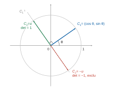
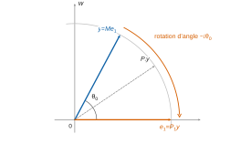
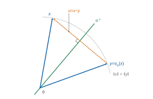

# Mines-Ponts MP — Maths 2 2026 · Corrigé guidé

*Corrigé rédigé par IA, non officiel. Signalez toute erreur.*

## Présentation du sujet

**Thème.** « Autour de $\mathrm{O}_n(\mathbb{R})$ et $\mathrm{SL}_n(\mathbb{R})$ » : le groupe orthogonal vu sous quatre angles, topologique, différentiel, puis à travers la classification des morphismes continus du cercle $\mathbb{U}$ dans $\mathrm{GL}_n(\mathbb{R})$.

Le problème part des rotations planes $R_\theta$ (question 1) et y revient (question 29). À conjugaison près, un morphisme continu de $\mathbb{U}$ dans $\mathrm{GL}_n(\mathbb{R})$ n'est fait que de rotations planes tournant à des vitesses entières.

**Format.** 4 heures, calculatrice et tout dispositif électronique interdits. 30 questions en quatre parties « largement indépendantes » (seules les notations et quelques résultats circulent).

**Découpage.**

| Partie | Questions | Contenu |
|---|---|---|
| I. Quelques propriétés de $\mathrm{O}_n(\mathbb{R})$ | 1–9 | diagonalisabilité de $R_\theta$, $\mathrm{SO}_2$, compacité et composantes connexes, sous-groupes intermédiaires, matrices aléatoires de Bernoulli, réflexions, maximalité de $\mathrm{O}_n(\mathbb{R})$ parmi les sous-groupes compacts |
| II. Calcul différentiel sur $\mathrm{O}_n(\mathbb{R})$ et $\mathrm{SL}_n(\mathbb{R})$ | 10–17 | différentielle de $M\mapsto M^\top M$, espace tangent en $I_n$, gradient du déterminant, optimisation sous la contrainte $\det=1$ |
| III. Morphismes continus de $\mathbb{U}$ dans $\mathrm{GL}_n(\mathbb{R})$ | 18–23 | sous-groupes bornés de $\mathbb{R}^*$, spectre, régularisation par intégration, $\Psi(x)=\exp(xM)$ |
| IV. Morphismes de $(\mathbb{R},+)$ dans $(\mathrm{GL}_n(\mathbb{R}),\times)$ | 24–30 | similitude réelle et complexe, nilpotents, sous-espaces caractéristiques, forme normale par blocs de rotation |

**Notions du programme mobilisées.** Algèbre : groupes et morphismes, réduction (diagonalisation, trigonalisation, sous-espaces caractéristiques), matrices orthogonales et réflexions, exponentielle de matrice. Topologie : compacité en dimension finie, connexité par arcs, ouverts et fermés par images réciproques, théorème des bornes atteintes. Calcul différentiel : différentielle, gradient, vecteurs tangents, théorème d'optimisation sous une contrainte. Analyse : théorème fondamental de l'analyse, dérivation d'un produit. Probabilités : indépendance, variables de Bernoulli.

**Difficulté.** Le rapport 2026 juge le sujet « assez long », mais fait de parties quasiment indépendantes, si bien que les dernières questions ont été abordées par un grand nombre de candidats. Les verrous : la question 4 (connexité de $\mathrm{SO}_n$, peu traitée), les questions 8–9 (l'astuce de la réflexion qui ramène $Gx$ sur la droite $\mathbb{R}x$, très peu traitées), la question 16 (application soignée du théorème sous contrainte) et la question 29 (synthèse de la partie IV).

**Ce que le jury a sanctionné en 2026.** D'après le rapport, les questions les plus discriminantes ont été :

- la question 1, souvent mal traitée faute de disjonction de cas sur $\theta$ ;
- les questions 4, 5 et 12 (cette dernière « très mal traitée ») ;
- les questions 8, 9 et 13, très peu traitées, et la seconde moitié de la question 21 ;
- la question 23, « relativement mal traitée » ;
- la question 29, où presque personne n'a justifié que $Q$ ne dépend pas de $x$.

Le jury signale aussi que l'usage du théorème d'optimisation sous contrainte sans vérification des hypothèses valait systématiquement 0, et qu'un malus de présentation figurait au barème.

**Questions à ne pas laisser passer.** 1, 2, 3, 5, 7, 10, 11, 14, 15, 20, 21, 24, 25, 26, 30 : ce sont des applications directes du cours, qui demandent seulement une rédaction complète. La question 20 est, selon le rapport, la plus facile du sujet.

**Gestion du temps.** Environ 8 minutes par question en moyenne. Les parties étant indépendantes, on peut commencer par II ou III si la partie I résiste ; la question 23 peut être admise pour traiter la partie IV, comme l'énoncé l'autorise.

**Conventions utilisées dans tout le corrigé.** $E=\mathbb{R}^n$, $n\ge2$, muni du produit scalaire canonique.

$\mathcal{M}_n(\mathbb{R})$ est muni de $\langle A,B\rangle=\operatorname{tr}(A^\top B)=\sum_{i,j}a_{ij}b_{ij}$ et de la norme associée $\|\cdot\|$, de sorte que $g(M)=\|M\|^2$ et $\|A^\top\|=\|A\|$.

Par Cauchy-Schwarz sur chaque coefficient, $\|AB\|\le\|A\|\,\|B\|$ et $\|AX\|\le\|A\|\,\|X\|$ pour $X\in\mathbb{C}^n$ (norme hermitienne canonique). On note $\mathcal{A}_n(\mathbb{R})$ l'ensemble des matrices antisymétriques.

## Partie I — Quelques propriétés de $\mathrm{O}_n(\mathbb{R})$

La partie établit les propriétés de base de $\mathrm{O}_n(\mathbb{R})$ (compact, deux « morceaux » séparés par le déterminant, $\mathrm{SO}_n$ connexe par arcs), fait une incursion probabiliste, puis montre que $\mathrm{O}_n(\mathbb{R})$ est un sous-groupe compact maximal de $\mathrm{GL}_n(\mathbb{R})$. Outils : polynôme caractéristique, compacité en dimension finie, valeurs intermédiaires, réflexions.

### Question 1

> [!INDICATION]
> Tout se lit sur le polynôme caractéristique, de degré 2 : calculer son discriminant.

> [!INDICATION]
> Discuter selon que $\sin\theta$ est nul ou non ; c'est le seul paramètre qui change la réponse.

#### Solution

$\chi_{R_\theta}=X^2-2\cos(\theta)X+1$, de discriminant $-4\sin^2\theta$.

- Si $\sin\theta=0$, c'est-à-dire $\theta\in\pi\mathbb{Z}$ : $R_\theta=\pm I_2$ est diagonale, donc diagonalisable sur $\mathbb{R}$ et sur $\mathbb{C}$.
- Si $\sin\theta\neq0$ : $\chi_{R_\theta}$ n'a aucune racine réelle, donc $R_\theta$ n'a aucune valeur propre réelle. Or une matrice diagonalisable sur $\mathbb{R}$ est semblable à une matrice diagonale réelle, dont les coefficients sont des valeurs propres réelles : $R_\theta$ n'est pas diagonalisable sur $\mathbb{R}$.

  Sur $\mathbb{C}$, les racines $e^{\pm i\theta}$ sont distinctes, car $e^{i\theta}-e^{-i\theta}=2i\sin\theta\neq0$. Une matrice d'ordre 2 à deux valeurs propres distinctes est diagonalisable : $R_\theta$ est semblable à $\operatorname{diag}(e^{i\theta},e^{-i\theta})$.

**$R_\theta$ est toujours diagonalisable sur $\mathbb{C}$, et diagonalisable sur $\mathbb{R}$ si et seulement si $\theta\in\pi\mathbb{Z}$ ($R_\theta=\pm I_2$).**

> [!PIEGE]
> Les erreurs relevées par le rapport 2026 : conclure que $R_\theta$ n'est pas diagonalisable sur $\mathbb{C}$ parce que ses racines sont complexes (confusion entre « complexes » et « non réelles ») ; croire que $\sin t=0$ seulement pour $t=0$ ; affirmer que $\pm I_2$ n'est pas diagonalisable faute de racines simples. Une racine double n'empêche pas d'être diagonalisable : $\pm I_2$ est déjà diagonale.

> [!JURY]
> Le rapport 2026 attend une disjonction de cas sur $\theta$ et, dans le cas non réel, la justification que les deux valeurs propres sont distinctes, que beaucoup ont omise. Il ajoute que « commencer le sujet par une question très mal traitée ne met pas le correcteur dans les meilleures dispositions pour la suite » (p. 64).

### Question 2

> [!INDICATION]
> Repartir de la définition : $M^\top M=I_2$ signifie que les colonnes forment une base orthonormée.

> [!INDICATION]
> Paramétrer la première colonne par un angle ; la seconde vit alors sur une droite, où seuls deux vecteurs sont unitaires.

#### Solution

*Inclusion $\supset$.* Le calcul direct donne $R_\theta^\top R_\theta=I_2$ (car $\cos^2+\sin^2=1$) et $\det R_\theta=1$.

*Inclusion $\subset$.* Soit $M\in\mathrm{SO}_2(\mathbb{R})$, de colonnes $C_1=(a,c)$ et $C_2=(b,d)$.

La relation $M^\top M=I_2$ signifie que $(C_1,C_2)$ est orthonormée.

Comme $a^2+c^2=1$, il existe $\theta$ avec $a=\cos\theta$ et $c=\sin\theta$.

Alors $C_2\in C_1^\perp=\mathbb{R}u$, avec $u=(-\sin\theta,\cos\theta)$ unitaire, et $C_2$ unitaire impose $C_2=\pm u$.

Le choix $C_2=-u$ donne $\det M=-\cos^2\theta-\sin^2\theta=-1$, exclu. Donc $C_2=u$ et $M=R_\theta$.

$$\boxed{\mathrm{SO}_2(\mathbb{R})=\{R_\theta,\ \theta\in\mathbb{R}\}}$$

> [!METHODE]
> Pour décrire un petit groupe de matrices, traduire la condition matricielle en conditions sur les colonnes, puis exploiter la géométrie (ici : une droite en dimension 2 ne contient que deux vecteurs unitaires).

> [!PIEGE]
> Prendre le même angle $\theta$ pour les deux colonnes, ou paramétrer chaque colonne par un angle puis obtenir « miraculeusement » la forme finale sans utiliser $\det M=1$ : deux erreurs fréquentes selon le rapport 2026. Citer le cours ne rapporte rien, l'énoncé l'interdit explicitement.

> [!JURY]
> Rapport 2026 (p. 64) : « Il fallait évidemment utiliser l'orthogonalité des colonnes et le fait que celles-ci étaient de norme 1 pour conclure. » Le jury préfère un raisonnement inachevé avoué à un « passage en force ».

### Question 3

> [!INDICATION]
> En dimension finie, compact équivaut à fermé et borné.

> [!INDICATION]
> Pour la non-connexité, regarder ce que fait le déterminant le long d'un éventuel chemin.

#### Solution

*Compacité.* $f:M\mapsto M^\top M$ est continue (coefficients polynomiaux) et $\mathrm{O}_n(\mathbb{R})=f^{-1}(\{I_n\})$ est fermé, image réciproque d'un fermé par une application continue. Pour $M$ orthogonale, $\|M\|^2=\operatorname{tr}(M^\top M)=n$, soit $\|M\|=\sqrt n$ : $\mathrm{O}_n(\mathbb{R})$ est borné.

Fermé, borné, dans un espace de dimension finie : **$\mathrm{O}_n(\mathbb{R})$ est compact**.

*Non-connexité par arcs.* Pour $M$ orthogonale, $(\det M)^2=\det(M^\top M)=1$, donc $\det M=\pm1$.

Les deux valeurs sont atteintes : $I_n$ et $S=\operatorname{diag}(-1,1,\dots,1)$ sont orthogonales, de déterminants $1$ et $-1$.

Supposons qu'un chemin continu $\gamma$ relie $I_n$ à $S$ dans $\mathrm{O}_n(\mathbb{R})$.

La fonction continue $\det\circ\gamma$, définie sur $[0,1]$ et à valeurs dans $\{-1,1\}$, vaudrait $1$ puis $-1$.

Par le théorème des valeurs intermédiaires, elle s'annulerait : absurde. **$\mathrm{O}_n(\mathbb{R})$ n'est pas connexe par arcs.**

> [!PIEGE]
> $\det(-I_n)=(-1)^n$, qui vaut $1$ pour $n$ pair : $-I_n$ ne convient pas comme matrice de déterminant $-1$, contrairement à ce qu'affirment beaucoup de copies selon le rapport 2026.
>
> De même, $\mathrm{O}_n(\mathbb{R})$ n'est pas l'image réciproque de $\{\pm1\}$ par le déterminant. Pour le caractère borné, préciser la norme et ne pas oublier la racine carrée.

> [!JURY]
> Le rapport 2026 (p. 64) rappelle que « tout résultat doit être justifié ». Dire que $\mathrm{O}_n(\mathbb{R})$ est borné sans préciser la norme ne rapportait rien. Pour la non-connexité, il fallait établir $\det M=\pm1$ et montrer que $1$ et $-1$ sont atteints. Le jury relève aussi « produit d'applications continues » écrit alors qu'il s'agit de composées.

### Question 4

> [!INDICATION]
> Il suffit de relier tout élément de $\mathrm{SO}_n(\mathbb{R})$ à $I_n$ par un chemin restant dans $\mathrm{SO}_n(\mathbb{R})$.

> [!INDICATION]
> Pour $n=2$, utiliser la question 2 et faire tendre l'angle vers 0. Pour $n\ge3$, raisonner par récurrence : une rotation dans un plan bien choisi ramène continûment $Me_1$ sur $e_1$.

> [!INDICATION]
> Une matrice orthogonale qui fixe $e_1$ stabilise aussi $e_1^\perp$ : elle est diagonale par blocs $1\times1$ et $(n-1)\times(n-1)$.

#### Solution

Si chaque $M\in\mathrm{SO}_n(\mathbb{R})$ est relié à $I_n$, deux éléments quelconques le sont entre eux en concaténant les chemins. Récurrence sur $n\ge2$.

*$n=2$.* $M=R_\theta$ (question 2) et $t\mapsto R_{(1-t)\theta}$ est un chemin continu de $M$ à $I_2$ dans $\mathrm{SO}_2(\mathbb{R})$.

*Hérédité ($n\ge3$).* Soit $M\in\mathrm{SO}_n(\mathbb{R})$ et $y=Me_1$, unitaire.

1. On choisit $w$ unitaire orthogonal à $e_1$ et $\theta_0\in[0,\pi]$ avec $y=\cos(\theta_0)e_1+\sin(\theta_0)w$.

   Si $y\neq\pm e_1$, $w$ est le normalisé de $y-\langle y,e_1\rangle e_1$ ; si $y=\pm e_1$, $\theta_0\in\{0,\pi\}$ et $w$ est quelconque.

   On complète $(e_1,w)$ en base orthonormée, de matrice de passage $U\in\mathrm{O}_n(\mathbb{R})$, et l'on pose, pour $t\in[0,1]$,
   $$P_t=U\begin{pmatrix}R_{-t\theta_0}&0\\0&I_{n-2}\end{pmatrix}U^{-1}\in\mathrm{SO}_n(\mathbb{R}).$$
   $t\mapsto P_t$ est continu, $P_0=I_n$ et $P_1y=e_1$.

   En effet, dans la base $(e_1,w,\dots)$, $y$ a pour coordonnées $(\cos\theta_0,\sin\theta_0,0,\dots)$ et $R_{-\theta_0}$ envoie $(\cos\theta_0,\sin\theta_0)$ sur $(1,0)$.

   Le chemin $t\mapsto P_tM$ relie $M$ à $M'=P_1M$, qui fixe $e_1$.
2. Pour $x\perp e_1$, $\langle M'x,e_1\rangle=\langle M'x,M'e_1\rangle=\langle x,e_1\rangle=0$. Donc $M'=\begin{pmatrix}1&0\\0&M''\end{pmatrix}$ avec $M''\in\mathrm{SO}_{n-1}(\mathbb{R})$.

   L'hypothèse de récurrence fournit un chemin $\Gamma$ de $M''$ à $I_{n-1}$ dans $\mathrm{SO}_{n-1}(\mathbb{R})$.

   Le chemin $t\mapsto\operatorname{diag}(1,\Gamma(t))$ relie alors $M'$ à $I_n$.

Par concaténation, **$\mathrm{SO}_n(\mathbb{R})$ est connexe par arcs**.

> [!METHODE]
> Autre voie, plus rapide si l'on cite le théorème de réduction des isométries en base orthonormée : $M=P\operatorname{diag}(R_{\theta_1},\dots,R_{\theta_q},1,\dots,1,-1,\dots,-1)P^\top$ avec $P$ orthogonale et un nombre pair de $-1$ (car $\det M=1$), que l'on regroupe en blocs $R_\pi$. On fait alors tendre tous les angles vers 0, à $P$ fixée.

> [!PIEGE]
> Le chemin doit rester dans $\mathrm{SO}_n(\mathbb{R})$, pas seulement dans $\mathrm{O}_n(\mathbb{R})$ : vérifier que chaque $P_t$ est de déterminant 1. Le cas $y=-e_1$ ne doit pas être oublié.

> [!JURY]
> Rapport 2026 (p. 65) : question peu traitée, car le théorème de réduction des isométries est mal connu. Quand il est cité, les candidats oublient de dire que la matrice de passage est orthogonale, ou prennent la même pour toutes les isométries. Le cas $n=2$ n'était qu'une suggestion : une preuve directe du cas général recevait tous les points.

### Question 5

> [!INDICATION]
> Distinguer selon que $H$ contient ou non une matrice de déterminant $-1$.

> [!INDICATION]
> Si $A\in H$ est de déterminant $-1$, toute matrice orthogonale $B$ de déterminant $-1$ s'écrit $A\times(\text{élément de }\mathrm{SO}_n)$.

#### Solution

Si $H\subset\mathrm{SO}_n(\mathbb{R})$, alors $H=\mathrm{SO}_n(\mathbb{R})$. Sinon, soit $A\in H$ avec $\det A=-1$, et $B\in\mathrm{O}_n(\mathbb{R})$.

- Si $\det B=1$, $B\in\mathrm{SO}_n(\mathbb{R})\subset H$.
- Si $\det B=-1$, $A^{-1}B$ est orthogonale de déterminant $1$, donc dans $H$, et $B=A(A^{-1}B)\in H$ ($H$ est stable par produit).

Ainsi $H=\mathrm{O}_n(\mathbb{R})$.

**$H=\mathrm{SO}_n(\mathbb{R})$ ou $H=\mathrm{O}_n(\mathbb{R})$.**

> [!METHODE]
> C'est l'argument des classes à gauche : $\mathrm{SO}_n(\mathbb{R})$ est d'indice 2 dans $\mathrm{O}_n(\mathbb{R})$ (noyau du morphisme surjectif $\det:\mathrm{O}_n(\mathbb{R})\to\{\pm1\}$), et la disjonction explicite suffit, sans théorie des quotients.

> [!PIEGE]
> Le rapport 2026 relève deux erreurs : croire que le complémentaire d'un sous-groupe est stable par la loi du groupe, et invoquer des cardinaux ou le théorème de Lagrange, alors que les groupes en jeu sont infinis.

### Question 6

> [!INDICATION]
> Les coefficients valent 0 ou 1 : traduire chaque condition matricielle en condition combinatoire.

> [!INDICATION]
> Pour $\mathrm{GL}_2$, écrire le déterminant comme différence de deux produits indépendants. Pour $\mathrm{O}_n$, chercher quelles matrices à coefficients dans $\{0,1\}$ ont des colonnes orthonormées.

> [!INDICATION]
> Le déterminant d'une matrice de permutation est la signature de la permutation.

#### Solution

*$\mathrm{GL}_2$.* $\det Z_2=U-V$ avec $U=Y_{1,1}Y_{2,2}$ et $V=Y_{1,2}Y_{2,1}$. Ces variables sont à valeurs dans $\{0,1\}$ et indépendantes, comme fonctions de familles disjointes de variables indépendantes ; par indépendance, $P(U=1)=P(V=1)=p^2$.

$Z_2$ est inversible si et seulement si $U\neq V$, d'où

$$\begin{aligned}P(Z_2\in\mathrm{GL}_2(\mathbb{R}))&=P(U=1)P(V=0)+P(U=0)P(V=1)\\&=2p^2(1-p^2).\end{aligned}$$

$$\boxed{P(Z_2\in\mathrm{GL}_2(\mathbb{R}))=2p^2(1-p^2).}$$

*$\mathrm{O}_n$.* Si $A$ est orthogonale à coefficients dans $\{0,1\}$, chaque colonne vérifie $\sum_ia_{ij}^2=\sum_ia_{ij}=1$, donc contient un unique $1$, en ligne $\sigma(j)$.

Deux colonnes distinctes étant orthogonales et les termes $a_{ij}a_{ij'}$ positifs, $\sigma(j)\neq\sigma(j')$.

Donc $\sigma\in\mathfrak{S}_n$ et $A=P_\sigma$ : la matrice a un unique $1$ par ligne et par colonne. Réciproquement, les matrices de permutation sont orthogonales. Les événements $\{Z_n=P_\sigma\}$ sont incompatibles, de probabilité $p^n(1-p)^{n^2-n}$ par indépendance des $n^2$ coefficients :

$$\boxed{P(Z_n\in\mathrm{O}_n(\mathbb{R}))=n!\,p^n(1-p)^{n^2-n}.}$$

*$\mathrm{SO}_n$.* $\det P_\sigma=\varepsilon(\sigma)$, donc $Z_n\in\mathrm{SO}_n(\mathbb{R})$ si et seulement si $Z_n=P_\sigma$ avec $\sigma$ paire.

Pour $n\ge2$, la signature est un morphisme surjectif de $\mathfrak{S}_n$ sur $\{\pm1\}$, de noyau $\mathfrak{A}_n$, donc $|\mathfrak{A}_n|=n!/2$ :

$$\boxed{P(Z_n\in\mathrm{SO}_n(\mathbb{R}))=\frac{n!}{2}\,p^n(1-p)^{n^2-n}.}$$

> [!PIEGE]
> Les 16 matrices de $\{0,1\}^{2\times2}$ ne sont équiprobables que si $p=1/2$ : compter les matrices inversibles et diviser par 16 est faux en général. Ne pas oublier non plus le facteur $(1-p)^{n^2-n}$ des coefficients nuls. Le rapport conseille un contrôle au brouillon en $p=0$ et $p=1$ : une probabilité négative ou supérieure à 1 doit alerter.

> [!JURY]
> Rapport 2026 (p. 65) : « le jury sanctionnait lorsque l'indépendance n'était pas citée ». Pour $\mathrm{SO}_n$, il « attendait bien sûr des arguments, et pas simplement de diviser la probabilité précédente par 2 ». Le jury veut des phrases d'explication et une expression finale simplifiée.

### Question 7

> [!INDICATION]
> La réflexion cherchée doit échanger $x$ et $y$ : son hyperplan est l'hyperplan médiateur de $x$ et $y$.

> [!INDICATION]
> Écrire la formule de la réflexion d'hyperplan $u^\perp$ et utiliser $\|x\|=\|y\|$ pour calculer $\langle x,u\rangle$. Traiter à part le cas $x=y$.

#### Solution

Pour $u\neq0$, la réflexion d'hyperplan $u^\perp$ est $s_u(v)=v-2\dfrac{\langle v,u\rangle}{\|u\|^2}u$.

- Si $x\neq y$, posons $u=x-y$. Grâce à $\|x\|=\|y\|$, $\|u\|^2=2\|x\|^2-2\langle x,y\rangle=2\langle x,u\rangle$, donc $s_u(x)=x-u=y$.

  Lecture géométrique : $\langle x+y,x-y\rangle=\|x\|^2-\|y\|^2=0$, donc $x+y\in u^\perp$ est fixe et $x-y$ est changé en son opposé. Ainsi $s_u(x)=\frac12(x+y)-\frac12(x-y)=y$.
- Si $x=y$ : comme $n\ge2$, il existe $u\neq0$ orthogonal à $x$, et $s_u(x)=x=y$.

**La matrice $A$ de $s_u$ dans la base canonique est une matrice de réflexion telle que $Ax=y$.**

> [!PIEGE]
> Le cas $x=y$ fait partie de la question, et c'est là que sert $n\ge2$. L'identité ne convient pas : ce n'est pas une réflexion (son déterminant vaut $1$). Le rapport 2026 relève cette erreur dans beaucoup de copies.

> [!JURY]
> Rapport 2026 (p. 65) : un dessin explicatif a été apprécié, sans dispenser de la preuve ; « il fallait évidemment justifier à l'aide de l'hypothèse sur les normes que $x-y$ et $x+y$ étaient orthogonaux ». Beaucoup de candidats ignoraient la définition d'une matrice de réflexion.

### Question 8

> [!INDICATION]
> Pour $p=1$, comparer les normes de $Gx$ et de $\|Gx\|\,x$, puis utiliser la question 7.

> [!INDICATION]
> La réflexion obtenue est dans $\mathcal{G}$, puisque $\mathrm{O}_n(\mathbb{R})\subset\mathcal{G}$ ; multiplier $G$ par elle.

> [!INDICATION]
> Pour $p$ quelconque, $x$ est vecteur propre de la matrice obtenue : passer aux puissances, positives et négatives.

#### Solution

Soit $\lambda=\|Gx\|>0$ ($G$ inversible, $x\neq0$).

Comme $\|\lambda x\|=\lambda=\|Gx\|$, la question 7 donne une réflexion $A$ avec $A(Gx)=\lambda x$.

Or $A\in\mathrm{O}_n(\mathbb{R})\subset\mathcal{G}$, donc $G_1=AG\in\mathcal{G}$ et $G_1x=\lambda x$.

Pour $p\in\mathbb{Z}$, $G_p=G_1^{\,p}\in\mathcal{G}$ (groupe). Par récurrence $G_1^{\,p}x=\lambda^px$ pour $p\ge0$.

De plus $G_1^{-1}x=\lambda^{-1}x$ (car $\lambda\neq0$), d'où $G_1^{-p}x=\lambda^{-p}x$. Donc

$$\boxed{\forall p\in\mathbb{Z},\ G_p\in\mathcal{G}\ \text{ et }\ G_px=\|Gx\|^p\,x.}$$

> [!METHODE]
> Pour exploiter qu'un groupe contient $\mathrm{O}_n(\mathbb{R})$, on « corrige » un élément par une isométrie bien choisie afin de le rendre plus simple sur un vecteur donné (ici, $x$ devient vecteur propre).

### Question 9

> [!INDICATION]
> Un compact est borné ; que dit la question 8 si $\|Gx\|\neq1$ ?

> [!INDICATION]
> Une fois $\|Gv\|=\|v\|$ établi pour tout $v$, il reste à passer de la conservation de la norme à $G^\top G=I_n$.

#### Solution

Soit $C$ avec $\|H\|\le C$ pour tout $H\in\mathcal{G}$ (compact donc borné).

Soient $G\in\mathcal{G}$, $x$ unitaire et $\lambda=\|Gx\|$. Pour tout $p\in\mathbb{Z}$,

$$\begin{aligned}\lambda^p&=\|G_px\|\\&\le\|G_p\|\le C.\end{aligned}$$

Si $\lambda>1$ (resp. $\lambda<1$), $\lambda^p\to+\infty$ quand $p\to+\infty$ (resp.

$-\infty$) : contradiction.

Donc $\|Gx\|=1$ pour tout $x$ unitaire, puis $\|Gv\|=\|v\|$ pour tout $v$ par homogénéité.

Par polarisation, $\langle Ga,Gb\rangle=\langle a,b\rangle$, soit $\langle(G^\top G-I_n)a,b\rangle=0$ pour tous $a,b$. Avec $b=(G^\top G-I_n)a$, on obtient $G^\top G=I_n$. Ainsi $\mathcal{G}\subset\mathrm{O}_n(\mathbb{R})$ et

$$\boxed{\mathcal{G}=\mathrm{O}_n(\mathbb{R}).}$$

> [!PIEGE]
> Avec seulement $p\ge0$, on n'obtient que $\|Gx\|\le1$ : ce sont les exposants négatifs qui donnent l'autre inégalité.

> [!JURY]
> Le rapport 2026 classe les questions 8 et 9 parmi les questions très peu traitées (p. 65). Elles se traitent pourtant en quelques lignes une fois l'idée de la question 7 réemployée : c'est un gain net pour qui les aborde. La compacité n'intervient que par la bornitude, et une rédaction claire le dit.

## Partie II — Calcul différentiel sur $\mathrm{O}_n(\mathbb{R})$ et $\mathrm{SL}_n(\mathbb{R})$

On calcule l'espace tangent à $\mathrm{O}_n(\mathbb{R})$ en $I_n$ (les matrices antisymétriques), puis on minimise la norme euclidienne sur $\mathrm{SL}_n(\mathbb{R})$ : le minimum est atteint exactement sur $\mathrm{SO}_n(\mathbb{R})$. Outils : différentielle, dérivation le long d'un arc, exponentielle, gradient, théorème d'optimisation sous une contrainte, compacité.

### Question 10

> [!INDICATION]
> Développer $f(M+H)$ et isoler la partie linéaire en $H$.

> [!INDICATION]
> Majorer le reste par la sous-multiplicativité de la norme ; pour le caractère $\mathcal{C}^1$, examiner les coordonnées de $f$.

#### Solution

*Classe $\mathcal{C}^1$.* Les coordonnées de $f$ sont $f(M)_{ij}=\sum_k m_{ki}m_{kj}$, polynomiales en les coefficients de $M$. Leurs dérivées partielles existent et sont continues : **$f$ est de classe $\mathcal{C}^1$**.

*Différentielle.* On a $f(M+H)=f(M)+M^\top H+H^\top M+H^\top H$. L'application $H\mapsto M^\top H+H^\top M$ est linéaire (linéarité de la transposition, bilinéarité du produit). Pour la norme choisie, sous-multiplicative et telle que $\|H^\top\|=\|H\|$, le reste vérifie $\|H^\top H\|\le\|H\|^2=o(\|H\|)$. Donc

$$\boxed{\mathrm{d}f(M)\cdot H=M^\top H+H^\top M.}$$

> [!METHODE]
> Une application de la forme $B(M,M)$ avec $B$ bilinéaire en dimension finie est $\mathcal{C}^1$, de différentielle $H\mapsto B(H,M)+B(M,H)$.

> [!PIEGE]
> « $f$ est un produit de fonctions $C^1$ », « $f$ est $C^1$ par théorèmes généraux », ou affirmer que $f$ est linéaire : formules relevées par le rapport 2026, qui ne rapportaient aucun point. Une matrice et sa transposée n'ont pas la même norme pour toute norme : il faut nommer la norme utilisée.

> [!JURY]
> Rapport 2026 (p. 65) : « Dire que $f$ était polynomiale en les coefficients était insuffisant, il fallait préciser que toutes les coordonnées de $f$ l'étaient. » Il fallait aussi vérifier la linéarité de la différentielle et justifier que $H^\top H$ est négligeable devant $H$ : « on pouvait prendre une norme sous-multiplicative et le résultat devenait alors assez simple à prouver » (p. 65-66).

### Question 11

> [!INDICATION]
> Composer $f$ avec l'arc $\gamma$ : on obtient une fonction constante.

> [!INDICATION]
> Dériver en 0 par la règle de dérivation le long d'un arc ($\gamma$ n'est supposé dérivable qu'en 0).

#### Solution

$f\circ\gamma=I_n$ sur $]-\varepsilon,\varepsilon[$. $f$ étant différentiable en $I_n$ et $\gamma$ dérivable en 0,

$$\begin{aligned}0&=(f\circ\gamma)'(0)\\&=\mathrm{d}f(I_n)\cdot\gamma'(0)\\&=H+H^\top.\end{aligned}$$

**Donc $T\subset\mathcal{A}_n(\mathbb{R})$.**

> [!PIEGE]
> L'arc n'est dérivable qu'en 0 : la règle de dérivation le long d'un arc ne demande que cela, alors qu'une dérivation « pour tout $t$ » de $\gamma(t)^\top\gamma(t)$ ne serait pas justifiée.

> [!JURY]
> Rapport 2026 (p. 66) : le résultat du cours sur l'espace tangent à une ligne de niveau, vu comme noyau de la différentielle, ne vaut que pour une fonction numérique ; l'invoquer ici pour conclure directement ne rapportait aucun point. Les copies qui passaient par la différentielle de $f$ ou par la dérivée le long d'un arc ont en revanche souvent bien traité la question.

### Question 12

> [!INDICATION]
> $\mathrm{O}_n(\mathbb{R})$ est un groupe : le produit de deux arcs tracés sur $\mathrm{O}_n(\mathbb{R})$ en est encore un.

> [!INDICATION]
> Pour les scalaires, reparamétrer l'arc. Ne pas oublier le vecteur nul.

#### Solution

*Somme.* Pour $H,K\in T$ d'arcs $\gamma_H,\gamma_K$, l'arc $\gamma=\gamma_H\gamma_K$ (sur le plus petit des deux intervalles) est à valeurs dans $\mathrm{O}_n(\mathbb{R})$ et vaut $I_n$ en 0.

La dérivation d'un produit bilinéaire donne $\gamma'(0)=H\,I_n+I_n\,K=H+K$. **Donc $H+K\in T$.**

*Espace vectoriel.* L'arc constant $I_n$ montre $0\in T$.

Pour $\lambda\neq0$, $t\mapsto\gamma_H(\lambda t)$, défini sur $]-\varepsilon/|\lambda|,\varepsilon/|\lambda|[$, a pour vitesse initiale $\lambda H$.

**$T$ est un sous-espace vectoriel de $\mathcal{M}_n(\mathbb{R})$.**

> [!PIEGE]
> L'arc $\gamma_1+\gamma_2$ (ou $\lambda\gamma_1$) n'est pas à valeurs dans $\mathrm{O}_n(\mathbb{R})$ : le rapport 2026 dit avoir vu beaucoup de ces sommes d'arcs, qui a vu aussi affirmer que $\mathrm{O}_n(\mathbb{R})$ est stable par somme. Et $I_n\notin T$ : les éléments de $T$ sont antisymétriques (question 11).

> [!JURY]
> Rapport 2026 (p. 66) : question « très mal traitée ». Le jury précise qu'« utiliser la question 13 pour répondre à la question 12 ne rapportait aucun point », et qu'« oublier de prouver que la matrice nulle était dans l'ensemble était sanctionné ».

### Question 13

> [!INDICATION]
> On sait déjà $T\subset\mathcal{A}_n(\mathbb{R})$ ; pour l'inclusion réciproque, il faut un arc explicite d'origine $I_n$ et de vitesse $H$.

> [!INDICATION]
> Penser à $t\mapsto\exp(tH)$ et calculer sa transposée.

#### Solution

Pour $H$ antisymétrique, $\gamma(t)=\exp(tH)$ vérifie $\gamma(t)^\top=\exp(tH^\top)=\exp(-tH)$, par continuité de la transposition.

Comme $tH$ et $-tH$ commutent, $\gamma(t)^\top\gamma(t)=\exp(0)=I_n$. De plus $\gamma(0)=I_n$ et

$$\Big\|\frac{\gamma(t)-I_n}{t}-H\Big\|\le\frac{e^{|t|\|H\|}-1-|t|\|H\|}{|t|}\xrightarrow[t\to0]{}0,$$

donc $\gamma'(0)=H$. Avec la question 11 :

$$\boxed{T=\mathcal{A}_n(\mathbb{R}).}$$

> [!METHODE]
> L'exponentielle fournit des arcs naturels sur les groupes de matrices : $\exp(tH)$ est orthogonale dès que $H$ est antisymétrique, de déterminant $e^{t\operatorname{tr}H}$ en général.

> [!JURY]
> Rapport 2026 (p. 66) : question très peu traitée, plutôt bien quand elle l'était. Il fallait prouver que l'exponentielle d'une antisymétrique est orthogonale, en précisant que $H$ et $H^\top=-H$ commutent pour écrire le produit des exponentielles comme exponentielle de la somme.

### Question 14

> [!INDICATION]
> Pour nier l'existence d'un maximum, il suffit de montrer que $g$ n'est pas majorée sur $\mathrm{SL}_n(\mathbb{R})$.

> [!INDICATION]
> Chercher une famille de matrices diagonales de déterminant 1 et de norme arbitrairement grande.

#### Solution

Pour $t>0$, $D_t=\operatorname{diag}(t,1/t,1,\dots,1)\in\mathrm{SL}_n(\mathbb{R})$ et

$$g(D_t)=t^2+t^{-2}+n-2\xrightarrow[t\to+\infty]{}+\infty.$$

**$g$ n'est pas majorée sur $\mathrm{SL}_n(\mathbb{R})$, donc n'y a pas de maximum global.**

> [!PIEGE]
> $n$ est fixé dans cette question : faire tendre la taille vers l'infini (par exemple avec $g(I_n)=n$) ne prouve rien, comme le rappelle le rapport 2026. Le contre-exemple doit être de taille $n$ et de déterminant exactement 1.

### Question 15

> [!INDICATION]
> Les deux applications sont polynomiales en les coefficients.

> [!INDICATION]
> Pour $g$, développer $g(M+H)$. Pour $\det$, calculer la dérivée partielle par rapport à $m_{ij}$ à l'aide d'un développement selon la ligne $i$.

#### Solution

$g(M)=\sum_{i,j}m_{ij}^2$ et $\det M$ (formule de Leibniz) sont polynomiales en les coefficients de $M$, donc $\mathcal{C}^1$.

On a $g(M+H)=g(M)+2\langle M,H\rangle+\|H\|^2$, d'où $\boxed{\nabla g(M)=2M}$.

Notons $\Delta_{ik}(M)$ le mineur d'indice $(i,k)$, déterminant de la matrice extraite en supprimant la ligne $i$ et la colonne $k$.

Le cofacteur est $\operatorname{Com}(M)_{ik}=(-1)^{i+k}\Delta_{ik}(M)$.

En développant selon la ligne $i$, $\det M=\sum_km_{ik}\operatorname{Com}(M)_{ik}$, et les cofacteurs $\operatorname{Com}(M)_{ik}$ ne contiennent aucun coefficient de la ligne $i$.

Donc $\dfrac{\partial\det}{\partial m_{ij}}(M)=\operatorname{Com}(M)_{ij}$, et

$$\begin{aligned}\mathrm{d}\det(M)\cdot H&=\sum_{i,j}\operatorname{Com}(M)_{ij}h_{ij}\\&=\langle\operatorname{Com}(M),H\rangle.\end{aligned}$$

$$\boxed{\nabla\det(M)=\operatorname{Com}(M).}$$

> [!PIEGE]
> Dériver le développement selon la ligne $i$ par rapport à $m_{ij}$ n'est licite que parce que les cofacteurs de cette ligne ne dépendent pas de $m_{ij}$ : il faut le dire. Un gradient se définit relativement à un produit scalaire, qu'il faut préciser. Et le cofacteur n'est pas le mineur : il porte le signe $(-1)^{i+k}$.

> [!JURY]
> Rapport 2026 (p. 66) : dire que $g$ et $\det$ « étaient polynomiales (ou linéaires !) ne rapportait évidemment aucun point » ; il fallait dire « polynomiales en les coefficients ». Le résultat étant donné, le jury a été vigilant sur les tentatives d'arnaque. « Beaucoup de candidats ne comprennent pas la différence entre mineur et cofacteur. »

### Question 16

> [!INDICATION]
> $\mathrm{SL}_n(\mathbb{R})$ est l'ensemble des zéros d'une fonction $\mathcal{C}^1$ : c'est le cadre du théorème d'optimisation sous une contrainte. Vérifier toutes ses hypothèses.

> [!INDICATION]
> Pour $M$ inversible, relier $\operatorname{Com}(M)$ à $M^{-1}$, puis transformer $M=\lambda\operatorname{Com}(M)$ en une relation sur $M^\top M$.

> [!INDICATION]
> La trace et le déterminant de cette relation fixent $\lambda$ ; attention au signe.

#### Solution

$h=\det-1$ et $g$ sont $\mathcal{C}^1$ sur l'ouvert $\mathcal{M}_n(\mathbb{R})$, et $\mathrm{SL}_n(\mathbb{R})=h^{-1}(\{0\})$.

En un extremum local $M$ de $g_{|\mathrm{SL}_n(\mathbb{R})}$, la relation $M\operatorname{Com}(M)^\top=I_n$ donne $\operatorname{Com}(M)=(M^{-1})^\top\neq0$, donc $\mathrm{d}h(M)\neq0$.

Les hypothèses sont réunies : le théorème d'optimisation sous une contrainte donne $\mu\in\mathbb{R}$ tel que $2M=\mu\operatorname{Com}(M)$. Avec $\lambda=\mu/2$ :

$$\boxed{M=\lambda\operatorname{Com}(M),\ \lambda\in\mathbb{R}.}$$

Alors $M^\top=\lambda M^{-1}$, donc $M^\top M=\lambda I_n$.

- Trace : $n\lambda=\|M\|^2>0$, donc $\lambda>0$.
- Déterminant : $\det(\lambda I_n)=\lambda^n=(\det M)^2=1$.

Donc $\lambda=1$, $M^\top M=I_n$, et avec $\det M=1$ : **$M\in\mathrm{SO}_n(\mathbb{R})$**.

> [!PIEGE]
> $\lambda^n=1$ ne donne $\lambda=1$ que si l'on sait $\lambda>0$ : pour $n$ pair, $\lambda=-1$ n'est exclu que par l'argument de trace.
>
> Et $\det(\lambda I_n)=\lambda^n$, non $\lambda$ : le rapport 2026 indique que cette erreur a été très fortement pénalisée.

> [!JURY]
> Rapport 2026 (p. 66) : le théorème d'optimisation sous contrainte a souvent été cité, « mais il fallait évidemment citer les hypothèses (et en particulier le fait que le gradient doit être non nul) ! ». Les conseils généraux sont plus sévères encore (p. 9-10) : son usage sans vérifier les hypothèses était « systématiquement sanctionné de la note 0 ».

> [!METHODE]
> Variante sans le théorème sous contrainte : pour $H$ fixé, l'arc $\gamma(t)=\det(M+tH)^{-1/n}(M+tH)$ est tracé dans $\mathrm{SL}_n(\mathbb{R})$. La nullité de $(g\circ\gamma)'(0)$ pour tout $H$ donne directement $M=\frac{g(M)}{n}\operatorname{Com}(M)$.

### Question 17

> [!INDICATION]
> $\mathrm{SL}_n(\mathbb{R})$ n'est pas borné : se restreindre à une partie compacte où le minimum doit se trouver.

> [!INDICATION]
> Considérer les éléments de $\mathrm{SL}_n(\mathbb{R})$ où $g$ est inférieure à $g(I_n)$. Puis utiliser la question 16.

#### Solution

Soit $K=\{M\in\mathrm{SL}_n(\mathbb{R}),\ g(M)\le n\}=\det^{-1}(\{1\})\cap g^{-1}(]-\infty,n])$. $K$ est fermé, intersection d'images réciproques de fermés par les applications continues $\det$ et $g$. Il est borné ($\|M\|^2\le n$) et non vide ($I_n\in K$), donc compact (dimension finie).

$g$ continue y atteint un minimum en $M_0$, avec $g(M_0)\le n<g(M)$ pour $M\in\mathrm{SL}_n(\mathbb{R})\setminus K$ : c'est un **minimum global** sur $\mathrm{SL}_n(\mathbb{R})$.

Tout point de minimum global est un extremum local, donc appartient à $\mathrm{SO}_n(\mathbb{R})$ (question 16), où $g=\operatorname{tr}(I_n)=n$. Réciproquement $g=n$ sur tout $\mathrm{SO}_n(\mathbb{R})$.

$$\boxed{\min_{\mathrm{SL}_n(\mathbb{R})}g=n,\ \text{atteint exactement sur }\mathrm{SO}_n(\mathbb{R}).}$$

> [!PIEGE]
> Un minimum sur $K$ n'est un minimum global que si l'on compare avec les points hors de $K$. L'ensemble des points de minimum est tout $\mathrm{SO}_n(\mathbb{R})$, pas seulement $I_n$. Et « $g$ est minorée par 0 donc admet un minimum global » est une absurdité relevée par le rapport 2026.

> [!JURY]
> Rapport 2026 (p. 66) : la fermeture de $\mathrm{SL}_n(\mathbb{R})$ doit être prouvée, « il ne suffisait pas de l'affirmer doctement ». L'inégalité arithmético-géométrique était admise comme autre voie, à condition de la redémontrer.

## Partie III — Morphismes continus de $\mathbb{U}$ dans $\mathrm{GL}_n(\mathbb{R})$

On montre qu'un morphisme continu $\varphi$ de $\mathbb{U}$ dans $\mathrm{GL}_n(\mathbb{R})$ est à valeurs dans $\mathrm{SL}_n(\mathbb{R})$, à spectre dans $\mathbb{U}$, puis qu'il s'écrit $\varphi(e^{ix})=\exp(xM)$.

L'idée clé est une régularisation : une fonction continue vérifiant l'équation fonctionnelle des exponentielles s'exprime à l'aide de ses intégrales, donc est $\mathcal{C}^1$.

### Question 18

> [!INDICATION]
> Dans un sous-groupe borné, les puissances (positives et négatives) d'un élément restent bornées.

> [!INDICATION]
> Pour la conséquence, regarder $\det\circ\varphi$ : son image est un sous-groupe compact de $\mathbb{R}^*$. Que manque-t-il pour exclure $-1$ ?

#### Solution

Si $H$ est un sous-groupe borné de $\mathbb{R}^*$ et $x\in H$, les $|x|^k$, $k\in\mathbb{Z}$, sont bornés.

Si $|x|>1$, $|x|^k\to+\infty$ en $+\infty$ ; si $|x|<1$, en $-\infty$.

Donc $|x|=1$ et $H\subset\{-1,1\}$ ; comme $1\in H$, **les sous-groupes bornés de $\mathbb{R}^*$ sont $\{1\}$ et $\{-1,1\}$**.

$\delta=\det\circ\varphi$ est un morphisme continu de $\mathbb{U}$ dans $\mathbb{R}^*$. Son image est un sous-groupe de $\mathbb{R}^*$, compact comme image continue du compact $\mathbb{U}$, donc borné : $\delta(\mathbb{U})\subset\{-1,1\}$.

Comme $\mathbb{U}$ est connexe par arcs (image de $\mathbb{R}$ par $t\mapsto e^{it}$), $\delta(\mathbb{U})$ est un intervalle de $\mathbb{R}$.

Il contient $\delta(1)=1$ et est inclus dans $\{-1,1\}$, donc égal à $\{1\}$ :

$$\boxed{\varphi(\mathbb{U})\subset\mathrm{SL}_n(\mathbb{R}).}$$

> [!PIEGE]
> La bornitude seule ne donne que $\det\varphi(z)=\pm1$. Il faut un argument supplémentaire : la connexité, ou bien le fait que tout $z\in\mathbb{U}$ est un carré $w^2$, d'où $\delta(z)=\delta(w)^2=1$.
>
> Le rapport 2026 relève des réponses absurdes à la première partie ($\mathbb{R}_+^*$, $\mathbb{N}$, $\mathbb{Z}$).

> [!JURY]
> Rapport 2026 (p. 66) : « il fallait utiliser la compacité de $\mathbf{U}$ pour pouvoir affirmer que son image était bornée (et ne pas se contenter de dire que $\mathbf{U}$ était borné donc son image aussi) et sa connexité par arcs pour exclure le cas $\{\pm1\}$ ».

### Question 19

> [!INDICATION]
> $\varphi(\mathbb{U})$ est borné, et contient toutes les puissances entières de $\varphi(z)$.

> [!INDICATION]
> Faire agir $\varphi(z)^k$ sur un vecteur propre complexe et majorer.

#### Solution

$\varphi(\mathbb{U})$ est compact donc borné par un $C$. Soit $X\in\mathbb{C}^n\setminus\{0\}$ avec $\varphi(z)X=\lambda X$. Pour $k\in\mathbb{Z}$, $\varphi(z)^k=\varphi(z^k)$, donc

$$\begin{aligned}|\lambda|^k\|X\|&=\|\varphi(z^k)X\|\\&\le C\|X\|.\end{aligned}$$

Donc $|\lambda|^k\le C$ pour tout $k\in\mathbb{Z}$, ce qui impose $|\lambda|=1$ :

$$\boxed{\mathrm{Sp}_{\mathbb{C}}(\varphi(z))\subset\mathbb{U}.}$$

> [!METHODE]
> Même mécanisme qu'à la question 9 : dans un groupe borné, les puissances positives et négatives encadrent tout facteur de dilatation.

> [!PIEGE]
> Passer par le déterminant ne suffit pas : $\det\varphi(z)=1$ (question 18) dit que le produit des valeurs propres vaut 1, pas que chacune est de module 1, erreur fréquente selon le rapport 2026. Et un déterminant ne se calcule pas sur un vecteur colonne.

### Question 20

> [!INDICATION]
> $x\mapsto e^{ix}$ est un morphisme de $(\mathbb{R},+)$ dans $(\mathbb{U},\times)$.

#### Solution

Comme $\varphi$ est un morphisme et $e^{i(x+y)}=e^{ix}e^{iy}$,

$$\begin{aligned}\Psi(x+y)&=\varphi(e^{ix}e^{iy})\\&=\varphi(e^{ix})\varphi(e^{iy})\\&=\Psi(x)\Psi(y).\end{aligned}$$

On retient aussi : $\Psi$ est continue, $\Psi(0)=I_n$, et $\Psi$ est $2\pi$-périodique.

> [!JURY]
> Rapport 2026 (p. 67) : « Cette question était la plus facile du sujet », traitée correctement par la quasi-totalité des candidats. La laisser passer coûte cher.

### Question 21

> [!INDICATION]
> Théorème fondamental de l'analyse pour la régularité ; pour l'inversibilité, comparer $F(x)$ à $xI_n$ près de 0.

> [!INDICATION]
> Étudier la limite de $F(x)/x$ quand $x\to0$ et utiliser que $\mathrm{GL}_n(\mathbb{R})$ est un ouvert contenant cette limite.

#### Solution

$\Psi$ étant continue, $F$ est une primitive de $\Psi$ (théorème fondamental de l'analyse) : dérivable de dérivée $\Psi$ continue, **$F$ est $\mathcal{C}^1$**.

Comme $F(0)=0$ et $F'(0)=I_n$, $F(x)/x\to I_n$.

$\mathrm{GL}_n(\mathbb{R})=\det^{-1}(\mathbb{R}^*)$ est ouvert (image réciproque d'un ouvert par une application continue) et contient $I_n$.

Il contient donc une boule $B(I_n,r)$, et il existe $\alpha>0$ tel que $F(x)/x\in B(I_n,r)$ pour $0<|x|\le\alpha$.

Alors $F(x)=x\cdot(F(x)/x)$ est inversible pour $x\in[-\alpha,\alpha]\setminus\{0\}$.

> [!PIEGE]
> Le théorème de dérivation sous le signe intégral n'a rien à faire ici : la variable est une borne de l'intégrale, pas un paramètre de l'intégrande. Le rapport 2026 signale cette erreur chez beaucoup de candidats.

> [!JURY]
> Rapport 2026 (p. 67) : il ne fallait pas oublier de justifier le caractère $\mathcal{C}^1$ de $F$, par le théorème fondamental de l'analyse ou en disant que $F$ est une primitive de $\Psi$ continue. « Le reste de la question a été très peu traité » : l'inversibilité de $F(x)$ près de 0 est discriminante. L'énoncé demande en outre de justifier l'ouverture de $\mathrm{GL}_n(\mathbb{R})$.

### Question 22

> [!INDICATION]
> Translater la variable d'intégration et utiliser l'équation fonctionnelle de la question 20.

> [!INDICATION]
> Pour la régularité, exprimer l'intégrale à l'aide de $F$.

#### Solution

Par le changement de variable $t=x+u$ et la question 20,

$$\begin{aligned}\int_x^{x+\alpha}\Psi(t)\,\mathrm{d}t&=\int_0^\alpha\Psi(x)\Psi(u)\,\mathrm{d}u\\&=\Psi(x)F(\alpha),\end{aligned}$$

$\Psi(x)$ sortant de l'intégrale, à gauche, par linéarité de $A\mapsto\Psi(x)A$. $F(\alpha)$ étant inversible :

$$\begin{aligned}\Psi(x)&=\Big(\int_x^{x+\alpha}\Psi(t)\,\mathrm{d}t\Big)F(\alpha)^{-1}\\&=\big(F(x+\alpha)-F(x)\big)F(\alpha)^{-1}.\end{aligned}$$

$$\boxed{\Psi(x)=\Big(\int_x^{x+\alpha}\Psi(t)\,\mathrm{d}t\Big)F(\alpha)^{-1}}$$

Le membre de droite est $\mathcal{C}^1$ : **$\Psi$ est de classe $\mathcal{C}^1$**.

> [!PIEGE]
> Le produit matriciel n'est pas commutatif : c'est bien $\Psi(x)F(\alpha)$, et la multiplication par $F(\alpha)^{-1}$ se fait à droite. Le rapport 2026 indique que le jury a pénalisé les copies qui faisaient commuter $\Psi(x)$ et $\Psi(t)$ sans justification.

> [!METHODE]
> Technique de régularisation classique : une solution continue d'une équation fonctionnelle de type morphisme s'écrit comme intégrale d'elle-même, donc gagne une classe de régularité (et, par récurrence, devient $\mathcal{C}^\infty$).

### Question 23

> [!INDICATION]
> Dériver $h\mapsto\Psi(x+h)=\Psi(x)\Psi(h)$ en $h=0$ : on obtient une équation différentielle linéaire.

> [!INDICATION]
> Montrer que $x\mapsto\Psi(x)\exp(-xM)$ a une dérivée nulle.

#### Solution

En dérivant en $h=0$, $\Psi'(x)=\Psi(x)M$. Comme $x\mapsto\exp(-xM)$ est dérivable de dérivée $-M\exp(-xM)=-\exp(-xM)M$, la fonction $V(x)=\Psi(x)\exp(-xM)$ vérifie

$$V'(x)=\Psi(x)M\exp(-xM)-\Psi(x)M\exp(-xM)=0.$$

$V$ est constante sur l'intervalle $\mathbb{R}$, égale à $V(0)=I_n$, d'où

$$\boxed{\forall x\in\mathbb{R},\ \Psi(x)=\varphi(e^{ix})=\exp(xM).}$$

> [!METHODE]
> Alternative : $\Psi$ est solution du système linéaire $Y'=YM$, $Y(0)=I_n$, et l'on conclut par l'unicité du théorème de Cauchy linéaire, à condition d'expliciter le système et la condition initiale.

> [!JURY]
> Rapport 2026 (p. 67) : question « relativement mal traitée ». Les candidats obtenaient une équation différentielle, pas toujours la bonne, puis donnaient la réponse sans argument. Il faut vérifier que $\exp(xM)$ est solution et prouver l'unicité, par un facteur intégrant ou par le théorème de Cauchy.

## Partie IV — Morphismes de $(\mathbb{R},+)$ dans $(\mathrm{GL}_n(\mathbb{R}),\times)$

On réduit $M=\Psi'(0)$ : $\exp(2\pi M)=I_n$ force $M$ à être diagonalisable sur $\mathbb{C}$ à valeurs propres dans $i\mathbb{Z}$, puis un retour au réel donne la forme normale par blocs de rotation. Outils : similitude réelle et complexe, nilpotents, sous-espaces caractéristiques, exponentielle de matrices qui commutent.

### Question 24

> [!INDICATION]
> Écrire la matrice de passage complexe $P=P_1+iP_2$ et séparer parties réelle et imaginaire dans $AP=PB$.

> [!INDICATION]
> Toutes les matrices $P_1+tP_2$, $t$ réel, entrelacent $A$ et $B$ ; il reste à en trouver une inversible, en regardant un polynôme en $t$.

#### Solution

$AP=PB$ avec $P=P_1+iP_2$ et $A,B$ réelles donne $AP_1=P_1B$ et $AP_2=P_2B$.

Donc $A(P_1+tP_2)=(P_1+tP_2)B$ pour tout réel $t$.

Le polynôme réel $\chi(X)=\det(P_1+XP_2)$ vérifie $\chi(i)=\det P\neq0$ : il n'est pas nul, donc n'a qu'un nombre fini de racines.

Il existe $t_0\in\mathbb{R}$ avec $Q=P_1+t_0P_2\in\mathrm{GL}_n(\mathbb{R})$, et $B=Q^{-1}AQ$.

**$A$ et $B$ sont semblables dans $\mathcal{M}_n(\mathbb{R})$.**

> [!PIEGE]
> $\det(P_1+iP_2)\neq0$ n'entraîne pas que $P_1$ ou $P_2$ soit inversible : avec $P_1=\operatorname{diag}(1,0)$ et $P_2=\operatorname{diag}(0,1)$, les deux sont singulières alors que $P_1+iP_2$ est inversible.

> [!JURY]
> Rapport 2026 (p. 67) : exercice classique souvent bien traité, mais beaucoup ont affirmé que des matrices réelles ont forcément une matrice de passage réelle. « Pour justifier qu'une fonction polynomiale admet une valeur réelle non nulle, il fallait dire qu'elle était non nulle en $i$ donc n'admet qu'un nombre fini de racines. »

### Question 25

> [!INDICATION]
> Raisonner par l'absurde : si $\ker N=\ker N^2$, que deviennent les noyaux des puissances suivantes ?

> [!INDICATION]
> Montrer par récurrence que la suite des noyaux stationne, puis utiliser la nilpotence.

#### Solution

$\ker N\subset\ker N^2$ toujours.

Si $\ker N=\ker N^2$, alors $\ker N^k=\ker N$ pour tout $k\ge1$ par récurrence : si $N^{k+1}x=0$, $Nx\in\ker N^k=\ker N$, donc $x\in\ker N^2=\ker N$.

Avec $N^p=0$, on obtient $\ker N=\mathbb{C}^n$, soit $N=0$ : contradiction. **Donc $\ker N\neq\ker N^2$.**

> [!JURY]
> Rapport 2026 (p. 67) : beaucoup de copies se sont contentées d'exhiber une matrice nilpotente $2\times2$ ou $3\times3$. « Le jury rappelle avec force qu'un exemple ne prouve rien ! » Toute propriété de la suite des noyaux invoquée doit être démontrée.

### Question 26

> [!INDICATION]
> Utiliser la question 23 en $x=2\pi$.

> [!INDICATION]
> Faire agir $\exp(2\pi M)$ sur un vecteur propre de $M$, puis séparer module et argument de $e^{2\pi\lambda}$.

#### Solution

Par la question 23 en $x=2\pi$ :

$$\begin{aligned}\exp(2\pi M)&=\Psi(2\pi)\\&=\varphi(1)=I_n.\end{aligned}$$

$$\boxed{\exp(2\pi M)=I_n}$$

Si $MX=\lambda X$ avec $X\neq0$, alors en passant à la limite dans les sommes partielles, $\exp(2\pi M)X=e^{2\pi\lambda}X$, donc $e^{2\pi\lambda}=1$.

Avec $\lambda=a+ib$, $e^{2\pi a}=1$ donne $a=0$ et $e^{2i\pi b}=1$ donne $b\in\mathbb{Z}$ :

$$\boxed{\mathrm{Sp}_{\mathbb{C}}(M)\subset\{ik,\ k\in\mathbb{Z}\}.}$$

> [!METHODE]
> Le résultat de cours sur le spectre de $\exp(A)$ s'utilise aussi : pour chaque $\lambda\in\mathrm{Sp}(M)$, $e^{2\pi\lambda}$ est valeur propre de $\exp(2\pi M)=I_n$, donc vaut 1. Encore faut-il l'appliquer dans ce sens.

> [!PIEGE]
> $\exp(2\pi M)$ est une matrice : elle vaut $I_n$, pas $1$. Le rapport 2026 range cette erreur parmi les « échecs de type », nombreux sur cette question.

### Question 27

> [!INDICATION]
> Le polynôme caractéristique de $M$ est scindé sur $\mathbb{C}$ : penser aux sous-espaces caractéristiques et à leur traduction matricielle.

> [!INDICATION]
> Dans chaque bloc, séparer la partie scalaire de la partie strictement triangulaire.

#### Solution

$\chi_M=\prod_{j=1}^r(X-\lambda_j)^{m_j}$ est scindé sur $\mathbb{C}$. $\mathbb{C}^n$ est la somme directe des sous-espaces caractéristiques $F_j=\ker(M-\lambda_jI_n)^{m_j}$, stables par $M$, de dimensions $m_j$.

L'endomorphisme induit par $M$ sur $F_j$ est annulé par $(X-\lambda_j)^{m_j}$, donc a $\lambda_j$ pour seule valeur propre.

Trigonalisé dans une base de $F_j$, il a une matrice $T_j$ triangulaire supérieure à diagonale constante $\lambda_j$.

En réunissant ces bases, $M$ est semblable à $\operatorname{diag}(T_1,\dots,T_r)$.

Avec $T_j=\lambda_jI_{m_j}+S_j$ ($S_j$ triangulaire stricte), on pose $D=\operatorname{diag}(\lambda_jI_{m_j})$ et $N=\operatorname{diag}(S_j)$.

- $D$ est diagonale avec $\mathrm{Sp}_{\mathbb{C}}(D)=\mathrm{Sp}_{\mathbb{C}}(M)$.
- $N$ est nilpotente.
- **$DN=ND$** car, bloc par bloc, $\lambda_jI_{m_j}$ commute avec $S_j$.

> [!PIEGE]
> Une simple trigonalisation $M\sim T$, avec $D$ la diagonale de $T$ et $N=T-D$, ne suffit pas : $D$ et $N$ ne commutent pas en général. C'est le regroupement des valeurs propres égales en blocs qui assure la commutation.

> [!JURY]
> Rapport 2026 (p. 67) : la décomposition de Dunford n'est pas au programme, et il ne suffisait pas d'écrire « c'est la décomposition de Dunford de $M$ ». La trigonalisation seule ne suffisait pas non plus : « il fallait décomposer $M$ sur la somme directe des sous-espaces caractéristiques ».

### Question 28

> [!INDICATION]
> Transporter $\exp(2\pi M)=I_n$ par similitude, puis séparer l'exponentielle grâce à la commutation de $D$ et $N$.

> [!INDICATION]
> Pour montrer $N=0$, utiliser un vecteur fourni par la question 25 et calculer $\exp(2\pi N)$ sur ce vecteur.

#### Solution

Avec $M=P(D+N)P^{-1}$, on a $\exp(2\pi(D+N))=P^{-1}\exp(2\pi M)P=I_n$.

Comme $D$ et $N$ commutent, $\exp(2\pi(D+N))=\exp(2\pi D)\exp(2\pi N)$.

Les coefficients diagonaux de $D$ sont des $ik$, $k\in\mathbb{Z}$, donc $\exp(2\pi D)=I_n$, puis $\exp(2\pi N)=I_n$ :

$$\boxed{\exp(2\pi D)=I_n\ \text{ et }\ \exp(2\pi N)=I_n.}$$

Si $N\neq0$, la question 25 fournit $x$ avec $N^2x=0$ et $Nx\neq0$.

Alors $\exp(2\pi N)x=x+2\pi Nx=x$, d'où $Nx=0$ : contradiction.

**Donc $N=0$**, et $M$ est diagonalisable sur $\mathbb{C}$ à valeurs propres dans $i\mathbb{Z}$.

> [!METHODE]
> Variante : $\exp(2\pi N)-I_n=2\pi N\,(I_n+\pi N+\dots)$, le second facteur étant inversible (identité plus nilpotent qui commute) ; d'où $N=0$.

> [!JURY]
> Rapport 2026 (p. 67) : il fallait préciser que $D$ et $N$ commutent avant d'écrire l'exponentielle de la somme comme produit. Beaucoup se contentent de « $\exp(2\pi N)=I_n$ donc $N=0$ », sans argument. Si l'on utilise la liberté des puissances non nulles de $N$, il faut la prouver ; la question 25 donne une voie plus simple.

### Question 29

> [!INDICATION]
> $M$ est réelle, diagonalisable sur $\mathbb{C}$, de spectre dans $i\mathbb{Z}$ : comment se répartissent ses valeurs propres et leurs multiplicités ?

> [!INDICATION]
> Construire une matrice réelle diagonale par blocs $2\times2$ (et des zéros) ayant le même spectre avec les mêmes multiplicités, puis revenir au réel grâce à la question 24.

> [!INDICATION]
> Calculer l'exponentielle de $\theta\begin{pmatrix}0&-1\\1&0\end{pmatrix}$ en séparant termes pairs et impairs.

#### Solution

$\chi_M$ étant réel, les valeurs propres non réelles $\pm ik$ vont par paires conjuguées de même multiplicité ; la seule valeur propre réelle possible est $0$. On obtient $k_1,\dots,k_p\in\mathbb{Z}\setminus\{0\}$ tels que le spectre avec multiplicités soit $(\pm ik_1,\dots,\pm ik_p,0,\dots,0)$.

Soit $J=\begin{pmatrix}0&-1\\1&0\end{pmatrix}$. La matrice réelle $R=\operatorname{diag}(k_1J,\dots,k_pJ,0,\dots,0)$ est diagonalisable sur $\mathbb{C}$, car $k_jJ$ a deux valeurs propres distinctes $\pm ik_j$. Elle a le même spectre avec multiplicités que $M$.

$M$ et $R$ sont donc semblables sur $\mathbb{C}$, donc sur $\mathbb{R}$ (question 24) : $M=QRQ^{-1}$ avec $Q\in\mathrm{GL}_n(\mathbb{R})$.

La matrice $Q$ ne dépend que de $M$, donc pas de $x$.

Comme $J^2=-I_2$, $\exp(\theta J)=\cos(\theta)I_2+\sin(\theta)J=R_\theta$. L'exponentielle se calculant bloc par bloc, $\exp(xR)=\operatorname{diag}(R_{xk_1},\dots,R_{xk_p},1,\dots,1)$. Enfin $\Psi(x)=\exp(xM)=Q\exp(xR)Q^{-1}$, avec $Q$ fixe :

$$\boxed{\forall x\in\mathbb{R},\ \Psi(x)=Q\begin{pmatrix}R_{xk_1}&&&&&\\&\ddots&&&&\\&&R_{xk_p}&&&\\&&&1&&\\&&&&\ddots&\\&&&&&1\end{pmatrix}Q^{-1}.}$$

> [!PIEGE]
> L'égalité des multiplicités de $ik$ et $-ik$ (conséquence de $\chi_M\in\mathbb{R}[X]$) est indispensable pour que le modèle réel existe. Et la question 24 ne s'applique qu'après avoir vérifié que les deux matrices comparées sont réelles.

> [!JURY]
> Rapport 2026 (p. 67) : « Très peu de candidats ont vu la nécessité de prouver que la matrice $Q$ obtenue précédemment ne dépendait pas de $x$. » Le jury qualifie cette subtilité d'importante : c'est le point discriminant de la question.
>
> Ici, $Q$ vient de la réduction de $M$ seule, et la formule $\exp(xM)=Q\exp(xR)Q^{-1}$ vaut pour tout $x$ avec la même $Q$.

> [!METHODE]
> Plutôt que de construire à la main une base réelle adaptée (via $Z=U+iV$ vecteur propre pour $ik$, $\operatorname{Vect}(V,U)$ stable), on devine le modèle à partir de la forme annoncée et on prouve la similitude par l'égalité des spectres.

### Question 30

> [!INDICATION]
> Vérifier d'abord que $\Psi(x)$ est inversible, puis calculer $R_\theta R_{\theta'}$.

> [!INDICATION]
> Les matrices diagonales par blocs de même découpage se multiplient bloc par bloc, et la conjugaison par $Q$ se télescope.

#### Solution

Posons $\Delta(x)=\operatorname{diag}(R_{xk_1},\dots,R_{xk_p},1,\dots,1)$ et $\Psi(x)=Q\Delta(x)Q^{-1}$.

- $\det\Psi(x)=\prod_j\det R_{xk_j}=1$, donc $\Psi(x)\in\mathrm{GL}_n(\mathbb{R})$.
- Les formules d'addition donnent $R_\theta R_{\theta'}=R_{\theta+\theta'}$, donc $\Delta(x)\Delta(y)=\Delta(x+y)$ (produit bloc par bloc) et
  $$\begin{aligned}\Psi(x)\Psi(y)&=Q\Delta(x)Q^{-1}Q\Delta(y)Q^{-1}\\&=Q\Delta(x+y)Q^{-1}\\&=\Psi(x+y).\end{aligned}$$

**$\Psi$ est un morphisme de groupes de $(\mathbb{R},+)$ dans $(\mathrm{GL}_n(\mathbb{R}),\times)$.**

Comme les $k_j$ sont entiers, $\Psi$ est de plus continu et $2\pi$-périodique, et $e^{ix}\mapsto\Psi(x)$ définit bien un morphisme continu de $\mathbb{U}$ dans $\mathrm{GL}_n(\mathbb{R})$ : avec la question 29, on obtient une classification complète.

> [!PIEGE]
> L'espace d'arrivée fait partie de ce qu'il faut démontrer : vérifier que $\Psi(x)$ est inversible, ce que l'on oublie facilement dans une question de fin d'épreuve.

## Bilan

**Méthodes à retenir.**

- *Compacité et groupes* : dans un groupe borné, les puissances positives et négatives d'un élément restent bornées, ce qui force les modules des valeurs propres ou les facteurs de dilatation à valoir 1 (questions 9, 18, 19).
- *Composantes connexes* : le déterminant, continu et à valeurs dans $\{-1,1\}$, sépare $\mathrm{O}_n(\mathbb{R})$ ; la connexité de $\mathrm{SO}_n(\mathbb{R})$ s'obtient par des chemins de rotations planes.
- *Espace tangent* : dériver la contrainte le long d'un arc donne une inclusion, l'exponentielle fournit les arcs de l'inclusion réciproque.
- *Optimisation sous contrainte* : vérifier $\mathrm{d}h(x)\neq0$, écrire la colinéarité des gradients, et prouver l'existence d'un extremum par restriction à un compact (sous-niveau).
- *Régularisation d'un morphisme continu* par intégration, puis équation différentielle $\Psi'=\Psi M$.
- *Réduction* : sous-espaces caractéristiques ($D+N$ qui commutent), $\exp(2\pi N)=I_n\Rightarrow N=0$, retour du complexe au réel par un polynôme non nul.

**Leçons du rapport 2026.** Le jury a surtout sanctionné l'application d'un théorème sans vérification de ses hypothèses (note 0 dans ce cas pour le théorème d'optimisation sous contrainte) et les « échecs de type » : matrice égale à un scalaire, déterminant d'un vecteur colonne, $\det(\lambda I_n)=\lambda$. Il a aussi pénalisé les affirmations sans preuve (« polynomiale » sans « en les coefficients », un exemple en guise de démonstration) et les copies mal présentées, par un malus. Les questions les plus discriminantes : 1, 4, 8, 9, 12, 13, la fin de 21, 23 et l'indépendance de $Q$ par rapport à $x$ en 29.

**Prérequis à revoir.** Matrices orthogonales et réflexions ; théorème d'optimisation sous une contrainte ; vecteurs tangents ; exponentielle de matrices (somme de matrices qui commutent, matrices semblables, diagonales par blocs) ; sous-espaces caractéristiques ; comatrice et développement d'un déterminant.

**Questions classiques transposables.**

- $\mathrm{O}_n(\mathbb{R})$ compact non connexe, $\mathrm{SO}_n(\mathbb{R})$ connexe ;
- matrice de Householder envoyant $x$ sur $y$ ;
- espace tangent de $\mathrm{O}_n(\mathbb{R})$ ; $\nabla\det=\operatorname{Com}$ ;
- deux matrices réelles semblables sur $\mathbb{C}$ le sont sur $\mathbb{R}$ ;
- $\ker N\subsetneq\ker N^2$ pour $N$ nilpotente non nulle ;
- morphismes continus de $(\mathbb{R},+)$ dans $\mathrm{GL}_n$ de la forme $x\mapsto\exp(xM)$.
