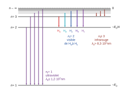
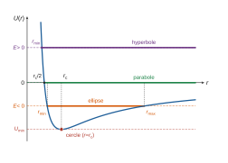
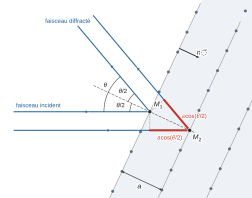
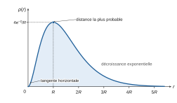

# Mines-Ponts MP — Physique 1 2026 · Corrigé brut

*Corrigé rédigé par IA, non officiel. Signalez toute erreur.*

**Du spectre à la structure de l'hydrogène.** Épreuve de 3 heures, calculatrice interdite. Applications numériques à deux chiffres significatifs, sauf indication contraire (Q12 et Q22 : un seul).

## I — Les raies d'émission de l'hydrogène atomique

### Question 1

Le photon émis emporte l'énergie $\epsilon=E_i-E_f>0$. Relation de Planck-Einstein : $\epsilon=h\nu$, et dans le vide $\nu=c/\lambda_0$. Donc $E_i-E_f=hc/\lambda_0$ :

$$\boxed{\lambda_0=\frac{hc}{E_i-E_f}}$$

grandeur positive puisque $E_f<E_i$.

### Question 2

Avec $E_n=-E_0/n^2$, $n_i=k+2$ et $n_f=2$, la Q1 donne

$$\begin{aligned}
\frac1{\lambda_0}&=\frac{E_i-E_f}{hc}\\
&=\frac{E_0}{hc}\left(\frac14-\frac1{(k+2)^2}\right)\\
&=A-B\,x,
\end{aligned}$$

avec

$$\begin{aligned}
x&=\frac1{(k+2)^2},\\
A&=\frac{E_0}{4hc},\\
B&=\frac{E_0}{hc}.
\end{aligned}$$

La relation (2) prévoit donc que $1/\lambda_0$ est une fonction **affine décroissante** de $x$, d'ordonnée à l'origine positive, avec de plus un rapport imposé $A/B=1/4$, indépendant de toute constante.

Sur la figure 1, les cinq points sont alignés, aux barres d'erreur près, sur la droite en pointillés. On y lit l'ordonnée à l'origine $A\simeq2{,}72\ \mu\mathrm m^{-1}$ ; la droite passe par le point $k=1$, d'abscisse $1/9\simeq0{,}111$ et d'ordonnée $1/0{,}660\simeq1{,}52\ \mu\mathrm m^{-1}$, d'où

$$\begin{aligned}
B&\simeq\frac{2{,}72-1{,}52}{0{,}111}\simeq10{,}8\ \mu\mathrm m^{-1},\\
\frac AB&\simeq\frac{2{,}72}{10{,}8}\simeq0{,}25.
\end{aligned}$$

Pente négative, ordonnée à l'origine positive et rapport $A/B=1/4$ : **la droite de Balmer est compatible avec la relation (2).**

### Question 3

De $A=E_0/(4hc)$, avec $hc\simeq1{,}2\ \mathrm{eV\cdot\mu m}$ :

$$\begin{aligned}
E_0&=4hc\,A\\
&\simeq4\times1{,}2\times2{,}72\ \mathrm{eV},
\end{aligned}$$

$$\boxed{E_0\simeq13\ \mathrm{eV}}$$

Contrôle par la pente : $E_0=hc\,B\simeq1{,}2\times10{,}8\simeq13$ eV. Soit $E_0\simeq2{,}1\cdot10^{-18}$ J.

### Question 4

Pour une transition $n_i\to n_f$ ($n_i>n_f$), la Q1 et (2) donnent

$$\frac1{\lambda_0}=\frac{E_{n_i}-E_{n_f}}{hc}=\frac{E_0}{hc}\left(\frac1{n_f^2}-\frac1{n_i^2}\right),$$

c'est la relation de Rydberg (3) avec

$$\boxed{R_\infty=\frac{E_0}{hc}}$$

Numériquement :

$$\begin{aligned}
\frac1{R_\infty}&=\frac{hc}{E_0}\\
&\simeq\frac{1{,}2\ \mathrm{eV\cdot\mu m}}{13\ \mathrm{eV}}\\
&\simeq0{,}092\ \mu\mathrm m,
\end{aligned}$$

$$\boxed{\frac1{R_\infty}\simeq92\ \mathrm{nm}}$$

soit $R_\infty\simeq1{,}1\cdot10^7\ \mathrm m^{-1}$.

### Question 5

À $n_f$ fixé, $1/\lambda_0=R_\infty(1/n_f^2-1/n_i^2)$ croît avec $n_i$ ; toutes les quantités sont positives, donc on peut inverser les inégalités.

**Cas $n_f=1$.** Pour $n_i\ge2$, $1/n_i^2\le1/4$, d'où $1/\lambda_0\ge\frac34R_\infty$ et

$$\begin{aligned}
\lambda_0\le\lambda_{\max}&=\frac4{3R_\infty}\\
&\simeq\frac43\times92\ \mathrm{nm},
\end{aligned}$$

$$\boxed{\lambda_{\max}\simeq1{,}2\cdot10^2\ \mathrm{nm}}$$

borne atteinte par la raie $2\to1$. Ces raies (série de Lyman) sont dans l'**ultraviolet** (lointain).

**Cas $n_f>2$**, soit $n_f\ge3$. Pour tout $n_i>n_f$, $1/\lambda_0<R_\infty/n_f^2\le R_\infty/9$, d'où

$$\begin{aligned}
\lambda_0>\lambda_{\min}&=\frac9{R_\infty}\\
&\simeq9\times92\ \mathrm{nm},
\end{aligned}$$

$$\boxed{\lambda_{\min}\simeq8{,}3\cdot10^2\ \mathrm{nm}}$$

borne non atteinte (limite de la série $n_f=3$). Ces raies (Paschen, Brackett…) sont dans l'**infrarouge**.

**Conclusion.** Le visible s'étend d'environ 400 à 800 nm : les séries $n_f=1$ et $n_f\ge3$ en sont exclues. **Seules les raies de la série de Balmer ($n_f=2$) sont observables dans le visible.**

Pour celle-ci, $\lambda_0$ décroît quand $n_i$ augmente :

$$\begin{aligned}
n_i=3&:\ \lambda_0=\frac{36}{5R_\infty}\simeq6{,}6\cdot10^2\ \mathrm{nm},\\
n_i=7&:\ \lambda_0=\frac{196}{45R_\infty}\simeq4{,}0\cdot10^2\ \mathrm{nm},\\
n_i\to\infty&:\ \lambda_0\to\frac4{R_\infty}\simeq3{,}7\cdot10^2\ \mathrm{nm}.
\end{aligned}$$

Les raies visibles sont donc celles de $n_i=3$ à $n_i=7$, c'est-à-dire les cinq raies $\mathrm H_\alpha$ à $\mathrm H_\epsilon$ du tableau. Les suivantes s'accumulent entre 390 et 365 nm, à la frontière du proche ultraviolet.

## II — Le modèle de Bohr pour l'atome d'hydrogène

### II.A — Énergie potentielle effective

### Question 6

La force de Coulomb exercée par le noyau ($+e$, en $O$) sur l'électron ($-e$) est attractive :

$$\vec F=-\frac{e^2}{4\pi\varepsilon_0r^2}\vec u_r.$$

Son travail élémentaire s'écrit

$$\begin{aligned}
\delta W&=\vec F\cdot\mathrm d\vec r\\
&=-\frac{e^2}{4\pi\varepsilon_0r^2}\mathrm dr\\
&=-\mathrm dE_p,
\end{aligned}$$

d'où $E_p=-\dfrac{e^2}{4\pi\varepsilon_0r}+\text{cte}$. La constante est nulle puisque $E_p\to0$ quand $r\to\infty$ :

$$\boxed{E_p(r)=-\frac{e^2}{4\pi\varepsilon_0r}}$$

### Question 7

Dans le référentiel galiléen où $O$ est fixe, le théorème du moment cinétique en $O$ donne

$$\frac{\mathrm d\vec s}{\mathrm dt}=\vec r\wedge\vec F=\vec 0,$$

car $\vec F$ est colinéaire à $\vec r$ (force centrale). Donc **$\vec s$ est constant**.

Si $\vec s\ne\vec0$, on a à chaque instant

$$\vec r\cdot\vec s=\vec r\cdot(\vec r\wedge\vec p)=0.$$

Donc $M$ reste dans le plan **fixe** passant par $O$ et orthogonal au vecteur constant $\vec s$ : le mouvement est plan et son plan contient $O$.

Si $\vec s=\vec0$, $\vec p$ reste colinéaire à $\vec r$ : le mouvement est rectiligne sur une droite passant par $O$ (cas dégénéré, encore plan). On suppose désormais $s>0$.

### Question 8

La force de Coulomb est conservative et seule à agir : l'énergie mécanique $E$ se conserve dans le référentiel galiléen d'étude. En polaires, $\vec v=\dot r\,\vec u_r+r\dot\theta\,\vec u_\theta$, la base $(\vec u_r,\vec u_\theta)$ étant orthonormée :

$$\|\vec v\|^2=\dot r^2+r^2\dot\theta^2.$$

Par ailleurs $\vec s=m_er^2\dot\theta\,\vec u_z$, donc $s=m_er^2|\dot\theta|$ et

$$r^2\dot\theta^2=\frac{s^2}{m_e^2r^2}.$$

Ainsi

$$\begin{aligned}
E&=\frac12m_e\dot r^2+\frac{s^2}{2m_er^2}-\frac{e^2}{4\pi\varepsilon_0r}\\
&=\frac12m_e\dot r^2+U(r),
\end{aligned}$$

$$\boxed{U(r)=\frac{s^2}{2m_er^2}-\frac{e^2}{4\pi\varepsilon_0r}}$$

$U$ ne dépend que de $r$ parce que $s$ est constant (Q7) : c'est l'énergie potentielle effective du mouvement radial.

### Question 9

**Allure.** $U(r)\to+\infty$ quand $r\to0^+$ (terme centrifuge, $s\ne0$), $U(r)\to0^-$ quand $r\to+\infty$. Avec

$$U'(r)=-\frac{s^2}{m_er^3}+\frac{e^2}{4\pi\varepsilon_0r^2}=\frac1{r^3}\left(\frac{e^2r}{4\pi\varepsilon_0}-\frac{s^2}{m_e}\right),$$

$U$ décroît puis croît, avec un minimum unique $U_{\min}<0$ en $r_c$ ; elle s'annule en $r_c/2$.

**Les quatre types d'orbites.** Comme $\frac12m_e\dot r^2=E-U(r)\ge0$, seules les valeurs de $r$ telles que $U(r)\le E$ sont accessibles.

| Niveau d'énergie | Domaine de $r$ | Mouvement | Trajectoire |
|---|---|---|---|
| $E=U_{\min}$ | $r=r_c$ | lié, $\dot r=0$, vitesse angulaire constante | cercle de rayon $r_c$ |
| $U_{\min}<E<0$ | $r_{\min}\le r\le r_{\max}$ | lié, $r$ oscille entre péricentre et apocentre | ellipse de foyer $O$ |
| $E=0$ | $r\ge r_{\min}=r_c/2$ | libre, vitesse nulle à l'infini | parabole de foyer $O$ |
| $E>0$ | $r\ge r_{\min}$, avec $r_{\min}<r_c/2$ | libre, vitesse non nulle à l'infini | branche d'hyperbole de foyer $O$ |

($r_{\min}$ et $r_{\max}$ sont les racines de $U(r)=E$ ; la nature conique des trajectoires est le résultat de cours du champ newtonien.)

**Trajectoires circulaires.** $U'(r_c)=0$ donne

$$\boxed{r_c(s)=\frac{4\pi\varepsilon_0s^2}{m_ee^2}}$$

Sur le cercle, $\vec r\perp\vec p$, donc $s=r_cp_c$ et

$$\boxed{p_c(s)=\frac{s}{r_c}=\frac{m_ee^2}{4\pi\varepsilon_0s}}$$

et

$$\begin{aligned}
E_c(s)&=U(r_c)\\
&=-\frac{e^2}{8\pi\varepsilon_0r_c},
\end{aligned}$$

$$\boxed{E_c(s)=-\frac{m_ee^4}{32\pi^2\varepsilon_0^2s^2}}$$

On vérifie :

$$\begin{aligned}
E_c&=\frac{p_c^2}{2m_e}+E_p(r_c)\\
&=-\frac{p_c^2}{2m_e}\\
&=\frac12E_p(r_c).
\end{aligned}$$

### II.B — L'hypothèse de quantification de Bohr

### Question 10

Le périmètre contient $n$ longueurs d'onde, avec $\lambda=h/p_c$ :

$$2\pi r_c=n\lambda=\frac{nh}{p_c}.$$

Sur une orbite circulaire, $\vec r\perp\vec p$, donc $s=r_cp_c$ (Q9) :

$$\boxed{s=n\hbar=\frac{nh}{2\pi}}$$

avec $n\in\mathbb N^*$.

### Question 11

En reportant $s=nh/(2\pi)$ dans les résultats de Q9 :

$$\boxed{r_c(n)=\frac{\varepsilon_0h^2}{\pi m_ee^2}\,n^2}$$

$$\boxed{p_c(n)=\frac{m_ee^2}{2\varepsilon_0h}\,\frac1n}$$

$$\boxed{E_c(n)=-\frac{m_ee^4}{8\varepsilon_0^2h^2}\,\frac1{n^2}}$$

$E_c(n)$ a exactement la forme (2), $E_n=-E_0/n^2$, avec

$$\begin{aligned}
E_0&=\frac{m_ee^4}{8\varepsilon_0^2h^2}\\
&\simeq\frac{9{,}1\cdot10^{-31}\times6{,}6\cdot10^{-76}}{8\times7{,}9\cdot10^{-23}\times4{,}4\cdot10^{-67}}\ \mathrm J\\
&\simeq2{,}2\cdot10^{-18}\ \mathrm J,
\end{aligned}$$

soit $\underline{E_0\simeq14\ \mathrm{eV}}$ à deux chiffres significatifs (13,5 eV avec un chiffre de plus).

Le modèle de Bohr redonne la loi de Balmer-Rydberg **et** la valeur de $E_0$ à partir des seules constantes fondamentales, en accord avec les 13 eV tirés de la figure 1 (Q3), à la précision de la lecture graphique près.

### Question 12

$r_c(n)=r_c(1)\,n^2$ croît avec $n\ge1$ : le rayon minimal est celui de $n=1$,

$$\begin{aligned}
r_{c,\min}&=\frac{\varepsilon_0h^2}{\pi m_ee^2}\\
&\simeq\frac{8{,}9\cdot10^{-12}\times4{,}4\cdot10^{-67}}{3{,}1\times9{,}1\cdot10^{-31}\times2{,}6\cdot10^{-38}}\ \mathrm m\\
&\simeq5{,}3\cdot10^{-11}\ \mathrm m,
\end{aligned}$$

$$\boxed{r_{c,\min}\simeq5\cdot10^{-11}\ \mathrm m}$$

C'est le rayon de Bohr : il donne un diamètre atomique de l'ordre de $10^{-10}$ m, l'ordre de grandeur des tailles atomiques et des distances interatomiques. Contrairement au cas classique, où $s$ et donc $r_c$ peuvent être arbitrairement petits, la quantification interdit l'effondrement de l'électron sur le noyau ; mais cette stabilité est postulée, pas expliquée (une charge en mouvement circulaire devrait rayonner).

## III — Ondes de matière en physique microscopique

### III.A — États quantiques stationnaires

### Question 13

$|\underline\Psi(x,t)|^2S\,\mathrm dx$ est la probabilité de trouver la particule, à l'instant $t$, dans le volume $S\,\mathrm dx$ : $|\underline\Psi|^2$ est une densité volumique de probabilité de présence, et

$$\int_{\mathscr D}|\underline\Psi(x,t)|^2S\,\mathrm dx=\text{probabilité de présence dans }\mathscr D,$$

égale à $1$ si $\mathscr D$ est tout le domaine accessible (normalisation). Une probabilité est sans dimension et $S\,\mathrm dx$ est un volume, donc

$$\boxed{[\underline\Psi]=L^{-3/2}}$$

En reportant $\underline\Psi=\underline\psi(x)\mathrm e^{-\mathrm i\omega t}$ dans (4) et en simplifiant par $\mathrm e^{-\mathrm i\omega t}\ne0$ :

$$\boxed{-\frac{\hbar^2}{2m}\frac{\mathrm d^2\underline\psi}{\mathrm dx^2}+V(x)\underline\psi(x)=E\,\underline\psi(x)}$$

et la première égalité de (4) donne

$$\begin{aligned}
\mathrm i\hbar\frac{\partial\underline\Psi}{\partial t}&=\mathrm i\hbar(-\mathrm i\omega)\underline\Psi\\
&=\hbar\omega\underline\Psi\\
&=E\underline\Psi,
\end{aligned}$$

d'où

$$\boxed{E=\hbar\omega=\frac{h\omega}{2\pi}}$$

### Question 14

Avec $V=V_0$ : $\underline\psi''+\dfrac{2m(E-V_0)}{\hbar^2}\underline\psi=0$.

- Si $E<V_0$, solutions en $\mathrm e^{\pm\kappa x}$ avec $\kappa=\sqrt{2m(V_0-E)}/\hbar$ : onde évanescente, pas de propagation.
- Si $E=V_0$, $\underline\psi$ est affine : pas de propagation.
- Si $E>V_0$ : propagation sans atténuation. **Condition : $E>V_0$, c'est-à-dire $K=E-V_0>0$.**

On pose alors $k=\sqrt{2m(E-V_0)}/\hbar$ :

$$\underline\psi(x)=\underline A\,\mathrm e^{\mathrm ikx}+\underline B\,\mathrm e^{-\mathrm ikx},$$

superposition de deux ondes progressives de sens opposés :

$$\underline\Psi=\underline A\mathrm e^{\mathrm i(kx-\omega t)}+\underline B\mathrm e^{-\mathrm i(kx+\omega t)}.$$

La longueur d'onde associée vaut

$$\boxed{\lambda=\frac{2\pi}k=\frac h{\sqrt{2m(E-V_0)}}}$$

Pour un sens unique ($\underline B=0$ par exemple), la relation de de Broglie (1) donne

$$\begin{aligned}
p&=\frac h\lambda=\hbar k\\
&=\sqrt{2m(E-V_0)},
\end{aligned}$$

$$\boxed{p=\sqrt{2mK}}$$

**Oui**, c'est la même relation qu'en mécanique classique non relativiste, où $K=\frac12mv^2=p^2/(2m)$.

### III.B — Ondes stationnaires et états liés

### Question 15

Sur le segment, $\underline\psi$ s'annule aux deux extrémités et $n-1$ fois entre elles : le segment contient $n$ demi-longueurs d'onde, $\ell=n\lambda/2$. Chez Bohr, le périmètre contient $n$ longueurs d'onde entières, $2\pi r=n\lambda$.

**Les deux conditions ne sont pas identiques** : sur le segment, des nœuds sont imposés aux extrémités (comme pour une corde fixée à ses deux bouts), d'où des demi-longueurs d'onde ; sur le cercle, il n'y a pas d'extrémité, la seule contrainte est que l'onde se referme sur elle-même après un tour (condition de périodicité), d'où des longueurs d'onde entières. Elles relèvent pourtant du même principe d'accord de phase sur un parcours fermé : l'analogue du périmètre de Bohr est, pour le segment, la longueur de l'aller-retour, $2\ell=n\lambda$.

### Question 16

Sur $[0,\ell]$, $V=0$, et l'équation de Q13 devient

$$\underline\psi''+k^2\underline\psi=0,$$

où l'on a posé $k^2=2mE/\hbar^2$.

Si $E\le0$, les solutions sont exponentielles réelles ou affines, et les conditions $\underline\psi(0)=\underline\psi(\ell)=0$ imposent $\underline\psi\equiv0$. Donc $E>0$ et

$$\underline\psi=\underline A\sin kx+\underline B\cos kx.$$

La condition $\underline\psi(0)=0$ donne $\underline B=0$.

Puis $\underline\psi(\ell)=0$ avec $\underline A\ne0$ donne $k\ell=n\pi$, $n\in\mathbb N^*$ (on retrouve $\ell=n\lambda/2$). D'où

$$\begin{aligned}
E_n&=\frac{\hbar^2k^2}{2m}\\
&=\frac{\hbar^2\pi^2n^2}{2m\ell^2},
\end{aligned}$$

$$\boxed{E_n=\frac{n^2h^2}{8m\ell^2}}$$

avec $n\in\mathbb N^*$.

### Question 17

$\Delta E=E_2-E_1=\dfrac{3h^2}{8m_n\ell^2}$, d'où

$$\boxed{\ell=h\sqrt{\frac3{8m_n\Delta E}}}$$

Avec $\Delta E=30\ \mathrm{MeV}$, soit $30\cdot10^6\times1{,}6\cdot10^{-19}\ \mathrm J=4{,}8\cdot10^{-12}$ J :

$$\begin{aligned}
\ell^2&=\frac{3\times(6{,}6\cdot10^{-34})^2}{8\times1{,}7\cdot10^{-27}\times4{,}8\cdot10^{-12}}\ \mathrm m^2\\
&\simeq\frac{1{,}3\cdot10^{-66}}{6{,}5\cdot10^{-38}}\ \mathrm m^2\\
&\simeq2{,}0\cdot10^{-29}\ \mathrm m^2,
\end{aligned}$$

$$\boxed{\ell\simeq4{,}5\cdot10^{-15}\ \mathrm m}$$

(4,4 fm avec $\sqrt{20}=2\sqrt5\simeq4{,}4$). Quelques femtomètres : c'est la taille d'un **noyau atomique**. La situation décrite est celle d'un nucléon confiné dans un noyau, et les écarts d'énergie nucléaires se comptent en MeV (contre quelques eV pour les niveaux atomiques). Le neutron, neutre, n'est pas retenu par l'interaction électromagnétique, et la gravitation est négligeable : c'est l'**interaction nucléaire forte**, de portée de l'ordre du femtomètre, qui le confine.

### III.C — Ondes progressives et diffraction

### Question 18

Un cristal isolé accumulerait la charge négative apportée par le faisceau. Cette charge crée un champ entre les grilles et le cristal, qui repousse et dévie les électrons incidents : leur impulsion à l'arrivée n'est plus fixée par $V_A$ (donc $\lambda$ non plus), elle dérive au cours du temps, les trajectoires se courbent (l'angle $\theta$ est faussé), et l'hypothèse « aucune interaction entre AB et le cristal » tombe.

Il faut relier le cristal **aux électrodes A et B**. L'espace entre B et le cristal doit être équipotentiel pour que les électrons s'y propagent sans force. Relié à la masse, le cristal serait au potentiel de K : il régnerait un champ décélérateur entre B et le cristal. Le théorème de l'énergie cinétique entre K et le cristal donnerait alors une énergie cinétique d'arrivée $(-e)(0-0)=0$ : les électrons ne frapperaient pas le cristal avec l'énergie voulue.

### Question 19

Entre K (potentiel nul) et A (potentiel $V_A$), seule la force électrique travaille :

$$W=(-e)(0-V_A)=eV_A.$$

Théorème de l'énergie cinétique, vitesse initiale négligeable : $\frac12m_ev^2=eV_A$. Au-delà de A, la région est équipotentielle : $p$ et $E$ restent constants. En prenant l'origine des énergies potentielles dans cette région ($V=0$, ce qui rend $E$ positif comme le demande l'énoncé), l'énergie est purement cinétique :

$$\boxed{E=eV_A}$$

L'impulsion s'en déduit par $p=\sqrt{2m_eE}$ :

$$\boxed{p=\sqrt{2m_eeV_A}}$$

d'où $\lambda=h/\sqrt{2m_eeV_A}$, réglable par la tension accélératrice.

### Question 20

$[|\underline\Psi|^2]=L^{-3}$ (Q13) et $\vec p/m_e$ est une vitesse, donc

$$\boxed{[\vec J]=L^{-2}\cdot T^{-1}}$$

C'est un nombre par unité de surface et par unité de temps : $\vec J$ est la **densité de courant de probabilité** (densité de flux de particules lorsque $|\underline\Psi|^2$ est interprété comme une densité volumique d'électrons du faisceau), dirigée selon $\vec p$. Son flux à travers une surface est le nombre d'électrons qui la traversent par unité de temps.

Pour l'onde incidente, $|\underline\Psi_{\mathrm{inc}}|^2=\psi_0^2$, et le flux d'électrons par unité de section droite et de temps vaut $\Phi_0$ :

$$\Phi_0=\psi_0^2\frac p{m_e},$$

d'où

$$\boxed{\psi_0=\sqrt{\frac{m_e\Phi_0}{p}}}$$

**Pas de perte de généralité** : (4) est linéaire, donc $\mathrm e^{\mathrm i\alpha}\underline\Psi$ est solution dès que $\underline\Psi$ l'est, avec la même densité $|\underline\Psi|^2$ et le même $\vec J$ ; choisir $\psi_0>0$ revient à fixer l'origine des phases.

*Remarque sur l'énoncé.* Telle qu'écrite, $\underline\Psi_{\mathrm{inc}}=\psi_0\exp[-\frac{\mathrm i}\hbar(px-Et)]$ vérifie $\mathrm i\hbar\,\partial_t\underline\Psi=-E\underline\Psi$ ; la forme compatible avec (4) et la convention $\mathrm e^{-\mathrm i\omega t}$ est sa conjuguée $\psi_0\exp[\frac{\mathrm i}\hbar(px-Et)]$. Les deux se propagent vers les $x$ croissants et ont le même module : les résultats ci-dessus sont inchangés.

### Question 21

Sur la figure 6, la normale $\vec n$ aux plans réticulaires est la bissectrice de l'angle entre le faisceau incident (renversé) et le faisceau diffracté : chacun fait l'angle $\theta/2$ avec $\vec n$ (loi de la réflexion).

Soient $\vec u_i$ et $\vec u_d$ les vecteurs unitaires des directions incidente et diffractée, $M_1$ et $M_2$ deux centres diffuseurs situés sur deux plans consécutifs, et $\vec n$ orienté vers l'intérieur du cristal, de sorte que $\overrightarrow{M_1M_2}\cdot\vec n=a$. La différence de marche vaut

$$\delta=(\vec u_i-\vec u_d)\cdot\overrightarrow{M_1M_2}.$$

Le faisceau incident entre dans le cristal et le faisceau diffracté en sort, chacun à $\theta/2$ de la normale :

$$\begin{aligned}
\vec u_i\cdot\vec n&=\cos\frac\theta2,\\
\vec u_d\cdot\vec n&=-\cos\frac\theta2.
\end{aligned}$$

Leurs composantes parallèles aux plans sont égales (réflexion), donc $\vec u_i-\vec u_d=2\cos(\theta/2)\,\vec n$. Géométriquement, l'onde réfléchie par le plan inférieur parcourt en plus deux segments, chacun de longueur $a\cos(\theta/2)$. D'où

$$\boxed{\delta=2a\cos\frac\theta2}$$

indépendante de la position de $M_2$ dans son plan.

Le faisceau diffracté est intense quand les ondes réfléchies par tous les plans sont en phase, $\delta=q\lambda$ :

$$\boxed{2a\cos\frac\theta2=q\,\lambda}$$

avec $q\in\mathbb N^*$ l'ordre d'interférence.

C'est la condition de Bragg $2a\sin\alpha=q\lambda$, l'angle de rasance valant $\alpha=90^\circ-\theta/2$.

### Question 22

Avec $\lambda=h/\sqrt{2m_eeV}$ (Q19), la condition de Q21 s'écrit

$$\sqrt{V_q}=q\,\Delta,$$

où le pas $\Delta$ vaut

$$\Delta=\frac h{2a\cos(\theta/2)\sqrt{2m_ee}}.$$

Les maxima sont **équidistants en $\sqrt V$** (ils s'écarteraient comme $q^2$ en $V$) : c'est pourquoi on porte $\sqrt V$ en abscisse.

Sur la figure 7, les maxima sont en $\sqrt V\approx$ 8,0 ; 11,4 ; 14,7 ; 18,1 ; 21,2 ; 24,2 (en $\mathrm V^{1/2}$). Ils sont régulièrement espacés, de pas moyen

$$\Delta\approx\frac{24{,}2-8{,}0}5\ \mathrm V^{1/2}\approx3{,}2\ \mathrm V^{1/2}.$$

Le premier n'est pas un multiple entier du pas : on exploite le pas, insensible à ce décalage. On calcule $\sqrt{2m_ee}=\sqrt{2\times9{,}1\cdot10^{-31}\times1{,}6\cdot10^{-19}}\simeq5{,}4\cdot10^{-25}$ SI, et l'on prend $\cos25^\circ=0{,}91$ :

$$\begin{aligned}
a&=\frac h{2\cos(\theta/2)\sqrt{2m_ee}\,\Delta}\\
&\simeq\frac{6{,}6\cdot10^{-34}}{2\times0{,}91\times5{,}4\cdot10^{-25}\times3{,}2}\ \mathrm m\\
&\simeq2{,}1\cdot10^{-10}\ \mathrm m,
\end{aligned}$$

$$\boxed{a\simeq2\cdot10^{-10}\ \mathrm m}$$

C'est l'ordre de grandeur des distances interatomiques dans un solide (la distance entre plans denses du nickel vaut environ 0,2 nm) : la longueur d'onde des électrons de quelques centaines d'électronvolts ($\lambda\approx0{,}05$ à $0{,}15$ nm) est comparable à $a$, d'où la diffraction par le cristal, preuve expérimentale de l'onde de matière. Le décalage du premier maximum s'explique par un effet non modélisé (potentiel interne du cristal, qui modifie la longueur d'onde à l'intérieur).

### III.D — Retour sur l'atome d'hydrogène

### Question 23

$|\underline\Psi|^2=\psi_0^2\mathrm e^{-2r/R}$ est une densité volumique de probabilité qui ne dépend pas des angles. En sphériques, l'élément de volume vaut

$$\mathrm d\tau=r^2\sin\theta\,\mathrm dr\,\mathrm d\theta\,\mathrm d\varphi.$$

La probabilité de présence dans la coquille $[r,r+\mathrm dr]$ s'obtient en intégrant $|\underline\Psi|^2\mathrm d\tau$ sur $\theta$ et $\varphi$, avec $\iint\sin\theta\,\mathrm d\theta\,\mathrm d\varphi=4\pi$ :

$$\mathrm d\mathbb P=4\pi\psi_0^2r^2\mathrm e^{-2r/R}\,\mathrm dr.$$

Normalisation, avec $x=2r/R$ :

$$\begin{aligned}
\int_0^\infty r^2\mathrm e^{-2r/R}\mathrm dr&=\frac{R^3}8\int_0^\infty x^2\mathrm e^{-x}\mathrm dx\\
&=\frac{R^3}4,
\end{aligned}$$

donc $\pi\psi_0^2R^3=1$ et

$$\boxed{\rho(r)=\frac4{R^3}\,r^2\,\mathrm e^{-2r/R}}$$

$\rho'(r)=\dfrac{8r}{R^3}\mathrm e^{-2r/R}\left(1-\dfrac rR\right)$ : $\rho$ est nulle en $0$ (tangente horizontale), croît jusqu'à son maximum $\rho(R)=4\mathrm e^{-2}/R\simeq0{,}54/R$ en $r=R$, puis décroît exponentiellement vers $0$.

**$R$ est la distance électron-noyau la plus probable** : c'est le maximum de la densité radiale, pas un rayon de trajectoire.

### Question 24

L'équation de Schrödinger stationnaire, généralisée à trois dimensions avec $V(r)=-e^2/(4\pi\varepsilon_0r)$, s'écrit $-\dfrac{\hbar^2}{2m_e}\Delta f+V(r)f=Ef$. Pour $f$ ne dépendant que de $r$, seul le terme radial du laplacien subsiste :

Pour $f=\psi_0\mathrm e^{-r/R}$ :

$$\begin{aligned}
\Delta f&=\frac1{r^2}\frac{\mathrm d}{\mathrm dr}\left(r^2\frac{\mathrm df}{\mathrm dr}\right)\\
&=\left(\frac1{R^2}-\frac2{Rr}\right)f.
\end{aligned}$$

En simplifiant par $f\ne0$, pour tout $r>0$ :

$$-\frac{\hbar^2}{2m_eR^2}+\left(\frac{\hbar^2}{m_eR}-\frac{e^2}{4\pi\varepsilon_0}\right)\frac1r=E.$$

Le membre de droite est constant : le coefficient de $1/r$ est nul et le terme constant vaut $E$. D'où

$$\boxed{R=\frac{4\pi\varepsilon_0\hbar^2}{m_ee^2}=\frac{\varepsilon_0h^2}{\pi m_ee^2}}$$

et

$$\begin{aligned}
E&=-\frac{\hbar^2}{2m_eR^2}\\
&=-\frac{m_ee^4}{8\varepsilon_0^2h^2},
\end{aligned}$$

$$\boxed{E=-E_0\simeq-14\ \mathrm{eV}}$$

Ce sont exactement le rayon $r_c(1)\simeq5\cdot10^{-11}$ m et l'énergie $E_c(1)=-E_0$ de l'état fondamental de Bohr (Q11). Mais ici la quantification découle de l'équation et de la condition de normalisabilité, sans règle ad hoc, et $R$ n'est plus le rayon d'une orbite : c'est la distance la plus probable d'un électron sans trajectoire définie.

### Question 25

$$\begin{aligned}
\langle V\rangle&=\int_0^\infty V(r)\rho(r)\,\mathrm dr\\
&=-\frac{e^2}{4\pi\varepsilon_0}\frac4{R^3}\int_0^\infty r\,\mathrm e^{-2r/R}\mathrm dr\\
&=-\frac{e^2}{4\pi\varepsilon_0}\frac4{R^3}\cdot\frac{R^2}4\int_0^\infty x\mathrm e^{-x}\mathrm dx,
\end{aligned}$$

(intégrale convergente : l'intégrande est prolongeable par continuité en $0$ et décroît exponentiellement)

$$\boxed{\langle V\rangle=-\frac{e^2}{4\pi\varepsilon_0R}}$$

En utilisant $e^2/(4\pi\varepsilon_0)=\hbar^2/(m_eR)$ (Q24) :

$$\begin{aligned}
\langle V\rangle&=-\frac{\hbar^2}{m_eR^2}\\
&=2E=-2E_0,
\end{aligned}$$

soit $\underline{\langle V\rangle\simeq-27\ \mathrm{eV}}$. Comme $E=\langle K\rangle+\langle V\rangle$ :

$$\begin{aligned}
\langle K\rangle&=E-\langle V\rangle\\
&=-E=E_0,
\end{aligned}$$

$$\boxed{\langle K\rangle\simeq14\ \mathrm{eV}}$$

$\langle K\rangle$ est bien positive. On retrouve $\langle K\rangle=-\frac12\langle V\rangle$, la relation que vérifie l'orbite circulaire de Bohr, pour laquelle $E_c=\frac12E_p(r_c)$ (Q9) : la description ondulatoire conserve la répartition énergétique classique du champ newtonien. La taille $R$ de l'atome résulte du compromis entre l'attraction coulombienne, qui tend à resserrer le nuage, et l'énergie cinétique de confinement, qui croît quand il se resserre.
