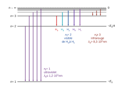
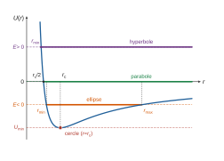
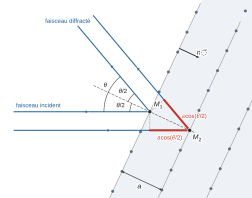
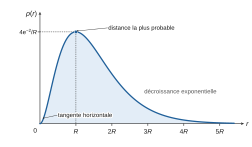

# Mines-Ponts MP — Physique 1 2026 · Corrigé guidé

*Corrigé rédigé par IA, non officiel. Signalez toute erreur.*

## Présentation du sujet

**Thème.** « Du spectre à la structure de l'hydrogène » : le sujet refait le chemin historique qui mène des raies d'émission d'une lampe à hydrogène à la fonction d'onde de l'électron. Une même idée revient trois fois : une onde confinée ne peut exister qu'à des longueurs d'onde discrètes, d'où des énergies quantifiées.

**Format.** 3 heures, calculatrice interdite, 25 questions (Q1 à Q25). Les applications numériques se font à la main avec les valeurs fournies ($hc\simeq1{,}2\ \mathrm{eV\cdot\mu m}$, $\sqrt5=2{,}2$, $\cos25^\circ=0{,}91$…), à deux chiffres significatifs sauf en Q12 et Q22 où un seul est demandé.

**Découpage.**

| Partie | Questions | Contenu |
|---|---|---|
| I. Raies d'émission | Q1–Q5 | photon et transition, droite de Balmer (figure 1), $E_0$, relation de Rydberg, séries spectrales |
| II.A Énergie potentielle effective | Q6–Q9 | force de Coulomb, moment cinétique, mouvement plan, $U(r)$, orbites, cas circulaire |
| II.B Quantification de Bohr | Q10–Q12 | $s=n\hbar$, $r_c(n)$, $p_c(n)$, $E_c(n)$, rayon de Bohr |
| III.A États stationnaires | Q13–Q14 | interprétation de $|\underline\Psi|^2$, équation stationnaire, onde plane, $p=\sqrt{2mK}$ |
| III.B Puits infini | Q15–Q17 | ondes stationnaires, $E_n$, neutron confiné dans un noyau |
| III.C Davisson et Germer | Q18–Q22 | montage, accélération des électrons, courant de probabilité, condition de Bragg, lecture de la figure 7 |
| III.D Retour sur l'hydrogène | Q23–Q25 | densité radiale, résolution de Schrödinger, énergies moyennes |

**Notions du programme mobilisées.** Première année : mouvement dans un champ de force centrale conservatif (moment cinétique, énergie potentielle effective, champ newtonien, trajectoires coniques), électrostatique (énergie potentielle coulombienne, potentiel), introduction au monde quantique (photon, relation de de Broglie, quantification de l'énergie). Deuxième année MP : physique quantique (fonction d'onde, équation de Schrödinger, états stationnaires, puits infini, courant de probabilité), interférences à deux ondes et différence de marche (optique ondulatoire).

**Difficulté.** Moyenne. Le sujet est très guidé et les parties sont presque indépendantes. Les points délicats sont la lecture quantitative des figures 1 et 7, l'interprétation de l'angle $\theta$ sur la figure 6 (Q21), la discussion de Q15 et les commentaires physiques (Q12, Q17, Q22, Q25), qui font la différence entre une copie correcte et une bonne copie.

**Questions à ne pas laisser passer.** Q1, Q4, Q6, Q7, Q8, Q10, Q11, Q13, Q14, Q16, Q19, Q23 : du cours appliqué.

**Ce qu'en dit le jury (rapport 2026).** Le rapport juge le sujet « classique, ne présentant pas de difficulté majeure », de longueur bien adaptée. Il signale comme discriminantes :

- la démonstration de la planéité du mouvement (Q7), « assez discriminante » ;
- la différence de marche sur le réseau de plans (Q21), « Question très mal traitée » ;
- l'intégration en coordonnées sphériques de la densité radiale (Q23), souvent omise ou mal faite.

Q24 et Q25 ont été peu traitées, mais brillamment réussies par certains candidats : elles rapportent à qui va jusqu'au bout. Le rapport insiste aussi sur les fautes de dimension, les applications numériques fantaisistes et la méconnaissance du spectre électromagnétique (domaines ultraviolet et infrarouge).

**Gestion du temps.** Environ 7 minutes par question en moyenne. La partie III est la plus longue (13 questions) : ne pas s'attarder sur la figure 1 ni sur l'allure de $U(r)$. Les calculs sans calculatrice gagnent à être menés en séparant mantisses et puissances de dix.

## Partie I — Les raies d'émission de l'hydrogène atomique

On relie les longueurs d'onde mesurées aux énergies de l'électron, puis on exploite la droite de Balmer pour mesurer la constante $E_0$ et en déduire la structure complète du spectre. Outils : relation de Planck-Einstein, lecture d'un graphe affine, encadrements.

### Question 1

> [!INDICATION]
> L'énergie perdue par l'atome est intégralement emportée par un photon.

> [!INDICATION]
> Relier l'énergie d'un photon à sa fréquence, puis la fréquence à la longueur d'onde dans le vide.

#### Solution

Le photon emporte $\epsilon=E_i-E_f>0$. Relation de Planck-Einstein $\epsilon=h\nu$ et, dans le vide, $\nu=c/\lambda_0$ :

$$\boxed{\lambda_0=\frac{hc}{E_i-E_f}}$$

grandeur positive puisque $E_f<E_i$.

> [!JURY]
> Le rapport 2026 relève « Des erreurs inacceptables sur la relation fréquence-longueur d'onde. » Écrire explicitement $\nu=c/\lambda_0$ (dans le vide) avant de conclure.

> [!METHODE]
> Retenir la forme pratique $hc\simeq1{,}2\ \mathrm{eV\cdot\mu m}$ (fournie) : une énergie de 1 eV correspond à une longueur d'onde de 1,2 µm. Toutes les applications numériques de la partie I s'en déduisent sans passer par les joules.

### Question 2

> [!INDICATION]
> Appliquer la Q1 avec les énergies (2) et les valeurs de $n_i$ et $n_f$ données, puis écrire $1/\lambda_0$ en fonction de la variable portée en abscisse.

> [!INDICATION]
> La forme affine ne suffit pas : la relation (2) impose un lien entre l'ordonnée à l'origine et la pente, qui ne dépend d'aucune constante. C'est ce lien qu'il faut tester sur la figure.

#### Solution

Avec $E_n=-E_0/n^2$, $n_i=k+2$, $n_f=2$ :

$$\begin{aligned}
\frac1{\lambda_0}&=\frac{E_i-E_f}{hc}\\
&=\frac{E_0}{hc}\left(\frac14-\frac1{(k+2)^2}\right)\\
&=A-Bx,
\end{aligned}$$

avec

$$\begin{aligned}
x&=\frac1{(k+2)^2},\\
A&=\frac{E_0}{4hc},\\
B&=\frac{E_0}{hc}.
\end{aligned}$$

La relation (2) prévoit une droite décroissante, d'ordonnée à l'origine positive, et surtout $A/B=1/4$.

Sur la figure 1, les cinq points sont alignés, aux barres d'erreur près, sur la droite en pointillés. On lit $A\simeq2{,}72\ \mu\mathrm m^{-1}$.

La droite passe par le point $k=1$, d'abscisse $x=1/9\simeq0{,}111$ et d'ordonnée $1/0{,}660\simeq1{,}52\ \mu\mathrm m^{-1}$. Donc

$$\begin{aligned}
B&\simeq\frac{2{,}72-1{,}52}{0{,}111}\simeq10{,}8\ \mu\mathrm m^{-1},\\
\frac AB&\simeq0{,}25.
\end{aligned}$$

**La droite de Balmer est compatible avec (2)** : forme affine, signes, et rapport $1/4$.

> [!PIEGE]
> L'axe de la figure est en $\mu\mathrm m^{-1}$ alors que le tableau donne $\lambda_0$ en nm : convertir avant de comparer ($660\ \mathrm{nm}=0{,}660\ \mu\mathrm m$). Autre piège : l'axe des ordonnées ne commence pas à zéro, la pente se calcule avec deux points lus, pas avec la hauteur apparente.

> [!JURY]
> Rapport 2026 : « Ne pas mélanger expressions littérales et valeurs numériques. » On établit d'abord la forme littérale $A-Bx$ et la relation $A/B=1/4$, puis on confronte aux valeurs lues.

### Question 3

> [!INDICATION]
> L'ordonnée à l'origine (ou la pente) lue en Q2 s'exprime simplement en fonction de $E_0$ et $hc$.

#### Solution

$E_0=4hc\,A\simeq4\times1{,}2\times2{,}72\ \mathrm{eV}$ :

$$\boxed{E_0\simeq13\ \mathrm{eV}}$$

Contrôle par la pente : $E_0=hc\,B\simeq1{,}2\times10{,}8\simeq13$ eV. Soit $E_0\simeq2{,}1\cdot10^{-18}$ J.

> [!PIEGE]
> Oublier le facteur 4 donne 3,3 eV, qui est en fait $E_0/4$, l'énergie d'ionisation depuis le niveau $n=2$. Mesurer $E_0$ par les deux voies (ordonnée à l'origine et pente) est un contrôle gratuit.

> [!JURY]
> Le rapport 2026 regrette que la valeur soit parfois donnée « par coeur » sans aucun calcul. Les 13,6 eV connus ne rapportent rien s'ils ne sortent pas de la lecture de la figure 1.

### Question 4

> [!INDICATION]
> Reprendre le calcul de Q2 sans fixer $n_f$.

#### Solution

Pour $n_i>n_f$ :

$$\frac1{\lambda_0}=\frac{E_{n_i}-E_{n_f}}{hc}=\frac{E_0}{hc}\left(\frac1{n_f^2}-\frac1{n_i^2}\right),$$

c'est la relation (3) avec

$$\boxed{R_\infty=\frac{E_0}{hc}}$$

Numériquement :

$$\begin{aligned}
\frac1{R_\infty}&=\frac{hc}{E_0}\\
&\simeq\frac{1{,}2}{13}\ \mu\mathrm m,
\end{aligned}$$

$$\boxed{\frac1{R_\infty}\simeq92\ \mathrm{nm}}$$

soit $R_\infty\simeq1{,}1\cdot10^7\ \mathrm m^{-1}$.

### Question 5

> [!INDICATION]
> À $n_f$ fixé, étudier comment $1/\lambda_0$ varie avec $n_i$ : quelle est sa plus petite et sa plus grande valeur possible ?

> [!INDICATION]
> Pour $n_f\ge3$, majorer $1/\lambda_0$ par sa limite quand $n_i\to\infty$, puis par la valeur la plus défavorable de $n_f$. Inverser ensuite les inégalités entre nombres positifs.

> [!INDICATION]
> Pour conclure, comparer les bornes obtenues aux limites du visible (environ 400 à 800 nm), puis regarder quelles raies de la série restante tombent dans cet intervalle.

#### Solution

À $n_f$ fixé, $1/\lambda_0$ croît avec $n_i$.

**$n_f=1$.** Pour $n_i\ge2$, $1/\lambda_0=R_\infty(1-1/n_i^2)\ge\frac34R_\infty$, d'où

$$\begin{aligned}
\lambda_0\le\lambda_{\max}&=\frac4{3R_\infty}\\
&\simeq\frac43\times92\ \mathrm{nm},
\end{aligned}$$

$$\boxed{\lambda_{\max}\simeq1{,}2\cdot10^2\ \mathrm{nm}}$$

borne atteinte par la raie $2\to1$ : série de Lyman, dans l'**ultraviolet**.

**$n_f\ge3$.** $1/\lambda_0<R_\infty/n_f^2\le R_\infty/9$, d'où

$$\begin{aligned}
\lambda_0>\lambda_{\min}&=\frac9{R_\infty}\\
&\simeq9\times92\ \mathrm{nm},
\end{aligned}$$

$$\boxed{\lambda_{\min}\simeq8{,}3\cdot10^2\ \mathrm{nm}}$$

borne non atteinte (limite de la série $n_f=3$) : ces raies sont dans l'**infrarouge**.

**Conclusion.** **Seule la série de Balmer ($n_f=2$) peut donner des raies visibles.** Ses longueurs d'onde décroissent quand $n_i$ augmente :

$$\begin{aligned}
n_i=3&:\ \lambda_0=\frac{36}{5R_\infty}\simeq6{,}6\cdot10^2\ \mathrm{nm},\\
n_i=7&:\ \lambda_0=\frac{196}{45R_\infty}\simeq4{,}0\cdot10^2\ \mathrm{nm},\\
n_i\to\infty&:\ \lambda_0\to\frac4{R_\infty}\simeq3{,}7\cdot10^2\ \mathrm{nm}.
\end{aligned}$$

Les raies visibles sont celles de $n_i=3$ à $7$ : ce sont exactement les cinq raies $\mathrm H_\alpha$ à $\mathrm H_\epsilon$ du tableau. Les suivantes s'accumulent entre 390 et 365 nm, à la frontière du proche ultraviolet.

> [!METHODE]
> Pour encadrer une famille de raies, raisonner sur $1/\lambda_0$ (affine en $1/n_i^2$), puis inverser. Distinguer une borne atteinte (premier terme de la série) d'une borne non atteinte (limite de série).

> [!PIEGE]
> Inverser ultraviolet et infrarouge. L'ultraviolet est du côté des courtes longueurs d'onde (en dessous de 400 nm, photons plus énergétiques), l'infrarouge du côté des grandes (au-delà de 800 nm).

> [!JURY]
> Rapport 2026 : « Les valeurs numériques sont parfois étonnantes. Il y a des confusions entre ultra-violet et infra-rouge. » Plus généralement, le jury juge « inacceptable que le spectre électromagnétique, et en particulier les domaines ultra-violet et infra-rouge, soient mal connus ».

## Partie II — Le modèle de Bohr pour l'atome d'hydrogène

### II.A — Énergie potentielle effective

Étude classique du mouvement de l'électron dans le champ coulombien du noyau : c'est le problème à force centrale newtonienne du cours de première année, avec ses outils standard (moment cinétique, énergie potentielle effective, discussion graphique).

### Question 6

> [!INDICATION]
> Écrire la force de Coulomb entre les deux charges, puis chercher la fonction de $r$ dont elle dérive.

#### Solution

La force de Coulomb est attractive :

$$\vec F=-\frac{e^2}{4\pi\varepsilon_0r^2}\vec u_r.$$

Son travail élémentaire :

$$\begin{aligned}
\delta W&=\vec F\cdot\mathrm d\vec r\\
&=-\frac{e^2}{4\pi\varepsilon_0r^2}\mathrm dr\\
&=-\mathrm dE_p.
\end{aligned}$$

On intègre, et la constante est nulle puisque $E_p\to0$ à l'infini :

$$\boxed{E_p(r)=-\frac{e^2}{4\pi\varepsilon_0r}}$$

> [!PIEGE]
> Le signe : charges opposées, interaction attractive, $E_p<0$ et croissante avec $r$. Avec le signe $+$, il n'y aurait aucun état lié et toute la partie II deviendrait incohérente.

> [!JURY]
> Rapport 2026 : « Trop de fautes de calcul (signe, primitive) ainsi que d'erreurs sur l'expression de la force de Coulomb. » Contrôle rapide : $-\mathrm dE_p/\mathrm dr$ doit redonner la composante radiale de $\vec F$, négative.

### Question 7

> [!INDICATION]
> Théorème du moment cinétique en un point fixe d'un référentiel galiléen ; que vaut le moment d'une force centrale ?

> [!INDICATION]
> Pour la planéité, calculer $\vec r\cdot\vec s$ et utiliser le fait que $\vec s$ est constant. Penser au cas $\vec s=\vec0$.

#### Solution

Dans le référentiel galiléen où $O$ est fixe :

$$\frac{\mathrm d\vec s}{\mathrm dt}=\vec r\wedge\vec F=\vec0$$

puisque $\vec F$ est colinéaire à $\vec r$. **$\vec s$ est constant.**

Si $\vec s\ne\vec0$, on a $\vec r\cdot\vec s=0$ à chaque instant. $M$ reste donc dans le plan fixe passant par $O$ et orthogonal à $\vec s$ : le mouvement est plan et son plan contient $O$.

Si $\vec s=\vec0$, $\vec p$ reste colinéaire à $\vec r$ : mouvement rectiligne sur une droite passant par $O$ (cas dégénéré, exclu ensuite : $s>0$).

> [!JURY]
> Rapport 2026 : « La démonstration de la planéité du mouvement est assez discriminante. » Les commentaires généraux ajoutent : « Des oublis du référentiel sont encore constatés en mécanique. » Une bonne copie précise le référentiel (galiléen) et le point (fixe) où l'on applique le théorème. Elle insiste sur la constance de $\vec s$ : c'est elle, et non la seule orthogonalité instantanée $\vec r\perp\vec s$, qui donne un plan fixe.

### Question 8

> [!INDICATION]
> Exprimer l'énergie cinétique en coordonnées polaires.

> [!INDICATION]
> Exprimer $\dot\theta$ en fonction de la constante $s$ pour faire disparaître la variable angulaire.

#### Solution

L'énergie mécanique se conserve dans le référentiel galiléen d'étude (force conservative). Avec $\vec v=\dot r\,\vec u_r+r\dot\theta\,\vec u_\theta$ dans la base orthonormée $(\vec u_r,\vec u_\theta)$ :

$$\|\vec v\|^2=\dot r^2+r^2\dot\theta^2.$$

Comme $s=m_er^2|\dot\theta|$, on a $r^2\dot\theta^2=s^2/(m_e^2r^2)$, d'où

$$E=\frac12m_e\dot r^2+\frac{s^2}{2m_er^2}-\frac{e^2}{4\pi\varepsilon_0r},$$

$$\boxed{U(r)=\frac{s^2}{2m_er^2}-\frac{e^2}{4\pi\varepsilon_0r}}$$

> [!PIEGE]
> Écrire $s=m_er\dot\theta$ au lieu de $m_er^2\dot\theta$, ou oublier le $\frac12$ du terme centrifuge. Contrôle : $s^2/(m_er^2)=m_er^2\dot\theta^2$ est bien une énergie.

> [!JURY]
> Le rapport 2026 juge anormal de trouver $\|\dot{\vec r}\|^2$ écrit $(\dot r+r\dot\theta)^2$ au lieu de $\dot r^2+r^2\dot\theta^2$ : les deux composantes sont orthogonales, leurs carrés s'ajoutent sans terme croisé.

### Question 9

> [!INDICATION]
> Étude de fonction : limites en $0^+$ et en $+\infty$, signe de la dérivée, zéro de $U$.

> [!INDICATION]
> La conservation de l'énergie impose $E-U(r)\ge0$ : placer des droites horizontales d'ordonnée $E$ sur la courbe et lire le domaine accessible en $r$ selon la position de $E$ par rapport à $U_{\min}$ et à $0$.

> [!INDICATION]
> Pour l'orbite circulaire, $r$ ne varie pas : où se trouve-t-on sur la courbe ? Sur un cercle, quel lien simple existe entre $s$, $r$ et $p$ ?

#### Solution

**Allure.** $U\to+\infty$ en $0^+$ (barrière centrifuge), $U\to0^-$ en $+\infty$,

$$U'(r)=\frac1{r^3}\left(\frac{e^2r}{4\pi\varepsilon_0}-\frac{s^2}{m_e}\right),$$

négative puis positive : minimum unique $U_{\min}<0$ en $r_c$. $U$ s'annule en $r_c/2$.

**Les quatre types d'orbites** ($\frac12m_e\dot r^2=E-U(r)\ge0$) :

| Niveau d'énergie | Domaine de $r$ | Mouvement | Trajectoire |
|---|---|---|---|
| $E=U_{\min}$ | $r=r_c$ | lié, $\dot r=0$ | cercle de rayon $r_c$ |
| $U_{\min}<E<0$ | $r_{\min}\le r\le r_{\max}$ | lié | ellipse de foyer $O$ (péricentre $r_{\min}$, apocentre $r_{\max}$) |
| $E=0$ | $r\ge r_c/2$ | libre, vitesse nulle à l'infini | parabole de foyer $O$ |
| $E>0$ | $r\ge r_{\min}$, $r_{\min}<r_c/2$ | libre, vitesse non nulle à l'infini | branche d'hyperbole de foyer $O$ |

**Orbites circulaires.** $U'(r_c)=0$ :

$$\boxed{r_c(s)=\frac{4\pi\varepsilon_0s^2}{m_ee^2}}$$

Sur un cercle $\vec r\perp\vec p$, donc $s=r_cp_c$ :

$$\boxed{p_c(s)=\frac{m_ee^2}{4\pi\varepsilon_0s}}$$

$$\boxed{E_c(s)=U(r_c)=-\frac{m_ee^4}{32\pi^2\varepsilon_0^2s^2}}$$

et l'on vérifie $E_c=-p_c^2/(2m_e)=\frac12E_p(r_c)$.

> [!METHODE]
> L'énergie potentielle effective ramène un mouvement plan à un mouvement rectiligne en $r$ : la discussion graphique (niveau $E$ contre courbe $U$) donne les états liés et libres, et les points de rebroussement sont les racines de $U(r)=E$. Le cercle correspond toujours au minimum de $U$.

> [!JURY]
> Les rayons caractéristiques sont explicitement demandés : il faut nommer $r_c$, $r_{\min}$ et $r_{\max}$ pour chaque cas et dire qu'ils sont racines de $U(r)=E$, pas seulement dessiner la courbe.
>
> Le rapport 2026 rappelle aussi qu'« une courbe dont la légende des axes n'est pas indiquée vaut aussi 0 » : nommer les axes ($r$, $U$) et placer $r_c/2$, $r_c$ et $U_{\min}$.

### II.B — L'hypothèse de quantification de Bohr

On impose la règle de Bohr (onde de de Broglie se refermant sur l'orbite) et l'on obtient la quantification du moment cinétique, puis des rayons et des énergies.

### Question 10

> [!INDICATION]
> Traduire « le périmètre représente $n$ longueurs d'onde » avec $\lambda=h/p$.

#### Solution

Avec $\lambda=h/p_c$ :

$$2\pi r_c=n\lambda=\frac{nh}{p_c}.$$

Sur le cercle, $\vec r\perp\vec p$, donc $s=r_cp_c$ (Q9) :

$$\boxed{s=n\hbar=\frac{nh}{2\pi}}$$

avec $n\in\mathbb N^*$.

> [!JURY]
> Rapport 2026 : « Une justification concise mais nécessaire est attendue. » Ici, une phrase suffit : sur un cercle, $\vec r\perp\vec p$, donc $s=r_cp_c$.

### Question 11

> [!INDICATION]
> Substituer dans les expressions de Q9, en veillant aux puissances de $\pi$.

> [!INDICATION]
> Comparer : identifier la forme en $1/n^2$, puis l'expression de $E_0$, et faire l'application numérique.

#### Solution

$$\boxed{r_c(n)=\frac{\varepsilon_0h^2}{\pi m_ee^2}n^2}$$

$$\boxed{p_c(n)=\frac{m_ee^2}{2\varepsilon_0h}\frac1n}$$

$$\boxed{E_c(n)=-\frac{m_ee^4}{8\varepsilon_0^2h^2}\frac1{n^2}}$$

$E_c(n)$ a la forme (2) avec

$$\begin{aligned}
E_0&=\frac{m_ee^4}{8\varepsilon_0^2h^2}\\
&\simeq\frac{9{,}1\cdot10^{-31}\times6{,}6\cdot10^{-76}}{8\times7{,}9\cdot10^{-23}\times4{,}4\cdot10^{-67}}\ \mathrm J\\
&\simeq2{,}2\cdot10^{-18}\ \mathrm J,
\end{aligned}$$

soit $\underline{E_0\simeq14\ \mathrm{eV}}$ à deux chiffres significatifs (13,5 eV avec un chiffre de plus), en accord avec les 13 eV de la figure 1 (Q3) : le modèle prédit $E_0$ à partir des seules constantes fondamentales.

> [!PIEGE]
> Les $\pi$ : avec $s^2=n^2h^2/(4\pi^2)$, le $\pi^2$ de $(4\pi\varepsilon_0)^2$ disparaît de $E_c$.
>
> Il reste en revanche un $\pi$ au dénominateur de $r_c$.
>
> Pour l'application numérique, éviter les arrondis intermédiaires grossiers : arrondir 2,16·10⁻¹⁸ J à 2,2·10⁻¹⁸ J avant de diviser par 1,6·10⁻¹⁹ J/eV fait passer de 13,5 à 13,8 eV.

### Question 12

> [!INDICATION]
> $r_c(n)$ est monotone en $n$ ; quel est le plus petit $n$ permis ?

> [!INDICATION]
> Pour le commentaire, comparer à l'échelle des tailles atomiques, et à ce que permettrait la mécanique classique.

#### Solution

Le minimum est obtenu pour $n=1$ :

$$\begin{aligned}
r_{c,\min}&=\frac{\varepsilon_0h^2}{\pi m_ee^2}\\
&\simeq\frac{8{,}9\cdot10^{-12}\times4{,}4\cdot10^{-67}}{3{,}1\times9{,}1\cdot10^{-31}\times2{,}6\cdot10^{-38}}\ \mathrm m\\
&\simeq5{,}3\cdot10^{-11}\ \mathrm m,
\end{aligned}$$

$$\boxed{r_{c,\min}\simeq5\cdot10^{-11}\ \mathrm m}$$

C'est le rayon de Bohr : un diamètre atomique d'environ $10^{-10}$ m, l'ordre de grandeur réel des atomes. En mécanique classique, $s$ et donc $r_c$ pourraient être arbitrairement petits ; la quantification empêche l'électron de tomber sur le noyau, mais cette stabilité est postulée (un électron en orbite devrait rayonner et perdre son énergie), ce qui motive l'abandon du modèle.

> [!JURY]
> Rapport 2026 : « Valeurs numériques parfois fantaisistes. » La consigne d'un seul chiffre significatif est à respecter littéralement, avec l'unité (une application numérique sans unité vaut 0). Le commentaire doit contenir une comparaison chiffrée à une échelle connue.

## Partie III — Ondes de matière en physique microscopique

### III.A — États quantiques stationnaires

On pose le formalisme : interprétation probabiliste, équation de Schrödinger stationnaire, onde plane dans un potentiel uniforme.

### Question 13

> [!INDICATION]
> $|\underline\Psi|^2$ est une densité de probabilité : par rapport à quel élément (longueur, surface, volume) ?

> [!INDICATION]
> Reporter la forme séparée $\underline\psi(x)\mathrm e^{-\mathrm i\omega t}$ dans chacune des deux égalités de (4).

#### Solution

$|\underline\Psi|^2S\,\mathrm dx$ est la probabilité de présence dans le volume $S\,\mathrm dx$ ; l'intégrale est donc la **probabilité de trouver la particule dans $\mathscr D$**, égale à $1$ si $\mathscr D$ est tout le domaine accessible (normalisation). Probabilité sans dimension, $S\,\mathrm dx$ volume :

$$\boxed{[\underline\Psi]=L^{-3/2}}$$

En simplifiant par $\mathrm e^{-\mathrm i\omega t}\ne0$ :

$$\boxed{-\frac{\hbar^2}{2m}\frac{\mathrm d^2\underline\psi}{\mathrm dx^2}+V(x)\underline\psi=E\underline\psi}$$

et la première égalité de (4) donne

$$\begin{aligned}
\mathrm i\hbar\partial_t\underline\Psi&=\hbar\omega\underline\Psi\\
&=E\underline\Psi,
\end{aligned}$$

d'où

$$\boxed{E=\hbar\omega}$$

> [!PIEGE]
> L'élément d'intégration est un volume $S\,\mathrm dx$, pas une longueur : la dimension est $L^{-3/2}$, pas $L^{-1/2}$.

> [!JURY]
> Le rapport 2026 déplore « un nombre bien trop important de fautes de dimension » et une confusion entre dimension et unité (la dimension masse M prise pour le mètre). Une dimension s'écrit avec les symboles M, L, T… de l'énoncé, pas avec des unités.

### Question 14

> [!INDICATION]
> Avec $V$ constant, l'équation de Q13 est linéaire à coefficients constants : discuter selon le signe de $E-V_0$.

> [!INDICATION]
> Une onde progressive dans un seul sens est une seule exponentielle complexe ; appliquer alors la relation de de Broglie.

#### Solution

Avec $V=V_0$ :

$$\underline\psi''+\frac{2m(E-V_0)}{\hbar^2}\underline\psi=0.$$

- Si $E<V_0$ : solutions en $\mathrm e^{\pm\kappa x}$, onde évanescente.
- Si $E=V_0$ : solution affine.
- **Propagation sans atténuation si et seulement si $E>V_0$**, c'est-à-dire $K>0$.

Alors, avec $k=\sqrt{2m(E-V_0)}/\hbar$, on a deux ondes progressives de sens opposés :

$$\underline\psi=\underline A\,\mathrm e^{\mathrm ikx}+\underline B\,\mathrm e^{-\mathrm ikx},$$

$$\boxed{\lambda=\frac h{\sqrt{2m(E-V_0)}}}$$

Pour un sens unique, la relation de de Broglie donne $p=h/\lambda$ :

$$\boxed{p=\sqrt{2m(E-V_0)}=\sqrt{2mK}}$$

**Oui**, c'est la relation classique non relativiste $K=p^2/(2m)$.

> [!JURY]
> Rapport 2026 : « On regrette que certaines questions proches du cours soient traitées quasiment en mode pilote automatique, avec des blocs de cours récités sans aucune adaptation à la question posée. On pense notamment aux solutions stationnaires de l'équation de Schrödinger. » Répondre aux quatre sous-questions dans l'ordre : condition, forme de $\underline\psi$ et $\lambda$, impulsion, comparaison classique.

> [!METHODE]
> Exponentielles réelles : évanescence ; exponentielles imaginaires : propagation. La forme $\mathrm e^{\pm\mathrm ikx}$ est préférable à $\cos/\sin$ dès qu'il est question de sens de propagation.

### III.B — Ondes stationnaires et états liés

Le puits infini : conditions aux limites, quantification de l'énergie, puis application à l'ordre de grandeur de la taille d'un noyau.

### Question 15

> [!INDICATION]
> Écrire chaque condition sous la forme « une longueur égale à un nombre entier de… ».

> [!INDICATION]
> Comparer la nature des conditions aux limites : extrémités où l'onde s'annule d'un côté, boucle fermée sans extrémité de l'autre. Que devient la condition du segment si l'on considère un aller-retour ?

#### Solution

Segment : $n-1$ nœuds intermédiaires plus les deux extrémités, soit $\ell=n\lambda/2$. Bohr : $2\pi r=n\lambda$.

**Les deux conditions ne sont pas identiques.** Sur le segment, des nœuds sont imposés aux extrémités (corde fixée aux deux bouts) : on compte des demi-longueurs d'onde. Sur le cercle, il n'y a pas d'extrémité, seulement une condition de périodicité (l'onde doit se refermer sur elle-même) : on compte des longueurs d'onde entières. Les deux relèvent toutefois du même principe d'accord de phase sur un parcours fermé : l'analogue du périmètre de Bohr est l'aller-retour sur le segment, $2\ell=n\lambda$.

> [!PIEGE]
> Répondre « oui, c'est une onde stationnaire dans les deux cas » sans écrire les deux conditions. Le facteur 2 traduit des conditions aux limites différentes.

> [!JURY]
> Rapport 2026 : « Un raisonnement est attendu. » Un oui ou un non sec ne rapporte rien : il faut écrire les deux conditions et comparer.

### Question 16

> [!INDICATION]
> Résoudre l'équation de Q13 avec $V=0$ et imposer l'annulation en $x=0$ et $x=\ell$.

> [!INDICATION]
> Justifier que l'énergie doit être positive pour qu'une solution non nulle existe.

#### Solution

Avec $V=0$, on pose $k^2=2mE/\hbar^2$ :

$$\underline\psi''+k^2\underline\psi=0.$$

Si $E\le0$, les solutions exponentielles réelles ou affines ne s'annulent pas deux fois sans être nulles. Donc $E>0$ et

$$\underline\psi=\underline A\sin kx+\underline B\cos kx.$$

La condition $\underline\psi(0)=0$ impose $\underline B=0$. Puis $\underline\psi(\ell)=0$ avec $\underline A\ne0$ impose $k\ell=n\pi$, $n\in\mathbb N^*$. D'où

$$\boxed{E_n=\frac{\hbar^2\pi^2n^2}{2m\ell^2}=\frac{n^2h^2}{8m\ell^2}}$$

> [!METHODE]
> Confinement sur une longueur $\ell$ : énergie minimale non nulle en $h^2/(8m\ell^2)$. Cet ordre de grandeur sert partout (Q17, et taille de l'atome en Q25).

### Question 17

> [!INDICATION]
> Exprimer l'écart entre les deux premiers niveaux avec la Q16, puis isoler $\ell$. Quelle masse utiliser ?

> [!INDICATION]
> Convertir les MeV en joules avant de calculer, et comparer le résultat aux tailles connues (atome, noyau).

#### Solution

$\Delta E=E_2-E_1=\dfrac{3h^2}{8m_n\ell^2}$ :

$$\boxed{\ell=h\sqrt{\frac3{8m_n\Delta E}}}$$

Avec $\Delta E=4{,}8\cdot10^{-12}$ J :

$$\begin{aligned}
\ell^2&\simeq\frac{3\times4{,}4\cdot10^{-67}}{8\times1{,}7\cdot10^{-27}\times4{,}8\cdot10^{-12}}\ \mathrm m^2\\
&\simeq2{,}0\cdot10^{-29}\ \mathrm m^2,
\end{aligned}$$

$$\boxed{\ell\simeq4{,}5\cdot10^{-15}\ \mathrm m}$$

(4,4 fm avec $\sqrt{20}=2\sqrt5$). C'est la taille d'un **noyau atomique** : le modèle décrit un nucléon confiné dans un noyau. Le neutron étant neutre et la gravitation négligeable, le confinement est assuré par l'**interaction nucléaire forte**, de portée femtométrique.

> [!PIEGE]
> Utiliser $m_e$ au lieu de $m_n$ ($\ell$ serait 43 fois trop grand), ou $\Delta E=E_1$ au lieu de $E_2-E_1$ (facteur $\sqrt3$).

### III.C — Ondes progressives et diffraction

L'expérience de Davisson et Germer : on règle la longueur d'onde des électrons par la tension accélératrice et l'on observe des maxima de diffraction sur un cristal, comme en optique avec un réseau.

### Question 18

> [!INDICATION]
> Quel champ créerait une charge accumulée sur le cristal, et quel effet aurait-il sur des électrons incidents ?

> [!INDICATION]
> L'énoncé affirme qu'entre les grilles et le cristal les électrons ne subissent aucune interaction : quelle condition sur les potentiels cela impose-t-il ? Calculer l'énergie d'arrivée dans l'autre hypothèse.

#### Solution

Une charge négative accumulée créerait un champ qui repousserait et dévierait les électrons : leur impulsion à l'arrivée ne serait plus fixée par $V_A$ (ni donc $\lambda$), elle dériverait au cours du temps, et les trajectoires courbées fausseraient l'angle $\theta$.

On relie le cristal **aux électrodes A et B** : l'espace entre B et le cristal est alors équipotentiel, sans champ, et les électrons y gardent l'impulsion acquise. Relié à la masse, le cristal serait au potentiel de K : un champ décélérateur régnerait entre B et le cristal, et l'énergie cinétique d'arrivée serait $(-e)(V_K-V_{\text{cristal}})=0$.

> [!PIEGE]
> Le réflexe « on relie à la masse pour décharger » est faux ici : il faut un espace sans champ, pas un potentiel nul.

> [!JURY]
> Rapport 2026 : « Réponses qui donnent souvent une impression de "pile ou face". » Le choix entre masse et électrodes A et B ne vaut que par sa justification : absence de champ entre B et le cristal, énergie d'arrivée.

### Question 19

> [!INDICATION]
> Théorème de l'énergie cinétique entre K et A avec la seule force électrique.

> [!INDICATION]
> L'énoncé veut $E>0$ : où faut-il placer l'origine des énergies potentielles ?

#### Solution

Entre K et A, seule la force électrique travaille :

$$W=(-e)(0-V_A)=eV_A,$$

donc $\frac12m_ev^2=eV_A$. Au-delà de A la région est équipotentielle ; en y prenant l'origine des énergies potentielles, l'énergie est purement cinétique :

$$\boxed{E=eV_A}$$

$$\boxed{p=\sqrt{2m_eeV_A}}$$

et $\lambda=h/\sqrt{2m_eeV_A}$ est réglable par $V_A$. (Pour $V_A\lesssim600$ V, $eV_A\ll m_ec^2\approx0{,}5$ MeV : le traitement non relativiste est justifié.)

### Question 20

> [!INDICATION]
> Partir de la dimension de $\underline\Psi$ établie en Q13.

> [!INDICATION]
> Un nombre par unité de surface et de temps est un flux surfacique : l'identifier à $\Phi_0$. Pour la généralité, se demander ce que change un facteur de phase constant.

#### Solution

$$\boxed{[\vec J]=L^{-3}\cdot L\cdot T^{-1}=L^{-2}\cdot T^{-1}}$$

$\vec J$ est la **densité de courant de probabilité** : avec $|\underline\Psi|^2$ vu comme densité volumique d'électrons, c'est le nombre d'électrons traversant une surface unité par unité de temps, dans le sens de $\vec p$.

Pour l'onde incidente, $|\underline\Psi_{\mathrm{inc}}|^2=\psi_0^2$, d'où $\Phi_0=\psi_0^2p/m_e$ :

$$\boxed{\psi_0=\sqrt{\frac{m_e\Phi_0}p}}$$

**Aucune perte de généralité** : (4) étant linéaire, $\mathrm e^{\mathrm i\alpha}\underline\Psi$ est solution avec le même $|\underline\Psi|^2$ et le même $\vec J$ ; choisir $\psi_0>0$ fixe seulement l'origine des phases.

*Remarque sur l'énoncé.* L'onde écrite $\psi_0\exp[-\frac{\mathrm i}\hbar(px-Et)]$ vérifie $\mathrm i\hbar\partial_t\underline\Psi=-E\underline\Psi$ ; la forme compatible avec (4) et la convention $\mathrm e^{-\mathrm i\omega t}$ est sa conjuguée. Même sens de propagation, même module : les résultats sont inchangés.

> [!PIEGE]
> Croire que le signe de $\psi_0$ fixe le sens de propagation : c'est le signe relatif des termes en $x$ et en $t$ dans la phase qui le fixe.

### Question 21

> [!INDICATION]
> Sur la figure 6, repérer la normale aux plans réticulaires (tirets) et les angles qu'elle fait avec les faisceaux incident et diffracté.

> [!INDICATION]
> Comme en optique, la différence de marche entre deux diffuseurs s'obtient en projetant le vecteur qui les joint sur la différence des vecteurs unitaires incident et diffracté.

> [!INDICATION]
> L'angle qui apparaît dans la formule de Bragg habituelle est l'angle de rasance, pas l'angle à la normale : relier l'un à l'autre.

#### Solution

Sur la figure 6, la normale $\vec n$ aux plans est la bissectrice de l'angle entre faisceau incident renversé et faisceau diffracté : chacun fait $\theta/2$ avec $\vec n$.

Prenons deux diffuseurs $M_1$, $M_2$ de plans consécutifs, $\vec n$ orienté vers l'intérieur du cristal, de sorte que $\overrightarrow{M_1M_2}\cdot\vec n=a$. La différence de marche vaut

$$\delta=(\vec u_i-\vec u_d)\cdot\overrightarrow{M_1M_2}.$$

Le faisceau incident entre dans le cristal et le faisceau diffracté en sort, chacun à $\theta/2$ de la normale :

$$\begin{aligned}
\vec u_i\cdot\vec n&=\cos\frac\theta2,\\
\vec u_d\cdot\vec n&=-\cos\frac\theta2.
\end{aligned}$$

Les composantes parallèles aux plans sont égales (réflexion), donc $\vec u_i-\vec u_d=2\cos(\theta/2)\,\vec n$. Géométriquement, l'onde réfléchie par le plan inférieur parcourt en plus deux segments de longueur $a\cos(\theta/2)$ :

$$\boxed{\delta=2a\cos\frac\theta2}$$

Maximum d'intensité quand toutes les ondes réfléchies sont en phase :

$$\boxed{2a\cos\frac\theta2=q\lambda}$$

avec $q\in\mathbb N^*$ l'ordre d'interférence.

C'est la loi de Bragg $2a\sin\alpha=q\lambda$ avec l'angle de rasance $\alpha=90^\circ-\theta/2$.

> [!PIEGE]
> Écrire $2a\sin(\theta/2)$ par habitude : ici $\theta/2$ est mesuré à la normale. L'erreur multiplierait le résultat de Q22 par $\cos25^\circ/\sin25^\circ\approx2{,}2$.

> [!PIEGE]
> Invoquer le théorème de Malus sans dire à quoi il sert. S'il est cité, c'est pour justifier un point précis : les plans d'onde sont orthogonaux aux rayons, ce qui permet de tracer les perpendiculaires qui délimitent les deux segments supplémentaires.

> [!JURY]
> Rapport 2026 : « Question très mal traitée. Schémas souvent faux et trop petits pour être exploités correctement. » Le rapport relève aussi des erreurs de trigonométrie et de géométrie de base, et une « Evocation quasi-systématique mais incantatoire et sans contexte du théorème de Malus ». Un schéma grand, avec la normale et les deux angles $\theta/2$ marqués, fait l'essentiel de la question.

### Question 22

> [!INDICATION]
> Combiner la condition de Q21 et l'expression de $\lambda$ en fonction de la tension accélératrice : quelle grandeur est proportionnelle à l'ordre $q$ ?

> [!INDICATION]
> Relever les abscisses des maxima ; exploiter plutôt l'écart moyen entre maxima consécutifs que la position d'un maximum isolé, dont l'ordre est inconnu.

#### Solution

Avec $\lambda=h/\sqrt{2m_eeV}$ :

$$\sqrt{V_q}=q\Delta,$$

où le pas vaut

$$\Delta=\frac h{2a\cos(\theta/2)\sqrt{2m_ee}}.$$

Les maxima sont **équidistants en $\sqrt V$** : c'est ce qui justifie l'abscisse choisie (en $V$, ils s'écarteraient comme $q^2$).

Maxima relevés : $\sqrt V\approx$ 8,0 ; 11,4 ; 14,7 ; 18,1 ; 21,2 ; 24,2 (en $\mathrm V^{1/2}$), de pas moyen

$$\Delta\approx\frac{16{,}2}5\ \mathrm V^{1/2}\approx3{,}2\ \mathrm V^{1/2}.$$

Avec $\sqrt{2m_ee}\simeq5{,}4\cdot10^{-25}$ SI :

$$\begin{aligned}
a&=\frac h{2\cos(\theta/2)\sqrt{2m_ee}\,\Delta}\\
&\simeq\frac{6{,}6\cdot10^{-34}}{2\times0{,}91\times5{,}4\cdot10^{-25}\times3{,}2}\ \mathrm m\\
&\simeq2{,}1\cdot10^{-10}\ \mathrm m,
\end{aligned}$$

$$\boxed{a\simeq2\cdot10^{-10}\ \mathrm m}$$

C'est l'ordre des distances interatomiques (distance entre plans denses du nickel ≈ 0,2 nm) ; les électrons de quelques centaines d'électronvolts ont une longueur d'onde du même ordre (0,05 à 0,15 nm), d'où la diffraction. Le premier maximum n'est pas un multiple entier du pas : un décalage systématique (potentiel interne du cristal) que la mesure par le pas élimine.

> [!METHODE]
> Choisir les axes pour linéariser la loi attendue, puis exploiter une pente ou un pas plutôt qu'un point isolé : on s'affranchit ainsi des décalages systématiques et de l'ordre inconnu.

### III.D — Retour sur l'atome d'hydrogène

On résout l'équation de Schrödinger pour l'état fondamental : on retrouve les nombres de Bohr avec une interprétation probabiliste. Outils : intégration en coordonnées sphériques, laplacien fourni, intégrales fournies.

### Question 23

> [!INDICATION]
> La probabilité de présence entre deux sphères s'obtient en intégrant $|\underline\Psi|^2$ sur la coquille ; l'élément de volume sphérique fait apparaître un facteur supplémentaire en $r$.

> [!INDICATION]
> Éliminer $\psi_0$ par la normalisation, avec le changement de variable qui fait apparaître une intégrale fournie. Pour l'interprétation de $R$, chercher le maximum de $\rho$.

#### Solution

$|\underline\Psi|^2=\psi_0^2\mathrm e^{-2r/R}$ est une densité volumique de probabilité. En sphériques, l'élément de volume vaut

$$\mathrm d\tau=r^2\sin\theta\,\mathrm dr\,\mathrm d\theta\,\mathrm d\varphi.$$

On intègre $|\underline\Psi|^2\mathrm d\tau$ sur les angles, à $r$ fixé :

$$\begin{aligned}
\mathrm d\mathbb P&=\psi_0^2\mathrm e^{-2r/R}r^2\mathrm dr\iint\sin\theta\,\mathrm d\theta\,\mathrm d\varphi\\
&=4\pi\psi_0^2r^2\mathrm e^{-2r/R}\mathrm dr.
\end{aligned}$$

Normalisation, avec $x=2r/R$ :

$$\begin{aligned}
\int_0^\infty r^2\mathrm e^{-2r/R}\mathrm dr&=\frac{R^3}8\times2\\
&=\frac{R^3}4,
\end{aligned}$$

donc $\psi_0^2=1/(\pi R^3)$ :

$$\boxed{\rho(r)=\frac4{R^3}r^2\mathrm e^{-2r/R}}$$

$\rho'(r)=\dfrac{8r}{R^3}\mathrm e^{-2r/R}(1-r/R)$ : nulle en $0$ avec tangente horizontale, maximum $4\mathrm e^{-2}/R\simeq0{,}54/R$ en $r=R$, décroissance exponentielle ensuite.

**$R$ est la distance électron-noyau la plus probable.** (La distance moyenne vaut $\langle r\rangle=3R/2$.)

> [!PIEGE]
> Tracer $|f|^2$, maximal en $r=0$, au lieu de $\rho$ : la densité volumique est maximale sur le noyau, la densité radiale est nulle en $r=0$ car la coquille y a un volume nul.

> [!JURY]
> Rapport 2026 : « L'intégration sur le volume élémentaire en sphérique est fréquemment omise ou mal réalisée. Une interprétation physique de R est souvent donnée de façon arbitraire, sans même l'obtention de l'expression de ρ(r). » L'interprétation de $R$ doit découler de l'étude de $\rho$ (maximum en $r=R$), pas être affirmée.

### Question 24

> [!INDICATION]
> Écrire l'équation de Schrödinger stationnaire à trois dimensions avec l'énergie potentielle de Q6 ; seul le terme radial du laplacien intervient.

> [!INDICATION]
> Après simplification par $f$, l'égalité doit valoir pour tout $r$ : séparer les termes en $1/r$ des termes constants.

#### Solution

L'équation stationnaire à trois dimensions s'écrit

$$-\frac{\hbar^2}{2m_e}\Delta f-\frac{e^2}{4\pi\varepsilon_0r}f=Ef,$$

avec, pour $f=\psi_0\mathrm e^{-r/R}$,

$$\begin{aligned}
\Delta f&=\frac1{r^2}\frac{\mathrm d}{\mathrm dr}\left(r^2f'\right)\\
&=\left(\frac1{R^2}-\frac2{Rr}\right)f.
\end{aligned}$$

En simplifiant par $f\ne0$, pour tout $r>0$ :

$$-\frac{\hbar^2}{2m_eR^2}+\left(\frac{\hbar^2}{m_eR}-\frac{e^2}{4\pi\varepsilon_0}\right)\frac1r=E.$$

Coefficient de $1/r$ nul et terme constant égal à $E$ :

$$\boxed{R=\frac{4\pi\varepsilon_0\hbar^2}{m_ee^2}=\frac{\varepsilon_0h^2}{\pi m_ee^2}}$$

$$\boxed{E=-\frac{m_ee^4}{8\varepsilon_0^2h^2}=-E_0}$$

soit $\underline{E\simeq-14\ \mathrm{eV}}$.

Ce sont le rayon $r_c(1)$ et l'énergie $E_c(1)$ de Bohr. Mais la quantification découle ici de l'équation et de la normalisabilité, sans règle ad hoc, et $R$ est une distance la plus probable, non le rayon d'une trajectoire.

> [!METHODE]
> Identification d'une relation valable pour tout $r$ : les fonctions $1$ et $1/r$ étant indépendantes, chaque coefficient s'annule séparément. Cela fournit deux équations pour deux inconnues.

### Question 25

> [!INDICATION]
> Moyenne de $V(r)$ pondérée par la densité radiale de Q23 ; une des intégrales fournies conclut.

> [!INDICATION]
> L'énergie totale est la somme des moyennes des énergies cinétique et potentielle. Pour le commentaire, comparer à l'orbite circulaire de Bohr.

#### Solution

$$\begin{aligned}
\langle V\rangle&=\int_0^\infty V\rho\,\mathrm dr\\
&=-\frac{e^2}{4\pi\varepsilon_0}\frac4{R^3}\int_0^\infty r\mathrm e^{-2r/R}\mathrm dr\\
&=-\frac{e^2}{4\pi\varepsilon_0}\frac4{R^3}\frac{R^2}4,
\end{aligned}$$

$$\boxed{\langle V\rangle=-\frac{e^2}{4\pi\varepsilon_0R}=2E}$$

(avec $e^2/(4\pi\varepsilon_0)=\hbar^2/(m_eR)$), soit $\underline{\langle V\rangle\simeq-27\ \mathrm{eV}}$. Puis $E=\langle K\rangle+\langle V\rangle$ :

$$\boxed{\langle K\rangle=-E=E_0}$$

soit $\underline{\langle K\rangle\simeq14\ \mathrm{eV}}$.

$\langle K\rangle>0$, comme il se doit ; $\langle K\rangle=-\frac12\langle V\rangle$, exactement comme pour l'orbite circulaire de Bohr ($E_c=\frac12E_p=-p_c^2/(2m_e)$). La taille de l'atome résulte du compromis entre l'attraction coulombienne et l'énergie cinétique de confinement, qui augmente quand le nuage se resserre (Q16).

> [!JURY]
> Le rapport 2026 note que Q24 et Q25 ont été peu traitées mais brillamment réussies par certains candidats. L'énoncé impose la voie : $\langle K\rangle$ se déduit de $E$ et de $\langle V\rangle$, il n'est pas demandé de le calculer directement. Le commentaire porte sur le signe et sur la comparaison au modèle de Bohr.

## Bilan

**Méthodes à retenir.**
- Relation de Planck-Einstein sous la forme $hc\simeq1{,}2\ \mathrm{eV\cdot\mu m}$ ; raisonner sur $1/\lambda$ pour les séries spectrales.
- Tester une loi sur un graphe : forme, signes, et relation imposée entre coefficients (ici $A/B=1/4$).
- Mouvement à force centrale : théorème du moment cinétique, énergie potentielle effective, discussion graphique des états liés et libres.
- Quantification par accord de phase : périodicité sur une boucle, nœuds aux extrémités d'un segment.
- Équation de Schrödinger : séparation des variables, discussion du signe de $E-V$, conditions aux limites, identification des coefficients pour une solution d'essai.
- Interférences : différence de marche par projection, attention à l'angle utilisé (rasance ou normale).

**Prérequis à revoir.** Coordonnées polaires et sphériques (élément de volume, laplacien radial), champ newtonien et coniques, courant de probabilité, loi de Bragg, ordres de grandeur (rayon de Bohr, taille d'un noyau, distances interatomiques), limites du visible et place de l'ultraviolet et de l'infrarouge.

**Questions discriminantes selon le rapport 2026.** Q7 (planéité du mouvement), Q21 (schéma et trigonométrie de la différence de marche), Q23 (élément de volume sphérique). Q24 et Q25, peu abordées, ont été brillamment réussies par certains candidats.

**Questions classiques transposables.** Énergie potentielle effective et nature des trajectoires (tout sujet de mécanique céleste) ; puits infini et énergie de confinement ; diffraction par un cristal (rayons X, neutrons, électrons) ; état fondamental de l'hydrogène et théorème du viriel $\langle K\rangle=-\frac12\langle V\rangle$.
