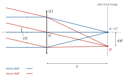
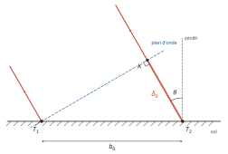
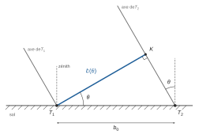
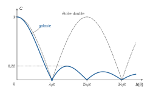
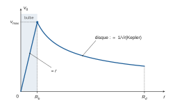
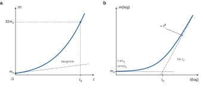

# Mines-Ponts MP — Physique 2 2026 · Corrigé

*Corrigé rédigé par IA, non officiel. Signalez toute erreur.*

Épreuve de 3 heures, calculatrice interdite. « De la physique avec les galaxies » : 22 questions en deux parties indépendantes. Applications numériques à un chiffre significatif, comme le demande l'énoncé, présentées au format scientifique avec leur unité.

**Remarque sur l'énoncé.** La liste des données porte « $1M_\odot=2^{30}$ kg ». Cette valeur est incompatible avec la page 5, qui donne $M_\odot\simeq2\times10^{30}$ kg, et absurde ($2^{30}\ \mathrm{kg}\approx10^9$ kg). Il s'agit d'une coquille : on retient $M_\odot=2\times10^{30}$ kg.

## I — L'observation des galaxies

### Question 1

Le domaine visible s'étend de $0{,}4\ \mu\mathrm m$ environ (violet) à $0{,}8\ \mu\mathrm m$ (rouge). Comme $\lambda_0=2{,}0\ \mu\mathrm m>0{,}8\ \mu\mathrm m$, **ces ondes appartiennent à l'infrarouge (proche infrarouge)**.

### I.A Télescope unique

### Question 2

*Construction.* $A$ et $B$ sont à l'infini : tous les rayons issus de l'un d'eux arrivent parallèles entre eux. Par stigmatisme de la lentille dans les conditions de Gauss, chaque faisceau converge en un point du plan focal image $(F')$.

- Les rayons issus de $A$ sont parallèles à l'axe optique : ils convergent au foyer image, $A'=F'$.
- Les rayons issus de $B$ sont inclinés de $\epsilon/2$ sur l'axe : ils convergent au point $B'$ du plan focal image situé sur le rayon passant par le centre optique $O$, qui n'est pas dévié.

*Distance entre les images.* Le rayon non dévié issu de $B$ fait l'angle $\epsilon/2$ avec l'axe. Dans les conditions de Gauss, cet angle est petit ($\epsilon\ll1$) et il coupe le plan focal à la distance $f'\epsilon/2$ de l'axe :

$$\boxed{A'B'=\frac{f'\epsilon}{2}}$$

*Résolution du capteur.* Les deux images sont distinguées si elles tombent sur deux cellules différentes, c'est-à-dire si $A'B'\geqslant a$ :

$$\begin{aligned}
\frac{f'\epsilon}{2}\geqslant a
&\iff\epsilon\geqslant\frac{2a}{f'}\\
\boxed{r_{\rm cap}=\frac{2a}{f'}}&
\end{aligned}$$

### Question 3

*Ouverture angulaire de la tache.* La diffraction par une ouverture de taille $D$ étale la lumière sur un demi-angle d'ordre de grandeur

$$\boxed{\theta_{\rm diff}\sim\frac{\lambda_0}{D}}$$

C'est le seul angle constructible avec $\lambda_0$ et $D$. Le calcul pour une pupille circulaire donne $1{,}22\,\lambda_0/D$, préfacteur sans importance ici.

*Résolution due à la diffraction.* Dans le plan focal, la tache a une taille caractéristique (rayon) $f'\theta_{\rm diff}\sim f'\lambda_0/D$. Les deux points sont distingués si $A'B'$ dépasse cette taille :

$$\begin{aligned}
\frac{f'\epsilon}{2}>\frac{f'\lambda_0}{D}
&\iff\epsilon>\frac{2\lambda_0}{D}\\
\boxed{r_{\rm diff}=\frac{2\lambda_0}{D}}&
\end{aligned}$$

### Question 4

Pour être séparés, deux points doivent satisfaire les deux critères à la fois. La résolution effective est donc la plus grande des deux :

$$r=\max\left(\frac{2a}{f'},\frac{2\lambda_0}{D}\right)$$

Quand $D$ augmente, $r_{\rm diff}$ diminue ; dès que $r_{\rm diff}<r_{\rm cap}$, la résolution est fixée par le capteur et n'augmente plus. Le diamètre limite vérifie $r_{\rm diff}=r_{\rm cap}$ :

$$\begin{aligned}
\frac{2\lambda_0}{D_{\max}}&=\frac{2a}{f'}\\
\boxed{D_{\max}=\frac{\lambda_0f'}{a}}&
\end{aligned}$$

*Application numérique.*

$$D_{\max}=\frac{2{,}0\times10^{-6}\times10}{1{,}0\times10^{-6}}\ \mathrm m=\underline{2\times10^{1}\ \mathrm m}$$

La résolution correspondante est $r_{\rm cap}=r_{\rm diff}=2\times10^{-7}$ rad.

*Commentaire.* $D_{\max}\approx2\times10^1$ m est de l'ordre du diamètre des plus grands télescopes actuels (8 à 10 m) ou en construction (39 m pour l'ELT) : capteur et optique sont bien dimensionnés l'un pour l'autre. Pour tirer profit d'un miroir plus grand, il faut réduire le pas $a$ des cellules ou allonger la focale $f'$. Au sol, la turbulence atmosphérique limite de toute façon la résolution, sauf correction par optique adaptative.

### I.B Association de 2 télescopes

### I.B.1 Élaboration d'un modèle équivalent

### Question 5

La source est à l'infini : l'onde reçue est plane, ses surfaces d'onde sont perpendiculaires à la direction de propagation, qui fait l'angle $\theta$ avec la verticale. Sur la figure 2, la direction d'observation est inclinée du côté de $T_1$ : la surface d'onde atteint $T_1$ en premier.

Le plan d'onde passant par $T_1$ coupe le rayon qui va vers $T_2$ en $K$.

Le triangle $T_1KT_2$ est rectangle en $K$, d'hypoténuse $T_1T_2=b_0$. L'angle en $T_2$ entre la base et le rayon vaut $\pi/2-\theta$.

D'après le théorème de Malus, les points $T_1$ et $K$, situés sur le même plan d'onde, sont à même chemin optique de la source. La différence de marche est donc la longueur $KT_2=b_0\cos(\pi/2-\theta)$ :

$$\boxed{\delta_0(\theta)=b_0\sin\theta}$$

Elle est nulle au zénith, comme il se doit.

*Nécessité de la compensation.* Le but est d'**obtenir** des interférences entre les deux faisceaux. Le critère du cours est le suivant : deux ondes issues d'un même point source interfèrent si leur différence de marche reste inférieure à la longueur de cohérence $\ell_c$ de la lumière. Or, avec $b_0$ de quelques centaines de mètres, $\delta_0$ atteint la centaine de mètres.

- La lumière d'une galaxie n'est pas réellement monochromatique. Même après un filtrage étroit, sa longueur de cohérence $\ell_c=\lambda_0^2/\Delta\lambda$ reste au plus décimétrique ($4$ mm pour $\Delta\lambda=1$ nm). Comme $\delta_0\gg\ell_c$, les deux faisceaux ne peuvent pas interférer sans compensation.
- Même dans le modèle monochromatique, $\delta_0(\theta)$ varie au cours du temps car $\theta$ suit le mouvement apparent de l'astre. Sa vitesse de variation atteint $b_0\Omega_T\approx10^3\times7\times10^{-5}\approx7\ \mathrm{cm\cdot s^{-1}}$, soit plusieurs dizaines de milliers de franges par seconde à $\lambda_0=2\ \mu$m. La figure défilerait et serait brouillée pendant la pose.

Le système de miroirs mobiles (ligne à retard) doit donc allonger le trajet du faisceau 1 de $\delta_0(\theta)$, **en permanence**, pour ramener la différence de marche à une valeur petite devant $\ell_c$ au niveau de la recombinaison.

### Question 6

Les deux télescopes visent la même direction : leurs axes optiques sont deux droites parallèles, inclinées de $\theta$ sur la verticale, passant par $T_1$ et $T_2$.

Leur distance est la longueur de la perpendiculaire commune, menée de $T_1$ jusqu'à l'axe de $T_2$. Son pied est le même point $K$ qu'à la question 5.

Dans le triangle $T_1KT_2$ rectangle en $K$, d'hypoténuse $b_0$, le segment $T_1K$ est perpendiculaire aux axes, donc fait l'angle $\theta$ avec l'horizontale :

$$\boxed{b(\theta)=T_1K=b_0\cos\theta}$$

On vérifie que $b^2+\delta_0^2=b_0^2$, et que $b=b_0$ au zénith.

*Paramètre variable.* La Terre tourne : un astre suivi en permanence par les télescopes change de direction dans le référentiel terrestre au cours de la nuit. L'angle $\theta$ varie, donc $b(\theta)=b_0\cos\theta$ varie aussi, entre $b_0$ (astre au zénith) et $0$ (astre à l'horizon). La base équivalente n'est pas fixée par la construction : c'est un paramètre que la rotation terrestre fait balayer au cours d'une observation.

### I.B.2 Étude du système équivalent

### Question 7

*Construction.* $A$ est à l'infini sur l'axe : les surfaces d'onde incidentes sont parallèles au plan des fentes, que l'onde atteint en phase. Toute la différence de marche naît donc après les fentes.

En $M(x)$ convergent, après la lentille, les rayons qui sortent des fentes parallèlement au rayon non dévié passant par $O$ et $M$. Ce rayon fait avec l'axe l'angle $\alpha=x/f'$ (conditions de Gauss, $x\ll f'$).

On mène par la fente $(2)$ le plan d'onde perpendiculaire à ces rayons ; il coupe le rayon issu de $(1)$ en $H$. Par le principe du retour inverse, ce plan est un plan d'onde de l'onde qui converge en $M$ ; d'après le théorème de Malus, les chemins optiques de ce plan jusqu'à $M$ sont égaux. La différence de marche est donc portée par le seul segment $(1)H$, avant la lentille. Un calcul géométrique des longueurs après la lentille n'aurait pas de sens, car il ignore la traversée du verre.

$$\begin{aligned}
\delta_A(x)&=(1)H=b(\theta)\,\alpha=\frac{b(\theta)\,x}{f'}\\
\boxed{p_A(x)=\frac{\delta_A}{\lambda_0}=\frac{b(\theta)\,x}{\lambda_0f'}}&
\end{aligned}$$

Ici $x$ est orienté comme sur la figure 3 : un point $M$ à droite de l'axe est plus loin de la fente $(1)$ que de la fente $(2)$.

*Intensité.* Les deux ondes viennent du même point source : elles sont cohérentes. Si chacune a l'intensité $I_0$, la formule de Fresnel donne

$$\begin{aligned}
I_A(x)&=I_0+I_0+2\sqrt{I_0I_0}\cos\left(2\pi p_A\right)\\
\boxed{I_A(x)=2I_0\left[1+\cos\left(\frac{2\pi b(\theta)x}{\lambda_0f'}\right)\right]}&
\end{aligned}$$

**$I_0$ est l'intensité que produirait en $M$ une seule des deux voies (un seul télescope), l'autre étant masquée.**

*Allure.* L'intensité ne dépend que de $x$ : les franges sont **rectilignes**, parallèles aux fentes, donc perpendiculaires à l'axe $Ox$ qui joint les fentes. Elles sont équidistantes, d'interfrange

$$\boxed{i=\frac{\lambda_0f'}{b(\theta)}}$$

Le **contraste** vaut

$$\begin{aligned}
C&=\frac{I_{\max}-I_{\min}}{I_{\max}+I_{\min}}\\
&=\frac{4I_0-0}{4I_0+0}=1
\end{aligned}$$

*Dépendance en $b(\theta)$.* **Le contraste vaut 1 quelle que soit $b(\theta)$** (deux ondes cohérentes de même intensité) ; **l'interfrange est inversement proportionnel à $b(\theta)$**.

### Question 8

*Ordre d'interférence pour $B$.* On reprend la construction de la question 7. L'onde issue de $B$ arrive inclinée de $\epsilon/2$, du côté de la fente $(1)$ (figure 3(b)).

Son plan d'onde atteint donc la fente $(1)$ avant la fente $(2)$ : avant les fentes, le trajet vers $(2)$ est plus long de $b(\theta)\sin(\epsilon/2)\simeq b(\theta)\epsilon/2$.

Après les fentes, le trajet par $(1)$ reste plus long de $b(\theta)x/f'$. Les deux contributions se retranchent :

$$\begin{aligned}
\delta_B(x)&=\frac{b(\theta)\,x}{f'}-\frac{b(\theta)\,\epsilon}{2}\\
\boxed{p_B(x)=\frac{b(\theta)}{\lambda_0}\left(\frac{x}{f'}-\frac{\epsilon}{2}\right)}&
\end{aligned}$$

La frange d'ordre 0 de $B$ est en $x=f'\epsilon/2$, sur l'image géométrique $B'$ de $B$ : le rayon non dévié issu de $B$ descend vers les $x>0$.

Le système de franges de $B$ est donc celui de $A$ translaté de $f'\epsilon/2$.

L'énoncé écrit plus loin $\mathrm dI_{\rm gal}$ avec le terme $x/f'+\alpha$ : son angle $\alpha$ est compté dans l'autre sens, et $B$ y correspond à $\alpha=-\epsilon/2$. Ce choix d'orientation est sans effet sur les contrastes.

*Superposition.* $A$ et $B$ sont deux points distincts de la galaxie, qui émettent indépendamment. Le déphasage entre une onde issue de $A$ et une onde issue de $B$ varie aléatoirement sur des durées très courtes devant le temps de réponse du détecteur, et le terme d'interférence croisé a une moyenne nulle. Les deux sources sont **incohérentes : leurs intensités s'ajoutent**, et la figure observée est la superposition des deux figures.

Avec la formule d'addition, en notant $\Phi=2\pi b(\theta)x/(\lambda_0f')$ et $\psi=\pi b(\theta)\epsilon/(2\lambda_0)$ :

$$\begin{aligned}
I(x)&=I_A+I_B\\
&=2I_0\left[2+\cos\Phi+\cos(\Phi-2\psi)\right]\\
&=4I_0\left[1+\cos\psi\,\cos(\Phi-\psi)\right]
\end{aligned}$$

L'interfrange est inchangé et le contraste vaut

$$C=\left|\cos\left(\frac{\pi b(\theta)\epsilon}{2\lambda_0}\right)\right|$$

*Brouillage.* Pour deux sources ponctuelles incohérentes de même intensité, le critère est le suivant : les franges sont brouillées quand les franges brillantes de l'une tombent sur les franges sombres de l'autre, c'est-à-dire quand $p_A-p_B=b\epsilon/(2\lambda_0)$ est demi-entier :

$$\begin{aligned}
\frac{\pi b(\theta)\epsilon}{2\lambda_0}&=\frac{\pi}{2}+k\pi\\
\boxed{b(\theta)=(2k+1)\frac{\lambda_0}{\epsilon},\quad k\in\mathbb N}&
\end{aligned}$$

C'est bien là que le contraste calculé s'annule.

### Question 9

La plus petite valeur annulant le contraste correspond à $k=0$ :

$$\boxed{b_{\min}=\frac{\lambda_0}{\epsilon}}$$

*Mesure de la taille.* On suit le contraste des franges pendant que $b(\theta)$ varie (rotation terrestre, ou changement de paire de télescopes), en partant de bases faibles. On relève la valeur $b^\star$ pour laquelle les franges disparaissent **pour la première fois**, d'où $\epsilon=\lambda_0/b^\star$, en radians.

Connaissant la distance $d$ de la galaxie, et puisque $\epsilon\ll1$, on en déduit son diamètre :

$$\boxed{L=\epsilon\,d=\frac{\lambda_0d}{b^\star}}$$

### Question 10

La base équivalente prend toutes les valeurs de $[0,b_0]$. L'extinction n'est observable, donc l'angle $\epsilon$ mesurable, que si $\lambda_0/\epsilon\leqslant b_0$, soit $\epsilon\geqslant\lambda_0/b_0$ :

$$\boxed{r_{\rm double}=\frac{\lambda_0}{b_0}}$$

*Équivalence.* Un télescope unique de diamètre $D$ a une résolution $r_{\rm diff}\sim\lambda_0/D$ (question 3, au facteur 2 de convention près).

En remplaçant $D$ par $b_0$, on retrouve $r_{\rm double}$. Du point de vue de la résolution angulaire, les deux télescopes distants de $b_0$ équivalent donc à un télescope unique de diamètre $b_0$.

*Application numérique.*

$$r_{\rm double}=\frac{2{,}0\times10^{-6}}{10^3}=\underline{2\times10^{-9}\ \mathrm{rad}}$$

C'est cent fois mieux que le télescope unique de $2\times10^1$ m de la question 4.

### Question 11

La puissance lumineuse recueillie, donc la possibilité de détecter un objet peu lumineux, est proportionnelle à la **surface collectrice**.

- Un télescope de diamètre $b_0$ collecte sur la surface $\pi b_0^2/4$.
- Le télescope double ne collecte que sur ses deux pupilles, $2\times\pi D^2/4$.

Le rapport des deux surfaces, $2D^2/b_0^2$, vaut environ $2\times10^{-4}$ pour $D=10$ m et $b_0=1$ km. **Le télescope double a la résolution d'un télescope de diamètre $b_0$, pas sa sensibilité** : un objet peu lumineux ne fournit pas assez de flux pour émerger du bruit.

### Question 12

Le centre de la galaxie est sur l'axe et elle est vue sous l'angle $\epsilon$ : $\alpha$ décrit $[-\epsilon/2,\epsilon/2]$. Les étoiles étant mutuellement incohérentes, les intensités élémentaires s'ajoutent. On pose $\kappa=2\pi b(\theta)/\lambda_0$ et $\Phi=\kappa x/f'$ :

$$\begin{aligned}
I_{\rm gal}(x)&=\Gamma\int_{-\epsilon/2}^{\epsilon/2}\left[1+\cos(\Phi+\kappa\alpha)\right]\mathrm d\alpha\\
&=\Gamma\epsilon+\frac{\Gamma}{\kappa}\left[\sin\left(\Phi+\frac{\kappa\epsilon}{2}\right)-\sin\left(\Phi-\frac{\kappa\epsilon}{2}\right)\right]
\end{aligned}$$

La formule $\sin p-\sin q=2\sin\frac{p-q}{2}\cos\frac{p+q}{2}$ transforme le crochet. Avec $\kappa\epsilon/2=\pi b(\theta)\epsilon/\lambda_0$ :

$$\begin{aligned}
\frac{\Gamma}{\kappa}\left[\dots\right]&=\frac{2\Gamma}{\kappa}\sin\frac{\kappa\epsilon}{2}\cos\Phi\\
&=\Gamma\epsilon\,\mathrm{sinc}\left(\frac{\kappa\epsilon}{2}\right)\cos\Phi
\end{aligned}$$

$$\boxed{I_{\rm gal}(x)=\Gamma\epsilon\left[1+\mathrm{sinc}\left(\frac{\pi b(\theta)\epsilon}{\lambda_0}\right)\cos\left(\frac{2\pi b(\theta)x}{\lambda_0f'}\right)\right]}$$

Ce résultat vaut aussi pour $b=0$, puisque $\mathrm{sinc}(0)=1$.

*Contraste.*

$$\boxed{C=\left|\mathrm{sinc}\left(\frac{\pi b(\theta)\epsilon}{\lambda_0}\right)\right|}$$

*Allure de $C$ en fonction de $b(\theta)$* :

| Point de la courbe | $b(\theta)$ | $C$ |
|---|---|---|
| origine | $0$ | $1$ |
| première annulation | $\lambda_0/\epsilon$ | $0$ |
| premier lobe secondaire | $\approx1{,}43\,\lambda_0/\epsilon$ | $0{,}22$ |
| deuxième annulation | $2\lambda_0/\epsilon$ | $0$ |
| deuxième lobe secondaire | $\approx2{,}46\,\lambda_0/\epsilon$ | $0{,}13$ |
| troisième annulation | $3\lambda_0/\epsilon$ | $0$ |

Le contraste décroît de 1 à 0 entre $b=0$ et $b=\lambda_0/\epsilon$, puis ne présente plus que des lobes secondaires de hauteur décroissante.

*Commentaire.* Quand la base augmente, les systèmes de franges dus aux différents points de la galaxie se décalent les uns par rapport aux autres et se brouillent. La première annulation a lieu pour $b=\lambda_0/\epsilon$, comme pour le modèle à deux points de la question 9 : la mesure de cette base donne le diamètre angulaire $\epsilon$.

*Galaxie ou étoile double.* Pour deux points sources séparés de $\epsilon/2$, le contraste $\left|\cos\left(\pi b\epsilon/(2\lambda_0)\right)\right|$ est une fonction **périodique** de $b$. Il revient à 1 pour $b=2\lambda_0/\epsilon$, $4\lambda_0/\epsilon$, etc. Pour la galaxie, le contraste reste inférieur à $0{,}22$ au-delà de la première annulation.

La première extinction est la même ; **c'est le comportement au-delà (retour du contraste à 1 ou lobes faibles et décroissants) qui distingue l'étoile double de l'objet étendu.**

### I.C Association de $N$ télescopes

### Question 13

*Dispositif.* $N$ télescopes alignés, distants de $b_0$ au sol et visant la direction $\theta$, sont équivalents à $N$ fentes régulièrement espacées de $b(\theta)$ devant la lentille de focale $f'$.

L'observation se fait dans le plan focal image : c'est le schéma de la figure 3, avec $N$ ouvertures au lieu de deux.

*Condition d'intensité non nulle.* Pour une source dans la direction $\alpha$ (orientation de l'énoncé), deux voies voisines présentent en $M(x)$ la différence de marche $b(\theta)(x/f'+\alpha)$, la même d'un couple au suivant. Pour $N$ grand, l'intensité n'est non nulle que si deux voisines sont en phase :

$$\begin{aligned}
\frac{b(\theta)}{\lambda_0}\left(\frac{x}{f'}+\alpha\right)&=p\in\mathbb Z\\
x&=f'\left(p\frac{\lambda_0}{b(\theta)}-\alpha\right)
\end{aligned}$$

Dès que l'on s'écarte de ces positions, le déphasage entre la première et la dernière voie dépasse $2\pi$ pour un écart $N$ fois plus petit qu'avec deux voies. Les $N$ ondes se répartissent alors sur tout le cercle des phases et leur somme s'annule.

Les maxima gardent l'espacement $\lambda_0f'/b$ mais deviennent des pics très fins. Leur largeur est $\sim\lambda_0f'/(Nb)$ dans le plan focal, soit une largeur angulaire $\sim\lambda_0/(Nb)$.

*Télescope de diamètre infini.* La position des pics dépend de la direction $\alpha$ de la source : deux sources séparées d'un angle supérieur à $\lambda_0/(Nb)$ donnent des pics distincts. Cette résolution est celle d'un télescope de diamètre $\sim Nb$, qui tend vers l'infini avec $N$ : l'image d'un point devient un point, comme pour un instrument sans diffraction.

**Tout se passe comme si l'on avait un télescope de diamètre infiniment grand, mais seulement pour la résolution angulaire, et dans certaines limites** :

- les pics se répètent avec la période angulaire $\lambda_0/b$ : des sources dont les directions diffèrent d'un multiple de $\lambda_0/b$ ne sont pas distinguées, l'analogie ne vaut que dans un champ de largeur $\lambda_0/b$ ;
- la surface collectrice n'est que $N\pi D^2/4$ (question 11) ;
- $N$ reste fini en pratique.

## II — Quelques propriétés galactiques

### II.A Répartition de masse

### Question 14

*Uniformité.* On se place dans le référentiel galactique, supposé galiléen, et l'on étudie l'étoile $E$ en coordonnées polaires de centre $T$ dans le plan $(T,XY)$. Pour le mouvement circulaire de rayon $r$, l'accélération s'écrit

$$\vec a=-r\dot\varphi^2\,\hat u_r+r\ddot\varphi\,\hat u_\varphi$$

La seule force est centrale :

$$\vec F=-\frac{GM_TM_\odot}{r^2}\hat u_r$$

La projection du principe fondamental de la dynamique sur $\hat u_\varphi$ donne $M_\odot r\ddot\varphi=0$. Donc $\dot\varphi$ est constant, et la norme $v=r|\dot\varphi|$ de la vitesse aussi : **le mouvement est uniforme.**

*Vitesse et période.* La projection sur $\hat u_r$ donne $M_\odot v^2/r=GM_TM_\odot/r^2$, d'où

$$\boxed{v(r)=\sqrt{\frac{GM_T}{r}}}$$

$$\boxed{\tau=\frac{2\pi r}{v}=2\pi\sqrt{\frac{r^3}{GM_T}}}$$

*Application numérique.*

$$\begin{aligned}
r&=8\times10^3\times3\times10^{16}\ \mathrm m=2{,}4\times10^{20}\ \mathrm m\\
M_T&=4\times10^6\times2\times10^{30}\ \mathrm{kg}=8\times10^{36}\ \mathrm{kg}\\
GM_T&\approx5{,}4\times10^{26}\ \mathrm{m^3\cdot s^{-2}}\\
v&=\sqrt{\frac{5{,}4\times10^{26}}{2{,}4\times10^{20}}}\approx\sqrt{2{,}2\times10^6}\ \mathrm{m\cdot s^{-1}}\\
v&\approx\underline{1\times10^{3}\ \mathrm{m\cdot s^{-1}}}
\end{aligned}$$

**Non** : la vitesse observée, $2\times10^5\ \mathrm{m\cdot s^{-1}}$, est plus de cent fois supérieure. Le trou noir seul ne peut pas expliquer le mouvement du Soleil. Il faudrait une masse intérieure $v^2r/G\approx1\times10^{41}$ kg, soit environ $7\times10^{10}M_\odot$ ou $2\times10^4$ fois $M_T$.

### Question 15

*Forces.* On place en $O$ une charge $q_1$ ou une masse $m_1$, et en $M$ une charge $q_2$ ou une masse $m_2$.

La force exercée sur le point $M$ vaut, selon le cas,

$$\vec F_e=\frac{q_1q_2}{4\pi\varepsilon_0r^2}\hat u_r$$

$$\vec F_g=-\frac{Gm_1m_2}{r^2}\hat u_r$$

*Champs.* Les champs sont définis par $\vec F_e=q_2\vec E$ et $\vec F_g=m_2\vec g$. Le champ créé par la source placée en $O$ vaut donc

$$\vec E=\frac{q_1}{4\pi\varepsilon_0r^2}\hat u_r$$

$$\vec g=-\frac{Gm_1}{r^2}\hat u_r$$

Les deux champs sont radiaux, en $1/r^2$, et obéissent tous deux au principe de superposition. On passe de l'un à l'autre par la correspondance (analogie, et non égalité) :

$$q\longleftrightarrow m$$

$$\frac{1}{4\pi\varepsilon_0}\longleftrightarrow-G,\quad\text{soit}\quad\frac1{\varepsilon_0}\longleftrightarrow-4\pi G$$

*Théorème de Gauss.* Le théorème de Gauss de l'électrostatique s'écrit

$$\oint\!\!\!\!\oint_S\vec E\cdot\mathrm d\vec S=\frac{Q_{\rm int}}{\varepsilon_0}$$

Il ne repose que sur la forme radiale en $1/r^2$ du champ d'une source ponctuelle et sur la superposition ; il se transpose donc par la correspondance précédente :

$$\boxed{\oint\!\!\!\!\oint_S\vec g\cdot\mathrm d\vec S=-4\pi G\,M_{\rm int}}$$

où $M_{\rm int}$ est la masse contenue à l'intérieur de la surface fermée $S$. Le signe $-$ traduit le caractère toujours attractif de la gravitation.

### Question 16

*Distribution.* Le bulbe est une boule homogène de centre $T$, de rayon $R_b$ et de masse volumique $\mu_0$, donc de masse $M_b=\frac43\pi R_b^3\mu_0$.

Le disque est assimilé au vide. On repère $M$ par ses coordonnées sphériques $(r,\theta,\varphi)$ de centre $T$.

*Invariances.* La distribution est invariante par toute rotation autour d'un axe passant par $T$, donc par les rotations qui changent $\theta$ ou $\varphi$ : la norme du champ ne dépend que de $r$.

*Symétries.* Le plan $(M,\hat u_r,\hat u_\theta)$ et le plan $(M,\hat u_r,\hat u_\varphi)$ contiennent $T$ : ce sont des plans de symétrie de la distribution passant par $M$. Le champ $\vec g(M)$ appartient à ces deux plans, donc à leur intersection, la droite $(TM)$ :

$$\vec g(M)=g(r)\,\hat u_r$$

*Théorème de Gauss.* On choisit comme surface de Gauss la sphère de centre $T$ et de rayon $r$, sur laquelle $g(r)$ est uniforme et $\mathrm d\vec S$ colinéaire à $\hat u_r$ :

$$4\pi r^2g(r)=-4\pi GM_{\rm int}(r)$$

- $r\leqslant R_b$ : $M_{\rm int}=M_b\,r^3/R_b^3$, d'où $\boxed{\vec g=-\dfrac{GM_b}{R_b^3}\,r\,\hat u_r}$.
- $R_b\leqslant r\leqslant R_d$ : $M_{\rm int}=M_b$, d'où $\boxed{\vec g=-\dfrac{GM_b}{r^2}\,\hat u_r}$.

Le champ est continu en $r=R_b$.

*Vitesse circulaire.* Comme à la question 14, la projection radiale du principe fondamental donne $v_0^2/r=|g(r)|$ :

$$\boxed{v_0(r)=r\sqrt{\frac{GM_b}{R_b^3}}\quad(r\leqslant R_b)}$$

$$\boxed{v_0(r)=\sqrt{\frac{GM_b}{r}}\quad(R_b\leqslant r\leqslant R_d)}$$

*Allure.* $v_0$ croît linéairement de 0 à $v_{\max}=\sqrt{GM_b/R_b}$ en $r=R_b$ (rotation d'ensemble du bulbe), puis décroît en $1/\sqrt r$ jusqu'en $R_d$. La courbe est continue, avec un point anguleux en $R_b$.

*Domaine képlérien.* Pour $R_b\leqslant r\leqslant R_d$, le champ est exactement celui d'une masse ponctuelle $M_b$ placée en $T$ : **c'est le disque qui suit les lois de Kepler**, avec $\tau^2/r^3=4\pi^2/(GM_b)$.

Dans le bulbe, le champ est proportionnel à $r$ : la période $2\pi\sqrt{R_b^3/(GM_b)}$ est la même pour tous les rayons, et la troisième loi de Kepler n'est pas vérifiée.

### Question 17

*Forme locale.* Pour tout volume $V$ de frontière $S$, le théorème de Gauss et celui de Green-Ostrogradski donnent

$$\begin{aligned}
\oint\!\!\!\!\oint_S\vec g\cdot\mathrm d\vec S&=-4\pi G\iiint_V\mu\,\mathrm dV\\
\oint\!\!\!\!\oint_S\vec g\cdot\mathrm d\vec S&=\iiint_V\mathrm{div}\,\vec g\,\mathrm dV
\end{aligned}$$

L'égalité $\iiint_V(\mathrm{div}\,\vec g+4\pi G\mu)\,\mathrm dV=0$ valant pour tout volume $V$, l'intégrande (continu) est nul en tout point :

$$\boxed{\mathrm{div}\,\vec g=-4\pi G\mu}$$

*Masse volumique du halo.* Dans le halo, les étoiles ont un mouvement circulaire de vitesse $v_1$ constante ; la projection radiale du principe fondamental donne

$$\vec g=-\frac{v_1^2}{r}\hat u_r$$

La divergence en coordonnées sphériques d'un champ radial donne alors

$$\begin{aligned}
\mathrm{div}\,\vec g&=\frac1{r^2}\frac{\partial(r^2g_r)}{\partial r}\\
&=\frac1{r^2}\frac{\mathrm d(-v_1^2r)}{\mathrm dr}\\
&=-\frac{v_1^2}{r^2}
\end{aligned}$$

$$\boxed{\mu(r)=\frac{v_1^2}{4\pi Gr^2}\quad(R_b\leqslant r\leqslant R_h)}$$

*Analyse dimensionnelle.* On cherche $\mu=k\,v_1^aG^br^c$ avec $k$ sans dimension. Les dimensions sont :

- $[\mu]=\mathrm{M\,L^{-3}}$ et $[r]=\mathrm L$ ;
- $[v_1]=\mathrm{L\,T^{-1}}$ ;
- $[G]=\mathrm{M^{-1}L^3T^{-2}}$.

L'identification des exposants donne

$$\begin{aligned}
\text{masse :}&\quad-b=1\\
\text{temps :}&\quad-a-2b=0\\
\text{longueur :}&\quad a+3b+c=-3
\end{aligned}$$

d'où $b=-1$, $a=2$ et $c=-2$. On retrouve $\mu=k\,v_1^2/(Gr^2)$, c'est-à-dire le résultat précédent avec $k=1/(4\pi)$.

Remarque : avec un bulbe sans effet, le théorème de Gauss intégral appliqué à cette densité donnerait $g=-v_1^2(r-R_b)/r^2$. Ce champ ne se confond avec $-v_1^2/r$ que pour $r\gg R_b$ : le modèle de l'énoncé n'est rigoureusement cohérent que loin du bulbe.

### Question 18

La masse volumique est variable : on intègre sur le volume du halo, découpé en coquilles sphériques de volume $4\pi r^2\,\mathrm dr$ :

$$\begin{aligned}
M_h&=\int_{R_b}^{R_h}\frac{v_1^2}{4\pi Gr^2}\,4\pi r^2\,\mathrm dr\\
\boxed{M_h=\frac{v_1^2(R_h-R_b)}{G}}&
\end{aligned}$$

*Application numérique.* $v_1^2=4\times10^{10}\ \mathrm{m^2\cdot s^{-2}}$ et $R_h-R_b=98\ \mathrm{kpc}\approx3\times10^{21}$ m :

$$\begin{aligned}
M_h&\approx\frac{4\times10^{10}\times3\times10^{21}}{6{,}7\times10^{-11}}\ \mathrm{kg}\approx\underline{2\times10^{42}\ \mathrm{kg}}\\
M_h&\approx\underline{9\times10^{11}\,M_\odot}
\end{aligned}$$

*Proportion.* La masse visible est celle du bulbe, $M_b=2\times10^{11}M_\odot$ (trou noir négligeable, disque assimilé au vide). La fraction de matière noire vaut

$$\frac{M_h}{M_h+M_b}\approx\frac{9}{11}\approx0{,}8$$

**La matière noire représente environ 80 % de la masse de la galaxie.**

### II.B Formation d'étoiles

### Question 19

En logarithme décimal, $\dot m=\alpha_0m^{\beta_0}$ s'écrit $\log\dot m=\log\alpha_0+\beta_0\log m$ : une droite de pente $\beta_0$ dans les axes de la figure 6. On lit sur la droite de la séquence principale deux points éloignés :

- $\log\dot m=-0{,}8$ en $\log m=9{,}0$ ;
- $\log\dot m=1{,}6$ en $\log m=12{,}0$.

$$\begin{aligned}
\beta_0&=\frac{1{,}6-(-0{,}8)}{12{,}0-9{,}0}=0{,}8\\
\log\alpha_0&=-0{,}8-0{,}8\times9{,}0=-8{,}0
\end{aligned}$$

$$\boxed{\frac{\mathrm dm}{\mathrm dt}=\alpha_0m^{\beta_0}}$$

avec

$$\boxed{\alpha_0=10^{-8}}$$

$$\boxed{\beta_0=0{,}8}$$

Ici $m$ est en $M_\odot$ et $\dot m$ en $M_\odot$/an, donc $\alpha_0$ en $M_\odot^{0{,}2}\cdot\mathrm{an^{-1}}$.

Contrôle : en $\log m=10$, on trouve $\log\dot m=0$, ce que montre bien la figure.

*Efficacité.* L'efficacité de la formation d'étoiles se mesure par le taux rapporté à la masse déjà présente :

$$\frac{\dot m}{m}=\alpha_0m^{\beta_0-1}=\alpha_0m^{-0{,}2}$$

C'est une fonction décroissante de $m$ puisque $\beta_0<1$. **Une galaxie peu massive forme chaque année une plus grande fraction de sa masse en étoiles : la création d'étoiles y est plus efficace.**

*Inversion.* Ce ne serait plus le cas si $\dot m/m$ croissait avec $m$, c'est-à-dire si

$$\boxed{\beta_0>1}$$

Pour $\beta_0=1$, l'efficacité serait indépendante de la masse.

### Question 20

$m>0$ : on sépare les variables, $m^{-\beta_0}\,\mathrm dm=\alpha_0\,\mathrm dt$, et on intègre entre $0$ et $t$ (avec $\beta_0\neq1$) :

$$\frac{m^{1-\beta_0}-m_0^{1-\beta_0}}{1-\beta_0}=\alpha_0t$$

En posant

$$\boxed{\tau_0=\frac{m_0^{1-\beta_0}}{(1-\beta_0)\alpha_0}=\frac{m_0}{(1-\beta_0)\,\dot m(0)}}$$

on obtient

$$\boxed{m(t)=m_0\left(1+\frac{t}{\tau_0}\right)^{\frac1{1-\beta_0}}=m_0\left(1+\frac{t}{\tau_0}\right)^5}$$

*Régimes limites.*

- $t\ll\tau_0$ : $m(t)\simeq m_0\left(1+5t/\tau_0\right)=m_0+\alpha_0m_0^{\beta_0}\,t$. Croissance **linéaire** à taux constant $\dot m(0)$ : la masse a trop peu changé pour que le taux évolue.
- $t\gg\tau_0$ : $m(t)\simeq m_0\left(t/\tau_0\right)^5=\left[(1-\beta_0)\alpha_0t\right]^5$. Croissance en **loi de puissance** $t^5$, indépendante de $m_0$ : la masse nourrit le taux de formation, qui nourrit la masse ; la mémoire de la condition initiale est perdue. Il n'y a pas de divergence en temps fini car $\beta_0<1$.

*Allure.* Courbe croissante et convexe, partant de $m_0$ avec la pente $\dot m(0)$ (tangente à l'origine, régime linéaire), puis s'incurvant vers le haut au-delà de $\tau_0$ (on a $m=32\,m_0$ en $t=\tau_0$).

*Ordre de grandeur.* Pour $m_0=10^{10}M_\odot$, on a $\dot m(0)=1\ M_\odot$/an et $\tau_0=10^{10}/0{,}2$ ans $=5\times10^{10}$ ans, plus que l'âge de l'Univers : une telle galaxie serait encore dans le régime linéaire.

### Question 21

La relation est valable pour $z>1$, donc pour $z=2$. On l'inverse :

$$\begin{aligned}
\Delta t&=\frac1{H_0}\left[\frac{4}{3(1+z)}\right]^{3/2}\\
&=\frac1{H_0}\left(\frac49\right)^{3/2}\\
&=\frac{8}{27H_0}
\end{aligned}$$

On convertit $H_0$ en $\mathrm s^{-1}$, puis $1/H_0$ en années :

$$\begin{aligned}
H_0&=\frac{7\times10^4}{10^6\times3\times10^{16}}\ \mathrm{s^{-1}}\approx2{,}3\times10^{-18}\ \mathrm{s^{-1}}\\
\frac1{H_0}&\approx4{,}3\times10^{17}\ \mathrm s\approx1{,}4\times10^{10}\ \text{ans}\\
\Delta t&\approx0{,}30\times1{,}4\times10^{10}\ \text{ans}\approx\underline{4\times10^9\ \text{ans}}
\end{aligned}$$

$$\boxed{\Delta t\approx4\ \text{milliards d'années}}$$

### Question 22

*Lecture.* À masse fixée, les deux séquences de la figure 7 sont décalées verticalement d'environ $1{,}5$ en $\log\dot m$ :

| $\log m$ | $\log\dot m$ à $z=2$ | $\log\dot m$ à $z=0$ |
|---|---|---|
| $9$ | $0{,}7$ | $-0{,}8$ |
| $10$ | $1{,}5$ | $0{,}0$ |
| $12$ | $3{,}0$ | $1{,}6$ |

Le décalage est quasi constant (pentes voisines de $0{,}8$), donc

$$\frac{\dot m(z=2)}{\dot m(z=0)}\approx10^{1{,}5}\approx\underline{3\times10^1}$$

**À masse égale, le taux de formation d'étoiles a été divisé par environ 30 entre $z=2$ (il y a une dizaine de milliards d'années) et $z=0$.** Autrement dit, $\alpha_0$ a diminué d'un facteur $\approx30$, $\beta_0$ restant à peu près inchangé.

*Explication.* La formation d'étoiles dépend de la réserve de gaz froid disponible, qui résulte de la compétition décrite par l'énoncé :

- à $z=2$, l'Univers était plus dense et plus jeune ; les filaments de la toile cosmique apportaient abondamment du gaz frais aux galaxies ;
- depuis, l'expansion a dilué la matière et réduit cet apport, tandis que le gaz déjà présent a été consommé dans les étoiles formées.

Les galaxies d'aujourd'hui disposent d'un réservoir appauvri : leur taux de formation d'étoiles est plus faible à masse égale. La loi $\dot m=\alpha_0m^{\beta_0}$ décrit la dépendance en masse à une époque donnée, mais son coefficient $\alpha_0$ dépend de l'époque.
