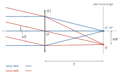
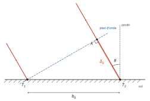
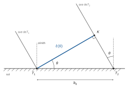
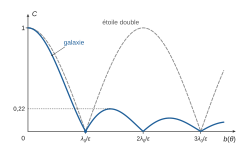
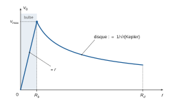
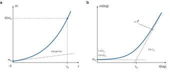

# Mines-Ponts MP — Physique 2 2026 · Corrigé guidé

*Corrigé rédigé par IA, non officiel. Signalez toute erreur.*

## Présentation du sujet

**Thème.** « De la physique avec les galaxies ». Le sujet aborde la galaxie par deux côtés totalement indépendants : comment on l'**observe** (optique, partie I) et comment on la **pèse** et suit sa croissance (mécanique, analyse vectorielle et lecture de graphes, partie II).

**Format.** 3 heures, calculatrice interdite, 22 questions numérotées de 1 à 22. Les applications numériques sont demandées avec **un chiffre significatif** et se font de tête.

Données : $G=6{,}7\times10^{-11}$ SI, $1\ \mathrm{pc}=3\times10^{16}$ m, 1 an $=3\times10^7$ s, $M_\odot=2\times10^{30}$ kg. La liste des données porte par erreur « $2^{30}$ kg » pour la masse du Soleil : la page 5 donne la bonne valeur, et il faut signaler la coquille sur la copie, comme le demande la consigne de l'épreuve.

**Découpage.**

| Partie | Questions | Contenu |
|---|---|---|
| I (préambule) | Q1 | domaine spectral |
| I.A Télescope unique | Q2–Q4 | images à l'infini, résolution du capteur, diffraction, diamètre utile maximal |
| I.B.1 Modèle équivalent | Q5–Q6 | différence de marche entre deux télescopes, base équivalente |
| I.B.2 Système équivalent | Q7–Q12 | trous d'Young, ordre d'interférence, sources incohérentes, brouillage, résolution, contraste d'une source étendue (sinus cardinal) |
| I.C $N$ télescopes | Q13 | interférences à $N$ ondes, qualitatif |
| II.A Répartition de masse | Q14–Q18 | orbite circulaire, théorème de Gauss gravitationnel, courbe de rotation, matière noire |
| II.B Formation d'étoiles | Q19–Q22 | loi de puissance en échelle log-log, équation différentielle à variables séparables, redshift, lecture de graphe |

**Notions du programme mobilisées.** Première année : optique géométrique (images dans le plan focal, rayon non dévié), mécanique du point (mouvement circulaire, forces centrales, lois de Kepler), analyse dimensionnelle. Deuxième année MP : superposition d'ondes lumineuses (formule de Fresnel, cohérence, trous d'Young, $N$ ondes), électrostatique et analogie gravitationnelle (théorème de Gauss, forme locale), équations différentielles.

**Difficulté.** Le rapport 2026 juge le sujet « très abordable et progressif », proche du cours. La partie I demande surtout des **schémas justes** et une bonne maîtrise du raisonnement par différence de marche (théorème de Malus) ; le seul vrai calcul est l'intégrale de la question 12. La partie II est plus classique (Gauss en symétrie sphérique, courbe de rotation) et se termine par des lectures de graphes qui demandent du soin.

**Questions à ne pas laisser passer.** Le rapport 2026 classe Q1, Q2, Q7, Q8, Q14, Q15 et Q16 parmi les questions de restitution du cours, et Q4, Q5, Q6, Q9, Q16 (seconde moitié) et Q19 parmi les exploitations immédiates de l'énoncé. Avec Q18 et Q21, elles représentent l'essentiel du barème probable.

**Questions discriminantes.** D'après le rapport 2026 :

- Q2 : construction d'images à l'infini, avec un taux de réponses correctes jugé anormalement bas ;
- Q7 et Q8 : les schémas corrects avec le théorème de Malus étaient rares, et ils conditionnent toute la suite ;
- Q9 à Q13 : peu traitées, beaucoup de candidats ayant abandonné la partie I ;
- Q19 à Q22 : sans prérequis, mais peu traitées ; les deux coefficients de Q19, l'intégration de Q20 et l'application numérique de Q21 ont rarement été justes.

**Gestion du temps.** Les deux parties sont indépendantes, et le rapport indique que la partie I représente la moitié de l'épreuve : comptez environ 1 h 30 pour chacune. Les questions 12, 13 et 20 sont les plus longues : ne pas s'y enliser au détriment des questions de cours de la partie II, ni de la fin du sujet, qui ne demande que de la lecture de graphes et du calcul soigné.

> [!JURY]
> Le rapport 2026 rappelle que les applications numériques étaient toutes gratifiées : « le résultat se présente au format scientifique, avec le nombre de chiffres significatifs spécifiés (ici, un seul pour des calculs faits à la main), et avec une unité. Un résultat sous forme de fraction ou de racine n'est pas pris en compte. » Il refuse aussi les acronymes non introduits (PRIL, BAME, PFD…) et les raccourcis du type « j'utilise Malus » : on nomme le théorème de Malus.

## Partie I — L'observation des galaxies

La partie montre qu'un télescope unique a une résolution limitée par son capteur et par la diffraction, puis qu'on la dépasse en combinant deux télescopes éloignés. Le dispositif devient un système de trous d'Young, et c'est la **disparition du contraste** des franges qui renseigne sur la taille angulaire de la source. Outils : optique géométrique, formule de Fresnel, cohérence, sommation d'intensités.

### Question 1

> [!INDICATION]
> Il suffit de connaître les bornes du domaine visible, en micromètres.

#### Solution

Le domaine visible s'étend de $0{,}4\ \mu$m (violet) à $0{,}8\ \mu$m (rouge) environ. Comme $\lambda_0=2{,}0\ \mu\mathrm m>0{,}8\ \mu\mathrm m$, **ces ondes appartiennent à l'infrarouge (proche infrarouge)**.

> [!JURY]
> Rapport 2026 : « Des réponses souvent fantaisistes à une question élémentaire. » Les bornes du visible et la position de l'ultraviolet et de l'infrarouge doivent être sues sans hésitation.

### I.A Télescope unique

On modélise le télescope par une lentille mince de focale $f'$ et de diamètre $D$, la caméra étant dans le plan focal image. On cherche ce qui limite la finesse des détails observables.

### Question 2

> [!INDICATION]
> Où se forme l'image d'un point situé à l'infini ? Quel rayon particulier permet de la placer sans calcul ?

> [!INDICATION]
> Attention à l'angle : le point $B$ est au bord de la galaxie, à $\epsilon/2$ de l'axe, et non à $\epsilon$.

> [!INDICATION]
> Deux images sont distinguées par le capteur si elles ne tombent pas sur la même cellule.

#### Solution

*Construction.* $A$ et $B$ sont à l'infini : les rayons issus de chacun arrivent parallèles entre eux. Par stigmatisme de la lentille dans les conditions de Gauss, chaque faisceau converge en un point du plan focal image.

- Les rayons issus de $A$ sont parallèles à l'axe : ils convergent au foyer image, $A'=F'$.
- Les rayons issus de $B$ sont inclinés de $\epsilon/2$ : ils convergent au point $B'$ du plan focal où arrive le rayon passant par le centre optique $O$, qui n'est pas dévié.

*Distance entre les images.* Le rayon non dévié fait l'angle $\epsilon/2$ avec l'axe ; dans les conditions de Gauss, cet angle est petit et

$$\boxed{A'B'=\frac{f'\epsilon}{2}}$$

*Résolution du capteur.* Les deux images sont séparées si $A'B'\geqslant a$, soit $\epsilon\geqslant2a/f'$ :

$$\boxed{r_{\rm cap}=\frac{2a}{f'}}$$

> [!METHODE]
> Image d'un point à l'infini dans la direction $\alpha$ : point du plan focal image situé à la distance $f'\alpha$ de l'axe (conditions de Gauss). Ce résultat sert dans toute la partie I : il convertit un angle en une position dans le plan d'observation.

> [!PIEGE]
> Les objets étant à l'infini, la relation de conjugaison de Descartes avec $\overline{OA}$ fini n'a pas de sens ici ; on raisonne directement sur les faisceaux parallèles.

> [!JURY]
> Rapport 2026 : « Les constructions doivent respecter le stigmatisme. » et « Dans les calculs, les conditions de Gauss imposent l'approximation des petits angles. » Le jury précise dans ses commentaires généraux qu'il refuse les écritures en arc tangente d'un sinus et leurs variantes : on écrit directement $f'\epsilon/2$.

### Question 3

> [!INDICATION]
> On demande un ordre de grandeur : quel est le seul angle que l'on peut former avec $\lambda_0$ et $D$ ?

> [!INDICATION]
> Pour appliquer le critère de l'énoncé, convertir l'ouverture angulaire de la tache en une taille dans le plan focal, puis la comparer à $A'B'$.

#### Solution

*Ouverture angulaire de la tache.* La diffraction par une pupille de taille $D$ étale la lumière dans un cône de demi-angle

$$\boxed{\theta_{\rm diff}\sim\frac{\lambda_0}{D}}$$

Le calcul pour une pupille circulaire donne $1{,}22\,\lambda_0/D$, préfacteur inutile en ordre de grandeur.

*Résolution.* La tache a dans le plan focal une taille caractéristique (rayon) $f'\lambda_0/D$. Les deux points sont distingués si

$$\begin{aligned}
\frac{f'\epsilon}{2}>\frac{f'\lambda_0}{D}
&\iff\epsilon>\frac{2\lambda_0}{D}\\
\boxed{r_{\rm diff}=\frac{2\lambda_0}{D}}&
\end{aligned}$$

> [!PIEGE]
> Comparer directement un angle ($\lambda_0/D$) à une longueur ($A'B'$) est une faute d'homogénéité : passer par le plan focal (facteur $f'$) ou tout raisonner en angles.

> [!JURY]
> Rapport 2026 : « On n'exige ici que l'ordre de grandeur de l'angle de diffraction. » Inutile de démontrer le facteur $1{,}22$ ; en revanche, annoncer la convention choisie (rayon ou diamètre de la tache) et la garder jusqu'à la question 4.

### Question 4

> [!INDICATION]
> Pour séparer deux points, les deux critères doivent être satisfaits simultanément : la résolution effective est la plus défavorable des deux.

> [!INDICATION]
> Laquelle des deux résolutions dépend de $D$ ? À partir de quand cesse-t-elle d'être la plus contraignante ?

#### Solution

La résolution effective est la plus grande des deux :

$$r=\max\left(\frac{2a}{f'},\frac{2\lambda_0}{D}\right)$$

Quand $D$ croît, $r_{\rm diff}$ diminue ; dès que $r_{\rm diff}<r_{\rm cap}$, c'est le capteur qui limite et la résolution n'augmente plus. Le diamètre limite vérifie $r_{\rm diff}=r_{\rm cap}$ :

$$\boxed{D_{\max}=\frac{\lambda_0f'}{a}}$$

*Application numérique.*

$$D_{\max}=\frac{2{,}0\times10^{-6}\times10}{1{,}0\times10^{-6}}\ \mathrm m=\underline{2\times10^{1}\ \mathrm m}$$

La résolution correspondante vaut $2\times10^{-7}$ rad.

*Commentaire.* C'est l'ordre de grandeur des plus grands télescopes actuels (8 à 10 m) et en construction (39 m pour l'ELT) : capteur et optique sont dimensionnés l'un pour l'autre. Pour profiter d'un miroir plus grand, il faut réduire $a$ ou allonger $f'$. Au sol, la turbulence atmosphérique limite en pratique la résolution, sauf optique adaptative.

> [!PIEGE]
> Ce n'est pas la somme des deux résolutions ni la plus petite des deux qui compte, mais la plus grande : il faut satisfaire les deux critères à la fois.

> [!JURY]
> Le rapport 2026 signale une « Question souvent non traitée qui faisait la synthèse des trois précédentes. » Pour le commentaire, il attend « une phrase courte qui exprime une idée de physique, une conséquence (et non pas une banalité sous forme de truisme) ».

### I.B Association de 2 télescopes

Deux télescopes séparés d'une base $b_0$ pointent dans la même direction ; leurs faisceaux sont recombinés. La sous-partie I.B.1 construit un modèle équivalent (des trous d'Young), la sous-partie I.B.2 l'exploite.

### Question 5

> [!INDICATION]
> La source est à l'infini : à quoi ressemblent ses surfaces d'onde au niveau du sol ?

> [!INDICATION]
> Tracer le plan d'onde passant par le télescope atteint en premier, et chercher sur l'autre rayon le chemin restant à parcourir. Un triangle rectangle d'hypoténuse $b_0$ apparaît.

> [!INDICATION]
> Pour la compensation : à quelle condition deux ondes issues d'un même point source peuvent-elles interférer ? Et la différence de marche reste-t-elle constante au cours d'une nuit ?

#### Solution

L'onde issue d'une source à l'infini est plane ; ses surfaces d'onde sont perpendiculaires à la direction de propagation, inclinée de $\theta$ sur la verticale. Sur la figure 2, la direction d'observation penche du côté de $T_1$, qui est donc atteint en premier.

Le plan d'onde passant par $T_1$ coupe en $K$ le rayon qui va vers $T_2$.

Le triangle $T_1KT_2$ est rectangle en $K$ ; l'angle en $T_2$, entre la base horizontale et le rayon, vaut $\pi/2-\theta$.

D'après le théorème de Malus, $T_1$ et $K$ sont sur le même plan d'onde, donc à même chemin optique de la source. La différence de marche est la longueur $KT_2=b_0\cos(\pi/2-\theta)$ :

$$\boxed{\delta_0(\theta)=b_0\sin\theta}$$

Contrôle : au zénith ($\theta=0$), les deux télescopes sont sur le même plan d'onde et $\delta_0=0$.

*Nécessité de la compensation.* Le but est d'**obtenir** des interférences. Critère du cours : deux ondes issues d'un même point source interfèrent si leur différence de marche reste inférieure à la longueur de cohérence $\ell_c$. Or, pour $b_0$ de quelques centaines de mètres, $\delta_0$ est de l'ordre de la centaine de mètres.

- La lumière réelle n'est pas monochromatique : sa longueur de cohérence $\ell_c=\lambda_0^2/\Delta\lambda$ reste au plus décimétrique, même avec un filtre étroit ($4$ mm pour $\Delta\lambda=1$ nm). Comme $\delta_0\gg\ell_c$, les faisceaux ne peuvent pas interférer sans compensation.
- Même dans le modèle monochromatique, $\delta_0(\theta)$ change avec la rotation de la Terre, à une vitesse pouvant atteindre $b_0\Omega_T\approx10^3\times7\times10^{-5}\approx7\ \mathrm{cm\cdot s^{-1}}$. Plusieurs dizaines de milliers de franges défileraient chaque seconde, et la figure serait brouillée pendant la pose.

Les miroirs mobiles (ligne à retard) doivent donc allonger le trajet du faisceau 1 de $\delta_0(\theta)$, **à chaque instant**.

> [!METHODE]
> Différence de marche entre deux points recevant une onde plane : projeter le vecteur qui les joint sur la direction de propagation. Ici $\delta_0=\overrightarrow{T_1T_2}\cdot\hat u$, avec $\hat u$ unitaire de la direction de propagation.

> [!PIEGE]
> Confondre $\sin\theta$ et $\cos\theta$ : le test du zénith ($\delta_0(0)=0$) tranche immédiatement.

> [!PIEGE]
> Croire que la compensation sert à éviter les interférences, ou évoquer, sans fondement, « une dégradation du signal ou une perte de qualité ». Le rapport 2026 juge ces commentaires « quasiment tous des contre-sens : il s'agit d'obtenir des interférences et non pas de les éviter ».

> [!JURY]
> Rapport 2026 : « Le calcul doit être justifié par un raisonnement sur les plans d'ondes (théorème de Malus). » et « Le critère du cours portant sur la longueur de cohérence doit être cité. »

### Question 6

> [!INDICATION]
> La distance entre deux droites parallèles se mesure sur une perpendiculaire commune.

> [!INDICATION]
> Réutiliser le triangle de la question 5 : le côté cherché est l'autre côté de l'angle droit.

#### Solution

Les axes optiques sont deux droites parallèles, inclinées de $\theta$ sur la verticale, passant par $T_1$ et $T_2$. La perpendiculaire commune menée de $T_1$ coupe l'axe de $T_2$ au point $K$ de la question 5.

Dans le triangle $T_1KT_2$ rectangle en $K$, d'hypoténuse $b_0$, le segment $T_1K$ fait l'angle $\theta$ avec l'horizontale :

$$\boxed{b(\theta)=T_1K=b_0\cos\theta}$$

Contrôle : $b^2+\delta_0^2=b_0^2$, et $b(0)=b_0$.

*Paramètre variable.* Les télescopes suivent l'astre au cours de la nuit. La Terre tournant, la direction de l'astre change dans le référentiel terrestre : $\theta$ varie, et avec lui $b(\theta)=b_0\cos\theta$, entre $b_0$ (astre au zénith) et $0$ (astre à l'horizon). La base équivalente est donc un paramètre que la rotation terrestre fait balayer, et que l'on va exploiter.

> [!METHODE]
> Ce qui compte pour un interféromètre n'est pas la distance au sol entre les télescopes, mais sa **projection perpendiculairement à la direction visée**. C'est elle qui joue le rôle de l'écartement des trous d'Young.

### Question 7

> [!INDICATION]
> Les deux fentes sont-elles atteintes en phase par l'onde issue de $A$ ? Toute la différence de marche naît alors après les fentes.

> [!INDICATION]
> Quels rayons convergent en $M(x)$ après la lentille ? Tracer le plan d'onde perpendiculaire à ces rayons et utiliser le théorème de Malus.

> [!INDICATION]
> Pour l'intensité, la formule de Fresnel avec deux ondes cohérentes de même intensité.

#### Solution

*Construction.* $A$ est à l'infini sur l'axe : les surfaces d'onde incidentes sont parallèles au plan des fentes, atteintes en phase.

En $M(x)$ convergent les rayons sortant des fentes parallèlement au rayon non dévié passant par $O$ et $M$, qui fait l'angle $\alpha=x/f'$ avec l'axe (conditions de Gauss).

Le plan d'onde perpendiculaire à ces rayons, mené par la fente $(2)$, coupe le rayon issu de $(1)$ en $H$. Par le retour inverse et le théorème de Malus, les chemins optiques de ce plan d'onde jusqu'à $M$ sont égaux. La différence de marche est donc la longueur $(1)H$, placée avant la lentille :

$$\begin{aligned}
\delta_A&=(1)H=b(\theta)\,\alpha=\frac{b(\theta)\,x}{f'}\\
\boxed{p_A(x)=\frac{b(\theta)\,x}{\lambda_0f'}}&
\end{aligned}$$

*Intensité.* Les deux ondes viennent du même point source : elles sont cohérentes. Chacune ayant l'intensité $I_0$, la formule de Fresnel donne

$$\begin{aligned}
I_A&=I_0+I_0+2\sqrt{I_0I_0}\cos(2\pi p_A)\\
\boxed{I_A(x)=2I_0\left[1+\cos\left(\frac{2\pi b(\theta)x}{\lambda_0f'}\right)\right]}&
\end{aligned}$$

**$I_0$ est l'intensité que donnerait en $M$ une seule voie (un seul télescope), l'autre étant masquée.**

*Allure.* Franges **rectilignes**, parallèles aux fentes, donc perpendiculaires à l'axe $Ox$ qui joint les fentes. Elles sont équidistantes, d'interfrange $\boxed{i=\dfrac{\lambda_0f'}{b(\theta)}}$, et de contraste $C=1$, puisque $I_{\min}=0$.

*Dépendance en $b(\theta)$.* **Le contraste ne dépend pas de $b(\theta)$** (il vaut toujours 1) ; **l'interfrange est inversement proportionnel à $b(\theta)$**.

> [!PIEGE]
> $I_0$ n'est ni l'intensité maximale ($4I_0$) ni l'intensité moyenne ($2I_0$).

> [!PIEGE]
> Calculer la différence de marche par la géométrie des trajets après la lentille. Le rapport 2026 explique pourquoi c'est faux : « Un calcul géométrique de la différence de marche n'est pas possible lorsqu'une lentille est mise en œuvre », car la traversée du verre ajoute un retard qui dépend du point de passage. Seul le théorème de Malus place correctement la différence de marche sur la figure.

> [!JURY]
> Rapport 2026 : « Le jury attendait des éléments très précis pour accorder les points à chaque sous-question. » Sur l'allure : « Les franges ne sont pas des bandes ni des traits ni des taches ni circulaires ou hyperboliques, elles sont rectilignes, et orientées perpendiculairement à l'axe des trous d'Young. » Le jury rappelle aussi que parler de l'intensité d'un rayon n'a pas de sens.

### Question 8

> [!INDICATION]
> Pour $B$, l'onde arrive inclinée : une différence de marche existe déjà à l'entrée des fentes, calculée comme à la question 5. Refaire la construction pour savoir si elle s'ajoute à celle de la question 7 ou s'en retranche.

> [!INDICATION]
> $A$ et $B$ sont deux points distincts de la galaxie : leurs ondes peuvent-elles interférer entre elles ? Qu'additionne-t-on alors ?

> [!INDICATION]
> Pour le brouillage, transformer la somme des deux cosinus en produit et isoler le facteur indépendant de $x$.

#### Solution

*Ordre d'interférence.* L'onde issue de $B$ arrive inclinée de $\epsilon/2$, du côté de la fente $(1)$ (figure 3(b)). Son plan d'onde atteint la fente $(1)$ en premier : avant les fentes, le trajet vers $(2)$ est plus long de $b(\theta)\epsilon/2$.

Après les fentes, le trajet par $(1)$ reste plus long de $b(\theta)x/f'$. Les deux contributions se retranchent :

$$\boxed{p_B(x)=\frac{b(\theta)}{\lambda_0}\left(\frac{x}{f'}-\frac{\epsilon}{2}\right)}$$

La frange d'ordre 0 de $B$ est en $x=f'\epsilon/2$, sur l'image géométrique de $B$ : la figure de $B$ est celle de $A$ translatée de $f'\epsilon/2$.

L'énoncé écrit ensuite $\mathrm dI_{\rm gal}$ avec le terme $x/f'+\alpha$, l'angle $\alpha$ y étant compté dans l'autre sens ($B$ correspond à $\alpha=-\epsilon/2$). Ce choix d'orientation ne change aucun contraste.

*Superposition.* $A$ et $B$ émettent indépendamment : le déphasage entre leurs ondes fluctue aléatoirement sur des durées très courtes devant le temps de réponse du détecteur, et le terme d'interférence croisé a une moyenne nulle. **Les sources sont incohérentes : on ajoute les intensités**, d'où la superposition des deux figures.

Avec $\Phi=2\pi b(\theta)x/(\lambda_0f')$ et $\psi=\pi b(\theta)\epsilon/(2\lambda_0)$ :

$$\begin{aligned}
I&=2I_0\left[2+\cos\Phi+\cos(\Phi-2\psi)\right]\\
&=4I_0\left[1+\cos\psi\,\cos(\Phi-\psi)\right]
\end{aligned}$$

L'interfrange est inchangé ; le contraste vaut $C=\left|\cos\psi\right|$.

*Brouillage.* $C=0$ quand les deux systèmes sont décalés d'un demi-interfrange :

$$\begin{aligned}
\frac{\pi b(\theta)\epsilon}{2\lambda_0}&=\frac\pi2+k\pi\\
\boxed{b(\theta)=(2k+1)\frac{\lambda_0}{\epsilon},\ k\in\mathbb N}&
\end{aligned}$$

> [!METHODE]
> Critère de brouillage pour deux sources ponctuelles incohérentes de même intensité : les franges disparaissent quand la différence des ordres d'interférence, $p_A-p_B$, est demi-entière (franges brillantes de l'une sur les franges sombres de l'autre). Pour une source étendue, le critère est différent : il porte sur la variation d'ordre d'environ 1 sur l'étendue de la source, comme le montrera la question 12.

> [!PIEGE]
> Oublier la différence de marche à l'entrée des fentes donne $p_B=p_A$ : la figure ne serait jamais brouillée et toute la suite tomberait.

> [!PIEGE]
> Justifier l'addition des intensités par le « théorème de superposition ». Rapport 2026 : « Ce n'est pas le théorème de superposition qui permet de dire qu'on additionne les intensités. Incohérence, asynchrone et déphasés sont des notions différentes. » La raison est l'incohérence des deux sources.

> [!JURY]
> Rapport 2026 : « Sans construction, il est impossible de valider la réponse. » Le signe devait être cohérent avec la nouvelle construction. Le jury note aussi que certains candidats retrouvent le bon critère de brouillage par le calcul du contraste à la question 9 sans corriger leur énoncé faux de la question 8.

### Question 9

> [!INDICATION]
> Choisir l'entier qui minimise la famille obtenue à la question 8.

> [!INDICATION]
> Pour la mesure : quel paramètre varie naturellement au cours de l'observation, et que faut-il repérer pour remonter à $\epsilon$ sans ambiguïté sur l'entier ?

#### Solution

La plus petite valeur correspond à $k=0$ :

$$\boxed{b_{\min}=\frac{\lambda_0}{\epsilon}}$$

*Mesure.* On suit le contraste des franges pendant que $b(\theta)$ varie (rotation terrestre, ou changement de paire de télescopes), en partant des petites bases. On note la base $b^\star$ de la **première** disparition des franges : alors $\epsilon=\lambda_0/b^\star$, en radians.

La distance $d$ étant connue et $\epsilon\ll1$, le diamètre de la galaxie vaut

$$\boxed{L=\epsilon d=\frac{\lambda_0d}{b^\star}}$$

> [!PIEGE]
> Une extinction quelconque ne suffit pas : l'entier $k$ serait inconnu. C'est la première qui donne $\epsilon$ sans ambiguïté.

### Question 10

> [!INDICATION]
> La mesure de la question 9 n'est possible que si la base critique est accessible. Que cela impose-t-il à $\epsilon$ ?

> [!INDICATION]
> Pour l'équivalence, comparer avec la forme de la résolution d'un télescope unique obtenue à la question 3.

#### Solution

$b(\theta)$ prend les valeurs de $[0,b_0]$. L'extinction n'est observable que si $\lambda_0/\epsilon\leqslant b_0$, c'est-à-dire $\epsilon\geqslant\lambda_0/b_0$ :

$$\boxed{r_{\rm double}=\frac{\lambda_0}{b_0}}$$

*Équivalence.* Un télescope unique de diamètre $D$ a une résolution $\sim\lambda_0/D$ (question 3, au facteur 2 de convention près). En remplaçant $D$ par $b_0$, on retrouve $r_{\rm double}$ : pour la résolution angulaire, le télescope double équivaut à un télescope unique de diamètre $b_0$.

*Application numérique.*

$$r_{\rm double}=\frac{2{,}0\times10^{-6}}{10^3}=\underline{2\times10^{-9}\ \mathrm{rad}}$$

C'est cent fois mieux que le télescope de $2\times10^1$ m de la question 4.

> [!JURY]
> Rapport 2026 : « Le résultat d'un calcul de petit angle est en radians et non en degrés. » Le jury tient l'unité radian pour indispensable, même sans dimension. L'équivalence n'est vraie qu'en ordre de grandeur : le dire plutôt que forcer une égalité stricte.

### Question 11

> [!INDICATION]
> Résolution et sensibilité ne dépendent pas de la même caractéristique de la pupille. De quoi dépend la quantité de lumière recueillie ?

#### Solution

La puissance recueillie est proportionnelle à la **surface collectrice**.

- Un télescope de diamètre $b_0$ collecte sur $\pi b_0^2/4$.
- Le télescope double ne collecte que sur ses deux pupilles, $2\pi D^2/4$.

Le rapport $2D^2/b_0^2$ vaut environ $2\times10^{-4}$ pour $D=10$ m et $b_0=1$ km. **Le télescope double a la résolution d'un télescope de diamètre $b_0$, mais pas sa sensibilité** : un objet peu lumineux ne fournit pas assez de flux pour être détecté.

> [!METHODE]
> Résolution : liée à l'**étendue** de la pupille (sa plus grande dimension). Sensibilité : liée à sa **surface**. L'interférométrie gagne la première, pas la seconde.

### Question 12

> [!INDICATION]
> Les étoiles de la galaxie sont des sources incohérentes entre elles. Quelles sont les bornes de $\alpha$, sachant que le centre est sur l'axe et que la galaxie est vue sous l'angle $\epsilon$ ?

> [!INDICATION]
> L'intégrale du cosinus fait apparaître une différence de deux sinus : utiliser la formule du formulaire et reconnaître un sinus cardinal.

> [!INDICATION]
> Pour distinguer galaxie et étoile double, comparer les deux fonctions contraste au-delà de leur première annulation.

#### Solution

$\alpha$ décrit $[-\epsilon/2,\epsilon/2]$ et les intensités s'ajoutent. On pose $\kappa=2\pi b(\theta)/\lambda_0$ et $\Phi=\kappa x/f'$ :

$$\begin{aligned}
I_{\rm gal}&=\Gamma\int_{-\epsilon/2}^{\epsilon/2}\left[1+\cos(\Phi+\kappa\alpha)\right]\mathrm d\alpha\\
&=\Gamma\epsilon+\frac\Gamma\kappa\left[\sin\left(\Phi+\frac{\kappa\epsilon}2\right)-\sin\left(\Phi-\frac{\kappa\epsilon}2\right)\right]
\end{aligned}$$

La formule $\sin p-\sin q=2\sin\frac{p-q}2\cos\frac{p+q}2$ transforme le second terme, avec $\kappa\epsilon/2=\pi b(\theta)\epsilon/\lambda_0$ :

$$\begin{aligned}
\frac\Gamma\kappa\left[\dots\right]&=\frac{2\Gamma}{\kappa}\sin\frac{\kappa\epsilon}2\cos\Phi\\
&=\Gamma\epsilon\,\mathrm{sinc}\left(\frac{\kappa\epsilon}2\right)\cos\Phi
\end{aligned}$$

$$\boxed{I_{\rm gal}(x)=\Gamma\epsilon\left[1+\mathrm{sinc}\left(\frac{\pi b(\theta)\epsilon}{\lambda_0}\right)\cos\left(\frac{2\pi b(\theta)x}{\lambda_0f'}\right)\right]}$$

Ce résultat vaut aussi pour $b=0$, puisque $\mathrm{sinc}(0)=1$.

*Contraste.*

$$\boxed{C=\left|\mathrm{sinc}\left(\frac{\pi b(\theta)\epsilon}{\lambda_0}\right)\right|}$$

*Allure* (en fonction de $b(\theta)$) :

| Point de la courbe | $b(\theta)$ | $C$ |
|---|---|---|
| origine | $0$ | $1$ |
| première annulation | $\lambda_0/\epsilon$ | $0$ |
| premier lobe secondaire | $\approx1{,}43\,\lambda_0/\epsilon$ | $0{,}22$ |
| deuxième annulation | $2\lambda_0/\epsilon$ | $0$ |
| deuxième lobe secondaire | $\approx2{,}46\,\lambda_0/\epsilon$ | $0{,}13$ |
| troisième annulation | $3\lambda_0/\epsilon$ | $0$ |

Le contraste décroît de 1 à 0 entre $b=0$ et $b=\lambda_0/\epsilon$, puis ne présente plus que des lobes de hauteur décroissante.

*Commentaire.* Quand la base augmente, les figures dues aux différents points de la galaxie se décalent les unes par rapport aux autres et se brouillent. La première annulation, en $b=\lambda_0/\epsilon$, coïncide avec celle du modèle à deux points : sa mesure donne $\epsilon$.

*Galaxie ou étoile double.* Pour deux points séparés de $\epsilon/2$, le contraste $\left|\cos\left(\pi b\epsilon/(2\lambda_0)\right)\right|$ est **périodique** en $b$.

Il revient à 1 pour $b=2\lambda_0/\epsilon$, $4\lambda_0/\epsilon$, etc. Pour la galaxie, $C$ reste inférieur à $0{,}22$ après la première annulation.

**Même première extinction ; c'est le comportement au-delà (retour à 1 ou lobes faibles décroissants) qui distingue l'étoile double de l'objet étendu.**

> [!METHODE]
> Source étendue incohérente : on somme les intensités élémentaires sur l'étendue angulaire. Le contraste est alors, au module près, la moyenne de $\cos$ de la phase sur la source, ce qui donne un sinus cardinal pour une source uniforme.

> [!PIEGE]
> Le contraste est positif par définition : écrire $C=|\mathrm{sinc}(\cdot)|$. Un sinus cardinal négatif correspond simplement à une inversion des franges brillantes et sombres.

> [!PIEGE]
> Perdre un facteur 2 dans la formule $\sin p-\sin q$. Le rapport 2026 note que les calculs de contraste sont souvent faux « par mauvaise application des formules d'addition en trigonométrie (les facteurs 2 et 1/2 sont mal gérés) ». Contrôle immédiat : pour $\epsilon\to0$, on doit retrouver $C=1$.

> [!JURY]
> Rapport 2026 : « Le calcul de l'intégrale (pourtant posée dans l'énoncé) est souvent fantaisiste : une intégrale possède des bornes que le contexte impose. » Ici, les bornes sont $\pm\epsilon/2$ parce que le centre de la galaxie est sur l'axe. Le graphe doit avoir ses axes légendés.

### I.C Association de $N$ télescopes

### Question 13

> [!INDICATION]
> Le dispositif équivaut à $N$ fentes équidistantes devant une lentille. Écrire la condition de l'énoncé (voisines en phase) en fonction de $x$ et de la direction de la source.

> [!INDICATION]
> Que deviennent les maxima quand $N$ grandit : leur position change-t-elle ? leur largeur ? Relier la largeur angulaire d'un pic à la résolution.

> [!INDICATION]
> « Dans quelle mesure » invite à dire aussi ce que l'analogie ne restitue pas.

#### Solution

*Dispositif.* $N$ fentes régulièrement espacées de $b(\theta)$ devant la lentille de focale $f'$, observation dans le plan focal image (comme la figure 3, avec $N$ ouvertures).

*Condition.* Pour une source dans la direction $\alpha$ (orientation de l'énoncé), deux voies voisines présentent en $M(x)$ la différence de marche $b(x/f'+\alpha)$. L'intensité n'est non nulle (pour $N$ grand) que si

$$\begin{aligned}
\frac{b(\theta)}{\lambda_0}\left(\frac{x}{f'}+\alpha\right)&=p\in\mathbb Z\\
x&=f'\left(p\frac{\lambda_0}{b(\theta)}-\alpha\right)
\end{aligned}$$

Hors de ces positions, le déphasage entre la première et la dernière voie atteint $2\pi$ pour un écart $N$ fois plus petit qu'avec deux voies : les $N$ ondes se répartissent sur tout le cercle des phases et s'annulent. Les maxima gardent l'espacement $\lambda_0f'/b$ mais deviennent des pics fins, de largeur angulaire $\sim\lambda_0/(Nb)$.

*Télescope de diamètre infini.* La position des pics dépend de la direction $\alpha$ : deux sources séparées de plus de $\lambda_0/(Nb)$ donnent des pics distincts. Cette résolution est celle d'un télescope de diamètre $\sim Nb$, qui tend vers l'infini avec $N$ : l'image d'un point source devient un point.

**Tout se passe comme pour un télescope de diamètre infiniment grand, mais seulement pour la résolution, et avec des limites :**

- les pics d'une même source se répètent avec la période angulaire $\lambda_0/b$ ; deux sources dont les directions diffèrent d'un multiple de $\lambda_0/b$ sont confondues, l'analogie ne vaut que dans un champ de largeur $\lambda_0/b$ ;
- la surface collectrice reste $N\pi D^2/4$ (question 11) ;
- $N$ est fini en pratique.

> [!METHODE]
> Pour $N$ ondes de phases en progression arithmétique, le raisonnement qualitatif suffit : positions des maxima fixées par l'accord de phase entre voisines, largeur des pics divisée par $N$. Le programme n'exige pas de calcul de la somme.

## Partie II — Quelques propriétés galactiques

La partie II pèse la galaxie par sa dynamique : orbite képlérienne autour du trou noir, champ d'un bulbe sphérique par le théorème de Gauss, courbe de rotation incompatible avec l'observation, d'où un halo de matière noire. Elle s'achève sur la croissance en masse des galaxies, à partir de lectures de graphes en échelle logarithmique.

### II.A Répartition de masse

### Question 14

> [!INDICATION]
> La force est centrale : que dit la projection du principe fondamental de la dynamique sur la direction orthoradiale ?

> [!INDICATION]
> La projection radiale relie $v^2/r$ à l'attraction. Attention aux conversions : kiloparsec en mètres, masse du Soleil en kilogrammes.

#### Solution

*Uniformité.* Dans le référentiel galactique supposé galiléen, en coordonnées polaires de centre $T$, l'accélération du mouvement circulaire s'écrit

$$\vec a=-r\dot\varphi^2\hat u_r+r\ddot\varphi\,\hat u_\varphi$$

La force $\vec F=-\dfrac{GM_TM_\odot}{r^2}\hat u_r$ est centrale. La projection du principe fondamental sur $\hat u_\varphi$ donne $r\ddot\varphi=0$ : $\dot\varphi$ est constant, et la norme $v=r|\dot\varphi|$ aussi. **Le mouvement est uniforme.**

*Vitesse et période.* La projection sur $\hat u_r$ donne $v^2/r=GM_T/r^2$, donc

$$\boxed{v(r)=\sqrt{\frac{GM_T}{r}}}$$

$$\boxed{\tau=\frac{2\pi r}{v}=2\pi\sqrt{\frac{r^3}{GM_T}}}$$

*Application numérique.*

$$\begin{aligned}
r&=8\times10^3\times3\times10^{16}\ \mathrm m=2{,}4\times10^{20}\ \mathrm m\\
M_T&=8\times10^{36}\ \mathrm{kg}\\
GM_T&\approx5{,}4\times10^{26}\ \mathrm{m^3\cdot s^{-2}}\\
v&=\sqrt{\frac{5{,}4\times10^{26}}{2{,}4\times10^{20}}}\approx\sqrt{2{,}2\times10^6}\ \mathrm{m\cdot s^{-1}}\\
v&\approx\underline{1\times10^{3}\ \mathrm{m\cdot s^{-1}}}
\end{aligned}$$

**Non** : c'est plus de cent fois moins que les $2\times10^5\ \mathrm{m\cdot s^{-1}}$ observés. Il faudrait une masse intérieure $v^2r/G\approx7\times10^{10}M_\odot$, environ $2\times10^4$ fois celle du trou noir.

> [!PIEGE]
> Uniforme ne veut pas dire rectiligne uniforme : l'accélération centripète n'est pas nulle. On peut aussi conclure par la puissance de la force, nulle car $\vec F$ est radiale et $\vec v$ orthoradiale.

> [!PIEGE]
> Invoquer la seule conservation du moment cinétique. Rapport 2026 : « Le moment cinétique constant ne suffit pas à lui seul à démontrer le caractère uniforme du mouvement. » Il faut ajouter que $r$ est constant, ou projeter le principe fondamental comme ci-dessus.

> [!JURY]
> Le rapport 2026 relève « Beaucoup de confusions » entre la norme de la vitesse constante et le vecteur vitesse constant, et demande d'annoncer la méthode employée : « on ne confond pas les coordonnées polaires et le repère de Frenet ». Il conseille de faire les calculs au brouillon pour éviter les développements « souvent indigestes ».

### Question 15

> [!INDICATION]
> Partir des deux lois de force entre objets ponctuels, en déduire les deux champs, puis établir le dictionnaire de correspondance.

> [!INDICATION]
> Bien garder le signe : l'une des interactions peut être répulsive, l'autre jamais.

#### Solution

*Forces.* On place en $O$ une charge $q_1$ ou une masse $m_1$, et en $M$ une charge $q_2$ ou une masse $m_2$.

La force exercée sur $M$ vaut, selon le cas,

$$\vec F_e=\frac{q_1q_2}{4\pi\varepsilon_0r^2}\hat u_r$$

$$\vec F_g=-\frac{Gm_1m_2}{r^2}\hat u_r$$

*Champs.* Avec $\vec F_e=q_2\vec E$ et $\vec F_g=m_2\vec g$, les champs créés par la source en $O$ sont

$$\vec E=\frac{q_1}{4\pi\varepsilon_0r^2}\hat u_r$$

$$\vec g=-\frac{Gm_1}{r^2}\hat u_r$$

Les deux champs sont radiaux, en $1/r^2$, et obéissent au principe de superposition. On passe de l'un à l'autre par la correspondance

$$q\longleftrightarrow m$$

$$\frac1{4\pi\varepsilon_0}\longleftrightarrow-G,\ \text{soit}\ \frac1{\varepsilon_0}\longleftrightarrow-4\pi G$$

Le théorème de Gauss électrostatique

$$\oint\!\!\!\!\oint_S\vec E\cdot\mathrm d\vec S=\frac{Q_{\rm int}}{\varepsilon_0}$$

ne repose que sur ces propriétés ; il se transpose en

$$\boxed{\oint\!\!\!\!\oint_S\vec g\cdot\mathrm d\vec S=-4\pi GM_{\rm int}}$$

$M_{\rm int}$ étant la masse intérieure à $S$. Le signe $-$ traduit le caractère toujours attractif de la gravitation.

> [!METHODE]
> Analogie électrostatique-gravitation : $q\to m$, $\dfrac{1}{4\pi\varepsilon_0}\to-G$. Tout résultat d'électrostatique fondé sur Gauss (champ d'une boule, d'une coquille, d'un plan) se transpose immédiatement.

> [!JURY]
> Rapport 2026 : « L'analogie doit être entièrement explicitée et partir de l'expression des forces. Analogie n'est pas identité, on ne veut pas de signe égal. » D'où les flèches de correspondance, et non une égalité entre $1/(4\pi\varepsilon_0)$ et $-G$.

### Question 16

> [!INDICATION]
> Étudier les invariances (de quelles variables dépend la norme du champ ?) puis les symétries (quelle est sa direction ?) de la distribution.

> [!INDICATION]
> Surface de Gauss : sphère de centre $T$ passant par $M$. La masse intérieure n'a pas la même expression dans le bulbe et à l'extérieur.

> [!INDICATION]
> Pour Kepler : à quel champ connu ressemble le champ à l'extérieur du bulbe ?

#### Solution

*Distribution.* Bulbe homogène de centre $T$, de masse $M_b=\frac43\pi R_b^3\mu_0$ ; disque assimilé au vide. On repère $M$ par ses coordonnées sphériques $(r,\theta,\varphi)$ de centre $T$.

*Invariances.* La distribution est invariante par toute rotation autour d'un axe passant par $T$ : la norme du champ ne dépend ni de $\theta$ ni de $\varphi$, seulement de $r$.

*Symétries.* Les plans $(M,\hat u_r,\hat u_\theta)$ et $(M,\hat u_r,\hat u_\varphi)$ contiennent $T$ : ce sont des plans de symétrie de la distribution. Le champ en $M$ appartient à leur intersection, la droite $(TM)$ :

$$\vec g(M)=g(r)\,\hat u_r$$

*Gauss* sur la sphère de centre $T$ et de rayon $r$, où $g(r)$ est uniforme :

$$4\pi r^2g(r)=-4\pi GM_{\rm int}(r)$$

- $r\leqslant R_b$ : $M_{\rm int}=M_br^3/R_b^3$, $\boxed{\vec g=-\dfrac{GM_b}{R_b^3}\,r\,\hat u_r}$.
- $R_b\leqslant r\leqslant R_d$ : $M_{\rm int}=M_b$, $\boxed{\vec g=-\dfrac{GM_b}{r^2}\hat u_r}$.

*Vitesse.* La projection radiale du principe fondamental donne $v_0^2/r=|g|$ :

$$\boxed{v_0=r\sqrt{\frac{GM_b}{R_b^3}}\quad(r\leqslant R_b)}$$

$$\boxed{v_0=\sqrt{\frac{GM_b}{r}}\quad(R_b\leqslant r\leqslant R_d)}$$

*Allure.* Croissance linéaire de 0 à $v_{\max}=\sqrt{GM_b/R_b}$ en $R_b$ (rotation d'ensemble du bulbe), puis décroissance en $1/\sqrt r$ jusqu'à $R_d$. La courbe est continue, avec un point anguleux en $R_b$.

*Kepler.* Pour $R_b\leqslant r\leqslant R_d$, le champ est celui d'une masse ponctuelle $M_b$ en $T$ : **le disque suit les lois de Kepler** ($\tau^2/r^3=4\pi^2/(GM_b)$). Dans le bulbe, le champ est proportionnel à $r$ : la période est la même pour tous les rayons, la troisième loi de Kepler n'y est pas vérifiée.

> [!PIEGE]
> Prendre $M_{\rm int}=M_b$ aussi dans le bulbe fait disparaître la partie linéaire et le maximum de la courbe.

> [!JURY]
> Rapport 2026 : « L'application du théorème de Gauss doit (bien évidemment) être précédée de l'analyse des symétries et invariances. Invoquer la symétrie sphérique ne suffit pas, on attend le développement complet. » Pour la courbe, le jury exige le graphe : « Il faut savoir représenter correctement l'allure de fonctions élémentaires, légender les axes, présenter convenablement un graphe. »

### Question 17

> [!INDICATION]
> Écrire le flux de deux manières pour un volume quelconque : par le théorème de Gauss (masse intérieure) et par Green-Ostrogradski.

> [!INDICATION]
> Dans le halo, que donne le principe fondamental pour une étoile en mouvement circulaire de vitesse $v_1$ ? Utiliser ensuite la divergence en coordonnées sphériques du formulaire.

> [!INDICATION]
> Pour l'analyse dimensionnelle, poser $\mu=k\,v_1^aG^br^c$ et résoudre le système sur les dimensions de masse, longueur et temps.

#### Solution

*Forme locale.* Pour tout volume $V$ de frontière $S$ :

$$\begin{aligned}
\oint\!\!\!\!\oint_S\vec g\cdot\mathrm d\vec S&=-4\pi G\iiint_V\mu\,\mathrm dV\\
\oint\!\!\!\!\oint_S\vec g\cdot\mathrm d\vec S&=\iiint_V\mathrm{div}\,\vec g\,\mathrm dV
\end{aligned}$$

L'égalité valant pour tout $V$, les intégrandes (continus) sont égaux :

$$\boxed{\mathrm{div}\,\vec g=-4\pi G\mu}$$

*Halo.* Mouvement circulaire de vitesse $v_1$ : $\vec g=-\dfrac{v_1^2}{r}\hat u_r$. Alors

$$\begin{aligned}
\mathrm{div}\,\vec g&=\frac1{r^2}\frac{\mathrm d(r^2g_r)}{\mathrm dr}\\
&=\frac{1}{r^2}\frac{\mathrm d(-v_1^2r)}{\mathrm dr}\\
&=-\frac{v_1^2}{r^2}
\end{aligned}$$

$$\boxed{\mu(r)=\frac{v_1^2}{4\pi Gr^2}}$$

*Analyse dimensionnelle.* Dimensions : $[\mu]=\mathrm{M\,L^{-3}}$, $[v_1]=\mathrm{L\,T^{-1}}$, $[G]=\mathrm{M^{-1}L^3T^{-2}}$ et $[r]=\mathrm L$. Avec $\mu=k\,v_1^aG^br^c$ :

$$\begin{aligned}
\text{masse :}&\quad-b=1\\
\text{temps :}&\quad-a-2b=0\\
\text{longueur :}&\quad a+3b+c=-3
\end{aligned}$$

D'où $b=-1$, $a=2$, $c=-2$ et $\mu=k\,v_1^2/(Gr^2)$. On retrouve le résultat, avec $k=1/(4\pi)$ que l'analyse dimensionnelle ne peut pas fournir.

Remarque : avec un bulbe sans effet, le théorème de Gauss intégral appliqué à cette densité donnerait $g=-v_1^2(r-R_b)/r^2$. Ce champ n'est égal à $-v_1^2/r$ que pour $r\gg R_b$ : le modèle de l'énoncé n'est rigoureusement cohérent que loin du bulbe.

> [!PIEGE]
> La divergence d'un champ radial en sphériques n'est pas $\partial g_r/\partial r$ : il faut le facteur $r^2$ à l'intérieur de la dérivée. Sans lui, ou avec $g_r>0$, on trouve une masse volumique négative, ce qu'un contrôle de signe détecte immédiatement.

### Question 18

> [!INDICATION]
> Découper le halo en coquilles sphériques : le facteur $r^2$ de l'élément de volume se simplifie avec $\mu(r)$.

> [!INDICATION]
> Le pourcentage se rapporte à la masse totale de la galaxie, pas à la seule masse visible.

#### Solution

$$\begin{aligned}
M_h&=\int_{R_b}^{R_h}\frac{v_1^2}{4\pi Gr^2}\,4\pi r^2\,\mathrm dr\\
\boxed{M_h=\frac{v_1^2(R_h-R_b)}{G}}&
\end{aligned}$$

*Application numérique.* $v_1^2=4\times10^{10}\ \mathrm{m^2\cdot s^{-2}}$ et $R_h-R_b=98\ \mathrm{kpc}\approx3\times10^{21}$ m :

$$\begin{aligned}
M_h&\approx\frac{4\times10^{10}\times3\times10^{21}}{6{,}7\times10^{-11}}\ \mathrm{kg}\approx\underline{2\times10^{42}\ \mathrm{kg}}\\
M_h&\approx\underline{9\times10^{11}\,M_\odot}
\end{aligned}$$

*Proportion.* Masse visible : $M_b=2\times10^{11}M_\odot$ (trou noir négligeable). La fraction de matière noire vaut

$$\frac{M_h}{M_h+M_b}\approx\frac9{11}\approx0{,}8$$

**La matière noire représente environ 80 % de la masse de la galaxie.**

> [!METHODE]
> Masse d'une distribution à symétrie sphérique : $M=\displaystyle\int4\pi r^2\mu(r)\,\mathrm dr$. Une densité en $1/r^2$ donne une masse proportionnelle au rayon, d'où le plateau de la courbe de rotation.

> [!PIEGE]
> Multiplier $\mu$ par le volume du halo. Le rapport 2026 rappelle la différence entre multiplier par le volume et intégrer sur le volume, « notamment quand la masse volumique est variable ». Il note une « A.N. peu traitée et souvent fausse ».

### II.B Formation d'étoiles

### Question 19

> [!INDICATION]
> Passer au logarithme décimal : quelle forme prend $\dot m=\alpha_0m^{\beta_0}$ dans les axes de la figure 6 ?

> [!INDICATION]
> Lire deux points éloignés de la droite pour la pente, puis calculer l'ordonnée en $\log m=0$, qui est hors du graphe.

> [!INDICATION]
> L'efficacité de la formation d'étoiles se juge par rapport à la masse déjà présente.

#### Solution

$\log\dot m=\log\alpha_0+\beta_0\log m$ : droite de pente $\beta_0$. On lit $\log\dot m=-0{,}8$ en $\log m=9{,}0$ et $1{,}6$ en $\log m=12{,}0$ :

$$\begin{aligned}
\beta_0&=\frac{1{,}6+0{,}8}{3{,}0}=0{,}8\\
\log\alpha_0&=-0{,}8-0{,}8\times9{,}0=-8{,}0
\end{aligned}$$

$$\boxed{\frac{\mathrm dm}{\mathrm dt}=\alpha_0m^{\beta_0}}$$

avec

$$\boxed{\alpha_0=10^{-8}}$$

$$\boxed{\beta_0=0{,}8}$$

($m$ en $M_\odot$, $\dot m$ en $M_\odot$/an.) Contrôle : en $\log m=10$, $\log\dot m=0$, conforme à la figure.

*Efficacité.* Le taux spécifique $\dot m/m=\alpha_0m^{\beta_0-1}=\alpha_0m^{-0{,}2}$ décroît avec $m$ car $\beta_0<1$ : **les galaxies peu massives forment chaque année une plus grande fraction de leur masse en étoiles.**

*Inversion.* Il faudrait que $\dot m/m$ croisse avec $m$ :

$$\boxed{\beta_0>1}$$

> [!PIEGE]
> Comparer les $\dot m$ conduit à la conclusion inverse (les galaxies massives forment plus d'étoiles en valeur absolue) : c'est le taux spécifique $\dot m/m$ qui mesure l'efficacité.

> [!PIEGE]
> Confondre logarithme décimal et népérien en passant de $\log\alpha_0=-8$ à $\alpha_0$ : les axes sont en $\log$ décimal, donc $\alpha_0=10^{-8}$ et non $\mathrm e^{-8}$. Le rapport 2026 le rappelle : « Un logarithme décimal n'est pas népérien. »

> [!JURY]
> Rapport 2026 : « La question 19 demandait les valeurs numériques des deux coefficients d'un ajustement affine donné sur un graphique : nous avons rarement eu les deux valeurs correctes. » Lire deux points éloignés sur la droite, pas sur le nuage de points.

### Question 20

> [!INDICATION]
> Équation à variables séparables : séparer, intégrer entre $0$ et $t$, puis isoler $m(t)$.

> [!INDICATION]
> Factoriser $m_0^{1-\beta_0}$ : le temps caractéristique apparaît comme ce qui divise $t$.

> [!INDICATION]
> Pour les régimes, développer pour $t$ petit devant ce temps, et négliger le 1 pour $t$ grand.

#### Solution

$m^{-\beta_0}\,\mathrm dm=\alpha_0\,\mathrm dt$, intégré de $0$ à $t$ ($\beta_0\neq1$) :

$$\frac{m^{1-\beta_0}-m_0^{1-\beta_0}}{1-\beta_0}=\alpha_0t$$

On pose

$$\boxed{\tau_0=\frac{m_0^{1-\beta_0}}{(1-\beta_0)\alpha_0}=\frac{m_0}{(1-\beta_0)\dot m(0)}}$$

et l'on obtient

$$\boxed{m(t)=m_0\left(1+\frac t{\tau_0}\right)^{\frac1{1-\beta_0}}=m_0\left(1+\frac t{\tau_0}\right)^5}$$

*Régimes.*

- $t\ll\tau_0$ : $m\simeq m_0(1+5t/\tau_0)=m_0+\alpha_0m_0^{\beta_0}t$, croissance **linéaire** au taux initial.
- $t\gg\tau_0$ : $m\simeq m_0(t/\tau_0)^5=[(1-\beta_0)\alpha_0t]^5$, croissance en **loi de puissance** $t^5$, indépendante de $m_0$ (la condition initiale est oubliée). Pas de divergence en temps fini car $\beta_0<1$.

*Allure.* Courbe croissante et convexe, tangente à l'origine de pente $\dot m(0)$, qui se redresse au-delà de $\tau_0$ (on a $m(\tau_0)=32\,m_0$).

*Ordre de grandeur.* Pour $m_0=10^{10}M_\odot$ : $\dot m(0)=1\ M_\odot$/an et $\tau_0=5\times10^{10}$ ans, plus que l'âge de l'Univers ; une telle galaxie serait encore dans le régime linéaire.

> [!METHODE]
> Pour une équation $\dot y=\alpha y^\beta$, mettre la solution sous la forme $y_0(1+t/\tau)^{n}$ fait apparaître d'un coup le temps caractéristique et les deux régimes.

> [!JURY]
> Rapport 2026 : la question a donné « De trop rares succès », à cause d'erreurs de calcul « dues à la négligence ». Surtout, « La discussion physique du résultat obtenu (mise en évidence d'un temps caractéristique ; description des régimes asymptotiques) relève de savoir-faire ordinaires en physique, mais cela n'a quasiment jamais été étudié. » Les deux régimes et $\tau_0$ rapportent des points à part entière.

### Question 21

> [!INDICATION]
> Inverser la relation donnée pour isoler $H_0\Delta t$, puis remarquer que $4/9$ est un carré parfait.

> [!INDICATION]
> Convertir $H_0$ en $\mathrm s^{-1}$ (le mégaparsec en mètres), puis $1/H_0$ en années.

#### Solution

La relation est valable pour $z>1$, donc pour $z=2$ :

$$\begin{aligned}
(H_0\Delta t)^{2/3}&=\frac{4}{3(1+z)}=\frac49\\
H_0\Delta t&=\left(\frac23\right)^3=\frac8{27}
\end{aligned}$$

Conversions :

$$\begin{aligned}
H_0&=\frac{7\times10^4}{3\times10^{22}}\ \mathrm{s^{-1}}\approx2{,}3\times10^{-18}\ \mathrm{s^{-1}}\\
\frac1{H_0}&\approx4{,}3\times10^{17}\ \mathrm s\approx1{,}4\times10^{10}\ \text{ans}\\
\Delta t&\approx0{,}30\times1{,}4\times10^{10}\ \text{ans}\approx\underline{4\times10^9\ \text{ans}}
\end{aligned}$$

$$\boxed{\Delta t\approx4\ \text{milliards d'années}}$$

> [!PIEGE]
> La formule ne vaut que pour $z>1$ : l'appliquer à $z=0$ donnerait environ 22 milliards d'années, incompatible avec les 13,8 annoncés.

> [!JURY]
> Rapport 2026 : « L'application numérique de la question 21 était souvent commencée mais rarement terminée et souvent fausse. » Mener les conversions jusqu'au bout (mégaparsec en mètres, secondes en années) et conclure en milliards d'années, comme le demande l'énoncé.

### Question 22

> [!INDICATION]
> En échelle logarithmique, un rapport constant entre deux grandeurs se traduit par un décalage vertical constant. Lire ce décalage à masse fixée.

> [!INDICATION]
> Pour l'explication, s'appuyer sur ce que dit l'énoncé de la compétition entre l'apport de matière par la toile cosmique et la consommation dans les étoiles.

#### Solution

*Lecture.* À masse fixée, les deux séquences de la figure 7 sont décalées d'environ $1{,}5$ décade :

| $\log m$ | $\log\dot m$ à $z=2$ | $\log\dot m$ à $z=0$ |
|---|---|---|
| $9$ | $0{,}7$ | $-0{,}8$ |
| $10$ | $1{,}5$ | $0{,}0$ |
| $12$ | $3{,}0$ | $1{,}6$ |

Le décalage est quasi constant, donc

$$\frac{\dot m(z=2)}{\dot m(z=0)}\approx10^{1{,}5}\approx\underline{3\times10^1}$$

**À masse égale, le taux de formation d'étoiles a été divisé par environ 30 entre $z=2$ (il y a une dizaine de milliards d'années) et $z=0$** : $\alpha_0$ a diminué d'un facteur $\approx30$, $\beta_0$ restant à peu près le même.

*Explication.* Le taux de formation dépend de la réserve de gaz froid :

- à $z=2$, l'Univers, plus jeune et plus dense, alimentait abondamment les galaxies en gaz frais par les filaments de la toile cosmique ;
- depuis, l'expansion a dilué la matière et réduit cet apport, et le gaz présent a été consommé par les étoiles déjà formées.

Les galaxies actuelles vivent sur un réservoir appauvri. La loi $\dot m=\alpha_0m^{\beta_0}$ décrit la dépendance en masse à une époque donnée, mais son coefficient dépend de l'époque.

> [!PIEGE]
> Un écart de $1{,}5$ sur un axe logarithmique est un **facteur** $10^{1{,}5}\approx30$, pas une différence de $1{,}5\ M_\odot$/an.

## Bilan

**Méthodes à retenir.**

- Image d'un point à l'infini : plan focal, distance $f'\alpha$ à l'axe dans les conditions de Gauss ; résolution limitée à la fois par le capteur et par la diffraction ($\sim\lambda/D$).
- Différence de marche pour une onde plane : projection de la base sur la direction de propagation (théorème de Malus) ; base équivalente = projection perpendiculaire à la visée.
- Trous d'Young à l'infini : $\delta=bx/f'$, interfrange $\lambda f'/b$, construction par le théorème de Malus (jamais par la géométrie des trajets après la lentille).
- Sources incohérentes : on ajoute les **intensités** ; brouillage quand les ordres diffèrent d'un demi-entier ; source étendue uniforme : contraste en $|\mathrm{sinc}|$.
- Interférométrie : la résolution vient de l'étendue de la base, la sensibilité de la surface collectrice.
- Analogie électrostatique-gravitation à partir des forces, puis théorème de Gauss précédé d'une étude complète des symétries et invariances ; passage à la forme locale par Green-Ostrogradski « pour tout volume ».
- Courbe de rotation : $v^2/r=GM_{\rm int}/r^2$ ; plateau $\Leftrightarrow$ $M_{\rm int}\propto r$ $\Leftrightarrow$ $\mu\propto1/r^2$.
- Lois de puissance : droites en log-log décimal ; équation $\dot m=\alpha m^\beta$ à variables séparables, temps caractéristique et régimes limites.

**Ce que le jury a sanctionné en 2026.** Constructions d'optique sans stigmatisme ni théorème de Malus (Q2, Q7, Q8) ; commentaires à contre-sens sur la compensation de la différence de marche (Q5) ; calculs de contraste faux d'un facteur 2 (Q8, Q12) ; Gauss appliqué sans étude des symétries (Q16) ; masse obtenue en multipliant par le volume au lieu d'intégrer (Q18) ; applications numériques inachevées ou sans unité (Q14, Q18, Q21).

**Prérequis à revoir.** Optique géométrique de première année (faisceaux parallèles, plan focal) ; formule de Fresnel et notion de cohérence ; divergence en coordonnées sphériques ; conversions astronomiques (parsec, année, masse solaire).

**Questions classiques transposables.** Mesure d'un diamètre angulaire par l'annulation du contraste (interféromètre stellaire de Michelson, fentes d'Young éclairées par une fente source large) ; réseau et finesse des pics à $N$ ondes ; champ d'une boule homogène ; courbe de rotation et matière noire ; lecture d'une loi de puissance sur un graphe log-log.
