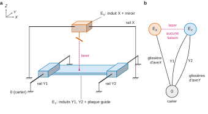
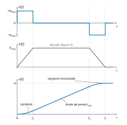
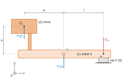
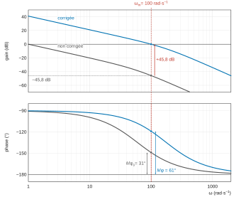
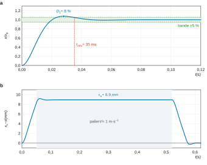

# Mines-Ponts MP — Sciences industrielles 2026 · Corrigé brut

*Corrigé rédigé par IA, non officiel. Signalez toute erreur.*

Machine à gravure laser hautes performances. Épreuve de 3 heures, calculatrice interdite. Certaines questions s'appuient sur des documents du cahier de réponses, non reproduits dans le sujet (schémas proposés en Q1, données de la vis-écrou en Q4, courbes des Q23-Q24) : le corrigé reconstruit ce qui peut l'être à partir de l'énoncé et le signale.

## 1. Présentation

### Question 1

**Classes d'équivalence.**

- $0$ : carter machine, source laser, périscope, poutre rigide, inducteur X et rail X, inducteurs Y1, Y2 et rails Y1, Y2 (tous rigidement liés au carter).
- $E_X$ : induit X + miroir de découpe (le miroir est encastré sur l'induit X).
- $E_Y$ : induits Y1 et Y2 + plaque guide (rigidement liés entre eux).

**Liaisons.** L'inducteur d'un MLS n'est pas en contact avec l'induit : le moteur n'introduit aucune liaison, il exerce seulement un effort. Le guidage est assuré par les rails :

- une **glissière de direction $\vec X$** entre $0$ et $E_X$ (rail X) ;
- **deux glissières de direction $\vec Y$, en parallèle**, entre $0$ et $E_Y$ (rails Y1 et Y2).

Les deux translations sont indépendantes par rapport au carter : l'axe X n'est pas monté sur l'axe Y. Il n'y a **aucune liaison mécanique entre $E_X$ et $E_Y$** ; le faisceau laser ne réalise qu'un couplage optique.

**Le schéma à retenir est celui qui comporte deux chaînes indépendantes issues du carter : une glissière d'axe $\vec X$ pour l'ensemble (induit X + miroir) et deux glissières parallèles d'axe $\vec Y$ pour l'ensemble (induits Y1, Y2 + plaque guide).** Les deux glissières parallèles de l'axe Y sont surabondantes : le montage exige des rails Y1 et Y2 parallèles.

## 2. Restriction du cadre de l'étude

Aucune question : la suite porte sur le seul axe X.

## 3. Étude de la durée d'un cycle de gravure pour l'axe X (exigence 1.1)

### Question 2

On note $t_1=V_{max}/a_{max}$ et $t_2=t_f-t_1$.

**Accélération** : profil en créneaux, discontinu aux instants $0$, $t_1$, $t_2$ et $t_f$.

$$
\ddot x(t)=\begin{cases}
+a_{max} & t\in\,]0,t_1[\\[2pt]
0 & t\in\,]t_1,t_2[\\[2pt]
-a_{max} & t\in\,]t_2,t_f[
\end{cases}
$$

**Position** : on intègre deux fois avec $x(0)=0$, en gardant $x$ et $\dot x$ continues.

$$
x(t)=\begin{cases}
\tfrac12 a_{max}t^2 & t\in[0,t_1]\\[2pt]
\tfrac12 a_{max}t_1^2+V_{max}(t-t_1) & t\in[t_1,t_2]\\[2pt]
d-\tfrac12 a_{max}(t_f-t)^2 & t\in[t_2,t_f]
\end{cases}
$$

Arc de parabole tourné vers le haut, segment de droite de pente $V_{max}$ raccordé tangentiellement, arc de parabole tourné vers le bas arrivant en $x=d$ avec une tangente horizontale (figure 2, proportions de temps non à l'échelle).

### Question 3

La distance $d$ est l'aire sous le trapèze de vitesse. Les phases d'accélération et de décélération durent chacune $t_1=V_{max}/a_{max}$ et couvrent chacune $V_{max}^2/(2a_{max})$. Le palier dure $t_f-2t_1$ :

$$
\begin{aligned}
d&=2\,\frac{V_{max}^2}{2a_{max}}+V_{max}\left(t_f-2\frac{V_{max}}{a_{max}}\right)\\
&=V_{max}t_f-\frac{V_{max}^2}{a_{max}}
\end{aligned}
$$

d'où

$$
\boxed{t_f=\frac{d}{V_{max}}+\frac{V_{max}}{a_{max}}}
$$

Cette expression est valable si le palier existe, c'est-à-dire si $d\ge V_{max}^2/a_{max}=0{,}05$ m. C'est le cas, puisque $d=0{,}52$ m.

Application numérique :

$$
\begin{aligned}
t_f&=\frac{0{,}52}{1}+\frac{1}{20}\\
&=0{,}57\ \text{s}
\end{aligned}
$$

avec $t_1=0{,}05$ s et $t_2=0{,}52$ s.

Durée d'un cycle de plaque : $N$ lignes horizontales et $N$ lignes verticales, chacune en $t_f$, transferts négligés :

$$
\boxed{T=2N\,t_f}
$$

La figure 5 indique un transfert de 1 mm entre deux lignes sur une zone utile de 50 cm, d'où $N=500$ :

$$
\begin{aligned}
T&=2\times500\times0{,}57\\
&=570\ \text{s}\\
&=9\ \text{min}\ 30\ \text{s}
\end{aligned}
$$

**Conclusion.** L'exigence 1.1.2 limite la plaque à $50\times50\ \mathrm{cm^2}$ : on a traité la plus grande plaque autorisée, donc le cas le plus défavorable. L'exigence 1.1.1 impose un temps de gravure d'au plus 10 min, soit 600 s. On obtient $T=570$ s, et $570\ \text{s}<600\ \text{s}$ : **les exigences 1.1.1 et 1.1.2 sont satisfaites**, avec une marge faible (5 %). Si l'on comptait $N=520$ lignes sur toute la course, on aurait $T\approx593$ s, encore conforme.

Remarque sur l'énoncé : l'accélération demande $V_{max}^2/(2a_{max})=25$ mm, alors que la figure 5 ne réserve que 10 mm de part et d'autre de la zone utile. La vitesse n'est donc constante qu'environ 15 mm après l'entrée dans la zone utile. Cela ne modifie pas $t_f$, qui ne dépend que de $d$, $V_{max}$ et $a_{max}$.

## 4. Comparaison entre MLS et (moteur rotatif + système vis-écrou) (exigences 1.2.1 et 1.2.2)

### Question 4

On note (1) l'ensemble en rotation (rotor du moteur + vis), de moment d'inertie $J_1$ autour de son axe, de vitesse angulaire $\omega$. On note (2) l'ensemble en translation (écrou + chariot + miroir), de masse $m_2$, de vitesse $V$. Les notations exactes et les valeurs sont celles du cahier de réponses, non reproduit.

Énergie cinétique (rotation autour d'un axe fixe + translation) :

$$
E_c(1+2/0)=\tfrac12J_1\omega^2+\tfrac12m_2V^2 .
$$

Loi entrée-sortie de la liaison hélicoïdale de pas $p_v$ (avance $p_v$ par tour) : $V=\dfrac{p_v}{2\pi}\omega$, donc $\omega=\dfrac{2\pi}{p_v}V$ et

$$
E_c(1+2/0)=\frac12\left[m_2+J_1\left(\frac{2\pi}{p_v}\right)^2\right]V^2 .
$$

Par identification avec $E_c(1+2/0)=\tfrac12m_{eq1}V^2$ :

$$
\boxed{m_{eq1}=m_2+J_1\left(\frac{2\pi}{p_v}\right)^2}
$$

S'il y a plusieurs pièces tournantes (rotor, accouplement, vis) à la même vitesse $\omega$, $J_1$ est la somme de leurs inerties.

**Application numérique** : elle s'obtient en remplaçant $m_2$, $J_1$ et $p_v$ par les valeurs du cahier de réponses, non disponibles ici. Le terme ramené $J_1(2\pi/p_v)^2$ est d'autant plus grand que le pas est petit : il s'ajoute à la masse réellement translatée.

### Question 5

Avec le MLS, l'ensemble (induit X + miroir) est en translation rectiligne de vitesse $V=\dot x$ par rapport à 0, sans aucune pièce en rotation :

$$
E_c(1+2/0)=\tfrac12(m_1+m_2)V^2
$$

donc

$$
\begin{aligned}
m_{eq2}&=m_1+m_2\\
&=4+6\\
&=\boxed{10\ \text{kg}}
\end{aligned}
$$

**Conclusion.** L'exigence 1.2.1 fixe la masse en translation de l'axe X à 6 kg : c'est la masse du miroir, charge utile. Le MLS n'y ajoute que l'induit (4 kg) et aucune inertie de rotation ramenée. La solution rotative ajoute au contraire à la masse translatée le terme $J_1(2\pi/p_v)^2$, amplifié par le carré du rapport de transmission.

L'exigence 1.2.2 impose $a_{max}=20\ \mathrm{m\cdot s^{-2}}$ et $V_{max}=1\ \mathrm{m\cdot s^{-1}}$. À force motrice bornée, l'accélération accessible vaut $F_m/m_{eq}$ : la masse équivalente plus faible du MLS permet d'atteindre $a_{max}$ avec un effort modéré. S'y ajoutent l'absence de jeu et d'usure de transmission et l'absence de vitesse critique de vis. **La solution MLS retenue par le constructeur est la plus favorable vis-à-vis des exigences 1.2.1 et 1.2.2.**

## 5. Dimensionnement d'un MLS (exigence 1.2.2)

### Question 6

Ensemble isolé $E=\{1,2\}$, en translation rectiligne de direction $\vec X$ par rapport à $R$ galiléen. Pour tout point $P$ de $E$ :

$$
\begin{aligned}
\vec\Omega(E/R)&=\vec0\\
\vec V(P\in E/R)&=\dot x\,\vec X
\end{aligned}
$$

On fait un bilan de puissances, et non un bilan d'actions mécaniques : chaque action est associée à sa puissance dans le mouvement de $E$ par rapport à $R$.

**Puissances extérieures.**

- Pesanteur : $\mathcal P=(-m_1g\vec Z-m_2g\vec Z)\cdot\dot x\vec X=0$, car le mouvement est horizontal.
- Guidage $0\to1$ : liaison glissière parfaite, sa puissance est nulle par définition d'une liaison parfaite.

$$
\begin{aligned}
\mathcal P(0\to1/R)&=\vec R_{0\to1}\cdot\dot x\vec X+\vec M_{M,0\to1}\cdot\vec 0\\
&=X_{01}\,\dot x\\
&=0
\end{aligned}
$$

- Moteur : l'inducteur est lié à 0, l'action motrice est donc extérieure à $E$.

$$
\begin{aligned}
\mathcal P(\text{mot}\to1/R)&=F_m\vec X\cdot\dot x\vec X+\vec0\cdot\vec\Omega(1/R)\\
&=F_m\,\dot x
\end{aligned}
$$

**Puissance intérieure** : la seule liaison intérieure est l'encastrement 1-2, sans mouvement relatif, donc $\mathcal P_{int}=0$.

$$
\boxed{\begin{aligned}
\mathcal P_{ext}(\bar E\to E/R)&=F_m\,\dot x\\
\mathcal P_{int}(E)&=0
\end{aligned}}
$$

### Question 7

**Théorème de l'énergie-puissance** (énergie cinétique) : pour un ensemble $E$ de solides en mouvement par rapport à un référentiel galiléen $R$,

$$
\frac{\mathrm dE_c(E/R)}{\mathrm dt}=\mathcal P_{ext}(\bar E\to E/R)+\mathcal P_{int}(E).
$$

Ici $E$ est en translation, donc $E_c(E/R)=\tfrac12(m_1+m_2)\dot x^2$, et le théorème donne

$$
(m_1+m_2)\,\dot x\,\ddot x=F_m\,\dot x .
$$

Pour $\dot x\neq0$ on simplifie par $\dot x$. La relation s'étend aux instants isolés où $\dot x=0$ par continuité (ou en projetant le théorème de la résultante dynamique sur $\vec X$) :

$$
\boxed{F_m=(m_1+m_2)\,\ddot x=m_{eq2}\,\ddot x}
$$

### Question 8

On utilise $F_m=m_{eq2}\ddot x$ avec $m_{eq2}=10$ kg :

- $t\in[0\,;0{,}05]$ s (accélération) : $\ddot x=20\ \mathrm{m\cdot s^{-2}}$, $F_m=+200$ N ;
- $t\in[0{,}05\,;0{,}52]$ s (palier) : $\ddot x=0$, $F_m=0$ (liaisons parfaites) ;
- $t\in[0{,}52\,;0{,}57]$ s (décélération) : $F_m=-200$ N.

La phase dimensionnante est l'accélération (ou la décélération, au signe près) :

$$
\begin{aligned}
|F_m|_{max}&=m_{eq2}\,a_{max}\\
&=10\times20\\
&=\boxed{200\ \text{N}}
\end{aligned}
$$

**Conclusion.** L'exigence 1.2.2 impose $a_{max}=20\ \mathrm{m\cdot s^{-2}}$ et $V_{max}=1\ \mathrm{m\cdot s^{-1}}$. Pour la tenir, il faut $|F_m|_{max}=200$ N. La documentation donne une force motrice maximale $F_{m\text{-}max}=1000$ N. Comme $200\ \text{N}<1000$ N, **le moteur peut produire l'effort requis** (marge d'un facteur 5) : l'exigence 1.2.2 est respectée du point de vue de la motorisation.

### Question 9

La glissière parfaite d'axe $\vec X$ autorise le seul mouvement $\{\mathcal V(1/0)\}=\{\vec0\,;\,\dot x\vec X\}$. Sa puissance est nulle pour tout $\dot x$ : $X_{01}\dot x=0$, donc $X_{01}=0$.

$$
\boxed{\{T_{0\to1}\}=\left\{\begin{array}{l}\vec R_{0\to1}=Y_{01}\vec Y+Z_{01}\vec Z\\ \vec M_{M,0\to1}=L_{01}\vec X+M_{01}\vec Y+N_{01}\vec Z\end{array}\right\}_M}
$$

Cinq inconnues, qui correspondent aux cinq limites données par le constructeur.

### Question 10

**Démarche.** On isole $E=\{1,2\}$ dans $R$ galiléen.

Actions extérieures : pesanteur sur 1 (en $G_1$) et sur 2 (en $G_2$), guidage $\{T_{0\to1}\}$, action motrice $\{T_{Moteur\to1}\}=\{F_m\vec X\,;\,\vec0\}_{G_1}$.

On applique le principe fondamental de la dynamique : théorème de la résultante dynamique et théorème du moment dynamique en $M$, point de réduction des limites du constructeur. On obtient six équations pour six inconnues : $F_m$ et les cinq composantes de $\{T_{0\to1}\}$.

**Positions.**

$$
\begin{aligned}
\overrightarrow{MG_1}&=-l\,\vec Y\\
\overrightarrow{MG_2}&=\overrightarrow{MG_1}+\overrightarrow{G_1G_2}=-(l+b)\,\vec Y+a\,\vec Z
\end{aligned}
$$

**Torseur dynamique.** Chaque solide est en translation : $\vec\delta(G_i,i/R)=\vec0$ et $\vec a(G_i)=\ddot x\vec X$. Avec $\vec Y\wedge\vec X=-\vec Z$ et $\vec Z\wedge\vec X=\vec Y$ :

$$
\begin{aligned}
\vec\delta(M,E/R)&=\sum_i m_i\,\overrightarrow{MG_i}\wedge\ddot x\vec X\\
&=m_1l\ddot x\,\vec Z+m_2\left[(l+b)\ddot x\,\vec Z+a\ddot x\,\vec Y\right]\\
&=\ddot x\left[m_2a\,\vec Y+\big(m_1l+m_2(l+b)\big)\vec Z\right]
\end{aligned}
$$

La résultante dynamique vaut $(m_1+m_2)\ddot x\,\vec X$.

**Moments en $M$ des actions extérieures** ($\vec Y\wedge\vec Z=\vec X$) :

- pesanteur : $\overrightarrow{MG_1}\wedge(-m_1g\vec Z)+\overrightarrow{MG_2}\wedge(-m_2g\vec Z)=\big(m_1l+m_2(l+b)\big)g\,\vec X$ ;
- moteur : $\overrightarrow{MG_1}\wedge F_m\vec X=lF_m\,\vec Z$ ;
- guidage : $L_{01}\vec X+M_{01}\vec Y+N_{01}\vec Z$.

**Équations.** Projections de la résultante sur la base, puis du moment en $M$ sur la même base, dans l'ordre $(\vec X,\vec Y,\vec Z)$ :

$$
\begin{aligned}
F_m&=(m_1+m_2)\,\ddot x\\
Y_{01}&=0\\
Z_{01}-(m_1+m_2)\,g&=0\\
L_{01}+\big(m_1l+m_2(l+b)\big)g&=0\\
M_{01}&=m_2\,a\,\ddot x\\
N_{01}+l\,F_m&=\big(m_1l+m_2(l+b)\big)\ddot x
\end{aligned}
$$

En reportant $F_m=(m_1+m_2)\ddot x$ dans la dernière équation, les termes en $l$ disparaissent :

$$
\boxed{\begin{aligned}
Y_{01}&=0\\
Z_{01}&=(m_1+m_2)\,g\\
L_{01}&=-\big[m_1l+m_2(l+b)\big]g\\
M_{01}&=m_2\,a\,\ddot x\\
N_{01}&=m_2\,b\,\ddot x
\end{aligned}}
$$

$Z_{01}$ et $L_{01}$ reprennent le poids et son moment (efforts statiques) ; $M_{01}$ et $N_{01}$ sont dus à l'inertie du miroir excentré de $a$ et $b$.

### Question 11

$Y_{01}$, $Z_{01}$ et $L_{01}$ sont constants ; $M_{01}$ et $N_{01}$ sont proportionnels à $\ddot x$.

La phase la plus contraignante est donc celle où $|\ddot x|=a_{max}$ : accélération sur $[0\,;0{,}05]$ s ou décélération sur $[0{,}52\,;0{,}57]$ s, avec les mêmes valeurs absolues.

On prend $g=9{,}81\ \mathrm{m\cdot s^{-2}}$ et $m_1l+m_2(l+b)=0{,}4+1{,}2=1{,}6$ kg·m. Les limites sont celles du constructeur pour une durée de vie de 100 000 km du guidage :

| Composante | Expression | Valeur | Limite | Taux d'utilisation |
|---|---|---|---|---|
| $Y_{01}$ | $0$ | $0$ N | $<1$ kN | 0 % |
| $Z_{01}$ | $(m_1+m_2)g$ | $98$ N | $<1$ kN | 10 % |
| $L_{01}$ | $-[m_1l+m_2(l+b)]g$ | $-15{,}7$ N·m | $<20$ N·m | 78 % |
| $M_{01}$ | $m_2a\,a_{max}$ | $\pm8{,}4$ N·m | $<80$ N·m | 11 % |
| $N_{01}$ | $m_2b\,a_{max}$ | $\pm12$ N·m | $<80$ N·m | 15 % |

**Conclusion.** Chaque composante est inférieure à sa limite : **le guidage intégré au moteur supporte les efforts, l'exigence 1.2.2 est validée**. La composante la plus proche de sa limite est le moment $|L_{01}|\approx16$ N·m, soit environ 80 % de 20 N·m. Il est d'origine statique (porte-à-faux du miroir) et présent même à l'arrêt ; les efforts dynamiques restent faibles.

## 6. Étude du synchronisme pour un MLS (exigence 1.2.3)

### Question 12

Pour $m\in\{A,B,C\}$, on part de $u_m=r_mi_m+\dfrac{\mathrm d\varphi_m}{\mathrm dt}$ avec $\varphi_m=\sum_jL_{mj}i_j+\varphi_{mM}$. Les inductances sont constantes, donc

$$
\frac{\mathrm d\varphi_m}{\mathrm dt}=\sum_jL_{mj}\frac{\mathrm di_j}{\mathrm dt}+\frac{\mathrm d\varphi_{mM}}{\mathrm dt}.
$$

On obtient bien $\vec U=[R]\vec I+[L]\dfrac{\mathrm d\vec I}{\mathrm dt}+\vec E$, avec

$$
[R]=\begin{pmatrix}r_A&0&0\\0&r_B&0\\0&0&r_C\end{pmatrix}
$$

et

$$
[L]=\begin{pmatrix}L_{AA}&M_{AB}&M_{AC}\\M_{BA}&L_{BB}&M_{BC}\\M_{CA}&M_{CB}&L_{CC}\end{pmatrix}.
$$

En dérivant $\varphi_V\cos(kx(t)-\phi)$, $\phi\in\{0,2\pi/3,4\pi/3\}$, par rapport au temps (fonction composée) :

$$
\boxed{\vec E=\begin{pmatrix}e_A\\e_B\\e_C\end{pmatrix}=-k\,\varphi_V\,\frac{\mathrm dx}{\mathrm dt}(t)\begin{pmatrix}\sin\big(kx(t)\big)\\ \sin\big(kx(t)-2\pi/3\big)\\ \sin\big(kx(t)-4\pi/3\big)\end{pmatrix}}
$$

### Question 13

On pose $\theta_j=\theta-2j\pi/3$ et $\psi_j=kx-2j\pi/3$ pour $j=0,1,2$. Alors

$$
\vec E\cdot\vec I=-k\varphi_V\dot x\,I_m\sum_{j=0}^{2}\sin\psi_j\cos\theta_j .
$$

La formule $\sin p\cos q=\tfrac12[\sin(p+q)+\sin(p-q)]$ donne, pour chaque $j$,

$$
\sin\psi_j\cos\theta_j=\tfrac12\left[\sin(kx-\theta)+\sin\!\left(kx+\theta-\tfrac{4j\pi}{3}\right)\right].
$$

Le premier terme ne dépend pas de $j$. Pour le second, on pose $\alpha=kx+\theta$ et on utilise la $2\pi$-périodicité, puis $\sin(\alpha+\beta)+\sin(\alpha-\beta)=2\sin\alpha\cos\beta$ :

$$
\begin{aligned}
\sum_{j=0}^{2}\sin\!\left(\alpha-\tfrac{4j\pi}{3}\right)&=\sin\alpha+\sin\!\left(\alpha-\tfrac{4\pi}{3}\right)+\sin\!\left(\alpha-\tfrac{8\pi}{3}\right)\\
&=\sin\alpha+\sin\!\left(\alpha+\tfrac{2\pi}{3}\right)+\sin\!\left(\alpha-\tfrac{2\pi}{3}\right)\\
&=\sin\alpha+2\sin\alpha\cos\tfrac{2\pi}{3}\\
&=0 .
\end{aligned}
$$

Il reste

$$
\begin{aligned}
\sum_{j=0}^2\sin\psi_j\cos\theta_j&=\tfrac32\sin(kx-\theta)\\
\vec E\cdot\vec I&=\tfrac32k\varphi_VI_m\,\dot x\,\sin(\theta-kx)
\end{aligned}
$$

Le bilan $F_m\dot x=\vec E\cdot\vec I$ donne, pour $\dot x\neq0$ :

$$
\boxed{F_m=K\,I_m\sin(\theta-kx)}
$$

avec

$$
\boxed{K=\frac32\,k\,\varphi_V}
$$

$K$ s'exprime en $\mathrm{V\cdot s\cdot m^{-1}}=\mathrm{N\cdot A^{-1}}$.

### Question 14

À $I_m$ fixé, $F_m$ est indépendante de $x$ et de $t$ si et seulement si

$$
\boxed{\theta(t)-k\,x(t)=\text{constante}}
$$

La valeur $\pi/2$ de cette constante donne la poussée maximale $F_m=KI_m$ pour $I_m$ donné. En dérivant :

$$
\begin{aligned}
\omega=\frac{\mathrm d\theta}{\mathrm dt}&=k\,\frac{\mathrm dx}{\mathrm dt}\\
\frac{\omega}{k}&=V
\end{aligned}
$$

**Grandeurs synchrones : la pulsation électrique $\omega$ des courants d'alimentation et la vitesse de déplacement $V$ de l'induit** (au facteur $k$ près). Autrement dit, l'onde de courant créée par l'induit doit défiler à la vitesse de l'induit par rapport au réseau d'aimants de l'inducteur. Comme $V$ varie au cours du trapèze, la phase $\theta$ doit être calculée en permanence à partir de la mesure de la position $x$ (autopilotage).

## 7. Conception de l'asservissement d'un MLS (exigences 1.2.4 et 1.2.5)

### 7.1. Retour sur le comportement dynamique de l'axe en translation

### Question 15

Le schéma-blocs donne $V=\dfrac{1}{M_{eq}p}(F_m-\mu V)$, soit $V(M_{eq}p+\mu)=F_m$ :

$$
\boxed{\begin{aligned}
H_{mec}(p)&=\frac{1}{\mu+M_{eq}p}\\
&=\frac{1/\mu}{1+\frac{M_{eq}}{\mu}p}\\
&=\frac{1}{1+10\,p}
\end{aligned}}
$$

Premier ordre de gain statique $1/\mu=1\ \mathrm{m\cdot s^{-1}\cdot N^{-1}}$ et de constante de temps $M_{eq}/\mu=10$ s.

### 7.2. Étude de la boucle de vitesse (exigence 1.2.4)

### Question 16

On note $\mathrm{FTBO}_v$ la fonction de transfert en boucle ouverte de la boucle de vitesse. Avec $C_v=K_V$ :

$$
\mathrm{FTBO}_v(p)=K_VAH_{mec}(p)=\frac{50K_V}{1+10p}
$$

Elle est de **classe 0**. La boucle fermée est un premier ordre stable. Pour $v_c=v_0u(t)$, le théorème de la valeur finale donne

$$
\varepsilon_V(\infty)=\lim_{p\to0}p\,\frac{v_0/p}{1+\mathrm{FTBO}_v(p)}=\frac{v_0}{1+50K_V}\neq0 .
$$

L'exigence de précision demande une erreur statique nulle pour un échelon de vitesse. **L'écart statique n'est jamais nul pour un gain fini : la correction proportionnelle ne satisfait pas l'exigence de précision.**

### Question 17

Avec le correcteur proportionnel intégral :

$$
C_v(p)=K_v\left(1+\frac{1}{T_vp}\right)=K_v\,\frac{1+T_vp}{T_vp}
$$

La boucle ouverte devient

$$
\mathrm{FTBO}_v(p)=\frac{K_vA(1+T_vp)}{T_vp\,(\mu+M_{eq}p)}
$$

Elle est de **classe 1**. Le dénominateur de la boucle fermée est

$$
D(p)=M_{eq}T_vp^2+(\mu T_v+K_vAT_v)\,p+K_vA .
$$

C'est un polynôme du second degré à coefficients strictement positifs pour $K_v>0$ et $T_v>0$ : la boucle fermée est stable. Le théorème de la valeur finale donne alors

$$
\varepsilon_V(\infty)=\lim_{p\to0}\frac{v_0}{1+\mathrm{FTBO}_v(p)}=0 .
$$

**Le correcteur PI est pertinent : écart statique nul pour un échelon de vitesse.**

### Question 18

Le choix $T_v=M_{eq}/\mu=10$ s compense le pôle mécanique par le zéro du correcteur :

$$
\begin{aligned}
\mathrm{FTBO}_v(p)&=\frac{K_vA}{\mu T_v\,p}\\
&=\frac{cK_v}{p}
\end{aligned}
$$

avec

$$
\begin{aligned}
c&=\frac{A}{\mu T_v}=\frac{A}{M_{eq}}\\
&=5\ \mathrm{m\cdot s^{-2}\cdot A^{-1}}
\end{aligned}
$$

ce qui est la valeur de l'énoncé. Avec retour unitaire :

$$
\begin{aligned}
\frac{V(p)}{V_c(p)}&=\frac{cK_v/p}{1+cK_v/p}\\
&=\frac{1}{1+\frac{p}{cK_v}}
\end{aligned}
$$

d'où

$$
\boxed{\begin{aligned}
K_X&=1\\
\tau_X&=\frac{1}{c\,K_v}
\end{aligned}}
$$

La bande passante à $-3$ dB d'un premier ordre est $\omega_c=1/\tau_X=cK_v$. Le cahier des charges impose $\omega_c=60$ rad/s :

$$
\begin{aligned}
K_v&=\frac{60}{c}=\boxed{12\ \mathrm{A\cdot s\cdot m^{-1}}}\\
\tau_X&=\frac1{60}\approx1{,}7\cdot10^{-2}\ \text{s}
\end{aligned}
$$

### Question 19

Critère par critère, valeur exigée par l'annexe 5 puis valeur obtenue :

- **Précision** : exigé, erreur statique nulle pour $v_c=v_0u(t)$. Obtenu : boucle ouverte de classe 1 (intégrateur du PI), boucle fermée stable, gain statique $K_X=1$, donc écart statique nul (Q17). **Respecté.**
- **Rapidité** : exigé, bande passante à $-3$ dB en boucle fermée égale à 60 rad/s. Obtenu : $1/\tau_X=cK_v=5\times12=60$ rad/s. **Respecté.**
- Stabilité (non demandée explicitement) : premier ordre de pôle $-60\ \mathrm{s^{-1}}$, stable, sans dépassement ; marge de phase de 90°.

**Tous les critères du cahier des charges de la boucle de vitesse sont respectés** (exigence 1.2.4), avec $K_X=1$ et $\tau_X=1/60$ s pour la suite.

Vérification de saturation : à $t=0^+$ d'un échelon $v_0=1\ \mathrm{m\cdot s^{-1}}$, $i_c=K_vv_0=12$ A, soit $F_m=600\ \text{N}<1000$ N.

### 7.3. Étude de la boucle de position (exigence 1.2.5.1 et 1.2.5.2)

### Question 20

$$
\begin{aligned}
\mathrm{FTBO}_X(p)&=C_X(p)\,\frac{K_X}{1+\tau_Xp}\,\frac1p\\
&=K\,\frac{1+aTp}{1+Tp}\cdot\frac{1}{p\,(1+p/60)}
\end{aligned}
$$

Le correcteur à avance de phase a un gain statique fini non nul ($C_X(0)=K$) : il ne retire pas l'intégrateur $1/p$ (passage de la vitesse à la position). La boucle ouverte est donc **de classe 1**. La boucle fermée étant stable après réglage, pour $x_c=x_0u(t)$ :

$$
\varepsilon_X(\infty)=\lim_{p\to0}\frac{x_0}{1+\mathrm{FTBO}_X(p)}=0 .
$$

**L'exigence d'écart statique nul est satisfaite.**

Pour une rampe $x_c=Vt$, l'écart de traînage vaut

$$
\begin{aligned}
\varepsilon_{tr}&=\lim_{p\to0}\frac{V}{p\,\big(1+\mathrm{FTBO}_X(p)\big)}\\
&=\frac{V}{KK_X}\\
&=\frac{V}{K}
\end{aligned}
$$

Le retard de traînage vaut donc $\varepsilon_{tr}/V=1/K$ : le critère « retard $<0{,}01$ s » impose $K>100\ \mathrm{s^{-1}}$.

### Question 21

À $\omega_m=\dfrac1{T\sqrt a}$, on a $aT\omega_m=\sqrt a$ et $T\omega_m=1/\sqrt a$, donc

$$
\begin{aligned}
|C_X(j\omega_m)|&=K\,\frac{\sqrt{1+a}}{\sqrt{1+1/a}}\\
&=K\sqrt a
\end{aligned}
$$

et

$$
\boxed{C_{X,\mathrm{dB}}(\omega_m)=20\log K+10\log a}
$$

### Question 22

**Étapes de réglage.**

1. Choisir $\omega_m$ égale à la pulsation de coupure à 0 dB souhaitée : $\boxed{\omega_m=\omega_{0dB}=100\ \mathrm{rad\cdot s^{-1}}}$.
2. Lire sur la réponse fréquentielle non corrigée la phase à $\omega_m$ et en déduire la marge qu'on aurait sans apport de phase : $M\varphi_0=180°+\arg\mathrm{FTBO}_0(j\omega_m)$.
3. Phase à apporter : $\varphi_m=60°-M\varphi_0$ (éventuellement majorée de quelques degrés). En déduire $a=\dfrac{1+\sin\varphi_m}{1-\sin\varphi_m}$ puis $T=\dfrac1{\omega_m\sqrt a}$.
4. Lire le gain non corrigé $G_0(\omega_m)$ en dB et choisir $K$ tel que $G_0(\omega_m)+20\log K+10\log a=0$ (Q21).
5. Vérifier les autres critères : retard de traînage $1/K<0{,}01$ s, temps de réponse à 5 %.

**Valeurs.** La boucle ouverte non corrigée est $\mathrm{FTBO}_0(p)=\dfrac{1}{p(1+p/60)}$, avec $C_X=1\ \mathrm{s^{-1}}$, $K_X=1$ et $\tau_X=1/60$ s. À 100 rad/s :

$$
\begin{aligned}
\arg\mathrm{FTBO}_0(j100)&=-90°-\arctan(100/60)\\
&\approx-149°
\end{aligned}
$$

D'où $M\varphi_0\approx31°$ et un besoin de $29°$ :

$$
\boxed{\begin{aligned}
\omega_m&=100\ \mathrm{rad\cdot s^{-1}}\\
\varphi_m&\approx30°
\end{aligned}}
$$

### Question 23

Relevés à $\omega_m=100$ rad/s sur la réponse fréquentielle non corrigée :

$$
\begin{aligned}
|\mathrm{FTBO}_0(j100)|&=\frac{1}{100\sqrt{1+(100/60)^2}}\approx5{,}1\cdot10^{-3}\\
G_0(100)&\approx-45{,}8\ \text{dB}\\
\arg\mathrm{FTBO}_0(j100)&\approx-149°
\end{aligned}
$$

Paramètres, dans l'ordre :

$$
\begin{aligned}
a&=\frac{1+\sin30°}{1-\sin30°}=\frac{1+0{,}5}{1-0{,}5}=3\\
T&=\frac{1}{100\sqrt3}\approx5{,}8\cdot10^{-3}\ \text{s}\\
20\log K&=45{,}8-10\log3\approx45{,}8-4{,}8=41{,}0\ \text{dB}
\end{aligned}
$$

On a $aT\approx1{,}7\cdot10^{-2}$ s ; les cassures sont à $1/(aT)\approx58$ rad/s et $1/T\approx173$ rad/s. Enfin $K=10^{41/20}\approx1{,}1\cdot10^2\ \mathrm{s^{-1}}$ :

$$
\boxed{\begin{aligned}
a&=3\\
T&\approx5{,}8\cdot10^{-3}\ \text{s}\\
K&\approx112\ \mathrm{s^{-1}}
\end{aligned}}
$$

**Tracés à reporter sur le cahier** (figure 4) : verticale à 100 rad/s, lecture de $-45{,}8$ dB sur la courbe réelle et remontée jusqu'à 0 dB ; sur la phase, le point à $-149°$ et la marge mesurée depuis $-180°$. Valeurs de contrôle :

| $\omega$ (rad/s) | 10 | 58 | 100 | 173 | 300 |
|---|---|---|---|---|---|
| gain non corrigé (dB) | $-20{,}1$ | $-38{,}1$ | $-45{,}8$ | $-54{,}5$ | $-63{,}7$ |
| phase non corrigée | $-99{,}5°$ | $-134{,}0°$ | $-149{,}0°$ | $-160{,}9°$ | $-168{,}7°$ |
| gain corrigé (dB) | $21{,}0$ | $5{,}4$ | $0$ | $-6{,}5$ | $-14{,}2$ |
| phase corrigée | $-92{,}9°$ | $-107{,}4°$ | $-119{,}0°$ | $-134{,}3°$ | $-149{,}6°$ |

**Vérifications.**

- Stabilité (exigence 1.2.5.2) : exigé, marge de phase de l'ordre de 60° à $\omega_{0dB}=100$ rad/s. Obtenu : coupure à 0 dB à 100 rad/s et marge $180°-119°=61°$. **Respecté.**
- Retard de traînage (exigence 1.2.5.1) : exigé, moins de 0,01 s. Obtenu : $1/K\approx8{,}9$ ms. **Respecté.**

## 8. Synthèse

### Question 24

**Temps de réponse à 5 %.** Sur la réponse à l'échelon unitaire, on trace la bande $[0{,}95\,;1{,}05]$ et on repère l'instant à partir duquel la courbe n'en sort plus. La réponse présente un dépassement d'environ 8 % vers $t\approx28$ ms, puis entre définitivement dans la bande vers

$$
t_{r5\%}\approx35\ \text{ms}<0{,}1\ \text{s}.
$$

**Le critère de rapidité ($t_{r5\%}<0{,}1$ s) est respecté.**

**Retard de traînage.** Sur la réponse au profil de position issu du trapèze, pendant le palier à $V=1\ \mathrm{m\cdot s^{-1}}$ ($t\in[0{,}05\,;0{,}52]$ s), consigne et réponse sont deux droites parallèles de pente $V$. On mesure leur décalage horizontal, ou l'écart vertical divisé par $V$. L'écart de position vaut environ 8,9 mm, soit

$$
\tau_{tr}=\frac{\varepsilon_{tr}}{V}\approx8{,}9\ \text{ms}<10\ \text{ms},
$$

conforme à la prévision $1/K$ de la Q20. **Le critère de retard de traînage (moins de 0,01 s) est respecté**, avec peu de marge ; l'écart revient à zéro à l'arrêt (écart statique nul).

**Conclusion.** Le correcteur

$$
C_X(p)=112\,\frac{1+1{,}7\cdot10^{-2}p}{1+5{,}8\cdot10^{-3}p}
$$

satisfait l'ensemble du cahier des charges de la boucle de position : écart statique nul, retard de traînage $<0{,}01$ s, marge de phase d'environ 60° à 100 rad/s, $t_{r5\%}<0{,}1$ s. Les exigences 1.2.5.1 et 1.2.5.2 sont validées.
