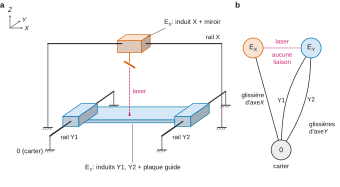
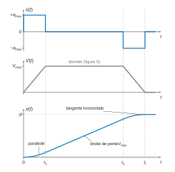
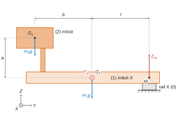
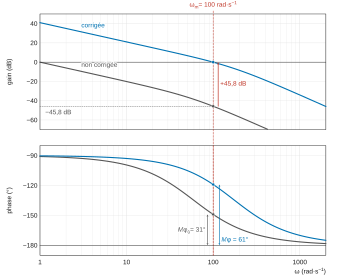
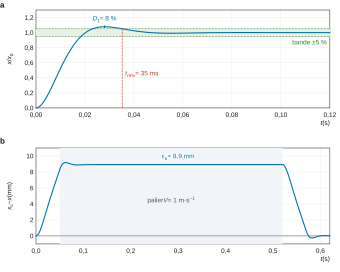

# Mines-Ponts MP — Sciences industrielles 2026 · Corrigé guidé

*Corrigé rédigé par IA, non officiel. Signalez toute erreur.*

## Présentation du sujet

**Thème.** Machine à gravure laser hautes performances de la société PHLOX. La machine grave par balayage laser un guide d'onde en PMMA qui sert de rétroéclairage (*backlight*) pour le contrôle optique. La qualité de la gravure exige une vitesse constante sur la zone utile et un positionnement très précis. Le sujet suit un fil unique : partir de la loi de mouvement imposée par le procédé, puis vérifier exigence par exigence (diagramme de l'annexe 1) que la motorisation par moteur linéaire synchrone (MLS), son guidage et sa commande tiennent les performances.

**Format.** 3 heures, calculatrice interdite, 24 questions (Q1 à Q24), réponses sur un cahier de réponses de 12 pages. Ce cahier contient des documents absents de l'énoncé : schémas cinématiques à choisir (Q1), données de la vis-écrou (Q4), diagramme de Bode non corrigé (Q22-Q23) et réponses temporelles (Q24). Ce corrigé les reconstruit à partir de l'énoncé quand c'est possible et le signale.

**Découpage.**

| Partie | Questions | Contenu |
|---|---|---|
| 1. Présentation | Q1 | choix du schéma cinématique des deux axes |
| 2. Restriction du cadre | aucune | l'étude porte désormais sur l'axe X |
| 3. Cycle de gravure (exigence 1.1) | Q2–Q3 | trapèze de vitesse, temps de cycle, durée de gravure d'une plaque |
| 4. MLS ou vis-écrou (1.2.1, 1.2.2) | Q4–Q5 | masses équivalentes par l'énergie cinétique |
| 5. Dimensionnement du MLS (1.2.2) | Q6–Q11 | bilan des puissances, théorème de l'énergie cinétique, force motrice, torseur de glissière, principe fondamental de la dynamique, limites du guidage |
| 6. Synchronisme (1.2.3) | Q12–Q14 | équations électriques matricielles, force de poussée triphasée, autopilotage |
| 7. Asservissement (1.2.4, 1.2.5) | Q15–Q23 | modèle mécanique, boucle de vitesse P puis PI, boucle de position avec avance de phase |
| 8. Synthèse | Q24 | temps de réponse à 5 % et retard de traînage |

**Notions du programme mobilisées.** Modélisation cinématique (classes d'équivalence, liaisons normalisées), loi de mouvement en trapèze de vitesse, énergie cinétique et masse équivalente, transmetteur vis-écrou, puissances extérieures et intérieures, théorème de l'énergie cinétique, torseur des actions transmissibles par une liaison parfaite, principe fondamental de la dynamique pour un ensemble en translation (moment dynamique), modèle électrique d'un actionneur, fonctions de transfert, schéma-blocs, classe et précision, théorème de la valeur finale, premier ordre et bande passante, diagrammes de Bode, marge de phase, correcteurs P, PI et à avance de phase.

**Difficulté.** Moyenne, sujet très progressif et sans grand calcul. Les points délicats : le moment dynamique en $M$ (Q10), la somme trigonométrique triphasée (Q13), la démarche de réglage de l'avance de phase et la lecture des tracés (Q22 à Q24). Les parties sont en grande partie indépendantes : un blocage en partie 5 ou 6 n'empêche pas de traiter la partie 7.

**Ce qu'en dit le jury (rapport 2026).** Le sujet a globalement été traité jusqu'au bout. Le rapport ne détaille que les questions propres à la filière MP (Q1, Q6, Q7, Q12, Q13, Q14). Q1 est jugée simple et globalement réussie, Q7 et Q14 assez bien traitées, Q12 correctement réussie malgré des erreurs de produit matriciel. Les deux questions qui ont fait la différence sont **Q13**, avec peu de réponses justes à cause des simplifications trigonométriques, et **Q6**, où le bilan des puissances est souvent confondu avec un bilan d'actions mécaniques. Le jury insiste aussi, pour toute l'épreuve, sur les unités, l'homogénéité et la vérification chiffrée et explicite des exigences.

**Questions à ne pas laisser passer.** Q1, Q2, Q3, Q5 à Q9, Q12, Q14, Q15 à Q19, Q21 : du cours appliqué, rapide et sûr.

**Gestion du temps.** Environ 7 minutes par question en moyenne. Prévoir un quart d'heure pour Q10-Q11 et autant pour Q22-Q23 avec leurs tracés. Sans calculatrice, préparer quelques valeurs ($\sqrt3\approx1{,}73$, $\log3\approx0{,}48$, $\arctan(5/3)\approx59°$).

## 1. Présentation

On identifie les classes d'équivalence et les liaisons à partir de la seule description textuelle, appuyée par les figures 4 et annexe 2.

### Question 1

> [!INDICATION]
> Commencer par lister ce qui est rigidement lié au carter, puis ce qui bouge avec l'axe X et ce qui bouge avec l'axe Y.

> [!INDICATION]
> Se demander quelles pièces sont en contact : l'inducteur et l'induit d'un MLS le sont-ils ? Qui assure alors le guidage ?

> [!INDICATION]
> Relire la phrase de l'énoncé sur les mouvements de translation indépendants par rapport au carter : l'axe X est-il porté par l'axe Y ?

#### Solution

**Classes d'équivalence.**

- $0$ : carter machine, source laser, périscope, poutre rigide, inducteur X et rail X, inducteurs Y1, Y2 et rails Y1, Y2.
- $E_X$ : induit X + miroir de découpe.
- $E_Y$ : induits Y1 et Y2 + plaque guide.

**Liaisons.** L'inducteur n'est pas en contact avec l'induit : le moteur exerce un effort mais ne constitue pas une liaison. Le guidage est réalisé par les rails :

- une **glissière d'axe $\vec X$** entre $0$ et $E_X$ ;
- **deux glissières d'axe $\vec Y$ en parallèle** entre $0$ et $E_Y$.

Les deux mouvements sont indépendants par rapport au carter, et **aucune liaison ne relie $E_X$ à $E_Y$** (le faisceau laser n'est qu'un couplage optique).

**Le schéma à choisir comporte deux chaînes issues directement du carter : une glissière d'axe $\vec X$ pour (induit X + miroir), deux glissières parallèles d'axe $\vec Y$ pour (induits Y1, Y2 + plaque guide).** Les deux glissières de l'axe Y sont surabondantes et imposent des rails parallèles.

> [!PIEGE]
> Trois schémas faux classiques : l'axe X monté sur l'axe Y (table croisée), une liaison supplémentaire dessinée au niveau du moteur, une seule glissière pour l'axe Y alors que l'énoncé insiste sur deux MLS et deux rails.

## 3. Étude de la durée d'un cycle de gravure pour l'axe X (exigence 1.1)

La partie 2 ne contient pas de question : elle restreint l'étude à l'axe X. La partie 3 exploite la loi en trapèze de vitesse pour calculer le temps de gravure d'une plaque. Outils : intégration et dérivation de fonctions affines par morceaux, aire sous une courbe.

### Question 2

> [!INDICATION]
> L'accélération est la dérivée de la vitesse, la position en est une primitive.

> [!INDICATION]
> Sur chaque phase la vitesse est affine ou constante : en déduire la nature de la courbe de position et les conditions de raccordement.

#### Solution

On note $t_1=V_{max}/a_{max}$ et $t_2=t_f-t_1$.

**Accélération** : profil en créneaux.

$$
\ddot x(t)=\begin{cases}
+a_{max} & t\in\,]0,t_1[\\[2pt]
0 & t\in\,]t_1,t_2[\\[2pt]
-a_{max} & t\in\,]t_2,t_f[
\end{cases}
$$

**Position** : on intègre avec $x(0)=0$, en gardant $x$ et $\dot x$ continues.

$$
x(t)=\begin{cases}
\tfrac12 a_{max}t^2 & t\in[0,t_1]\\[2pt]
\tfrac12 a_{max}t_1^2+V_{max}(t-t_1) & t\in[t_1,t_2]\\[2pt]
d-\tfrac12 a_{max}(t_f-t)^2 & t\in[t_2,t_f]
\end{cases}
$$

Arc de parabole tourné vers le haut, droite de pente $V_{max}$ raccordée tangentiellement, arc de parabole tourné vers le bas finissant en $x=d$ avec une tangente horizontale (figure 2, proportions de temps non à l'échelle).

> [!PIEGE]
> La partie centrale de la position est rectiligne, pas courbe : c'est précisément la phase à vitesse constante qui garantit une gravure homogène. Les raccordements sont tangents, sinon la vitesse serait discontinue.

### Question 3

> [!INDICATION]
> La distance parcourue est l'aire sous la courbe de vitesse.

> [!INDICATION]
> Exprimer la durée des rampes à l'aide de $V_{max}$ et $a_{max}$, puis la durée du palier en fonction de $t_f$ ; vérifier qu'un palier existe.

> [!INDICATION]
> Pour $N$, chercher sur la figure 5 le déplacement entre deux lignes et la taille de la zone utile.

#### Solution

Rampes de durée $t_1=V_{max}/a_{max}$, couvrant chacune $V_{max}^2/(2a_{max})$ ; palier de durée $t_f-2t_1$ :

$$
d=\frac{V_{max}^2}{a_{max}}+V_{max}\left(t_f-\frac{2V_{max}}{a_{max}}\right)
$$

d'où

$$
\boxed{t_f=\frac{d}{V_{max}}+\frac{V_{max}}{a_{max}}}
$$

Le palier existe car $d=0{,}52$ m est supérieure à $V_{max}^2/a_{max}=0{,}05$ m. Application numérique :

$$
\begin{aligned}
t_f&=0{,}52+0{,}05\\
&=0{,}57\ \text{s}
\end{aligned}
$$

$N$ lignes horizontales et $N$ verticales, transferts négligés : $\boxed{T=2Nt_f}$. Avec un transfert de 1 mm sur une zone utile de 50 cm, $N=500$ et

$$
\begin{aligned}
T&=2\times500\times0{,}57\\
&=570\ \text{s}\\
&=9\ \text{min}\ 30\ \text{s}
\end{aligned}
$$

**Conclusion.** La plaque traitée est la plus grande autorisée par l'exigence 1.1.2, $50\times50\ \mathrm{cm^2}$ (cas le plus défavorable). L'exigence 1.1.1 impose un temps de gravure d'au plus 10 min, soit 600 s. On trouve $T=570$ s et $570\ \text{s}<600$ s : **les exigences 1.1.1 et 1.1.2 sont satisfaites**, avec 5 % de marge seulement. Avec $N=520$ (toute la course de 52 cm), $T\approx593$ s, toujours conforme.

Remarque : l'accélération demande $V_{max}^2/(2a_{max})=25$ mm, alors que la figure 5 ne réserve que 10 mm de chaque côté. La vitesse n'est donc constante qu'environ 15 mm après l'entrée dans la zone utile. Le calcul de $t_f$ n'en dépend pas, mais l'incohérence mérite d'être signalée sur la copie.

> [!METHODE]
> Pour un trapèze de vitesse symétrique : temps total = distance / vitesse de palier + durée d'une rampe. Formule à retrouver en une ligne par l'aire du trapèze.

> [!PIEGE]
> Oublier le facteur 2 : il y a $N$ lignes horizontales **et** $N$ lignes verticales.

> [!JURY]
> Le rapport 2026 le rappelle pour toute l'épreuve : « lorsqu’il est demandé de vérifier une exigence du cahier des charges, les candidats ne peuvent se contenter d’indiquer qu’elle est validée sans rappeler l’exigence concernée, donner la valeur déterminée et comparer explicitement les deux ». Ici : exigence 1.1.1 (10 min), valeur trouvée (570 s), comparaison écrite. Et encore : « Les réponses brutes n’ont pas été valorisées. »

## 4. Comparaison entre MLS et (moteur rotatif + système vis-écrou) (exigences 1.2.1 et 1.2.2)

On compare l'inertie vue par l'actionneur dans les deux architectures. Outils : énergie cinétique d'un ensemble, loi entrée-sortie d'une liaison hélicoïdale, masse équivalente.

### Question 4

> [!INDICATION]
> L'énergie cinétique de l'ensemble est la somme d'un terme de rotation et d'un terme de translation.

> [!INDICATION]
> La loi entrée-sortie de la liaison hélicoïdale relie la vitesse de translation à la vitesse de rotation par le pas : attention au facteur $2\pi$.

#### Solution

Notations (celles du cahier de réponses peuvent différer) : (1) ensemble en rotation (rotor + vis), inertie $J_1$ autour de son axe, vitesse angulaire $\omega$ ; (2) ensemble en translation (écrou + chariot + miroir), masse $m_2$, vitesse $V$ ; pas de la vis $p_v$.

$$
\begin{aligned}
E_c(1+2/0)&=\tfrac12J_1\omega^2+\tfrac12m_2V^2\\
V&=\frac{p_v}{2\pi}\,\omega
\end{aligned}
$$

d'où

$$
E_c(1+2/0)=\frac12\left[m_2+J_1\left(\frac{2\pi}{p_v}\right)^2\right]V^2 .
$$

Par identification avec $E_c(1+2/0)=\tfrac12m_{eq1}V^2$ :

$$
\boxed{m_{eq1}=m_2+J_1\left(\frac{2\pi}{p_v}\right)^2}
$$

Si plusieurs pièces tournent à $\omega$ (rotor, accouplement, vis), $J_1$ est la somme de leurs inerties. L'application numérique se fait avec les valeurs données sur le cahier de réponses (non reproduites dans l'énoncé). Le terme ramené est d'autant plus grand que le pas est petit.

> [!METHODE]
> Masse (ou inertie) équivalente : écrire $E_c$ de toute la chaîne, exprimer toutes les vitesses en fonction d'une seule grâce aux lois entrée-sortie, puis identifier. Le rapport de transmission apparaît **au carré**.

> [!PIEGE]
> Écrire $V=p_v\,\omega$ : le pas est une avance par tour, soit par $2\pi$ radians. L'homogénéité ($p_v$ en m, $\omega$ en rad/s) le rappelle.

> [!JURY]
> Le rapport 2026 note que « Beaucoup de résultats faux auraient pu être évités par une simple vérification de l’homogénéité. » Ici, $J_1(2\pi/p_v)^2$ doit être une masse : des $\mathrm{kg\cdot m^2}$ divisés par des $\mathrm{m^2}$.

### Question 5

> [!INDICATION]
> Dans un MLS, y a-t-il une pièce en rotation ? Quelle est alors la nature du mouvement de l'ensemble (1+2) ?

> [!INDICATION]
> Pour conclure, relier la masse équivalente à l'accélération que peut produire une force motrice bornée.

#### Solution

L'ensemble (induit X + miroir) est en translation de vitesse $V=\dot x$, sans pièce tournante :

$$
E_c(1+2/0)=\tfrac12(m_1+m_2)V^2
$$

donc

$$
\begin{aligned}
m_{eq2}&=m_1+m_2\\
&=4+6\\
&=\boxed{10\ \text{kg}}
\end{aligned}
$$

**Conclusion.** L'exigence 1.2.1 fixe la masse en translation à 6 kg : celle du miroir, charge utile. Le MLS n'ajoute que l'induit (4 kg) et aucune inertie de rotation ramenée, alors que la vis-écrou ajoute $J_1(2\pi/p_v)^2$.

L'exigence 1.2.2 impose $a_{max}=20\ \mathrm{m\cdot s^{-2}}$ et $V_{max}=1\ \mathrm{m\cdot s^{-1}}$. À force bornée, l'accélération accessible vaut $F_m/m_{eq}$ : une faible masse équivalente facilite l'obtention de $a_{max}$. En outre, pas de jeu ni d'usure de transmission, pas de vitesse critique de vis. **Le MLS est la solution la plus favorable vis-à-vis des exigences 1.2.1 et 1.2.2.**

> [!PIEGE]
> Oublier la masse de l'induit : $m_{eq2}$ vaut 10 kg et non 6 kg. La partie 7 reprend d'ailleurs $M_{eq}=10$ kg, ce qui permet de contrôler le résultat.

## 5. Dimensionnement d'un MLS (exigence 1.2.2)

On calcule la force motrice nécessaire par une approche énergétique, puis les efforts dans le guidage par le principe fondamental de la dynamique. Outils : puissances, théorème de l'énergie cinétique, torseurs, moment dynamique d'un ensemble en translation.

### Question 6

> [!INDICATION]
> Isoler l'ensemble (1+2) et lister toutes les actions extérieures, y compris celles qui ne travaillent pas.

> [!INDICATION]
> Pour chaque action, multiplier son torseur par le torseur cinématique adapté ; penser à la définition d'une liaison parfaite et à la direction du mouvement.

#### Solution

L'ensemble $E=\{1,2\}$ est en translation de direction $\vec X$ par rapport à $R$ galiléen :

$$
\begin{aligned}
\vec\Omega(E/R)&=\vec0\\
\vec V(P\in E/R)&=\dot x\,\vec X
\end{aligned}
$$

On fait un bilan de **puissances** : chaque action est associée à sa puissance dans le mouvement de $E$ par rapport à $R$.

**Puissances extérieures.**

- Pesanteur : $(-m_1g\vec Z-m_2g\vec Z)\cdot\dot x\vec X=0$, mouvement horizontal.
- Guidage $0\to1$ : glissière parfaite, $\vec R_{0\to1}\cdot\dot x\vec X=X_{01}\dot x=0$.
- Moteur (inducteur lié à 0, donc action extérieure) : $F_m\vec X\cdot\dot x\vec X=F_m\dot x$.

**Puissance intérieure.** Seule liaison intérieure : l'encastrement 1-2, sans mouvement relatif, donc puissance nulle.

$$
\boxed{\begin{aligned}
\mathcal P_{ext}(\bar E\to E/R)&=F_m\,\dot x\\
\mathcal P_{int}(E)&=0
\end{aligned}}
$$

> [!PIEGE]
> L'action du moteur est extérieure à (1+2) : l'inducteur appartient à la classe 0. La puissance intérieure est nulle ici parce que le mouvement relatif 1/2 est nul, pas parce que la liaison est parfaite.

> [!PIEGE]
> Répondre par une liste de torseurs d'actions mécaniques. On attend des puissances, c'est-à-dire chaque action multipliée par le mouvement de $E/R$, puis le classement extérieur ou intérieur.

> [!JURY]
> Question discriminante d'après le rapport 2026 : « Certains candidats confondent bilan de puissance et bilan d’actions mécaniques extérieures. » Il ajoute que « les notions de puissances extérieures et puissances intérieures ne sont pas toujours maitrisées ». Nommer explicitement l'ensemble isolé, puis séparer les deux familles de puissances.

### Question 7

> [!INDICATION]
> Énoncer le théorème avec ses hypothèses (référentiel galiléen, puissances extérieures et intérieures).

> [!INDICATION]
> Écrire l'énergie cinétique d'un ensemble en translation, la dériver et simplifier ; justifier la simplification.

#### Solution

**Théorème de l'énergie-puissance** : pour un ensemble $E$ de solides en mouvement par rapport à un référentiel galiléen $R$,

$$
\frac{\mathrm dE_c(E/R)}{\mathrm dt}=\mathcal P_{ext}(\bar E\to E/R)+\mathcal P_{int}(E).
$$

Avec $E_c=\tfrac12(m_1+m_2)\dot x^2$, le théorème donne

$$
(m_1+m_2)\,\dot x\,\ddot x=F_m\,\dot x .
$$

Pour $\dot x\neq0$ on simplifie. Aux instants isolés où $\dot x=0$, la relation s'étend par continuité (ou par le théorème de la résultante dynamique projeté sur $\vec X$) :

$$
\boxed{F_m=(m_1+m_2)\,\ddot x=m_{eq2}\,\ddot x}
$$

> [!METHODE]
> Le théorème de l'énergie cinétique donne en une ligne l'équation de mouvement d'un système à un seul degré de liberté, sans faire apparaître les actions de liaison (qui ne travaillent pas si les liaisons sont parfaites).

### Question 8

> [!INDICATION]
> La force motrice est proportionnelle à l'accélération : sur quelle(s) phase(s) du trapèze est-elle maximale en valeur absolue ?

#### Solution

Avec $m_{eq2}=10$ kg :

- $t\in[0\,;0{,}05]$ s : $\ddot x=20\ \mathrm{m\cdot s^{-2}}$, $F_m=+200$ N ;
- $t\in[0{,}05\,;0{,}52]$ s : $\ddot x=0$, $F_m=0$ ;
- $t\in[0{,}52\,;0{,}57]$ s : $F_m=-200$ N.

La phase dimensionnante est l'accélération (ou la décélération) :

$$
\begin{aligned}
|F_m|_{max}&=m_{eq2}\,a_{max}\\
&=\boxed{200\ \text{N}}
\end{aligned}
$$

**Conclusion.** L'exigence 1.2.2 impose $a_{max}=20\ \mathrm{m\cdot s^{-2}}$ et $V_{max}=1\ \mathrm{m\cdot s^{-1}}$, ce qui demande 200 N. Le moteur fournit au plus $F_{m\text{-}max}=1000$ N, et $200\ \text{N}<1000$ N : le moteur produit l'effort nécessaire avec un facteur 5 de marge ; l'exigence 1.2.2 est respectée côté motorisation.

> [!PIEGE]
> Ajouter le poids dans l'équation selon $\vec X$ : le mouvement est horizontal, le poids n'intervient que dans les efforts de guidage (Q10).

### Question 9

> [!INDICATION]
> Une liaison parfaite ne dissipe aucune puissance quel que soit le mouvement relatif qu'elle autorise.

#### Solution

La glissière d'axe $\vec X$ n'autorise que $\{\mathcal V(1/0)\}=\{\vec0\,;\,\dot x\vec X\}$ ; puissance nulle pour tout $\dot x$ : $X_{01}=0$.

$$
\boxed{\{T_{0\to1}\}=\left\{\begin{array}{l}\vec R_{0\to1}=Y_{01}\vec Y+Z_{01}\vec Z\\ \vec M_{M,0\to1}=L_{01}\vec X+M_{01}\vec Y+N_{01}\vec Z\end{array}\right\}_M}
$$

Cinq inconnues, qui sont exactement les cinq grandeurs bornées par le constructeur.

> [!PIEGE]
> Annuler $L_{01}$ : la glissière transmet le moment autour de son axe (ce n'est pas un pivot glissant).

### Question 10

> [!INDICATION]
> Isoler (1+2), faire le bilan des actions extérieures, choisir le point de réduction imposé par les données constructeur, compter équations et inconnues.

> [!INDICATION]
> Le moment dynamique d'un solide en translation est nul en son centre d'inertie, pas en un point quelconque : le transporter en $M$.

> [!INDICATION]
> Écrire $\overrightarrow{MG_2}$ à partir de $\overrightarrow{MG_1}$ et $\overrightarrow{G_1G_2}$, puis poser les produits vectoriels en rappelant la base directe.

#### Solution

**Démarche.** On isole $E=\{1,2\}$ dans $R$ galiléen.

Actions extérieures : pesanteur sur 1 en $G_1$ et sur 2 en $G_2$, guidage $\{T_{0\to1}\}$, action motrice $\{F_m\vec X\,;\,\vec0\}_{G_1}$.

On applique le principe fondamental de la dynamique au point $M$ : six équations pour six inconnues, $F_m$ et les cinq composantes de $\{T_{0\to1}\}$.

**Géométrie.**

$$
\begin{aligned}
\overrightarrow{MG_1}&=-l\,\vec Y\\
\overrightarrow{MG_2}&=-(l+b)\,\vec Y+a\,\vec Z
\end{aligned}
$$

**Torseur dynamique.** Chaque solide est en translation : $\vec\delta(G_i,i/R)=\vec0$ et $\vec a(G_i)=\ddot x\vec X$. Avec $\vec Y\wedge\vec X=-\vec Z$ et $\vec Z\wedge\vec X=\vec Y$ :

$$
\begin{aligned}
\vec\delta(M,E/R)&=\sum_im_i\overrightarrow{MG_i}\wedge\ddot x\vec X\\
&=\ddot x\left[m_2a\,\vec Y+\big(m_1l+m_2(l+b)\big)\vec Z\right]
\end{aligned}
$$

La résultante dynamique vaut $(m_1+m_2)\ddot x\vec X$.

**Moments en $M$** ($\vec Y\wedge\vec Z=\vec X$) :

- pesanteur : $\big(m_1l+m_2(l+b)\big)g\,\vec X$ ;
- moteur : $(-l\vec Y)\wedge F_m\vec X=lF_m\vec Z$ ;
- guidage : $L_{01}\vec X+M_{01}\vec Y+N_{01}\vec Z$.

**Équations.** Résultante puis moment en $M$, projetés dans l'ordre $(\vec X,\vec Y,\vec Z)$ :

$$
\begin{aligned}
F_m&=(m_1+m_2)\,\ddot x\\
Y_{01}&=0\\
Z_{01}&=(m_1+m_2)\,g\\
L_{01}&=-\big(m_1l+m_2(l+b)\big)g\\
M_{01}&=m_2\,a\,\ddot x\\
N_{01}+l\,F_m&=\big(m_1l+m_2(l+b)\big)\ddot x
\end{aligned}
$$

La première équation redonne la Q7 ; en la reportant dans la dernière, les termes en $l$ se simplifient :

$$
\boxed{\begin{aligned}
Y_{01}&=0\\
Z_{01}&=(m_1+m_2)\,g\\
L_{01}&=-\big[m_1l+m_2(l+b)\big]g\\
M_{01}&=m_2\,a\,\ddot x\\
N_{01}&=m_2\,b\,\ddot x
\end{aligned}}
$$

$Z_{01}$ et $L_{01}$ équilibrent le poids et son moment ; $M_{01}$ (bras $a$) et $N_{01}$ (bras $b$) proviennent de l'inertie du miroir excentré.

> [!METHODE]
> Pour un ensemble en translation, $\vec\delta(M)=\sum_im_i\overrightarrow{MG_i}\wedge\vec a(G_i)$ : c'est le « moment des forces d'inertie » qui charge le guidage lors des accélérations.

> [!PIEGE]
> Écrire $\vec\delta(M)=\vec0$ parce que rien ne tourne : on perd $M_{01}$ et $N_{01}$, c'est-à-dire tout l'effet dynamique.

> [!JURY]
> La démarche est demandée explicitement : système isolé, référentiel galiléen, bilan des actions extérieures, théorème appliqué et point choisi, équations projetées. Le rapport 2026 demande aussi d'écrire les théorèmes en toutes lettres : « L’utilisation d’abréviations (TMS, PFD, etc.) devrait être limitée au maximum au profit de leur écriture complète et rigoureuse. »

### Question 11

> [!INDICATION]
> Distinguer les composantes qui dépendent de l'accélération de celles qui n'en dépendent pas.

> [!INDICATION]
> Comparer chaque composante à sa limite, une par une, et repérer celle qui en est la plus proche.

#### Solution

$Y_{01}$, $Z_{01}$ et $L_{01}$ sont constants ; $M_{01}$ et $N_{01}$ sont proportionnels à $\ddot x$.

La phase la plus contraignante est donc l'accélération sur $[0\,;0{,}05]$ s (ou la décélération sur $[0{,}52\,;0{,}57]$ s), où $|\ddot x|=a_{max}$.

On prend $g=9{,}81\ \mathrm{m\cdot s^{-2}}$ et $m_1l+m_2(l+b)=1{,}6$ kg·m ; les limites sont celles du constructeur pour 100 000 km de durée de vie :

| Composante | Expression | Valeur | Limite | Taux d'utilisation |
|---|---|---|---|---|
| $Y_{01}$ | $0$ | $0$ N | $<1$ kN | 0 % |
| $Z_{01}$ | $(m_1+m_2)g$ | $98$ N | $<1$ kN | 10 % |
| $L_{01}$ | $-[m_1l+m_2(l+b)]g$ | $-15{,}7$ N·m | $<20$ N·m | 78 % |
| $M_{01}$ | $m_2a\,a_{max}$ | $\pm8{,}4$ N·m | $<80$ N·m | 11 % |
| $N_{01}$ | $m_2b\,a_{max}$ | $\pm12$ N·m | $<80$ N·m | 15 % |

**Conclusion** : chaque composante reste sous sa limite, **le guidage intégré supporte les efforts, l'exigence 1.2.2 est validée**. La composante critique est $|L_{01}|$ (environ 80 % de sa limite), moment statique dû au porte-à-faux du miroir, présent même à l'arrêt.

> [!PIEGE]
> Conclure « tout est largement vérifié » sans calculer les rapports : la composante la plus chargée n'est pas une composante dynamique.

## 6. Étude du synchronisme pour un MLS (exigence 1.2.3)

On met en équations l'induit triphasé pour obtenir la force de poussée et comprendre pourquoi la commande doit être synchronisée avec la position. Outils : lois électriques, écriture matricielle, dérivation de fonctions composées, trigonométrie.

### Question 12

> [!INDICATION]
> Injecter l'expression des flux totalisés dans les trois équations électriques ; les inductances sont constantes.

> [!INDICATION]
> Le terme $\varphi_{mM}$ dépend du temps à travers $x(t)$ : dériver une fonction composée.

#### Solution

On part de $u_m=r_mi_m+\dfrac{\mathrm d\varphi_m}{\mathrm dt}$. Les inductances étant constantes :

$$
\frac{\mathrm d\varphi_m}{\mathrm dt}=\sum_jL_{mj}\frac{\mathrm di_j}{\mathrm dt}+\frac{\mathrm d\varphi_{mM}}{\mathrm dt}
$$

d'où $\vec U=[R]\vec I+[L]\dfrac{\mathrm d\vec I}{\mathrm dt}+\vec E$ avec

$$
[R]=\begin{pmatrix}r_A&0&0\\0&r_B&0\\0&0&r_C\end{pmatrix}
$$

et

$$
[L]=\begin{pmatrix}L_{AA}&M_{AB}&M_{AC}\\M_{BA}&L_{BB}&M_{BC}\\M_{CA}&M_{CB}&L_{CC}\end{pmatrix}.
$$

La dérivée de $\varphi_V\cos(kx(t)-\phi)$, $\phi\in\{0,2\pi/3,4\pi/3\}$, donne

$$
\boxed{\vec E=-k\,\varphi_V\,\frac{\mathrm dx}{\mathrm dt}(t)\begin{pmatrix}\sin\big(kx(t)\big)\\ \sin\big(kx(t)-2\pi/3\big)\\ \sin\big(kx(t)-4\pi/3\big)\end{pmatrix}}
$$

> [!PIEGE]
> Oublier le facteur $\dot x$ en dérivant $\cos(kx(t))$ : c'est lui qui fait de $\vec E$ une force électromotrice de mouvement, nulle à l'arrêt.

> [!JURY]
> Le rapport 2026 juge la question correctement réussie, mais relève parfois « des erreurs de calcul pour le produit matriciel ». Il recommande plus généralement de « faire attention aux notations introduites dans le sujet et de les respecter rigoureusement » : garder $L_{AA}$, $M_{AB}$, $\varphi_{AM}$ tels quels, ligne par ligne.

### Question 13

> [!INDICATION]
> Écrire $\vec E\cdot\vec I$ comme une somme de trois produits $\sin(\cdot)\cos(\cdot)$ et linéariser.

> [!INDICATION]
> Dans la linéarisation, un des deux termes ne dépend pas de la phase. L'autre est une somme de trois sinus déphasés de $2\pi/3$ : regrouper deux d'entre eux avec une formule d'addition.

#### Solution

Avec $\theta_j=\theta-2j\pi/3$ et $\psi_j=kx-2j\pi/3$ :

$$
\vec E\cdot\vec I=-k\varphi_V\dot x\,I_m\sum_{j=0}^2\sin\psi_j\cos\theta_j
$$

et, par $\sin p\cos q=\tfrac12[\sin(p+q)+\sin(p-q)]$,

$$
\sin\psi_j\cos\theta_j=\tfrac12\left[\sin(kx-\theta)+\sin\!\left(kx+\theta-\tfrac{4j\pi}{3}\right)\right].
$$

On pose $\alpha=kx+\theta$. Par $2\pi$-périodicité, puis $\sin(\alpha+\beta)+\sin(\alpha-\beta)=2\sin\alpha\cos\beta$ :

$$
\begin{aligned}
\sum_{j=0}^{2}\sin\!\left(\alpha-\tfrac{4j\pi}{3}\right)&=\sin\alpha+\sin\!\left(\alpha+\tfrac{2\pi}{3}\right)+\sin\!\left(\alpha-\tfrac{2\pi}{3}\right)\\
&=\sin\alpha+2\sin\alpha\cos\tfrac{2\pi}{3}\\
&=0 .
\end{aligned}
$$

On peut aussi écrire cette somme comme la partie imaginaire de $e^{i\alpha}\sum_j e^{-4ij\pi/3}$, nulle car $e^{-4i\pi/3}$ est une racine cubique de l'unité différente de 1. Il reste

$$
\begin{aligned}
\sum_j\sin\psi_j\cos\theta_j&=\tfrac32\sin(kx-\theta)\\
\vec E\cdot\vec I&=\tfrac32k\varphi_VI_m\,\dot x\,\sin(\theta-kx)
\end{aligned}
$$

Avec $F_m\dot x=\vec E\cdot\vec I$ et $\dot x\neq0$ :

$$
\boxed{F_m=K\,I_m\sin(\theta-kx)}
$$

avec

$$
\boxed{K=\frac32\,k\,\varphi_V}
$$

Contrôle : $[k\varphi_V]=\mathrm{m^{-1}\cdot V\cdot s}=\mathrm{N\cdot A^{-1}}$.

> [!METHODE]
> En triphasé équilibré, une somme de trois termes déphasés de $2\pi/3$ (ou $4\pi/3$) est nulle : c'est ce qui rend la puissance, donc la force, indépendante du temps.

> [!PIEGE]
> Le signe : $-\sin(kx-\theta)=\sin(\theta-kx)$. Garder la forme imposée par l'énoncé évite une erreur de signe en Q14.

> [!JURY]
> Question la plus discriminante de la partie selon le rapport 2026 : « Peu de réponses justes, les simplifications avec les formules de trigonométrie ont rebuté bon nombre de candidats. » La linéarisation $\sin p\cos q$ et la nullité de la somme triphasée sont les deux seuls outils nécessaires ; il faut les écrire.

### Question 14

> [!INDICATION]
> À quelle condition une fonction $\sin(\theta(t)-kx(t))$ est-elle constante ? Dériver cette condition.

#### Solution

À $I_m$ donné, $F_m$ est indépendante de $x$ et $t$ si et seulement si

$$
\boxed{\theta(t)-k\,x(t)=\text{constante}}
$$

La valeur $\pi/2$ maximise la poussée ($F_m=KI_m$). En dérivant :

$$
\begin{aligned}
\omega&=k\,\dot x\\
\frac{\omega}{k}&=V
\end{aligned}
$$

**Les grandeurs synchrones sont la pulsation électrique $\omega$ des courants et la vitesse $V$ de l'induit** : l'onde de courant de l'induit doit se déplacer à la même vitesse que l'induit vis-à-vis des aimants de l'inducteur. Comme $V$ varie pendant le trapèze, $\theta$ doit être calculée en permanence à partir de la mesure de la position (autopilotage).

> [!PIEGE]
> Répondre seulement « $\omega=kV$ » : la question demande de nommer les grandeurs physiques synchronisées.

## 7. Conception de l'asservissement d'un MLS (exigences 1.2.4 et 1.2.5)

Asservissement en cascade : on règle d'abord la boucle de vitesse (PI qui compense le pôle mécanique), puis la boucle de position par un correcteur à avance de phase. Outils : réduction de schéma-blocs, classe, valeur finale, premier ordre, Bode, marge de phase.

### 7.1. Retour sur le comportement dynamique de l'axe en translation

### Question 15

> [!INDICATION]
> Boucle à retour non unitaire élémentaire : écrire l'équation du comparateur, puis mettre sous forme canonique.

#### Solution

$V=\dfrac{1}{M_{eq}p}(F_m-\mu V)$, d'où

$$
\boxed{\begin{aligned}
H_{mec}(p)&=\frac{1}{\mu+M_{eq}p}\\
&=\frac{1/\mu}{1+\frac{M_{eq}}{\mu}p}\\
&=\frac{1}{1+10\,p}
\end{aligned}}
$$

premier ordre de gain $1\ \mathrm{m\cdot s^{-1}\cdot N^{-1}}$ et de constante de temps 10 s.

> [!METHODE]
> Toujours donner la forme canonique : gain statique et constante de temps servent aux questions suivantes (ici la compensation de pôle de Q18).

### 7.2. Étude de la boucle de vitesse (exigence 1.2.4)

### Question 16

> [!INDICATION]
> Déterminer la classe de la boucle ouverte avec un correcteur proportionnel.

> [!INDICATION]
> Calculer l'écart en régime permanent pour un échelon par le théorème de la valeur finale, après avoir justifié la stabilité.

#### Solution

On note $\mathrm{FTBO}_v$ la fonction de transfert en boucle ouverte de la boucle de vitesse :

$$
\mathrm{FTBO}_v(p)=K_VAH_{mec}(p)=\frac{50K_V}{1+10p}
$$

Elle est de **classe 0**. La boucle fermée est un premier ordre stable, et pour $v_c=v_0u(t)$ :

$$
\varepsilon_V(\infty)=\lim_{p\to0}\frac{v_0}{1+\mathrm{FTBO}_v(p)}=\frac{v_0}{1+50K_V}\neq0 .
$$

**L'exigence demande un écart statique nul ; il ne l'est pas : le correcteur P ne satisfait pas l'exigence de précision.**

> [!PIEGE]
> « L'écart tend vers 0 quand $K_V$ devient grand » ne répond pas : l'exigence demande un écart nul.

> [!JURY]
> Le rapport 2026 regrette, pour les questions de précision, l'emploi de « terminologies non standards » comme « tableau des erreurs », et tranche : « Un moyen mnémotechnique ne saurait constituer une justification. » On justifie par la classe de la boucle ouverte, la stabilité et le théorème de la valeur finale.

### Question 17

> [!INDICATION]
> Que change le terme intégral sur la classe de la boucle ouverte ? Ne pas oublier la condition de stabilité.

#### Solution

$C_v(p)=K_v\dfrac{1+T_vp}{T_vp}$, donc

$$
\mathrm{FTBO}_v(p)=\frac{K_vA(1+T_vp)}{T_vp(\mu+M_{eq}p)}
$$

est de **classe 1**. Le dénominateur de la boucle fermée est

$$
D(p)=M_{eq}T_vp^2+T_v(\mu+K_vA)\,p+K_vA .
$$

Ses coefficients sont strictement positifs : système du second ordre stable. Alors

$$
\varepsilon_V(\infty)=\lim_{p\to0}\frac{v_0}{1+\mathrm{FTBO}_v(p)}=0 .
$$

**Le PI est pertinent pour l'exigence de précision.**

> [!METHODE]
> Erreur statique nulle vis-à-vis d'un échelon de consigne : il faut au moins un intégrateur dans la boucle ouverte **et** une boucle fermée stable.

### Question 18

> [!INDICATION]
> Chercher la valeur de $T_v$ qui fait disparaître le pôle mécanique, et retrouver la valeur de $c$.

> [!INDICATION]
> Boucle ouverte intégrateur pur et retour unitaire : la boucle fermée est un premier ordre ; relier sa bande passante à $-3$ dB à sa constante de temps.

#### Solution

Avec $T_v=M_{eq}/\mu=10$ s, le zéro du PI compense le pôle mécanique :

$$
\begin{aligned}
\mathrm{FTBO}_v(p)&=\frac{K_vA}{\mu T_vp}\\
&=\frac{cK_v}{p}
\end{aligned}
$$

avec

$$
c=\frac{A}{M_{eq}}=5\ \mathrm{m\cdot s^{-2}\cdot A^{-1}} .
$$

En boucle fermée :

$$
\frac{V(p)}{V_c(p)}=\frac{1}{1+\frac{p}{cK_v}}
$$

d'où

$$
\boxed{\begin{aligned}
K_X&=1\\
\tau_X&=\frac1{cK_v}
\end{aligned}}
$$

La bande passante à $-3$ dB d'un premier ordre est $1/\tau_X=cK_v$ ; pour 60 rad/s :

$$
\begin{aligned}
K_v&=\boxed{12\ \mathrm{A\cdot s\cdot m^{-1}}}\\
\tau_X&=\frac1{60}\approx1{,}7\cdot10^{-2}\ \text{s}
\end{aligned}
$$

> [!PIEGE]
> L'unité de $K_v$ : il transforme une vitesse en courant, donc des ampères par $\mathrm{m\cdot s^{-1}}$, soit $\mathrm{A\cdot s\cdot m^{-1}}$.

> [!JURY]
> Le rapport 2026 constate que « De nombreux résultats numériques sont donnés sans unité ou avec des unités incorrectes. » $K_v$, $c$ et $\tau_X$ ont chacun leur unité : l'écrire à chaque fois.

### Question 19

> [!INDICATION]
> Reprendre un par un les critères de l'annexe 5 pour la boucle de vitesse et confronter chacun au résultat de Q18.

#### Solution

- **Précision** : exigé, erreur statique nulle pour un échelon. Obtenu : classe 1, boucle fermée stable, $K_X=1$, donc écart statique nul. **Respecté.**
- **Rapidité** : exigé, bande passante à $-3$ dB en boucle fermée égale à 60 rad/s. Obtenu : $cK_v=60$ rad/s. **Respecté.**
- Stabilité : premier ordre de pôle $-60\ \mathrm{s^{-1}}$, marge de phase de 90°.

**Tous les critères de la boucle de vitesse sont respectés** (exigence 1.2.4). Contrôle de saturation : pour un échelon de 1 m/s, $i_c(0^+)=K_vv_0=12$ A, soit 600 N < 1000 N.

> [!JURY]
> Même exigence que celle rappelée par le rapport 2026 en Q3 : pour chaque critère, rappeler la valeur exigée, donner la valeur obtenue, les comparer. Un simple « respecté » sans chiffres n'est pas valorisé.

### 7.3. Étude de la boucle de position (exigence 1.2.5.1 et 1.2.5.2)

### Question 20

> [!INDICATION]
> Écrire la boucle ouverte de position et repérer où se trouve l'intégrateur.

> [!INDICATION]
> Le gain statique du correcteur à avance de phase est-il fini et non nul ? Quel effet sur la classe ?

#### Solution

$$
\mathrm{FTBO}_X(p)=K\frac{1+aTp}{1+Tp}\cdot\frac{K_X}{p(1+\tau_Xp)}
$$

$C_X(0)=K$ est fini et non nul : le correcteur conserve l'intégrateur $1/p$ (passage vitesse-position). Classe 1 et boucle fermée stable après réglage, donc pour un échelon $x_0u(t)$ :

$$
\varepsilon_X(\infty)=\lim_{p\to0}\frac{x_0}{1+\mathrm{FTBO}_X(p)}=0 .
$$

**L'exigence de précision est satisfaite.** En rampe $Vt$, l'écart de traînage vaut

$$
\begin{aligned}
\varepsilon_{tr}&=\frac{V}{KK_X}\\
&=\frac{V}{K}
\end{aligned}
$$

Le retard de traînage est $1/K$, d'où la contrainte $K>100\ \mathrm{s^{-1}}$.

> [!PIEGE]
> Attribuer l'écart nul au correcteur : l'avance de phase n'est pas un intégrateur, elle ne fait que préserver la classe apportée par le $1/p$.

### Question 21

> [!INDICATION]
> Calculer le module de $C_X(j\omega)$ et remplacer $\omega$ par $\omega_m$ : les produits $aT\omega_m$ et $T\omega_m$ se simplifient.

#### Solution

$aT\omega_m=\sqrt a$ et $T\omega_m=1/\sqrt a$, donc

$$
\begin{aligned}
|C_X(j\omega_m)|&=K\,\frac{\sqrt{1+a}}{\sqrt{1+1/a}}\\
&=K\sqrt a
\end{aligned}
$$

et

$$
\boxed{C_{X,\mathrm{dB}}(\omega_m)=20\log K+10\log a}
$$

C'est le milieu, en décibels, des deux asymptotes $20\log K$ et $20\log(aK)$.

> [!PIEGE]
> Prendre $20\log(aK)$, gain haute fréquence, au lieu du gain à $\omega_m$ : on sous-estime $K$ d'un facteur $\sqrt a$.

### Question 22

> [!INDICATION]
> Le correcteur doit apporter son maximum de phase là où l'on veut la coupure à 0 dB : où est-elle fixée par le cahier des charges ?

> [!INDICATION]
> Trois paramètres, trois conditions : position du maximum de phase, valeur de ce maximum, gain nul à la coupure.

#### Solution

**Étapes.**

1. $\omega_m=\omega_{0dB}$ visée, soit **100 rad/s**.
2. Lire la phase non corrigée à $\omega_m$ ; marge sans apport : $M\varphi_0=180°+\arg\mathrm{FTBO}_0(j\omega_m)$.
3. $\varphi_m=60°-M\varphi_0$ (avec éventuellement quelques degrés de sécurité) ; puis $a=\dfrac{1+\sin\varphi_m}{1-\sin\varphi_m}$ et $T=\dfrac1{\omega_m\sqrt a}$.
4. $K$ tel que $G_0(\omega_m)+20\log K+10\log a=0$.
5. Vérifier le retard de traînage ($1/K<0{,}01$ s) et le temps de réponse.

**Valeurs.** La boucle ouverte non corrigée est $\mathrm{FTBO}_0(p)=\dfrac{1}{p(1+p/60)}$. À 100 rad/s :

$$
\begin{aligned}
\arg\mathrm{FTBO}_0(j100)&=-90°-\arctan(5/3)\\
&\approx-149°
\end{aligned}
$$

d'où $M\varphi_0\approx31°$ et un besoin de 29° :

$$
\boxed{\begin{aligned}
\omega_m&=100\ \mathrm{rad\cdot s^{-1}}\\
\varphi_m&\approx30°
\end{aligned}}
$$

> [!PIEGE]
> Prendre $\varphi_m=60°$ : $\varphi_m$ est le complément de phase à apporter, pas la marge visée. On obtiendrait $a\approx14$ et une marge d'environ 90°, système inutilement lent.

### Question 23

> [!INDICATION]
> Lire sur la courbe réelle (pas l'asymptote) le gain et la phase de la boucle ouverte non corrigée à 100 rad/s.

> [!INDICATION]
> Appliquer les formules de l'annexe 6 et de la Q21 dans l'ordre : $a$, puis $T$, puis $K$ ; contrôler ensuite le retard de traînage.

#### Solution

À 100 rad/s :

$$
\begin{aligned}
|\mathrm{FTBO}_0(j100)|&=\frac{1}{100\sqrt{1+(5/3)^2}}\approx5{,}1\cdot10^{-3}\\
G_0&\approx-45{,}8\ \text{dB}\\
\arg\mathrm{FTBO}_0(j100)&\approx-149°
\end{aligned}
$$

Paramètres :

$$
\begin{aligned}
a&=\frac{1+\sin30°}{1-\sin30°}=3\\
T&=\frac{1}{100\sqrt3}\approx5{,}8\cdot10^{-3}\ \text{s}\\
20\log K&=45{,}8-10\log3\approx41{,}0\ \text{dB}
\end{aligned}
$$

Les cassures sont à $1/(aT)\approx58$ rad/s et $1/T\approx173$ rad/s, et $K\approx112\ \mathrm{s^{-1}}$ :

$$
\boxed{\begin{aligned}
a&=3\\
T&\approx5{,}8\cdot10^{-3}\ \text{s}\\
K&\approx112\ \mathrm{s^{-1}}
\end{aligned}}
$$

**Tracés** (figure 4) : verticale à 100 rad/s, niveau $-45{,}8$ dB et remontée jusqu'à 0 dB sur le gain ; point à $-149°$ et marge sur la phase. Valeurs de contrôle :

| $\omega$ (rad/s) | 10 | 58 | 100 | 173 | 300 |
|---|---|---|---|---|---|
| gain non corrigé (dB) | $-20{,}1$ | $-38{,}1$ | $-45{,}8$ | $-54{,}5$ | $-63{,}7$ |
| phase non corrigée | $-99{,}5°$ | $-134{,}0°$ | $-149{,}0°$ | $-160{,}9°$ | $-168{,}7°$ |
| gain corrigé (dB) | $21{,}0$ | $5{,}4$ | $0$ | $-6{,}5$ | $-14{,}2$ |
| phase corrigée | $-92{,}9°$ | $-107{,}4°$ | $-119{,}0°$ | $-134{,}3°$ | $-149{,}6°$ |

**Vérifications.**

- Marge de phase : exigé, de l'ordre de 60° à 100 rad/s ; obtenu, $180°-119°=61°$ à 100 rad/s. **Respecté.**
- Retard de traînage : exigé, moins de 10 ms ; obtenu, $1/K\approx8{,}9$ ms. **Respecté.**

Le réglage est juste suffisant pour le traînage : choisir une coupure plus basse « pour plus de marge » ferait baisser $K$ (vers 55 $\mathrm{s^{-1}}$ pour 50 rad/s, soit environ 18 ms de retard) et violerait le critère.

> [!PIEGE]
> Lire le gain sur l'asymptote à $-40$ dB/décade : l'écart à la courbe réelle est d'environ 1,3 dB à 100 rad/s, assez pour décaler $K$ d'environ 17 %.

> [!JURY]
> Les tracés exigés sur le cahier de réponses font partie de la réponse : les lectures doivent y apparaître (verticale, niveaux lus, marge). Le rapport 2026 précise que la valeur comparée à l'exigence « doit provenir d’un calcul ou d’un tracé justifié ».

## 8. Synthèse

On vérifie sur les réponses temporelles les deux critères non utilisés dans le réglage. Outils : lecture d'un temps de réponse à 5 % et d'un retard de traînage.

### Question 24

> [!INDICATION]
> Pour le temps de réponse, tracer la bande à $\pm5$ % autour de la valeur finale et chercher l'entrée **définitive** dans la bande.

> [!INDICATION]
> Pour le traînage, regarder la phase à vitesse constante : consigne et réponse sont deux droites parallèles ; mesurer leur décalage horizontal (ou vertical divisé par la vitesse).

#### Solution

**Temps de réponse à 5 %.** La réponse indicielle dépasse d'environ 8 % vers 28 ms puis entre définitivement dans la bande $[0{,}95\,;1{,}05]$ vers

$$
t_{r5\%}\approx35\ \text{ms}<0{,}1\ \text{s}
$$

**Critère de rapidité ($t_{r5\%}<0{,}1$ s) respecté.**

**Retard de traînage.** Pendant le palier à $V=1\ \mathrm{m\cdot s^{-1}}$ ($t\in[0{,}05\,;0{,}52]$ s), l'écart de position se stabilise vers 8,9 mm :

$$
\tau_{tr}=\frac{\varepsilon_{tr}}{V}\approx8{,}9\ \text{ms}<10\ \text{ms}
$$

**Critère de retard de traînage respecté**, de justesse, en accord avec $1/K$ (Q20). L'écart s'annule à l'arrêt (écart statique nul).

**Conclusion.** Avec

$$
C_X(p)=112\,\frac{1+1{,}7\cdot10^{-2}p}{1+5{,}8\cdot10^{-3}p}
$$

les quatre critères de la boucle de position (écart statique nul, traînage < 0,01 s, marge d'environ 60° à 100 rad/s, $t_{r5\%}<0{,}1$ s) sont respectés : exigences 1.2.5.1 et 1.2.5.2 validées.

> [!PIEGE]
> Prendre le premier passage dans la bande comme temps de réponse : avec un dépassement de 8 %, la courbe ressort de la bande avant d'y rentrer pour de bon. Et le retard de traînage est un temps, pas une distance.

> [!JURY]
> Les deux valeurs (35 ms et 8,9 ms) doivent être lues sur les courbes du cahier, avec les constructions visibles (bande à ±5 %, décalage entre les deux droites), puis comparées aux seuils de l'annexe 5, comme le demande le rapport 2026 pour toute vérification d'exigence.

## Bilan

**Méthodes à retenir.**

- Trapèze de vitesse : $t_f=d/V_{max}+V_{max}/a_{max}$, vérifier l'existence du palier.
- Masse équivalente par l'énergie cinétique, rapport de transmission au carré ; un moteur linéaire supprime toute inertie ramenée.
- Théorème de l'énergie cinétique pour l'équation de mouvement, principe fondamental de la dynamique pour les efforts de liaison ; en translation, $\vec\delta(M)=\sum m_i\overrightarrow{MG_i}\wedge\vec a(G_i)$.
- Forme du torseur d'une liaison parfaite par la nullité de la puissance.
- Triphasé équilibré : somme de trois termes déphasés de $2\pi/3$ nulle, poussée constante si $\theta-kx$ est constant (autopilotage).
- Précision : classe de la boucle ouverte et stabilité ; un PI peut compenser le pôle dominant ; un premier ordre a une bande passante égale à l'inverse de sa constante de temps.
- Avance de phase : placer le maximum de phase à la coupure visée et lui faire apporter la phase manquante. En déduire $a$ puis $T$. Régler enfin $K$ par le gain au maximum de phase, $20\log K+10\log a$, et vérifier le traînage $1/K$.

**Questions discriminantes (rapport 2026).** Q13 (somme trigonométrique triphasée, peu de réponses justes) et Q6 (bilan des puissances confondu avec un bilan d'actions mécaniques). Ce sont des points de cours sûrs : les travailler rapporte des points que beaucoup de candidats laissent.

**Prérequis à revoir.** Produits vectoriels dans une base directe, changement de point d'un torseur, identités trigonométriques de linéarisation et d'addition, lecture de diagrammes de Bode réels, théorème de la valeur finale.

**Questions transposables.** Q3 (temps de cycle), Q4-Q5 (masse équivalente), Q9-Q11 (efforts dans un guidage avec porte-à-faux), Q16 à Q19 (boucle de vitesse avec PI compensateur), Q20 à Q24 (synthèse d'un correcteur à avance de phase et vérification temporelle) : ces enchaînements reviennent très régulièrement dans les épreuves de SII.
