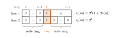
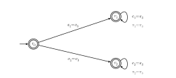
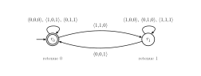
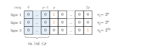
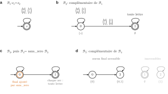

# Mines-Ponts MPI — Informatique 1 2026 · Corrigé brut

*Corrigé rédigé par IA, non officiel. Signalez toute erreur.*

Conventions.

- Une lettre de $\Sigma_2$ est notée $\binom{a}{b}$ ; une lettre de $\Sigma_3$ est notée $\langle a,b,c\rangle$ (composantes des lignes 1, 2, 3, de haut en bas).
- La lettre nulle de $\Sigma_n$ est notée $\mathbf{0}$.
- Les lignes sont numérotées de $1$ à $n$ comme dans l'énoncé ; la ligne $i$ correspond à l'indice `i-1` du tableau OCaml.
- Pour un automate $\mathcal{A}$, $\widehat{\delta}(q,m)$ désigne l'ensemble des états atteints depuis $q$ en lisant le mot $m$.
- Les opérations arithmétiques coûtent $O(1)$ (hypothèse de l'énoncé : entiers aussi grands qu'on veut).
- Pour un mot $u$ sur $\{0,1\}$, on utilise sans le redire que **à longueur fixée, $u$ est déterminé par $v(u)$** (unicité de l'écriture binaire, voir Q2).

## 1. Implémentation de quelques fonctions utiles

### Question 1

```ocaml
(* pow2 n = 2^n, exponentiation rapide *)
let rec pow2 n =
  if n = 0 then 1
  else
    let p = pow2 (n / 2) in
    if n mod 2 = 0 then p * p else 2 * p * p
```

**Correction.** Récurrence forte sur $n$. Pour $n=0$ on renvoie $1=2^0$. Pour $n\ge1$, on a $\lfloor n/2\rfloor<n$, donc $p=2^{\lfloor n/2\rfloor}$.

- Si $n$ est pair, on renvoie $p^2=2^n$.
- Si $n$ est impair, on renvoie $2p^2=2^{2\lfloor n/2\rfloor+1}=2^n$.

**Complexité.** Un seul appel récursif, sur $\lfloor n/2\rfloor$, et un nombre borné d'opérations :

$$C(n)=C(\lfloor n/2\rfloor)+O(1).$$

La suite $n,\lfloor n/2\rfloor,\dots$ atteint $0$ en $\lfloor\log_2 n\rfloor+1$ étapes, d'où $\boxed{C(n)=O(\log n)}$.

### Question 2

Soit $\psi:\Sigma_n\to\mathbb{N}$ définie par

$$\psi\big((a_1,\dots,a_n)^{\mathsf T}\big)=\sum_{i=1}^n 2^{i-1}a_i$$

(la colonne lue de haut en bas, poids faible en ligne 1, comme pour $v$).

- $\psi$ est à valeurs dans $[\![0,2^n-1]\!]$ : $0\le\psi(a)\le\sum_{i=1}^n2^{i-1}=2^n-1$.
- $\psi$ est injective. Si $a\ne b$, soit $i_0$ le plus grand indice où ils diffèrent, avec par exemple $a_{i_0}=1$ et $b_{i_0}=0$. Alors

$$\begin{aligned}
\psi(a)-\psi(b)&=2^{i_0-1}+\sum_{i<i_0}2^{i-1}(a_i-b_i)\\
&\ge 2^{i_0-1}-(2^{i_0-1}-1)\\
&=1.
\end{aligned}$$

- $|\Sigma_n|=2^n=\big|[\![0,2^n-1]\!]\big|$ : une injection entre ensembles finis de même cardinal est une bijection.

**La bijection demandée est $\varphi=\psi^{-1}:[\![0,2^n-1]\!]\to\Sigma_n$.**

Explicitement, $\varphi(x)$ est la colonne dont la ligne $i$ vaut $\lfloor x/2^{i-1}\rfloor \bmod 2$ : le bit de poids $2^{i-1}$ de $x$ est placé en ligne $i$ (Q3 le vérifie par un invariant).

Le même argument montre que deux mots de $\{0,1\}^\ell$ de même valeur $v$ sont égaux.

### Question 3

```ocaml
let decompose x n =
  assert (0 <= x && x < pow2 n);
  let a = Array.make n 0 in
  let r = ref x in
  for i = 0 to n - 1 do        (* indice i = ligne i+1 *)
    a.(i) <- !r mod 2;         (* bit de poids 2^i *)
    r := !r / 2
  done;
  a
```

**Correction.** Invariant avant l'itération $i$ :

$$x=\sum_{j<i}2^j\,\texttt{a.(j)}+2^i\,\texttt{!r}.$$

Il est vrai pour $i=0$ et conservé par la division euclidienne de `!r` par 2. En sortie, $x=\psi(\texttt{a})+2^n\,\texttt{!r}$ avec $0\le x<2^n$.

Donc $\texttt{!r}=0$ et $\psi(\texttt{a})=x$ : on renvoie $\varphi(x)$, sous forme d'un tableau de taille exactement $n$.

**Coût** $O(n)$ : `pow2` n'est appelée qu'une fois, dans l'assertion.

## 2. Automates finis sur $\Sigma_n$

Lecture des figures.

- $\mathcal{A}_1$ : $q_0$ initial boucle sur $\binom00$ ; $q_0\xrightarrow{\binom11}q_1$ ; $q_0\xrightarrow{\binom10,\binom01}q_2$.
- $q_1$ final boucle sur $\binom00,\binom10$ ; $q_1\xrightarrow{\binom01,\binom11}q_2$ ; aucune transition ne sort de $q_2$.
- $\mathcal{A}_2$ : $q_0$ initial boucle sur $\binom00,\binom01,\binom11$ ; $q_0\xrightarrow{\binom10}q_1$.
- $q_1$ final boucle sur $\binom00,\binom10,\binom11$ ; $q_1\xrightarrow{\binom01}q_0$.

### Question 4

Posons

$$R=\Big\{\tbinom00^k\tbinom11w \;:\; k\in\mathbb{N},\ w\in\big\{\tbinom00,\tbinom10\big\}^*\Big\}.$$



**Étape 1 : $\mathcal{L}(\mathcal{A}_1)=R$.**

- $R\subseteq\mathcal{L}(\mathcal{A}_1)$ : le calcul $q_0\xrightarrow{\binom00^k}q_0\xrightarrow{\binom11}q_1\xrightarrow{w}q_1$ existe et finit dans $q_1\in F$.
- $\mathcal{L}(\mathcal{A}_1)\subseteq R$ : soit $q_{(0)}=q_0,\dots,q_{(\ell)}=q_1$ un calcul acceptant sur $m=m_0\cdots m_{\ell-1}$. Il ne passe jamais par $q_2$ : aucune transition n'en sort et $q_2\notin F$.
- Soit $k$ le premier instant où $q_{(k+1)}=q_1$. Pour $t<k$, la transition $q_0\xrightarrow{m_t}q_0$ impose $m_t=\binom00$.
- La transition $q_0\xrightarrow{m_k}q_1$ impose $m_k=\binom11$. Pour $t>k$, $q_1\xrightarrow{m_t}q_1$ impose $m_t\in\{\binom00,\binom10\}$. Donc $m\in R$.

**Étape 2 : $R=E$.** Il n'existe pas de plus grande puissance de 2 divisant $0$ : un mot avec $v_1(m)=0$ n'est pas dans $E$.

- $R\subseteq E$ : soit $m=\binom00^k\binom11w$ et $u=\pi_1(w)$. Alors $\pi_1(m)=0^k1u$ et $\pi_2(m)=0^k10^{|w|}$, donc

$$\begin{aligned}
v_2(m)&=2^k,\\
v_1(m)&=2^k+2^{k+1}v(u)=2^k\big(1+2v(u)\big).
\end{aligned}$$

Le facteur $1+2v(u)$ est impair : la plus grande puissance de 2 divisant $v_1(m)$ est $2^k=v_2(m)$.
- $E\subseteq R$ : soit $m\in E$ de longueur $\ell$. Alors $v_1(m)\ne0$ ; notons $2^k$ la plus grande puissance de 2 qui le divise.
- Le bit de poids $2^k$ de $v_1(m)$ vaut 1 et ceux de poids inférieur sont nuls : $\pi_1(m)=0^k1u$, avec $k\le\ell-1$.
- Comme $v_2(m)=2^k$, l'unicité de l'écriture binaire à longueur $\ell$ donne $\pi_2(m)=0^k10^{\ell-k-1}$.
- Les $k$ premières lettres valent donc $\binom00$, la suivante $\binom11$, et les autres ont une ligne 2 nulle : $m\in R$.

$$\boxed{\mathcal{L}(\mathcal{A}_1)=R=E}$$

### Question 5

Soit $m\in\mathcal{L}(\mathcal{A}_1)$. D'après Q4, $v_2(m)=2^k$ et $v_1(m)=2^k+2^{k+1}v(u)$ avec $v(u)\in\mathbb{N}$. Donc

$$v_1(m)-v_2(m)=\big(2\times v_2(m)\big)\,v(u),$$

soit

$$\boxed{v_1(m)\equiv v_2(m)\ [2\times v_2(m)]}$$

### Question 6

$$\boxed{m\in\mathcal{L}(\mathcal{A}_2)\iff v_1(m)>v_2(m)}$$

(L'état courant est $q_1$ exactement quand, à la dernière position où les deux lignes diffèrent, c'est-à-dire au bit de poids fort où les deux entiers diffèrent, la ligne 1 porte un 1.)

### Question 7

Comme les lignes d'un mot ont la même longueur, $v_i(m)=v_j(m)\iff\pi_i(m)=\pi_j(m)$.

On prend l'automate $\mathcal{B}=(\Sigma_3,\{r_0,r_1,r_2\},r_0,\{r_0,r_1,r_2\},\delta)$, **tous les états finaux**, sans $\varepsilon$-transition, avec pour $a=\langle a_1,a_2,a_3\rangle$ :

| depuis | vers $r_1$ si | vers $r_2$ si |
|---|---|---|
| $r_0$ | $a_1=a_3$ | $a_2=a_3$ |
| $r_1$ | $a_1=a_3$ | jamais |
| $r_2$ | jamais | $a_2=a_3$ |

L'état $r_0$ accepte $\varepsilon$ (où $v_1=v_2=v_3=0$).

Un mot non vide est accepté si toutes ses lettres vérifient $a_1=a_3$ (chemin par $r_1$) ou toutes vérifient $a_2=a_3$ (chemin par $r_2$).



### Question 8

```ocaml
let est_deterministe_complet a =
  let ok = ref true in
  for x = 0 to pow2 a.n - 1 do       (* x parcourt les 2^n lettres *)
    let lettre = decompose x a.n in
    for q = 0 to a.k - 1 do          (* tous les états, accessibles ou non *)
      match a.delta q lettre with
      | [_] -> ()                     (* exactement un successeur *)
      | _ -> ok := false
    done
  done;
  !ok
```

**Correction.** Par Q2 et Q3, $x\mapsto\texttt{decompose x n}$ parcourt $\Sigma_n$ une fois et une seule. La double boucle examine chaque couple $(q,a)\in Q\times\Sigma_n$, pour **tous** les états. `ok` reste vrai si et seulement si chaque liste $\delta(q,a)$ a exactement un élément (listes sans doublon).

**Complexité.**

- Un appel à `delta` est compté $O(n)$ (il reçoit une lettre de taille $n$).
- Le filtrage `[_]` est en $O(1)$ : il ne parcourt pas la liste, contrairement à `List.length`.
- `pow2 a.n` est évalué une fois, en $O(\log n)$.
- Pour chacune des $2^n=|\Sigma_n|$ lettres : `decompose` en $O(n)$, puis $|Q|$ appels en $O(n)$.

Total :

$$O(\log n)+|\Sigma_n|\big(O(n)+|Q|\,O(n)\big)=\boxed{O\big(n\times|Q|\times|\Sigma_n|\big)}$$

### Question 9

Soit $\mathcal{A}=(\Sigma,Q,q_0,F,\delta)$. L'automate des parties est $\mathcal{A}^d=\big(\Sigma,\ \mathcal{P}(Q),\ \{q_0\},\ F^d,\ \delta^d\big)$, avec :

$$\begin{aligned}
&\text{états : } \mathcal{P}(Q), \qquad \text{état initial : } \{q_0\},\\
&\delta^d(S,a)=\Big\{\bigcup_{q\in S}\delta(q,a)\Big\} \quad\text{pour } S\subseteq Q,\ a\in\Sigma,\\
&F^d=\{S\subseteq Q \mid S\cap F\ne\emptyset\}.
\end{aligned}$$

Chaque $\delta^d(S,a)$ est un singleton : $\mathcal{A}^d$ est déterministe complet ($\emptyset$ est un état puits).

Par récurrence sur $|m|$, l'unique état atteint depuis $S$ en lisant $m$ est $\bigcup_{q\in S}\widehat\delta(q,m)$.

C'est vrai pour $\varepsilon$ ; pour $m=m'a$, on applique $\delta^d$ à $\bigcup_{q\in S}\widehat\delta(q,m')$. Donc

$$m\in\mathcal{L}(\mathcal{A}^d)\iff\widehat\delta(q_0,m)\cap F\ne\emptyset\iff m\in\mathcal{L}(\mathcal{A}).$$

### Question 10

```ocaml
let union etats a lettre =
  let t = Array.make a.k 0 in
  for q = 0 to a.k - 1 do
    if etats.(q) = 1 then
      List.iter (fun i -> t.(i) <- 1) (a.delta q lettre)
  done;
  t
```

`t.(i)` passe à 1 exactement quand $i\in\delta(q,\texttt{lettre})$ pour un $q$ tel que `etats.(q) = 1`, et reste à 0 sinon. Le tableau est neuf, initialisé à 0, et `etats` n'est pas modifié. Les transitions ne sont parcourues qu'une fois.

### Question 11

Une partie de $[\![0,k-1]\!]$ est codée par son vecteur caractéristique, élément de $\Sigma_k$, donc par un entier de $[\![0,2^k-1]\!]$ (Q2).

Le singleton $\{0\}$ a pour code $1$.

Comme l'état initial doit porter le numéro $0$, on numérote les états par la transposition qui échange les codes $0$ et $1$.

```ocaml
(* involution de [0, 2^k - 1] : échange 0 et 1 *)
let echange x = if x = 0 then 1 else if x = 1 then 0 else x

let determinise a =
  let kd = pow2 a.k in
  let ens i = decompose (echange i) a.k in   (* numéro -> partie *)
  let code t =                               (* partie -> numéro *)
    let x = ref 0 and p = ref 1 in
    for q = 0 to a.k - 1 do
      if t.(q) = 1 then x := !x + !p;
      p := 2 * !p
    done;
    echange !x
  in
  let finaux = Array.make kd false in
  for i = 0 to kd - 1 do
    let s = ens i in
    for q = 0 to a.k - 1 do
      if s.(q) = 1 && a.finaux.(q) then finaux.(i) <- true
    done
  done;
  { k = kd; n = a.n; finaux = finaux;
    delta = (fun i lettre -> [ code (union (ens i) a lettre) ]) }
```

**Correction.** `ens` est une bijection de $[\![0,2^k-1]\!]$ sur $\mathcal{P}([\![0,k-1]\!])$ (composée de deux bijections) et `code` est sa réciproque. L'état $0$ code $\{0\}=\{q_0\}$.

`delta` renvoie le singleton du code de $\bigcup_{q\in S}\delta(q,a)$ (Q10), et `finaux.(i)` est vrai si et seulement si la partie codée rencontre $F$. C'est l'automate $\mathcal{A}^d$ de Q9 : déterministe complet et équivalent à `a`.

### Question 12

```ocaml
let complementaire a =
  let d = if est_deterministe_complet a then a else determinise a in
  { k = d.k; n = d.n; finaux = Array.map not d.finaux; delta = d.delta }
```

L'automate $d$ est déterministe complet et $\mathcal{L}(d)=\mathcal{L}(a)$ (Q11).

Tout mot $m$ a un unique calcul dans $d$, d'état d'arrivée $p(m)$.

Le mot $m$ est accepté par le résultat si et seulement si $p(m)\notin F_d$, c'est-à-dire $m\notin\mathcal{L}(a)$.

**On obtient le complémentaire dans $\Sigma_n^*$.** Sans complétude, l'échange des finaux est faux : un mot sans calcul serait rejeté par les deux automates.

### Question 13

On pose $\mathcal{A}_\cap=\big(\Sigma_n,\ Q_1\times Q_2,\ (q_1,q_2),\ F_1\times F_2,\ \delta\big)$, avec :

$$\begin{aligned}
&\text{état initial : } (q_1,q_2), \qquad \text{états finaux : } F_1\times F_2,\\
&\delta\big((p,q),a\big)=\delta_1(p,a)\times\delta_2(q,a)\quad\text{pour }(p,q)\in Q_1\times Q_2,\ a\in\Sigma_n.
\end{aligned}$$

Par récurrence sur $|m|$ :

$$\widehat\delta\big((q_1,q_2),m\big)=\widehat\delta_1(q_1,m)\times\widehat\delta_2(q_2,m).$$

C'est vrai pour $\varepsilon$. Pour $m=m'a$, l'union des $\delta_1(p',a)\times\delta_2(q',a)$ sur un produit $P_1\times P_2$ est le produit des unions.

Or $(R_1\times R_2)\cap(F_1\times F_2)\ne\emptyset$ si et seulement si $R_1\cap F_1\ne\emptyset$ et $R_2\cap F_2\ne\emptyset$. Donc $\mathcal{L}(\mathcal{A}_\cap)=\mathcal{L}(\mathcal{A}_1)\cap\mathcal{L}(\mathcal{A}_2)$. Aucune hypothèse de déterminisme n'est nécessaire.

## 3. Opérations arithmétiques

### Question 14

Deux états : $r_0$ (retenue 0, initial et **seul final**) et $r_1$ (retenue 1). La transition $r_c\xrightarrow{\langle\alpha,\beta,\sigma\rangle}r_{c'}$ existe si et seulement si $\alpha+\beta+c=\sigma+2c'$ :

| depuis | lettre $\to r_0$ | lettre $\to r_1$ |
|---|---|---|
| $r_0$ | $\langle0,0,0\rangle,\ \langle1,0,1\rangle,\ \langle0,1,1\rangle$ | $\langle1,1,0\rangle$ |
| $r_1$ | $\langle0,0,1\rangle$ | $\langle1,0,0\rangle,\ \langle0,1,0\rangle,\ \langle1,1,1\rangle$ |

Les autres couples (état, lettre) n'ont pas de transition.



### Question 15

Soit $m=m_0\cdots m_{\ell-1}$ avec $m_t=\langle\alpha_t,\beta_t,\sigma_t\rangle$. Pour $0\le t\le\ell$, on pose

$$A_t=\sum_{j<t}2^j\alpha_j,$$

et $B_t$, $S_t$ de même. Ce sont les valeurs des préfixes, dans $[\![0,2^t-1]\!]$, et $A_\ell=v_1(m)$, $B_\ell=v_2(m)$, $S_\ell=v_3(m)$.

**Propriété $\mathcal{P}(t)$** : il existe un calcul depuis $r_0$ sur $m_0\cdots m_{t-1}$ si et seulement s'il existe $c\in\{0,1\}$ tel que $A_t+B_t=S_t+2^tc$.

Ce $c$ est alors unique, et le calcul (unique, l'automate étant déterministe) arrive en $r_c$.

$\mathcal{P}(0)$ : calcul vide en $r_0$, et $0=0+2^0c$ force $c=0$. Supposons $\mathcal{P}(t)$, et notons $m_t=\langle\alpha,\beta,\sigma\rangle$.

- ($\Rightarrow$) Un calcul sur $t+1$ lettres passe, après $t$ lettres, par $r_c$ avec $A_t+B_t=S_t+2^tc$.

  Il emprunte ensuite $r_c\xrightarrow{m_t}r_{c'}$, donc $\alpha+\beta+c=\sigma+2c'$. Alors

$$\begin{aligned}
A_{t+1}+B_{t+1}&=S_t+2^t(c+\alpha+\beta)\\
&=S_t+2^t(\sigma+2c')\\
&=S_{t+1}+2^{t+1}c'.
\end{aligned}$$

- ($\Leftarrow$) Supposons $A_{t+1}+B_{t+1}=S_{t+1}+2^{t+1}c'$ avec $c'\in\{0,1\}$. Alors $A_t+B_t=S_t+2^tc$ avec $c=\sigma-\alpha-\beta+2c'\in\mathbb{Z}$.
- Comme $-(2^t-1)\le A_t+B_t-S_t\le2(2^t-1)$, on a $-2^t<2^tc<2^{t+1}$, donc $c\in\{0,1\}$.
- Par $\mathcal{P}(t)$, le calcul arrive en $r_c$, et $\alpha+\beta+c=\sigma+2c'$ est exactement la condition d'existence de $r_c\xrightarrow{m_t}r_{c'}$.
- Unicité : $c'=(A_{t+1}+B_{t+1}-S_{t+1})/2^{t+1}$.

Conclusion avec $t=\ell$ : $m$ est accepté si et seulement si le calcul existe et arrive en $r_0$, si et seulement si $v_1(m)+v_2(m)=v_3(m)+2^\ell\cdot0$. **L'automate reconnaît $L_+$.**

### Question 16

**Non, $L_\times$ n'est pas reconnaissable.** Supposons-le reconnu par un automate à $N$ états et posons $p=N$. Soit $m\in\Sigma_3^*$ de longueur $2p+1$ avec

$$\begin{aligned}
\pi_1(m)&=0^p\,1\,0^p,\\
\pi_2(m)&=0^p\,1\,0^p,\\
\pi_3(m)&=0^{2p}\,1.
\end{aligned}$$

Alors $v_1(m)=v_2(m)=2^p$ et $v_3(m)=2^{2p}$ : $m\in L_\times$.

Le lemme de l'étoile donne $m=xyz$ avec $|xy|\le p$, $y\ne\varepsilon$ et $xy^iz\in L_\times$ pour tout $i$.

Les $p$ premières lettres de $m$ valent $\mathbf{0}$, donc $y=\mathbf{0}^\lambda$ avec $\lambda\ge1$.

Dans $xy^2z$, on a inséré $\lambda$ colonnes nulles avant toutes les positions des 1 :

$$\begin{aligned}
v_1(xy^2z)=v_2(xy^2z)&=2^{p+\lambda},\\
v_1(xy^2z)\times v_2(xy^2z)&=2^{2p+2\lambda},\\
v_3(xy^2z)&=2^{2p+\lambda}\ne2^{2p+2\lambda}.
\end{aligned}$$

Donc $xy^2z\notin L_\times$ : contradiction.



## 4. Arithmétique de Presburger

### Question 17

$$\boxed{\mathrm{div}_2(x):=\exists y.\ x=y+y}$$

Sous l'assignation $x\mapsto k$, la formule est vraie si et seulement s'il existe $j\in\mathbb{N}$ avec $k=j+j=2j$, c'est-à-dire si $2\mid k$.

### Question 18

Aucune constante n'est un terme : on caractérise $0$, puis $1$.

- $\mathrm{zero}(z):=(z=z+z)$ : dans $\mathbb{N}$, $z=2z\iff z=0$.
- On pose

$$\begin{aligned}
\mathrm{un}(u):=\ &\neg(u=u+u)\\
&\wedge\neg\exists s.\exists t.\big(\neg(s=s+s)\wedge\neg(t=t+t)\wedge u=s+t\big).
\end{aligned}$$

Elle dit que $u$ est non nul et n'est pas somme de deux entiers non nuls. Si $u=1$, toute écriture $1=s+t$ a un terme nul.

Si $u\ge2$, l'écriture $u=1+(u-1)$ a deux termes non nuls. Le cas $u=0$ est exclu par le premier conjoint.

Donc $\mathrm{un}(u)$ est vraie si et seulement si $u=1$.

$$\boxed{\begin{aligned}
f_0(x)&:=\big(x=x+x\big),\\
f_n(x)&:=\exists u.\Big(\mathrm{un}(u)\wedge x=\underbrace{u+u+\cdots+u}_{n\text{ termes}}\Big)\quad(n\ge1).
\end{aligned}}$$

Pour $n\ge1$, la formule est vraie si et seulement s'il existe $u$ valant $1$ avec $a(x)=n\,u$, c'est-à-dire $a(x)=n$.

Les variables $u,s,t$ sont distinctes de $x$ et liées ; $x$ est la seule variable libre.

### Question 19

**Stratégie.** Induction structurelle sur l'ensemble des formules de Presburger. Pour une formule $\varphi$, la propriété démontrée est :

> $\mathcal{P}(\varphi)$ : on sait construire une formule $S(\varphi)$ sous forme simple, de mêmes variables libres que $\varphi$ et équivalente à $\varphi$.

Les variables introduites sont **fraîches** ($\mathcal{V}$ est infini).

Le cas de base (les atomes) assure la condition (iii) ; les cas inductifs traitent $\neg$, $\wedge$, $\exists$, puis éliminent $\vee$, $\to$ et $\forall$.

**Cas de base : atomes.** Tout terme s'écrit $y_1+\cdots+y_p$ ($p\ge1$, $y_r$ variables), par induction sur les termes et associativité.

*Lemme.* Si $z$ n'apparaît ni dans le terme $t$ ni dans $\psi$, alors $\exists z.(z=t\wedge\psi)$ est équivalente à $\psi[t/z]$.

En effet, pour toute assignation, le seul témoin possible est la valeur de $t$, qui est dans $\mathbb{N}$.

Considérons l'atome $y_1+\cdots+y_p=y'_1+\cdots+y'_q$. On pose $z_1:=y_1$ et $z'_1:=y'_1$, et on prend des variables fraîches $z_2,\dots,z_p,z'_2,\dots,z'_q$. On définit

$$\begin{aligned}
C&:=\bigwedge_{r=2}^p \big(z_r=z_{r-1}+y_r\big),\\
C'&:=\bigwedge_{s=2}^q \big(z'_s=z'_{s-1}+y'_s\big),\\
S(t_1=t_2)&:=\exists z_2\cdots\exists z_p\,\exists z'_2\cdots\exists z'_q.\big(C\wedge C'\wedge z_p=z'_q\big).
\end{aligned}$$

Chaque atome a la forme « variable $=$ variable » ou « variable $=$ variable $+$ variable » : (iii) est respectée.

Il n'y a ni $\vee$, ni $\to$, ni $\forall$. En appliquant le lemme de l'intérieur vers l'extérieur, on retrouve l'atome initial ; les $z$ sont liées, donc les variables libres sont inchangées.

**Cas inductifs.** Par hypothèse d'induction, $S(\varphi)$, $S(\varphi_1)$ et $S(\varphi_2)$ sont sous forme simple et équivalentes à $\varphi$, $\varphi_1$, $\varphi_2$. On pose :

$$\begin{aligned}
S(\neg\varphi)&:=\neg S(\varphi),\\
S(\varphi_1\wedge\varphi_2)&:=S(\varphi_1)\wedge S(\varphi_2),\\
S(\exists x.\varphi)&:=\exists x.S(\varphi),\\
S(\varphi_1\vee\varphi_2)&:=\neg\big(\neg S(\varphi_1)\wedge\neg S(\varphi_2)\big),\\
S(\varphi_1\to\varphi_2)&:=\neg\big(S(\varphi_1)\wedge\neg S(\varphi_2)\big),\\
S(\forall x.\varphi)&:=\neg\exists x.\neg S(\varphi).
\end{aligned}$$

- Les trois dernières lignes reposent sur des équivalences vraies sous toute assignation : De Morgan, $A\to B\equiv\neg(A\wedge\neg B)$ et $\forall x.A\equiv\neg\exists x.\neg A$.
- La valeur de vérité de $\neg$, $\wedge$, $\exists$ ne dépend de leurs sous-formules que par leurs valeurs de vérité : remplacer $\varphi_r$ par $S(\varphi_r)$, équivalente, conserve l'équivalence.
- Les propriétés (i), (ii), (iii) sont stables par $\neg$, $\wedge$, $\exists$, et les variables libres sont conservées.
- $S(\exists x.\varphi)$ est bien formée : les variables fraîches diffèrent de $x$, et $S$ ne quantifie que les variables déjà quantifiées dans $\varphi$.

**Toute formule de Presburger est équivalente à une formule sous forme simple.**

### Question 20

On note $A=\varphi(x)$, $B=\psi(y)$ et $\Gamma=\{A\vee B,\ \neg A\}$. Aucune règle de quantificateur n'intervient.

$$\dfrac{\dfrac{\dfrac{\Gamma\vdash A\vee B\ (\mathrm{ax})\qquad\dfrac{\dfrac{\Gamma,A\vdash\neg A\ (\mathrm{ax})\qquad\Gamma,A\vdash A\ (\mathrm{ax})}{\Gamma,A\vdash\bot}\,\neg e}{\Gamma,A\vdash B}\,\bot\qquad\Gamma,B\vdash B\ (\mathrm{ax})}{\Gamma\vdash B}\,\vee e}{A\vee B\vdash\neg A\to B}\,\to i}{\vdash(A\vee B)\to(\neg A\to B)}\,\to i$$

### Question 21

$$\boxed{\begin{aligned}
T:=\ &\forall x.\forall y.\forall z.\\
&\Big(\big(x=y\wedge y=z\big)\to x=z\Big)
\end{aligned}}$$

Soit $\Delta=\{y=z,\ x=y\}$. L'arbre est écrit ligne par ligne, de la feuille (1) à la racine (7) ; chaque ligne est la conclusion de la règle indiquée appliquée à la ligne précédente.

$$\begin{array}{lll}
(1) & \Delta\vdash y=z & \mathrm{ax}\\
(2) & \Delta\vdash x=z & \mathrm{sub}_=\ \text{sur }(1)\\
(3) & x=y\wedge y=z\vdash x=z & \mathrm{cut}\ \text{sur }(2)\\
(4) & \vdash(x=y\wedge y=z)\to x=z & {\to}i\ \text{sur }(3)\\
(5) & \vdash\forall z.\big((x=y\wedge y=z)\to x=z\big) & \forall i\ \text{sur }(4)\\
(6) & \vdash\forall y.\forall z.\big((x=y\wedge y=z)\to x=z\big) & \forall i\ \text{sur }(5)\\
(7) & \vdash T & \forall i\ \text{sur }(6)
\end{array}$$

- Ligne (2) : instance de $\mathrm{sub}_=$ avec la variable $x$, le terme $y$, le contexte $\{y=z\}$ et la formule $x=z$.

  La prémisse demandée est $(x=z)[y/x]$, c'est-à-dire $y=z$ : c'est la ligne (1).
- Ligne (3) : la règle cut transforme les deux hypothèses $x=y$, $y=z$ en la conjonction.
- Lignes (5) à (7) : les trois $\forall i$ sont licites, car le contexte est vide ($z,y,x\notin FV(\emptyset)$).

### Question 22

Soit $\Delta=\{x=y+a,\ y=z+b\}$ et

$$\begin{aligned}
\Phi:=\ &\big(\exists a.\exists b.(x=y+a\wedge y=z+b)\big)\\
&\to\exists c.\,x=z+c.
\end{aligned}$$

Seule l'associativité est permise : le témoin est $c:=b+a$ (et non $a+b$). L'arbre est écrit ligne par ligne, de la feuille (1) à la racine (11).

$$\begin{array}{lll}
(1) & \Delta\vdash z+b+a=z+b+a & \mathrm{ax}_=\\
(2) & \Delta\vdash y+a=z+b+a & \mathrm{sub}_=\ \text{sur }(1)\\
(3) & \Delta\vdash x=z+b+a & \mathrm{sub}_=\ \text{sur }(2)\\
(4) & \Delta\vdash \exists c.\,x=z+c & \exists i\ \text{sur }(3)\\
(5) & x=y+a\wedge y=z+b\vdash \exists c.\,x=z+c & \mathrm{cut}\ \text{sur }(4)\\
(6) & \exists b.(x=y+a\wedge y=z+b)\vdash \exists c.\,x=z+c & \exists' e\ \text{sur }(5)\\
(7) & \exists a.\exists b.(x=y+a\wedge y=z+b)\vdash \exists c.\,x=z+c & \exists' e\ \text{sur }(6)\\
(8) & \vdash\Phi & {\to}i\ \text{sur }(7)\\
(9) & \vdash\forall z.\,\Phi & \forall i\ \text{sur }(8)\\
(10) & \vdash\forall y.\forall z.\,\Phi & \forall i\ \text{sur }(9)\\
(11) & \vdash\forall x.\forall y.\forall z.\,\Phi & \forall i\ \text{sur }(10)
\end{array}$$

Instances et conditions de bord :

- Ligne (2) : $\mathrm{sub}_=$ avec la variable $y$, le terme $z+b$, le contexte $\{x=y+a\}$ et la formule $y+a=z+b+a$.

  La substitution donne $(z+b)+a=z+b+a$, instance de $\mathrm{ax}_=$ à l'associativité près.
- Ligne (3) : $\mathrm{sub}_=$ avec la variable $x$, le terme $y+a$, le contexte $\{y=z+b\}$ et la formule $x=z+b+a$. La substitution donne $y+a=z+b+a$ : c'est la ligne (2).
- Ligne (4) : $\exists i$ avec le terme $b+a$. La formule $(x=z+c)[b+a/c]$ est $x=z+(b+a)$, c'est-à-dire $x=z+b+a$ par associativité.
- Lignes (6) et (7) : pour $\exists' e$ sur $b$ puis sur $a$, le contexte restant est vide, et $FV(\exists c.\,x=z+c)=\{x,z\}$ ne contient ni $b$ ni $a$.
- Lignes (9) à (11) : les $\forall i$ sont licites, car le contexte est vide.

## 5. Retour sur les automates

### Question 23

Soit $\varphi$ une CNF sur les variables propositionnelles $p_1,\dots,p_N$. On prend $N$ variables de Presburger distinctes $u_1,\dots,u_N$.

On remplace chaque occurrence de $p_i$ par la formule de Presburger $T_i:=\neg(u_i=u_i+u_i)$ (« $u_i\ne0$ »), en conservant $\neg$, $\wedge$, $\vee$.

On obtient une formule de Presburger $\mathrm{tr}(\varphi)$, puis

$$\boxed{\Psi:=\exists u_1.\exists u_2\cdots\exists u_N.\ \mathrm{tr}(\varphi)}$$

formule close, donc instance de Tautologie-Presburger.

**Correction.** À tout $(n_1,\dots,n_N)\in\mathbb{N}^N$, on associe la valuation $\theta(p_i)=(n_i\ne0)$. Toute valuation est obtenue ainsi (prendre $n_i\in\{0,1\}$).

Par induction sur la formule, $\mathrm{tr}(\alpha)$ est vraie sous l'assignation $u_i\mapsto n_i$ si et seulement si $\alpha$ est vraie sous $\theta$.

Donc $\Psi$ est vraie si et seulement si $\varphi$ est satisfiable.

**Coût.** Chaque littéral est remplacé par une formule de taille constante, et on ajoute $N$ quantificateurs : $|\Psi|=O(|\varphi|)$, construite par un parcours linéaire. **Sat-Cnf se réduit polynomialement à Tautologie-Presburger** (qui est donc NP-difficile).

### Question 24

Ici $n=3$ et $L=\{\varepsilon,\ \langle0,1,1\rangle,\ \langle0,0,0\rangle\langle1,1,1\rangle\}$. Un mot de $L_{\exists2}$ a la longueur et les lignes 1 et 3 d'un mot de $L$, la ligne 2 étant quelconque. On énumère donc, pour chaque mot de $L$, les deux choix de bit en ligne 2 à chaque position :

$$\boxed{\begin{aligned}
L_{\exists2}=\big\{&\varepsilon,\\
&\langle0,0,1\rangle,\ \langle0,1,1\rangle,\\
&\langle0,0,0\rangle\langle1,0,1\rangle,\ \langle0,0,0\rangle\langle1,1,1\rangle,\\
&\langle0,1,0\rangle\langle1,0,1\rangle,\ \langle0,1,0\rangle\langle1,1,1\rangle\big\}
\end{aligned}}$$

soit $1+2+4=7$ mots.

### Question 25

On garde les états, l'état initial et les finaux. On remplace $\delta$ par

$$\delta'(q,a)=\delta(q,a[i\leftarrow0])\cup\delta(q,a[i\leftarrow1]),$$

où $a[i\leftarrow\beta]$ est la lettre $a$ dont la composante $i$ vaut $\beta$.

```ocaml
let automate_existe a i =
  let delta' q lettre =
    let l0 = Array.copy lettre and l1 = Array.copy lettre in
    l0.(i - 1) <- 0;          (* ligne i = indice i-1 *)
    l1.(i - 1) <- 1;
    List.sort_uniq compare (a.delta q l0 @ a.delta q l1)
  in
  { k = a.k; n = a.n; finaux = a.finaux; delta = delta' }
```

**Correction.**

- Si $m$ a un calcul acceptant dans le nouvel automate, chaque pas $q_{(t)}\to q_{(t+1)}$ provient d'une lettre $w_t=m_t[i\leftarrow\beta_t]$.

  Le mot $w=w_0\cdots w_{\ell-1}$ est accepté par $\mathcal{A}$ et coïncide avec $m$ hors de la ligne $i$.
- Réciproquement, soit $w\in\mathcal{L}(\mathcal{A})$ qui coïncide avec $m$ hors de la ligne $i$.

  Alors $|w|=|m|$, $w_t=m_t[i\leftarrow\pi_i(w)_t]$ et $\delta(q,w_t)\subseteq\delta'(q,m_t)$ : le calcul acceptant de $w$ est un calcul acceptant de $m$.
- La lettre reçue n'est pas modifiée (pas d'effet de bord) : on travaille sur deux copies.

### Question 26

On fixe $n$ (plus grand indice de variable) pendant tout le calcul : tous les automates sont sur $\Sigma_n$, la ligne $i$ portant la variable $x_i$. On construit l'automate de $\varphi$ **récursivement sur la structure de la formule** :

- **Atome $x_i=x_j$** : `automate_egalite n i j`.
- **Atome $x_i=x_j+x_k$** : `automate_somme n j k i` (cette fonction reconnaît $v_j+v_k=v_i$ ; elle suppose $n\ge3$).
- **$\neg\psi$** : complémentaire (Q12) de l'automate de $\psi$.
- **$\psi_1\wedge\psi_2$** : intersection des deux automates.
- **$\exists x_i.\psi$** : on rend la ligne $i$ libre par `automate_existe` (Q25) sur l'automate de $\psi$, puis on applique `sans_zero`.

**Pourquoi `sans_zero`.** La projection ne change pas la longueur du mot : elle ne permet pour $x_i$ que des valeurs codables sur $|m|$ bits, alors que $\exists x_i$ porte sur tout $\mathbb{N}$.

Ajouter des lettres $\mathbf{0}$ à droite ne change aucune valeur $v_k$ (bits de poids fort nuls). Un mot $m$ doit donc être accepté dès qu'un allongement $m\mathbf{0}^j$ laisse la place au témoin. C'est exactement ce que fait `sans_zero`, qui reconnaît $\{m\mid\exists j\ge0,\ m\mathbf{0}^j\in\mathcal{L}(\mathcal{A})\}$.

Par exemple, avec $n=3$ et $\exists x_1.\,x_1=x_2+x_2$, le mot de longueur 1 tel que $v_2=1$ doit être accepté (témoin $x_1=2$). Or aucun mot de longueur 1 ne code $2$ sur la ligne 1.

### Question 27

On traite $\varphi(x_2):=\neg\exists x_1.\neg(x_1=x_2)$ avec $n=2$, en suivant le code (Q11, Q12, Q25). Pour la feuille, on suppose que `automate_egalite 2 1 2` renvoie l'automate à un état $s$, initial et final, bouclant sur $\binom00$ et $\binom11$, sans autre transition.

**Étape 1** — $\mathcal{B}_1$ reconnaît $\{m\mid v_1(m)=v_2(m)\}$ (toutes les lettres valent $\binom00$ ou $\binom11$).

**Étape 2** — $\neg(x_1=x_2)$. $\mathcal{B}_1$ n'est pas complet : on déterminise ($k=1$, donc $2$ états).

L'état $0$ est $\{s\}$, l'état $1$ est $\emptyset$ :

| état | $\binom00,\binom11$ | $\binom01,\binom10$ | final après échange |
|---|---|---|---|
| $0=\{s\}$ | $0$ | $1$ | non |
| $1=\emptyset$ | $1$ | $1$ | oui |

$\mathcal{B}_2$ reconnaît $\{m\mid v_1(m)\ne v_2(m)\}$.

**Étape 3** — `automate_existe` sur la ligne 1. Depuis $0$, une lettre de ligne 2 égale à $b$ donne les deux lettres $\binom0b$ et $\binom1b$, l'une vers $0$, l'autre vers $1$.

- Pour toute lettre $a$ : $\delta_3(0,a)=\{0,1\}$ et $\delta_3(1,a)=\{1\}$.
- Finaux : $\{1\}$. $\mathcal{B}_3$ reconnaît $\Sigma_2^*\setminus\{\varepsilon\}$.

**Étape 4** — `sans_zero`. Depuis $0$, la lettre $\binom00$ mène en $1$, final : $0$ devient final. $\mathcal{B}_4$ a les mêmes transitions et **tous ses états finaux** ; il reconnaît $\Sigma_2^*$.

C'est bien $L_{\exists x_1.\neg(x_1=x_2)}$ : pour tout $x_2$, $x_1=x_2+1$ convient, y compris pour $\varepsilon$.

**Étape 5** — négation extérieure. $\mathcal{B}_4$ n'est pas déterministe ($\delta_4(0,a)=\{0,1\}$) : on déterminise ($k=2$, donc 4 états, numéros obtenus par la transposition des codes 0 et 1).

| numéro | partie | transition (toute lettre) | final dans le déterminisé | final après échange |
|---|---|---|---|---|
| $0$ | $\{0\}$ | $3$ | oui | non |
| $1$ | $\emptyset$ | $1$ | non | oui |
| $2$ | $\{1\}$ | $2$ | oui | non |
| $3$ | $\{0,1\}$ | $3$ | oui | non |

Depuis l'état initial $0$, seuls $0$ et $3$ sont accessibles, et aucun n'est final ; l'unique état final $1$ est inaccessible.

$$\boxed{\mathcal{L}(\mathcal{B}_5)=\emptyset=L_\varphi}$$

C'est conforme à la sémantique : $\varphi(x_2)$ équivaut à $\forall x_1.\,x_1=x_2$, fausse pour tout $x_2$.



### Question 28

```ocaml
let rec automate_formule phi n =
  match phi with
  | Egale (V i, V j) -> automate_egalite n i j
  | Egale (V i, Plus (j, k)) -> automate_somme n j k i   (* v_j + v_k = v_i *)
  | Egale (Plus _, _) -> failwith "formule non sous forme simple"
  | Non psi -> complementaire (automate_formule psi n)
  | Et (psi1, psi2) ->
      intersection (automate_formule psi1 n) (automate_formule psi2 n)
  | Existe (i, psi) ->
      sans_zero (automate_existe (automate_formule psi n) i)
```

Chaque appel récursif porte sur une sous-formule stricte : le calcul termine. Toutes les fonctions employées conservent le champ `n`.

### Question 29

On montre par induction structurelle la propriété suivante : pour toute formule $\varphi$ sous forme simple de variables parmi $x_1,\dots,x_n$, $\mathcal{L}(\texttt{automate\_formule}\ \varphi\ n)=L_\varphi$. Rappelons que $L_\varphi$ ne dépend que des lignes des variables libres ; les autres lignes sont quelconques.

**Lemme 1 (zéros à droite).** Pour tout $m$ et tout $j$, on a $v_k(m\mathbf{0}^j)=v_k(m)$ pour tout $k$ (on ajoute des bits de poids fort nuls). Donc $a_{m\mathbf{0}^j}=a_m$.

**Lemme 2 (place pour un témoin).** Soit $m\in\Sigma_n^*$, $i\in[\![1,n]\!]$ et $N\in\mathbb{N}$.

Il existe $j$ et $w$ avec $|w|=|m|+j$, $v_i(w)=N$ et $\pi_k(w)=\pi_k(m\mathbf{0}^j)$ pour $k\ne i$.

On prend $j$ tel que $2^{|m|+j}>N$, et pour ligne $i$ l'écriture binaire de $N$ sur $|m|+j$ bits (Q2).

**Induction.**

- **$x_i=x_j$** : `automate_egalite n i j` reconnaît $\{m\mid v_i(m)=v_j(m)\}$, et $[\![x_i=x_j]\!]_{a_m}$ est vrai si et seulement si $v_i(m)=v_j(m)$.
- **$x_i=x_j+x_k$** : `automate_somme n j k i` reconnaît $\{m\mid v_j(m)+v_k(m)=v_i(m)\}=L_\varphi$.
- **$\neg\psi$** : par Q12 et l'hypothèse d'induction, le langage est $\Sigma_n^*\setminus L_\psi$. Comme $\neg\psi$ et $\psi$ ont les mêmes variables libres, $[\![\neg\psi]\!]_{a_m}$ est vrai si et seulement si $m\notin L_\psi$.
- **$\psi_1\wedge\psi_2$** : par Q13 et l'hypothèse d'induction, le langage est $L_{\psi_1}\cap L_{\psi_2}$. Un même mot $m$ fournit les valeurs des variables communes, et $a_m$ restreinte aux variables libres de $\psi_r$ est l'assignation de $L_{\psi_r}$.
- **$\exists x_i.\psi$** : soit $\mathcal{C}=\texttt{automate\_existe}\ \mathcal{A}_\psi\ i$. Par Q25 et l'hypothèse d'induction, $\mathcal{L}(\mathcal{C})=(L_\psi)_{\exists i}$. Par définition de `sans_zero`, $m$ est accepté si et seulement s'il existe $j\ge0$ avec $m\mathbf{0}^j\in(L_\psi)_{\exists i}$.
  - ($\subseteq$) Soit $w\in L_\psi$ qui coïncide avec $m\mathbf{0}^j$ hors de la ligne $i$.

    Le lemme 1 donne $v_k(w)=v_k(m)$ pour $k\ne i$.

    Donc $\psi$ est vraie sous l'assignation qui donne $v_k(m)$ aux autres variables libres et $N:=v_i(w)$ à $x_i$ : $[\![\exists x_i.\psi]\!]_{a_m}$ est vrai, et $m\in L_\varphi$.
  - ($\supseteq$) Si $m\in L_\varphi$, il existe $N$ tel que $\psi$ soit vraie sous $a_m$ modifiée par $x_i\mapsto N$.

    Le lemme 2 fournit $j$ et $w$, et $a_w$ est exactement cette assignation (lemme 1).

    Donc $w\in L_\psi$, puis $m\mathbf{0}^j\in(L_\psi)_{\exists i}$, et $m$ est accepté.

La forme simple ne contient ni $\vee$, ni $\to$, ni $\forall$, et ses atomes ont l'une des deux formes traitées : **l'algorithme est correct**.

### Question 30

```ocaml
let est_vraie phi n =
  let a = automate_formule phi n in
  a.finaux.(0)          (* l'état initial est l'état 0 *)
```

**Correction.** Si $\varphi$ est close, l'assignation $a_m$ est vide pour tout $m$ : $L_\varphi=\Sigma_n^*$ si $\varphi$ est vraie, $L_\varphi=\emptyset$ sinon.

Par Q29, l'automate reconnaît $L_\varphi$.

Il n'y a pas de transition spontanée : $\varepsilon$ est accepté si et seulement si l'état initial $0$ est final. Donc `a.finaux.(0)` vaut `true` si et seulement si $\varepsilon\in L_\varphi$, si et seulement si **$\varphi$ est vraie**.

Le coût est celui de la construction de l'automate (exponentiel à chaque négation) ; la lecture finale est en $O(1)$. Tautologie-Presburger est donc décidable.
