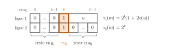
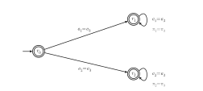
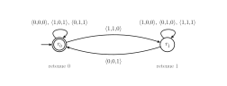
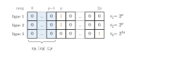
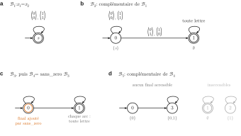

# Mines-Ponts MPI — Informatique 1 2026 · Corrigé guidé

*Corrigé rédigé par IA, non officiel. Signalez toute erreur.*

## Présentation du sujet

**Format.** L'épreuve dure 3 heures, sans calculatrice ni dispositif électronique. Le code s'écrit **en OCaml exclusivement** ; les fonctions des modules `List` et `Array` sont permises sans explication, et l'énoncé recommande de s'en tenir aux plus courantes. Le barème tient compte de la clarté et de la concision des programmes.

Une annexe fixe les règles de déduction naturelle. L'énoncé y ajoute deux règles d'égalité, $\mathrm{ax}_=$ ($\Gamma\vdash t=t$) et $\mathrm{sub}_=$ (de $\Gamma,x=t\vdash\varphi[t/x]$ on déduit $\Gamma,x=t\vdash\varphi$), et autorise l'associativité de l'addition dans les arbres. On peut réutiliser le résultat d'une question antérieure sans l'avoir établi.

**Thème.** Le problème démontre que **l'arithmétique de Presburger** (les entiers naturels avec l'addition, sans la multiplication) est **décidable**, en traduisant les formules en automates.

L'idée centrale : un $n$-uplet d'entiers est codé par un mot sur l'alphabet $\Sigma_n$ des colonnes de $n$ bits, une lettre par rang binaire, **poids faible en tête**. Un ensemble de $n$-uplets devient un langage, une formule devient un automate, et la vérité d'une formule close se lit sur l'état initial.

**Découpage.**

- **Section 1** (Q1 à Q3) : exponentiation rapide et codage d'une lettre par un entier. Mise en route.
- **Section 2** (Q4 à Q13) : deux automates sur $\Sigma_2$ à analyser (une preuve rigoureuse en Q4), un automate à construire, puis la boîte à outils : test de déterminisme complet, déterminisation (formelle puis en OCaml), complémentaire, produit. Le point délicat est la numérotation des états en Q11.
- **Section 3** (Q14 à Q16) : l'addition est reconnaissable (automate à retenue, avec preuve), la multiplication ne l'est pas.
- **Section 4** (Q17 à Q22) : écrire des formules sans constantes, les mettre sous forme simple, trois preuves en déduction naturelle.
- **Section 5** (Q23 à Q30) : réduction depuis Sat-Cnf, projection d'une ligne, puis l'algorithme formule → automate, son déroulé à la main, son code, sa preuve de correction et son application aux formules closes.

**Notions du programme mobilisées.** Automates finis non déterministes, déterminisation par sous-ensembles, clôture par complémentaire et intersection, lemme de l'étoile, invariants et inductions structurelles, déduction naturelle (y compris quantificateurs), réductions polynomiales et NP-difficulté, OCaml sur tableaux, listes, enregistrements et types sommes.

**Notations de ce corrigé.**

- Une lettre de $\Sigma_2$ est notée $\binom ab$ ; une lettre de $\Sigma_3$ est notée $\langle a,b,c\rangle$ (lignes 1, 2, 3).
- $\mathbf{0}$ est la lettre nulle. La ligne $i$ de l'énoncé est l'indice `i-1` du tableau OCaml.
- $\widehat\delta(q,m)$ est l'ensemble des états atteints depuis $q$ en lisant $m$.

**Difficulté et gestion du temps.** Trente questions en trois heures, soit six minutes en moyenne. Le sujet est progressif et très linéaire, mais presque tous les résultats peuvent être admis pour avancer.

- **À ne pas laisser passer** : Q1, Q2, Q3, Q5, Q6, Q7, Q9, Q10, Q13, Q14, Q17, Q20, Q24, Q25, Q30.
- **Le cœur du sujet** : Q4, Q8, Q11, Q12, Q15, Q21, Q22, Q26, Q28.
- **Les plus exigeantes** : Q16 (non-reconnaissabilité), Q18 et Q19 (formules sans constantes, aplatissement des termes), Q23 (réduction), Q27 (déroulé long) et Q29 (preuve de correction).

**Ce qu'en dit le rapport 2026.** Le jury juge **discriminantes** Q1, Q2, Q4, Q8 et Q14, ainsi que Q19 « notamment parmi les meilleures copies » ; Q23 a permis aux meilleures copies de se distinguer. Q5 et Q6 ont été parfaitement réussies par une majorité de ceux qui les ont traitées. Q9 a rarement été réussie parfaitement, Q15 rarement traitée correctement et Q18 peu réussie ; Q11 et Q16 ont été peu traitées, et « Très peu de candidats ont abordé sérieusement les dernières questions » (Q26 à Q30).

Le jury insiste sur les questions de cours : « le pourcentage de réussite sur les questions de cours n’est pas à la hauteur de la filière MPI en informatique ». Restituer proprement la déterminisation (Q9), le produit (Q13) ou le lemme de l'étoile (Q16) rapporte donc des points sûrs.

La présentation compte : « un peu plus d’un tiers des copies ont subi un malus de points lorsque la présentation de leur copie rendait difficile leur correction ». Le code mal indenté et les commentaires absents ont aussi été sanctionnés.

Lire la section 5 dès le début aide à comprendre où va le sujet, en particulier le rôle de `sans_zero`.

## Partie 1 — Implémentation de quelques fonctions utiles

On fixe le codage d'une lettre de $\Sigma_n$ par un entier et on l'implémente. Outils : exponentiation rapide, division euclidienne, unicité de l'écriture binaire.

### Question 1

> [!INDICATION]
> Exprimez $2^n$ à partir de $2^{\lfloor n/2\rfloor}$, en distinguant selon la parité de $n$.

> [!INDICATION]
> Combien de fois l'appel récursif doit-il être évalué dans un même appel pour que la complexité soit logarithmique ?

#### Solution

```ocaml
(* pow2 n = 2^n, exponentiation rapide *)
let rec pow2 n =
  if n = 0 then 1
  else
    let p = pow2 (n / 2) in
    if n mod 2 = 0 then p * p else 2 * p * p
```

**Correction**, par récurrence forte. Pour $n=0$ on renvoie $1=2^0$. Pour $n\ge1$, l'appel sur $\lfloor n/2\rfloor<n$ renvoie $p=2^{\lfloor n/2\rfloor}$.

- Si $n$ est pair, on renvoie $p^2=2^n$.
- Sinon, on renvoie $2p^2=2^{2\lfloor n/2\rfloor+1}=2^n$.

**Complexité.** Un seul appel récursif et un nombre borné d'opérations :

$$C(n)=C(\lfloor n/2\rfloor)+O(1).$$

La suite $n,\lfloor n/2\rfloor,\dots$ atteint $0$ en $\lfloor\log_2 n\rfloor+1$ étapes : $C(n)=O(\log n)$.

> [!PIEGE]
> Écrire `pow2 (n/2) * pow2 (n/2)` recalcule deux fois le même appel : $C(n)=2C(n/2)+O(1)$ donne un coût linéaire, et la complexité demandée est perdue. Il faut nommer le résultat par un `let`.

> [!PIEGE]
> Passer par les flottants (`2. ** float n` puis conversion) : le type demandé est `int -> int`, et le rapport 2026 juge cette voie incorrecte.

> [!JURY]
> Le rapport 2026 note que « trop de candidats ont utilisé deux appels récursifs lors du même appel, n’atteignant donc pas la complexité demandée ». Seule une version correcte et de la bonne complexité avait tous les points : « elle a donc été discriminante ». Une réponse utilisant correctement `lsl` (`1 lsl n`) a aussi eu tous les points.

### Question 2

> [!INDICATION]
> Le sujet lit déjà les mots poids faible en tête : faites de même pour une colonne, lue de haut en bas.

> [!INDICATION]
> Il est plus simple de définir l'application de $\Sigma_n$ vers les entiers, de prouver qu'elle est injective et de conclure par un argument de cardinal.

#### Solution

Soit $\psi:\Sigma_n\to\mathbb{N}$ définie par

$$\psi(a_1,\dots,a_n)=\sum_{i=1}^n2^{i-1}a_i.$$

- $0\le\psi(a)\le\sum_{i=1}^n2^{i-1}=2^n-1$.
- Injectivité : si $a\ne b$, soit $i_0$ le plus grand indice où ils diffèrent, avec $a_{i_0}=1$ et $b_{i_0}=0$. Alors

$$\begin{aligned}
\psi(a)-\psi(b)&\ge2^{i_0-1}-\sum_{i<i_0}2^{i-1}\\
&=1>0.
\end{aligned}$$

- $|\Sigma_n|=2^n=\big|[\![0,2^n-1]\!]\big|$, donc $\psi$ est bijective.

**La bijection demandée est $\varphi=\psi^{-1}$.**

Explicitement, la ligne $i$ de $\varphi(x)$ vaut $\lfloor x/2^{i-1}\rfloor\bmod 2$ : le bit de poids $2^{i-1}$ de $x$ est placé en ligne $i$.

Le même argument montre qu'à longueur fixée, un mot de $\{0,1\}^\ell$ est déterminé par sa valeur $v$ : ce fait resservira en Q4 et Q7.

> [!PIEGE]
> Définir la bijection avec la fonction $v$ de l'énoncé : $v$ porte sur les mots de $\{0,1\}^*$, pas sur $\Sigma_n$. Il faut définir sa propre application sur les colonnes. Et la question n'a rien à voir avec le noyau d'une application linéaire.

> [!JURY]
> « Exhiber une bijection » demande de prouver qu'elle en est une. Le rapport 2026 précise : « Cette justification ne pouvait pas se limiter à citer l’unicité de la décomposition en base 2 d’un entier. » Le jury classe la question parmi les discriminantes, en raison de la précision attendue.

### Question 3

> [!INDICATION]
> Divisions euclidiennes successives par 2 : le reste donne un bit, le quotient devient la nouvelle valeur.

> [!INDICATION]
> Dans quelle case du tableau doit aller le bit de poids $2^i$ pour respecter la convention de Q2 ?

#### Solution

```ocaml
let decompose x n =
  assert (0 <= x && x < pow2 n);
  let a = Array.make n 0 in
  let r = ref x in
  for i = 0 to n - 1 do        (* indice i = ligne i+1 *)
    a.(i) <- !r mod 2;         (* bit de poids 2^i *)
    r := !r / 2
  done;
  a
```

Invariant avant l'itération $i$ :

$$x=\sum_{j<i}2^j\,\texttt{a.(j)}+2^i\,\texttt{!r}.$$

Il est conservé par la division euclidienne. En sortie, $x=\psi(\texttt{a})+2^n\,\texttt{!r}$ avec $x<2^n$, donc $\texttt{!r}=0$ : on renvoie $\varphi(x)$.

Coût $O(n)$. Exemple : `decompose 6 3` renvoie `[|0;1;1|]`.

> [!PIEGE]
> Remplir le tableau à l'envers (`a.(n-1-i)`) met le poids faible en dernière ligne : tout le reste du sujet devient incohérent. Et l'assertion est explicitement demandée.

> [!JURY]
> Le rapport 2026 rappelle qu'il fallait renvoyer un tableau de taille $n$, ni une écriture sans zéros non significatifs, ni une liste. Il ajoute : « Il fallait éviter d’utiliser la fonction pow2 pour calculer chaque coefficient. » Des candidats ont été pénalisés pour la complexité de leur réponse.

## Partie 2 — Automates finis sur $\Sigma_n$

On apprend d'abord à lire des automates sur $\Sigma_2$ comme des relations entre deux entiers (Q4 à Q7), puis on programme la boîte à outils des langages reconnaissables : déterminisation, complémentaire, intersection.

Lecture des figures.

- $\mathcal{A}_1$ : $q_0$ initial boucle sur $\binom00$ ; il va en $q_1$ par $\binom11$.
- Depuis $q_0$, on va en $q_2$ par $\binom10$ ou $\binom01$.
- $q_1$ final boucle sur $\binom00,\binom10$ et va en $q_2$ par $\binom01,\binom11$ ; rien ne sort de $q_2$.
- $\mathcal{A}_2$ : $q_0$ initial boucle sur $\binom00,\binom01,\binom11$ et va en $q_1$ par $\binom10$.
- $q_1$ final boucle sur $\binom00,\binom10,\binom11$ et revient en $q_0$ par $\binom01$.

### Question 4

> [!INDICATION]
> Séparez le travail en deux : décrivez d'abord $\mathcal{L}(\mathcal{A}_1)$ comme un ensemble de mots explicite, puis comparez cet ensemble à $E$.

> [!INDICATION]
> Quel est le rôle de $q_2$ ? Un calcul acceptant peut-il y passer ?

> [!INDICATION]
> Côté arithmétique : que vaut $v_2$ si la ligne 2 contient un seul 1 ? Et que dit l'unicité de l'écriture binaire à longueur fixée ? N'oubliez pas le cas $v_1(m)=0$.

#### Solution

Posons

$$R=\Big\{\tbinom00^k\tbinom11w\;:\;k\in\mathbb{N},\ w\in\big\{\tbinom00,\tbinom10\big\}^*\Big\}.$$



**Étape 1 : $\mathcal{L}(\mathcal{A}_1)=R$.**

- $R\subseteq\mathcal{L}(\mathcal{A}_1)$ : le calcul $q_0\xrightarrow{\binom00^k}q_0\xrightarrow{\binom11}q_1\xrightarrow{w}q_1$ existe et finit en $q_1\in F$.
- $\mathcal{L}(\mathcal{A}_1)\subseteq R$ : un calcul acceptant $q_{(0)}=q_0,\dots,q_{(\ell)}=q_1$ ne passe jamais par $q_2$ (aucune transition n'en sort et $q_2\notin F$).
- Soit $k$ le premier instant avec $q_{(k+1)}=q_1$. Avant, les transitions $q_0\to q_0$ imposent $\binom00$.
- À l'instant $k$, $q_0\to q_1$ impose $\binom11$ ; ensuite $q_1\to q_1$ impose $\binom00$ ou $\binom10$.
- Donc $m\in R$.

**Étape 2 : $R=E$.** Il n'existe pas de plus grande puissance de 2 divisant $0$ : un mot avec $v_1(m)=0$ n'est pas dans $E$.

- $R\subseteq E$ : pour $m=\binom00^k\binom11w$ et $u=\pi_1(w)$, on a $\pi_1(m)=0^k1u$ et $\pi_2(m)=0^k10^{|w|}$. Donc

$$\begin{aligned}
v_2(m)&=2^k,\\
v_1(m)&=2^k\big(1+2v(u)\big),
\end{aligned}$$

avec $1+2v(u)$ impair : la plus grande puissance de 2 qui divise $v_1(m)$ est $2^k=v_2(m)$.

- $E\subseteq R$ : soit $m\in E$, de longueur $\ell$. Alors $v_1(m)\ne0$ ; soit $2^k$ la plus grande puissance de 2 qui le divise.
- Les bits de $v_1(m)$ de poids inférieur à $2^k$ sont nuls et celui de poids $2^k$ vaut 1 : $\pi_1(m)=0^k1u$, avec $k\le\ell-1$.
- Comme $v_2(m)=2^k$, l'unicité de l'écriture binaire sur $\ell$ bits donne $\pi_2(m)=0^k10^{\ell-k-1}$. Donc $m\in R$.

$$\boxed{\mathcal{L}(\mathcal{A}_1)=E}$$

> [!METHODE]
> Pour identifier le langage d'un automate donné : (1) décrire l'ensemble des mots acceptés en suivant les calculs possibles, (2) traduire cette forme en propriété arithmétique, (3) conclure par double inclusion. Séparer combinatoire des mots et arithmétique allège chaque étape.

> [!PIEGE]
> Le cas $v_1(m)=0$ (mot vide ou mot de colonnes nulles) : $0$ est divisible par toutes les puissances de 2, il n'en a pas de plus grande. Ces mots ne sont pas dans $E$, et l'automate les rejette bien puisque $q_0$ n'est pas final.

> [!PIEGE]
> Écrire « $m=\binom00^i\binom10(\ldots)^j$ » avec une barre de choix : le membre de droite est une expression régulière, pas un mot. Le rapport 2026 sanctionne cette confusion ; on écrit $m\in R$ avec $R$ défini comme ensemble de mots. De même, on écrit $v_i(m)$, jamais $v_i$ seul.

> [!JURY]
> Question discriminante selon le rapport 2026 : « Il ne suffisait pas de remarquer la forme des mots acceptés par l’automate, le jury attendait également une démonstration que les mots de cette forme étaient exactement les mots de E. » D'où les deux inclusions de l'étape 2.

### Question 5

> [!INDICATION]
> Reprenez l'écriture de $v_1(m)$ obtenue en Q4 et isolez $v_2(m)$.

#### Solution

D'après Q4, $v_2(m)=2^k$ et $v_1(m)=2^k+2^{k+1}v(u)$, avec $v(u)\in\mathbb{N}$. Donc

$$v_1(m)-v_2(m)=\big(2\times v_2(m)\big)\,v(u),$$

c'est-à-dire

$$\boxed{v_1(m)\equiv v_2(m)\ [2\times v_2(m)]}$$

### Question 6

> [!INDICATION]
> Quelles lettres changent l'état, et lesquelles le laissent inchangé ? Que « retient » donc l'état courant ?

> [!INDICATION]
> En lisant poids faible en tête, la dernière position où deux lignes diffèrent est celle du bit de poids le plus fort où les deux entiers diffèrent.

#### Solution

$$\boxed{m\in\mathcal{L}(\mathcal{A}_2)\iff v_1(m)>v_2(m)}$$

Justification non demandée : par récurrence, après $t$ lettres, l'état est $q_1$ si et seulement si la valeur du préfixe de la ligne 1 dépasse strictement celle de la ligne 2. En effet, $(A-B)+2^t(a-b)$ a le signe de $a-b$ si $a\ne b$, puisque $|A-B|<2^t$.

> [!PIEGE]
> Inégalité large ou stricte ? Testez : $\varepsilon$ n'est pas accepté et $v_1=v_2=0$, donc l'égalité doit donner « faux ». Puis $\binom10$ est accepté ($1>0$) et $\binom10\binom01$ ne l'est pas ($1<2$).

> [!JURY]
> La question demande une condition sur $v_1(m)$ et $v_2(m)$. Le rapport 2026 le rappelle : « On ne pouvait pas seulement répondre par une expression régulière décrivant le langage reconnu par l’automate. »

### Question 7

> [!INDICATION]
> Deux lignes d'un même mot ont la même longueur : quand ont-elles la même valeur ?

> [!INDICATION]
> Pour une disjonction avec peu d'états, le non-déterminisme permet de « choisir » à la première lettre quelle condition surveiller. Pensez au mot vide.

#### Solution

À longueur égale, $v_i(m)=v_j(m)\iff\pi_i(m)=\pi_j(m)$ (Q2). On prend trois états $r_0$ (initial), $r_1$, $r_2$, **tous finaux**, sans $\varepsilon$-transition, et pour $a=\langle a_1,a_2,a_3\rangle$ :

| depuis | vers $r_1$ si | vers $r_2$ si |
|---|---|---|
| $r_0$ | $a_1=a_3$ | $a_2=a_3$ |
| $r_1$ | $a_1=a_3$ | jamais |
| $r_2$ | jamais | $a_2=a_3$ |

L'état $r_0$ accepte $\varepsilon$, qui est dans $L$ ($v_1=v_2=v_3=0$). Un mot non vide est accepté si toutes ses lettres vérifient $a_1=a_3$, ou toutes vérifient $a_2=a_3$.



> [!PIEGE]
> Oublier de rendre l'état initial final : on rate le mot vide. Une variante déterministe incomplète à trois états existe aussi (« les deux égalités tiennent encore », « seule la première », « seule la seconde »).

> [!JURY]
> Le rapport 2026 : « L’automate demandé n’avait pas besoin d’être complet ou déterministe, mais il ne pouvait pas comporter de $\varepsilon$-transitions. » Le jury demande aussi, pour tout automate construit, d'indiquer clairement l'état initial et les états finaux.

### Question 8

> [!INDICATION]
> Pour parcourir toutes les lettres de $\Sigma_n$, utilisez la bijection de Q2 et la fonction de Q3.

> [!INDICATION]
> Comment tester qu'une liste a exactement un élément sans la parcourir en entier ?

#### Solution

```ocaml
let est_deterministe_complet a =
  let ok = ref true in
  for x = 0 to pow2 a.n - 1 do       (* x parcourt les 2^n lettres *)
    let lettre = decompose x a.n in
    for q = 0 to a.k - 1 do          (* tous les états, accessibles ou non *)
      match a.delta q lettre with
      | [_] -> ()                     (* exactement un successeur *)
      | _ -> ok := false
    done
  done;
  !ok
```

**Correction.** La double boucle examine chaque couple $(q,a)\in Q\times\Sigma_n$ une fois, pour tous les états. `ok` reste vrai si et seulement si chaque $\delta(q,a)$ (liste sans doublon) a un seul élément.

**Complexité.**

- Un appel à `delta` reçoit une lettre de taille $n$ : on le compte $O(n)$. Le filtrage `[_]` est en $O(1)$.
- Pour chacune des $2^n=|\Sigma_n|$ lettres, `decompose` coûte $O(n)$ et les $|Q|$ appels $O(n|Q|)$.
- `pow2 a.n` est calculé une fois, en $O(\log n)$.

Total : $O(n\times|Q|\times|\Sigma_n|)$.

> [!PIEGE]
> `List.length (a.delta q lettre) = 1` parcourt toute la liste, qui peut contenir jusqu'à $|Q|$ états : sans retour précoce, la borne demandée n'est plus garantie. Le filtrage sur `[_]` évite ce surcoût.

> [!PIEGE]
> Ne vérifier que les états accessibles depuis l'état initial : la définition porte sur **tous** les états de $Q$.

> [!JURY]
> Question discriminante d'après le rapport 2026, qui précise : « Il ne suffisait pas de vérifier que les états accessibles depuis l’état initial donnaient lieu à des transitions déterministes et complètes, il fallait le vérifier pour tous les états. » La complexité doit être justifiée par un texte rédigé, pas seulement par des annotations dans le code.

### Question 9

> [!INDICATION]
> Un état du nouvel automate représente l'ensemble des états où l'automate de départ « pourrait se trouver ».

> [!INDICATION]
> Précisez l'ensemble d'états, l'état initial, la transition (une union) et les états finaux, puis justifiez par une récurrence sur la longueur du mot.

#### Solution

L'automate des parties est $\mathcal{A}^d=\big(\Sigma,\ \mathcal{P}(Q),\ \{q_0\},\ F^d,\ \delta^d\big)$, avec :

$$\begin{aligned}
&\text{états : }\mathcal{P}(Q),\qquad\text{état initial : }\{q_0\},\\
&\delta^d(S,a)=\Big\{\bigcup_{q\in S}\delta(q,a)\Big\}\quad\text{pour }S\subseteq Q,\ a\in\Sigma,\\
&F^d=\{S\subseteq Q\mid S\cap F\ne\emptyset\}.
\end{aligned}$$

Chaque $\delta^d(S,a)$ est un singleton : $\mathcal{A}^d$ est déterministe complet, $\emptyset$ jouant le rôle de puits.

Par récurrence sur $|m|$, l'état atteint depuis $S$ en lisant $m$ est $\bigcup_{q\in S}\widehat\delta(q,m)$. Donc

$$m\in\mathcal{L}(\mathcal{A}^d)\iff\widehat\delta(q_0,m)\cap F\ne\emptyset\iff m\in\mathcal{L}(\mathcal{A}).$$

> [!METHODE]
> La construction par sous-ensembles se retient avec son invariant : « l'état du déterminisé est l'ensemble des états accessibles ». C'est lui qui donne la preuve en deux lignes.

> [!PIEGE]
> Proposer l'automate de Glushkov (algorithme de Berry-Sethi) ou se contenter d'ajouter un état puits : le rapport 2026 rappelle que ni l'un ni l'autre ne déterminise un automate.

> [!JURY]
> Pour cette question de cours, le rapport 2026 attendait une définition formelle : « L’état initial et les états finaux de cet automate devaient être précisés. » Il ajoute, à propos de Q9 : « Un exemple de construction d’un tel automate ne constituait pas une réponse correcte à elle seule. » Une définition formelle était jugée plus succincte et plus convaincante qu'une description algorithmique.

### Question 10

> [!INDICATION]
> Partez d'un tableau neuf rempli de 0, puis marquez les successeurs de chaque état présent dans `etats`.

#### Solution

```ocaml
let union etats a lettre =
  let t = Array.make a.k 0 in
  for q = 0 to a.k - 1 do
    if etats.(q) = 1 then
      List.iter (fun i -> t.(i) <- 1) (a.delta q lettre)
  done;
  t
```

`t.(i)` vaut 1 exactement s'il existe $q$ avec `etats.(q) = 1` et $q\xrightarrow{\texttt{lettre}}i$. Le tableau `etats` n'est pas modifié.

> [!PIEGE]
> Le résultat doit partir de zéros. Partir d'une copie de `etats` (ou modifier `etats` en place) ajouterait à tort les états de départ.

> [!JURY]
> Le rapport 2026 signale des copies qui recalculaient chaque case du résultat en reparcourant toutes les transitions. On attendait un seul parcours, en marquant les successeurs au fur et à mesure, comme ci-dessus.

### Question 11

> [!INDICATION]
> Une partie de $[\![0,k-1]\!]$ se représente par un vecteur de $\{0,1\}^k$, c'est-à-dire une lettre de $\Sigma_k$, donc par un entier : d'où l'indication d'utiliser `decompose`.

> [!INDICATION]
> L'énoncé impose que l'état initial porte le numéro 0. Quel entier code la partie $\{q_0\}$ ? Comment renuméroter sans perdre la bijection ?

> [!INDICATION]
> Il faut aussi la fonction réciproque, du vecteur caractéristique vers le numéro d'état.

#### Solution

Le singleton $\{0\}$ a pour code $1$ ; on numérote les états par la transposition qui échange les codes $0$ et $1$.

```ocaml
(* involution de [0, 2^k - 1] : échange 0 et 1 *)
let echange x = if x = 0 then 1 else if x = 1 then 0 else x

let determinise a =
  let kd = pow2 a.k in
  let ens i = decompose (echange i) a.k in   (* numéro -> partie *)
  let code t =                               (* partie -> numéro *)
    let x = ref 0 and p = ref 1 in
    for q = 0 to a.k - 1 do
      if t.(q) = 1 then x := !x + !p;
      p := 2 * !p
    done;
    echange !x
  in
  let finaux = Array.make kd false in
  for i = 0 to kd - 1 do
    let s = ens i in
    for q = 0 to a.k - 1 do
      if s.(q) = 1 && a.finaux.(q) then finaux.(i) <- true
    done
  done;
  { k = kd; n = a.n; finaux = finaux;
    delta = (fun i lettre -> [ code (union (ens i) a lettre) ]) }
```

**Correction.** `ens` est une bijection des numéros sur les parties, et `code` est sa réciproque ; l'état $0$ code $\{q_0\}$.

`delta` renvoie toujours un singleton (déterministe complet), celui du code de $\bigcup_{q\in S}\delta(q,a)$. `finaux.(i)` est vrai si et seulement si la partie rencontre $F$ : c'est l'automate de Q9.

> [!PIEGE]
> Numéroter les parties par leur code brut met $\emptyset$ en position 0, qui deviendrait l'état initial : l'automate ne reconnaîtrait plus rien. Le ou exclusif avec 1 (`x lxor 1`) est une autre involution qui convient.

> [!PIEGE]
> Mélanger les types : les parties sont des `int array` à valeurs dans $\{0,1\}$ (comme `etats` en Q10), alors que `finaux` est un `bool array`. Le rapport 2026 cite cette confusion parmi les erreurs de type à éviter.

> [!PIEGE]
> L'ensemble vide doit rester un état (le puits) : `delta` renvoie une liste à un élément même quand aucun successeur n'existe dans l'automate de départ.

> [!JURY]
> Question peu traitée en 2026. Le rapport précise : « Le jury a valorisé les copies remarquant qu’il fallait échanger les états 0 et 1 pour que l’état initial corresponde au singleton {0}. » Les fonctions auxiliaires comme `echange` et `code` doivent être présentées par une phrase sur leur rôle.

### Question 12

> [!INDICATION]
> Échanger finaux et non-finaux ne donne le complémentaire que sous une hypothèse précise sur l'automate.

> [!INDICATION]
> Vous disposez d'un test (Q8) et d'une construction (Q11).

#### Solution

```ocaml
let complementaire a =
  let d = if est_deterministe_complet a then a else determinise a in
  { k = d.k; n = d.n; finaux = Array.map not d.finaux; delta = d.delta }
```

L'automate $d$ est déterministe complet et reconnaît $\mathcal{L}(a)$. Tout mot $m$ a un unique calcul dans $d$.

Le mot $m$ est accepté par le résultat si et seulement si ce calcul finit hors de $F_d$, c'est-à-dire si $m\notin\mathcal{L}(a)$.

> [!PIEGE]
> Sans complétude, un mot qui n'a aucun calcul est rejeté avant et après l'échange. Exemple : l'automate à un état final bouclant sur $\binom00$ et $\binom11$ ; échanger les finaux donne le langage vide, pas le complémentaire.

> [!PIEGE]
> Retourner les transitions : on obtient un automate du miroir du langage, pas de son complémentaire. Le rapport 2026 relève cette confusion dans un certain nombre de copies.

> [!JURY]
> Le rapport 2026 : « Il ne fallait pas oublier de déterminiser l’automate avant d’inverser les états non finaux et finaux. »

### Question 13

> [!INDICATION]
> Faites fonctionner les deux automates en parallèle sur le même mot.

> [!INDICATION]
> Pour la preuve, montrez par récurrence que l'ensemble des couples atteints est un produit d'ensembles.

#### Solution

On pose $\mathcal{A}_\cap=\big(\Sigma_n,\ Q_1\times Q_2,\ (q_1,q_2),\ F_1\times F_2,\ \delta\big)$, avec :

$$\begin{aligned}
&\text{état initial : }(q_1,q_2),\qquad\text{états finaux : }F_1\times F_2,\\
&\delta\big((p,q),a\big)=\delta_1(p,a)\times\delta_2(q,a)\quad\text{pour }(p,q)\in Q_1\times Q_2,\ a\in\Sigma_n.
\end{aligned}$$

Par récurrence sur $|m|$ :

$$\widehat\delta\big((q_1,q_2),m\big)=\widehat\delta_1(q_1,m)\times\widehat\delta_2(q_2,m),$$

car une union de produits $\delta_1(p',a)\times\delta_2(q',a)$ indexée par un produit est le produit des unions.

Et $(R_1\times R_2)\cap(F_1\times F_2)\ne\emptyset$ si et seulement si $R_1\cap F_1\ne\emptyset$ et $R_2\cap F_2\ne\emptyset$. Donc $\mathcal{L}(\mathcal{A}_\cap)=\mathcal{L}(\mathcal{A}_1)\cap\mathcal{L}(\mathcal{A}_2)$, sans hypothèse de déterminisme.

> [!PIEGE]
> Pour l'intersection, les finaux sont $F_1\times F_2$ ; $(F_1\times Q_2)\cup(Q_1\times F_2)$ donnerait l'union, et seulement pour des automates complets.

> [!JURY]
> Le rapport 2026 : « Une rédaction formelle de la fonction de transition était attendue. Un exemple d’application de cette construction n’était ni nécessaire, ni suffisant pour répondre à la question. » Il demande aussi de respecter les notations : un état est un couple $(q_1,q_2)$, pas $q_1\times q_2$ ni $\{q_1;q_2\}$.

## Partie 3 — Opérations arithmétiques

On montre que l'addition se calcule par un automate fini (la retenue est une mémoire bornée) et que la multiplication ne le peut pas (lemme de l'étoile).

### Question 14

> [!INDICATION]
> Posez l'addition à la main, colonne par colonne en commençant par le poids faible : quelle information faut-il mémoriser d'une colonne à la suivante ?

> [!INDICATION]
> Écrivez la condition sur la lettre $\langle\alpha,\beta,\sigma\rangle$, la retenue entrante $c$ et la retenue sortante $c'$. Quel état doit être final ?

#### Solution

Deux états : $r_0$ (retenue 0, initial et **seul final**) et $r_1$ (retenue 1). La transition $r_c\xrightarrow{\langle\alpha,\beta,\sigma\rangle}r_{c'}$ existe si et seulement si $\alpha+\beta+c=\sigma+2c'$ :

| depuis | lettre $\to r_0$ | lettre $\to r_1$ |
|---|---|---|
| $r_0$ | $\langle0,0,0\rangle,\ \langle1,0,1\rangle,\ \langle0,1,1\rangle$ | $\langle1,1,0\rangle$ |
| $r_1$ | $\langle0,0,1\rangle$ | $\langle1,0,0\rangle,\ \langle0,1,0\rangle,\ \langle1,1,1\rangle$ |

Les autres couples (état, lettre) n'ont pas de transition : le mot est rejeté.



> [!PIEGE]
> Rendre $r_1$ final : $\langle1,1,0\rangle$ mène en $r_1$ alors que $1+1\ne0$. Une retenue finale non nulle signifie que la somme ne tient pas sur la longueur du mot.

> [!PIEGE]
> Oublier les boucles sur $r_1$ : avec une retenue entrante, $\langle1,0,0\rangle$, $\langle0,1,0\rangle$ et $\langle1,1,1\rangle$ laissent la retenue à 1.

> [!JURY]
> Question discriminante selon le rapport 2026 : beaucoup de copies avaient l'idée mais proposaient un automate faux ou incomplet. L'automate n'avait pas à être complet ; en suivant l'addition posée, « il ne fallait pas oublier de choisir un état où cette retenue est égale à 1 et les transitions permettant de rester dans cet état ».

### Question 15

> [!INDICATION]
> Formulez un invariant reliant les valeurs des préfixes de longueur $t$ des trois lignes et l'état atteint. La retenue sortante pèse $2^t$.

> [!INDICATION]
> L'invariant doit être une équivalence : « un calcul existe si et seulement si… ». Le sens réciproque garantit qu'aucun mot de $L_+$ n'est rejeté faute de transition.

> [!INDICATION]
> Pour le sens réciproque, encadrez $A_t+B_t-S_t$ pour montrer que la retenue reconstituée vaut 0 ou 1.

#### Solution

Soit $m=m_0\cdots m_{\ell-1}$ avec $m_t=\langle\alpha_t,\beta_t,\sigma_t\rangle$. On pose

$$A_t=\sum_{j<t}2^j\alpha_j,$$

et $B_t$, $S_t$ de même. Ces valeurs sont dans $[\![0,2^t-1]\!]$, et $A_\ell=v_1(m)$, $B_\ell=v_2(m)$, $S_\ell=v_3(m)$.

**$\mathcal{P}(t)$** : un calcul depuis $r_0$ sur $m_0\cdots m_{t-1}$ existe si et seulement s'il existe $c\in\{0,1\}$ avec $A_t+B_t=S_t+2^tc$.

Ce $c$ est unique et le calcul (unique) arrive en $r_c$.

$\mathcal{P}(0)$ est clair ($c=0$). Supposons $\mathcal{P}(t)$ et notons $m_t=\langle\alpha,\beta,\sigma\rangle$.

- ($\Rightarrow$) Le calcul passe par $r_c$ avec $A_t+B_t=S_t+2^tc$, puis emprunte $r_c\xrightarrow{m_t}r_{c'}$, donc $\alpha+\beta+c=\sigma+2c'$. D'où

$$\begin{aligned}
A_{t+1}+B_{t+1}&=S_t+2^t(c+\alpha+\beta)\\
&=S_{t+1}+2^{t+1}c'.
\end{aligned}$$

- ($\Leftarrow$) Si $A_{t+1}+B_{t+1}=S_{t+1}+2^{t+1}c'$ avec $c'\in\{0,1\}$, alors $A_t+B_t=S_t+2^tc$ où $c=\sigma-\alpha-\beta+2c'$.
- De $-(2^t-1)\le A_t+B_t-S_t\le2(2^t-1)$, on tire $-2^t<2^tc<2^{t+1}$, donc $c\in\{0,1\}$.
- Par $\mathcal{P}(t)$, le calcul arrive en $r_c$, et $\alpha+\beta+c=\sigma+2c'$ est la condition d'existence de $r_c\xrightarrow{m_t}r_{c'}$.
- L'unicité de $c'$ vient de $2^{t+1}c'=A_{t+1}+B_{t+1}-S_{t+1}$.

Pour $t=\ell$ : $m$ est accepté si et seulement si le calcul existe et arrive en $r_0$, c'est-à-dire $v_1(m)+v_2(m)=v_3(m)$. **L'automate reconnaît $L_+$.**

> [!METHODE]
> Prouver qu'un automate reconnaît un langage, c'est presque toujours exhiber ce que « signifie » chaque état et le démontrer par récurrence sur la longueur du préfixe lu. L'invariant à prouver est celui qui a servi à construire l'automate.

> [!PIEGE]
> Ne prouver que le sens direct : on obtient $\mathcal{L}\subseteq L_+$, mais pas qu'un mot de $L_+$ possède un calcul.

> [!JURY]
> Question peu traitée correctement en 2026. Le rapport est net : « Les réponses ne faisant que paraphraser l’automate proposé à la question précédente n’ont obtenu aucun point. » Il suggère de démontrer une condition nécessaire et suffisante pour que le calcul aboutisse à l'un ou l'autre état ; c'est le rôle de $\mathcal{P}(t)$ ci-dessus.

### Question 16

> [!INDICATION]
> L'outil au programme pour prouver qu'un langage n'est pas reconnaissable est le lemme de l'étoile (ou, ce qui revient au même, un argument de tiroirs sur les états).

> [!INDICATION]
> Choisissez un mot de $L_\times$ dont le début ne contient que des colonnes nulles : le facteur pompé sera forcé d'y tomber.

> [!INDICATION]
> Insérer $\lambda$ colonnes nulles en tête multiplie chaque valeur par $2^\lambda$. Comment se comportent alors $v_1v_2$ et $v_3$ ?

#### Solution

**Non, $L_\times$ n'est pas reconnaissable.** Supposons-le reconnu par un automate à $N$ états, et soit $p=N$. Soit $m$ le mot de longueur $2p+1$ tel que

$$\begin{aligned}
\pi_1(m)&=0^p\,1\,0^p,\\
\pi_2(m)&=0^p\,1\,0^p,\\
\pi_3(m)&=0^{2p}\,1.
\end{aligned}$$

Il vérifie $v_1(m)=v_2(m)=2^p$ et $v_3(m)=2^{2p}$ : $m\in L_\times$.

Le lemme de l'étoile donne $m=xyz$ avec $|xy|\le p$, $y\ne\varepsilon$ et $xy^iz\in L_\times$ pour tout $i$.

Les $p$ premières lettres valent $\mathbf{0}$, donc $y=\mathbf{0}^\lambda$ avec $\lambda\ge1$. Alors

$$\begin{aligned}
v_1(xy^2z)=v_2(xy^2z)&=2^{p+\lambda},\\
v_3(xy^2z)&=2^{2p+\lambda}\ne2^{2p+2\lambda}.
\end{aligned}$$

Donc $xy^2z\notin L_\times$ : contradiction.



> [!PIEGE]
> Un argument du type « il y a une infinité de produits » ne prouve rien : $L_+$ est tout aussi infini et il est reconnaissable. Seule la structure du pompage fait la différence.

> [!METHODE]
> Quand on veut contrôler le facteur pompé, on place un préfixe « neutre » de longueur au moins le nombre d'états : la contrainte $|xy|\le N$ force $y$ à y tomber, quelle que soit la factorisation.

> [!JURY]
> Question peu traitée en 2026. Le rapport suggère la contraposée du lemme de l'étoile, et précise qu'invoquer le besoin d'une mémoire non bornée ne suffisait pas pour conclure.

## Partie 4 — Arithmétique de Presburger

On apprend à écrire des propriétés sans constantes ni multiplication, on normalise les formules (forme simple, utilisée en section 5), puis on rédige des preuves formelles avec les règles de l'annexe et les deux règles d'égalité.

### Question 17

> [!INDICATION]
> Être pair, c'est être le double d'un entier ; comment écrire un double sans multiplication ?

#### Solution

$$\boxed{\mathrm{div}_2(x):=\exists y.\ x=y+y}$$

Sous l'assignation $x\mapsto k$, elle est vraie si et seulement s'il existe $j\in\mathbb{N}$ avec $k=2j$.

> [!PIEGE]
> Écrire $\exists y.\,x=2y$ : le rapport 2026 rappelle que $2y$ n'est pas un terme de l'arithmétique de Presburger. Le double s'écrit $y+y$.

### Question 18

> [!INDICATION]
> Aucune constante n'est un terme, ni $n$, ni $1$, ni $0$. Commencez par trouver une formule à une variable libre vraie seulement pour $0$.

> [!INDICATION]
> Caractérisez ensuite $1$ parmi les entiers non nuls par une propriété additive. Enfin, $n$ est une somme de $n$ copies de $1$.

#### Solution

- $\mathrm{zero}(z):=(z=z+z)$ : dans $\mathbb{N}$, $z=2z$ si et seulement si $z=0$.
- On pose

$$\begin{aligned}
\mathrm{un}(u):=\ &\neg(u=u+u)\\
&\wedge\neg\exists s.\exists t.\big(\neg(s=s+s)\wedge\neg(t=t+t)\wedge u=s+t\big).
\end{aligned}$$

Elle dit que $u$ est non nul et n'est pas somme de deux entiers non nuls. Si $u=1$, toute écriture $1=s+t$ a un terme nul.

Si $u\ge2$, l'écriture $u=1+(u-1)$ convient ; $u=0$ est exclu par le premier conjoint. Donc $\mathrm{un}(u)$ est vraie si et seulement si $u=1$.

$$\boxed{\begin{aligned}
f_0(x)&:=\big(x=x+x\big),\\
f_n(x)&:=\exists u.\Big(\mathrm{un}(u)\wedge x=\underbrace{u+\cdots+u}_{n\text{ termes}}\Big)\quad(n\ge1).
\end{aligned}}$$

Pour $n\ge1$, la formule est vraie si et seulement s'il existe $u=1$ avec $a(x)=nu$, soit $a(x)=n$. Les variables $u,s,t$ sont liées et distinctes de $x$.

> [!PIEGE]
> Écrire $x=1+1+\cdots+1$ : $1$ n'est pas plus un terme que $n$. Il faut définir $1$ par une formule, et traiter $n=0$ à part (une somme vide n'est pas un terme).

> [!PIEGE]
> Une définition par récurrence sur $n$ est permise, mais pas $f_n$ appliquée à un autre terme que $x$, ni un indice qui dépend d'une variable (comme $f_{n-x}(y)$) : le rapport 2026 relève ces deux erreurs.

> [!JURY]
> Question peu réussie en 2026. Le rapport rappelle : « On ne pouvait pas utiliser les symboles de constante 0 et 1 dans les formules, puisqu’ils ne font pas partie des termes autorisés dans l’arithmétique de Presburger. » Il suggère de définir $f_0(x)$, puis $f_1(x)$, et d'en déduire $f_n(x)$ pour $n\ge2$ : c'est la démarche suivie ici.

### Question 19

> [!INDICATION]
> Trois défauts à corriger : les connecteurs $\vee$ et $\to$, le quantificateur $\forall$, et les atomes dont les membres sont des sommes de plus de deux variables (ou dont le membre gauche n'est pas une variable).

> [!INDICATION]
> Pour les connecteurs, pensez aux lois de De Morgan et à la dualité entre $\forall$ et $\exists$.

> [!INDICATION]
> Pour les atomes, nommez chaque somme partielle par une variable fraîche quantifiée existentiellement : pourquoi cela ne change-t-il pas la valeur de vérité ?

#### Solution

**Stratégie.** Induction structurelle sur l'ensemble des formules de Presburger. Pour une formule $\varphi$, la propriété démontrée est :

> $\mathcal{P}(\varphi)$ : on sait construire une formule $S(\varphi)$ sous forme simple, de mêmes variables libres que $\varphi$ et équivalente à $\varphi$.

Les variables introduites sont fraîches ($\mathcal{V}$ est infini).

Le cas de base (atomes) assure (iii) ; les cas inductifs traitent $\neg$, $\wedge$, $\exists$, puis éliminent $\vee$, $\to$ et $\forall$.

**Cas de base : atomes.** Tout terme s'écrit $y_1+\cdots+y_p$ avec des variables $y_r$ (induction sur les termes et associativité).

*Lemme* : si $z$ n'apparaît ni dans $t$ ni dans $\psi$, alors $\exists z.(z=t\wedge\psi)$ équivaut à $\psi[t/z]$. En effet, le seul témoin possible est la valeur de $t$.

Pour l'atome $y_1+\cdots+y_p=y'_1+\cdots+y'_q$, on pose $z_1:=y_1$, $z'_1:=y'_1$, et on prend des variables fraîches $z_2,\dots,z_p,z'_2,\dots,z'_q$ :

$$\begin{aligned}
C&:=\bigwedge_{r=2}^p\big(z_r=z_{r-1}+y_r\big),\\
C'&:=\bigwedge_{s=2}^q\big(z'_s=z'_{s-1}+y'_s\big),\\
S(t_1=t_2)&:=\exists z_2\cdots\exists z_p\,\exists z'_2\cdots\exists z'_q.\big(C\wedge C'\wedge z_p=z'_q\big).
\end{aligned}$$

Chaque atome est de la forme permise par (iii). Le lemme, appliqué de l'intérieur vers l'extérieur, redonne l'atome initial ; les $z$ étant liées, les variables libres sont inchangées.

**Cas inductifs.** Par hypothèse d'induction, $S(\varphi)$, $S(\varphi_1)$ et $S(\varphi_2)$ sont sous forme simple et équivalentes à $\varphi$, $\varphi_1$, $\varphi_2$. On pose :

$$\begin{aligned}
S(\neg\varphi)&:=\neg S(\varphi),\\
S(\varphi_1\wedge\varphi_2)&:=S(\varphi_1)\wedge S(\varphi_2),\\
S(\exists x.\varphi)&:=\exists x.S(\varphi),\\
S(\varphi_1\vee\varphi_2)&:=\neg\big(\neg S(\varphi_1)\wedge\neg S(\varphi_2)\big),\\
S(\varphi_1\to\varphi_2)&:=\neg\big(S(\varphi_1)\wedge\neg S(\varphi_2)\big),\\
S(\forall x.\varphi)&:=\neg\exists x.\neg S(\varphi).
\end{aligned}$$

- Les trois dernières lignes reposent sur des équivalences vraies sous toute assignation : De Morgan, $A\to B\equiv\neg(A\wedge\neg B)$ et $\forall x.A\equiv\neg\exists x.\neg A$.
- $\neg$, $\wedge$, $\exists$ ne dépendent de leurs sous-formules que par leurs valeurs de vérité : remplacer une sous-formule par une formule équivalente conserve l'équivalence.
- (i), (ii), (iii) sont stables par ces trois constructeurs, et les variables libres sont conservées.

**Toute formule est équivalente à une formule sous forme simple.**

> [!PIEGE]
> Oublier la condition (iii). C'est pourtant elle qui rend la section 5 possible : les seuls automates de base fournis reconnaissent $v_i=v_j$ et $v_i+v_j=v_k$.

> [!PIEGE]
> Réutiliser une variable déjà présente au lieu d'une variable fraîche : on capturerait une variable libre et l'équivalence serait perdue.

> [!JURY]
> Le rapport 2026 attendait trois éléments : une stratégie de preuve explicitée, le cas de base montrant comment obtenir (iii) dans les termes, et les cas inductifs, notamment $\vee$, $\to$, $\forall$. « Beaucoup de copies se sont limitées à proposer des équivalences pour le dernier point. » Le jury a valorisé les copies qui signalaient honnêtement un point non démontré. « Cette question a été discriminante, notamment parmi les meilleures copies. »

### Question 20

> [!INDICATION]
> Lisez l'arbre de bas en haut : commencez par les introductions d'implication pour placer les hypothèses dans le contexte.

> [!INDICATION]
> Éliminez ensuite la disjonction : l'une des deux branches se ferme par un axiome, l'autre par une contradiction.

#### Solution

Avec $A=\varphi(x)$, $B=\psi(y)$ et $\Gamma=\{A\vee B,\neg A\}$ :

$$\dfrac{\dfrac{\dfrac{\Gamma\vdash A\vee B\ (\mathrm{ax})\qquad\dfrac{\dfrac{\Gamma,A\vdash\neg A\ (\mathrm{ax})\qquad\Gamma,A\vdash A\ (\mathrm{ax})}{\Gamma,A\vdash\bot}\,\neg e}{\Gamma,A\vdash B}\,\bot\qquad\Gamma,B\vdash B\ (\mathrm{ax})}{\Gamma\vdash B}\,\vee e}{A\vee B\vdash\neg A\to B}\,\to i}{\vdash(A\vee B)\to(\neg A\to B)}\,\to i$$

Aucune règle de quantificateur n'intervient : les variables $x$ et $y$ ne jouent aucun rôle.

> [!PIEGE]
> La règle $\vee e$ de l'annexe a trois prémisses : il faut écrire les trois. Et le passage de $\bot$ à $B$ se fait par la règle $\bot$ ; le raisonnement par l'absurde n'est pas nécessaire.

> [!JURY]
> Pour Q20 à Q22, le rapport 2026 demande d'indiquer chaque règle utilisée et de l'appliquer telle qu'écrite en annexe : « on ne pouvait pas sous-entendre un affaiblissement en abandonnant des hypothèses en remontant dans l’arbre de preuve ». Inutile en revanche d'affaiblir pour fermer une branche : la règle ax admet un contexte $\Gamma$ quelconque.

### Question 21

> [!INDICATION]
> La formule doit être close : quantifiez toutes les variables.

> [!INDICATION]
> La règle $\mathrm{sub}_=$ se lit de bas en haut : pour prouver $\varphi$ sous l'hypothèse $x=t$, il suffit de prouver $\varphi$ où $x$ est remplacé par $t$. Avec quelle hypothèse et quelle formule l'appliquer ?

> [!INDICATION]
> La règle cut de l'annexe transforme deux hypothèses en une conjonction.

#### Solution

$$\boxed{\begin{aligned}
T:=\ &\forall x.\forall y.\forall z.\\
&\Big(\big(x=y\wedge y=z\big)\to x=z\Big)
\end{aligned}}$$

Soit $\Delta=\{y=z,\ x=y\}$. L'arbre est écrit ligne par ligne, de la feuille (1) à la racine (7) ; chaque ligne est la conclusion de la règle indiquée appliquée à la ligne précédente.

$$\begin{array}{lll}
(1) & \Delta\vdash y=z & \mathrm{ax}\\
(2) & \Delta\vdash x=z & \mathrm{sub}_=\ \text{sur }(1)\\
(3) & x=y\wedge y=z\vdash x=z & \mathrm{cut}\ \text{sur }(2)\\
(4) & \vdash(x=y\wedge y=z)\to x=z & {\to}i\ \text{sur }(3)\\
(5) & \vdash\forall z.\big((x=y\wedge y=z)\to x=z\big) & \forall i\ \text{sur }(4)\\
(6) & \vdash\forall y.\forall z.\big((x=y\wedge y=z)\to x=z\big) & \forall i\ \text{sur }(5)\\
(7) & \vdash T & \forall i\ \text{sur }(6)
\end{array}$$

- Ligne (2) : instance de $\mathrm{sub}_=$ avec la variable $x$, le terme $y$, le contexte $\{y=z\}$ et la formule $x=z$.
- La prémisse demandée est $(x=z)[y/x]$, c'est-à-dire $y=z$ : c'est la ligne (1).
- Lignes (5) à (7) : les $\forall i$ sont licites car le contexte est vide.

> [!METHODE]
> Un arbre de preuve n'est vérifiable que si chaque application d'une règle à paramètres est explicitée : quelle variable, quel terme, quelle formule. Écrire l'arbre ligne par ligne, chaque ligne citant celle dont elle découle, est une présentation équivalente et plus lisible.

> [!JURY]
> Le rapport 2026 : « Il convenait de mentionner les conditions nécessaires à l’application de règles portant sur des variables libres. » Ici, ce sont les conditions $x,y,z\notin FV(\Gamma)$ des trois $\forall i$.

### Question 22

> [!INDICATION]
> Sémantiquement, la formule dit que l'ordre $\le$ est transitif. Quel est le témoin naturel pour $c$ ? Attention : seule l'associativité est autorisée.

> [!INDICATION]
> Lisez de bas en haut : $\forall i$, $\to i$, puis la règle $\exists' e$ (deux fois) pour faire entrer $a$ et $b$ dans le contexte, puis cut, puis $\exists i$.

> [!INDICATION]
> Pour obtenir l'égalité finale, appliquez deux fois $\mathrm{sub}_=$, en partant d'une instance de $\mathrm{ax}_=$. Écrivez à chaque fois quelle hypothèse sert.

#### Solution

Soit $\Delta=\{x=y+a,\ y=z+b\}$ et

$$\begin{aligned}
\Phi:=\ &\big(\exists a.\exists b.(x=y+a\wedge y=z+b)\big)\\
&\to\exists c.\,x=z+c.
\end{aligned}$$

Le témoin est $c:=b+a$. L'arbre est écrit ligne par ligne, de la feuille (1) à la racine (11).

$$\begin{array}{lll}
(1) & \Delta\vdash z+b+a=z+b+a & \mathrm{ax}_=\\
(2) & \Delta\vdash y+a=z+b+a & \mathrm{sub}_=\ \text{sur }(1)\\
(3) & \Delta\vdash x=z+b+a & \mathrm{sub}_=\ \text{sur }(2)\\
(4) & \Delta\vdash \exists c.\,x=z+c & \exists i\ \text{sur }(3)\\
(5) & x=y+a\wedge y=z+b\vdash \exists c.\,x=z+c & \mathrm{cut}\ \text{sur }(4)\\
(6) & \exists b.(x=y+a\wedge y=z+b)\vdash \exists c.\,x=z+c & \exists' e\ \text{sur }(5)\\
(7) & \exists a.\exists b.(x=y+a\wedge y=z+b)\vdash \exists c.\,x=z+c & \exists' e\ \text{sur }(6)\\
(8) & \vdash\Phi & {\to}i\ \text{sur }(7)\\
(9) & \vdash\forall z.\,\Phi & \forall i\ \text{sur }(8)\\
(10) & \vdash\forall y.\forall z.\,\Phi & \forall i\ \text{sur }(9)\\
(11) & \vdash\forall x.\forall y.\forall z.\,\Phi & \forall i\ \text{sur }(10)
\end{array}$$

- Ligne (2) : $\mathrm{sub}_=$ avec la variable $y$, le terme $z+b$, le contexte $\{x=y+a\}$ et la formule $y+a=z+b+a$.
- La substitution donne $(z+b)+a=z+b+a$, instance de $\mathrm{ax}_=$ à l'associativité près.
- Ligne (3) : $\mathrm{sub}_=$ avec la variable $x$, le terme $y+a$, le contexte $\{y=z+b\}$ et la formule $x=z+b+a$.
- Ligne (4) : $(x=z+c)[b+a/c]$ est $x=z+(b+a)$, c'est-à-dire $x=z+b+a$.
- Lignes (6) et (7) : pour les deux $\exists' e$, le contexte restant est vide et $FV(\exists c.\,x=z+c)=\{x,z\}$ ne contient ni $b$ ni $a$.
- Lignes (9) à (11) : pour les $\forall i$, le contexte est vide.

> [!PIEGE]
> Prendre $c:=a+b$ impose de passer de $z+b+a$ à $z+a+b$, donc d'utiliser la commutativité, qui n'est pas fournie. Le témoin $b+a$ évite le problème.

> [!PIEGE]
> Appliquer $\mathrm{sub}_=$ « à l'envers » : la règle remplace, en remontant, la variable par le terme. Avec l'hypothèse $y=z+b$, on transforme un but contenant $y$ en un but contenant $z+b$, pas l'inverse.

> [!JURY]
> Le rapport 2026 juge Q20 à Q22 plutôt réussies quand elles sont traitées, avec des difficultés sur les règles d'introduction et d'élimination des quantificateurs. Pour $\exists' e$ et $\forall i$, la condition sur les variables libres doit figurer dans la réponse, comme ci-dessus.

## Partie 5 — Retour sur les automates

On relie tout : la satisfiabilité propositionnelle se code dans Presburger (difficulté), puis chaque formule sous forme simple se compile en automate (décidabilité). Le point technique est la gestion des zéros non significatifs lors de la quantification existentielle.

### Question 23

> [!INDICATION]
> Il faut transformer, en temps polynomial, une CNF en une formule de Presburger close, vraie exactement quand la CNF est satisfiable. Que doit traduire un quantificateur existentiel ?

> [!INDICATION]
> Codez la valeur de vérité d'une variable propositionnelle par une propriété d'un entier, exprimable sans constante (voir Q18).

#### Solution

Soit $\varphi$ une CNF sur $p_1,\dots,p_N$. On prend des variables distinctes $u_1,\dots,u_N$.

On remplace chaque $p_i$ par la formule de Presburger $T_i:=\neg(u_i=u_i+u_i)$ (« $u_i\ne0$ »), en gardant $\neg$, $\wedge$, $\vee$.

On obtient $\mathrm{tr}(\varphi)$, puis

$$\boxed{\Psi:=\exists u_1.\exists u_2\cdots\exists u_N.\ \mathrm{tr}(\varphi)}$$

formule close.

À $(n_1,\dots,n_N)\in\mathbb{N}^N$ correspond la valuation $\theta(p_i)=(n_i\ne0)$, et toute valuation s'obtient ainsi.

Par induction, $\mathrm{tr}(\alpha)$ est vraie sous $(n_i)$ si et seulement si $\alpha$ est vraie sous $\theta$. Donc **$\Psi$ est vraie si et seulement si $\varphi$ est satisfiable**.

La taille est $O(|\varphi|)$ et la construction linéaire : c'est une réduction polynomiale. Comme Sat-Cnf est NP-complet, Tautologie-Presburger est NP-difficile.

> [!PIEGE]
> Le sens de la réduction : on transforme une instance de Sat-Cnf en instance de Tautologie-Presburger. Et sans les quantificateurs existentiels, la formule obtenue aurait des variables libres : ce ne serait pas une instance du problème cible.

> [!PIEGE]
> Quantifier directement les variables propositionnelles ($\exists p_1\cdots\exists p_N.\,\varphi$) : le résultat n'est pas une formule de Presburger, dont les atomes sont des égalités de termes. Le rapport 2026 relève cette erreur ; il faut traduire chaque variable par un atome arithmétique.

> [!JURY]
> Une minorité de copies a traité Q23 en 2026, souvent avec une réduction incorrecte, même quand la notion de réduction polynomiale était bien connue. Le rapport conclut : « Cette question a permis aux meilleures copies de montrer leur maîtrise large du programme. »

### Question 24

> [!INDICATION]
> Un mot de $L_{\exists2}$ a la même longueur et les mêmes lignes 1 et 3 qu'un mot de $L$ ; seule la ligne 2 est libre.

#### Solution

Avec $L=\{\varepsilon,\ \langle0,1,1\rangle,\ \langle0,0,0\rangle\langle1,1,1\rangle\}$, on énumère, pour chaque mot de $L$, les deux choix de bit en ligne 2 à chaque position :

$$\boxed{\begin{aligned}
L_{\exists2}=\big\{&\varepsilon,\\
&\langle0,0,1\rangle,\ \langle0,1,1\rangle,\\
&\langle0,0,0\rangle\langle1,0,1\rangle,\ \langle0,0,0\rangle\langle1,1,1\rangle,\\
&\langle0,1,0\rangle\langle1,0,1\rangle,\ \langle0,1,0\rangle\langle1,1,1\rangle\big\}
\end{aligned}}$$

soit $1+2+4=7$ mots.

> [!PIEGE]
> L'opération ne change pas la longueur des mots. C'est précisément cette limitation que `sans_zero` corrigera en Q26.

> [!JURY]
> Le rapport 2026 : il ne suffisait pas de paraphraser la définition, « il était attendu d’énumérer les mots de cet ensemble ». Une écriture paramétrée par des bits libres est moins sûre que la liste explicite des sept mots.

### Question 25

> [!INDICATION]
> Gardez les états, l'état initial et les finaux ; seule la transition change. À la lecture d'une lettre, l'automate doit « deviner » la composante $i$.

> [!INDICATION]
> Attention au décalage d'indice entre lignes mathématiques et tableaux, et à ne pas modifier la lettre reçue.

#### Solution

On pose

$$\delta'(q,a)=\delta(q,a[i\leftarrow0])\cup\delta(q,a[i\leftarrow1]),$$

où $a[i\leftarrow\beta]$ est $a$ avec la composante $i$ égale à $\beta$.

```ocaml
let automate_existe a i =
  let delta' q lettre =
    let l0 = Array.copy lettre and l1 = Array.copy lettre in
    l0.(i - 1) <- 0;          (* ligne i = indice i-1 *)
    l1.(i - 1) <- 1;
    List.sort_uniq compare (a.delta q l0 @ a.delta q l1)
  in
  { k = a.k; n = a.n; finaux = a.finaux; delta = delta' }
```

**Correction.** Un calcul acceptant de $m$ dans le nouvel automate choisit à chaque pas un bit $\beta_t$.

Le mot $w$ de lettres $m_t[i\leftarrow\beta_t]$ est accepté par $\mathcal{A}$ et coïncide avec $m$ hors de la ligne $i$.

Réciproquement, si $w\in\mathcal{L}(\mathcal{A})$ coïncide avec $m$ hors de la ligne $i$, alors $|w|=|m|$ et $\delta(q,w_t)\subseteq\delta'(q,m_t)$.

Le calcul acceptant de $w$ en est donc un pour $m$.

> [!PIEGE]
> Modifier `lettre` en place : la lettre appartient à l'appelant (par exemple à la boucle de `determinise`), et la muter fausse les calculs suivants. D'où les deux copies.

> [!JURY]
> Question peu traitée en 2026. Le rapport insiste sur ce point : « Pour la fonction de transition à définir, il fallait éviter qu’elle ait un effet de bord sur le tableau en entrée. »

### Question 26

> [!INDICATION]
> La forme simple n'a que quatre constructeurs (deux sortes d'atomes, $\neg$, $\wedge$, $\exists$) : associez à chacun une opération sur les automates déjà disponible.

> [!INDICATION]
> Pour $\exists$, la projection de Q25 suffit-elle ? Pensez à un témoin plus grand que ce que la longueur du mot permet de coder.

> [!INDICATION]
> Que deviennent les valeurs $v_k$ quand on ajoute des lettres nulles à droite d'un mot ?

#### Solution

On fixe $n$ (plus grand indice de variable) : tous les automates sont sur $\Sigma_n$, la ligne $i$ portant $x_i$. On procède **récursivement sur la formule** :

- **$x_i=x_j$** : `automate_egalite n i j`.
- **$x_i=x_j+x_k$** : `automate_somme n j k i` (qui reconnaît $v_j+v_k=v_i$ ; elle suppose $n\ge3$).
- **$\neg\psi$** : complémentaire (Q12) de l'automate de $\psi$.
- **$\psi_1\wedge\psi_2$** : intersection des deux automates.
- **$\exists x_i.\psi$** : `automate_existe` sur la ligne $i$ appliqué à l'automate de $\psi$, puis `sans_zero`.

**Pourquoi `sans_zero`.** La projection ne change pas la longueur : elle ne propose pour $x_i$ que des valeurs codables sur $|m|$ bits, alors que $\exists x_i$ porte sur tout $\mathbb{N}$.

Ajouter des lettres $\mathbf{0}$ à droite ne change aucune valeur $v_k$ (bits de poids fort nuls). Un mot $m$ doit donc être accepté dès qu'un allongement $m\mathbf{0}^j$ laisse la place au témoin, ce que réalise `sans_zero`.

Exemple ($n=3$) : pour $\exists x_1.\,x_1=x_2+x_2$, le mot de longueur 1 avec $v_2=1$ doit être accepté (témoin 2). Or aucun mot de longueur 1 ne code 2 sur la ligne 1.

> [!PIEGE]
> L'ordre des arguments de `automate_somme` : elle reconnaît « $v_i+v_j=v_k$ » pour les lignes passées dans cet ordre, alors que l'atome s'écrit $x_i=x_j+x_k$. Il faut donc l'appeler avec $(j,k,i)$.

> [!JURY]
> Le rapport 2026 se borne à constater, pour Q26 à Q30 : « Très peu de candidats ont abordé sérieusement les dernières questions. » Une explication claire du principe, en langage courant comme le demande l'énoncé, y était donc précieuse.

### Question 27

> [!INDICATION]
> Partez de la feuille ($x_1=x_2$) et remontez : complémentaire, projection de la ligne 1, `sans_zero`, complémentaire. Précisez l'automate que vous supposez renvoyé par `automate_egalite`.

> [!INDICATION]
> À chaque complémentaire, demandez-vous si l'automate est déterministe complet : sinon le code déterminise, et numérote les parties comme en Q11.

> [!INDICATION]
> Vérifiez le résultat par la sémantique : que vaut $\neg\exists x_1.\neg(x_1=x_2)$ pour un $x_2$ donné ?

#### Solution

On suppose que `automate_egalite 2 1 2` renvoie l'automate à un état $s$, initial et final, bouclant sur $\binom00$ et $\binom11$, sans autre transition. C'est $\mathcal{B}_1$, de langage $\{m\mid v_1(m)=v_2(m)\}$.

**Étape 2 — $\neg(x_1=x_2)$.** $\mathcal{B}_1$ n'est pas complet : on déterminise (2 états, état $0=\{s\}$, état $1=\emptyset$), puis on échange les finaux.

| état | $\binom00,\binom11$ | $\binom01,\binom10$ | final après échange |
|---|---|---|---|
| $0=\{s\}$ | $0$ | $1$ | non |
| $1=\emptyset$ | $1$ | $1$ | oui |

$\mathcal{B}_2$ reconnaît $\{m\mid v_1(m)\ne v_2(m)\}$.

**Étape 3 — projection de la ligne 1.** Depuis $0$, une lettre de ligne 2 égale à $b$ donne $\binom0b$ et $\binom1b$, l'une vers $0$, l'autre vers $1$.

- Pour toute lettre $a$ : $\delta_3(0,a)=\{0,1\}$ et $\delta_3(1,a)=\{1\}$.
- Finaux $\{1\}$ : $\mathcal{B}_3$ reconnaît les mots non vides.

**Étape 4 — `sans_zero`.** Depuis $0$, la lettre $\binom00$ mène en $1$, final : $0$ devient final. $\mathcal{B}_4$ a tous ses états finaux et reconnaît $\Sigma_2^*$.

Sans `sans_zero`, le mot vide ($x_2=0$) aurait été rejeté à tort, alors que $x_1=1$ convient.

**Étape 5 — négation extérieure.** $\mathcal{B}_4$ n'est pas déterministe : le code construit les 4 parties de $\{0,1\}$.

| numéro | partie | transition (toute lettre) | final après échange |
|---|---|---|---|
| $0$ | $\{0\}$ | $3$ | non |
| $1$ | $\emptyset$ | $1$ | oui |
| $2$ | $\{1\}$ | $2$ | non |
| $3$ | $\{0,1\}$ | $3$ | non |

Depuis l'état initial $0$, seuls $0$ et $3$ sont accessibles, et aucun n'est final : l'unique état final, $\emptyset$, est inaccessible.

$$\boxed{\mathcal{L}(\mathcal{B}_5)=\emptyset=L_\varphi}$$

C'est cohérent : $\varphi(x_2)$ équivaut à $\forall x_1.\,x_1=x_2$, fausse pour tout $x_2$.



> [!PIEGE]
> Complémenter $\mathcal{B}_1$ sans le compléter donnerait le langage vide dès l'étape 2, et tout le déroulé serait faux.

> [!METHODE]
> Quand l'énoncé demande de détailler les automates intermédiaires, la seule conclusion, même juste, ne suffit pas : chaque étape doit être montrée, avec ses hypothèses (ici l'automate choisi pour la feuille).

### Question 28

> [!INDICATION]
> Traduisez littéralement la description de Q26 par un filtrage sur le constructeur de la formule.

#### Solution

```ocaml
let rec automate_formule phi n =
  match phi with
  | Egale (V i, V j) -> automate_egalite n i j
  | Egale (V i, Plus (j, k)) -> automate_somme n j k i   (* v_j + v_k = v_i *)
  | Egale (Plus _, _) -> failwith "formule non sous forme simple"
  | Non psi -> complementaire (automate_formule psi n)
  | Et (psi1, psi2) ->
      intersection (automate_formule psi1 n) (automate_formule psi2 n)
  | Existe (i, psi) ->
      sans_zero (automate_existe (automate_formule psi n) i)
```

Chaque appel récursif porte sur une sous-formule stricte : la fonction termine. Toutes les opérations conservent le champ `n`, donc l'alphabet $\Sigma_n$.

> [!PIEGE]
> Oublier `sans_zero` dans le cas `Existe` : l'algorithme se trompe dès qu'un témoin demande plus de bits que le mot n'en a.

### Question 29

> [!INDICATION]
> Récurrence structurelle sur la formule. Énoncez d'abord, à part, ce que deviennent les valeurs $v_k$ quand on ajoute des lettres nulles à droite.

> [!INDICATION]
> Les cas des atomes, de $\neg$ et de $\wedge$ découlent des spécifications des fonctions utilisées. Le seul cas délicat est $\exists$ : traitez les deux inclusions séparément.

> [!INDICATION]
> Pour l'inclusion difficile du cas $\exists$, il faut fabriquer un mot qui code le témoin : choisissez sa longueur pour que la valeur tienne.

#### Solution

On montre par induction structurelle que, pour toute formule $\varphi$ sous forme simple de variables parmi $x_1,\dots,x_n$, l'automate renvoyé reconnaît $L_\varphi$ (les lignes des variables non libres y sont quelconques).

**Lemme 1.** $v_k(m\mathbf{0}^j)=v_k(m)$ pour tout $k$ (bits de poids fort nuls), donc $a_{m\mathbf{0}^j}=a_m$.

**Lemme 2.** Soit $m$, $i$ et $N\in\mathbb{N}$.

Il existe $j$ et $w$ avec $|w|=|m|+j$, $v_i(w)=N$ et $\pi_k(w)=\pi_k(m\mathbf{0}^j)$ pour $k\ne i$.

On choisit $j$ tel que $2^{|m|+j}>N$, et on écrit $N$ en binaire sur la ligne $i$.

**Induction.**

- **Atomes** : par les spécifications de `automate_egalite` et `automate_somme`, le langage est $\{v_i=v_j\}$ ou $\{v_j+v_k=v_i\}$, exactement $L_\varphi$.
- **$\neg\psi$** : par Q12 et l'hypothèse d'induction, le langage est $\Sigma_n^*\setminus L_\psi=L_{\neg\psi}$ ($\neg\psi$ et $\psi$ ont les mêmes variables libres).
- **$\psi_1\wedge\psi_2$** : intersection $L_{\psi_1}\cap L_{\psi_2}=L_\varphi$, le même mot fournissant les valeurs des variables communes.
- **$\exists x_i.\psi$** : par Q25, la projection reconnaît $(L_\psi)_{\exists i}$. Après `sans_zero`, $m$ est accepté si et seulement s'il existe $j$ avec $m\mathbf{0}^j\in(L_\psi)_{\exists i}$.
  - ($\subseteq$) Soit $w\in L_\psi$ qui coïncide avec $m\mathbf{0}^j$ hors de la ligne $i$. Le lemme 1 donne $v_k(w)=v_k(m)$ pour $k\ne i$.

    Donc $\psi$ est vraie quand $x_i$ vaut $v_i(w)$ et les autres variables libres leurs valeurs dans $m$ : $m\in L_\varphi$.
  - ($\supseteq$) Si $m\in L_\varphi$, il existe $N$ rendant $\psi$ vraie avec $x_i\mapsto N$.

    Le lemme 2 fournit $w$, dont l'assignation est exactement celle-là (lemme 1). Donc $w\in L_\psi$ et $m$ est accepté.

La forme simple n'a pas d'autre constructeur : **l'algorithme est correct**.

> [!METHODE]
> Pour prouver un compilateur « formule → objet », on fait une induction structurelle dont chaque cas invoque la spécification de l'opération utilisée. Les lemmes techniques communs (ici l'invariance par zéros) se démontrent avant, une fois pour toutes.

> [!PIEGE]
> Confondre le mot et l'assignation : la sémantique ne dépend que des lignes des variables libres. C'est pour cela qu'effacer la ligne $i$ traduit correctement la liaison de $x_i$.

> [!JURY]
> Le rapport 2026 rappelle la forme attendue de toute preuve par induction : annoncer qu'on l'utilise, préciser l'ensemble sur lequel elle porte, la variable et la propriété démontrée, puis indiquer les hypothèses utilisées dans chaque cas inductif.

### Question 30

> [!INDICATION]
> Si la formule est close, de quoi dépend l'appartenance d'un mot à $L_\varphi$ ? Quels langages sont alors possibles ?

> [!INDICATION]
> Il suffit alors de tester un seul mot bien choisi ; lequel se lit directement sur l'automate ?

#### Solution

```ocaml
let est_vraie phi n =
  let a = automate_formule phi n in
  a.finaux.(0)          (* l'état initial est l'état 0 *)
```

**Correction.** Si $\varphi$ est close, l'assignation $a_m$ est vide pour tout $m$. Donc $L_\varphi=\Sigma_n^*$ si $\varphi$ est vraie, et $L_\varphi=\emptyset$ sinon.

Par Q29, l'automate reconnaît $L_\varphi$. Sans transition spontanée, $\varepsilon$ est accepté si et seulement si l'état initial $0$ est final. Donc `a.finaux.(0)` vaut `true` si et seulement si $\varphi$ est vraie.

Le coût est celui de la construction (exponentiel à chaque négation) ; la lecture finale est immédiate. **Tautologie-Presburger est décidable.**

> [!METHODE]
> Un test de vide par parcours de graphe depuis l'état initial (avec marquage des états vus) conviendrait aussi ; la remarque sur la dichotomie $\emptyset$ / $\Sigma_n^*$ permet de s'en passer, à condition de l'écrire.

## Bilan

**Méthodes à retenir.**

- **Coder des entiers par des mots** poids faible en tête : ajouter des zéros à droite ne change pas les valeurs, et la retenue de l'addition se propage dans le sens de lecture.
- **Prouver le langage d'un automate** : donner le sens de chaque état et le démontrer par récurrence sur la longueur, en équivalence (Q4, Q15).
- **Déterminiser, compléter, complémenter** : l'échange des finaux exige un automate déterministe complet ; le produit d'automates donne l'intersection sans hypothèse (Q9 à Q13).
- **Lemme de l'étoile** avec un préfixe neutre de longueur au moins le nombre d'états (Q16).
- **Normaliser une syntaxe** par induction structurelle, avec des variables fraîches et un lemme de « témoin unique » (Q19).
- **Déduction naturelle** : appliquer les introductions d'abord en lisant de bas en haut, et écrire les instances des règles à paramètres (Q20 à Q22).
- **Compiler une formule en automate** et le prouver par induction, la quantification existentielle demandant projection puis fermeture par zéros (Q26 à Q29).

**Ce que le jury a valorisé en 2026.** Les questions discriminantes (Q1, Q2, Q4, Q8, Q14, Q19, et Q23 pour les meilleures copies) récompensent la rigueur plus que l'astuce. Il faut une complexité réellement logarithmique, une bijection prouvée, une double inclusion, la vérification sur tous les états, un état de retenue avec ses boucles, et une induction annoncée. Côté code, le jury attend des commentaires placés avant le code pour expliquer la stratégie, et non une paraphrase ligne à ligne. Il attend aussi les types de l'énoncé (`int array` et `bool array`, tableaux et listes) et aucune fonction d'affichage.

**Prérequis à revoir.** Construction par sous-ensembles et sa preuve, automate produit, lemme de l'étoile, règles de la déduction naturelle (en particulier $\vee e$, $\exists e$ et leurs conditions de bord), réductions polynomiales, filtrage OCaml sur listes et types sommes.

**Questions transposables.** L'automate de l'addition binaire et sa preuve, la non-reconnaissabilité d'un langage arithmétique, la déterminisation programmée avec numérotation des parties, le complémentaire d'un automate non complet, la réduction de SAT vers un problème logique plus expressif : ces exercices reviennent sous d'autres habillages dans de nombreux sujets d'informatique théorique.
