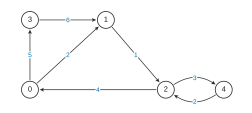
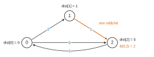
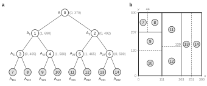

# Mines-Ponts MPI — Informatique 2 2026 · Corrigé brut

*Corrigé rédigé par IA, non officiel. Signalez toute erreur.*

Épreuve de 4 heures, calculatrice et tout dispositif électronique interdits. Langage C pour la programmation (en-têtes `assert.h`, `stdbool.h`, `stddef.h`, `stdint.h`, `stdio.h`, `stdlib.h`, `string.h` supposés inclus), SQL pour les requêtes. 38 questions.

Notations : $n_s$ (ou `ns`) nombre de salles, $n_p$ (ou `np`) nombre de passages, $\delta(u,v)$ coût minimal d'un chemin de $u$ à $v$, $c(u,v)$ coût d'un passage.

## 1 Représentation relationnelle des données

### Question 1

Une salle contient zéro, un ou plusieurs objets ; un objet est posé dans exactement une salle. L'association « objet est placé dans salle » est donc de type **un-à-plusieurs** : cardinalité $(1,1)$ du côté `objet` (chaque objet référence une et une seule salle) et $(0,N)$ du côté `salle` (une salle est référencée par un nombre quelconque d'objets).

Un attribut relationnel est atomique : il ne contient qu'une valeur. La clé étrangère doit donc être placée dans la table dont chaque ligne ne référence qu'**une** ligne de l'autre table, c'est-à-dire `objet`. Un attribut `objet_id` dans `salle` serait mal formé :

- une salle contenant $k \ge 2$ objets demanderait $k$ valeurs dans un même attribut (violation de l'atomicité), ou bien $k$ lignes pour la même salle, ce qui casse l'unicité de la clé primaire `salle.id` et duplique `nom`, `x`, `y` (redondance, risque d'incohérence) ;
- une salle vide devrait porter une valeur `NULL`.

**La clé étrangère `salle_id` est dans `objet` car l'association est de cardinalité 1–∗ (1–N) : un objet appartient à une seule salle, une salle contient 0 à N objets.**

### Question 2

```sql
SELECT DISTINCT arr.nom
FROM passage AS p
JOIN salle AS dep ON p.entree = dep.id
JOIN salle AS arr ON p.sortie = arr.id
WHERE dep.nom = 'ENTRÉE';
```

La table `salle` apparaît deux fois (alias `dep` pour la salle de départ, `arr` pour la salle d'arrivée). `DISTINCT` évite les doublons si plusieurs passages relient les deux mêmes salles.

### Question 3

```sql
SELECT s.nom, COUNT(p.id) AS nb_sortants
FROM salle AS s
LEFT JOIN passage AS p ON p.entree = s.id
GROUP BY s.id, s.nom;
```

« Pour chaque salle » impose la jointure externe : une salle sans passage sortant doit apparaître avec 0. `COUNT(p.id)` ignore les `NULL` produits par la jointure externe, alors que `COUNT(*)` donnerait 1 pour une telle salle. On regroupe sur la clé `s.id` (deux salles peuvent porter le même nom).

### Question 4

```sql
SELECT s.nom, MIN(p.cout) AS cout_min
FROM salle AS s
JOIN passage AS p ON p.entree = s.id
GROUP BY s.id, s.nom
ORDER BY cout_min DESC, s.nom ASC;
```

La jointure interne ne conserve que les salles possédant au moins un passage sortant, ce qui est exactement la restriction demandée.

### Question 5

```sql
SELECT s.nom, COUNT(o.id) AS nb_objets
FROM salle AS s
JOIN objet AS o ON o.salle_id = s.id
GROUP BY s.id, s.nom
HAVING COUNT(o.id) >= 2;
```

Le filtre porte sur un agrégat : il se place dans `HAVING`, pas dans `WHERE`. Les salles sans objet sont de toute façon éliminées par ce filtre, la jointure interne suffit.

## 2 Représentation en mémoire et navigation dans le monde

### 2.1 Implémentation classique du graphe pondéré

### Question 6

```c
monde* monde_init(int n) {
    assert(n >= 0);
    monde* m = malloc(sizeof(monde));
    assert(m != NULL);
    m->taille = n;
    m->salles = malloc(n * sizeof(salle*));
    assert(n == 0 || m->salles != NULL);
    for (int i = 0; i < n; i++) {
        m->salles[i] = malloc(sizeof(salle));
        assert(m->salles[i] != NULL);
        m->salles[i]->id = i;              /* id = indice dans le tableau */
        m->salles[i]->passages = NULL;     /* liste de passages vide */
    }
    return m;
}
```

On alloue la structure, le tableau de $n$ pointeurs, puis les $n$ salles. Le test `n == 0 ||` tient compte de ce que `malloc(0)` peut renvoyer `NULL`. Complexité $O(n)$.

### Question 7

```c
int monde_degre(monde* m, int s) {
    assert(m != NULL && 0 <= s && s < m->taille);
    int d = 0;
    for (passage* p = m->salles[s]->passages; p != NULL; p = p->suivant) {
        d++;
    }
    return d;
}
```

Complexité $O(d^+(s))$.

### Question 8

```c
int monde_sommeDegres(monde* m) {
    assert(m != NULL);
    int total = 0;
    for (int s = 0; s < m->taille; s++) {
        total += monde_degre(m, s);
    }
    return total;
}
```

Chaque passage est sortant d'exactement une salle et figure une seule fois dans la liste de celle-ci : la somme des degrés sortants vaut $n_p$. Complexité $O(n_s + n_p)$.

### Question 9

```c
int monde_coutTotal(monde* m) {
    assert(m != NULL);
    int total = 0;
    for (int s = 0; s < m->taille; s++) {
        for (passage* p = m->salles[s]->passages; p != NULL; p = p->suivant) {
            total += p->cout;
        }
    }
    return total;
}
```

Complexité $O(n_s + n_p)$. (Sur un très grand monde, la somme pourrait dépasser la capacité d'un `int` ; un `int64_t` lèverait ce risque.)

### Question 10

Entiers et pointeurs occupent 4 octets ; tous les champs ayant même taille et même alignement, il n'y a pas d'octet de remplissage. On ne compte pas le surcoût interne de l'allocateur.

- `monde` : `salles` + `taille` = 8 octets, une fois ;
- tableau `salles` : $n_s$ pointeurs, soit $4n_s$ octets ;
- `salle` : `id` + `passages` = 8 octets, $n_s$ fois ;
- `passage` : `cout` + `sortie` + `suivant` = 12 octets, $n_p$ fois (chaque passage n'est stocké que dans la liste de sa salle d'entrée).

$$\boxed{M_{\text{listes}} = 8 + 4n_s + 8n_s + 12n_p = 12\,n_s + 12\,n_p + 8 \ \text{octets}}$$

### Question 11

Avec $n_p \approx 4n_s$ : $M_{\text{listes}} \approx 12n_s + 48n_s = 60\,n_s$ octets. La mémoire disponible est $64 \text{ Ko} = 65\,536$ octets, d'où $n_s \lesssim 65\,536/60 \approx 1\,100$.

**L'ordre de grandeur plausible est 1 000 salles.** (Le surcoût réel des $n_s + n_p + 2$ blocs alloués ne peut que diminuer cette valeur, ce qui exclut 10 000.)

### 2.2 Représentation CSR pour un graphe

### Question 12

`indices` a 6 cases, donc $n_s = 5$ salles (0 à 4) ; la sentinelle `indices[5] = 7` donne $n_p = 7$. Les tranches $[\![\texttt{indices[s]}, \texttt{indices[s+1]}-1]\!]$ donnent :

| salle $s$ | cases $k$ | passages (coût) |
|---|---|---|
| 0 | 0, 1 | $0 \to 1$ (2), $0 \to 3$ (5) |
| 1 | 2 | $1 \to 2$ (1) |
| 2 | 3, 4 | $2 \to 0$ (4), $2 \to 4$ (3) |
| 3 | 5 | $3 \to 1$ (6) |
| 4 | 6 | $4 \to 2$ (2) |

Le graphe orienté pondéré a 5 sommets et 7 arcs (figure 1).



Les arcs $2 \to 4$ (coût 3) et $4 \to 2$ (coût 2) sont deux passages distincts. Le graphe est fortement connexe (circuits $0\to1\to2\to0$, $0\to3\to1$, $2\to4\to2$).

### Question 13

```c
mondeCSR* mondeCSR_init(int ns, int np) {
    assert(ns >= 0 && np >= 0);
    mondeCSR* mc = malloc(sizeof(mondeCSR));
    assert(mc != NULL);
    mc->nb_salles = ns;
    mc->indices = malloc((ns + 1) * sizeof(int));   /* sentinelle incluse */
    mc->sorties = malloc(np * sizeof(int));
    mc->couts   = malloc(np * sizeof(int));
    assert(mc->indices != NULL);
    assert(np == 0 || (mc->sorties != NULL && mc->couts != NULL));
    return mc;
}
```

### Question 14

```c
int mondeCSR_degre(mondeCSR* mc, int s) {
    assert(mc != NULL && 0 <= s && s < mc->nb_salles);
    return mc->indices[s + 1] - mc->indices[s];
}
```

La tranche de $s$ a $\texttt{indices[s+1]} - \texttt{indices[s]}$ cases ; l'accès à `indices[s+1]` est licite car $s + 1 \le n_s$ (sentinelle). Complexité $O(1)$.

### Question 15

```c
int mondeCSR_sommeDegres(mondeCSR* mc) {
    assert(mc != NULL);
    return mc->indices[mc->nb_salles];   /* sentinelle : vaut np */
}
```

La somme des degrés se télescope, et `indices[0]` vaut 0 :

$$\begin{aligned}
\sum_{s=0}^{n_s-1}\left(\texttt{indices}[s+1] - \texttt{indices}[s]\right)
&= \texttt{indices}[n_s] - \texttt{indices}[0] \\
&= \texttt{indices}[n_s] = n_p .
\end{aligned}$$

Aucune boucle n'est nécessaire : complexité $O(1)$.

### Question 16

```c
int mondeCSR_coutTotal(mondeCSR* mc) {
    assert(mc != NULL);
    int np = mc->indices[mc->nb_salles];   /* nombre total de passages */
    int total = 0;
    for (int k = 0; k < np; k++) {
        total += mc->couts[k];
    }
    return total;
}
```

Les tranches partitionnent $[\![0, n_p - 1]\!]$ : un parcours linéaire de `couts` suffit. Complexité $O(n_p)$.

### Question 17

```c
mondeCSR* monde_vers_CSR(monde* m) {
    assert(m != NULL);
    int ns = m->taille;
    int np = monde_sommeDegres(m);
    mondeCSR* mc = mondeCSR_init(ns, np);
    int k = 0;
    for (int s = 0; s < ns; s++) {
        mc->indices[s] = k;                     /* début de la tranche de s */
        for (passage* p = m->salles[s]->passages; p != NULL; p = p->suivant) {
            mc->sorties[k] = p->sortie;
            mc->couts[k] = p->cout;
            k++;
        }
    }
    mc->indices[ns] = k;                        /* sentinelle : k = np */
    return mc;
}
```

L'allocation passe par `mondeCSR_init`, et la première itération pose `indices[0] = 0`.

Invariant : avant le traitement de la salle $s$, les cases $0$ à $k-1$ contiennent, dans l'ordre, les passages des salles $0$ à $s-1$. De plus, `indices[j]` est correct pour tout $j < s$.

En fin de boucle, $k = n_p$, valeur de la sentinelle. Complexité $O(n_s + n_p)$ ; `m` n'est pas modifié.

### Question 18

`mondeCSR` contient trois pointeurs et un entier : 16 octets. Tableaux : `indices` $4(n_s + 1)$, `sorties` $4n_p$, `couts` $4n_p$.

$$\boxed{M_{\text{CSR}} = 16 + 4(n_s+1) + 8n_p = 4\,n_s + 8\,n_p + 20 \ \text{octets}}$$

### Question 19

Les deux occupations (questions 10 et 18) sont :

$$\begin{aligned}
M_{\text{listes}} &= 12\,n_s + 12\,n_p + 8, \\
M_{\text{CSR}} &= 4\,n_s + 8\,n_p + 20 .
\end{aligned}$$

Leur différence vaut :

$$\begin{aligned}
M_{\text{listes}} - M_{\text{CSR}}
&= (12\,n_s + 12\,n_p + 8) - (4\,n_s + 8\,n_p + 20) \\
&= 8\,n_s + 4\,n_p - 12 .
\end{aligned}$$

Elle est strictement positive dès que $2n_s + n_p \ge 4$, donc pour tout monde non trivial.

Coefficient par coefficient : par salle, on passe de 12 à 4 octets (plus de structure `salle` ni de pointeur vers elle) ; par passage, de 12 à 8 octets (le pointeur `suivant` disparaît grâce à la contiguïté).

Avec $n_p = 4n_s$, on compare $60\,n_s$ à $36\,n_s$ : rapport $5/3$, soit environ 40 % d'économie. Dans 64 Ko, on passe d'environ 1 100 à environ 1 800 salles.

**Conclusion : la représentation CSR est toujours plus compacte.** Elle demande en outre 4 allocations au lieu de $n_s + n_p + 2$ (moins de surcoût d'allocateur), offre un accès séquentiel aux passages d'une salle (bonne localité) et un degré en $O(1)$. Contrepartie : c'est une structure statique (ajouter un passage coûte $O(n_s + n_p)$), adaptée à un monde figé au chargement du niveau.

### 2.3 Recherche d'un chemin de coût minimal

### Question 20

Le parcours en largeur depuis $s$ utilise une file. On enfile $s$ marqué ; puis on défile un sommet $u$ et on enfile, en les marquant, ses successeurs non marqués, en retenant $u$ comme père.

Notons $\ell(t)$ le nombre minimal de passages d'un chemin de $s$ à $t$, et $\mathrm{niv}(t)$ la longueur du chemin de $s$ à $t$ dans l'arbre des pères.

- **Invariant de la file.** Les niveaux des sommets de la file sont croissants au sens large et prennent au plus deux valeurs consécutives $d$ et $d+1$. C'est vrai pour la file $(s)$. Défiler un sommet de niveau $d$ et enfiler en queue des sommets de niveau $d+1$ le conserve. Les sommets sont donc marqués **par couches**, de niveaux croissants.
- **Récurrence sur $d$.** Montrons que tout $t$ tel que $\ell(t) = d$ est marqué au niveau $d$. Pour $d = 0$, $t = s$.
- Pour $d \ge 1$, soit $s \to \dots \to v \to t$ un chemin de $d$ passages. Alors $\ell(v) = d - 1$, donc $v$ est marqué au niveau $d-1$ par hypothèse de récurrence.
- Quand $v$ est défilé, ou bien $t$ est marqué à cet instant, au niveau $d$, ou bien il est déjà marqué. Dans ce second cas, son niveau est au plus $d$, par le marquage par couches.
- Ce niveau est aussi au moins $\ell(t)$, car $\mathrm{niv}(t)$ est la longueur d'un vrai chemin. Il vaut donc $d$.

Le chemin de l'arbre des pères de $s$ à $t$ utilise donc **un nombre minimal de passages**, et tout $t$ est atteint car le graphe est fortement connexe.

**Cas où ces chemins sont de coût minimal : tous les passages ont le même coût $c > 0$.** Le coût d'un chemin vaut alors $c$ fois son nombre de passages, fonction strictement croissante du nombre de passages. (C'est aussi le cas, trivialement, si chaque salle n'est reliée à $s$ que par un seul chemin élémentaire, par exemple un graphe en arbre.)

### Question 21

```c
int* bfs_cout(mondeCSR* mc, int s) {
    assert(mc != NULL && 0 <= s && s < mc->nb_salles);
    int n = mc->nb_salles;
    int* dist = malloc(n * sizeof(int));
    assert(dist != NULL);
    for (int u = 0; u < n; u++) { dist[u] = -1; }   /* -1 : salle non atteinte */
    file* f = file_init(n);                  /* chaque salle enfilée au plus une fois */
    dist[s] = 0;
    file_enfile(f, s);
    while (!file_vide(f)) {
        int u = file_defile(f);
        for (int k = mc->indices[u]; k < mc->indices[u + 1]; k++) {
            int v = mc->sorties[k];
            if (dist[v] == -1) {             /* v découverte maintenant */
                dist[v] = dist[u] + mc->couts[k];
                file_enfile(f, v);
            }
        }
    }
    file_libere(f);
    return dist;                             /* à libérer par l'appelant */
}
```

La valeur $-1$ sert de marque « non atteinte » : une salle atteinte a une valeur $\ge 0$ (0 pour $s$, et les coûts sont strictement positifs). Une initialisation à 0 ne permettrait pas de distinguer une salle non atteinte de la source. Aucun autre tableau n'est nécessaire.

La marque est posée à l'enfilement. Une salle est donc enfilée au plus une fois (la capacité $n$ suffit), et `dist[v]` est écrit une seule fois : c'est le coût du chemin de l'arbre du parcours. Le graphe étant fortement connexe, aucune case ne reste à $-1$. Complexité $O(n_s + n_p)$.

### Question 22

Par récurrence sur l'ordre de découverte, `dist[u]` est le coût d'un chemin effectif $P_u$ de $s$ à $u$, celui de l'arbre du parcours. En effet `dist[s] = 0`, et `dist[v] = dist[u] + c(u,v)` quand $v$ est découverte depuis $u$.

Le coût minimal $\delta(s,u)$ est le minimum des coûts des chemins de $s$ à $u$. Ce minimum existe : l'ensemble des chemins est non vide (forte connexité) et, les coûts étant strictement positifs, on peut se restreindre aux chemins élémentaires, en nombre fini. Comme $P_u$ est l'un de ces chemins :

$$\delta(s,u) \le \mathrm{cout}(P_u) = \texttt{dist}[u].$$

**`dist[u]` est donc un majorant du coût minimal.** Il peut être très mauvais : avec $0 \to 2$ de coût $M$ et $0 \to 1 \to 2$ de coûts $1, 1$, on obtient $\texttt{dist}[2] = M$ alors que $\delta(0,2) = 2$.

### Question 23

Le tas ne propose pas de diminution de priorité : on ré-empile une salle à chaque amélioration et on ignore les entrées périmées grâce à un tableau `traite`.

Point essentiel : `dist` est initialisé par des valeurs finies, et non par $+\infty$. **Toutes les salles doivent alors être empilées au départ**, avec leur priorité `dist[u]`, si la relaxation est stricte.

Si l'on n'empilait que $s$, une salle $v$ dont la valeur issue du parcours en largeur est déjà optimale ne serait jamais améliorée, donc jamais empilée ; ses successeurs ne seraient jamais relâchés depuis elle.

Exemple : passages $0 \to 1$ (1), $1 \to 2$ (1), $0 \to 2$ (5) et $2 \to 0$ (1). Le parcours en largeur donne $\texttt{dist} = (0, 1, 5)$.

En n'empilant que 0, on relâche $0 \to 1$ (test $1 < 1$ faux), puis $0 \to 2$ (test $5 < 5$ faux). Le tas se vide, et $\texttt{dist}[2]$ reste à 5 au lieu de 2 (figure 2).



```c
void dijkstra(mondeCSR* mc, int s, int* dist) {
    assert(mc != NULL && dist != NULL && 0 <= s && s < mc->nb_salles);
    int n = mc->nb_salles;
    bool* traite = malloc(n * sizeof(bool));
    assert(traite != NULL);
    tasMin* tm = tasMin_init();
    dist[s] = 0;
    for (int u = 0; u < n; u++) {           /* toutes les salles sont découvertes */
        traite[u] = false;
        tasMin_empile(tm, u, dist[u]);
    }
    while (!tasMin_vide(tm)) {
        int u = tasMin_depile(tm);
        if (!traite[u]) {                    /* sinon : entrée périmée */
            traite[u] = true;
            for (int k = mc->indices[u]; k < mc->indices[u + 1]; k++) {
                int v = mc->sorties[k];
                int d = dist[u] + mc->couts[k];
                if (d < dist[v]) {
                    dist[v] = d;
                    tasMin_empile(tm, v, d);
                }
            }
        }
    }
    tasMin_libere(tm);
    free(traite);
}
```

Variante tout aussi correcte : n'empiler que $s$, mais relâcher avec un test large `d <= dist[v] && !traite[v]`. Chaque salle est alors empilée au moins une fois, par récurrence le long de l'arbre du parcours en largeur. Seule la combinaison « source seule et test strict » est fausse.

**Correction.** Deux invariants valent à tout instant.

- (I1) `dist[u]` est le coût d'un chemin effectif, donc $\texttt{dist}[u] \ge \delta(s,u)$ : vrai au départ (question 22), conservé par relâchement.
- (I2) Toute salle non traitée a dans le tas une entrée de priorité égale à `dist[u]` : empilement initial, puis empilement à chaque diminution.

Les entrées d'une même salle ont des priorités décroissantes au fil des empilements. Le premier dépilement de $u$ se fait donc avec la priorité `dist[u]` courante.

Supposons qu'une salle soit traitée avec une valeur non optimale, et soit $u$ la première. Soit $s = v_0, \dots, v_k = u$ un plus court chemin, et $v_i$ sa première salle non traitée. On a $i \ge 1$, car $s$, seule de priorité 0, est traitée en premier.

Les $v_j$ ($j < i$) ont été traitées avec leur valeur optimale et ont relâché $v_j \to v_{j+1}$. D'où :

$$\begin{aligned}
\texttt{dist}[v_i] &\le \delta(s,v_{i-1}) + c(v_{i-1},v_i) \\
&= \delta(s,v_i),
\end{aligned}$$

donc égalité par (I1). Par (I2), le tas contient $v_i$ avec la priorité $\delta(s,v_i)$, et :

$$\begin{aligned}
\delta(s,v_i) &\le \delta(s,u) \\
&< \texttt{dist}[u].
\end{aligned}$$

Ce n'est donc pas $u$ qui aurait été dépilée : contradiction. **À l'issue, `dist[u]` = $\delta(s,u)$ pour toute salle $u$.**

Complexité : au plus $n_s + n_p$ entrées dans le tas, d'où $O((n_s + n_p)\log(n_s + n_p))$.

## 3 Recherche rapide d'un chemin avec heuristique

### Question 24

Notons $f(u) = \texttt{dist}[u] + h(u)$ et $\delta = \delta(s,t)$. `dist[u]` est toujours le coût d'un chemin effectif, donc $\texttt{dist}[u] \ge \delta(s,u)$. Toute diminution de `dist[v]` provoque une (ré)insertion de $v$.

**Lemme (sommet frontière).** Soit $P = (s = v_0, \dots, v_k = t)$ un chemin optimal. À un instant où $t$ est dans la file, soit $v_i$ le sommet de $P$ d'indice minimal présent dans la file. Alors $\texttt{dist}[v_i] = \delta(s,v_i)$.

*Preuve.* $s$ a été extrait en premier, donc $i \ge 1$. Pour $j < i$, $v_j$ n'est pas dans la file : depuis sa dernière modification de `dist`, il a été extrait et ses arcs relâchés.

Par récurrence sur $j < i$, $\texttt{dist}[v_j] = \delta(s,v_j)$. C'est vrai pour $j = 0$. Si c'est vrai pour $j$, la relaxation de $v_j \to v_{j+1}$ donne :

$$\begin{aligned}
\texttt{dist}[v_{j+1}] &\le \delta(s,v_j) + c(v_j,v_{j+1}) \\
&= \delta(s,v_{j+1}),
\end{aligned}$$

car un préfixe de chemin optimal est optimal. Avec la minoration, il y a égalité, jusqu'à $\texttt{dist}[v_i] = \delta(s,v_i)$.

**Preuve par l'absurde.** Supposons $t$ extraite avec $\texttt{dist}[t] > \delta$. Juste avant l'extraction, $t$ est dans la file ; soit $v_i$ le sommet frontière. Alors :

$$\begin{aligned}
f(v_i) &= \delta(s,v_i) + h(v_i) \\
&\le \delta(s,v_i) + \delta(v_i,t) && \text{(admissibilité)} \\
&= \delta && (v_i \text{ est sur un chemin optimal}) \\
&< \texttt{dist}[t] && \text{(hypothèse)} \\
&= \texttt{dist}[t] + h(t) && (h(t) = 0) \\
&= f(t).
\end{aligned}$$

Les salles étant extraites par valeur de $f$ minimale, $v_i$ (ou une salle de priorité encore plus faible) aurait été extraite avant $t$ : contradiction.

**Donc, dès que $t$ est extraite, $\texttt{dist}[t] = \delta(s,t)$ et le chemin reconstruit est de coût minimal.**

### Question 25

**L'algorithme de Dijkstra est l'algorithme A\* utilisé avec l'heuristique nulle $h \equiv 0$** : la priorité $\texttt{dist}[u] + 0$ est celle de Dijkstra.

Cette heuristique est **admissible** : $h(u) = 0 \le \delta(u,t)$ car les coûts sont positifs, et $h(t) = 0$. La question 24 s'applique donc : dès que $t$ est extraite, `dist[t]` est le coût minimal. Le même raisonnement justifie l'optimalité de Dijkstra.

### Question 26

Soit $h$ monotone et $u$ une salle. Si $t$ n'était pas accessible depuis $u$, on aurait $\delta(u,t) = +\infty$ et rien à montrer (cas exclu ici par la forte connexité).

Sinon, soit $u = w_0, w_1, \dots, w_k = t$ un chemin de coût minimal, et $c_j$ le coût du passage $w_{j-1} \to w_j$. La monotonie donne, pour tout $j \in [\![1, k]\!]$ :

$$h(w_{j-1}) \le c_j + h(w_j).$$

Montrons par récurrence sur $j \in [\![0, k]\!]$ :

$$h(u) \le \sum_{i=1}^{j} c_i + h(w_j).$$

Pour $j = 0$, c'est une égalité. Si l'inégalité vaut au rang $j - 1$, on majore $h(w_{j-1})$ par la monotonie :

$$\begin{aligned}
h(u) &\le \sum_{i=1}^{j-1} c_i + h(w_{j-1}) \\
&\le \sum_{i=1}^{j-1} c_i + c_j + h(w_j) \\
&= \sum_{i=1}^{j} c_i + h(w_j).
\end{aligned}$$

Au rang $k$, avec $h(w_k) = h(t) = 0$ :

$$\begin{aligned}
h(u) &\le \sum_{j=1}^{k} c_j + h(t) \\
&= \delta(u,t).
\end{aligned}$$

**Toute heuristique monotone est admissible.** La réciproque est fausse : sur $s \to a \to t$ de coûts 1 et 1, l'heuristique $h(s) = 2$, $h(a) = h(t) = 0$ est admissible mais pas monotone.

### Question 27

**Non-décroissance de $f$.** Soit $u$ extraite, puis $v$ (ré)insérée par relaxation du passage $u \to v$ de coût $c$. Par monotonie :

$$\begin{aligned}
f(v) &= \texttt{dist}[u] + c + h(v) \\
&\ge \texttt{dist}[u] + h(u) \\
&= f(u).
\end{aligned}$$

Toute insertion se fait donc avec une priorité au moins égale à celle de la salle qui vient d'être extraite. Par récurrence, les valeurs de $f$ des salles extraites forment une suite croissante au sens large ; en particulier, $f$ ne décroît pas le long des chemins de l'arbre de recherche.

**Inégalité triangulaire.** Le télescopage de la question 26, mené le long d'un plus court chemin de $v$ à $u$, donne pour toutes salles $u, v$ :

$$h(v) \le \delta(v,u) + h(u). \qquad (\star)$$

**Distance définitive à l'extraction.** Supposons une salle $u$ extraite avec $\texttt{dist}[u] > \delta(s,u)$. Soit $P$ un plus court chemin de $s$ à $u$, et $v_i$ son sommet frontière.

Le lemme de la question 24, appliqué au chemin $P$, donne $\texttt{dist}[v_i] = \delta(s,v_i)$. Alors :

$$\begin{aligned}
f(v_i) &= \delta(s,v_i) + h(v_i) \\
&\le \delta(s,v_i) + \delta(v_i,u) + h(u) && (\star) \\
&= \delta(s,u) + h(u) \\
&< \texttt{dist}[u] + h(u) \\
&= f(u).
\end{aligned}$$

Donc $v_i$ aurait été extraite avant $u$ : contradiction. **Toute salle extraite a un `dist` définitif.**

**Pas de réinsertion.** Après l'extraction de $u$, une relaxation depuis une salle $w$ donnerait :

$$\begin{aligned}
\texttt{dist}[w] + c(w,u) &\ge \delta(s,w) + c(w,u) \\
&\ge \delta(s,u) \\
&= \texttt{dist}[u].
\end{aligned}$$

Elle n'améliore jamais `dist[u]` : on peut marquer $u$ comme fermée et ne plus jamais la traiter.

**Intérêt pratique.** Chaque salle est développée au plus une fois et chaque passage relâché au plus une fois, comme pour Dijkstra (complexité $O((n_s + n_p)\log n_s)$ avec un tas). Un simple tableau de booléens suffit pour l'ensemble fermé, et l'on peut s'arrêter dès que $t$ est extraite.

De manière équivalente, avec les coûts réduits $c'(u,v) = c(u,v) + h(v) - h(u) \ge 0$, A\* monotone est exactement Dijkstra sur le graphe repondéré. Sans monotonie (heuristique seulement admissible), une salle fermée peut devoir être rouverte, et le nombre de développements peut exploser.

### 3.1 Heuristique pondérée : compromis entre rapidité et qualité

### Question 28

- **Valeur d'extraction.** Dijkstra extrait la salle de `dist[u]` minimal : le coût déjà parcouru depuis $s$. A\* extrait la salle de `dist[u] + h(u)` minimal : une estimation du coût total d'un chemin de $s$ à $t$ passant par $u$.
- **Effet sur l'exploration (Dijkstra).** Dijkstra explore par coûts croissants autour de $s$, dans toutes les directions, sans tenir compte de $t$. Avant d'extraire $t$, il développe toutes les salles telles que $\delta(s,u) < \delta(s,t)$ ; la destination n'intervient que comme condition d'arrêt.
- **Effet sur l'exploration (A\*).** Avec une heuristique monotone, une salle n'est développée avant $t$ que si $\delta(s,u) + h(u) \le \delta(s,t)$. Les salles qui s'éloignent de $t$, de grand $h$, sont repoussées en fin de file et souvent jamais développées : l'exploration est orientée vers la destination.
- **Cas limites.** L'heuristique nulle redonne Dijkstra. L'heuristique parfaite $h = \delta(\cdot,t)$ ne développe, aux égalités près, que des salles situées sur des chemins optimaux.

### Question 29

On factorise la priorité par $w$ :

$$f(u) = w\left(\tfrac{1}{w}\,\texttt{dist}[u] + h(u)\right).$$

À un facteur global près, sans effet sur l'ordre, cela revient à diviser par $w$ le poids du coût déjà parcouru. Le terme prospectif $h$ pèse $w$ fois plus que le terme rétrospectif :

$$f(u) < f(v) \iff \texttt{dist}[u] - \texttt{dist}[v] < w\,\bigl(h(v) - h(u)\bigr).$$

**L'exploration devient plus gloutonne** : on privilégie les salles estimées proches de $t$, même si elles ont été coûteuses à atteindre, et la zone explorée se resserre dans la direction de $t$. Pour $w = 1$, on retrouve A\* ; lorsque $w \to +\infty$, on tend vers une recherche gloutonne guidée par $h$ seule.

### Question 30

**Non.** $h_w = w\,h$ n'est pas admissible en général.

En effet, $h_w$ est admissible si et seulement si $h(u) \le \delta(u,t)/w$ pour toute salle $u$. L'admissibilité de $h$ permet pourtant qu'une salle $u$ vérifie :

$$\frac{\delta(u,t)}{w} < h(u) \le \delta(u,t).$$

Pour une telle salle, $h_w(u) > \delta(u,t)$.

Contre-exemple : deux salles $s, t$ et un passage $s \to t$ de coût 10, avec $h(s) = 10$ et $h(t) = 0$ (admissible, et même exacte).

Pour $w = 2$, on obtient $h_w(s) = 20$, alors que $\delta(s,t) = 10$.

$h_w$ ne reste admissible que si $h$ sous-estime déjà d'un facteur $w$, par exemple $h \equiv 0$.

### Question 31

- **Nombre de salles explorées** : en général il diminue quand $w$ augmente, la recherche se concentrant le long d'un « couloir » vers $t$ (à la limite, une descente gloutonne). Ce n'est qu'une tendance : sur certains graphes (cul-de-sac attirant pour $h$), augmenter $w$ peut augmenter le nombre de développements.
- **Qualité du chemin** : **il n'est plus optimal en général**, puisque $w\,h$ n'est plus admissible (question 30) et que la preuve de la question 24 ne s'applique plus. La perte est toutefois bornée : le chemin rendu est $w$-optimal, de coût au plus $w\,\delta(s,t)$ (question 33). Plus $w$ est grand, plus la garantie est faible.

### Question 32

Dans un moteur de jeu des années 1990 :

- le temps de calcul est contraint par image (quelques dizaines de millisecondes pour tout le jeu à 30–60 images par seconde) et c'est le pire cas qui provoque des saccades : réduire le nombre de salles développées (question 31) est décisif ;
- la mémoire est très limitée (64 Ko, de l'ordre de $10^3$ salles, questions 11 et 19) : moins de salles développées, c'est une file de priorité et des tableaux de travail plus petits ;
- la dégradation est bornée et réglable : le chemin est au plus $w$ fois plus coûteux que l'optimum (question 33), et le concepteur choisit $w$ selon l'usage ;
- un joueur ne perçoit pas qu'un chemin est 10 ou 20 % plus long que l'optimum, alors qu'il perçoit immédiatement un ralentissement.

**A\* pondéré échange donc une perte d'optimalité contrôlée contre un gain important en temps et en mémoire**, ce qui correspond exactement aux contraintes de ces plateformes.

### Question 33

Notons $\delta = \delta(s,t)$ et $f(u) = \texttt{dist}[u] + w\,h(u)$, avec $h$ admissible et $w > 1$. Comme précédemment, `dist[u]` est toujours le coût d'un chemin effectif, et toute diminution de `dist` provoque une insertion. `best` est le coût d'un chemin complet effectivement trouvé de $s$ à $t$.

**Étape 1.** Soit $P = (s = v_0, \dots, v_k = t)$ un chemin optimal. À un instant où un sommet de $P$ est dans la file, soit $v_i$ celui d'indice minimal. Le lemme du sommet frontière de la question 24, dont la preuve n'utilise ni l'admissibilité ni $w$, donne $\texttt{dist}[v_i] = \delta(s,v_i)$. D'où :

$$\begin{aligned}
f(v_i) &= \delta(s,v_i) + w\,h(v_i) \\
&\le \delta(s,v_i) + w\,\delta(v_i,t) && \text{(admissibilité)} \\
&\le \max(1, w)\,\bigl(\delta(s,v_i) + \delta(v_i,t)\bigr) && \text{(termes positifs)} \\
&= w\,\bigl(\delta(s,v_i) + \delta(v_i,t)\bigr) && (w > 1) \\
&= w\,\delta && (v_i \in P).
\end{aligned}$$

Donc **tant qu'un sommet de $P$ est dans la file, $\min f \le f(v_i) \le w\,\delta$.**

**Étape 2.** L'algorithme s'arrête lorsque la salle $u$ dépilée, de priorité minimale, vérifie $f(u) \ge \texttt{best}$, c'est-à-dire $\min f \ge \texttt{best}$.

- Si un sommet de $P$ est encore dans la file : $\texttt{best} \le \min f \le w\,\delta$.
- Sinon, tous les sommets de $P$ ont été extraits après leur dernière mise à jour. La récurrence du lemme, poursuivie jusqu'à $v_k = t$, donne $\texttt{dist}[t] = \delta$. Or `best` est mis à jour dès qu'un chemin complet plus court vers $t$ est découvert, donc $\texttt{best} \le \delta \le w\,\delta$.
- Si la file se vide sans déclenchement du `break`, on est dans le second cas.

Dans tous les cas, le chemin retourné, de coût `best`, vérifie

$$\boxed{\texttt{best} \le w \cdot \delta(s,t)}$$

**il est donc $w$-optimal.**

## 4 Arbres BSP et dérécursivation

### 4.1 Dérécursivation

### Question 34

```c
void infixe(int n) {
    if (n == -1) { return; }            /* sous-arbre vide */
    infixe(bsp[n].filsDevant);          /* 1. sous-arbre « devant » */
    visite(n);                          /* 2. le nœud */
    infixe(bsp[n].filsDerriere);        /* 3. sous-arbre « derrière » */
}
```

Terminaison par récurrence sur la hauteur du sous-arbre ; complexité $O(N)$ pour $N$ nœuds, profondeur de récursion égale à la hauteur de l'arbre.

### Question 35

```c
            sommet--;            /* L1 : on retire le sommet de pile */
            n = pile[sommet];    /* L2 : on remonte au nœud en attente */
```

On atteint L1 lorsque `n` vient d'être visité, n'a pas de fils « derrière » et que la pile est non vide : dans la version récursive, l'appel sur le sous-arbre courant se termine et l'on revient au dernier nœud empilé, dont le sous-arbre « devant » est achevé et qui doit maintenant être visité. On le dépile (le sommet est en position `sommet-1`, d'où la décrémentation avant la lecture) et la boucle interne le visite au tour suivant. La pile contient exactement les nœuds dont on parcourt le sous-arbre « devant » et qui restent à visiter.

Contrôle sur l'arbre complet à 7 nœuds (fils de $i$ : $2i+1$, $2i+2$) : l'ordre de visite obtenu est $3, 1, 4, 0, 5, 2, 6$, identique à celui de la version récursive.

### 4.2 Génération procédurale d'une carte de jeu

### Question 36

```c
int alea(void) {
    return 300 + rand() % 401;     /* 401 valeurs : 300..700 */
}
```

`rand() % 401` prend les valeurs $0$ à $400$ ; l'écart à l'uniformité est d'ordre $401/(\texttt{RAND\_MAX}+1)$, négligeable puisque `RAND_MAX` est assimilé à $+\infty$.

### Question 37

```c
coupe* repartition(int n) {
    assert(n > 0);
    coupe* coupes = malloc(n * sizeof(coupe));
    assert(coupes != NULL);
    for (int i = 0; i < n; i++) {
        coupes[i].dir = rand() % 2;          /* 0 : verticale, 1 : horizontale */
        coupes[i].proportion = alea();       /* entre 300 et 700 */
    }
    return coupes;
}
```

Les cases sont dans l'ordre du parcours en largeur : les fils du nœud $i$ sont $2i+1$ et $2i+2$. Le tableau est à libérer par l'appelant.

### Question 38

**Indexation.** Les régions sont demandées dans l'ordre $A, A_1, A_2, A_{11}, A_{12}, A_{21}, A_{22}, \dots$, qui est l'ordre en largeur. En rangeant $A$ en case 0, la coupe $i$ découpe la région $i$ en les régions $2i+1$ et $2i+2$.

Un arbre complet à $n$ nœuds internes a $n + 1$ feuilles : le tableau compte $2n + 1$ régions (15 pour $n = 7$).

**Taille du carré.** L'énoncé emploie $n$ dans deux sens. Dans `creation(int n)`, $n$ est le nombre de nœuds, et le nombre final de salles est $p = n + 1$. On prend donc pour côté $100\,k$ avec $k = \log_2(n+1)$ (300 pour $n = 7$), calculé sans `math.h`.

**Convention géométrique**, non précisée par le texte et lue sur la figure et le tableau d'exemple. La proportion se mesure depuis $x_{\min}$ (coupe verticale) ou depuis $y_{\min}$ (coupe horizontale). Pour une coupe verticale :

$$x_c = x_{\min} + \texttt{prop}\cdot(x_{\max} - x_{\min})/1000,$$

et de même pour $y_c$. Pour une coupe verticale, la région $2i+1$ est la bande de gauche, $[x_{\min}, x_c]$. Pour une coupe horizontale, la région $2i+1$ est la bande supérieure, $[y_c, y_{\max}]$.

Sur la figure, $A_{11}$ est en haut et occupe 31 % de la hauteur de $A_1$ pour la proportion 690.

```c
region* creation(int n) {
    assert(n > 0);
    coupe* coupes = repartition(n);
    region* regions = malloc((2 * n + 1) * sizeof(region));
    assert(regions != NULL);
    int k = 0;                                   /* 2^k = n + 1 */
    while ((1 << k) < n + 1) { k++; }
    regions[0].xmin = 0; regions[0].xmax = 100 * k;
    regions[0].ymin = 0; regions[0].ymax = 100 * k;
    for (int i = 0; i < n; i++) {
        region r = regions[i];
        region a = r, b = r;                     /* futures régions 2i+1 et 2i+2 */
        if (coupes[i].dir == 0) {                /* verticale : partage en x */
            int xc = r.xmin + (r.xmax - r.xmin) * coupes[i].proportion / 1000;
            a.xmax = xc;  b.xmin = xc;
        } else {                                 /* horizontale : partage en y */
            int yc = r.ymin + (r.ymax - r.ymin) * coupes[i].proportion / 1000;
            a.ymin = yc;  b.ymax = yc;           /* 2i+1 en haut, 2i+2 en bas */
        }
        regions[2 * i + 1] = a;
        regions[2 * i + 2] = b;
    }
    free(coupes);
    return regions;
}
```

Invariant : avant l'itération $i$, les régions $0$ à $2i$ sont écrites. L'itération lit la région $i$, déjà écrite puisque $i \le 2i$, puis écrit ses deux filles.

Complexité $O(n)$. Le tableau des coupes, interne, est libéré ; le tableau des régions est à libérer par l'appelant.

Sur l'exemple de l'énoncé (côté 300), on obtient :

| région | coupe appliquée | coordonnées $[x_{\min}, x_{\max}] \times [y_{\min}, y_{\max}]$ |
|---|---|---|
| $A$ | verticale à $x = 111$ (370 ‰) | $[0,300] \times [0,300]$ |
| $A_1$ | horizontale à $y = 207$ (690 ‰) | $[0,111] \times [0,300]$ |
| $A_2$ | verticale à $x = 203$ (492 ‰) | $[111,300] \times [0,300]$ |
| $A_{11}$ | — | $[0,111] \times [207,300]$ |
| $A_{12}$ | — | $[0,111] \times [0,207]$ |
| $A_{21}$ | — | $[111,203] \times [0,300]$ |
| $A_{22}$ | — | $[203,300] \times [0,300]$ |

Viennent ensuite les 8 régions finales (figure 3). **Toute autre convention clairement annoncée (origine en haut à gauche, fils « devant » du côté des petites coordonnées) donne une fonction tout aussi valable.**


