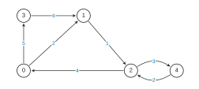
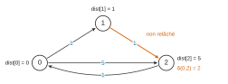
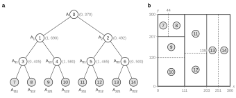

# Mines-Ponts MPI — Informatique 2 2026 · Corrigé guidé

*Corrigé rédigé par IA, non officiel. Signalez toute erreur.*

## Présentation du sujet

**Thème.** « Regards contemporains sur des algorithmes des années 1990 » : le monde d'un jeu vidéo rétro, ensemble de salles reliées par des passages orientés et pondérés, est suivi à travers plusieurs représentations (base relationnelle, listes chaînées, tableaux CSR), puis exploité pour la recherche de chemins (parcours en largeur, Dijkstra, A\*, A\* pondéré) ; la dernière partie change d'objet avec les arbres BSP (parcours infixe, dérécursivation, génération procédurale de carte). Le fil rouge est l'adéquation entre structure de données, algorithme et contraintes matérielles (mémoire, temps).

**Cadre.** 4 heures, sans calculatrice, 38 questions. Programmation en C (sept en-têtes standards supposés inclus, `math.h` n'en fait pas partie), requêtes en SQL. L'énoncé insiste sur la gestion de la mémoire, l'initialisation des structures, l'usage d'`assert`, la concision : les fonctions attendues tiennent en une dizaine de lignes.

**Découpage.**

- **Partie 1 (Q1–Q5)** : modèle relationnel et SQL (jointures, jointure externe, agrégats, `HAVING`, tri).
- **Partie 2.1 (Q6–Q11)** : graphe par listes chaînées en C, puis décompte mémoire.
- **Partie 2.2 (Q12–Q19)** : représentation CSR (*Compressed Sparse Row*), conversion, comparaison mémoire.
- **Partie 2.3 (Q20–Q23)** : parcours en largeur, majorant du coût minimal, Dijkstra initialisé par ce majorant.
- **Partie 3 (Q24–Q33)** : A\*, admissibilité, monotonie, A\* pondéré et garantie de $w$-optimalité. Questions de preuve et de discussion.
- **Partie 4 (Q34–Q38)** : arbres BSP, parcours infixe récursif puis itératif, génération aléatoire d'une partition.

**Notions du programme MPI mobilisées.** Bases de données (association 1–N, clé étrangère, jointures, agrégation) ; C (structures, pointeurs, `malloc`/`free`, listes chaînées, tableaux) ; graphes (représentations, parcours en largeur, Dijkstra, A\*) ; arbres binaires (parcours, représentation en tableau, numérotation en largeur) ; preuves d'algorithmes (invariants, raisonnement par l'absurde).

**Difficulté et gestion du temps.** Le sujet est long mais régulier ; le rapport 2026 note qu'« Il fallait savoir aller à l'essentiel ». Les parties 1, 2.1, 2.2 et 4 (sauf Q38) sont très abordables et rapportent : il ne faut pas les laisser passer. La partie 4 est indépendante : un candidat pressé par le temps a intérêt à l'aborder avant les questions de discussion de la partie 3.

**Questions discriminantes selon le rapport 2026.**

- La gestion de la mémoire en C, jugée « le point le plus discriminant » : allocations (Q6, Q13, Q17), `sizeof`, indices de la représentation CSR.
- Q10, Q11 et Q18 : calculs simples mais souvent mal traités (bits et octets confondus, mauvais ordre de grandeur).
- Q15, « point saillant du sujet » : la somme des degrés se lit dans la sentinelle, sans boucle.
- Q21 (parcours en largeur, gestion de la file « très discriminante ») et Q23 (Dijkstra, traitée par la moitié des copies).
- Q27 et Q33 : les preuves les moins abordées ; Q33 est la « Démonstration la plus difficile du sujet ».
- Q28 à Q32 : la série de discussion sur A\* pondéré a permis, selon le jury, de repérer les candidats qui comprenaient le comportement concret des algorithmes.

Le jury rappelle aussi que le code est lu sur papier : un `;` oublié est toléré, pas du code invalide (`()` au lieu de `[]`, `None` au lieu de `NULL`, fonction définie dans une autre).

## Partie 1 — Représentation relationnelle des données

On traduit une association du modèle entité-association et on écrit des requêtes simples : jointures (dont une auto-jointure), jointure externe, `GROUP BY`, `HAVING`, `ORDER BY`.

### Question 1

> [!INDICATION]
> Combien d'objets une salle peut-elle contenir ? Dans combien de salles un objet peut-il se trouver ?

> [!INDICATION]
> Un attribut d'une relation ne contient qu'une seule valeur. Que faudrait-il faire pour stocker plusieurs objets dans une ligne de `salle` ?

#### Solution

Une salle contient zéro, un ou plusieurs objets ; un objet est posé dans exactement une salle. L'association est donc **un-à-plusieurs** : cardinalité $(1,1)$ du côté `objet`, $(0,N)$ du côté `salle`.

Un attribut est atomique. La clé étrangère se place donc dans la table dont chaque ligne ne référence qu'une seule ligne de l'autre table : `objet`. Un attribut `objet_id` dans `salle` obligerait, pour une salle à $k \ge 2$ objets, soit à mettre $k$ valeurs dans un même attribut (interdit), soit à dupliquer la ligne de la salle $k$ fois, ce qui casse l'unicité de la clé primaire `salle.id` et duplique `nom`, `x`, `y` (redondance, risque d'incohérence) ; une salle vide porterait `NULL`.

**Clé étrangère dans `objet`, association de cardinalité 1–∗ (1–N) : un objet est dans une seule salle, une salle contient 0 à N objets.**

> [!METHODE]
> Pour une association 1–N, la clé étrangère va dans la table « côté plusieurs » (celle dont chaque ligne ne pointe que vers une ligne de l'autre). Pour une association N–N, on crée une table d'association, comme `passage` qui relie deux salles.

> [!PIEGE]
> Répondre seulement « parce qu'une salle peut contenir plusieurs objets » sans dire pourquoi cela interdit `objet_id` dans `salle` (atomicité, unicité de la clé), et oublier de donner la cardinalité explicitement demandée.

> [!JURY]
> Le rapport 2026 attend surtout la cardinalité, écrite explicitement : « L'erreur la plus fréquente a été d'expliquer correctement le placement de la clé sans jamais formaliser la cardinalité, ou d'en indiquer une erronée. »

### Question 2

> [!INDICATION]
> La table `passage` ne contient que des identifiants : il faut retrouver le nom de la salle de départ **et** celui de la salle d'arrivée.

> [!INDICATION]
> La table `salle` doit apparaître deux fois dans la requête, avec deux alias.

#### Solution

```sql
SELECT DISTINCT arr.nom
FROM passage AS p
JOIN salle AS dep ON p.entree = dep.id
JOIN salle AS arr ON p.sortie = arr.id
WHERE dep.nom = 'ENTRÉE';
```

`dep` sert à reconnaître la salle de départ par son nom, `arr` à récupérer le nom de la salle atteinte. `DISTINCT` élimine les doublons si deux passages relient les mêmes salles.

> [!PIEGE]
> Écrire `WHERE salle.nom = 'ENTRÉE'` et projeter `salle.nom` avec une seule occurrence de `salle` : on obtient le nom de la salle de départ, pas ceux des salles d'arrivée. Le rapport 2026 relève exactement ces deux défauts : « jointures sur passage.id et absence de la seconde jointure ». La jointure se fait sur `entree` et `sortie`, jamais sur l'identifiant du passage.

### Question 3

> [!INDICATION]
> « Pour chaque salle » : une salle sans passage sortant doit-elle apparaître ?

> [!INDICATION]
> Une jointure interne fait disparaître les salles sans passage. Laquelle ne les fait pas disparaître, et que faut-il alors compter pour obtenir 0 ?

#### Solution

```sql
SELECT s.nom, COUNT(p.id) AS nb_sortants
FROM salle AS s
LEFT JOIN passage AS p ON p.entree = s.id
GROUP BY s.id, s.nom;
```

La jointure externe gauche conserve chaque salle, avec des attributs `NULL` côté `passage` si elle n'a pas de passage sortant. `COUNT(p.id)` ignore les `NULL` et donne 0 ; `COUNT(*)` compterait la ligne artificielle et donnerait 1. On regroupe sur la clé primaire `s.id`, car rien n'interdit deux salles homonymes.

> [!PIEGE]
> Les deux erreurs sont indépendantes et se cumulent : jointure interne (les salles sans issue disparaissent) et `COUNT(*)` (elles reçoivent 1 au lieu de 0).

> [!JURY]
> Le rapport 2026 attendait « Une jointure, un GROUP BY et un COUNT » et cite comme fautes récurrentes l'oubli du `GROUP BY` et la jointure sur la mauvaise extrémité du passage (`sortie` au lieu de `entree`) : les passages sortants d'une salle sont ceux dont elle est l'`entree`. Le rapport ne se prononce pas sur les salles sans passage sortant ; la jointure externe est le choix le plus fidèle à « pour chaque salle ».

### Question 4

> [!INDICATION]
> Ici, seules les salles ayant au moins un passage sortant sont demandées : quel type de jointure réalise exactement ce filtre ?

> [!INDICATION]
> Un agrégat par salle, puis un tri à deux clés dans l'ordre imposé par l'énoncé.

#### Solution

```sql
SELECT s.nom, MIN(p.cout) AS cout_min
FROM salle AS s
JOIN passage AS p ON p.entree = s.id
GROUP BY s.id, s.nom
ORDER BY cout_min DESC, s.nom ASC;
```

La jointure interne supprime précisément les salles de degré sortant nul. Le tri principal est décroissant sur le coût minimal, le tri secondaire alphabétique sur le nom.

> [!PIEGE]
> Reprendre par réflexe la jointure externe de Q3 : on ferait apparaître des salles de coût minimal `NULL`, qui ne sont pas demandées.

> [!JURY]
> Question « Nettement plus difficile, souvent non traitée » selon le rapport 2026 : il fallait combiner `GROUP BY`, `MIN` et un double `ORDER BY`. Outre les copies blanches, l'oubli du `GROUP BY` et les jointures sur la mauvaise clé ont dominé.

### Question 5

> [!INDICATION]
> Le filtre « au moins deux objets » porte sur un résultat d'agrégation : quelle clause filtre les groupes ?

#### Solution

```sql
SELECT s.nom, COUNT(o.id) AS nb_objets
FROM salle AS s
JOIN objet AS o ON o.salle_id = s.id
GROUP BY s.id, s.nom
HAVING COUNT(o.id) >= 2;
```

`WHERE` filtre les lignes avant regroupement, `HAVING` les groupes après agrégation : un agrégat ne peut figurer que dans `HAVING`. La jointure interne suffit, puisque les salles sans objet seraient éliminées par le filtre.

> [!METHODE]
> Avant de choisir le type de jointure, se demander quelles lignes survivent au filtre final. S'il élimine de toute façon les « sans correspondance », la jointure interne suffit.

> [!PIEGE]
> Filtrer par `WHERE COUNT(o.id) >= 2` : c'est invalide. Le rapport 2026 précise qu'« Un WHERE placé après un HAVING, ou utilisé pour filtrer un COUNT, n'est pas valide. »

> [!JURY]
> Pour le rapport 2026, l'emploi de `WHERE` à la place de `HAVING` « a été l'erreur la plus répandue, et sanctionnée ». Sur l'ensemble de la partie, le jury distinguait aisément les candidats ayant révisé SQL de ceux qui improvisaient.

## Partie 2 — Représentation en mémoire et navigation dans le monde

### 2.1 Implémentation classique du graphe pondéré

Le graphe est stocké sous forme de listes d'adjacence chaînées. On écrit les fonctions de base, puis on évalue le coût mémoire de cette représentation, qui motive la suite.

### Question 6

> [!INDICATION]
> Combien de niveaux d'allocation ? La structure `monde`, le tableau `salles`, puis chacune des salles.

> [!INDICATION]
> Chaque champ doit être initialisé : `taille`, `id` de chaque salle (qui coïncide avec son indice) et la liste de passages, vide au départ.

#### Solution

```c
monde* monde_init(int n) {
    assert(n >= 0);
    monde* m = malloc(sizeof(monde));
    assert(m != NULL);
    m->taille = n;
    m->salles = malloc(n * sizeof(salle*));
    assert(n == 0 || m->salles != NULL);
    for (int i = 0; i < n; i++) {
        m->salles[i] = malloc(sizeof(salle));
        assert(m->salles[i] != NULL);
        m->salles[i]->id = i;
        m->salles[i]->passages = NULL;     /* liste vide */
    }
    return m;
}
```

$n + 2$ allocations, complexité $O(n)$. Le test `n == 0 ||` tient compte de ce que `malloc(0)` peut légitimement renvoyer `NULL`.

> [!PIEGE]
> Allouer le tableau de pointeurs sans allouer les salles, ou écrire `malloc(n * sizeof(salle))` pour un tableau qui contient des `salle*`. Oublier `passages = NULL` rend tout parcours ultérieur indéfini.

> [!JURY]
> Le rapport 2026 attendait l'allocation de la structure, celle du tableau, puis une boucle d'initialisation. Erreurs fréquentes : « absence d'allocation individuelle, oubli de l'initialisation des champs à NULL, confusion entre sizeof(structure) et sizeof(pointeur) ». L'énoncé valorisant la gestion des erreurs, on vérifie chaque allocation par un `assert`, sans noyer le code.

### Question 7

> [!INDICATION]
> Le degré sortant est la longueur d'une liste chaînée.

#### Solution

```c
int monde_degre(monde* m, int s) {
    assert(m != NULL && 0 <= s && s < m->taille);
    int d = 0;
    for (passage* p = m->salles[s]->passages; p != NULL; p = p->suivant) {
        d++;
    }
    return d;
}
```

Complexité $O(d^+(s))$.

> [!PIEGE]
> La condition `p->suivant != NULL` oublie le dernier maillon (et plante sur une liste vide). Itérer sur des indices de tableau au lieu de suivre les chaînages trahit, pour le jury, une incompréhension de la structure.

> [!JURY]
> Le rapport 2026 précise que « Le recours à une fonction récursive, moins efficace, a été sanctionné. » La confusion entre liste et tableau, déjà signalée les années précédentes, a été pénalisée à chaque occurrence.

### Question 8

> [!INDICATION]
> Chaque passage est sortant d'exactement une salle.

#### Solution

```c
int monde_sommeDegres(monde* m) {
    assert(m != NULL);
    int total = 0;
    for (int s = 0; s < m->taille; s++) {
        total += monde_degre(m, s);
    }
    return total;
}
```

Chaque passage figure une seule fois, dans la liste de sa salle d'entrée : la somme des degrés sortants vaut $n_p$. Complexité $O(n_s + n_p)$.

> [!JURY]
> L'énoncé impose d'utiliser `monde_degre`. Pour le rapport 2026, « La consigne essentielle était de réutiliser cette fonction plutôt que de recalculer les degrés ; ne pas le faire a été sanctionné. »

### Question 9

> [!INDICATION]
> Même double parcours qu'à la question précédente, mais en accumulant le champ `cout`.

#### Solution

```c
int monde_coutTotal(monde* m) {
    assert(m != NULL);
    int total = 0;
    for (int s = 0; s < m->taille; s++) {
        for (passage* p = m->salles[s]->passages; p != NULL; p = p->suivant) {
            total += p->cout;
        }
    }
    return total;
}
```

Complexité $O(n_s + n_p)$. Sur un très grand monde, la somme pourrait déborder un `int` ; un `int64_t` lèverait ce risque.

> [!JURY]
> Le rapport 2026 rappelle « qu'imbriquer une définition de fonction dans une autre plafonnait la note » : une fonction auxiliaire s'écrit à part, avant la fonction qui l'appelle.

### Question 10

> [!INDICATION]
> Faire la liste de toutes les structures et de tous les tableaux alloués, avec leur nombre d'exemplaires.

> [!INDICATION]
> Taille de chaque structure : somme des tailles de ses champs (4 octets chacun). N'oublier ni la structure `monde`, ni le tableau de pointeurs `salles`.

#### Solution

Tous les champs font 4 octets, il n'y a donc pas de remplissage ; on ignore le surcoût interne de l'allocateur.

| élément | taille unitaire | nombre | total |
|---|---|---|---|
| `monde` (`salles`, `taille`) | 8 | 1 | 8 |
| tableau `salles` (pointeurs) | 4 | $n_s$ | $4n_s$ |
| `salle` (`id`, `passages`) | 8 | $n_s$ | $8n_s$ |
| `passage` (`cout`, `sortie`, `suivant`) | 12 | $n_p$ | $12n_p$ |

$$\boxed{M_{\text{listes}} = 12\,n_s + 12\,n_p + 8 \ \text{octets}}$$

> [!PIEGE]
> Oublier le tableau de pointeurs (confondu avec les salles elles-mêmes) ou le pointeur `suivant`, qui fait passer un passage de 8 à 12 octets.

> [!PIEGE]
> Répondre en bits. Un entier de 32 bits occupe 4 octets ; le rapport 2026 qualifie la confusion entre bits et octets de « rédhibitoire » et cite aussi des coefficients erronés (taille d'un maillon ou d'une salle).

### Question 11

> [!INDICATION]
> Remplacer $n_p$ par $4n_s$ dans la formule précédente et négliger la constante.

> [!INDICATION]
> 64 Ko valent $64 \times 1024$ octets ; un ordre de grandeur suffit.

#### Solution

Avec $n_p = 4n_s$ : $M \approx 12n_s + 48n_s = 60\,n_s$ octets. Il faut $60\,n_s \le 65\,536$, soit $n_s \lesssim 1\,100$.

**Ordre de grandeur : 1 000 salles.** Le surcoût réel des blocs alloués (en-têtes de l'allocateur) ne peut que réduire cette valeur, ce qui exclut 10 000.

> [!PIEGE]
> Oublier le facteur 4 sur les passages conduit à $65\,536/24 \approx 2\,700$ et à hésiter entre deux ordres de grandeur. Ce sont les passages qui dominent l'empreinte mémoire.

> [!JURY]
> Question « Simple, mais étonnamment mal traitée » selon le rapport 2026 : la réponse attendue est 1 000, et de nombreuses copies ont répondu 100, parfois 10 000. Un calcul d'une ligne, comme ci-dessus, suffit à trancher.

### 2.2 Représentation CSR pour un graphe

On remplace les listes chaînées par trois tableaux contigus. Le tableau `indices`, avec sa case sentinelle, découpe `sorties` et `couts` en tranches consécutives, une par salle.

### Question 12

> [!INDICATION]
> Combien de salles ? La longueur de `indices` vaut $n_s + 1$.

> [!INDICATION]
> Pour chaque salle $s$, lire les cases $k$ de `indices[s]` à `indices[s+1]-1` dans `sorties` et dans `couts`.

#### Solution

$n_s = 5$, $n_p = \texttt{indices}[5] = 7$.

| salle $s$ | cases $k$ | passages (coût) |
|---|---|---|
| 0 | 0, 1 | $0 \to 1$ (2), $0 \to 3$ (5) |
| 1 | 2 | $1 \to 2$ (1) |
| 2 | 3, 4 | $2 \to 0$ (4), $2 \to 4$ (3) |
| 3 | 5 | $3 \to 1$ (6) |
| 4 | 6 | $4 \to 2$ (2) |



Le triangle orienté $0 \to 1 \to 2 \to 0$ porte les coûts 2, 1, 4 ; la salle 4 est reliée à 2 par deux arcs de sens opposés. Le graphe est fortement connexe.

> [!PIEGE]
> Lire $n_s = 6$ (la sentinelle n'est pas une salle), dessiner une arête non orientée entre 2 et 4 alors qu'il s'agit de deux passages de coûts différents, ou indexer `couts` comme `indices`.

> [!JURY]
> Le rapport 2026 cite comme erreurs principales un « nombre de sommets incorrect (6 au lieu de 5) » et des arêtes mal placées, et note que l'effort de schématisation a été valorisé.

### Question 13

> [!INDICATION]
> Quatre allocations ; quelle est la taille exacte de chacun des trois tableaux ?

#### Solution

```c
mondeCSR* mondeCSR_init(int ns, int np) {
    assert(ns >= 0 && np >= 0);
    mondeCSR* mc = malloc(sizeof(mondeCSR));
    assert(mc != NULL);
    mc->nb_salles = ns;
    mc->indices = malloc((ns + 1) * sizeof(int));   /* sentinelle incluse */
    mc->sorties = malloc(np * sizeof(int));
    mc->couts   = malloc(np * sizeof(int));
    assert(mc->indices != NULL);
    assert(np == 0 || (mc->sorties != NULL && mc->couts != NULL));
    return mc;
}
```

> [!PIEGE]
> Allouer `ns` cases pour `indices` : la sentinelle disparaît et toutes les fonctions suivantes lisent hors du tableau pour la dernière salle. Oublier de renseigner `nb_salles`.

> [!JURY]
> « Quatre allocations étaient attendues. » Le rapport 2026 relève l'« oubli d'allouer la structure mondeCSR elle-même, et dimensionnement du tableau d'indices à ns au lieu de ns+1 ».

### Question 14

> [!INDICATION]
> Le degré est le nombre de cases de la tranche de $s$ : pas besoin de boucle.

#### Solution

```c
int mondeCSR_degre(mondeCSR* mc, int s) {
    assert(mc != NULL && 0 <= s && s < mc->nb_salles);
    return mc->indices[s + 1] - mc->indices[s];
}
```

L'accès à `indices[s+1]` est licite car $s + 1 \le n_s$ : c'est le rôle de la sentinelle. Complexité $O(1)$, contre $O(d^+(s))$ avec les listes.

> [!PIEGE]
> Le rapport 2026 relève deux erreurs : l'« off-by-one » `indices[s+1]-1`, qui compte une case de moins, et une boucle de comptage là où une soustraction suffit.

### Question 15

> [!INDICATION]
> Écrire la somme des degrés à l'aide de la question précédente et la simplifier.

> [!INDICATION]
> La somme est télescopique ; que vaut `indices[0]` ?

#### Solution

```c
int mondeCSR_sommeDegres(mondeCSR* mc) {
    assert(mc != NULL);
    return mc->indices[mc->nb_salles];   /* sentinelle : vaut np */
}
```

La somme se télescope, et `indices[0]` vaut 0 :

$$\begin{aligned}
\sum_{s=0}^{n_s-1}\left(\texttt{indices}[s+1] - \texttt{indices}[s]\right)
&= \texttt{indices}[n_s] - \texttt{indices}[0] \\
&= \texttt{indices}[n_s] = n_p .
\end{aligned}$$

Complexité $O(1)$. C'est d'ailleurs la définition même de la sentinelle donnée par l'énoncé.

> [!JURY]
> Le rapport 2026 en fait le « point saillant du sujet » : la somme est donnée directement par `indices[nb_salles]`. « Une large majorité des copies a néanmoins écrit un parcours complet, ce qui ne permettait pas d'obtenir tous les points », l'exploitation directe de la structure étant attendue.

> [!METHODE]
> Une somme de différences consécutives se télescope : c'est le réflexe à avoir dès qu'une quantité s'écrit `t[i+1] - t[i]`.

### Question 16

> [!INDICATION]
> Les tranches recouvrent exactement les cases $0$ à $n_p - 1$ de `couts`. Où lire $n_p$ ?

#### Solution

```c
int mondeCSR_coutTotal(mondeCSR* mc) {
    assert(mc != NULL);
    int np = mc->indices[mc->nb_salles];
    int total = 0;
    for (int k = 0; k < np; k++) {
        total += mc->couts[k];
    }
    return total;
}
```

Une seule boucle sur un tableau contigu, complexité $O(n_p)$.

> [!JURY]
> Selon le rapport 2026, la borne de boucle méritait une attention particulière : « itérer sur le nombre de passages, et non de salles, et éviter d'appeler une fonction de calcul dans la condition de boucle ». D'où la variable locale `np`, lue une fois.

### Question 17

> [!INDICATION]
> Pour allouer, il faut connaître $n_p$ : une fonction précédente le fournit.

> [!INDICATION]
> Un seul compteur $k$ parcourt `sorties` et `couts`. Que vaut $k$ au moment où l'on commence la salle $s$ ?

> [!INDICATION]
> Ne pas oublier la dernière case de `indices`.

#### Solution

```c
mondeCSR* monde_vers_CSR(monde* m) {
    assert(m != NULL);
    int ns = m->taille;
    int np = monde_sommeDegres(m);
    mondeCSR* mc = mondeCSR_init(ns, np);
    int k = 0;
    for (int s = 0; s < ns; s++) {
        mc->indices[s] = k;                     /* début de la tranche de s */
        for (passage* p = m->salles[s]->passages; p != NULL; p = p->suivant) {
            mc->sorties[k] = p->sortie;
            mc->couts[k] = p->cout;
            k++;
        }
    }
    mc->indices[ns] = k;                        /* sentinelle, k = np */
    return mc;
}
```

L'allocation passe par `mondeCSR_init`, et la première itération pose `indices[0] = 0`.

Invariant : avant le traitement de $s$, les cases $0$ à $k-1$ contiennent, dans l'ordre, les passages des salles $0$ à $s-1$. De plus, `indices[j]` est correct pour tout $j < s$.

En sortie, $k = n_p$. Complexité $O(n_s + n_p)$. Le monde `m` n'est pas modifié.

> [!PIEGE]
> Écrire `indices[s] = k` après la boucle interne (on obtient la fin de tranche, décalée d'une salle) ou oublier la sentinelle `indices[ns]`.

> [!JURY]
> Le rapport 2026 attendait une initialisation via `mondeCSR_init` (les allocations refaites à la main étaient pénalisées), la pose explicite de `indices[0]` à 0, la construction du tableau d'indices, puis le remplissage de `sorties` et `couts`. Beaucoup de copies sont restées inachevées ou ont laissé ces deux tableaux vides.

### Question 18

> [!INDICATION]
> Même méthode qu'à la question 10 : la structure, puis les trois tableaux, sans oublier la case sentinelle.

#### Solution

`mondeCSR` : trois pointeurs et un entier, 16 octets ; `indices` : $4(n_s + 1)$ ; `sorties` et `couts` : $4n_p$ chacun.

$$\boxed{M_{\text{CSR}} = 4\,n_s + 8\,n_p + 20 \ \text{octets}}$$

> [!PIEGE]
> Le rapport 2026 signale les mêmes défauts qu'à Q10 : résultats en bits au lieu d'octets, coefficients erronés.

### Question 19

> [!INDICATION]
> Comparer terme à terme les coefficients de $n_s$ et de $n_p$, puis chiffrer avec l'hypothèse de la question 11.

> [!INDICATION]
> Une « conclusion » attend aussi un regard sur ce que le décompte d'octets ne dit pas : allocations, localité, facilité de modification.

#### Solution

Les deux occupations (Q10 et Q18) sont :

$$\begin{aligned}
M_{\text{listes}} &= 12\,n_s + 12\,n_p + 8, \\
M_{\text{CSR}} &= 4\,n_s + 8\,n_p + 20 .
\end{aligned}$$

Leur différence vaut :

$$\begin{aligned}
M_{\text{listes}} - M_{\text{CSR}}
&= (12\,n_s + 12\,n_p + 8) - (4\,n_s + 8\,n_p + 20) \\
&= 8\,n_s + 4\,n_p - 12 .
\end{aligned}$$

Elle est strictement positive dès que $2n_s + n_p \ge 4$, donc pour tout monde non trivial.

Par salle, 12 octets deviennent 4 (plus de structure `salle` ni de pointeur vers elle) ; par passage, 12 deviennent 8 (le pointeur `suivant` est remplacé par la contiguïté).

Avec $n_p = 4n_s$, on compare $60\,n_s$ à $36\,n_s$ : rapport $5/3$, environ 40 % d'économie. Dans 64 Ko, cela fait de l'ordre de 1 100 salles contre 1 800.

**Conclusion : CSR est toujours plus compact**, demande 4 allocations au lieu de $n_s + n_p + 2$ (surcoût d'allocateur négligeable), donne un accès séquentiel aux passages d'une salle (localité mémoire) et un degré en $O(1)$. En contrepartie, c'est une structure statique : insérer un passage coûte $O(n_s + n_p)$. Elle convient à un monde chargé une fois pour toutes, ce qui est le cas d'un niveau de jeu.

> [!METHODE]
> Une comparaison de représentations se conclut par un compromis : ce que l'on gagne (mémoire, localité, accès en temps constant) et ce que l'on perd (modifications coûteuses).

> [!JURY]
> Le rapport 2026 attendait « à la fois le calcul et une comparaison algébrique explicite menant à une conclusion ». « Une conclusion sans calcul, ou fondée sur un résultat erroné à la question 10, ne pouvait être pleinement créditée. »

### 2.3 Recherche d'un chemin de coût minimal

On calcule d'abord un majorant des coûts minimaux par parcours en largeur, puis on l'améliore par l'algorithme de Dijkstra. L'initialisation inhabituelle de Dijkstra cache un piège.

### Question 20

> [!INDICATION]
> Dans quel ordre le parcours en largeur découvre-t-il les sommets ? Penser à l'état de la file.

> [!INDICATION]
> Montrer que la file contient à tout instant des sommets de deux niveaux consécutifs au plus, rangés par niveau croissant, puis raisonner par récurrence sur la distance en nombre de passages.

> [!INDICATION]
> Pour la seconde partie : quand le coût d'un chemin est-il une fonction croissante de son nombre de passages ?

#### Solution

Le parcours enfile $s$ (marqué), puis répète : défiler $u$, enfiler en les marquant les successeurs non marqués de $u$, en retenant $u$ comme père.

Notons $\ell(t)$ le nombre minimal de passages de $s$ à $t$, et $\mathrm{niv}(t)$ la longueur du chemin de l'arbre des pères.

*Invariant* : les niveaux des sommets de la file sont croissants au sens large et prennent au plus deux valeurs consécutives $d$ et $d+1$. C'est vrai pour la file $(s)$. Défiler un sommet de niveau $d$ (minimal) et enfiler en queue des sommets de niveau $d+1$ le conserve. Les sommets sont donc marqués **par couches**, de niveaux croissants.

*Récurrence sur $d$* : tout $t$ avec $\ell(t) = d$ est marqué au niveau $d$. Pour $d = 0$, $t = s$.

Sinon, considérons un chemin minimal $s \to \dots \to v \to t$. Alors $\ell(v) = d - 1$, donc $v$ est marqué au niveau $d - 1$ par hypothèse de récurrence.

Lorsque $v$ est défilé, ou bien $t$ est marqué maintenant, au niveau $d$, ou bien il est déjà marqué. Dans ce cas, son niveau est au plus $d$, par le marquage par couches. Il est aussi au moins $\ell(t)$, car $\mathrm{niv}(t)$ est la longueur d'un vrai chemin.

Le chemin de l'arbre de parcours de $s$ à $t$ utilise donc **un nombre minimal de passages** ; tout $t$ est atteint par forte connexité.

**Cas où ces chemins sont aussi de coût minimal : tous les passages ont le même coût $c > 0$.** Le coût d'un chemin vaut alors $c \times$ (nombre de passages), fonction strictement croissante de ce nombre. (Autre cas trivial : un graphe où chaque salle n'est reliée à $s$ que par un seul chemin élémentaire.)

> [!PIEGE]
> Affirmer « le parcours explore par couches » sans justification. L'énoncé demande d'expliquer : l'invariant sur la file est l'argument attendu.

> [!JURY]
> Le rapport 2026 attendait « une justification par couches (niveaux du parcours en largeur) du caractère minimal du nombre de passages ; une simple affirmation ne suffisait pas ». Il met aussi en garde contre les explications interminables : « ce qui se conçoit clairement s'exprime brièvement ».

### Question 21

> [!INDICATION]
> C'est un parcours en largeur ordinaire sur la représentation CSR ; seule change la valeur stockée pour un sommet découvert.

> [!INDICATION]
> Marquer un sommet au moment où on l'enfile (pas quand on le défile) : chaque salle est alors enfilée au plus une fois, ce qui dimensionne la file.

> [!INDICATION]
> Le tableau `dist` peut servir lui-même de marque, à condition de l'initialiser à une valeur qu'aucune salle atteinte ne peut prendre.

#### Solution

```c
int* bfs_cout(mondeCSR* mc, int s) {
    assert(mc != NULL && 0 <= s && s < mc->nb_salles);
    int n = mc->nb_salles;
    int* dist = malloc(n * sizeof(int));
    assert(dist != NULL);
    for (int u = 0; u < n; u++) { dist[u] = -1; }   /* -1 : non atteinte */
    file* f = file_init(n);
    dist[s] = 0;
    file_enfile(f, s);
    while (!file_vide(f)) {
        int u = file_defile(f);
        for (int k = mc->indices[u]; k < mc->indices[u + 1]; k++) {
            int v = mc->sorties[k];
            if (dist[v] == -1) {                     /* v découverte maintenant */
                dist[v] = dist[u] + mc->couts[k];
                file_enfile(f, v);
            }
        }
    }
    file_libere(f);
    return dist;            /* à libérer par l'appelant */
}
```

La valeur $-1$ marque les salles non atteintes. Une salle atteinte a une valeur positive ou nulle (0 pour $s$, les coûts étant strictement positifs) : une initialisation à 0 confondrait les salles non atteintes avec la source.

`dist[v]` est écrit une seule fois, au moment de la découverte : c'est le coût du chemin de l'arbre du parcours. Le graphe étant fortement connexe, aucune case ne reste à $-1$. Complexité $O(n_s + n_p)$.

> [!PIEGE]
> Écrire `mc->couts[v]` au lieu de `mc->couts[k]` : `couts` est indexé comme `sorties`, par numéro de passage, pas par numéro de salle. Autre oubli fréquent : libérer la file.

> [!JURY]
> Le rapport 2026 est net : « un parcours en profondeur (DFS) était noté 0 ». Le point délicat était l'initialisation de `dist` à $-1$, et non à 0, pour distinguer les sommets non atteints ; la gestion de la file était « très discriminante ». Le jury reproche aussi les tableaux de prédécesseurs et autres structures superflues : ne coder que ce qui est demandé.

### Question 22

> [!INDICATION]
> Que représente concrètement `dist[u]` ?

> [!INDICATION]
> Le coût minimal est un minimum sur un ensemble de chemins : il suffit d'exhiber un élément de cet ensemble.

#### Solution

Par construction, `dist[s] = 0`, puis `dist[v] = dist[u] + c(u,v)` lorsque $v$ est découverte depuis $u$. Donc `dist[u]` est le coût d'un chemin effectif $P_u$ de $s$ à $u$ : celui de l'arbre du parcours.

Le coût minimal $\delta(s,u)$ existe : l'ensemble des chemins est non vide (forte connexité) et, les coûts étant strictement positifs, on peut se restreindre aux chemins élémentaires, en nombre fini. D'où :

$$\begin{aligned}
\delta(s,u) &= \min_{P : s \leadsto u} \mathrm{cout}(P) \\
&\le \mathrm{cout}(P_u) \\
&= \texttt{dist}[u].
\end{aligned}$$

**`dist[u]` est un majorant du coût minimal.** Il peut être mauvais : avec $0 \to 2$ de coût $M$ et $0 \to 1 \to 2$ de coûts $1, 1$, on a $\texttt{dist}[2] = M$ alors que $\delta(0,2) = 2$.

> [!JURY]
> Question courte, souvent laissée de côté faute de temps d'après le rapport 2026 ; l'erreur rare consistait à confondre borne supérieure et borne inférieure. Le jury note qu'« une réponse d'une demi-page tenait plus de l'esquive que de l'explication » : trois lignes suffisent.

### Question 23

> [!INDICATION]
> Le tas fourni n'a pas d'opération « diminuer la priorité » : comment s'en passer ? Comment reconnaître une entrée périmée ?

> [!INDICATION]
> Dans Dijkstra classique, une salle n'entre dans le tas que lorsque sa distance diminue strictement. Ici, les distances initiales sont déjà finies : que se passe-t-il pour une salle dont la valeur initiale est déjà optimale ? Ses successeurs seront-ils relâchés ?

> [!INDICATION]
> Toutes les salles sont déjà « découvertes » au sens de l'énoncé, avec une priorité connue.

#### Solution

On ré-empile une salle à chaque diminution de sa distance et l'on ignore, grâce à un tableau `traite`, les entrées d'une salle déjà traitée.

**Avec une relaxation stricte, il faut empiler toutes les salles au départ.** Si l'on n'empile que $s$, une salle dont la valeur fournie par le parcours en largeur est déjà optimale n'est jamais améliorée, donc jamais empilée, et ses arcs sortants ne sont jamais relâchés.

Exemple : passages $0 \to 1$ (1), $1 \to 2$ (1), $0 \to 2$ (5) et $2 \to 0$ (1). `bfs_cout` donne $(0, 1, 5)$.

En n'empilant que 0, relâcher $0 \to 1$ teste $1 < 1$, faux ; relâcher $0 \to 2$ teste $5 < 5$, faux. Le tas est vide et $\texttt{dist}[2]$ reste à 5 au lieu de 2.



```c
void dijkstra(mondeCSR* mc, int s, int* dist) {
    assert(mc != NULL && dist != NULL && 0 <= s && s < mc->nb_salles);
    int n = mc->nb_salles;
    bool* traite = malloc(n * sizeof(bool));
    assert(traite != NULL);
    tasMin* tm = tasMin_init();
    dist[s] = 0;
    for (int u = 0; u < n; u++) {            /* toutes les salles sont découvertes */
        traite[u] = false;
        tasMin_empile(tm, u, dist[u]);
    }
    while (!tasMin_vide(tm)) {
        int u = tasMin_depile(tm);
        if (!traite[u]) {                     /* sinon : entrée périmée */
            traite[u] = true;
            for (int k = mc->indices[u]; k < mc->indices[u + 1]; k++) {
                int v = mc->sorties[k];
                int d = dist[u] + mc->couts[k];
                if (d < dist[v]) {
                    dist[v] = d;
                    tasMin_empile(tm, v, d);
                }
            }
        }
    }
    tasMin_libere(tm);
    free(traite);
}
```

Variante tout aussi correcte : n'empiler que $s$, mais relâcher avec le test large `d <= dist[v] && !traite[v]`. Chaque salle est alors empilée au moins une fois, de proche en proche le long de l'arbre du parcours en largeur. Seule la combinaison « source seule et test strict » est fausse.

*Correction.* Deux invariants valent à tout instant.

- (I1) `dist[u]` est le coût d'un chemin effectif, donc $\texttt{dist}[u] \ge \delta(s,u)$ : vrai au départ par Q22, conservé par relâchement.
- (I2) Toute salle non traitée a dans le tas une entrée de priorité `dist[u]` : empilement initial, puis à chaque diminution.

Les entrées d'une même salle ont des priorités de plus en plus faibles : son premier dépilement se fait avec la valeur courante.

Supposons qu'une salle soit traitée avec une valeur non optimale et prenons la première, $u$. Soit $s = v_0, \dots, v_k = u$ un plus court chemin et $v_i$ sa première salle non traitée. On a $i \ge 1$ car $s$, seule de priorité 0, est traitée en premier.

Les $v_j$ ($j < i$) ont été traitées avec la valeur $\delta(s,v_j)$ et ont relâché $v_j \to v_{j+1}$. D'où :

$$\begin{aligned}
\texttt{dist}[v_i] &\le \delta(s,v_{i-1}) + c(v_{i-1},v_i) \\
&= \delta(s,v_i),
\end{aligned}$$

donc égalité par (I1). Par (I2), $v_i$ est dans le tas avec la priorité $\delta(s,v_i)$, et :

$$\begin{aligned}
\delta(s,v_i) &\le \delta(s,u) \\
&< \texttt{dist}[u].
\end{aligned}$$

Ce n'est donc pas $u$ qui aurait été dépilée : contradiction. **En fin d'exécution, $\texttt{dist}[u] = \delta(s,u)$ pour toute salle.**

Complexité : au plus $n_s + n_p$ entrées, d'où $O((n_s + n_p)\log(n_s + n_p))$.

> [!PIEGE]
> Recopier Dijkstra « tel quel » en remplaçant seulement $+\infty$ par les valeurs du parcours en largeur : l'algorithme obtenu est faux, et silencieusement. L'initialisation à $+\infty$ garantissait que toute première relaxation empile le sommet ; ce n'est plus le cas.

> [!METHODE]
> Sans opération de diminution de clé : ré-empiler à chaque amélioration et ignorer au dépilement les sommets déjà traités (suppression paresseuse). Le tas contient au plus $n_s + n_p$ entrées.

> [!JURY]
> Le rapport 2026 attendait « la structure correcte du parcours et une gestion de la file de priorité ». Il range parmi les erreurs fréquentes l'« initialisation empilant tous les sommets au lieu de la seule source », la relaxation non conditionnelle, et ≤ au lieu de < dans la relaxation. Or, avec `dist` initialisé par `bfs_cout`, la version « source seule et test strict » est fausse (contre-exemple ci-dessus) ; chacune des deux autres pratiques suffit à la réparer. Ce corrigé maintient la version qui empile toutes les salles, avec sa justification. Le jury raisonnait sans doute sur le Dijkstra du cours, initialisé à $+\infty$ ; sur copie, il est prudent d'écrire en une phrase pourquoi l'on s'en écarte. Le rapport note enfin que Q23 a souvent été mieux réussie que Q21.

## Partie 3 — Recherche rapide d'un chemin avec heuristique

On justifie l'optimalité de A\* (heuristique admissible), on relie admissibilité et monotonie, puis on étudie A\* pondéré, qui sacrifie l'optimalité exacte contre une garantie à un facteur $w$ près. L'outil commun est le « sommet frontière » d'un chemin optimal.

### Question 24

> [!INDICATION]
> Raisonner par l'absurde : $t$ est extraite avec $\texttt{dist}[t] > \delta(s,t)$. Considérer un chemin optimal de $s$ à $t$.

> [!INDICATION]
> Sur ce chemin, regarder le premier sommet encore présent dans la file. Que vaut sa distance, sachant que tous ses prédécesseurs sur le chemin ont été extraits et ont relâché leurs arcs ?

> [!INDICATION]
> Comparer la priorité de ce sommet à celle de $t$ en utilisant l'admissibilité et $h(t) = 0$.

#### Solution

Notons $f(u) = \texttt{dist}[u] + h(u)$ et $\delta = \delta(s,t)$. `dist[u]` est toujours le coût d'un chemin effectif, donc $\texttt{dist}[u] \ge \delta(s,u)$, et toute diminution de `dist[v]` provoque une (ré)insertion de $v$.

**Lemme (sommet frontière).** Soit $P = (s = v_0, \dots, v_k = t)$ un chemin optimal. À un instant où $t$ est dans la file, soit $v_i$ le sommet de $P$ d'indice minimal présent dans la file. Alors $\texttt{dist}[v_i] = \delta(s,v_i)$.

*Preuve.* $s$ a été extrait en premier, donc $i \ge 1$. Pour $j < i$, $v_j$ n'est pas dans la file : il a été extrait après sa dernière modification et a relâché ses arcs.

Par récurrence sur $j < i$, $\texttt{dist}[v_j] = \delta(s,v_j)$, et la relaxation de $v_j \to v_{j+1}$ donne :

$$\begin{aligned}
\texttt{dist}[v_{j+1}] &\le \texttt{dist}[v_j] + c(v_j,v_{j+1}) \\
&= \delta(s,v_j) + c(v_j,v_{j+1}) \\
&= \delta(s,v_{j+1}),
\end{aligned}$$

car un préfixe de chemin optimal est optimal. Avec la minoration, il y a égalité, jusqu'à $\texttt{dist}[v_i] = \delta(s,v_i)$.

**Par l'absurde**, supposons $t$ extraite avec $\texttt{dist}[t] > \delta$. Juste avant l'extraction, soit $v_i$ le sommet frontière :

$$\begin{aligned}
f(v_i) &= \delta(s,v_i) + h(v_i) \\
&\le \delta(s,v_i) + \delta(v_i,t) && \text{(admissibilité)} \\
&= \delta && (v_i \text{ sur un chemin optimal}) \\
&< \texttt{dist}[t] && \text{(hypothèse)} \\
&= f(t) && (h(t) = 0).
\end{aligned}$$

Les salles étant extraites par $f$ minimal, $v_i$ (ou une salle de priorité plus faible encore) serait sortie avant $t$ : contradiction.

**Dès que $t$ est extraite, $\texttt{dist}[t] = \delta(s,t)$ : le chemin reconstruit est de coût minimal.**

> [!PIEGE]
> Supposer que « toute salle extraite a une distance définitive » : c'est vrai pour une heuristique monotone (Q27), pas pour une heuristique seulement admissible, où une salle peut être rouverte. La preuve ne doit porter que sur le sommet frontière.

> [!METHODE]
> Le lemme du sommet frontière se réutilise tel quel pour Dijkstra (Q25), la monotonie (Q27) et A\* pondéré (Q33). Il vaut la peine de l'isoler.

> [!JURY]
> Question rarement traitée selon le rapport 2026, qui attendait « un raisonnement par l'absurde mené à son terme » : de nombreuses copies n'ont proposé qu'une ébauche, sans conclusion. La contradiction doit être écrite, et la conclusion énoncée.

### Question 25

> [!INDICATION]
> Quelle heuristique transforme la priorité de A\* en celle de Dijkstra ? Vérifie-t-elle l'hypothèse de la question 24 ?

#### Solution

**Dijkstra est A\* avec l'heuristique nulle $h \equiv 0$** : la priorité $\texttt{dist}[u] + 0$ est celle de Dijkstra, le reste est identique.

Cette heuristique est **admissible** : $h(u) = 0 \le \delta(u,t)$ (coûts positifs) et $h(t) = 0$. Le raisonnement de Q24 s'applique donc et prouve qu'à l'extraction de $t$, `dist[t]` est le coût minimal.

> [!PIEGE]
> Dire seulement « A\* généralise Dijkstra » sans nommer $h \equiv 0$ ni vérifier son admissibilité.

> [!JURY]
> Question abordable mais souvent non traitée, d'après le rapport 2026. Le mot « admissible » devait figurer explicitement dans la réponse, ce qui a souvent manqué.

### Question 26

> [!INDICATION]
> Suivre un chemin de coût minimal de $u$ à $t$ et appliquer la monotonie à chacun de ses passages.

> [!INDICATION]
> Les inégalités s'enchaînent : formuler la propriété au rang $j$ et la démontrer par récurrence. Où intervient $h(t) = 0$ ?

#### Solution

Soit $u$ une salle et $u = w_0, w_1, \dots, w_k = t$ un chemin de coût minimal, $c_j$ le coût de $w_{j-1} \to w_j$. Si $t$ n'était pas accessible, on aurait $\delta(u,t) = +\infty$ et rien à montrer.

La monotonie donne, pour tout $j \in [\![1, k]\!]$ :

$$h(w_{j-1}) \le c_j + h(w_j).$$

Montrons par récurrence sur $j \in [\![0, k]\!]$ :

$$h(u) \le \sum_{i=1}^{j} c_i + h(w_j).$$

Pour $j = 0$, c'est une égalité. Si l'inégalité vaut au rang $j - 1$, la monotonie majore $h(w_{j-1})$ :

$$\begin{aligned}
h(u) &\le \sum_{i=1}^{j-1} c_i + h(w_{j-1}) \\
&\le \sum_{i=1}^{j-1} c_i + c_j + h(w_j) \\
&= \sum_{i=1}^{j} c_i + h(w_j).
\end{aligned}$$

Au rang $k$, avec $h(w_k) = h(t) = 0$ :

$$\begin{aligned}
h(u) &\le \sum_{j=1}^{k} c_j + h(t) \\
&= \delta(u,t).
\end{aligned}$$

**Toute heuristique monotone est admissible.** La réciproque est fausse : sur $s \to a \to t$ (coûts 1 et 1), $h(s) = 2$, $h(a) = h(t) = 0$ est admissible, mais l'inégalité $h(s) \le 1 + h(a)$ est fausse.

> [!METHODE]
> Une inégalité locale (sur chaque arc) se transforme en inégalité globale (sur un chemin) par télescopage.

> [!JURY]
> Le rapport 2026 attendait quatre éléments : une somme le long d'un chemin formellement défini $(v_0, \dots, v_k)$, l'inégalité de monotonie, sa généralisation par récurrence, et la mention explicite de $h(t) = 0$ pour conclure. Des pointillés sans récurrence ne suffisent pas.

### Question 27

> [!INDICATION]
> Comparer la priorité d'une salle insérée en relâchant $u \to v$ à celle de $u$ : la monotonie dit dans quel sens elle évolue.

> [!INDICATION]
> Généraliser la chaîne d'inégalités de Q26 : comparer $h(v)$ et $h(u)$ pour deux salles quelconques, puis reprendre la preuve de Q24 pour une salle $u$ quelconque extraite de la file au lieu de $t$.

> [!INDICATION]
> Si `dist[u]` est définitif à l'extraction, une relaxation ultérieure peut-elle encore le diminuer ?

#### Solution

**Non-décroissance de $f$.** Soit $u$ extraite, puis $v$ (ré)insérée par relaxation du passage $u \to v$ de coût $c$. Par monotonie :

$$\begin{aligned}
f(v) &= \texttt{dist}[u] + c + h(v) \\
&\ge \texttt{dist}[u] + h(u) \\
&= f(u).
\end{aligned}$$

Toute insertion se fait donc avec une priorité au moins égale à celle de la salle qui vient d'être extraite. Les valeurs de $f$ des salles extraites forment une suite croissante au sens large, et $f$ ne décroît pas le long des chemins de l'arbre de recherche.

**Inégalité triangulaire.** Le télescopage de Q26, mené le long d'un plus court chemin de $v$ à $u$, donne pour toutes salles :

$$h(v) \le \delta(v,u) + h(u). \qquad (\star)$$

**Distance définitive.** Supposons $u$ extraite avec $\texttt{dist}[u] > \delta(s,u)$. Soit $v_i$ le sommet frontière d'un plus court chemin de $s$ à $u$ : par le lemme de Q24, $\texttt{dist}[v_i] = \delta(s,v_i)$. Alors :

$$\begin{aligned}
f(v_i) &= \delta(s,v_i) + h(v_i) \\
&\le \delta(s,v_i) + \delta(v_i,u) + h(u) && (\star) \\
&= \delta(s,u) + h(u) \\
&< f(u).
\end{aligned}$$

Donc $v_i$ aurait été extraite avant $u$. **Une salle extraite a donc une valeur `dist` définitive.**

**Pas de réinsertion.** Après l'extraction de $u$, toute relaxation depuis $w$ donne :

$$\begin{aligned}
\texttt{dist}[w] + c(w,u) &\ge \delta(s,w) + c(w,u) \\
&\ge \delta(s,u) \\
&= \texttt{dist}[u].
\end{aligned}$$

Elle n'améliore jamais $u$ : on peut marquer $u$ comme fermée et ne plus la traiter.

**Intérêt pratique.** Chaque salle est développée une seule fois et chaque passage relâché une seule fois : même complexité que Dijkstra, ensemble fermé codé par un tableau de booléens, arrêt licite dès l'extraction de $t$.

Vu autrement, avec les coûts réduits $c'(u,v) = c(u,v) + h(v) - h(u) \ge 0$, A\* monotone est exactement Dijkstra sur le graphe repondéré. Sans monotonie, des salles fermées peuvent devoir être rouvertes et le nombre de développements peut exploser.

> [!PIEGE]
> Écrire une preuve qui n'utilise que l'admissibilité : elle « démontrerait » une propriété fausse pour les heuristiques seulement admissibles. C'est $(\star)$ qui a besoin de la monotonie.

> [!JURY]
> « L'une des questions les plus mal traitées du sujet », selon le rapport 2026, et très majoritairement non abordée. Il fallait établir la non-décroissance de $f$ le long d'un chemin et en déduire l'absence de réinsertion d'un sommet déjà traité ; les rares réponses étaient souvent trop vagues.

### 3.1 Heuristique pondérée : compromis entre rapidité et qualité

Questions de discussion (Q28 à Q32) puis une preuve (Q33). Les réponses gagnent à s'appuyer sur des inégalités précises plutôt que sur des formules vagues.

### Question 28

> [!INDICATION]
> Écrire la valeur d'extraction de chaque algorithme. Laquelle fait intervenir la destination ?

> [!INDICATION]
> Décrire l'ensemble des salles développées avant $t$ par une inégalité, pour chacun des deux algorithmes.

#### Solution

- **Valeur d'extraction.** Dijkstra : `dist[u]` minimal (coût déjà parcouru). A\* : `dist[u] + h(u)` minimal (estimation du coût total d'un chemin de $s$ à $t$ passant par $u$).
- **Exploration de Dijkstra.** Il explore par coûts croissants autour de $s$, dans toutes les directions : il développe avant $t$ toutes les salles telles que $\delta(s,u) < \delta(s,t)$, la destination ne servant que de condition d'arrêt.
- **Exploration de A\*.** Avec une heuristique monotone, une salle n'est développée avant $t$ que si $\delta(s,u) + h(u) \le \delta(s,t)$. Les salles qui s'éloignent de $t$ ont un $h$ grand : elles sont repoussées en fin de file et souvent jamais développées. L'exploration est orientée vers la destination.
- **Cas limites.** L'heuristique nulle redonne Dijkstra ; une heuristique parfaite $h = \delta(\cdot,t)$ ne développe, aux égalités près, que des salles situées sur des chemins optimaux.

> [!JURY]
> Le rapport 2026 attendait une comparaison explicite de l'exploration guidée par `dist[u] + h(u)` à celle guidée par `dist[u]`, et notamment l'orientation plus directe de A\* vers la cible. Les deux points de l'énoncé (valeur d'extraction, effet sur l'exploration) structurent la réponse.

### Question 29

> [!INDICATION]
> Factoriser $f(u)$ par $w$ : qu'advient-il du poids relatif de `dist` ?

#### Solution

On factorise la priorité par $w$ :

$$f(u) = w\left(\tfrac{1}{w}\,\texttt{dist}[u] + h(u)\right).$$

À un facteur global près, sans effet sur l'ordre, cela revient à diviser par $w$ le poids du coût déjà parcouru. On a de plus :

$$f(u) < f(v) \iff \texttt{dist}[u] - \texttt{dist}[v] < w\,\bigl(h(v) - h(u)\bigr).$$

Un écart d'estimation restante pèse $w$ fois plus qu'un écart de coût déjà payé. **L'exploration devient plus gloutonne** : elle privilégie les salles estimées proches de $t$, même chères à atteindre, et se resserre dans la direction de $t$.

Pour $w = 1$, c'est A\* ; quand $w \to +\infty$, on tend vers une recherche gloutonne guidée par $h$ seule.

### Question 30

> [!INDICATION]
> Chercher un contre-exemple minimal, avec une heuristique aussi bonne que possible.

#### Solution

**Non**, pas en général.

$h_w$ est admissible si et seulement si $h(u) \le \delta(u,t)/w$ pour toute salle $u$. Or l'admissibilité de $h$ permet qu'une salle vérifie :

$$\frac{\delta(u,t)}{w} < h(u) \le \delta(u,t).$$

Pour une telle salle, $h_w(u) > \delta(u,t)$ : $h_w$ n'est plus admissible.

Exemple : deux salles $s, t$ et un passage $s \to t$ de coût 10, avec $h(s) = 10$ et $h(t) = 0$ ; $h$ est admissible (et exacte).

Avec $w = 2$, on obtient $h_w(s) = 20$, alors que $\delta(s,t) = 10$.

$h_w$ ne reste admissible que pour une heuristique qui sous-estime déjà d'un facteur $w$, par exemple $h \equiv 0$.

> [!PIEGE]
> Multiplier une majoration par $w > 1$ ne la conserve pas : $h \le \delta$ n'entraîne pas $w h \le \delta$. Le rapport 2026 cite comme erreur principale le fait d'« affirmer à tort que l'heuristique pondérée reste admissible, ou ne raisonner que sur un cas particulier » : le contre-exemple illustre la réponse, l'argument général la justifie.

### Question 31

> [!INDICATION]
> Pour le nombre de salles : s'appuyer sur Q29. Est-ce une tendance ou une propriété garantie ?

> [!INDICATION]
> Pour l'optimalité : l'argument de Q24 s'applique-t-il encore à $w\,h$ ? La définition qui suit l'énoncé laisse deviner la réponse quantitative.

#### Solution

- **Salles explorées** : en général leur nombre diminue quand $w$ augmente, la recherche se concentrant dans un couloir vers $t$ ; à la limite, une descente gloutonne. C'est une tendance, pas une garantie : une heuristique qui attire la recherche dans un cul-de-sac peut faire augmenter le nombre de développements.
- **Qualité du chemin** : **il n'est plus optimal en général**, puisque $w\,h$ n'est plus admissible (Q30) et que la preuve de Q24 ne s'applique plus. La perte est bornée : le chemin est $w$-optimal, de coût au plus $w\,\delta(s,t)$ (Q33). Plus $w$ est grand, moins la garantie est forte.

> [!PIEGE]
> Inverser le sens de la variation, faute relevée dans plusieurs copies par le rapport 2026. Quand $w$ augmente, on explore moins (en tendance) et l'on garantit moins.

### Question 32

> [!INDICATION]
> Relier les contraintes de la partie 2 (mémoire) et le temps de calcul disponible dans un jeu aux propriétés établies en Q29–Q31.

#### Solution

- **Temps** : un jeu calcule une image toutes les 16 à 33 ms environ, pour tout le traitement ; c'est le pire cas qui provoque des saccades. Développer moins de salles (Q31) est décisif.
- **Mémoire** : 64 Ko, de l'ordre de $10^3$ salles (Q11, Q19). Moins de salles développées, c'est une file de priorité et des tableaux de travail plus petits.
- **Garantie** : la dégradation est bornée par le facteur $w$ (Q33), réglable par le concepteur selon l'usage.
- **Perception** : un joueur ne remarque pas un chemin 10 ou 20 % plus long que l'optimum, alors qu'il remarque un ralentissement.

**A\* pondéré échange une perte d'optimalité contrôlée contre un gain important en temps et en mémoire**, exactement le compromis imposé par ces plateformes.

> [!JURY]
> Pour le rapport 2026, le point attendu était « le compromis entre rapidité de calcul et qualité du chemin », et les meilleures réponses le reliaient explicitement aux contraintes du temps réel. L'énoncé demande de s'appuyer sur les questions précédentes : des renvois explicites (Q31, Q33) valent mieux qu'une dissertation générale.

### Question 33

> [!INDICATION]
> Étape 1 : reprendre le sommet frontière $v_i$ d'un chemin optimal de Q24. Que vaut `dist[v_i]` ? Majorer $h(v_i)$, puis utiliser $w > 1$.

> [!INDICATION]
> Pour majorer $\delta(s,v_i) + w\,\delta(v_i,t)$ par une quantité proportionnelle à $\delta(s,t)$, utiliser $\delta(s,v_i) \le w\,\delta(s,v_i)$.

> [!INDICATION]
> Étape 2 : la salle dépilée a la priorité minimale. Distinguer selon qu'un sommet du chemin optimal est encore dans la file ou non.

#### Solution

Notons $\delta = \delta(s,t)$ et $f(u) = \texttt{dist}[u] + w\,h(u)$. `dist[u]` est toujours le coût d'un chemin effectif, et toute diminution provoque une insertion. `best` est le coût d'un chemin complet effectivement trouvé.

**Étape 1.** Soit $P = (s = v_0, \dots, v_k = t)$ un chemin optimal. À un instant où un sommet de $P$ est dans la file, soit $v_i$ celui d'indice minimal. Le lemme de Q24, dont la preuve n'utilise ni l'admissibilité ni $w$, donne $\texttt{dist}[v_i] = \delta(s,v_i)$. Alors :

$$\begin{aligned}
f(v_i) &= \delta(s,v_i) + w\,h(v_i) \\
&\le \delta(s,v_i) + w\,\delta(v_i,t) && \text{(admissibilité)} \\
&\le \max(1, w)\,\bigl(\delta(s,v_i) + \delta(v_i,t)\bigr) && \text{(termes positifs)} \\
&= w\,\bigl(\delta(s,v_i) + \delta(v_i,t)\bigr) && (w > 1) \\
&= w\,\delta && (v_i \in P).
\end{aligned}$$

**Tant qu'un sommet de $P$ est dans la file, $\min f \le w\,\delta$.**

**Étape 2.** L'arrêt a lieu lorsque la salle dépilée, de priorité minimale, vérifie $f(u) \ge \texttt{best}$, soit $\min f \ge \texttt{best}$.

- Si un sommet de $P$ est encore dans la file : $\texttt{best} \le \min f \le w\,\delta$.
- Sinon, tous les sommets de $P$ ont été extraits après leur dernière mise à jour. La récurrence du lemme, menée jusqu'à $v_k = t$, donne $\texttt{dist}[t] = \delta$. `best` ayant été mis à jour à la découverte de ce chemin, $\texttt{best} \le \delta \le w\,\delta$.
- Si la file se vide sans `break`, on est dans ce second cas.

$$\boxed{\texttt{best} \le w \cdot \delta(s,t)}$$

**Le chemin retourné est $w$-optimal.**

> [!PIEGE]
> Oublier de dire où sert $w > 1$ (passage de $\delta(s,v_i)$ à $w\,\delta(s,v_i)$) et utiliser l'égalité $\delta(s,v_i) + \delta(v_i,t) = \delta(s,t)$ pour un sommet qui n'est pas sur un chemin optimal.

> [!JURY]
> « Démonstration la plus difficile du sujet » pour le rapport 2026, presque toujours laissée blanche. Le jury désigne comme point clé « le passage au maximum et la justification rigoureuse de l'encadrement des distances » : c'est la ligne $\max(1,w)$ ci-dessus, et le lemme qui garantit $\texttt{dist}[v_i] = \delta(s,v_i)$.

## Partie 4 — Arbres BSP et dérécursivation

On écrit le parcours infixe d'un arbre stocké dans un tableau global, on le dérécursive avec une pile explicite, puis on génère une partition aléatoire de l'espace à partir d'un arbre BSP complet numéroté en largeur.

### 4.1 Dérécursivation

### Question 34

> [!INDICATION]
> Transcrire la définition. Comment traiter un fils absent, codé par $-1$ ?

#### Solution

```c
void infixe(int n) {
    if (n == -1) { return; }            /* sous-arbre vide */
    infixe(bsp[n].filsDevant);
    visite(n);
    infixe(bsp[n].filsDerriere);
}
```

Terminaison par récurrence sur la hauteur ; complexité $O(N)$ pour $N$ nœuds ; profondeur de pile d'appels égale à la hauteur de l'arbre, ce qui motive la dérécursivation.

> [!PIEGE]
> Sans le test `n == -1`, l'accès `bsp[-1]` est hors du tableau. L'arbre est une variable globale : la signature imposée ne doit pas être modifiée.

> [!JURY]
> Le rapport 2026 relève deux lacunes : l'oubli du cas de base `n == -1` et le mauvais placement de la visite du nœud par rapport aux deux appels récursifs.

### Question 35

> [!INDICATION]
> À quel moment de la version récursive correspond le point L1/L2 ? Le nœud courant vient d'être visité et n'a pas de fils « derrière » : l'appel récursif se termine. À qui revient la main ?

> [!INDICATION]
> Le sommet de la pile est en position `sommet-1`. Dans quel ordre écrire les deux opérations ?

#### Solution

```c
            sommet--;            /* L1 */
            n = pile[sommet];    /* L2 */
```

On atteint L1 quand `n` vient d'être visité, n'a pas de fils « derrière » et que la pile est non vide. Dans la version récursive, l'appel se termine et l'on revient au dernier nœud empilé, qui a fini son sous-arbre « devant » et doit maintenant être visité. On le dépile (décrémentation d'abord, puisque le sommet est en `sommet-1`), et la boucle interne le visite au tour suivant ; s'il a un fils « derrière », on repart en descente depuis ce fils.

Trace sur l'arbre complet à 7 nœuds (fils de $i$ : $2i+1$, $2i+2$), en partant de `n = 0`, pile vide :

| étape | pile | `n` | action |
|---|---|---|---|
| 1 | — | 0 | empile 0, descend en 1 |
| 2 | 0 | 1 | empile 1, descend en 3 |
| 3 | 0, 1 | 3 | visite 3 ; pas de fils derrière : L1-L2, `n = 1` |
| 4 | 0 | 1 | visite 1 ; fils derrière : `n = 4` |
| 5 | 0 | 4 | visite 4 ; L1-L2, `n = 0` |
| 6 | — | 0 | visite 0 ; fils derrière : `n = 2` |
| 7 | — | 2 | empile 2, descend en 5 ; visite 5 ; L1-L2, `n = 2` |
| 8 | — | 2 | visite 2 ; fils derrière : `n = 6` |
| 9 | — | 6 | visite 6 ; pile vide : fin |

Ordre obtenu : $3, 1, 4, 0, 5, 2, 6$, celui du parcours infixe récursif.

> [!PIEGE]
> Inverser les deux lignes : `n = pile[sommet]` avant `sommet--` lit la case au-dessus du sommet, qui ne contient pas le bon nœud. C'est l'erreur la plus fréquente selon le rapport 2026, avec une mauvaise manipulation de la pile ; la question, technique, a été plutôt bien réussie quand elle était abordée.

> [!METHODE]
> Pour dérécursiver, identifier ce que contient la pile d'appels (ici : les nœuds dont le sous-arbre « devant » est en cours et qui restent à visiter) et le reproduire dans une pile explicite. Une trace sur un petit arbre vérifie le résultat.

### 4.2 Génération procédurale d'une carte de jeu

### Question 36

> [!INDICATION]
> Combien d'entiers dans $[\![300, 700]\!]$ ? Utiliser le reste d'une division euclidienne puis une translation.

#### Solution

```c
int alea(void) {
    return 300 + rand() % 401;      /* 401 valeurs, de 300 à 700 */
}
```

`rand() % 401` prend les valeurs 0 à 400 ; le biais est d'ordre $401/(\texttt{RAND\_MAX} + 1)$, négligeable puisque `RAND_MAX` est assimilé à $+\infty$.

> [!PIEGE]
> `rand() % 400` exclut la borne 700, demandée incluse.

> [!JURY]
> Question « notée en tout ou rien » selon le rapport 2026 : « L'erreur dominante a été un modulo 400 au lieu de 401 ». Compter les entiers de l'intervalle avant d'écrire le modulo.

### Question 37

> [!INDICATION]
> Une allocation, puis une boucle qui tire la direction et la proportion de chaque nœud. Quelle fonction de la question précédente sert ici ?

#### Solution

```c
coupe* repartition(int n) {
    assert(n > 0);
    coupe* coupes = malloc(n * sizeof(coupe));
    assert(coupes != NULL);
    for (int i = 0; i < n; i++) {
        coupes[i].dir = rand() % 2;          /* 0 : verticale, 1 : horizontale */
        coupes[i].proportion = alea();
    }
    return coupes;
}
```

Les nœuds sont rangés dans l'ordre du parcours en largeur : les fils de $i$ sont $2i+1$ et $2i+2$. Le tableau est à libérer par l'appelant.

> [!JURY]
> Le rapport 2026 attendait quatre points : allocation de la structure, boucle de remplissage, choix de la direction de coupe et respect des proportions. Erreurs fréquentes : oublis de `return` et incohérences dans la manipulation des structures.

### Question 38

> [!INDICATION]
> Les régions sont demandées dans l'ordre $A, A_1, A_2, A_{11}, \dots$ : c'est le même ordre en largeur que celui des coupes. Quelle région la coupe $i$ découpe-t-elle, et où ranger les deux morceaux ?

> [!INDICATION]
> Combien de régions au total pour $n$ nœuds internes d'un arbre complet ? Quel est le côté du carré initial, sachant que la lettre $n$ de l'énoncé change de sens ?

> [!INDICATION]
> L'énoncé ne dit pas depuis quel bord se mesure la proportion : la figure et le tableau d'exemple permettent de choisir une convention, qu'il faut annoncer.

#### Solution

**Indexation.** Avec $A$ en case 0, l'ordre demandé est l'ordre en largeur : la coupe $i$ découpe la région $i$ en les régions $2i+1$ et $2i+2$.

Un arbre complet à $n$ nœuds internes a $n + 1$ feuilles : $2n + 1$ régions (15 pour $n = 7$). Une seule boucle croissante suffit : la région $i$ est écrite avant d'être découpée, car son père $\lfloor (i-1)/2 \rfloor$ est plus petit.

**Côté du carré.** Dans `creation(int n)`, $n$ est le nombre de nœuds ; le nombre de salles finales est $p = n + 1$, et le côté vaut $100\log_2(n+1)$ (300 pour $n = 7$), calculé par doublements puisque `math.h` n'est pas disponible.

**Convention** (lue sur la figure) : la proportion se mesure depuis $x_{\min}$ ou $y_{\min}$ ; pour une coupe verticale, la région $2i+1$ est à gauche ; pour une coupe horizontale, la région $2i+1$ est la bande du haut. Sur la figure, $A_{11}$ est en haut de $A_1$ et en occupe 31 % pour la proportion 690.

```c
region* creation(int n) {
    assert(n > 0);
    coupe* coupes = repartition(n);
    region* regions = malloc((2 * n + 1) * sizeof(region));
    assert(regions != NULL);
    int k = 0;                                   /* 2^k = n + 1 */
    while ((1 << k) < n + 1) { k++; }
    regions[0].xmin = 0; regions[0].xmax = 100 * k;
    regions[0].ymin = 0; regions[0].ymax = 100 * k;
    for (int i = 0; i < n; i++) {
        region r = regions[i];
        region a = r, b = r;                     /* régions 2i+1 et 2i+2 */
        if (coupes[i].dir == 0) {                /* verticale : partage en x */
            int xc = r.xmin + (r.xmax - r.xmin) * coupes[i].proportion / 1000;
            a.xmax = xc;  b.xmin = xc;
        } else {                                 /* horizontale : partage en y */
            int yc = r.ymin + (r.ymax - r.ymin) * coupes[i].proportion / 1000;
            a.ymin = yc;  b.ymax = yc;           /* 2i+1 en haut */
        }
        regions[2 * i + 1] = a;
        regions[2 * i + 2] = b;
    }
    free(coupes);
    return regions;
}
```

Invariant : avant l'itération $i$, les régions $0$ à $2i$ sont écrites. Complexité $O(n)$. Le tableau des coupes est libéré, celui des régions est à la charge de l'appelant.

Vérification sur l'exemple (côté 300) :

| région | coupe appliquée | coordonnées $[x_{\min}, x_{\max}] \times [y_{\min}, y_{\max}]$ |
|---|---|---|
| $A$ | verticale à 37 % ($x = 111$) | $[0,300] \times [0,300]$ |
| $A_1$ | horizontale à 69 % depuis le bas ($y = 207$) | $[0,111] \times [0,300]$ |
| $A_2$ | verticale ($x = 203$) | $[111,300] \times [0,300]$ |
| $A_{11}$ | — | $[0,111] \times [207,300]$ |
| $A_{12}$ | — | $[0,111] \times [0,207]$ |
| $A_{21}$ | — | $[111,203] \times [0,300]$ |
| $A_{22}$ | — | $[203,300] \times [0,300]$ |

Une autre convention, clairement annoncée, est tout aussi recevable.



> [!PIEGE]
> Allouer $n + 1$ régions au lieu de $2n + 1$ (l'énoncé demande aussi les régions initiale et intermédiaires, et fournit le contrôle « 15 pour 7 ») ; diviser par 100 au lieu de 1000 (la proportion est en pour mille) ; prendre un côté $100n$ avec $n$ nombre de nœuds.

> [!JURY]
> Question la plus exigeante de la partie, rarement menée à terme d'après le rapport 2026. Erreurs principales : tableau dimensionné à $n$ au lieu de $2n + 1$, côté initial $100 \cdot n$ au lieu de $100 \cdot \log_2(\dots)$, et de nombreux oublis du test de direction de coupe et de l'affectation des bornes `xmin`, `xmax`, `ymin`, `ymax`.

> [!METHODE]
> Dans un arbre binaire complet rangé en largeur, le nœud $i$ a pour fils $2i+1$ et $2i+2$ et pour père $\lfloor (i-1)/2 \rfloor$ : un parcours de l'arbre devient une simple boucle croissante sur les indices.

## Bilan

**Méthodes à retenir.**

- SQL : jointure externe et `COUNT(colonne)` pour « chaque ligne, y compris sans correspondance » ; `HAVING` pour filtrer sur un agrégat ; auto-jointure avec alias.
- C : allocation à plusieurs niveaux avec `assert`, initialisation de chaque champ, libération des structures auxiliaires ; décompte mémoire champ par champ.
- Représentation CSR : tranches délimitées par un tableau d'indices avec sentinelle ; degré en $O(1)$ ; somme télescopique ; conversion avec un seul compteur.
- Graphes : le parcours en largeur minimise le nombre d'arcs, avec `dist` initialisé à $-1$ comme marque ; Dijkstra sans diminution de clé (suppression paresseuse) ; prudence quand on change l'initialisation d'un algorithme connu.
- Preuves A\* : le lemme du sommet frontière, l'admissibilité pour majorer la priorité de ce sommet, $h(t) = 0$ pour conclure ; la monotonie donne l'inégalité triangulaire $(\star)$ et des distances définitives.
- Arbres : parcours infixe, dérécursivation par pile explicite, numérotation en largeur $2i+1$, $2i+2$.

**Ce que le rapport 2026 retient.** Le jury a surtout départagé les candidats sur la gestion de la mémoire en C (allocations, `sizeof`, sentinelle CSR), sur Q15 (exploiter la sentinelle sans boucle), Q21 et Q23 (parcours en largeur et Dijkstra), et sur les preuves Q27 et Q33, rarement abordées. Les calculs de taille (Q10, Q18) et l'ordre de grandeur de Q11 ont coûté des points faciles. En SQL, l'emploi de `WHERE` au lieu de `HAVING` a été l'erreur la plus répandue. Sur Q23, le corrigé s'écarte d'une attente du rapport, pour une raison démontrée par un contre-exemple (voir la question).

**Prérequis à revoir.** Modèle entité-association ; invariants de boucle ; preuve de correction de Dijkstra ; représentation d'un arbre complet dans un tableau.

**Questions classiques transposables.** Q3 (jointure externe et comptage), Q10/Q18 (empreinte mémoire d'une structure), Q20 (le parcours en largeur calcule les plus courts chemins en nombre d'arcs), Q24–Q27 (optimalité de A\*, monotone implique admissible), Q34–Q35 (dérécursivation d'un parcours d'arbre).
