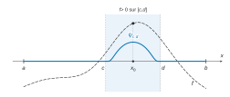
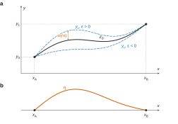
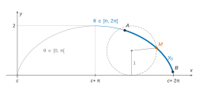
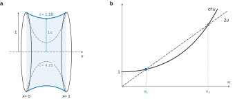

# Mines-Ponts MPI — Maths 1 2026 · Corrigé guidé

*Corrigé rédigé par IA, non officiel. Signalez toute erreur.*

## Présentation du sujet

**Thème.** Le sujet démontre l'**équation d'Euler-Lagrange**, condition nécessaire satisfaite par une fonction $y$ qui rend extrémale une intégrale $T(y)=\int f(x,y,y')\,dx$.

Il l'applique ensuite à trois problèmes célèbres du calcul des variations : le plus court chemin, la brachistochrone, la caténoïde.

**Découpage (18 questions, 3 heures, sans calculatrice).**

- **Partie I (Q1–Q4)** : construction de la fonction plateau $\mathcal C^\infty$ issue de $e^{-1/x}$, puis **lemme fondamental** : une fonction continue orthogonale à toutes les fonctions test nulles aux bornes est nulle. Autonome et classique.
- **Partie II (Q5–Q10)** : cœur théorique. On perturbe l'extrémale $z_0$ en $z_0+\varepsilon\eta$ (Q6, argument de compacité), on dérive sous le signe intégrale (Q7), on écrit la condition d'extremum et on intègre par parties (Q8). On conclut avec la partie I (Q9), puis on obtient l'**identité de Beltrami** quand $f$ ne dépend pas de $x$ (Q10).
- **Partie III (Q11)** : la ligne droite, première application de Beltrami.
- **Partie IV (Q12–Q15)** : la brachistochrone ; Beltrami, étude de $\operatorname{cotan}$ et $\operatorname{arccotan}$, paramétrage de la cycloïde.
- **Partie V (Q16–Q18)** : la caténoïde ; Beltrami, étude de $\operatorname{ch}$ et $\operatorname{argch}$, intégration d'une équation différentielle.

**Notions mobilisées.** Dérivées successives, croissances comparées, théorème de prolongement de la dérivée, fonctions continues positives d'intégrale nulle, Bolzano-Weierstrass, image continue d'un compact, dérivation des intégrales à paramètre, règle de la chaîne, condition nécessaire d'extremum en un point intérieur, intégration par parties, théorème de la bijection et dérivée d'une réciproque, fonctions hyperboliques, équations différentielles linéaires d'ordre 2.

**Difficulté et gestion du temps.** Le rapport 2026 juge la longueur et la difficulté raisonnables : les meilleurs candidats ont pratiquement terminé, et tous les résultats à utiliser étaient donnés, sans blocage d'une partie à l'autre.

**Questions discriminantes selon le jury.** Le rapport 2026 explique les résultats très contrastés par la structure du sujet : « les questions onze, douze et seize reposent sur la même technique, utilisée dans trois contextes différents ». Les candidats qui maîtrisaient l'application de Beltrami (hypothèses comprises) ont pris une avance confortable.

Autres constats du jury :

- Q1 et Q2, très classiques, ont été étonnamment faibles ; il y a eu « très peu de solutions complètes » à la question 2.
- Q6 a souvent été sautée ; Q10, Q14 et Q15 ont été peu abordées.
- Q13 et Q17 relèvent du programme de première année, mais la dérivée de la réciproque a été décevante.
- Q18 n'a presque jamais été réussie.

Les questions 13 et 17 sont indépendantes du reste : à ne pas laisser passer. Les questions 11, 12 et 16 n'ont besoin que de l'identité de Beltrami, **écrite dans l'énoncé** : on peut l'admettre et les traiter même si la partie II résiste.

**Présentation.** Le jury signale que la lecture des dérivées partielles au milieu des ratures pouvait s'avérer impossible, et prévient : « Si on n’arrive pas à lire, il met zéro à la question. »

**Deux points d'énoncé à signaler.** En partie II, $f$ n'est supposée de classe $\mathcal C^2$ que sur l'ouvert $]x_A,x_B[\times U\times V$, alors que les questions 7 à 9 utilisent ses dérivées jusqu'aux bornes ; le rapport 2026 le reconnaît à propos de la question 7.

En question 18, l'hypothèse $y_0'>0$ sur $[0,1]$ contredit $y_0(0)=y_0(1)$. Le bon réflexe : signaler, expliquer l'initiative prise, continuer.

## Partie I — Lemme fondamental du calcul variationnel

On construit une « bosse » $\mathcal C^\infty$ strictement positive exactement sur un intervalle $]c,d[$ choisi, puis on s'en sert comme fonction test pour détecter un point où $f$ ne s'annule pas.

### Question 1

> [!INDICATION]
> La régularité sur $\mathbb R_+^\star$ est une simple composition. Pour la forme des dérivées, raisonner par récurrence sur $n$.

> [!INDICATION]
> Dériver $x\mapsto P_n(1/x)\,e^{-1/x}$ comme un produit, sans oublier le facteur venant de la dérivée de $1/x$ ; factoriser par $\frac1{x^2}e^{-1/x}$ pour lire $P_{n+1}$.

#### Solution

$x\mapsto-1/x$ est de classe $\mathcal C^\infty$ sur $\mathbb R_+^\star$ et $\exp$ sur $\mathbb R$.

Par composition, $\varphi$ est de classe $\mathcal C^\infty$ sur $\mathbb R_+^\star$.

Récurrence : $P_0=1$ convient. Supposons $\varphi^{(n)}(x)=P_n(1/x)e^{-1/x}$ sur $\mathbb R_+^\star$.

La dérivée de $x\mapsto P_n(1/x)$ est $x\mapsto-\frac1{x^2}P_n'(1/x)$, celle de $x\mapsto e^{-1/x}$ est $x\mapsto\frac1{x^2}e^{-1/x}$. Pour $x>0$,

$$\begin{aligned}
\varphi^{(n+1)}(x)&=\left(-\frac1{x^2}P_n'\!\left(\frac1x\right)+\frac1{x^2}P_n\!\left(\frac1x\right)\right)e^{-1/x}\\
&=P_{n+1}\!\left(\frac1x\right)e^{-1/x},
\end{aligned}$$

avec

$$\boxed{P_{n+1}=X^2\,(P_n-P_n')}\in\mathbb R[X].$$

Par exemple $P_1=X^2$, $P_2=X^4-2X^3$ et $P_3=X^6-6X^5+6X^4$.

> [!PIEGE]
> Écrire $\big(P_n(1/x)\big)'=P_n'(1/x)$ en oubliant le facteur $-1/x^2$. Le rapport 2026 relève cette « erreur de dérivation des fonctions composées » dans une proportion non négligeable des copies. La propriété est existentielle : c'est la relation de récurrence explicite qui prouve l'existence de $P_{n+1}$.

### Question 2

> [!INDICATION]
> Tout se joue en $0$. Préparer un lemme : pour tout polynôme $Q$, que devient $Q(1/x)e^{-1/x}$ quand $x\to0^+$ ?

> [!INDICATION]
> Faire une récurrence sur la classe $\mathcal C^n$ et sur l'expression de $\varphi^{(n)}$ de part et d'autre de $0$. Pour passer de $\mathcal C^n$ à $\mathcal C^{n+1}$, penser au théorème de prolongement de la dérivée appliqué à $\varphi^{(n)}$.

#### Solution

*Lemme.* Pour $Q\in\mathbb R[X]$, en posant $u=1/x\to+\infty$, on a $Q(1/x)e^{-1/x}=Q(u)e^{-u}\to0$ par croissances comparées.

*Théorème utilisé (prolongement de la dérivée).* Soit $g$ continue sur un intervalle $I$ contenant $0$ et de classe $\mathcal C^1$ sur $I\setminus\{0\}$.

Si $g'$ admet une limite finie $\ell$ en $0$, alors $g$ est de classe $\mathcal C^1$ sur $I$.

De plus $g'(0)=\ell$.

Montrons par récurrence la propriété $\mathcal Q(n)$ :

- $\varphi$ est de classe $\mathcal C^n$ sur $\mathbb R$ et $\varphi^{(n)}=0$ sur $\mathbb R_-$ ;
- $\varphi^{(n)}(x)=P_n(1/x)e^{-1/x}$ pour $x>0$.

Preuve :

- $\mathcal Q(0)$ : $\varphi$ est continue sur $\mathbb R^\star$, et en $0$ elle tend vers $0=\varphi(0)$ des deux côtés (lemme avec $Q=1$ à droite).
- Hérédité : posons $g=\varphi^{(n)}$. Elle est **continue sur $\mathbb R$** (hypothèse de récurrence) et de classe $\mathcal C^1$ sur $\mathbb R^\star$.
  Sa dérivée est nulle à gauche de $0$ et vaut $P_{n+1}(1/x)e^{-1/x}$ à droite (question 1).
  Elle tend donc vers $0$ des deux côtés (lemme avec $P_{n+1}$).
  Le théorème donne : $g$ est $\mathcal C^1$ sur $\mathbb R$ et $g'(0)=0$, d'où $\mathcal Q(n+1)$.

**$\varphi$ est de classe $\mathcal C^\infty$ sur $\mathbb R$**, toutes ses dérivées étant nulles en $0$.

> [!JURY]
> Le rapport 2026 attendait le théorème de prolongement de la dérivée, « qui nécessite une certaine précision dans les hypothèses, celle de continuité étant souvent absente ». Il note qu'il y a eu « très peu de solutions complètes ». Sans la continuité de $\varphi^{(n)}$ en $0$, le théorème ne s'applique pas : la fonction pourrait avoir un saut en $0$ avec une dérivée qui tend vers $0$.

> [!METHODE]
> Deux rédactions sont possibles pour un raccord en un point : le théorème de prolongement de la dérivée, hypothèses citées, ou le taux d'accroissement à chaque ordre. La seconde demande de garder $\varphi^{(n)}(0)=0$ dans l'hypothèse de récurrence.

### Question 3

> [!INDICATION]
> $\varphi(t)$ est non nulle exactement quand $t>0$. Chercher deux facteurs, l'un non nul exactement à droite de $c$, l'autre exactement à gauche de $d$.

#### Solution

$$\boxed{\psi_{c,d}(x)=\varphi(x-c)\,\varphi(d-x).}$$

- Composée de $\varphi$ avec des fonctions affines, puis produit : $\psi_{c,d}$ est de classe $\mathcal C^\infty$ sur $\mathbb R$ (question 2).
- Pour $x\in\,]c,d[$ : $x-c>0$ et $d-x>0$, donc $\psi_{c,d}(x)=e^{-1/(x-c)}e^{-1/(d-x)}>0$.
- Pour $x\le c$, $\varphi(x-c)=0$ ; pour $x\ge d$, $\varphi(d-x)=0$ : $\psi_{c,d}=0$ hors de $]c,d[$, bornes comprises.

> [!JURY]
> Le rapport 2026 souligne que s'appuyer sur la question 2 rend la justification assez simple ; avec une autre construction, il fallait repartir de zéro pour prouver le caractère $\mathcal C^\infty$, qui n'était pas toujours vérifié.

> [!PIEGE]
> Traiter $x\le c$ et $x\ge d$ avec des inégalités larges : la nullité en $c$ et en $d$ est exactement ce qui servira à obtenir $h(a)=h(b)=0$.

### Question 4

> [!INDICATION]
> Raisonner par l'absurde : si $f(x_0)\neq0$, que dit la continuité au voisinage de $x_0$ ?

> [!INDICATION]
> Placer une fonction plateau de la question 3 sur un intervalle où $f$ garde un signe strict, et vérifier qu'elle est une fonction test admissible. Attention au cas où $x_0$ est une borne.

#### Solution

Supposons $f(x_0)\neq0$ pour un $x_0\in[a,b]$, et $f(x_0)>0$ quitte à changer $f$ en $-f$.

Par continuité, il existe $\delta>0$ tel que $f>0$ sur $[a,b]\cap[x_0-\delta,x_0+\delta]$.

Posons $c=\max(a,x_0-\delta)$ et $d=\min(b,x_0+\delta)$. On a $a\le c<d\le b$.

En effet, si $x_0<b$, $d>x_0\ge c$ ; si $x_0=b$, $c<b=d$.

Et $f>0$ sur $[c,d]$.

$h=\psi_{c,d}|_{[a,b]}$ est de classe $\mathcal C^\infty$, et $h(a)=h(b)=0$ car $a,b\notin\,]c,d[$. Donc $\int_a^bfh=0$.

Mais $fh$ est continue et positive sur $[a,b]$ ; d'intégrale nulle, elle est nulle. Cela contredit $(fh)\big(\frac{c+d}2\big)>0$.

**Donc $f=0$ sur $[a,b]$.**

Si $x_0\in\,]a,b[$, on peut prendre $\delta$ assez petit pour que $[c,d]\subset\,]a,b[$. La preuve n'utilise alors que des fonctions test nulles au voisinage de $a$ et de $b$ ; cette remarque resservira aux questions 9 et 12.

> [!PIEGE]
> Le rapport 2026 signale des copies qui traitent séparément le cas $f$ positive et le cas $f$ négative : ces deux cas n'épuisent pas les fonctions continues, qui peuvent changer de signe. Le raisonnement attendu est par l'absurde, localisé autour d'un point où $f$ ne s'annule pas.

> [!METHODE]
> « Une fonction continue, positive, d'intégrale nulle sur un segment est nulle » : c'est le théorème à citer explicitement pour conclure, plutôt qu'un « donc l'intégrale est strictement positive » sans justification.

## Partie II — Équation d'Euler-Lagrange

On ramène l'extremum de $T$ (fonction de fonction) à l'extremum d'une fonction réelle $\varphi(\varepsilon)=T(z_0+\varepsilon\eta)$, on écrit $\varphi'(0)=0$, et la partie I transforme cette famille d'égalités intégrales en une équation différentielle.

*Hypothèse de lecture à écrire sur la copie.* L'énoncé ne suppose $f$ de classe $\mathcal C^2$ que sur l'ouvert $]x_A,x_B[\times U\times V$.

On suppose (H) : les dérivées partielles de $f$ d'ordre $\le2$ se prolongent continûment à $[x_A,x_B]\times U\times V$. C'est vrai dans les trois applications.

### Question 5

> [!INDICATION]
> Une fonction continue sur un segment est intégrable. Que faut-il vérifier pour pouvoir composer avec $f$ ?

#### Solution

Pour $y\in\mathcal C$, $y$ et $y'$ sont continues (car $y$ est $\mathcal C^2$).

Donc $x\mapsto(x,y(x),y'(x))$ est continue, à valeurs dans $[x_A,x_B]\times U\times V$ par définition de $\mathcal C$.

Par composition avec $f$ continue, $x\mapsto f(x,y(x),y'(x))$ est continue sur le segment $[x_A,x_B]$, donc intégrable : **$T(y)$ existe**.

> [!JURY]
> Le rapport 2026 indique que l'important était de préciser la continuité de $x\mapsto f(x,y(x),y'(x))$ sur le segment, donc son intégrabilité sur ce segment. Les performances y ont été plus satisfaisantes.

> [!PIEGE]
> Oublier de dire que le triplet $(x,y(x),y'(x))$ reste dans le domaine de $f$ : c'est la raison d'être des conditions $y(x)\in U$ et $y'(x)\in V$.

### Question 6

> [!INDICATION]
> Les conditions aux bornes et la régularité de $y_\varepsilon$ sont immédiates. La difficulté est d'obtenir un même $\alpha$ pour tous les $x$ du segment.

> [!INDICATION]
> Si aucun $\alpha=1/n$ ne convient, on obtient des suites $(\varepsilon_n)$ et $(x_n)$. Extraire d'abord pour savoir laquelle des deux conditions échoue, puis appliquer Bolzano-Weierstrass à $(x_n)$ et utiliser l'ouverture de $U$ (ou de $V$) au point limite.

#### Solution

$y_\varepsilon=z_0+\varepsilon\eta$ est de classe $\mathcal C^2$.

Elle prend les valeurs $y_0$ et $y_1$ en $x_A$ et $x_B$, car $\eta(x_A)=\eta(x_B)=0$.

Par l'absurde, pour tout $n\ge1$, il existe $\varepsilon_n\in\,]-\frac1n,\frac1n[$ et $x_n\in[x_A,x_B]$ avec

$$z_0(x_n)+\varepsilon_n\eta(x_n)\notin U\quad\text{ou}\quad z_0'(x_n)+\varepsilon_n\eta'(x_n)\notin V.$$

L'une des deux éventualités se produit une infinité de fois ; disons la première (l'autre est identique avec $V$, $z_0'$, $\eta'$). Extrayons pour qu'elle ait lieu pour tout $n$.

Par Bolzano-Weierstrass, appliqué à la suite $(x_n)$ du segment $[x_A,x_B]$, $x_{\sigma(n)}\to\ell\in[x_A,x_B]$. Avec $M=\|\eta\|_\infty$,

$$\big|z_0(x_{\sigma(n)})+\varepsilon_{\sigma(n)}\eta(x_{\sigma(n)})-z_0(\ell)\big|\le|z_0(x_{\sigma(n)})-z_0(\ell)|+\frac M{\sigma(n)}.$$

Le membre de droite tend vers $0$ par continuité de $z_0$.

Comme $z_0(\ell)\in U$ ouvert, ces points sont dans $U$ pour $n$ grand : contradiction.

**Il existe $\alpha>0$ tel que $y_\varepsilon\in\mathcal C$ pour $|\varepsilon|<\alpha$.**

> [!PIEGE]
> « $U$ est ouvert donc pour $\varepsilon$ petit on reste dans $U$ » ne suffit pas : le « petit » dépend a priori de $x$. C'est la compacité du segment qui rend le choix uniforme. Le rapport 2026 relève aussi des versions fantaisistes de Bolzano-Weierstrass, appliqué sans qu'aucune suite ait été construite.

> [!METHODE]
> Uniformiser une propriété locale sur un segment : raisonner par l'absurde avec des suites, extraire par Bolzano-Weierstrass, contredire au point limite. Le même schéma prouve le théorème de Heine.

### Question 7

> [!INDICATION]
> Reconnaître le théorème de dérivation d'une intégrale à paramètre et vérifier ses hypothèses une par une.

> [!INDICATION]
> Pour la domination, se placer sur $[-\beta,\beta]$ avec $\beta<\alpha$ : l'application $(\varepsilon,x)\mapsto(x,y_\varepsilon(x),y'_\varepsilon(x))$ est continue sur un compact. Que dire de son image et des dérivées partielles de $f$ sur cette image ?

#### Solution

Posons $g(\varepsilon,x)=f\big(x,z_0(x)+\varepsilon\eta(x),z_0'(x)+\varepsilon\eta'(x)\big)$ et fixons $0<\beta<\alpha$.

- Pour $x$ fixé, $\varepsilon\mapsto g(\varepsilon,x)$ est de classe $\mathcal C^1$ : composée d'une application affine et de $f$, de classe $\mathcal C^1$ d'après (H). De plus

$$\frac{\partial g}{\partial\varepsilon}(\varepsilon,x)=\eta(x)\frac{\partial f}{\partial y}\big(x,y_\varepsilon(x),y'_\varepsilon(x)\big)+\eta'(x)\frac{\partial f}{\partial z}\big(x,y_\varepsilon(x),y'_\varepsilon(x)\big).$$

- Pour $\varepsilon$ fixé, $g(\varepsilon,\cdot)$ et $\frac{\partial g}{\partial\varepsilon}(\varepsilon,\cdot)$ sont continues sur le segment $[x_A,x_B]$.
- $\Phi:(\varepsilon,x)\mapsto(x,y_\varepsilon(x),y'_\varepsilon(x))$ est continue sur le compact $[-\beta,\beta]\times[x_A,x_B]$.
  Son image $K$ est un compact de $[x_A,x_B]\times U\times V$.
  Sur $K$, $\partial f/\partial y$ et $\partial f/\partial z$, continues, sont bornées par un $M$.
  Donc $\big|\frac{\partial g}{\partial\varepsilon}\big|\le M(\|\eta\|_\infty+\|\eta'\|_\infty)$, constante intégrable sur $[x_A,x_B]$.

Le théorème s'applique : $\varphi$ est de classe $\mathcal C^1$ sur $]-\beta,\beta[$ pour tout $\beta<\alpha$, donc sur $]-\alpha,\alpha[$, et

$$\boxed{\varphi'(\varepsilon)=\int_{x_A}^{x_B}\left(\eta(x)\frac{\partial f}{\partial y}\big(x,y_\varepsilon(x),y'_\varepsilon(x)\big)+\eta'(x)\frac{\partial f}{\partial z}\big(x,y_\varepsilon(x),y'_\varepsilon(x)\big)\right)dx.}$$

> [!JURY]
> Rapport 2026 : les hypothèses de régularité ont été assez souvent justifiées, mais « l’hypothèse de domination, pour laquelle les hypothèses de l’énoncé étaient légèrement insuffisantes a souvent été carrément oubliée ». Le jury reconnaît donc le défaut de l'énoncé aux bornes : il fallait le signaler et poser une hypothèse comme (H), puis produire la fonction dominante.

> [!PIEGE]
> Faire apparaître $\partial f/\partial x$ : la variable $x$ est la variable d'intégration, pas le paramètre. Autre écueil : affirmer la domination sans produire la fonction dominante.

### Question 8

> [!INDICATION]
> Commencer par montrer que $\varphi$ a un extremum local en $0$ : relier $\|y_\varepsilon-z_0\|_\infty$ à $|\varepsilon|$.

> [!INDICATION]
> Une fois $\varphi'(0)=0$ écrit, faire disparaître $\eta'$ par une intégration par parties ; justifier que la fonction intégrée par parties est de classe $\mathcal C^1$.

#### Solution

Si $T$ a un minimum local en $z_0$ (maximum : idem), soit $r>0$ tel que $T(y)\ge T(z_0)$ dès que $y\in\mathcal C$ et $\|y-z_0\|_\infty\le r$.

Posons $\alpha_0=\min\big(\frac\alpha2,\frac r{1+\|\eta\|_\infty}\big)$. Pour $|\varepsilon|\le\alpha_0$, $y_\varepsilon\in\mathcal C$ et

$$\|y_\varepsilon-z_0\|_\infty=|\varepsilon|\,\|\eta\|_\infty\le r,$$

donc $\varphi(\varepsilon)\ge\varphi(0)$.

$\varphi$ a un extremum local en $0$, point de l'intervalle ouvert $]-\alpha,\alpha[$ où elle est dérivable : $\varphi'(0)=0$. Comme $y_\varepsilon=z_0$ pour $\varepsilon=0$, la question 7 donne

$$\int_{x_A}^{x_B}\left(\eta\,\frac{\partial f}{\partial y}(x,z_0,z_0')+\eta'\,\frac{\partial f}{\partial z}(x,z_0,z_0')\right)dx=0.$$

$G(x)=\frac{\partial f}{\partial z}(x,z_0(x),z_0'(x))$ est de classe $\mathcal C^1$, car $z_0$ est $\mathcal C^2$ et $\partial f/\partial z$ est $\mathcal C^1$ par (H).

Intégrons par parties, avec $\eta(x_A)=\eta(x_B)=0$ :

$$\begin{aligned}
\int_{x_A}^{x_B}\eta'G&=\big[\eta G\big]_{x_A}^{x_B}-\int_{x_A}^{x_B}\eta G'\\
&=-\int_{x_A}^{x_B}\eta G'.
\end{aligned}$$

D'où

$$\boxed{\int_{x_A}^{x_B}\left(\frac{\partial f}{\partial y}\big(x,z_0(x),z_0'(x)\big)-\frac{d}{dx}\left(\frac{\partial f}{\partial z}\big(x,z_0(x),z_0'(x)\big)\right)\right)\eta(x)\,dx=0.}$$

> [!JURY]
> Le rapport 2026 attendait une justification précise : « en un extrémum d’une fonction sur un intervalle ouvert, la dérivée s’annule ». Il ajoute : « La rédaction la plus claire ensuite était une intégration par parties, et il était préférable de le dire. » Manipuler la dérivée d'un produit sans formalisme a souvent conduit, selon lui, à une tentative d'escroquerie.

> [!METHODE]
> Pour exploiter un extremum d'une fonctionnelle, on la restreint à une droite $\varepsilon\mapsto z_0+\varepsilon\eta$ et on applique la condition d'ordre 1 à une fonction d'une variable réelle.

> [!PIEGE]
> C'est ici que servent $f$ de classe $\mathcal C^2$ et $z_0$ de classe $\mathcal C^2$ : sans elles, $G$ n'est pas $\mathcal C^1$ et l'intégration par parties n'est pas justifiée.

### Question 9

> [!INDICATION]
> La partie I a été écrite pour cette question. Quelle fonction joue le rôle de $f$ dans la question 4 ?

> [!INDICATION]
> Deux vérifications : la continuité de cette fonction sur $[x_A,x_B]$, et le fait qu'une fonction $\mathcal C^\infty$ nulle aux bornes est un $\eta$ admissible.

#### Solution

$F(x)=\frac{\partial f}{\partial y}(x,z_0(x),z_0'(x))-G'(x)$ est continue sur $[x_A,x_B]$ : composée de fonctions continues, et $G'$ continue.

Toute $h\in\mathcal C^\infty([x_A,x_B])$ nulle aux bornes est de classe $\mathcal C^2$ : c'est un $\eta$ admissible, et la question 8 donne $\int_{x_A}^{x_B}Fh=0$.

Les hypothèses de la question 4 sont réunies ; elle donne $F=0$ :

$$\boxed{\forall x\in[x_A,x_B],\quad \frac{\partial f}{\partial y}\big(x,z_0(x),z_0'(x)\big)-\frac{d}{dx}\left(\frac{\partial f}{\partial z}\big(x,z_0(x),z_0'(x)\big)\right)=0.}$$

Sans (H), on se limite à $\eta=\psi_{c,d}$ avec $[c,d]\subset\,]x_A,x_B[$. Les calculs ne font intervenir que des points intérieurs, et la remarque finale de la question 4 donne l'équation sur $]x_A,x_B[$.

> [!JURY]
> Question souvent réussie, mais le rapport 2026 rappelle que « pour appliquer un résultat antérieur, il faut en vérifier un minimum d’hypothèses » : un simple renvoi à la première partie ne suffisait pas.

> [!PIEGE]
> L'inclusion utile est $\mathcal C^\infty\subset\mathcal C^2$ : la partie II fournit l'égalité pour tous les $\eta$ de classe $\mathcal C^2$, donc en particulier pour les fonctions test de la partie I. Il faut l'écrire, avec la continuité de $F$.

### Question 10

> [!INDICATION]
> Dériver $x\mapsto f(x,z_0,z_0')-z_0'\,\frac{\partial f}{\partial z}(x,z_0,z_0')$ par la règle de la chaîne. Que deviennent les termes en $z_0''$ ?

> [!INDICATION]
> Le facteur qui reste après simplification devrait vous rappeler la question 9.

#### Solution

Sur $]x_A,x_B[$, posons $B=f(x,z_0,z_0')-z_0'G$, de classe $\mathcal C^1$. Par la règle de la chaîne,

$$\begin{aligned}
B'&=\underbrace{\frac{\partial f}{\partial x}}_{=0}+z_0'\frac{\partial f}{\partial y}+z_0''\frac{\partial f}{\partial z}-z_0''G-z_0'G'\\
&=z_0'\left(\frac{\partial f}{\partial y}(x,z_0,z_0')-G'\right)\\
&=0
\end{aligned}$$

par la question 9. Dérivée nulle sur un intervalle :

$$\boxed{\exists C\in\mathbb R,\ \forall x\in\,]x_A,x_B[,\quad f\big(x,z_0(x),z_0'(x)\big)-z_0'(x)\frac{\partial f}{\partial z}\big(x,z_0(x),z_0'(x)\big)=C.}$$

Si $f$ et $\partial f/\partial z$ sont continues jusqu'au bord, l'égalité s'étend à $[x_A,x_B]$ par continuité.

> [!JURY]
> Le rapport 2026 note que cette question a été assez peu abordée, peut-être à cause de sa place en fin de partie, alors qu'il suffisait de dériver par la règle de la chaîne puis d'appliquer la question 9. Une question courte en fin de partie mérite d'être lue.

> [!PIEGE]
> Confondre $\frac{d}{dx}$ (dérivée le long de la courbe) et $\frac{\partial}{\partial x}$ (dérivée partielle en la première variable), ou oublier le terme $z_0''\,\partial f/\partial z$ sans lequel rien ne se simplifie.

> [!METHODE]
> Quand le lagrangien ne dépend pas de $x$, Beltrami fournit une **intégrale première** : on passe d'une équation d'ordre 2 à une équation d'ordre 1. C'est l'analogue de la conservation de l'énergie.

## Partie III — Le chemin le plus court est la ligne droite !

Première application de Beltrami, avec un lagrangien qui ne dépend que de $z$.

### Question 11

> [!INDICATION]
> Identifier $f$, son domaine, $U$ et $V$, et vérifier une à une les hypothèses de la question 10. Calculer $f-z\,\partial f/\partial z$ : l'expression se simplifie beaucoup.

> [!INDICATION]
> On obtient que $y_0'^2$ est constant. Pour passer à $y_0'$ constant, penser au théorème des valeurs intermédiaires.

#### Solution

*Hypothèses.* On prend $U=V=\mathbb R$, et $y_A$, $y_B$ comme valeurs aux bornes : l'ensemble $\mathcal C$ est celui de la partie II. On définit

$$f:[x_A,x_B]\times\mathbb R\times\mathbb R\to\mathbb R,\qquad f(x,y,z)=\sqrt{1+z^2}.$$

$f$ est continue et de classe $\mathcal C^\infty$ (car $1+z^2>0$), et $\frac{\partial f}{\partial x}=0$. Un extremum est en particulier un extremum local.

*Calcul.* Comme $\frac{\partial f}{\partial z}=\frac{z}{\sqrt{1+z^2}}$,

$$\begin{aligned}
f-z\frac{\partial f}{\partial z}&=\sqrt{1+z^2}-\frac{z^2}{\sqrt{1+z^2}}\\
&=\frac1{\sqrt{1+z^2}}.
\end{aligned}$$

Beltrami donne $\frac1{\sqrt{1+y_0'^2}}=C$ sur $]x_A,x_B[$.

*Résolution.* Le membre de gauche est dans $]0,1]$, donc $C\in\,]0,1]$ (en particulier $C\neq0$). On en tire $y_0'^2=\frac1{C^2}-1$, que l'on note $k^2$ avec $k\ge0$.

$y_0'$ est continue à valeurs dans $\{-k,k\}$ : son image est un intervalle inclus dans cette paire, donc un singleton.

$y_0'$ est constante sur $]x_A,x_B[$, donc sur $[x_A,x_B]$ par continuité : **$y_0$ est affine**,

$$\boxed{y_0(x)=y_A+\frac{y_B-y_A}{x_B-x_A}(x-x_A).}$$

> [!JURY]
> Le rapport 2026 est net : il fallait définir une fonction $(x,y,z)\mapsto f(x,y,z)$, et non $f(x,y,y')$, préciser son domaine et ne pas oublier l'hypothèse $\partial f/\partial x=0$. « Obtenir la bonne équation sans les précisions précédentes ne rapportait pas la totalité des points affectés à ce calcul. » La résolution demandait aussi des arguments de continuité et de non-nullité.

> [!PIEGE]
> « $y_0'^2$ constant donc $y_0'$ constant » est faux sans continuité : une fonction valant $-1$ puis $1$ a un carré constant. L'argument de valeurs intermédiaires est indispensable.

> [!METHODE]
> Pour tout lagrangien de la forme $g(y)\sqrt{1+z^2}$, la quantité de Beltrami vaut $\frac{g(y)}{\sqrt{1+z^2}}$. Les questions 11, 12 et 16 en sont trois cas ($g=1$, $g=1/\sqrt y$, $g=2\pi y$).

## Partie IV — Le chemin le plus rapide est la cycloïde

Beltrami donne une relation du premier ordre, qu'un changement de variable angulaire transforme en paramétrage de cycloïde.

### Question 12

> [!INDICATION]
> Le lagrangien est $\sqrt{(1+z^2)/y}$ ; il impose $y>0$. Vérifier que le cadre de la partie II s'applique : la contrainte $y'<0$ sur $]x_A,x_B]$ est-elle de la forme « $y'\in V$ » ?

> [!INDICATION]
> Pour contourner cette difficulté, n'utiliser que des perturbations $\eta=\psi_{c,d}$ avec $[c,d]\subset\,]x_A,x_B[$, et vérifier que $y_0+\varepsilon\eta$ reste admissible pour $\varepsilon$ petit. Le calcul de la quantité de Beltrami est ensuite celui de la question 11 à un facteur près.

#### Solution

On prend $U=\mathbb R_+^\star$, $V=\mathbb R$ et

$$f:[x_A,x_B]\times U\times V\to\mathbb R,\qquad f(x,y,z)=\sqrt{\frac{1+z^2}{y}}.$$

$f$ est de classe $\mathcal C^\infty$ et ne dépend pas de $x$ : $\frac{\partial f}{\partial x}=0$.

*Perturbations admissibles.* Soit $[c,d]\subset\,]x_A,x_B[$ et $\eta=\psi_{c,d}$.

Par continuité sur des segments, $y_0\ge m_0>0$ sur $[x_A,x_B]$ et $y_0'\le-m_1<0$ sur $[c,d]$. Pour

$$|\varepsilon|<\min\left(\frac{m_0}{1+\|\eta\|_\infty},\frac{m_1}{1+\|\eta'\|_\infty}\right),$$

$y_0+\varepsilon\eta$ est $\mathcal C^2$, a les bonnes valeurs aux bornes et reste $>0$.

Sa dérivée est $<0$ sur $[c,d]$ et égale à $y_0'<0$ ailleurs sur $]x_A,x_B]$. Elle est donc admissible, et $T(y_0+\varepsilon\eta)\ge T(y_0)$.

Les questions 7 et 8 s'appliquent mot pour mot. La remarque finale de la question 4 donne l'équation d'Euler-Lagrange sur $]x_A,x_B[$, donc l'identité de Beltrami sur $]x_A,x_B[$ (calcul de la question 10).

*Calcul.* On a $\frac{\partial f}{\partial z}=\frac{z}{\sqrt y\sqrt{1+z^2}}$ et

$$f-z\frac{\partial f}{\partial z}=\frac1{\sqrt y\,\sqrt{1+z^2}} .$$

Il existe $C_1$ avec $\frac1{\sqrt{y_0}\sqrt{1+y_0'^2}}=C_1$ sur $]x_A,x_B[$. Ce membre est $>0$, donc $C_1>0$.

Ainsi $y_0(1+y_0'^2)=1/C_1^2$, égalité prolongée aux bornes par continuité :

$$\boxed{\exists C>0,\ \forall x\in[x_A,x_B],\quad y_0(x)\big(1+y_0'(x)^2\big)=C.}$$

> [!JURY]
> Le rapport 2026 fait sur les questions 12 et 16 les mêmes commentaires qu'à la question 11 (définition de $f(x,y,z)$, domaine, $\partial f/\partial x=0$). Ces trois questions relevaient de la même technique, « donc les candidats qui l’ont comprise s’assuraient une avance confortable ».

> [!PIEGE]
> Appliquer la partie II avec $V=\mathbb R_-^\star$ suppose $y_0'(x_A)<0$, ce que l'énoncé ne garantit pas : il n'impose $y'<0$ que sur $]x_A,x_B]$. Les perturbations à support intérieur règlent la question dans tous les cas ; à défaut, il faut au moins signaler l'hypothèse faite.

> [!METHODE]
> Les perturbations à support compact dans l'ouvert suffisent pour obtenir l'équation d'Euler-Lagrange : elles permettent de respecter des contraintes supplémentaires (signe, monotonie) que l'extrémale vérifie strictement à l'intérieur.

### Question 13

> [!INDICATION]
> Où $\sin$ s'annule-t-il ? Pour la bijection : continuité, stricte monotonie (signe de la dérivée), limites aux bornes de $]0,\pi[$.

> [!INDICATION]
> Pour la dérivée de la réciproque, exprimer $\operatorname{cotan}'$ en fonction de $\operatorname{cotan}$ elle-même, puis vérifier où elle s'annule.

#### Solution

**Domaine : $\mathbb R\setminus\pi\mathbb Z$.** Sur $]0,\pi[$,

$$\begin{aligned}
\operatorname{cotan}'(x)&=-\frac1{\sin^2x}\\
&=-(1+\operatorname{cotan}^2x)<0.
\end{aligned}$$

$\operatorname{cotan}$ est continue et strictement décroissante sur $]0,\pi[$, de limite $+\infty$ en $0^+$ et $-\infty$ en $\pi^-$.

Par le théorème de la bijection, **elle réalise une bijection de $]0,\pi[$ sur $\mathbb R$**.

Comme $\operatorname{cotan}'$ ne s'annule jamais, $\operatorname{arccotan}$ est dérivable sur tout $\mathbb R$, de dérivée $1/\operatorname{cotan}'(u)$ en $t$, où $u=\operatorname{arccotan}t$ :

$$\boxed{\operatorname{arccotan}'(t)=-\frac1{1+t^2}\qquad(t\in\mathbb R).}$$

Au passage : $\sin^2(\operatorname{arccotan}t)=\frac1{1+t^2}$.

> [!JURY]
> Pour les questions 13 et 17, de niveau première année, le rapport 2026 relève des défauts de rédaction, par exemple : « oublier l’hypothèse de continuité invalide la démonstration ». Il juge décevantes les performances sur la dérivée de la réciproque.

> [!PIEGE]
> Un résultat positif serait incohérent avec la décroissance de $\operatorname{arccotan}$. Et le « lorsque cela est possible » appelle une phrase : ici c'est possible partout, parce que $\operatorname{cotan}'$ ne s'annule pas.

### Question 14

> [!INDICATION]
> Exprimer $y_0$ à l'aide de $y_0'$ grâce à la question 12 avec $C=2$, puis utiliser la relation entre $\sin^2$ et $\operatorname{cotan}$ notée à la question 13.

> [!INDICATION]
> Terminer par une formule de duplication.

#### Solution

On a $y_0=\frac2{1+y_0'^2}$. Avec $u(x)=\operatorname{arccotan}(y_0'(x))=\theta(x)/2$, on a $\sin^2u=\frac1{1+y_0'^2}$, donc

$$\begin{aligned}
y_0(x)&=2\sin^2\frac{\theta(x)}2\\
&=1-\cos\theta(x).
\end{aligned}$$

$$\boxed{\forall x\in[x_A,x_B],\quad y_0(x)=1-\cos\theta(x).}$$

Pour $x\in\,]x_A,x_B]$, $y_0'(x)<0$ donne $u(x)\in\,]\frac\pi2,\pi[$, donc $\theta(x)\in\,]\pi,2\pi[$.

> [!PIEGE]
> Le résultat est écrit dans l'énoncé : le rapport 2026 signale beaucoup de tentatives de bluff sur les questions 14 et 15. Chaque étape (expression de $\sin^2u$, formule de duplication) doit apparaître.

### Question 15

> [!INDICATION]
> On cherche à montrer que $\theta-\sin\theta-x$ est constant : calculer sa dérivée et, grâce à la question 14, se ramener à prouver $\theta'\,y_0=1$.

> [!INDICATION]
> $\theta'$ fait intervenir $y_0''$. La seule relation disponible entre $y_0$, $y_0'$ et $y_0''$ s'obtient en dérivant l'identité de la question 12. Attention à la division par $y_0'$.

#### Solution

$\theta=2\operatorname{arccotan}(y_0')$ est de classe $\mathcal C^1$ et $\theta'=-\frac{2y_0''}{1+y_0'^2}$. En dérivant $y_0(1+y_0'^2)=2$ :

$$y_0'\big(1+y_0'^2+2y_0y_0''\big)=0 .$$

Sur $]x_A,x_B]$, $y_0'\neq0$, donc $-2y_0''=\frac{1+y_0'^2}{y_0}$, puis $\theta'=\frac1{y_0}$.

Posons $\Lambda=\theta-\sin\theta-x$. Avec la question 14, sur $]x_A,x_B]$,

$$\begin{aligned}
\Lambda'&=\theta'(1-\cos\theta)-1\\
&=\theta'y_0-1\\
&=0.
\end{aligned}$$

Donc $\Lambda$ est constante sur $]x_A,x_B]$, puis sur $[x_A,x_B]$ par continuité. En notant $-c$ la constante :

$$\boxed{\exists c\in\mathbb R,\ \forall x\in[x_A,x_B],\quad x=\theta(x)-\sin\theta(x)+c.}$$

La trajectoire est donc la portion $\theta\in[\pi,2\pi[$ (au plus) de la cycloïde $\theta\mapsto(\theta-\sin\theta+c,\,1-\cos\theta)$, engendrée par un point d'une roue de rayon $1$ ; la normalisation $C=2$ fixe ce rayon.

> [!METHODE]
> Pour exploiter une relation du type « $\Phi(y,y')=$ constante », la dériver : on obtient une information sur $y''$ là où $y'\neq0$, puis on prolonge par continuité.

> [!PIEGE]
> Simplifier par $y_0'$ sans justification. L'hypothèse $y'<0$ sur $]x_A,x_B]$ sert exactement ici, et c'est pourquoi on conclut d'abord sur $]x_A,x_B]$.

*Remarque sur la physique.* Avec $v=\sqrt{2gh}$, où $h$ est la dénivellation depuis le départ, le lagrangien $\sqrt{(1+y'^2)/y}$ suppose $y$ mesuré vers le bas depuis le niveau de $A$.

On aurait alors $y(x_A)=0$ et $y$ croissant : les conventions de l'énoncé ($y_A>0$, $y'<0$) ne correspondent pas à ce modèle. Cela n'affecte pas les calculs demandés.

## Partie V — Une application à une structure optimale : la caténoïde

Dernière application de Beltrami ; on intègre l'équation obtenue à l'aide de $\operatorname{argch}$, puis on confronte le résultat aux conditions aux bornes.

### Question 16

> [!INDICATION]
> Même démarche qu'aux questions 11 et 12 avec $f=2\pi y\sqrt{1+z^2}$ et $U=V=\mathbb R$, hypothèses comprises.

> [!INDICATION]
> Pour montrer que la constante est non nulle, évaluer l'identité obtenue en un point où l'on connaît $y_0$.

#### Solution

Le cadre est celui de la partie II avec $x_A=0$, $x_B=1$, $U=V=\mathbb R$. On définit

$$f:[0,1]\times\mathbb R\times\mathbb R\to\mathbb R,\qquad f(x,y,z)=2\pi y\sqrt{1+z^2}.$$

$f$ est de classe $\mathcal C^\infty$ et $\frac{\partial f}{\partial x}=0$. Un minimum de $T$ est un extremum local.

On a $f-z\frac{\partial f}{\partial z}=\frac{2\pi y}{\sqrt{1+z^2}}$, d'où $\frac{y_0}{\sqrt{1+y_0'^2}}=k$ sur $]0,1[$, puis sur $[0,1]$ par continuité.

En $x=0$, $y_0(0)=1$ donne $k=\frac1{\sqrt{1+y_0'(0)^2}}>0$. Avec $c=1/k$ :

$$\boxed{\exists c\neq0,\ \forall x\in[0,1],\quad 1+y_0'(x)^2=c^2y_0(x)^2.}$$

De plus $y_0=k\sqrt{1+y_0'^2}>0$ sur $[0,1]$.

> [!PIEGE]
> Ne pas justifier $c\neq0$ alors que l'énoncé le demande explicitement ; c'est la condition $y_0(0)=1$ qui l'assure. C'est l'argument de non-nullité que le rapport 2026 exige pour cette famille de questions.

### Question 17

> [!INDICATION]
> Même plan qu'à la question 13 : monotonie stricte par le signe de $\operatorname{sh}$, valeur en $0$, limite en $+\infty$.

> [!INDICATION]
> Pour la dérivée de la réciproque, exprimer $\operatorname{sh}$ en fonction de $\operatorname{ch}$ sur $\mathbb R_+$, et repérer le point où $\operatorname{ch}'$ s'annule.

#### Solution

$\operatorname{ch}'=\operatorname{sh}>0$ sur $\mathbb R_+^\star$ : $\operatorname{ch}$ est continue et strictement croissante sur $\mathbb R_+$.

Avec $\operatorname{ch}0=1$ et $\operatorname{ch}x\to+\infty$, le théorème de la bijection donne une **bijection de $\mathbb R_+$ sur $[1,+\infty[$**.

Pour $t>1$, $u=\operatorname{argch}t>0$ et $\operatorname{sh}u=\sqrt{t^2-1}>0$ :

$$\boxed{\operatorname{argch}'(t)=\frac1{\sqrt{t^2-1}}\qquad(t>1).}$$

En $t=1$, $\operatorname{ch}'(0)=0$ : $\operatorname{argch}$ n'est pas dérivable en $1$. En effet, avec $u=\operatorname{argch}t\to0^+$,

$$\frac{\operatorname{argch}t-0}{t-1}=\frac{u}{\operatorname{ch}u-1}\sim\frac2u,$$

qui tend vers $+\infty$ (demi-tangente verticale).

> [!PIEGE]
> Écrire la formule sur $[1,+\infty[$ : elle n'a pas de sens en $1$. Le « lorsque cela est possible » attend l'exclusion de $t=1$, avec sa raison. Comme en question 13, la continuité de $\operatorname{ch}$ fait partie des hypothèses du théorème de la bijection.

### Question 18

> [!INDICATION]
> Normaliser le signe de $c$, puis utiliser $y_0'>0$ pour extraire la racine : $y_0'$ s'exprime en fonction de $y_0$.

> [!INDICATION]
> La question 17 suggère d'étudier $x\mapsto\operatorname{argch}(c\,y_0(x))$ : vérifier qu'elle est dérivable et calculer sa dérivée.

> [!INDICATION]
> Confronter ensuite l'hypothèse $y_0'>0$ aux conditions $y_0(0)=y_0(1)$. Pour obtenir la vraie solution, revenir à l'équation d'Euler-Lagrange de la question 9 plutôt qu'à celle du premier ordre.

#### Solution

*Réponse à la question posée.* Quitte à changer $c$ en $-c$, $c>0$.

Comme $y_0>0$ et $c^2y_0^2>1$, $cy_0>1$ ; comme $y_0'>0$, $y_0'=\sqrt{c^2y_0^2-1}$.

$\Psi=\operatorname{argch}(cy_0)$ est dérivable, car $cy_0$ est $\mathcal C^1$ à valeurs dans $]1,+\infty[$, et

$$\Psi'=\frac{cy_0'}{\sqrt{c^2y_0^2-1}}=c,$$

donc $\Psi(x)=cx+K$ et

$$\boxed{y_0(x)=\frac1c\operatorname{ch}(cx+K)\qquad(x\in[0,1]),}$$

avec $K=\operatorname{argch}(c)>0$ (car $c=cy_0(0)>1$), constante d'intégration.

On vérifie que $1+\operatorname{sh}^2(cx+K)=\operatorname{ch}^2(cx+K)=c^2y_0^2$.

*Erreur d'énoncé.* « $y_0'>0$ sur $[0,1]$ » rend $y_0$ strictement croissante, ce qui contredit $y_0(0)=y_0(1)=1$ : aucune fonction ne vérifie toutes les hypothèses. On le signale et l'on détermine le profil sans hypothèse de signe.

*Solution correcte.* Le cadre de la partie V est celui de la partie II : l'équation d'Euler-Lagrange s'applique. Avec $p=y_0'$,

$$\frac{d}{dx}\left(\frac{y_0p}{\sqrt{1+p^2}}\right)=\frac{p^2(1+p^2)+y_0y_0''}{(1+p^2)^{3/2}}.$$

L'équation $\sqrt{1+p^2}=\frac{d}{dx}\Big(\frac{y_0p}{\sqrt{1+p^2}}\Big)$ se réduit à $y_0y_0''=1+y_0'^2$. Avec la question 16 et $y_0>0$ :

$$y_0''=c^2y_0 .$$

Donc $y_0=A\operatorname{ch}(cx)+B\operatorname{sh}(cx)$.

La condition $y_0(0)=1$ donne $A=1$, et $y_0(1)=1$ donne $B=-\operatorname{th}\frac c2$. Ainsi

$$y_0(x)=\frac{\operatorname{ch}(c(x-1/2))}{\operatorname{ch}(c/2)}.$$

En $x=\frac12$, $y_0'=0$ et $1=c^2y_0(\frac12)^2$ imposent $\operatorname{ch}\frac c2=c$ :

$$\boxed{\begin{aligned}y_0(x)&=\frac1c\operatorname{ch}\!\left(c\left(x-\frac12\right)\right),\\
\operatorname{ch}\frac c2&=c\quad(c>0).\end{aligned}}$$

C'est la forme précédente avec $K=-c/2$ ; $y_0'$ s'annule en $x=\frac12$ (col du film de savon).

*Existence de $c$.* $G(u)=\operatorname{ch}u-2u$ est strictement convexe, et $G(\frac12)>0$.

De plus $G(\ln2)=\frac54-2\ln2<0$, car $\ln2>\frac58$ (puisque $e^5<243<256=2^8$), et $G\to+\infty$.

D'où exactement deux racines $u_1\approx0{,}589$ et $u_2\approx2{,}127$, soit $c\approx1{,}18$ ou $c\approx4{,}25$.

Deux caténoïdes s'appuient sur les cercles ; leurs aires valent environ $5{,}99$ et $6{,}85$. Seule la première (col de rayon $\approx0{,}85$) peut réaliser le minimum.

> [!PIEGE]
> Conclure à l'unicité à partir de l'équation $1+y'^2=c^2y^2$ : elle n'a pas l'unicité là où $y'=0$ (la constante $1/c$ en est aussi solution, et l'on peut recoller). C'est l'équation d'ordre 2, linéaire, qui détermine $y_0$.

> [!METHODE]
> Face à une hypothèse d'énoncé contradictoire : répondre à la question telle qu'elle est posée, montrer précisément où est la contradiction, puis donner la réponse correcte en expliquant l'initiative prise.

> [!JURY]
> Selon le rapport 2026, cette question « n’a été abordée que dans de rares copies et pratiquement jamais réussie » ; il ne commente pas l'incompatibilité des hypothèses. Le préambule du sujet demande de signaler sur la copie ce qui semble être une erreur d'énoncé et d'expliquer les initiatives prises : une ou deux phrases précises suffisent.

## Bilan

**Ce que le jury a sanctionné en 2026.** Des hypothèses de théorème oubliées : continuité dans le prolongement de la dérivée (Q2) et dans le théorème de la bijection (Q13, Q17), domination (Q7), domaine de $f$ et $\partial f/\partial x=0$ avant Beltrami (Q11, Q12, Q16). Des renvois vagues aux questions antérieures (Q9), et du bluff sur les résultats donnés (Q14, Q15).

**Questions discriminantes.** Le trio Q11, Q12, Q16 (même technique, rédigée avec ses hypothèses), puis Q2, Q6, Q7 et Q18.

**Méthodes à retenir.**

- La fonction $e^{-1/x}$ prolongée par $0$ est le prototype de fonction $\mathcal C^\infty$ non nulle à « dérivées toutes nulles » en un point ; le produit $\varphi(x-c)\varphi(d-x)$ fournit une bosse sur $]c,d[$.
- Lemme fondamental : une fonction continue orthogonale à toutes les bosses est nulle (positivité stricte de l'intégrale d'une fonction continue positive non nulle).
- Compacité par les suites (Bolzano-Weierstrass) pour uniformiser un choix, image continue d'un compact pour dominer.
- Restreindre une fonctionnelle à une droite $z_0+\varepsilon\eta$, écrire la dérivée nulle, intégrer par parties.
- Identité de Beltrami pour un lagrangien autonome ; pour $g(y)\sqrt{1+z^2}$, la quantité conservée est $g(y)/\sqrt{1+z^2}$.

**Prérequis à revoir.** Théorème de prolongement de la dérivée, théorème de dérivation des intégrales à paramètre (domination sur tout segment), théorème de la bijection et dérivée d'une réciproque, formules trigonométriques de duplication, fonctions hyperboliques, résolution de $y''=c^2y$. Le rapport 2026 insiste sur la révision du programme de première année.

**Questions classiques transposables.** Q1–Q3 (fonctions plateau, aussi utiles pour les partitions de l'unité ou les fonctions non développables en série entière), Q6 (uniformité sur un compact), Q7 (dérivation sous l'intégrale), Q13 et Q17 (fonctions réciproques). La démarche des parties III à V s'applique à tout problème de géodésique ou de surface minimale de révolution.
