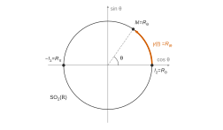
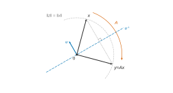
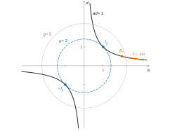

# Mines-Ponts MPI — Maths 2 2026 · Corrigé brut

*Corrigé rédigé par IA, non officiel. Signalez toute erreur.*

**Autour de $\mathrm{O}_n(\mathbb R)$ et $\mathrm{SL}_n(\mathbb R)$** — 4 heures, calculatrice interdite.

Notations. $E=\mathbb R^n$ ($n\ge2$) est muni du produit scalaire canonique et de la norme $\|\cdot\|$.

$\mathcal M_n(\mathbb R)$ est muni du produit scalaire $\langle A,B\rangle=\mathrm{tr}(A^\top B)=\sum_{i,j}a_{ij}b_{ij}$, de norme associée $\|A\|=\sqrt{g(A)}$. Toutes les normes y sont équivalentes (dimension finie).

$\mathcal A_n(\mathbb R)$ désigne l'ensemble des matrices antisymétriques.

---

## I. Quelques propriétés de $\mathrm{O}_n(\mathbb R)$

### Question 1

Le polynôme caractéristique se calcule directement :

$$\begin{aligned}
\chi_{R_\theta}&=(X-\cos\theta)^2+\sin^2\theta\\
&=X^2-2\cos(\theta)X+1\\
&=(X-e^{i\theta})(X-e^{-i\theta}).
\end{aligned}$$

Son discriminant vaut $-4\sin^2\theta$.

*Sur $\mathbb R$.* Si $\sin\theta\ne0$, $\chi_{R_\theta}$ n'a pas de racine réelle. $R_\theta$ n'a alors aucune valeur propre réelle : elle n'est pas diagonalisable sur $\mathbb R$.

Si $\sin\theta=0$, alors $\cos\theta=\pm1$ et $R_\theta=\pm I_2$ est diagonale.

*Sur $\mathbb C$.* Si $\sin\theta\ne0$, les deux valeurs propres sont distinctes, car $e^{i\theta}-e^{-i\theta}=2i\sin\theta\ne0$. Une matrice de taille 2 à deux valeurs propres distinctes est diagonalisable.

Si $\sin\theta=0$, $R_\theta=\pm I_2$ est diagonale.

$$\boxed{R_\theta\ \text{diagonalisable sur }\mathbb R\iff\theta\in\pi\mathbb Z\ (\text{et alors }R_\theta=\pm I_2).}$$

$$\boxed{R_\theta\ \text{est toujours diagonalisable sur }\mathbb C,\ \text{avec}\ \mathrm{Sp}_{\mathbb C}(R_\theta)=\{e^{i\theta},e^{-i\theta}\}.}$$

### Question 2

$\supset$ : on a $R_\theta^\top R_\theta=(\cos^2\theta+\sin^2\theta)I_2=I_2$ et $\det R_\theta=1$.

$\subset$ : soit $M=\begin{pmatrix}a&b\\c&d\end{pmatrix}\in\mathrm{SO}_2(\mathbb R)$. La relation $M^\top M=I_2$ dit que les colonnes sont unitaires et orthogonales :

$$\begin{aligned}
a^2+c^2&=1,\\
b^2+d^2&=1,\\
ab+cd&=0.
\end{aligned}$$

Le point $(a,c)$ est sur le cercle unité : il existe $\theta\in\mathbb R$ tel que $a=\cos\theta$ et $c=\sin\theta$.

Le vecteur $(b,d)$ est unitaire et orthogonal à $(a,c)\ne0$.

L'orthogonal de $\mathrm{Vect}(a,c)$ dans $\mathbb R^2$ est la droite engendrée par le vecteur unitaire $(-\sin\theta,\cos\theta)$. Donc $(b,d)=\varepsilon(-\sin\theta,\cos\theta)$ avec $\varepsilon=\pm1$.

Alors $\det M=ad-bc=\varepsilon(\cos^2\theta+\sin^2\theta)=\varepsilon$. Comme $\det M=1$, on obtient $\varepsilon=1$, puis $M=R_\theta$.

$$\boxed{\mathrm{SO}_2(\mathbb R)=\{R_\theta,\ \theta\in\mathbb R\}}$$

(Avec $\varepsilon=-1$, on obtient les éléments de $\mathrm{O}_2(\mathbb R)$ de déterminant $-1$ : les matrices $S_\theta=\begin{pmatrix}\cos\theta&\sin\theta\\\sin\theta&-\cos\theta\end{pmatrix}$, symétriques, de valeurs propres $1$ et $-1$.)

### Question 3

*Compacité.* L'application $f:M\mapsto M^\top M$ est continue, car chacun de ses coefficients est polynomial en les coefficients de $M$. Donc $\mathrm{O}_n(\mathbb R)=f^{-1}(\{I_n\})$ est fermé, image réciproque d'un fermé par une application continue.

Pour $M\in\mathrm{O}_n(\mathbb R)$, $\|M\|^2=\mathrm{tr}(M^\top M)=\mathrm{tr}(I_n)=n$, donc $\|M\|=\sqrt n$ : $\mathrm{O}_n(\mathbb R)$ est borné pour la norme $\|\cdot\|$.

En dimension finie, une partie fermée et bornée est compacte.

*Non-connexité par arcs.* Pour $M\in\mathrm{O}_n(\mathbb R)$, on a $\det(M)^2=\det(M^\top M)=1$, donc $\det M\in\{-1,1\}$.

Les deux valeurs sont atteintes : $I_n$ et $S=\mathrm{diag}(-1,1,\dots,1)$ sont orthogonales, de déterminants $1$ et $-1$.

Supposons qu'il existe un chemin continu $\gamma:[0,1]\to\mathrm{O}_n(\mathbb R)$ de $I_n$ à $S$.

La fonction réelle $\det\circ\gamma$ est continue (composée), vaut $1$ en $0$ et $-1$ en $1$. Par le théorème des valeurs intermédiaires, elle s'annulerait, ce qui contredit $\det\circ\gamma\in\{-1,1\}$.

$$\boxed{\mathrm{O}_n(\mathbb R)\ \text{est compact et n'est pas connexe par arcs.}}$$

### Question 4

*Cas $n=2$.* Si $M\in\mathrm{SO}_2(\mathbb R)$, alors $M=R_\theta$ (Q2).

L'application $t\in[0,1]\mapsto R_{t\theta}$ est un chemin continu dans $\mathrm{SO}_2(\mathbb R)$ de $I_2$ à $M$.

*Cas général.* On utilise le théorème de réduction des isométries en base orthonormée. Pour $M\in\mathrm{O}_n(\mathbb R)$, il existe une matrice de passage **orthogonale** $P\in\mathrm{O}_n(\mathbb R)$, qui dépend de $M$, et des entiers $r,s,q$ avec $2r+s+q=n$, tels que

$$M=P\,\mathrm{diag}\big(R_{\theta_1},\dots,R_{\theta_r},\underbrace{1,\dots,1}_{s},\underbrace{-1,\dots,-1}_{q}\big)\,P^\top.$$

Rappel de preuve, par récurrence sur $n$.

$\chi_M$ a une racine $\lambda\in\mathbb C$. Si $\lambda\in\mathbb R$, un vecteur propre réel engendre une droite stable.

Sinon, $\lambda=a+ib$ avec $b\ne0$. Soit $X=U+iV$ un vecteur propre associé, avec $U,V\in\mathbb R^n$. En séparant parties réelle et imaginaire :

$$\begin{aligned}MU&=aU-bV,\\MV&=bU+aV.\end{aligned}$$

Le sous-espace $\mathrm{Vect}(U,V)$ est donc stable. C'est bien un plan : si $U,V$ étaient liés, $U$ ou $V$ serait un vecteur propre réel associé à $\lambda\notin\mathbb R$.

Un sous-espace $F$ stable par l'isométrie $u$ vérifie $u(F)=F$, car $u$ est injective. Donc $F^\perp$ est stable.

En effet, pour $y\in F^\perp$ et $z=u(z')\in F$, on a $\langle u(y),z\rangle=\langle y,z'\rangle=0$.

On conclut avec Q2 (et sa remarque) sur les plans, et avec l'hypothèse de récurrence sur $F^\perp$ ; la concaténation de bases orthonormées donne une matrice de passage orthogonale.

Si $M\in\mathrm{SO}_n(\mathbb R)$, alors $1=\det M=(-1)^q$, donc $q$ est pair. Comme $\mathrm{diag}(-1,-1)=R_\pi$, on regroupe les $-1$ par paires :

$$M=P\,\mathrm{diag}\big(R_{\theta_1},\dots,R_{\theta_k},1,\dots,1\big)\,P^\top .$$

Pour $t\in[0,1]$, posons

$$\gamma(t)=P\,\mathrm{diag}\big(R_{t\theta_1},\dots,R_{t\theta_k},1,\dots,1\big)P^\top.$$

Ce chemin est continu et à valeurs dans $\mathrm{O}_n(\mathbb R)$ (produit de matrices orthogonales). Son déterminant vaut $\prod_j\det R_{t\theta_j}=1$. Il relie $\gamma(0)=I_n$ à $\gamma(1)=M$ dans $\mathrm{SO}_n(\mathbb R)$.

Deux éléments $M,M'$ sont alors reliés en concaténant le chemin de $M$ à $I_n$ (parcouru à l'envers) et celui de $I_n$ à $M'$.

$$\boxed{\mathrm{SO}_n(\mathbb R)\ \text{est connexe par arcs.}}$$

### Question 5

Si tout élément de $H$ est de déterminant $1$, alors $H\subset\mathrm{SO}_n(\mathbb R)$, d'où $H=\mathrm{SO}_n(\mathbb R)$.

Sinon, soit $A\in H$ avec $\det A=-1$, et soit $B\in\mathrm{O}_n(\mathbb R)$.

- Si $\det B=1$, alors $B\in\mathrm{SO}_n(\mathbb R)\subset H$.
- Si $\det B=-1$, posons $C=A^{-1}B$, élément du groupe $\mathrm{O}_n(\mathbb R)$ de déterminant $1$.

Donc $C\in\mathrm{SO}_n(\mathbb R)\subset H$, puis $B=AC\in H$, car $H$ est stable par produit.

Ainsi $\mathrm{O}_n(\mathbb R)\subset H\subset\mathrm{O}_n(\mathbb R)$.

$$\boxed{H=\mathrm{SO}_n(\mathbb R)\ \text{ou}\ H=\mathrm{O}_n(\mathbb R)}$$

### Question 6

*$\mathrm{GL}_2$.* On a $\det Z_2=U-V$ avec $U=Y_{1,1}Y_{2,2}$ et $V=Y_{1,2}Y_{2,1}$.

Les variables $Y_{i,j}$ sont indépendantes. Par le lemme des coalitions, $U$ et $V$ sont indépendantes, et chacune suit la loi $\mathcal B(p^2)$.

Comme $U,V\in\{0,1\}$, on a $\det Z_2=0$ si et seulement si $U=V$. Par indépendance :

$$\begin{aligned}
P(Z_2\notin\mathrm{GL}_2(\mathbb R))&=P(U=V=1)+P(U=V=0)\\
&=p^4+(1-p^2)^2.
\end{aligned}$$

$$\boxed{P(Z_2\in\mathrm{GL}_2(\mathbb R))=1-p^4-(1-p^2)^2=2p^2(1-p^2)}$$

*$\mathrm{O}_n$.* Soit $A$ à coefficients dans $\{0,1\}$ avec $A^\top A=I_n$.

La colonne $j$ vérifie $\sum_ia_{ij}^2=\sum_ia_{ij}=1$ : elle contient exactement un $1$, situé en ligne $\sigma(j)$.

Pour $j\ne j'$, le produit scalaire des colonnes $j$ et $j'$ est nul, ce qui interdit $\sigma(j)=\sigma(j')$.

L'application $\sigma$ est injective de $\{1,\dots,n\}$ dans lui-même, donc bijective : chaque ligne contient aussi exactement un $1$, et $A$ est une matrice de permutation $P_\sigma$.

Réciproquement, toute matrice de permutation est orthogonale : ses colonnes sont la base canonique permutée.

Il y a $n!$ matrices de permutation. Chacune a $n$ coefficients égaux à $1$ et $n^2-n$ coefficients nuls.

Par indépendance des $Y_{i,j}$, chacune est atteinte avec probabilité $p^n(1-p)^{n^2-n}$. Ces $n!$ événements sont deux à deux incompatibles.

$$\boxed{P(Z_n\in\mathrm{O}_n(\mathbb R))=n!\,p^n(1-p)^{n(n-1)}}$$

*$\mathrm{SO}_n$.* D'après ce qui précède, $Z_n\in\mathrm{SO}_n(\mathbb R)$ si et seulement si $Z_n=P_\sigma$ avec $\det P_\sigma=\varepsilon(\sigma)=1$, c'est-à-dire $\sigma$ paire.

Comme $n\ge2$, la transposition $\tau=(1\ 2)$ existe. L'application $\sigma\mapsto\tau\sigma$ est une bijection de l'ensemble des permutations paires sur celui des permutations impaires (sa réciproque est $\sigma\mapsto\tau\sigma$). Il y a donc $n!/2$ permutations paires, chacune de probabilité $p^n(1-p)^{n^2-n}$.

$$\boxed{P(Z_n\in\mathrm{SO}_n(\mathbb R))=\frac{n!}{2}\,p^n(1-p)^{n(n-1)}}$$

### Question 7

*Cas $x\ne y$.* Soit $u=\dfrac{x-y}{\|x-y\|}$ et $A=I_n-2uu^\top$.

Pour $z\in E$, $Az=z-2\langle u,z\rangle u$.

Donc $A$ fixe tout vecteur de l'hyperplan $u^\perp$ et envoie $u$ sur $-u$ : c'est la matrice de la réflexion d'hyperplan $u^\perp$.

On note aussi que $A^\top=A$ et $A^2=I_n$.

L'hypothèse $\|x\|=\|y\|$ donne l'orthogonalité de $x-y$ et $x+y$ :

$$\langle x-y,x+y\rangle=\|x\|^2-\|y\|^2=0.$$

Ainsi $x+y\in u^\perp$, donc $A(x+y)=x+y$, et $A(x-y)=-(x-y)$. En faisant la demi-somme :

$$\begin{aligned}
Ax&=\tfrac12\big(A(x+y)+A(x-y)\big)\\
&=\tfrac12\big((x+y)-(x-y)\big)\\
&=y.
\end{aligned}$$

*Cas $x=y$.* L'identité n'est pas une réflexion. Comme $n\ge2$, il existe $v$ unitaire orthogonal à $x$.

La réflexion $A=I_n-2vv^\top$, d'hyperplan $v^\perp\ni x$, vérifie $Ax=x=y$.

$$\boxed{\text{Il existe une réflexion }A\text{ telle que }Ax=y.}$$

### Question 8

Soit $c=\|Gx\|$. Comme $G$ est inversible et $x\ne0$, on a $c>0$.

*$p=1$.* Les vecteurs $Gx$ et $cx$ ont même norme $c$. Par Q7, il existe une réflexion $A$ telle que $A(Gx)=cx$.

Or $A\in\mathrm{O}_n(\mathbb R)\subset\mathcal G$ et $\mathcal G$ est un groupe, donc $G_1=AG\in\mathcal G$, et $G_1x=cx$.

*$p\in\mathbb Z$.* Posons $G_p=G_1^p$, qui appartient à $\mathcal G$ (groupe). Par récurrence, $G_1^px=c^px$ pour $p\in\mathbb N$.

De $G_1x=cx$ on tire $G_1^{-1}x=c^{-1}x$, puis $G_1^{-p}x=c^{-p}x$ par la même récurrence.

$$\boxed{\forall p\in\mathbb Z,\ G_p=(AG)^p\in\mathcal G\ \text{ vérifie }\ G_px=\|Gx\|^p\,x.}$$

### Question 9

$\mathcal G$ est compact et $H\mapsto Hx$ est linéaire, donc continue. L'ensemble $\{Hx,\ H\in\mathcal G\}$ est donc compact, et borné par un réel $R>0$.

D'après Q8, $c^p=\|G_px\|\le R$ pour tout $p\in\mathbb Z$, avec $c=\|Gx\|>0$.

- Si $c>1$, $c^p\to+\infty$ quand $p\to+\infty$ : contradiction.
- Si $c<1$, $c^p\to+\infty$ quand $p\to-\infty$ : contradiction.

Donc $\|Gx\|=1$ pour tout $x$ unitaire, puis $\|Gv\|=\|v\|$ pour tout $v\in E$ par homogénéité.

Par polarisation, pour $u,v\in E$ :

$$\begin{aligned}
\langle Gu,Gv\rangle&=\tfrac12\big(\|G(u+v)\|^2-\|Gu\|^2-\|Gv\|^2\big)\\
&=\tfrac12\big(\|u+v\|^2-\|u\|^2-\|v\|^2\big)\\
&=\langle u,v\rangle.
\end{aligned}$$

Ainsi $\langle(G^\top G-I_n)u,v\rangle=0$ pour tous $u,v$, soit $G^\top G=I_n$. Donc $\mathcal G\subset\mathrm{O}_n(\mathbb R)$, et l'inclusion inverse est une hypothèse.

$$\boxed{\mathcal G=\mathrm{O}_n(\mathbb R)}$$

---

## II. Calcul différentiel sur $\mathrm{O}_n(\mathbb R)$ et $\mathrm{SL}_n(\mathbb R)$

### Question 10

*Classe $\mathcal C^1$.* Chaque coordonnée de $f$, à savoir $(M^\top M)_{ij}=\sum_km_{ki}m_{kj}$, est une fonction polynomiale des coefficients de $M$.

Ses dérivées partielles existent et sont continues : $f$ est $\mathcal C^1$ (et même $\mathcal C^\infty$).

*Différentielle.* Pour $M,H\in\mathcal M_n(\mathbb R)$ :

$$f(M+H)=M^\top M+(M^\top H+H^\top M)+H^\top H.$$

L'application $H\mapsto M^\top H+H^\top M$ est linéaire (la transposition et les produits à gauche et à droite le sont).

Le reste est négligeable. Le coefficient $(H^\top H)_{ij}$ est le produit scalaire des colonnes $i$ et $j$ de $H$. Par Cauchy–Schwarz, $|(H^\top H)_{ij}|\le\|H\|^2$. En sommant les $n^2$ carrés :

$$\|H^\top H\|\le n\|H\|^2=o(\|H\|).$$

$$\boxed{\mathrm df(M)(H)=M^\top H+H^\top M}$$

### Question 11

Soit $H\in T$ et $\gamma$ comme dans l'énoncé. Pour tout $t\in\,]-\varepsilon,\varepsilon[$, on a $\gamma(t)^\top\gamma(t)=I_n$.

L'application $(A,B)\mapsto A^\top B$ est bilinéaire. La fonction $t\mapsto\gamma(t)^\top\gamma(t)$ est donc dérivable en $0$, comme image de deux fonctions dérivables en $0$ par une application bilinéaire. Sa dérivée en $0$ vaut

$$\gamma'(0)^\top\gamma(0)+\gamma(0)^\top\gamma'(0)=H^\top+H.$$

Cette fonction étant constante, sa dérivée est nulle.

$$\boxed{H^\top=-H,\quad\text{donc}\ T\subset\mathcal A_n(\mathbb R).}$$

### Question 12

*$T$ est non vide.* La matrice nulle appartient à $T$ : le chemin constant égal à $I_n$ est à valeurs dans $\mathrm{O}_n(\mathbb R)$ et de dérivée nulle en $0$.

*Somme.* Soient $H,K\in T$, associés à $\gamma$ (sur $]-\varepsilon_1,\varepsilon_1[$) et à $\delta$ (sur $]-\varepsilon_2,\varepsilon_2[$). Soit $\varepsilon=\min(\varepsilon_1,\varepsilon_2)$.

Sur $]-\varepsilon,\varepsilon[$, posons $\sigma(t)=\gamma(t)\delta(t)$. Comme $\mathrm{O}_n(\mathbb R)$ est un groupe, $\sigma$ est à valeurs dans $\mathrm{O}_n(\mathbb R)$, et $\sigma(0)=I_n$.

La dérivabilité en $0$ donne les développements $\gamma(t)=I_n+tH+o(t)$ et $\delta(t)=I_n+tK+o(t)$. D'où

$$\sigma(t)=I_n+t(H+K)+o(t).$$

Ainsi $\sigma$ est dérivable en $0$, de dérivée $H+K$ : $H+K\in T$.

*Produit par un scalaire.* Soit $\lambda\ne0$. L'application $t\mapsto\gamma(\lambda t)$ est définie sur $]-\varepsilon/|\lambda|,\varepsilon/|\lambda|[$ et à valeurs dans $\mathrm{O}_n(\mathbb R)$.

Elle vaut $I_n$ en $0$ et a pour dérivée $\lambda H$ en $0$. Pour $\lambda=0$, $0\in T$.

$$\boxed{T\ \text{est un sous-espace vectoriel de }\mathcal M_n(\mathbb R).}$$

### Question 13

Soit $H\in\mathcal A_n(\mathbb R)$ et $\gamma(t)=\exp(tH)$ pour $t\in\mathbb R$.

Par continuité de la transposition sur les sommes partielles, $\exp(tH)^\top=\exp(tH^\top)=\exp(-tH)$.

Les matrices $tH$ et $-tH=tH^\top$ commutent. Donc

$$\begin{aligned}
\gamma(t)^\top\gamma(t)&=\exp(-tH)\exp(tH)\\
&=\exp(0)=I_n.
\end{aligned}$$

$\gamma$ est à valeurs dans $\mathrm{O}_n(\mathbb R)$. Elle est dérivable, de dérivée $H\exp(tH)$, avec $\gamma(0)=I_n$ et $\gamma'(0)=H$. Donc $\mathcal A_n(\mathbb R)\subset T$ et, avec Q11 :

$$\boxed{T=\mathcal A_n(\mathbb R)}$$

En particulier, $\dim T=\dfrac{n(n-1)}{2}$.

### Question 14

L'entier $n\ge2$ est fixé. Pour $t>0$, la matrice $D_t=\mathrm{diag}(t,1/t,1,\dots,1)$ est de déterminant $1$, donc dans $\mathrm{SL}_n(\mathbb R)$. Et

$$g(D_t)=t^2+\frac1{t^2}+n-2\xrightarrow[t\to+\infty]{}+\infty.$$

$$\boxed{g_{|\mathrm{SL}_n(\mathbb R)}\ \text{n'est pas majorée, donc n'a pas de maximum global.}}$$

### Question 15

$g(M)=\sum_{i,j}m_{ij}^2$ et $\det M=\sum_{\sigma\in\mathfrak S_n}\varepsilon(\sigma)\prod_im_{\sigma(i)i}$ sont des fonctions polynomiales des coefficients de $M$. Leurs dérivées partielles existent et sont continues : elles sont $\mathcal C^1$.

Les gradients sont pris pour le produit scalaire $\langle A,B\rangle=\mathrm{tr}(A^\top B)$.

*Gradient de $g$.* Comme $\mathrm{tr}(H^\top M)=\mathrm{tr}(M^\top H)$,

$$g(M+H)=g(M)+2\,\mathrm{tr}(M^\top H)+\|H\|^2,$$

avec $\|H\|^2=o(\|H\|)$. Donc $\mathrm dg(M)(H)=\langle2M,H\rangle$.

*Gradient de $\det$.* Notons $\Delta_{ij}$ le mineur d'indice $(i,j)$ : le déterminant de la matrice extraite en supprimant la ligne $i$ et la colonne $j$.

Le cofacteur est $c_{ij}=(-1)^{i+j}\Delta_{ij}$, et $\mathrm{Com}(M)=(c_{ij})$.

Développons $\det M$ selon la ligne $i$ : $\det M=\sum_km_{ik}c_{ik}$. Aucun cofacteur $c_{ik}$ ne dépend des coefficients de la ligne $i$. Donc $\dfrac{\partial\det}{\partial m_{ij}}(M)=c_{ij}$.

Comme $\det$ est $\mathcal C^1$, sa différentielle s'exprime avec les dérivées partielles :

$$\begin{aligned}
\mathrm d\det(M)(H)&=\sum_{i,j}c_{ij}h_{ij}\\
&=\mathrm{tr}\big(\mathrm{Com}(M)^\top H\big)\\
&=\langle\mathrm{Com}(M),H\rangle.
\end{aligned}$$

$$\boxed{\nabla g(M)=2M}$$

$$\boxed{\nabla\det(M)=\mathrm{Com}(M)}$$

### Question 16

On utilise le théorème d'optimisation sous une contrainte, que l'on énonce.

*Soient $U$ un ouvert de $\mathbb R^d$ et $\phi,h:U\to\mathbb R$ deux fonctions de classe $\mathcal C^1$.*

*On pose $X=h^{-1}(\{0\})$.*

*Si $\phi_{|X}$ admet un extremum local en $a\in X$ et si $\mathrm dh(a)\ne0$, alors $\mathrm d\phi(a)$ est colinéaire à $\mathrm dh(a)$.*

*Vérification des hypothèses.* L'ouvert est $\mathcal M_n(\mathbb R)$, identifié à $\mathbb R^{n^2}$. Les fonctions $g$ et $h=\det-1$ sont $\mathcal C^1$ (Q15). Et $\mathrm{SL}_n(\mathbb R)=h^{-1}(\{0\})$.

En $M\in\mathrm{SL}_n(\mathbb R)$, on a $M\,\mathrm{Com}(M)^\top=\det(M)I_n=I_n$. Donc $\mathrm{Com}(M)^\top=M^{-1}$ est inversible. En particulier $\nabla h(M)=\mathrm{Com}(M)\ne0$, c'est-à-dire $\mathrm dh(M)\ne0$.

*Conclusion.* Si $g_{|\mathrm{SL}_n(\mathbb R)}$ a un extremum local en $M$, $\mathrm dg(M)$ est colinéaire à $\mathrm dh(M)$.

Il existe donc $\mu\in\mathbb R$ tel que $2M=\mu\,\mathrm{Com}(M)$. On pose $\lambda=\mu/2$.

$$\boxed{\exists\lambda\in\mathbb R,\quad M=\lambda\,\mathrm{Com}(M).}$$

Alors $M^\top=\lambda\,\mathrm{Com}(M)^\top=\lambda M^{-1}$, donc $M^\top M=\lambda I_n$.

- En prenant la trace : $n\lambda=\|M\|^2>0$, donc $\lambda>0$.
- En prenant le déterminant : $\lambda^n=\det(\lambda I_n)=\det(M)^2=1$.

Le réel $\lambda>0$ vérifie $\lambda^n=1$, donc $\lambda=1$. Ainsi $M^\top M=I_n$ et $\det M=1$.

$$\boxed{M\in\mathrm{SO}_n(\mathbb R)}$$

### Question 17

*Existence.* Soit $K=\{M\in\mathrm{SL}_n(\mathbb R),\ g(M)\le n\}$.

- $K$ contient $I_n$, car $g(I_n)=n$.
- $K$ est fermé : c'est l'intersection de $\det^{-1}(\{1\})$ et de $g^{-1}(]-\infty,n])$, images réciproques de fermés par des applications continues.
- $K$ est borné : $\|M\|\le\sqrt n$ sur $K$.

$K$ est donc une partie compacte non vide. La fonction continue $g$ y atteint son minimum en un point $M_0$.

Pour $M\in\mathrm{SL}_n(\mathbb R)\setminus K$, on a $g(M)>n=g(I_n)\ge g(M_0)$. Donc $M_0$ est un minimum global de $g$ sur $\mathrm{SL}_n(\mathbb R)$.

*Valeur et points.* Tout point de minimum global est un extremum local. D'après Q16, il appartient à $\mathrm{SO}_n(\mathbb R)$, où $g(M)=\mathrm{tr}(I_n)=n$.

Réciproquement, tout $M\in\mathrm{SO}_n(\mathbb R)$ est dans $\mathrm{SL}_n(\mathbb R)$ avec $g(M)=n$.

$$\boxed{\min_{\mathrm{SL}_n(\mathbb R)}g=n,\ \text{atteint exactement sur }\mathrm{SO}_n(\mathbb R).}$$

---

## III. Morphismes continus de $\mathbb U$ dans $\mathrm{GL}_n(\mathbb R)$

### Question 18

*Sous-groupes bornés de $\mathbb R^*$.* Soit $H$ un tel sous-groupe et $x\in H$. Alors $x^k\in H$ pour tout $k\in\mathbb Z$, donc la famille $(|x|^k)_{k\in\mathbb Z}$ est bornée.

- Si $|x|>1$, $|x|^k\to+\infty$ quand $k\to+\infty$ : contradiction.
- Si $|x|<1$, $|x|^k\to+\infty$ quand $k\to-\infty$ : contradiction.

Donc $|x|=1$, et $H\subset\{-1,1\}$. Comme $1\in H$, $H$ vaut $\{1\}$ ou $\{-1,1\}$. Réciproquement, ces deux ensembles sont des sous-groupes bornés.

$$\boxed{\text{Les sous-groupes bornés de }(\mathbb R^*,\times)\text{ sont }\{1\}\text{ et }\{-1,1\}.}$$

*Conséquence.* L'application $\det\circ\varphi:\mathbb U\to\mathbb R^*$ est un morphisme continu. Son image est un sous-groupe de $\mathbb R^*$. Elle est compacte, comme image continue du compact $\mathbb U$, donc bornée. Elle est donc contenue dans $\{-1,1\}$.

$\mathbb U$ est connexe par arcs, paramétré par $\theta\mapsto e^{i\theta}$. La fonction continue $\theta\mapsto\det\varphi(e^{i\theta})$ est définie sur l'intervalle $\mathbb R$.

Elle vaut $\det\varphi(1)=\det I_n=1$ en $0$. Si elle valait $-1$ en un point, elle s'annulerait par le théorème des valeurs intermédiaires. C'est exclu, car $\varphi(e^{i\theta})\in\mathrm{GL}_n(\mathbb R)$. Donc $\det\varphi(z)=1$ pour tout $z\in\mathbb U$.

$$\boxed{\varphi(\mathbb U)\subset\mathrm{SL}_n(\mathbb R)}$$

### Question 19

Soit $\lambda\in\mathrm{Sp}_{\mathbb C}(\varphi(z))$ et $X\in\mathbb C^n\setminus\{0\}$ avec $\varphi(z)X=\lambda X$. On a $\lambda\ne0$, car $\varphi(z)$ est inversible.

Pour $k\in\mathbb Z$, $\varphi(z^k)=\varphi(z)^k$ (morphisme), et $\varphi(z)^kX=\lambda^kX$.

L'ensemble $\varphi(\mathbb U)$ est compact (image continue d'un compact), et $A\mapsto AX$ est continue. Il existe donc $R$ tel que $\|AX\|\le R$ pour tout $A\in\varphi(\mathbb U)$, pour la norme hermitienne de $\mathbb C^n$.

Ainsi $|\lambda|^k\|X\|\le R$ pour tout $k\in\mathbb Z$. Comme en Q18, cela impose $|\lambda|=1$.

$$\boxed{\mathrm{Sp}_{\mathbb C}(\varphi(z))\subset\mathbb U}$$

### Question 20

Comme $\varphi$ est un morphisme de groupes :

$$\Psi(x+y)=\varphi(e^{ix}e^{iy})=\varphi(e^{ix})\varphi(e^{iy}).$$

$$\boxed{\forall(x,y)\in\mathbb R^2,\ \Psi(x+y)=\Psi(x)\Psi(y)}$$

De plus, $\Psi$ est continue (composée), $\Psi(0)=\varphi(1)=I_n$, et $\Psi$ est $2\pi$-périodique.

### Question 21

$\Psi$ est continue sur $\mathbb R$, à valeurs dans l'espace de dimension finie $\mathcal M_n(\mathbb R)$.

Par le théorème fondamental de l'analyse, $F$ est la primitive de $\Psi$ nulle en $0$ : $F$ est dérivable, de dérivée $\Psi$ continue.

Donc $F$ est $\mathcal C^1$, avec $F(0)=0$ et $F'(0)=I_n$.

$\mathrm{GL}_n(\mathbb R)=\det^{-1}(\mathbb R^*)$ est ouvert, image réciproque de l'ouvert $\mathbb R^*$ par l'application continue $\det$. Il existe donc $r>0$ tel que $\|A-I_n\|<r$ entraîne $A\in\mathrm{GL}_n(\mathbb R)$.

Comme $F(x)/x\to F'(0)=I_n$ quand $x\to0$, il existe $\alpha>0$ tel que, pour $0<|x|\le\alpha$, $\|F(x)/x-I_n\|<r$.

Pour ces $x$, $F(x)/x$ est inversible, donc $F(x)=x\cdot\frac{F(x)}x$ aussi ($x\ne0$).

$$\boxed{F\in\mathcal C^1(\mathbb R),\quad\exists\alpha>0,\ \forall x\in[-\alpha,\alpha]\setminus\{0\},\ F(x)\in\mathrm{GL}_n(\mathbb R).}$$

### Question 22

On fait le changement de variable $t=x+s$, puis on utilise Q20 et la linéarité de l'intégrale vis-à-vis de l'application linéaire $A\mapsto\Psi(x)A$. Le facteur $\Psi(x)$ reste **à gauche** :

$$\begin{aligned}
\int_x^{x+\alpha}\Psi(t)\,\mathrm dt&=\int_0^\alpha\Psi(x)\Psi(s)\,\mathrm ds\\
&=\Psi(x)F(\alpha).
\end{aligned}$$

$F(\alpha)$ est inversible (Q21). En multipliant à droite par $F(\alpha)^{-1}$ et avec la relation de Chasles :

$$\boxed{\Psi(x)=\left(\int_x^{x+\alpha}\Psi(t)\,\mathrm dt\right)F(\alpha)^{-1}=\big(F(x+\alpha)-F(x)\big)F(\alpha)^{-1}.}$$

Le membre de droite est $\mathcal C^1$, car $F$ l'est et $A\mapsto AF(\alpha)^{-1}$ est linéaire. **$\Psi$ est de classe $\mathcal C^1$ sur $\mathbb R$.**

### Question 23

Pour $x\in\mathbb R$ et $h\ne0$, Q20 donne

$$\frac{\Psi(x+h)-\Psi(x)}h=\Psi(x)\,\frac{\Psi(h)-I_n}h\xrightarrow[h\to0]{}\Psi(x)M,$$

car $\Psi(0)=I_n$ et $M=\Psi'(0)$. Donc $\Psi'=\Psi M$, dans cet ordre.

Soit $\Theta(x)=\Psi(x)\exp(-xM)$. L'application $x\mapsto\exp(-xM)$ est dérivable de dérivée $-M\exp(-xM)$. Par dérivation d'un produit :

$$\begin{aligned}
\Theta'(x)&=\Psi(x)M\exp(-xM)-\Psi(x)M\exp(-xM)\\
&=0.
\end{aligned}$$

$\Theta$ est constante sur l'intervalle $\mathbb R$, égale à $\Theta(0)=I_n$. On multiplie à droite par $\exp(xM)=\exp(-xM)^{-1}$ :

$$\boxed{\forall x\in\mathbb R,\ \Psi(x)=\varphi(e^{ix})=\exp(xM).}$$

---

## IV. Morphismes de $(\mathbb R,+)$ dans $(\mathrm{GL}_n(\mathbb R),\times)$

### Question 24

Soit $P\in\mathrm{GL}_n(\mathbb C)$ avec $AP=PB$. Écrivons $P=R+iS$ avec $R,S\in\mathcal M_n(\mathbb R)$.

Comme $A$ et $B$ sont réelles, l'identification des parties réelle et imaginaire donne $AR=RB$ et $AS=SB$. Donc $A(R+tS)=(R+tS)B$ pour tout $t$.

La fonction $\pi:t\mapsto\det(R+tS)$ est polynomiale, de degré au plus $n$, à coefficients réels. Évaluée en $i$, elle vaut $\pi(i)=\det P\ne0$.

$\pi$ n'est donc pas le polynôme nul : elle n'a qu'un nombre fini de racines. Il existe ainsi $t_0\in\mathbb R$ avec $\pi(t_0)\ne0$.

La matrice $Q=R+t_0S$ est réelle, inversible, et vérifie $AQ=QB$.

$$\boxed{A=QBQ^{-1}\ \text{avec}\ Q\in\mathrm{GL}_n(\mathbb R).}$$

### Question 25

On a toujours $\ker N\subset\ker N^2$.

Soit $r\ge1$ l'indice de nilpotence de $N$, c'est-à-dire le plus petit entier tel que $N^r=0$. Comme $N\ne0$, $r\ge2$.

Par minimalité, $N^{r-1}\ne0$ : soit $x$ tel que $N^{r-1}x\ne0$, et $y=N^{r-2}x$.

Alors $N^2y=N^rx=0$ et $Ny=N^{r-1}x\ne0$. Donc $y\in\ker N^2\setminus\ker N$.

$$\boxed{\ker N\ne\ker N^2}$$

### Question 26

Par Q23, $\exp(2\pi M)=\Psi(2\pi)=\varphi(e^{2i\pi})=\varphi(1)=I_n$.

Soit $X\in\mathbb C^n\setminus\{0\}$ avec $MX=\lambda X$. Alors $M^kX=\lambda^kX$ pour tout $k$. Par passage à la limite dans les sommes partielles, $\exp(2\pi M)X=e^{2\pi\lambda}X$.

Donc $e^{2\pi\lambda}X=X$ avec $X\ne0$, soit $e^{2\pi\lambda}=1$. Cela donne $2\pi\lambda\in2i\pi\mathbb Z$, c'est-à-dire $\lambda\in i\mathbb Z$.

$$\boxed{\exp(2\pi M)=I_n}$$

$$\boxed{\mathrm{Sp}_{\mathbb C}(M)\subset\{ik,\ k\in\mathbb Z\}}$$

### Question 27

Sur $\mathbb C$, le polynôme caractéristique est scindé : $\chi_M=\prod_{j=1}^r(X-\lambda_j)^{m_j}$, les $\lambda_j$ étant distinctes.

Par le théorème de Cayley–Hamilton et le lemme des noyaux, $\mathbb C^n=\bigoplus_jF_j$, où $F_j=\ker(M-\lambda_jI_n)^{m_j}$ est le sous-espace caractéristique associé à $\lambda_j$. Chaque $F_j$ est stable par $M$ et de dimension $m_j$.

Sur $F_j$, l'endomorphisme induit s'écrit $\lambda_j\mathrm{id}+\nu_j$, avec $\nu_j^{m_j}=0$ par définition de $F_j$.

Dans une base adaptée à cette décomposition, de matrice de passage $P\in\mathrm{GL}_n(\mathbb C)$, la matrice de $M$ est diagonale par blocs :

$$P^{-1}MP=\mathrm{diag}\big(\lambda_1I_{m_1}+N_1,\dots,\lambda_rI_{m_r}+N_r\big),\quad N_j\ \text{nilpotente}.$$

Posons $D=\mathrm{diag}(\lambda_1I_{m_1},\dots,\lambda_rI_{m_r})$ et $N=\mathrm{diag}(N_1,\dots,N_r)$.

- $D$ est diagonale, et $\mathrm{Sp}_{\mathbb C}(D)=\{\lambda_1,\dots,\lambda_r\}=\mathrm{Sp}_{\mathbb C}(M)$.
- $N^k=\mathrm{diag}(N_1^k,\dots,N_r^k)=0$ pour $k\ge\max m_j$ : $N$ est nilpotente.
- $DN=ND$, en calculant bloc par bloc, car chaque bloc de $D$ est scalaire.

$$\boxed{M=P(D+N)P^{-1},\ \text{avec}\ D\ \text{diagonale},\ N\ \text{nilpotente}\ \text{et}\ DN=ND.}$$

De plus, $\mathrm{Sp}_{\mathbb C}(D)=\mathrm{Sp}_{\mathbb C}(M)$.

### Question 28

Les coefficients diagonaux $\mu_1,\dots,\mu_n$ de $D$ sont dans $\mathrm{Sp}_{\mathbb C}(M)\subset i\mathbb Z$. Donc

$$\exp(2\pi D)=\mathrm{diag}\big(e^{2\pi\mu_1},\dots,e^{2\pi\mu_n}\big)=I_n.$$

Pour $P$ inversible, $\exp(PAP^{-1})=P\exp(A)P^{-1}$ : l'égalité vaut pour les sommes partielles, et $A\mapsto PAP^{-1}$ est continue. Par ailleurs $D$ et $N$ commutent, donc $\exp(2\pi(D+N))=\exp(2\pi D)\exp(2\pi N)$. D'où

$$\begin{aligned}
I_n=\exp(2\pi M)&=P\exp(2\pi D)\exp(2\pi N)P^{-1}\\
&=P\exp(2\pi N)P^{-1}.
\end{aligned}$$

$$\boxed{\exp(2\pi D)=I_n}$$

$$\boxed{\exp(2\pi N)=I_n}$$

$N$ étant nilpotente, la série de $\exp(2\pi N)$ est une somme finie, et

$$0=\exp(2\pi N)-I_n=2\pi N+N^2T,$$

avec $T=\sum_{k\ge2}\frac{(2\pi)^k}{k!}N^{k-2}$ (somme finie), polynôme en $N$ qui commute donc avec $N^2$.

Si $N\ne0$, Q25 fournit $y\in\ker N^2\setminus\ker N$. Alors $2\pi Ny=-TN^2y=0$, ce qui contredit $Ny\ne0$.

$$\boxed{N=0\ :\ M\ \text{est diagonalisable dans }\mathcal M_n(\mathbb C).}$$

### Question 29

$M$ est diagonalisable sur $\mathbb C$, de spectre inclus dans $i\mathbb Z$.

Comme $M$ est réelle, $\chi_M\in\mathbb R[X]$, donc $ik$ et $-ik$ ont la même multiplicité.

Notons $k_1,\dots,k_p\in\mathbb N^*$ les entiers $k>0$ tels que $ik\in\mathrm{Sp}_{\mathbb C}(M)$, chacun répété selon sa multiplicité. La multiplicité de $0$ est $m_0=n-2p$, et

$$\chi_M=X^{m_0}\prod_{j=1}^p(X^2+k_j^2).$$

Soit $J=\begin{pmatrix}0&-1\\1&0\end{pmatrix}$ et $B=\mathrm{diag}(k_1J,\dots,k_pJ,0,\dots,0)\in\mathcal M_n(\mathbb R)$.

Chaque bloc $k_jJ$ a deux valeurs propres distinctes $\pm ik_j$, donc $B$ est diagonalisable sur $\mathbb C$, et $\chi_B=\chi_M$.

Deux matrices diagonalisables de même polynôme caractéristique sont semblables à la même matrice diagonale. Donc $M$ et $B$ sont semblables dans $\mathcal M_n(\mathbb C)$, puis dans $\mathcal M_n(\mathbb R)$ par Q24 : $M=QBQ^{-1}$ avec $Q\in\mathrm{GL}_n(\mathbb R)$.

**La matrice $Q$ ne dépend que de $M$, donc pas de $x$.** Pour tout $x\in\mathbb R$, $xM=Q(xB)Q^{-1}$, et, comme en Q28,

$$\exp(xM)=Q\exp(xB)Q^{-1}.$$

Comme $J^2=-I_2$, en séparant les puissances paires et impaires :

$$\begin{aligned}
\exp(\theta J)&=\Big(\sum_m\frac{(-1)^m\theta^{2m}}{(2m)!}\Big)I_2+\Big(\sum_m\frac{(-1)^m\theta^{2m+1}}{(2m+1)!}\Big)J\\
&=\cos(\theta)I_2+\sin(\theta)J\\
&=R_\theta.
\end{aligned}$$

L'exponentielle d'une matrice diagonale par blocs se calcule bloc par bloc. On a donc $\exp(xB)=\mathrm{diag}(R_{xk_1},\dots,R_{xk_p},1,\dots,1)$, et, avec Q23 :

$$\boxed{\forall x\in\mathbb R,\ \Psi(x)=Q\,\mathrm{diag}\big(R_{xk_1},\dots,R_{xk_p},1,\dots,1\big)\,Q^{-1},\ \text{avec}\ Q\in\mathrm{GL}_n(\mathbb R),\ p\in\mathbb N,\ k_j\in\mathbb Z\setminus\{0\}.}$$

### Question 30

Soient $Q\in\mathrm{GL}_n(\mathbb R)$, $p\in\mathbb N$ avec $2p\le n$, et $k_1,\dots,k_p\in\mathbb Z\setminus\{0\}$. Posons $B(x)=\mathrm{diag}(R_{xk_1},\dots,R_{xk_p},1,\dots,1)$ et $\Psi(x)=QB(x)Q^{-1}$.

*Valeurs.* $\det\Psi(x)=\det B(x)=\prod_j\det R_{xk_j}=1$, donc $\Psi(x)\in\mathrm{GL}_n(\mathbb R)$.

*Morphisme.* Les formules d'addition donnent $R_\theta R_{\theta'}=R_{\theta+\theta'}$. Le produit de matrices diagonales par blocs de même découpage se fait bloc par bloc, donc $B(x)B(y)=B(x+y)$. Puis

$$\begin{aligned}
\Psi(x)\Psi(y)&=QB(x)Q^{-1}QB(y)Q^{-1}\\
&=QB(x+y)Q^{-1}\\
&=\Psi(x+y).
\end{aligned}$$

$$\boxed{\Psi\ \text{est un morphisme de groupes de }(\mathbb R,+)\ \text{dans}\ (\mathrm{GL}_n(\mathbb R),\times).}$$

*Remarque.* Comme $k_j\in\mathbb Z$, $\Psi$ est $2\pi$-périodique. L'application $\phi(e^{ix})=\Psi(x)$ est donc bien définie sur $\mathbb U$, et c'est un morphisme.

Il est continu. Près de $z_0=e^{ix_0}$, on a $\phi(z)=\Psi\big(x_0+\mathrm{Arg}(z/z_0)\big)$, où $\mathrm{Arg}(w)=2\arctan\dfrac{\mathrm{Im}\,w}{1+\mathrm{Re}\,w}$ est continue sur $\mathbb U\setminus\{-1\}$.

Les questions 29 et 30 décrivent donc exactement les morphismes continus de $\mathbb U$ dans $\mathrm{GL}_n(\mathbb R)$.
