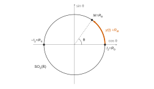
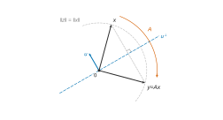
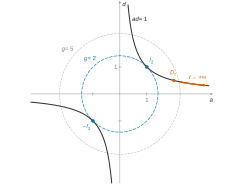

# Mines-Ponts MPI — Maths 2 2026 · Corrigé guidé

*Corrigé rédigé par IA, non officiel. Signalez toute erreur.*

## Présentation du sujet

**Thème.** Le sujet étudie le groupe orthogonal $\mathrm{O}_n(\mathbb R)$ et le groupe spécial linéaire $\mathrm{SL}_n(\mathbb R)$ sous trois angles.

- Topologique : compacité, connexité par arcs, maximalité de $\mathrm{O}_n(\mathbb R)$ parmi les sous-groupes compacts.
- Différentiel : espace tangent, optimisation sous la contrainte $\det=1$.
- Algébrique : description des morphismes continus du cercle $\mathbb U$ dans $\mathrm{GL}_n(\mathbb R)$.

Un fil relie les trois : **une partie bornée et stable par puissances ne contient que des éléments « de module 1 »**. On le retrouve aux questions 9, 18 et 19.

**Découpage (30 questions, 4 heures, sans calculatrice).**

- **Partie I (Q1–Q9)** : réduction de $R_\theta$, description de $\mathrm{SO}_2(\mathbb R)$, compacité et composantes de $\mathrm{O}_n(\mathbb R)$, connexité par arcs de $\mathrm{SO}_n(\mathbb R)$, sous-groupes intermédiaires. Une question de probabilités isolée (Q6). Puis, avec les réflexions (Q7), la preuve qu'un sous-groupe compact de $\mathrm{GL}_n(\mathbb R)$ contenant $\mathrm{O}_n(\mathbb R)$ lui est égal (Q8–Q9).
- **Partie II (Q10–Q17)** : différentielle de $M\mapsto M^\top M$, espace tangent à $\mathrm{O}_n(\mathbb R)$ en $I_n$ (les antisymétriques), gradients de $g=\|\cdot\|^2$ et du déterminant.
  Puis minimisation de $g$ sur $\mathrm{SL}_n(\mathbb R)$ : le minimum vaut $n$, atteint exactement sur $\mathrm{SO}_n(\mathbb R)$.
- **Partie III (Q18–Q23)** : un morphisme continu $\varphi:\mathbb U\to\mathrm{GL}_n(\mathbb R)$ est à valeurs dans $\mathrm{SL}_n(\mathbb R)$, et ses valeurs propres sont de module 1. Une astuce de régularisation par intégration montre que $\Psi(x)=\varphi(e^{ix})$ est $\mathcal C^1$, puis égal à $\exp(xM)$.
- **Partie IV (Q24–Q30)** : outils de réduction (similitude réelle et complexe, noyaux itérés d'un nilpotent, décomposition $D+N$). On montre ensuite que $M=\Psi'(0)$ est diagonalisable sur $\mathbb C$, de spectre dans $i\mathbb Z$. On en tire $\Psi(x)$ conjugué à un bloc de rotations $R_{xk_j}$ ; Q30 est la réciproque.

**Notions mobilisées.** Réduction (polynôme caractéristique, diagonalisabilité, sous-espaces caractéristiques, Cayley–Hamilton, lemme des noyaux). Isométries et réflexions. Topologie en dimension finie (fermé borné, image continue d'un compact, connexité par arcs, ouverts). Lemme des coalitions et matrices de permutation. Différentielle, gradient, vecteurs tangents, théorème d'optimisation sous une contrainte. Intégrale d'une fonction vectorielle, exponentielle de matrice.

**Difficulté et gestion du temps.** Sujet long mais très progressif, dont les quatre parties sont « largement indépendantes ». Le rapport 2026 note que les dernières questions ont été traitées par un grand nombre de candidats, ce qui est rare : un candidat bloqué doit passer à la suite.

Questions abordables à ne pas laisser passer : 1, 2, 3, 5, 6, 7, 10, 14, 15, 20, 25, 30. Le jury précise que la question 20 « était la plus facile du sujet ». La partie II suit pas à pas le cours de calcul différentiel.

Questions discriminantes d'après le rapport 2026 :

- Q4 (réduction des isométries mal connue, question peu traitée) ;
- Q8, Q9 et Q13, chacune « très peu traitée » ;
- Q12, souvent très mal traitée (chemins non à valeurs dans $\mathrm{O}_n(\mathbb R)$) ;
- Q16 : utiliser le théorème d'optimisation sous contrainte sans vérifier ses hypothèses valait 0 ;
- Q21 (fin), Q23 « relativement mal traitée », et Q29 (indépendance de $Q$ par rapport à $x$, vue par très peu de candidats).

La partie IV autorise à admettre Q23 : on peut l'aborder même si la partie III résiste. Compter environ 1 h 15 pour la partie I, 1 h pour la II, 45 min pour la III et 1 h pour la IV.

> [!JURY]
> Le rapport 2026 (p. 9) signale un malus de présentation dans le barème, alourdi si le soin, l'orthographe et la grammaire sont catastrophiques. Il rappelle aussi : « Les tentatives de bluff n'apportent aucun point » (p. 8), et que les « échecs de type » (matrice égale à un scalaire, déterminant d'un vecteur colonne) sont lourdement sanctionnés.

## Partie I — Quelques propriétés de $\mathrm{O}_n(\mathbb R)$

On commence par la dimension 2, où tout se calcule, puis on étudie $\mathrm{O}_n(\mathbb R)$ comme partie de $\mathcal M_n(\mathbb R)$. La fin de la partie montre que $\mathrm{O}_n(\mathbb R)$ est un sous-groupe compact maximal de $\mathrm{GL}_n(\mathbb R)$.

Notations : $\langle A,B\rangle=\mathrm{tr}(A^\top B)$ sur $\mathcal M_n(\mathbb R)$, de norme $\|A\|=\sqrt{\mathrm{tr}(A^\top A)}$. $\mathcal A_n(\mathbb R)$ désigne les matrices antisymétriques.

### Question 1

> [!INDICATION]
> Calculer le polynôme caractéristique et discuter le signe de son discriminant.

> [!INDICATION]
> Il y a un cas particulier de $\theta$ où la matrice est déjà diagonale. Sur $\mathbb C$, vérifier que les deux racines sont distinctes avant d'invoquer le critère « $n$ valeurs propres distinctes ».

#### Solution

$$\chi_{R_\theta}=X^2-2\cos(\theta)X+1=(X-e^{i\theta})(X-e^{-i\theta}).$$

Son discriminant vaut $-4\sin^2\theta$.

*Sur $\mathbb R$.* Si $\sin\theta\ne0$, il n'y a pas de valeur propre réelle : $R_\theta$ n'est pas diagonalisable sur $\mathbb R$. Si $\sin\theta=0$, $R_\theta=\pm I_2$ est diagonale.

*Sur $\mathbb C$.* Si $\sin\theta\ne0$, les valeurs propres sont distinctes, car $e^{i\theta}-e^{-i\theta}=2i\sin\theta\ne0$. Deux valeurs propres distinctes en dimension 2 : $R_\theta$ est diagonalisable.

Si $\sin\theta=0$, $R_\theta=\pm I_2$ est diagonale.

$$\boxed{\text{Diagonalisable sur }\mathbb R\iff\theta\in\pi\mathbb Z.}$$

$$\boxed{\text{Toujours diagonalisable sur }\mathbb C,\ \text{avec}\ \mathrm{Sp}_{\mathbb C}(R_\theta)=\{e^{\pm i\theta}\}.}$$

> [!PIEGE]
> Répondre « jamais diagonalisable sur $\mathbb R$ » : c'est faux pour $\theta\in\pi\mathbb Z$. Le rapport 2026 relève aussi l'erreur « $\sin(t)=0$ si et seulement si $t=0$ », et des copies affirmant que $\pm I_2$ n'est pas diagonalisable faute de racines simples. Une matrice diagonale est diagonalisable.

> [!JURY]
> Le rapport 2026 (p. 64) exige la disjonction de cas selon $\theta$ et regrette que « beaucoup de candidats n'ont pas jugé utile de justifier pourquoi elles étaient distinctes ». Il ajoute que la plupart des candidats confondent « complexes » et « non réelles ».

### Question 2

> [!INDICATION]
> Partir de $M^\top M=I_2$ écrit coefficient par coefficient : que disent ces relations sur les colonnes de $M$ ?

> [!INDICATION]
> Paramétrer la première colonne par un angle ; la seconde est unitaire et orthogonale à la première, ce qui ne laisse que deux possibilités. Le déterminant choisit.

#### Solution

$\supset$ : $R_\theta^\top R_\theta=I_2$ et $\det R_\theta=\cos^2\theta+\sin^2\theta=1$.

$\subset$ : soit $M=\begin{pmatrix}a&b\\c&d\end{pmatrix}\in\mathrm{SO}_2(\mathbb R)$. Les colonnes sont unitaires et orthogonales :

$$\begin{aligned}
a^2+c^2&=1,\\
b^2+d^2&=1,\\
ab+cd&=0.
\end{aligned}$$

On écrit $a=\cos\theta$ et $c=\sin\theta$. Le vecteur $(b,d)$ est unitaire et orthogonal à $(\cos\theta,\sin\theta)$.

L'orthogonal de cette droite de $\mathbb R^2$ est la droite engendrée par le vecteur unitaire $(-\sin\theta,\cos\theta)$. Donc $(b,d)=\varepsilon(-\sin\theta,\cos\theta)$, avec $\varepsilon=\pm1$.

Alors $\det M=\varepsilon$, donc $\varepsilon=1$ et $M=R_\theta$.

$$\boxed{\mathrm{SO}_2(\mathbb R)=\{R_\theta,\ \theta\in\mathbb R\}}$$

Avec $\varepsilon=-1$, on obtient les matrices $S_\theta=\begin{pmatrix}\cos\theta&\sin\theta\\\sin\theta&-\cos\theta\end{pmatrix}$ de $\mathrm{O}_2(\mathbb R)$ de déterminant $-1$. Elles sont symétriques, de valeurs propres $\pm1$ : ce sont les réflexions du plan.

> [!PIEGE]
> Prendre le même angle pour les deux colonnes sans justification, ou obtenir la forme finale « miraculeusement », sans utiliser le déterminant. Ce sont les deux erreurs relevées par le rapport 2026. Ne pas oublier non plus l'inclusion facile $\supset$.

> [!JURY]
> Le rapport 2026 (p. 64) : « Il fallait évidemment utiliser l'orthogonalité des colonnes et le fait que celles-ci étaient de norme 1 pour conclure. » Il préfère qu'on écrive qu'un raisonnement n'a pas abouti plutôt qu'un « passage en force ».

### Question 3

> [!INDICATION]
> En dimension finie, un compact est une partie fermée et bornée. Pour la non-connexité, chercher une fonction continue sur $\mathrm{O}_n(\mathbb R)$ qui ne prend que deux valeurs.

> [!INDICATION]
> Le déterminant vaut $\pm1$ sur $\mathrm{O}_n(\mathbb R)$ ; le composer avec un chemin hypothétique et appliquer le théorème des valeurs intermédiaires.

#### Solution

*Compacité.* $f:M\mapsto M^\top M$ est continue (coefficients polynomiaux). Donc $\mathrm{O}_n(\mathbb R)=f^{-1}(\{I_n\})$ est fermé.

Pour $M\in\mathrm{O}_n(\mathbb R)$, $\|M\|^2=\mathrm{tr}(I_n)=n$, soit $\|M\|=\sqrt n$ : $\mathrm{O}_n(\mathbb R)$ est borné. Il est donc compact (dimension finie).

*Non-connexité.* Sur $\mathrm{O}_n(\mathbb R)$, $\det(M)^2=\det(M^\top M)=1$, donc $\det M=\pm1$.

Les deux valeurs sont atteintes : $I_n$ et $S=\mathrm{diag}(-1,1,\dots,1)$ sont orthogonales, de déterminants $1$ et $-1$.

Supposons qu'un chemin continu $\gamma$ dans $\mathrm{O}_n(\mathbb R)$ relie $I_n$ à $S$.

La fonction $\det\circ\gamma$ serait continue, de valeur initiale $1$ et de valeur finale $-1$.

Elle s'annulerait (valeurs intermédiaires) : impossible.

$$\boxed{\mathrm{O}_n(\mathbb R)\ \text{compact, non connexe par arcs.}}$$

> [!METHODE]
> Pour montrer qu'une partie n'est pas connexe par arcs, on exhibe une fonction continue à valeurs dans un ensemble « troué » (ici $\{-1,1\}$) qui prend deux valeurs distinctes. L'image d'un connexe par arcs par une fonction continue réelle est un intervalle.

> [!PIEGE]
> $\det(-I_n)=(-1)^n$, qui vaut $1$ pour $n$ pair : $-I_n$ ne convient pas pour atteindre $-1$.
> Et $\mathrm{O}_n(\mathbb R)$ n'est pas l'image réciproque de $\{\pm1\}$ par le déterminant. Le rapport 2026 relève ces deux erreurs.

> [!JURY]
> Le rapport 2026 (p. 64) : « Le jury rappelle l'évidence suivante : tout résultat doit être justifié. » Dire que $\mathrm{O}_n(\mathbb R)$ est borné sans préciser la norme ne rapportait rien, et la racine carrée est souvent oubliée. Pour la non-connexité, il faut démontrer $\det=\pm1$ et que « il fallait aussi prouver que 1 et −1 étaient atteints ».

### Question 4

> [!INDICATION]
> Pour $n=2$, Q2 fournit un paramétrage par l'angle : faire varier l'angle de $0$ à $\theta$.

> [!INDICATION]
> En dimension $n$, écrire $M$ sous forme réduite en base orthonormée (blocs de rotation et $\pm1$). Que dit $\det M=1$ sur le nombre de $-1$ ? Comment s'écrit $\mathrm{diag}(-1,-1)$ ?

> [!INDICATION]
> Faire tendre tous les angles vers $0$ en même temps, en conjuguant par la matrice de passage orthogonale.

#### Solution

*$n=2$.* $M=R_\theta$, et $t\in[0,1]\mapsto R_{t\theta}$ relie $I_2$ à $M$ dans $\mathrm{SO}_2(\mathbb R)$.

*Cas général.* Par le théorème de réduction des isométries en base orthonormée, toute $M\in\mathrm{O}_n(\mathbb R)$ s'écrit

$$M=P\,\mathrm{diag}\big(R_{\theta_1},\dots,R_{\theta_r},1,\dots,1,\underbrace{-1,\dots,-1}_{q}\big)P^\top,$$

où $P\in\mathrm{O}_n(\mathbb R)$ est **orthogonale** et dépend de $M$.

Rappel de la preuve, par récurrence sur $n$. Une racine $\lambda$ de $\chi_M$ fournit une droite stable si $\lambda\in\mathbb R$.

Si $\lambda=a+ib$ avec $b\ne0$, et si $X=U+iV$ est un vecteur propre complexe, alors $MU=aU-bV$ et $MV=bU+aV$.

Les vecteurs $U,V$ sont libres, sinon $\lambda$ serait réelle : ils engendrent un plan stable.

L'orthogonal $F^\perp$ d'un sous-espace $F$ stable par l'isométrie $u$ est stable.

En effet $u(F)=F$, et $\langle u(y),u(z')\rangle=\langle y,z'\rangle=0$ pour $y\in F^\perp$, $z'\in F$.

On conclut avec Q2 sur les plans et la récurrence sur $F^\perp$.

Si $\det M=1$, $(-1)^q=1$ : $q$ est pair. Comme $\mathrm{diag}(-1,-1)=R_\pi$, on regroupe les $-1$ par paires :

$$M=P\,\mathrm{diag}(R_{\theta_1},\dots,R_{\theta_k},1,\dots,1)P^\top.$$

Le chemin

$$\gamma(t)=P\,\mathrm{diag}\big(R_{t\theta_1},\dots,R_{t\theta_k},1,\dots,1\big)P^\top,\qquad t\in[0,1],$$

est continu, à valeurs orthogonales de déterminant 1, de $I_n$ à $M$. Deux éléments de $\mathrm{SO}_n(\mathbb R)$ sont reliés en passant par $I_n$.

$$\boxed{\mathrm{SO}_n(\mathbb R)\ \text{est connexe par arcs.}}$$

> [!PIEGE]
> Le segment $t\mapsto(1-t)I_n+tM$ ne reste pas dans $\mathrm{SO}_n(\mathbb R)$. Oublier la parité du nombre de $-1$ empêche de les absorber dans des rotations.

> [!JURY]
> D'après le rapport 2026 (p. 65), la question a été peu traitée, faute de connaître la réduction des isométries. Quand le théorème est cité, « le candidat oublie régulièrement de préciser que les matrices de passage sont orthogonales ». Le cas $n=2$ n'est qu'une suggestion : « tous les points ont été naturellement donnés aux candidats démontrant directement le cas général ».

> [!METHODE]
> Pour montrer qu'un groupe de matrices est connexe par arcs, il suffit de relier chaque élément au neutre. Une forme réduite « angulaire » fournit le chemin, en faisant tendre les angles vers $0$.

### Question 5

> [!INDICATION]
> Distinguer selon que $H$ contient ou non une matrice de déterminant $-1$.

> [!INDICATION]
> Si $A\in H$ a pour déterminant $-1$, toute $B$ de déterminant $-1$ s'écrit $A\times(\text{élément de }\mathrm{SO}_n(\mathbb R))$.

#### Solution

Si $\det=1$ sur $H$, alors $H=\mathrm{SO}_n(\mathbb R)$.

Sinon, soit $A\in H$ avec $\det A=-1$.

Pour $B\in\mathrm{O}_n(\mathbb R)$ de déterminant $-1$, la matrice $C=A^{-1}B$ est dans $\mathrm{SO}_n(\mathbb R)\subset H$, donc $B=AC\in H$.

Les $B$ de déterminant 1 sont dans $\mathrm{SO}_n(\mathbb R)\subset H$. Donc $H=\mathrm{O}_n(\mathbb R)$.

$$\boxed{H=\mathrm{SO}_n(\mathbb R)\ \text{ou}\ H=\mathrm{O}_n(\mathbb R)}$$

> [!PIEGE]
> Le rapport 2026 (p. 65) note que « beaucoup de candidats croient que le complémentaire d'un sous-groupe est stable par la loi du groupe ». Les groupes en jeu sont infinis : un argument de cardinal ou le théorème de Lagrange est inutile, et faux ici.

> [!METHODE]
> $\mathrm{SO}_n(\mathbb R)$ est le noyau du morphisme surjectif $\det:\mathrm{O}_n(\mathbb R)\to\{-1,1\}$ : c'est un sous-groupe d'indice 2, et un sous-groupe d'indice 2 n'a pas d'intermédiaire strict.

### Question 6

> [!INDICATION]
> Pour $\mathrm{GL}_2$, écrire $\det Z_2$ comme différence de deux produits de variables de Bernoulli et utiliser leur indépendance.

> [!INDICATION]
> Pour $\mathrm{O}_n$ : une colonne d'une matrice orthogonale est unitaire ; à coefficients dans $\{0,1\}$, combien de $1$ contient-elle ? Que dit l'orthogonalité de deux colonnes ?

> [!INDICATION]
> Le déterminant d'une matrice de permutation est la signature de la permutation.

#### Solution

*$\mathrm{GL}_2$.* $\det Z_2=U-V$, avec $U=Y_{1,1}Y_{2,2}$ et $V=Y_{1,2}Y_{2,1}$.

Par le lemme des coalitions, $U$ et $V$ sont indépendantes, de loi $\mathcal B(p^2)$.

Comme $U,V\in\{0,1\}$, $\det Z_2=0$ si et seulement si $U=V$. Par indépendance :

$$\begin{aligned}
P(Z_2\in\mathrm{GL}_2(\mathbb R))&=1-P(U=V=1)-P(U=V=0)\\
&=1-p^4-(1-p^2)^2\\
&=2p^2(1-p^2).
\end{aligned}$$

$$\boxed{P(Z_2\in\mathrm{GL}_2(\mathbb R))=2p^2(1-p^2)}$$

*$\mathrm{O}_n$.* Soit $A\in\mathrm{O}_n(\mathbb R)$ à coefficients dans $\{0,1\}$. Chaque colonne vérifie $\sum_ia_{ij}=\sum_ia_{ij}^2=1$ : elle a un seul $1$, en ligne $\sigma(j)$.

Deux colonnes orthogonales ont leurs $1$ sur des lignes différentes : $\sigma$ est injective, donc bijective. Il y a donc un unique $1$ par ligne et par colonne : $A$ est une matrice de permutation.

Réciproquement, ces matrices sont orthogonales. Chacune a $n$ coefficients égaux à 1 et $n^2-n$ nuls. Par indépendance, chacune a probabilité $p^n(1-p)^{n^2-n}$, et les $n!$ événements sont incompatibles :

$$\boxed{P(Z_n\in\mathrm{O}_n(\mathbb R))=n!\,p^n(1-p)^{n(n-1)}}$$

*$\mathrm{SO}_n$.* $Z_n\in\mathrm{SO}_n(\mathbb R)$ si et seulement si $Z_n=P_\sigma$ avec $\det P_\sigma=\varepsilon(\sigma)=1$.

Pour $n\ge2$, la transposition $\tau=(1\ 2)$ existe, et $\sigma\mapsto\tau\sigma$ échange permutations paires et impaires. Il y a donc $n!/2$ permutations paires :

$$\boxed{P(Z_n\in\mathrm{SO}_n(\mathbb R))=\frac{n!}2\,p^n(1-p)^{n(n-1)}}$$

Contrôles. Pour $p\to0$ ou $p\to1$, les trois probabilités tendent vers $0$, ce qui est cohérent (matrice nulle, ou matrice remplie de $1$).

Pour $n=2$, on a $2p^2(1-p)^2\le2p^2(1-p^2)$, cohérent avec $\mathrm{O}_2(\mathbb R)\subset\mathrm{GL}_2(\mathbb R)$.

> [!PIEGE]
> Compter $n^2$ coefficients nuls au lieu de $n^2-n$, ou oublier de justifier que $\sigma$ est une bijection (injective d'un ensemble fini dans lui-même).

> [!JURY]
> Le rapport 2026 (p. 65) : « le jury sanctionnait lorsque l'indépendance n'était pas citée ». Pour $\mathrm{SO}_n$, « le jury attendait bien sûr des arguments, et pas simplement de diviser la probabilité précédente par 2 ». Il conseille de remplacer $p$ par 0 ou 1 au brouillon pour repérer un résultat absurde (probabilité négative ou supérieure à 1), et attend une expression finale simplifiée au maximum.

### Question 7

> [!INDICATION]
> Géométriquement, la réflexion cherchée échange $x$ et $y$ : par rapport à quel hyperplan ? Faire un dessin.

> [!INDICATION]
> Écrire la réflexion d'hyperplan $u^\perp$ ($u$ unitaire) sous la forme $I_n-2uu^\top$. Calculer $\langle x-y,x+y\rangle$ grâce à $\|x\|=\|y\|$. Ne pas oublier le cas $x=y$.

#### Solution

*$x\ne y$.* Soit $u=\frac{x-y}{\|x-y\|}$ et $A=I_n-2uu^\top$. Pour tout $z$, $Az=z-2\langle u,z\rangle u$.

Donc $A$ fixe $u^\perp$ et envoie $u$ sur $-u$ : c'est la réflexion d'hyperplan $u^\perp$.

Comme $\|x\|=\|y\|$, on a $\langle x-y,x+y\rangle=\|x\|^2-\|y\|^2=0$. Donc $A(x+y)=x+y$ et $A(x-y)=-(x-y)$. Par demi-somme :

$$Ax=\tfrac12\big((x+y)-(x-y)\big)=y.$$

*$x=y$.* L'identité n'est pas une réflexion. Comme $n\ge2$, on choisit $v$ unitaire orthogonal à $x$. Alors $A=I_n-2vv^\top$ est une réflexion, et $Ax=x$.

$$\boxed{\exists A\ \text{réflexion},\ Ax=y.}$$

> [!PIEGE]
> Pour $x=y$, répondre que l'identité convient : le rapport 2026 (p. 65) le relève dans « beaucoup de copies ». Il faut aussi éviter de diviser par $\|x-y\|$ sans avoir écarté $x=y$.

> [!JURY]
> Le rapport 2026 (p. 65) a apprécié les copies avec un dessin explicatif, qui ne remplace pas la preuve : « il fallait évidemment justifier à l'aide de l'hypothèse sur les normes que $x-y$ et $x+y$ étaient orthogonaux ».

### Question 8

> [!INDICATION]
> Pour $p=1$ : $Gx$ et $\|Gx\|\,x$ ont la même norme. Quelle question permet d'envoyer l'un sur l'autre par un élément de $\mathcal G$ ?

> [!INDICATION]
> Une fois $x$ vecteur propre de $G_1$, considérer les puissances de $G_1$, y compris négatives.

#### Solution

Soit $c=\|Gx\|$ ; on a $c>0$ car $G$ est inversible et $x\ne0$.

Par Q7, il existe une réflexion $A$ avec $A(Gx)=cx$. Comme $A\in\mathrm{O}_n(\mathbb R)\subset\mathcal G$, on a $G_1=AG\in\mathcal G$ et $G_1x=cx$.

Alors $G_p=G_1^p\in\mathcal G$ ($\mathcal G$ est un groupe). Par récurrence, $G_1^px=c^px$ pour $p\ge0$. De $G_1^{-1}x=c^{-1}x$, on déduit le cas $p<0$.

$$\boxed{\forall p\in\mathbb Z,\ G_p=(AG)^p\in\mathcal G\ \text{ vérifie }\ G_px=\|Gx\|^p\,x.}$$

> [!METHODE]
> Pour exploiter une propriété valable « pour tout élément d'un groupe », fabriquer un élément dont un vecteur donné est vecteur propre, puis itérer : les puissances transforment une valeur propre $c$ en $c^p$.

### Question 9

> [!INDICATION]
> La compacité de $\mathcal G$ borne $\{Hx,\ H\in\mathcal G\}$. Que dire de la suite $(\|Gx\|^p)_{p\in\mathbb Z}$ ?

> [!INDICATION]
> Une matrice qui conserve la norme conserve le produit scalaire (identité de polarisation).

#### Solution

$H\mapsto Hx$ est continue, donc $\{Hx,\ H\in\mathcal G\}$ est compact, borné par un réel $R$.

Avec Q8, $c^p\le R$ pour tout $p\in\mathbb Z$, où $c=\|Gx\|$.

Si $c>1$, faire $p\to+\infty$ donne une contradiction ; si $c<1$, faire $p\to-\infty$.

Donc $\|Gx\|=1$ pour $x$ unitaire, puis $\|Gv\|=\|v\|$ pour tout $v$.

Par polarisation, $\langle Gu,Gv\rangle=\langle u,v\rangle$ pour tous $u,v$, donc $G^\top G=I_n$. Ainsi $\mathcal G\subset\mathrm{O}_n(\mathbb R)\subset\mathcal G$.

$$\boxed{\mathcal G=\mathrm{O}_n(\mathbb R)}$$

> [!PIEGE]
> Se contenter de $p\in\mathbb N$ : on n'obtient que $\|Gx\|\le1$. C'est la raison pour laquelle Q8 demande $p\in\mathbb Z$.

## Partie II — Calcul différentiel sur $\mathrm{O}_n(\mathbb R)$ et $\mathrm{SL}_n(\mathbb R)$

On calcule l'espace tangent à $\mathrm{O}_n(\mathbb R)$ en $I_n$, puis on minimise $g(M)=\|M\|^2$ sous la contrainte $\det M=1$. Outils : gradients et théorème d'optimisation sous une contrainte.

### Question 10

> [!INDICATION]
> Développer $f(M+H)$ et isoler la partie linéaire en $H$.

> [!INDICATION]
> Majorer le reste $H^\top H$ par $C\|H\|^2$. Pour la classe $\mathcal C^1$, regarder chacune des coordonnées de $f$.

#### Solution

Chaque coordonnée $(M^\top M)_{ij}=\sum_km_{ki}m_{kj}$ de $f$ est polynomiale en les coefficients de $M$. Ses dérivées partielles sont continues : $f$ est $\mathcal C^1$.

Le développement donne

$$f(M+H)=f(M)+(M^\top H+H^\top M)+H^\top H.$$

$H\mapsto M^\top H+H^\top M$ est linéaire. Pour le reste, Cauchy–Schwarz sur les colonnes de $H$ donne $|(H^\top H)_{ij}|\le\|H\|^2$, d'où

$$\|H^\top H\|\le n\|H\|^2=o(\|H\|).$$

$$\boxed{\mathrm df(M)(H)=M^\top H+H^\top M}$$

> [!PIEGE]
> Écrire « $f$ est un produit de fonctions $\mathcal C^1$ » ou « $f$ est $\mathcal C^1$ par théorèmes généraux » : le rapport 2026 précise que ces affirmations n'apportaient aucun point. Pour une norme quelconque, $\|H^\top\|=\|H\|$ est faux en général ; c'est vrai pour la norme euclidienne choisie ici, qu'il faut donc annoncer.

> [!JURY]
> Le rapport 2026 (p. 65) : « Dire que f était polynomiale en les coefficients était insuffisant, il fallait préciser que toutes les coordonnées de f l'étaient. » Il attend aussi la vérification de la linéarité de la différentielle et la preuve que $H^\top H$ est négligeable devant $H$, la norme étant précisée.

### Question 11

> [!INDICATION]
> La relation $\gamma(t)^\top\gamma(t)=I_n$ vaut pour tout $t$. La dériver en $0$, seul point où $\gamma$ est supposée dérivable.

#### Solution

$t\mapsto\gamma(t)^\top\gamma(t)$ est constante, égale à $I_n$. Elle est dérivable en $0$ comme image de deux fonctions dérivables en $0$ par l'application bilinéaire $(A,B)\mapsto A^\top B$.

Sa dérivée en $0$ vaut $H^\top I_n+I_nH=H^\top+H$, et elle est nulle.

$$\boxed{T\subset\mathcal A_n(\mathbb R)}$$

> [!PIEGE]
> $\gamma$ n'est dérivable qu'en $0$ : on ne dérive pas l'identité « sur tout l'intervalle ». La règle de dérivation d'un produit en un point suffit, ou un développement limité à l'ordre 1 en $0$.

> [!JURY]
> Le rapport 2026 (p. 66) rappelle que le résultat du cours sur l'espace tangent à une ligne de niveau (noyau de la différentielle) « n'est valable que pour les applications numériques ». Ici $f$ est à valeurs matricielles : l'invoquer pour conclure directement n'apportait aucun point.

### Question 12

> [!INDICATION]
> $\mathrm{O}_n(\mathbb R)$ est un groupe : on peut multiplier deux chemins.

> [!INDICATION]
> Pour un multiple $\lambda H$, changer l'échelle de temps du chemin.

#### Solution

$0\in T$ : le chemin constant égal à $I_n$ convient.

Soient $H,K\in T$, via $\gamma$ et $\delta$. Sur l'intervalle commun, $\sigma=\gamma\delta$ est à valeurs dans le groupe $\mathrm{O}_n(\mathbb R)$, et $\sigma(0)=I_n$. De plus

$$\sigma(t)=I_n+t(H+K)+o(t),$$

donc $H+K\in T$.

Pour $\lambda\ne0$, $t\mapsto\gamma(\lambda t)$, défini sur $]-\varepsilon/|\lambda|,\varepsilon/|\lambda|[$, est à valeurs dans $\mathrm{O}_n(\mathbb R)$ et a pour dérivée $\lambda H$ en $0$.

$$\boxed{T\ \text{est un sous-espace vectoriel de }\mathcal M_n(\mathbb R).}$$

> [!PIEGE]
> Additionner les chemins ($\gamma_1+\gamma_2$) ou les multiplier par $\lambda$ : ils ne restent pas dans $\mathrm{O}_n(\mathbb R)$, qui n'est pas un espace vectoriel. C'est l'erreur principale relevée par le rapport 2026. Penser aussi à restreindre les deux chemins à un intervalle commun.

> [!JURY]
> Le rapport 2026 (p. 66) : « oublier de prouver que la matrice nulle était dans l'ensemble était sanctionné ». De même, « utiliser la question 13 pour répondre à la question 12 ne rapportait aucun point ». Le non-vide se montre avec $0$, pas avec $I_n$, qui n'est pas antisymétrique.

### Question 13

> [!INDICATION]
> Il reste à montrer $\mathcal A_n(\mathbb R)\subset T$ : pour $H$ antisymétrique, chercher un chemin dans $\mathrm{O}_n(\mathbb R)$ de vitesse initiale $H$.

> [!INDICATION]
> Penser à l'exponentielle de matrice et à la transposée d'une exponentielle.

#### Solution

Pour $H\in\mathcal A_n(\mathbb R)$, posons $\gamma(t)=\exp(tH)$. Par continuité de la transposition, $\gamma(t)^\top=\exp(tH^\top)=\exp(-tH)$.

Comme $tH$ et $-tH$ commutent, $\gamma(t)^\top\gamma(t)=\exp(0)=I_n$. Enfin $\gamma(0)=I_n$ et $\gamma'(0)=H$.

$$\boxed{T=\mathcal A_n(\mathbb R)}$$

En particulier, $\dim T=\frac{n(n-1)}2$.

> [!JURY]
> Question « très peu traitée » selon le rapport 2026 (p. 66). Il fallait prouver que l'exponentielle d'une matrice antisymétrique est orthogonale, sans oublier que $H$ et sa transposée commutent pour écrire le produit des exponentielles comme exponentielle de la somme.

> [!METHODE]
> L'espace tangent en $I_n$ à un groupe de matrices défini par une équation se calcule en deux temps : dériver l'équation (inclusion), puis exhiber $t\mapsto\exp(tH)$ (réciproque).

### Question 14

> [!INDICATION]
> Exhiber une famille d'éléments de $\mathrm{SL}_n(\mathbb R)$ de norme non bornée : des matrices diagonales suffisent.

#### Solution

$n$ est fixé. Pour $t>0$, $D_t=\mathrm{diag}(t,1/t,1,\dots,1)\in\mathrm{SL}_n(\mathbb R)$, et

$$g(D_t)=t^2+t^{-2}+n-2\xrightarrow[t\to+\infty]{}+\infty.$$

$$\boxed{g_{|\mathrm{SL}_n(\mathbb R)}\ \text{n'est pas majorée : pas de maximum global.}}$$

> [!PIEGE]
> Le rapport 2026 (p. 66) insiste : « il fallait faire attention au fait que n était fixe dans cette question ! ». Faire varier la taille, avec $g(I_n)=n\to+\infty$, ne prouve rien.

### Question 15

> [!INDICATION]
> Le gradient dépend du produit scalaire : on prend $\langle A,B\rangle=\mathrm{tr}(A^\top B)$. Pour $g$, développer $g(M+H)$.

> [!INDICATION]
> Pour $\det$, calculer les dérivées partielles $\partial\det/\partial m_{ij}$ en développant selon une ligne : de quoi le cofacteur d'indice $(i,j)$ ne dépend-il pas ?

#### Solution

$g$ et $\det$ sont polynomiales **en les coefficients**, donc $\mathcal C^1$.

*Pour $g$.* $g(M+H)=g(M)+2\,\mathrm{tr}(M^\top H)+\|H\|^2$, donc $\mathrm dg(M)(H)=\langle2M,H\rangle$.

*Pour $\det$.* Notons $\Delta_{ij}$ le mineur d'indice $(i,j)$ et $c_{ij}=(-1)^{i+j}\Delta_{ij}$ le cofacteur. En développant selon la ligne $i$, $\det M=\sum_km_{ik}c_{ik}$.

Les cofacteurs $c_{ik}$ ne dépendent pas de la ligne $i$, donc $\partial\det/\partial m_{ij}=c_{ij}$. Comme $\det$ est $\mathcal C^1$ :

$$\mathrm d\det(M)(H)=\sum_{i,j}c_{ij}h_{ij}=\langle\mathrm{Com}(M),H\rangle.$$

$$\boxed{\nabla g(M)=2M}$$

$$\boxed{\nabla\det(M)=\mathrm{Com}(M)}$$

> [!PIEGE]
> Confondre $\mathrm{Com}(M)$ et sa transposée : le gradient est $\mathrm{Com}(M)$, alors que la formule $M\,\mathrm{Com}(M)^\top=\det(M)I_n$ fait intervenir la transposée. Ne pas confondre non plus mineur et cofacteur : le signe $(-1)^{i+j}$ compte.

> [!JURY]
> Le rapport 2026 (p. 66) : dire que $g$ et $\det$ sont « polynomiales » sans préciser « en les coefficients » ne rapportait rien. Le résultat étant donné, le jury a été « particulièrement vigilant » sur les tentatives d'arnaque, et note : « Beaucoup de candidats ne comprennent pas la différence entre mineur et cofacteur. »

### Question 16

> [!INDICATION]
> $\mathrm{SL}_n(\mathbb R)$ est l'ensemble des zéros d'une fonction $\mathcal C^1$ : lequel des théorèmes d'optimisation du cours s'applique, et sous quelle hypothèse sur la différentielle de la contrainte ?

> [!INDICATION]
> Pour la seconde partie, utiliser $M\,\mathrm{Com}(M)^\top=I_n$ pour obtenir une relation $M^\top M=\lambda I_n$, puis prendre trace et déterminant.

#### Solution

*Énoncé utilisé.* Soient $U$ un ouvert de $\mathbb R^d$ et $\phi,h:U\to\mathbb R$ de classe $\mathcal C^1$. On pose $X=h^{-1}(\{0\})$.

Si $\phi_{|X}$ a un extremum local en $a\in X$ et si $\mathrm dh(a)\ne0$, alors $\mathrm d\phi(a)$ est colinéaire à $\mathrm dh(a)$.

*Hypothèses.* L'ouvert est $\mathcal M_n(\mathbb R)\simeq\mathbb R^{n^2}$. Soit $h=\det-1$, de classe $\mathcal C^1$, avec $\mathrm{SL}_n(\mathbb R)=h^{-1}(\{0\})$, et $g$ est $\mathcal C^1$.

Pour $M\in\mathrm{SL}_n(\mathbb R)$, $\mathrm{Com}(M)^\top=M^{-1}$, donc $\nabla h(M)=\mathrm{Com}(M)\ne0$.

*Conclusion.* $\mathrm dg(M)$ est colinéaire à $\mathrm dh(M)$ : il existe $\mu$ réel avec $2M=\mu\,\mathrm{Com}(M)$.

$$\boxed{M=\lambda\,\mathrm{Com}(M),\ \text{avec}\ \lambda=\mu/2\in\mathbb R.}$$

Variante sans le théorème, avec les seuls vecteurs tangents. Si $\mathrm{tr}(M^{-1}H)=0$, l'arc $t\mapsto M\exp(tM^{-1}H)$ reste dans $\mathrm{SL}_n(\mathbb R)$, car son déterminant vaut $e^{t\,\mathrm{tr}(M^{-1}H)}=1$. Sa vitesse en $0$ est $H$.

Donc $\mathrm dg(M)(H)=0$ pour tout $H\perp\mathrm{Com}(M)$, d'où $\nabla g(M)\in\mathrm{Vect}(\mathrm{Com}(M))$.

Ensuite $M^\top=\lambda\,\mathrm{Com}(M)^\top=\lambda M^{-1}$, donc $M^\top M=\lambda I_n$.

- Trace : $n\lambda=\|M\|^2>0$.
- Déterminant : $\lambda^n=\det(\lambda I_n)=1$.

Donc $\lambda=1$, $M^\top M=I_n$, et $\det M=1$.

$$\boxed{M\in\mathrm{SO}_n(\mathbb R)}$$

> [!PIEGE]
> Conclure $\lambda=1$ de $\lambda^n=1$ sans le signe : pour $n$ pair, $\lambda=-1$ convient aussi. C'est la trace qui tranche. Et $\det(\lambda I_n)=\lambda^n$, non $\lambda$ : le rapport 2026 pénalise très fortement cette erreur.

> [!JURY]
> Le rapport 2026 (p. 66) exige l'énoncé du théorème d'optimisation sous contrainte avec ses hypothèses : « il fallait évidemment citer les hypothèses (et en particulier le fait que le gradient doit être non nul) ! ». Dans ses conseils (p. 9-10), il précise que le candidat « était systématiquement sanctionné de la note 0 s'il utilisait le théorème d'optimisation sous contrainte sans vérifier les hypothèses ou si les hypothèses étaient incorrectes ».

### Question 17

> [!INDICATION]
> $\mathrm{SL}_n(\mathbb R)$ n'est pas compact : se ramener à une partie compacte sur laquelle chercher le minimum, sans en perdre.

> [!INDICATION]
> Choisir le sous-ensemble des $M\in\mathrm{SL}_n(\mathbb R)$ avec $g(M)\le g(M_1)$ pour un point $M_1$ commode. Puis utiliser Q16 pour localiser les points de minimum.

#### Solution

Soit $K=\{M\in\mathrm{SL}_n(\mathbb R),\ g(M)\le n\}$. Il contient $I_n$.

$K$ est fermé, intersection de $\det^{-1}(\{1\})$ et de $g^{-1}(]-\infty,n])$ ($\det$ et $g$ continues). Il est borné par $\sqrt n$ : il est compact.

$g$ y atteint son minimum en $M_0$. C'est un minimum global sur $\mathrm{SL}_n(\mathbb R)$ : hors de $K$, $g>n\ge g(M_0)$.

Par Q16, tout point de minimum global est dans $\mathrm{SO}_n(\mathbb R)$, où $g=n$. Réciproquement, tout élément de $\mathrm{SO}_n(\mathbb R)$ donne $g=n$.

$$\boxed{\min_{\mathrm{SL}_n(\mathbb R)}g=n,\ \text{atteint exactement sur }\mathrm{SO}_n(\mathbb R).}$$

Sur cette tranche, $a^2+1/a^2\ge2$, avec égalité si et seulement si $a=\pm1$ : le cercle $g=2$ est tangent à l'hyperbole, et seulement en $\pm I_2$.

> [!PIEGE]
> « $g$ est minorée par 0 donc admet un minimum global » : le rapport 2026 cite cette absurdité. Une fonction minorée n'atteint pas forcément sa borne inférieure. L'inégalité arithmético-géométrique sur les valeurs propres de $M^\top M$ est une autre voie, mais le jury exigeait qu'on la redémontre.

> [!JURY]
> Le rapport 2026 (p. 66) attend un argument de compacité complet : il fallait par exemple prouver que $\mathrm{SL}_n(\mathbb R)$ est fermé, « il ne suffisait pas de l'affirmer doctement ».

> [!METHODE]
> Existence d'un minimum sur un fermé non borné : restreindre à un sous-niveau $\{g\le g(M_1)\}$, compact si $g$ est coercive ; le minimum sur ce compact est global.

## Partie III — Morphismes continus de $\mathbb U$ dans $\mathrm{GL}_n(\mathbb R)$

On montre d'abord des contraintes « de module 1 » sur $\varphi$. Puis on régularise $\Psi(x)=\varphi(e^{ix})$ par intégration pour la rendre $\mathcal C^1$, et on l'identifie à $\exp(xM)$.

### Question 18

> [!INDICATION]
> Un sous-groupe contient toutes les puissances (positives et négatives) de chacun de ses éléments.

> [!INDICATION]
> Appliquer le résultat à l'image de $\det\circ\varphi$. Pour exclure la valeur $-1$, utiliser la continuité et le fait que $\det\varphi(1)=1$.

#### Solution

Soit $H$ un sous-groupe borné de $\mathbb R^*$ et $x\in H$. La famille $(|x|^k)_{k\in\mathbb Z}$ est bornée, donc $|x|=1$ : $H\subset\{-1,1\}$.

$$\boxed{\text{Sous-groupes bornés de }\mathbb R^*:\ \{1\}\ \text{et}\ \{-1,1\}.}$$

$\det\circ\varphi$ est un morphisme continu sur le **compact** $\mathbb U$. Son image est un sous-groupe compact, donc borné, inclus dans $\{-1,1\}$.

$\mathbb U$ est **connexe par arcs**. La fonction continue $\theta\mapsto\det\varphi(e^{i\theta})$ vaut $1$ en $0$ et ne s'annule jamais. Par les valeurs intermédiaires, elle ne prend pas la valeur $-1$.

$$\boxed{\varphi(\mathbb U)\subset\mathrm{SL}_n(\mathbb R)}$$

> [!PIEGE]
> Le premier argument ne donne que $\det\varphi(z)=\pm1$. Il faut un second argument pour éliminer $-1$ : la continuité, ou bien $z=w^2$ avec $w\in\mathbb U$ et $\det\varphi(z)=(\det\varphi(w))^2>0$.

> [!JURY]
> Le rapport 2026 (p. 66) : « il fallait utiliser la compacité de $\mathbf U$ pour pouvoir affirmer que son image était bornée », et non le seul fait que $\mathbb U$ est borné. Il fallait ensuite sa connexité par arcs pour exclure $\{\pm1\}$.

### Question 19

> [!INDICATION]
> Prendre un vecteur propre complexe $X$ de $\varphi(z)$ et regarder $\varphi(z^k)X$ pour $k\in\mathbb Z$.

> [!INDICATION]
> $\varphi(\mathbb U)$ est compact : les vecteurs $AX$, $A\in\varphi(\mathbb U)$, sont bornés.

#### Solution

Soit $X\ne0$ avec $\varphi(z)X=\lambda X$. Alors $\lambda\ne0$, et $\varphi(z^k)X=\lambda^kX$ pour $k\in\mathbb Z$.

$\varphi(\mathbb U)$ est compact et $A\mapsto AX$ continue. Il existe donc $R$ avec $|\lambda|^k\|X\|\le R$ pour tout $k\in\mathbb Z$ : $|\lambda|=1$.

$$\boxed{\mathrm{Sp}_{\mathbb C}(\varphi(z))\subset\mathbb U}$$

> [!PIEGE]
> Raisonner sur le déterminant ($\det\varphi(z)=1$) ne suffit pas : un produit de nombres complexes peut valoir 1 sans que chacun soit de module 1. Le rapport 2026 relève cette erreur, ainsi que des « déterminants de matrices colonnes ».

### Question 20

> [!INDICATION]
> Composer deux morphismes.

#### Solution

Comme $\varphi$ est un morphisme :

$$\Psi(x+y)=\varphi(e^{ix}e^{iy})=\varphi(e^{ix})\varphi(e^{iy}).$$

$$\boxed{\Psi(x+y)=\Psi(x)\Psi(y)}$$

À retenir pour la suite : $\Psi$ est continue, $\Psi(0)=I_n$, et $\Psi$ est $2\pi$-périodique.

### Question 21

> [!INDICATION]
> $F$ est une primitive d'une fonction continue. Que vaut $F'(0)$ ?

> [!INDICATION]
> Étudier $F(x)/x$ quand $x\to0$ et utiliser un voisinage de $I_n$ contenu dans $\mathrm{GL}_n(\mathbb R)$.

#### Solution

$\Psi$ est continue. Par le théorème fondamental de l'analyse, $F$ est $\mathcal C^1$, avec $F'=\Psi$, $F(0)=0$ et $F'(0)=I_n$.

$\mathrm{GL}_n(\mathbb R)=\det^{-1}(\mathbb R^*)$ est ouvert ($\det$ continue), donc contient une boule $B(I_n,r)$.

Comme $F(x)/x\to I_n$, il existe $\alpha>0$ avec $F(x)/x\in B(I_n,r)$ pour $0<|x|\le\alpha$. Alors $F(x)=x\cdot\frac{F(x)}x$ est inversible.

$$\boxed{F\in\mathcal C^1,\ \exists\alpha>0,\ F(x)\in\mathrm{GL}_n(\mathbb R)\ \text{pour}\ x\in[-\alpha,\alpha]\setminus\{0\}.}$$

> [!PIEGE]
> C'est $F(x)/x$, et non $F(x)$, qui est proche de $I_n$ ; d'où l'exclusion de $x=0$, où $F(0)=0$.

> [!JURY]
> Le rapport 2026 (p. 67) attend que le caractère $\mathcal C^1$ de $F$ soit justifié par le théorème fondamental de l'analyse (primitive d'une fonction continue). « Beaucoup de candidats ont, à tort, utilisé le théorème de dérivation sous le signe intégral. » La suite de la question a été très peu traitée.

### Question 22

> [!INDICATION]
> Changer de variable pour ramener l'intégrale sur $[x,x+\alpha]$ à une intégrale sur $[0,\alpha]$, puis utiliser Q20.

> [!INDICATION]
> Exprimer l'intégrale avec $F$ pour la régularité.

#### Solution

Par changement de variable et Q20 :

$$\begin{aligned}
\int_x^{x+\alpha}\Psi(t)\,\mathrm dt&=\int_0^\alpha\Psi(x)\Psi(s)\,\mathrm ds\\
&=\Psi(x)F(\alpha).
\end{aligned}$$

On sort $\Psi(x)$ **à gauche**, par linéarité de l'intégrale composée avec $A\mapsto\Psi(x)A$. Comme $F(\alpha)$ est inversible :

$$\boxed{\Psi(x)=\left(\int_x^{x+\alpha}\Psi(t)\,\mathrm dt\right)F(\alpha)^{-1}=\big(F(x+\alpha)-F(x)\big)F(\alpha)^{-1}.}$$

Ce membre de droite est $\mathcal C^1$ : **$\Psi$ est de classe $\mathcal C^1$.**

> [!PIEGE]
> Faire commuter $\Psi(x)$ et $\Psi(t)$ : ce sont des matrices. Le rapport 2026 (p. 67) indique que « le jury a pénalisé les candidats qui ont fait commuter Ψ(x) et Ψ(t) sans justification ».

> [!METHODE]
> Régularisation par intégration : une solution continue d'une équation fonctionnelle de type morphisme s'écrit comme intégrale d'elle-même, donc gagne un cran de régularité. Le même argument montre que les morphismes continus de $(\mathbb R,+)$ dans $(\mathbb R^*_+,\times)$ sont les $x\mapsto e^{ax}$.

### Question 23

> [!INDICATION]
> Écrire le taux d'accroissement de $\Psi$ en $x$ à l'aide de Q20 : on obtient une équation différentielle linéaire.

> [!INDICATION]
> Pour l'identifier, dériver $x\mapsto\Psi(x)\exp(-xM)$.

#### Solution

Par Q20 :

$$\frac{\Psi(x+h)-\Psi(x)}h=\Psi(x)\frac{\Psi(h)-I_n}h\xrightarrow[h\to0]{}\Psi(x)M.$$

Donc $\Psi'=\Psi M$. Soit $\Theta(x)=\Psi(x)\exp(-xM)$. Par dérivation d'un produit :

$$\Theta'(x)=\Psi(x)M\exp(-xM)-\Psi(x)M\exp(-xM)=0.$$

$\Theta$ est constante sur l'intervalle $\mathbb R$, égale à $\Theta(0)=I_n$.

$$\boxed{\Psi(x)=\varphi(e^{ix})=\exp(xM)}$$

> [!PIEGE]
> Respecter l'ordre des facteurs : $\Psi'=\Psi M$. On ne sait pas encore que $\Psi(x)$ commute avec $M$.

> [!JURY]
> Question « relativement mal traitée » d'après le rapport 2026 (p. 67) : les candidats obtenaient une équation différentielle, pas toujours la bonne, « et se contentaient de conclure en donnant la réponse ». La résolution (ici par $\Theta'=0$) doit être écrite.

## Partie IV — Morphismes de $(\mathbb R,+)$ dans $(\mathrm{GL}_n(\mathbb R),\times)$

On prépare trois outils de réduction (Q24, Q25, Q27). On montre ensuite que $M=\Psi'(0)$ est diagonalisable sur $\mathbb C$ à spectre dans $i\mathbb Z$, ce qui fournit la forme réelle de $\Psi$.

### Question 24

> [!INDICATION]
> Écrire la matrice de passage complexe $P=R+iS$ avec $R,S$ réelles, et séparer parties réelle et imaginaire dans $AP=PB$.

> [!INDICATION]
> Chercher une combinaison réelle $R+tS$ inversible : étudier le polynôme $t\mapsto\det(R+tS)$, en l'évaluant en un point non réel bien choisi.

#### Solution

$AP=PB$ avec $P=R+iS$ donne $AR=RB$ et $AS=SB$, d'où $A(R+tS)=(R+tS)B$ pour tout $t$.

Le polynôme $\pi(t)=\det(R+tS)$ vérifie $\pi(i)=\det P\ne0$. Il n'est donc pas nul, et n'a qu'un nombre fini de racines.

Il existe ainsi $t_0\in\mathbb R$ avec $\pi(t_0)\ne0$. La matrice $Q=R+t_0S\in\mathrm{GL}_n(\mathbb R)$ vérifie $AQ=QB$.

$$\boxed{A=QBQ^{-1},\ Q\in\mathrm{GL}_n(\mathbb R).}$$

> [!PIEGE]
> Affirmer que $R$ ou $S$ est inversible : c'est faux en général. Le rapport 2026 (p. 67) relève aussi que « beaucoup de candidats ont simplement dit que les matrices étaient réelles donc les matrices de passage devaient l'être aussi ».

> [!JURY]
> Le rapport 2026 (p. 67) : « Pour justifier qu'une fonction polynomiale admet une valeur réelle non nulle, il fallait dire qu'elle était non nulle en $i$ donc n'admet qu'un nombre fini de racines. »

### Question 25

> [!INDICATION]
> Introduire l'indice de nilpotence $r$ de $N$ et un vecteur $x$ tel que $N^{r-1}x\ne0$.

> [!INDICATION]
> Appliquer à $x$ une puissance bien choisie de $N$ pour obtenir un vecteur de $\ker N^2$ qui n'est pas dans $\ker N$.

#### Solution

$N\ne0$ est nilpotente, d'indice $r\ge2$. Soit $x$ avec $N^{r-1}x\ne0$, et $y=N^{r-2}x$.

Alors $N^2y=N^rx=0$ et $Ny\ne0$. Donc $y\in\ker N^2\setminus\ker N$.

$$\boxed{\ker N\ne\ker N^2}$$

Variante : si $\ker N=\ker N^2$, une récurrence donne $\ker N^k=\ker N$ pour tout $k$. D'où $\ker N=\ker N^r=\mathbb C^n$, et $N=0$.

> [!JURY]
> Le rapport 2026 (p. 67) a vu beaucoup de copies se contenter d'une matrice nilpotente $2\times2$ ou $3\times3$ : « Le jury rappelle avec force qu'un exemple ne prouve rien ! » Toute propriété des noyaux itérés utilisée doit être démontrée.

### Question 26

> [!INDICATION]
> Évaluer $\Psi$ en $2\pi$.

> [!INDICATION]
> Si $MX=\lambda X$, que vaut $\exp(2\pi M)X$ ? Résoudre ensuite $e^w=1$ dans $\mathbb C$.

#### Solution

$\exp(2\pi M)=\Psi(2\pi)=\varphi(1)=I_n$.

Si $MX=\lambda X$ avec $X\ne0$, alors $\exp(2\pi M)X=e^{2\pi\lambda}X$ (passage à la limite dans les sommes partielles). Donc $e^{2\pi\lambda}=1$, soit $2\pi\lambda\in2i\pi\mathbb Z$.

$$\boxed{\exp(2\pi M)=I_n}$$

$$\boxed{\mathrm{Sp}_{\mathbb C}(M)\subset i\mathbb Z}$$

> [!PIEGE]
> Écrire $\exp(2\pi M)=1$ : c'est l'un des « échecs de type » relevés par le rapport 2026, la réponse est la matrice $I_n$. Et ne pas résoudre $e^{2\pi\lambda}=1$ en $\lambda=0$ seulement : dans $\mathbb C$, l'exponentielle est $2i\pi$-périodique.

### Question 27

> [!INDICATION]
> Sur $\mathbb C$, le polynôme caractéristique est scindé : penser aux sous-espaces caractéristiques (Cayley–Hamilton et lemme des noyaux).

> [!INDICATION]
> Sur chaque sous-espace caractéristique, $M$ induit « valeur propre $\times$ identité $+$ nilpotent ». Séparer les deux morceaux bloc par bloc.

#### Solution

$\chi_M=\prod_j(X-\lambda_j)^{m_j}$. Par Cayley–Hamilton et le lemme des noyaux, $\mathbb C^n=\bigoplus_jF_j$ avec $F_j=\ker(M-\lambda_jI_n)^{m_j}$, sous-espaces stables.

Dans une base adaptée, $P^{-1}MP=\mathrm{diag}(\lambda_jI_{m_j}+N_j)$, avec $N_j$ nilpotente.

On pose $D=\mathrm{diag}(\lambda_jI_{m_j})$ et $N=\mathrm{diag}(N_j)$.

- $D$ est diagonale, et $\mathrm{Sp}(D)=\mathrm{Sp}(M)$.
- $N$ est nilpotente.
- $DN=ND$, car chaque bloc de $D$ est scalaire.

$$\boxed{M=P(D+N)P^{-1}\ \text{avec les propriétés demandées.}}$$

> [!PIEGE]
> Prendre pour $D$ la diagonale d'une trigonalisée quelconque : en général elle ne commute pas avec la partie strictement triangulaire. La commutation vient de ce que $D$ est scalaire sur chaque sous-espace caractéristique.

> [!JURY]
> Le rapport 2026 (p. 67) rappelle que « la décomposition de Dunford n'est pas au programme » : la nommer ne suffit pas. Il ajoute qu'« il fallait décomposer $M$ sur la somme directe des sous-espaces caractéristiques ».

### Question 28

> [!INDICATION]
> $D$ est diagonale à coefficients dans $i\mathbb Z$. Pour $N$, utiliser la commutation de $D$ et $N$ et la similitude $M\sim D+N$.

> [!INDICATION]
> Pour montrer $N=0$, écrire $\exp(2\pi N)-I_n$ comme $2\pi N$ plus des termes en $N^2$, et l'appliquer à un vecteur fourni par Q25.

#### Solution

Les coefficients diagonaux $\mu_k$ de $D$ sont dans $i\mathbb Z$, donc $\exp(2\pi D)=\mathrm{diag}(e^{2\pi\mu_k})=I_n$.

Comme $\exp(PAP^{-1})=P\exp(A)P^{-1}$ et que $D,N$ commutent :

$$I_n=\exp(2\pi M)=P\exp(2\pi D)\exp(2\pi N)P^{-1}.$$

Donc $\exp(2\pi N)=I_n$.

$$\boxed{\exp(2\pi D)=I_n}$$

$$\boxed{\exp(2\pi N)=I_n}$$

On écrit $0=\exp(2\pi N)-I_n=2\pi N+N^2T$, où $T$ est un polynôme en $N$.

Si $N\ne0$, Q25 donne $y\in\ker N^2\setminus\ker N$. Alors $2\pi Ny=-TN^2y=0$ : contradiction.

$$\boxed{N=0,\ M\ \text{diagonalisable sur }\mathbb C.}$$

> [!JURY]
> Le rapport 2026 (p. 67) : « Il ne fallait pas oublier de préciser que les matrices $N$ et $D$ commutaient » pour écrire l'exponentielle de la somme comme produit. Il reproche aussi de passer directement de $\exp(2\pi N)=I_n$ à $N=0$ ; la question 25 donne l'argument le plus simple.

> [!METHODE]
> Une matrice unipotente $\exp(N)$ ($N$ nilpotent) égale à l'identité force $N=0$ : l'exponentielle est injective sur les nilpotents. Le réflexe est de regarder le premier terme non nul du développement.

### Question 29

> [!INDICATION]
> On sait que $M$ est diagonalisable sur $\mathbb C$ de spectre dans $i\mathbb Z$. Comme $M$ est réelle, comment se répartissent ses valeurs propres non nulles ?

> [!INDICATION]
> Construire une matrice **réelle** simple, diagonale par blocs $2\times2$ et $1\times1$, ayant le même spectre (avec multiplicités) et diagonalisable sur $\mathbb C$ ; conclure avec Q24.

> [!INDICATION]
> Calculer l'exponentielle de $\theta\begin{pmatrix}0&-1\\1&0\end{pmatrix}$ en séparant puissances paires et impaires.

#### Solution

$\chi_M\in\mathbb R[X]$, donc $ik$ et $-ik$ ont même multiplicité. On écrit

$$\chi_M=X^{m_0}\prod_{j=1}^p(X^2+k_j^2),$$

avec $k_j\in\mathbb N^*$ répétés selon leur multiplicité, et $m_0=n-2p$.

Soit $J=\begin{pmatrix}0&-1\\1&0\end{pmatrix}$ et $B=\mathrm{diag}(k_1J,\dots,k_pJ,0,\dots,0)$. Cette matrice est réelle, diagonalisable sur $\mathbb C$ (blocs à deux valeurs propres distinctes $\pm ik_j$), et $\chi_B=\chi_M$.

$M$ et $B$ sont donc semblables sur $\mathbb C$ (même forme diagonale), puis sur $\mathbb R$ par Q24 : $M=QBQ^{-1}$.

**$Q$ est fixée une fois pour toutes à partir de $M$ : elle ne dépend pas de $x$.** Pour tout $x$, $\exp(xM)=Q\exp(xB)Q^{-1}$.

Comme $J^2=-I_2$, on a $\exp(\theta J)=\cos(\theta)I_2+\sin(\theta)J=R_\theta$. D'où, par Q23 et le calcul bloc par bloc :

$$\boxed{\Psi(x)=Q\,\mathrm{diag}\big(R_{xk_1},\dots,R_{xk_p},1,\dots,1\big)\,Q^{-1},\ Q\in\mathrm{GL}_n(\mathbb R),\ k_j\in\mathbb Z\setminus\{0\}.}$$

Le cas $p=0$ correspond à $M=0$ : $\Psi$ est alors constante, égale à $I_n$.

> [!PIEGE]
> L'égalité des spectres ne suffit pas pour la similitude : il faut les mêmes multiplicités **et** la diagonalisabilité des deux matrices. Sans Q24, on n'obtiendrait qu'une matrice de passage complexe.

> [!JURY]
> Le rapport 2026 (p. 67) : « Très peu de candidats ont vu la nécessité de prouver que la matrice $Q$ obtenue précédemment ne dépendait pas de $x$. » Cette subtilité, jugée importante, est la seule réserve du jury sur une question par ailleurs relativement bien traitée.

### Question 30

> [!INDICATION]
> Deux choses à vérifier : les valeurs sont inversibles, et $\Psi(x+y)=\Psi(x)\Psi(y)$.

> [!INDICATION]
> Établir $R_\theta R_{\theta'}=R_{\theta+\theta'}$ par les formules d'addition et calculer bloc par bloc.

#### Solution

$\det\Psi(x)=\prod_j\det R_{xk_j}=1$, donc $\Psi(x)\in\mathrm{GL}_n(\mathbb R)$.

Les formules d'addition donnent $R_\theta R_{\theta'}=R_{\theta+\theta'}$. Les produits de matrices diagonales par blocs de même découpage se font bloc par bloc. Pour $B(x)=\mathrm{diag}(R_{xk_j},1,\dots,1)$, on a donc $B(x)B(y)=B(x+y)$, et

$$\begin{aligned}
\Psi(x)\Psi(y)&=QB(x)Q^{-1}QB(y)Q^{-1}\\
&=QB(x+y)Q^{-1}\\
&=\Psi(x+y).
\end{aligned}$$

$$\boxed{\Psi\ \text{est un morphisme de }(\mathbb R,+)\ \text{dans}\ (\mathrm{GL}_n(\mathbb R),\times).}$$

Pour boucler avec la partie III : les $k_j$ étant entiers, $\Psi$ est $2\pi$-périodique. L'application $\phi(e^{ix})=\Psi(x)$ est donc bien définie sur $\mathbb U$, et c'est un morphisme.

Il est continu : près de $z_0=e^{ix_0}$, $\phi(z)=\Psi\big(x_0+\mathrm{Arg}(z/z_0)\big)$, où $\mathrm{Arg}(w)=2\arctan\frac{\mathrm{Im}\,w}{1+\mathrm{Re}\,w}$ est continue sur $\mathbb U\setminus\{-1\}$.

Les questions 29 et 30 décrivent ainsi exactement les morphismes continus de $\mathbb U$ dans $\mathrm{GL}_n(\mathbb R)$.

> [!PIEGE]
> La question ne demande que le caractère de morphisme de $(\mathbb R,+)$, pour lequel n'importe quels réels $k_j$ conviendraient ; c'est le passage au quotient sur $\mathbb U$ qui exige $k_j\in\mathbb Z$.

## Bilan

**Méthodes à retenir.**

- *Borné et stable par puissances implique module 1* : sous-groupes bornés de $\mathbb R^*$ (Q18), valeurs propres d'un sous-groupe compact (Q19), maximalité de $\mathrm{O}_n(\mathbb R)$ (Q8–Q9). Toujours utiliser les puissances **positives et négatives**.
- *Non-connexité par arcs* par une fonction continue à valeurs dans un ensemble discret (Q3) ; *connexité par arcs* d'un groupe en reliant chaque élément au neutre (Q4).
- *Espace tangent* en $I_n$ à un groupe de matrices : dériver l'équation, puis $t\mapsto\exp(tH)$ (Q11–Q13).
- *Optimisation sous contrainte* : énoncer le théorème, vérifier $\mathrm dh\ne0$, écrire la colinéarité des gradients, puis exploiter la contrainte (Q16). Existence par restriction à un sous-niveau compact (Q17).
- *Régularisation par intégration* d'un morphisme continu (Q21–Q22), puis identification à l'exponentielle par dérivation de $\Psi(x)\exp(-xM)$ (Q23).
- *Similitude réelle à partir d'une similitude complexe* par le polynôme $t\mapsto\det(R+tS)$ (Q24).

**Ce que le jury 2026 a sanctionné le plus souvent.** Hypothèses de théorème non vérifiées (Q16 notée 0 dans ce cas), confusion des objets (matrices et scalaires, produit et composée, déterminant d'une colonne), probabilités sans phrases ni indépendance citée (Q6), exemples présentés comme preuves (Q25), résultats donnés par l'énoncé « obtenus » sans calcul honnête (Q15, Q23). Les questions les moins réussies sont 4, 8, 9, 12, 13, 23 et la subtilité de Q29.

**Prérequis à revoir.** Réduction des isométries en base orthonormée (avec matrice de passage orthogonale). Sous-espaces caractéristiques et décomposition $D+N$, sans invoquer Dunford, hors programme. Propriétés de l'exponentielle de matrice (matrices qui commutent, matrices semblables, transposée, matrices diagonales par blocs). Théorème d'optimisation sous une contrainte. Lemme des coalitions.

**Questions classiques transposables.** $\mathrm{SO}_n(\mathbb R)$ connexe par arcs et $\mathrm{O}_n(\mathbb R)$ compact (très fréquent).

Espace tangent à $\mathrm{O}_n(\mathbb R)$. $\nabla\det=\mathrm{Com}$. Minimisation de $\|M\|$ sur $\mathrm{SL}_n(\mathbb R)$ (variante : inégalité arithmético-géométrique sur les valeurs propres de $M^\top M$, à redémontrer).

Morphismes continus de $(\mathbb R,+)$ dans $\mathrm{GL}_n(\mathbb R)$, tous de la forme $x\mapsto\exp(xM)$. Similitude sur $\mathbb R$ et sur $\mathbb C$.
