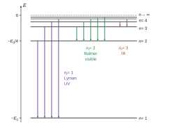
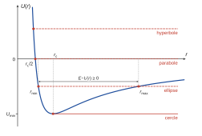
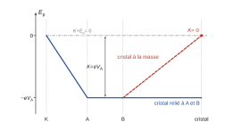
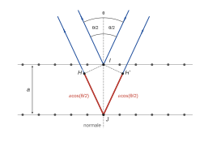
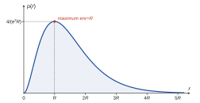

# Mines-Ponts MPI — Physique 1 2026 · Corrigé brut

*Corrigé rédigé par IA, non officiel. Signalez toute erreur.*

**Du spectre à la structure de l'hydrogène.** Durée 3 heures, calculatrice interdite. Applications numériques à deux chiffres significatifs sauf mention contraire.

Notations : $\lambda_0$ pour les ondes lumineuses, $\lambda$ pour les ondes de matière. On pose

$$k_e=\frac{e^2}{4\pi\varepsilon_0}$$

$$\hbar=\frac{h}{2\pi}$$

## I. Les raies d'émission de l'hydrogène atomique

### Question 1

Le photon emporte l'énergie $\epsilon=E_i-E_f>0$. D'après la relation de Planck-Einstein, $\epsilon=h\nu$. Dans le vide, la fréquence et la longueur d'onde sont liées par $\nu=c/\lambda_0$. Donc $E_i-E_f=hc/\lambda_0$ :

$$\boxed{\lambda_0=\frac{hc}{E_i-E_f}}$$

### Question 2

On suppose (2) : $E_n=-E_0/n^2$. Pour $n_i=k+2$ et $n_f=2$, la question 1 donne

$$\begin{aligned}
\frac1{\lambda_0}&=\frac{E_{n_i}-E_{n_f}}{hc}\\
&=\frac{E_0}{hc}\left(\frac14-\frac1{(k+2)^2}\right)\\
&=\frac{E_0}{4hc}-\frac{E_0}{hc}\cdot\frac1{(k+2)^2}.
\end{aligned}$$

Avec $X=1/(k+2)^2$, on obtient une loi affine :

$$\boxed{\frac1{\lambda_0}=b-\alpha X}$$

$$\begin{aligned}
b&=\frac{E_0}{4hc}>0\\
\alpha&=\frac{E_0}{hc}=4b
\end{aligned}$$

C'est une fonction affine décroissante de $X$, comme la droite en pointillés de la figure 1. Le contrôle quantitatif porte sur le rapport pente/ordonnée à l'origine, qui doit valoir $n_f^2=4$.

Sur la figure, l'ordonnée à l'origine se lit $b\simeq2{,}7\ \mu\text{m}^{-1}$. La droite passe par le point $k=1$, d'abscisse $X=1/9\simeq0{,}111$ et d'ordonnée $1/0{,}66\simeq1{,}5\ \mu\text{m}^{-1}$. D'où

$$\alpha\simeq\frac{2{,}7-1{,}5}{0{,}111}\ \mu\text{m}^{-1}\simeq11\ \mu\text{m}^{-1}\simeq4b.$$

Les cinq points tombent sur la droite aux barres d'erreur près. **La figure 1 est compatible avec (2)**, avec $n_f=2$ et une énergie en $-1/n^2$. La constante additive des énergies ne se voit pas sur un spectre : le choix $E_n\to0$ pour $n\to\infty$ est une convention.

### Question 3

L'ordonnée à l'origine se lit $b\simeq2{,}7\ \mu\text{m}^{-1}$. Donc $E_0=4hc\,b$, et avec $hc\simeq1{,}2$ eV·µm :

$$E_0\simeq4\times1{,}2\times2{,}7\ \text{eV}$$

$$\boxed{E_0\simeq13\ \text{eV}}$$

La pente donne la même valeur : $hc\,\alpha\simeq1{,}2\times11\simeq13$ eV.

### Question 4

Pour une transition $n_i\to n_f$ avec $n_i>n_f$, la question 1 et la loi (2) donnent

$$\begin{aligned}
\frac1{\lambda_0}&=\frac1{hc}\left(-\frac{E_0}{n_i^2}+\frac{E_0}{n_f^2}\right)\\
&=\frac{E_0}{hc}\left(\frac1{n_f^2}-\frac1{n_i^2}\right),
\end{aligned}$$

ce qui est la relation (3) avec

$$\boxed{R_\infty=\frac{E_0}{hc}}$$

La condition $n_i>n_f$ assure $1/\lambda_0>0$. Numériquement $R_\infty\simeq13/1{,}2\simeq11\ \mu\text{m}^{-1}$ et

$$\boxed{\frac1{R_\infty}=\frac{hc}{E_0}\simeq9{,}2\times10^{-2}\ \mu\text{m}\simeq92\ \text{nm}}$$

Contrôle : pour $3\to2$, $\lambda_0=\frac{36}{5}\times92\simeq6{,}6\times10^2$ nm ($\text{H}_\alpha$). Pour $4\to2$, $\lambda_0=\frac{16}3\times92\simeq4{,}9\times10^2$ nm ($\text{H}_\beta$).

### Question 5

**Cas $n_f=1$.** On a, avec $n_i\geqslant2$,

$$\frac1{\lambda_0}=R_\infty\left(1-\frac1{n_i^2}\right).$$

La fonction $n_i\mapsto1-1/n_i^2$ est croissante, minimale en $n_i=2$ où elle vaut $3/4$. Donc $1/\lambda_0\geqslant3R_\infty/4$ et

$$\boxed{\lambda_0\leqslant\lambda_{\max}=\frac4{3R_\infty}\simeq1{,}2\times10^{2}\ \text{nm}}$$

borne atteinte pour la transition $2\to1$. Toutes ces raies (série de Lyman) sont dans l'**ultraviolet**.

**Cas $n_f>2$**, soit $n_f\geqslant3$ et $n_i>n_f$ :

$$\begin{aligned}
\frac1{\lambda_0}&=R_\infty\left(\frac1{n_f^2}-\frac1{n_i^2}\right)\\
&<\frac{R_\infty}{n_f^2}\\
&\leqslant\frac{R_\infty}9,
\end{aligned}$$

donc

$$\boxed{\lambda_0>\lambda_{\min}=\frac9{R_\infty}\simeq8{,}3\times10^{2}\ \text{nm}}$$

La borne n'est pas atteinte ; elle est approchée pour $n_f=3$ et $n_i\to\infty$. Ces raies sont dans l'**infrarouge**.

**Conclusion.** Les raies visibles ($400$–$800$ nm) appartiennent toutes à la série $n_f=2$ (Balmer). Pour celle-ci,

$$\frac{5R_\infty}{36}\leqslant\frac1{\lambda_0}<\frac{R_\infty}4,$$

soit $370\ \text{nm}<\lambda_0\leqslant660$ nm.

**Les seules raies visibles sont celles de la série de Balmer avec $n_i=3$ à $7$**, c'est-à-dire les cinq raies du tableau, de $\text{H}_\alpha$ à $\text{H}_\epsilon$.

Les suivantes, à partir de $n_i=8$ et en dessous de $400$ nm, s'accumulent vers $370$ nm dans le proche ultraviolet.

## II. Le modèle de Bohr pour l'atome d'hydrogène

### II.A Énergie potentielle effective

### Question 6

La force de Coulomb exercée par le noyau ($+e$) sur l'électron ($-e$) est

$$\vec F=\frac{(+e)(-e)}{4\pi\varepsilon_0r^2}\,\vec e_r=-\frac{k_e}{r^2}\,\vec e_r.$$

Son travail élémentaire vaut

$$\delta W=\vec F\cdot d\vec r=-\frac{k_e}{r^2}\,dr,$$

et l'énergie potentielle est définie par $\delta W=-dE_p$.

D'où $E_p=-k_e/r+C$, et la condition $E_p\to0$ en $r\to\infty$ impose $C=0$ :

$$\boxed{E_p(r)=-\frac{e^2}{4\pi\varepsilon_0\,r}}$$

### Question 7

On travaille dans le référentiel galiléen où le noyau est fixe en $O$, avec $\vec p=m_e\vec v$. La dérivée du moment cinétique en $O$ vaut

$$\begin{aligned}
\frac{d\vec s}{dt}&=\underbrace{\vec v\wedge m_e\vec v}_{=\vec 0}+\vec r\wedge\frac{d\vec p}{dt}\\
&=\vec r\wedge\vec F\\
&=\vec0,
\end{aligned}$$

car, d'après le principe fondamental de la dynamique, $d\vec p/dt=\vec F$ (seule force), et $\vec F$ est colinéaire à $\vec r$ (force centrale). **$\vec s$ est un vecteur constant.**

Par construction, $\vec r\cdot\vec s=\vec r\cdot(\vec r\wedge\vec p)=0$ à tout instant. Si $\vec s\neq\vec0$, $M$ reste donc dans le plan fixe passant par $O$ et orthogonal au vecteur constant $\vec s$. **Le mouvement est plan et son plan contient $O$.**

Si $\vec s=\vec0$, $\vec v$ est colinéaire à $\vec r$ : le mouvement est rectiligne sur une droite passant par $O$. Ce cas dégénéré est écarté dans la suite.

### Question 8

En polaires dans le plan du mouvement, $\vec v=\dot r\,\vec e_r+r\dot\theta\,\vec e_\theta$, donc $v^2=\dot r^2+r^2\dot\theta^2$. De plus $\vec s=m_er^2\dot\theta\,\vec e_z$, donc $s=m_er^2|\dot\theta|$ et

$$r^2\dot\theta^2=\frac{s^2}{m_e^2r^2}.$$

L'électron n'étant soumis qu'à une force conservative, son énergie mécanique est conservée :

$$\begin{aligned}
E&=\frac12m_e\left(\dot r^2+r^2\dot\theta^2\right)+E_p(r)\\
&=\frac12m_e\dot r^2+U(r),
\end{aligned}$$

$$\boxed{U(r)=\frac{s^2}{2m_er^2}-\frac{e^2}{4\pi\varepsilon_0\,r}}$$

### Question 9

**Allure de $U$.** $U(r)\to+\infty$ quand $r\to0^+$ (terme en $1/r^2$), et $U(r)\to0^-$ quand $r\to+\infty$. La dérivée vaut

$$U'(r)=\frac1{r^3}\left(k_er-\frac{s^2}{m_e}\right).$$

Elle s'annule en changeant de signe en un seul point $r_c$. $U$ décroît sur $]0,r_c]$ et croît sur $[r_c,+\infty[$ : elle présente un puits de minimum $U_{\min}=U(r_c)<0$. Elle s'annule en $r_c/2$.

**Les quatre types d'orbites.** Comme $\frac12m_e\dot r^2=E-U(r)\geqslant0$, le mouvement radial est restreint à $\{r : U(r)\leqslant E\}$.

1. $E=U_{\min}$ : $r$ est bloqué en $r_c$. Trajectoire **circulaire** de rayon $r_c$, parcourue uniformément.
2. $U_{\min}<E<0$ : $r$ oscille entre les deux racines $r_{\min}<r_c<r_{\max}$ de l'équation $U(r)=E$. État **lié**, trajectoire **elliptique** de foyer $O$, de péricentre et d'apocentre
$$r_{\min,\max}=\frac{k_e\mp\sqrt{k_e^2-2|E|s^2/m_e}}{2|E|}.$$
3. $E=0$ : un seul point de rebroussement, $r_{\min}=r_c/2$. L'électron vient de l'infini et y repart avec une vitesse tendant vers $0$ : trajectoire **parabolique** (état de diffusion limite).
4. $E>0$ : un seul point de rebroussement. L'électron arrive de l'infini et y repart avec une vitesse non nulle : trajectoire **hyperbolique** (état de diffusion), avec
$$r_{\min}=\frac{-k_e+\sqrt{k_e^2+2Es^2/m_e}}{2E}.$$

La nature conique des trajectoires est un résultat de cours admis.

**Trajectoires circulaires.** $U'(r_c)=0$ donne

$$\boxed{r_c(s)=\frac{4\pi\varepsilon_0\,s^2}{m_ee^2}}$$

Sur un cercle, $\vec r\perp\vec p$ donc $s=r_cp_c$ :

$$\boxed{p_c(s)=\frac{s}{r_c}=\frac{m_ee^2}{4\pi\varepsilon_0\,s}}$$

Enfin

$$\begin{aligned}
E_c&=U(r_c)\\
&=\frac{k_e}{2r_c}-\frac{k_e}{r_c}\\
&=-\frac{k_e}{2r_c},
\end{aligned}$$

$$\boxed{E_c(s)=-\frac{m_ee^4}{32\pi^2\varepsilon_0^2\,s^2}}$$

On note que $E_c=-p_c^2/(2m_e)=\frac12E_p(r_c)$.

### II.B L'hypothèse de quantification de Bohr

### Question 10

Sur une orbite circulaire, $r=r_c$ est constant et $s=m_er_c^2|\dot\theta|$ aussi : la vitesse est uniforme, donc l'impulsion $p_c$ et la longueur d'onde $\lambda=h/p_c$ sont les mêmes en tout point du cercle.

Le périmètre contient alors $n$ longueurs d'onde de de Broglie :

$$2\pi r_c=n\lambda=\frac{nh}{p_c}.$$

Donc $r_cp_c=nh/(2\pi)$. Or $s=r_cp_c$ sur une orbite circulaire ($\vec r\perp\vec p$) :

$$\boxed{s=\frac{nh}{2\pi}=n\hbar}$$

avec $n\in\mathbb N^*$.

### Question 11

On reporte $s^2=n^2h^2/(4\pi^2)$ dans les résultats de Q9 :

$$\boxed{r_c(n)=\frac{\varepsilon_0h^2}{\pi m_ee^2}\,n^2}$$

$$\boxed{p_c(n)=\frac{m_ee^2}{2\varepsilon_0h}\cdot\frac1n}$$

$$\boxed{E_c(n)=-\frac{m_ee^4}{8\varepsilon_0^2h^2}\cdot\frac1{n^2}}$$

On retrouve exactement la loi (2), $E_n=-E_0/n^2$, avec

$$\boxed{E_0=\frac{m_ee^4}{8\varepsilon_0^2h^2}}$$

Numériquement,

$$E_0=\frac{9{,}1\times10^{-31}\times(1{,}6\times10^{-19})^4}{8\times(8{,}9\times10^{-12})^2\times(6{,}6\times10^{-34})^2}\simeq2{,}2\times10^{-18}\ \text{J},$$

soit $E_0\simeq14$ eV ($13{,}5$ eV avant arrondi). C'est en accord avec les $13$ eV lus en Q3, à la précision de la lecture graphique et des données.

Le modèle exprime la constante de Rydberg à l'aide des constantes fondamentales :

$$R_\infty=\frac{m_ee^4}{8\varepsilon_0^2h^3c}.$$

### Question 12

$r_c(n)$ croît comme $n^2$ : le rayon minimal est obtenu pour $n=1$,

$$\boxed{r_{c,\min}=\frac{\varepsilon_0h^2}{\pi m_ee^2}}$$

$$r_{c,\min}=\frac{8{,}9\times10^{-12}\times(6{,}6\times10^{-34})^2}{\pi\times9{,}1\times10^{-31}\times(1{,}6\times10^{-19})^2}\ \text{m}$$

$$\boxed{r_{c,\min}\simeq5\times10^{-11}\ \text{m}}$$

C'est le rayon de Bohr ($0{,}05$ nm). Il donne le bon ordre de grandeur de la taille des atomes (dixième de nanomètre) à partir des seules constantes fondamentales, la constante de Planck fixant l'échelle.

L'existence d'un rayon minimal non nul rend l'atome stable, ce que le modèle planétaire classique ne pouvait expliquer : une charge accélérée rayonne, et l'électron devrait s'effondrer sur le noyau. Le modèle reste toutefois semi-classique : il conserve la notion de trajectoire et postule la quantification sans la justifier.

## III. Ondes de matière en physique microscopique

### III.A États quantiques stationnaires

### Question 13

$|\Psi(x,t)|^2S\,dx$ est la probabilité de trouver la particule dans la tranche $[x,x+dx]$ du cylindre à l'instant $t$. L'intégrale sur $\mathscr D$ est donc **la probabilité de trouver la particule dans le domaine, égale à $1$** puisqu'elle y est confinée (condition de normalisation).

Une probabilité est sans dimension et $S\,dx$ est un volume : $|\Psi|^2$ est une densité volumique de probabilité et

$$\boxed{[\Psi]=L^{-3/2}}$$

On reporte $\Psi=\psi(x)e^{-i\omega t}$ dans (4). Le premier membre vaut $i\hbar\,\partial_t\Psi=\hbar\omega\Psi$. Après simplification par $e^{-i\omega t}\neq0$, on obtient l'équation de Schrödinger stationnaire :

$$\boxed{-\frac{\hbar^2}{2m}\frac{d^2\psi}{dx^2}+V(x)\,\psi(x)=E\,\psi(x)}$$

L'énergie de la particule est

$$\boxed{E=\hbar\omega=\frac{h\omega}{2\pi}}$$

### Question 14

Avec $V=V_0$, l'équation devient

$$\psi''+\frac{2m(E-V_0)}{\hbar^2}\,\psi=0.$$

- Si $E<V_0$, les solutions sont des combinaisons de $e^{\pm x/\delta}$, avec $\delta=\hbar/\sqrt{2m(V_0-E)}$ : onde évanescente, pas de propagation.
- Si $E=V_0$, $\psi$ est affine : pas de propagation.
- Si $E>V_0$, on pose $k=\sqrt{2m(E-V_0)}/\hbar$, et

$$\boxed{\psi(x)=A\,e^{ikx}+B\,e^{-ikx}}$$

$$\Psi(x,t)=A\,e^{i(kx-\omega t)}+B\,e^{-i(kx+\omega t)}$$

C'est la superposition de deux ondes progressives d'amplitude constante.

Il y a propagation sans atténuation si et seulement si $\boxed{E>V_0}$. La longueur d'onde est

$$\boxed{\lambda=\frac{2\pi}k=\frac{h}{\sqrt{2m(E-V_0)}}}$$

Pour une propagation dans un seul sens ($B=0$ par exemple), la relation de de Broglie donne

$$\begin{aligned}
p&=\frac h\lambda=\hbar k\\
&=\sqrt{2m(E-V_0)},
\end{aligned}$$

soit

$$\boxed{K=E-V_0=\frac{p^2}{2m}}$$

**C'est la même relation qu'en mécanique classique non relativiste.** Seule change l'interprétation de $p$, liée à la périodicité spatiale de l'onde et non plus à une trajectoire.

### III.B Ondes stationnaires et états liés

### Question 15

Non, les deux conditions ne sont pas identiques, même si elles procèdent du même principe : une onde stationnaire n'existe que si un nombre entier de « motifs » tient sur la longueur disponible.

- Chez Bohr (figure 3), l'onde se referme sur un cercle : elle doit se retrouver en phase avec elle-même après un tour, soit $2\pi r_c=n\lambda$. C'est **un nombre entier de longueurs d'onde**, sans nœud imposé (condition de périodicité).
- Sur le segment (figure 4), $\Psi$ s'annule aux deux extrémités. Les $n+1$ nœuds, distants de $\lambda/2$, découpent $n$ intervalles : $\ell=n\lambda/2$. C'est **un nombre entier de demi-longueurs d'onde** (condition aux limites).

Si l'on déroule le cercle en un segment de longueur $2\pi r_c$, la condition de Bohr n'autorise qu'un nombre pair de demi-longueurs d'onde.

### Question 16

Sur $[0,\ell]$, $V=0$. Si $E\leqslant0$, les solutions de Q14 (exponentielles réelles ou fonction affine) ne s'annulent aux deux extrémités que si $\psi$ est identiquement nulle. On a donc $E>0$ et, avec $k=\sqrt{2mE}/\hbar$,

$$\psi(x)=C\sin(kx)+D\cos(kx).$$

La condition $\psi(0)=0$ impose $D=0$. La condition $\psi(\ell)=0$ avec $C\neq0$ impose alors $\sin(k\ell)=0$.

On a donc $k\ell=n\pi$ avec $n\in\mathbb N^*$, la valeur $n=0$ redonnant la solution nulle. Alors

$$\begin{aligned}
E&=\frac{\hbar^2k^2}{2m}\\
&=\frac{h^2}{8\pi^2m}\cdot\frac{n^2\pi^2}{\ell^2},
\end{aligned}$$

$$\boxed{E_n=\frac{n^2h^2}{8m\ell^2},\qquad n\in\mathbb N^*}$$

C'est cohérent avec $\ell=n\lambda/2$, $p=h/\lambda$ et $E=p^2/2m$.

### Question 17

L'écart entre le fondamental et le premier état excité vaut

$$\Delta E=E_2-E_1=\frac{3h^2}{8m_n\ell^2},$$

donc

$$\ell=h\sqrt{\frac3{8m_n\Delta E}}.$$

Avec $\Delta E=30\times10^6\times1{,}6\times10^{-19}\ \text{J}=4{,}8\times10^{-12}$ J :

$$\ell=6{,}6\times10^{-34}\sqrt{\frac3{8\times1{,}7\times10^{-27}\times4{,}8\times10^{-12}}}\ \text{m}$$

$$\boxed{\ell\simeq4{,}5\times10^{-15}\ \text{m}\simeq4{,}5\ \text{fm}}$$

C'est la taille d'un **noyau atomique** (quelques femtomètres), environ $10^4$ fois plus petite que l'atome. La situation décrite est celle d'un **nucléon confiné dans un noyau**, et l'écart de quelques dizaines de MeV est l'ordre de grandeur des énergies nucléaires.

Le neutron étant neutre, l'interaction électromagnétique ne peut pas le confiner, et la gravitation est beaucoup trop faible. C'est l'**interaction forte** (nucléaire), attractive et de très courte portée (de l'ordre du femtomètre), qui le retient. Le puits infini à une dimension n'en est qu'un modèle grossier, valable en ordre de grandeur.

### III.C Ondes progressives et diffraction

### Question 18

Un cristal isolé recevant des électrons se charge négativement. Cette charge crée entre les grilles et le cristal un champ qui n'existe pas dans le dispositif idéal : les électrons sont freinés (et déviés) avant l'impact. Leur impulsion, donc leur longueur d'onde $\lambda=h/p$, n'est plus fixée par $V_A$, et cet effet croît au cours du temps jusqu'à repousser complètement le faisceau. **On perd le contrôle de $\lambda$, qui est le paramètre de l'expérience.**

Il faut **relier le cristal aux électrodes A et B** (potentiel $V_A$), et non à la masse. Par conservation de l'énergie, un électron parti de K (potentiel nul, vitesse négligeable) a, en un point de potentiel $V$, l'énergie cinétique $eV$.

- Cristal relié à A et B : la région B–cristal est équipotentielle, sans champ, et les électrons arrivent avec l'énergie cinétique $eV_A$ (hypothèse de l'énoncé).
- Cristal à la masse (potentiel $0$) : leur énergie cinétique au niveau du cristal serait nulle. Ils seraient intégralement freinés entre B et le cristal et rebrousseraient chemin.

### Question 19

Entre K ($V=0$, vitesse négligeable) et A ($V_A$), seule la force électrique travaille. Le théorème de l'énergie cinétique, dans le référentiel du laboratoire, donne

$$\frac12m_ev^2=(-e)(0-V_A)=eV_A.$$

Donc

$$\boxed{p=\sqrt{2m_e\,e\,V_A}}$$

Au-delà de A, la région est équipotentielle et $p$ se conserve. On prend l'origine des énergies potentielles dans cette région (onde plane libre $\Psi_\text{inc}$ de l'énoncé, $V(x)=0$) :

$$\boxed{E=\frac{p^2}{2m_e}=e\,V_A}$$

### Question 20

D'après Q13, $[|\Psi|^2]=L^{-3}$, et $[\vec p/m_e]=L\,T^{-1}$. Donc

$$\boxed{[\vec J]=L^{-2}\,T^{-1}}$$

$\vec J=|\Psi|^2\vec v$ est une densité de courant de probabilité : produit d'une densité volumique par une vitesse. Son flux à travers une surface est le **nombre d'électrons (ou la probabilité) traversant cette surface par unité de temps**.

Pour l'onde incidente, $|\Psi_\text{inc}|^2=\psi_0^2$, donc $J=\psi_0^2p/m_e$. C'est exactement $\Phi_0$, nombre d'électrons par unité de section droite et de temps :

$$\boxed{\psi_0=\sqrt{\frac{m_e\,\Phi_0}{p}}}$$

Il n'y a **pas de perte de généralité** : une amplitude complexe $|\psi_0|e^{i\varphi}$ ne diffère que par un facteur de phase global, constant, qui disparaît de $|\Psi|^2$, de $\vec J$ et de toute grandeur observable.

Remarque : l'onde $\Psi_\text{inc}$ de l'énoncé, en $\exp\left[-\frac{i}{\hbar}(px-Et)\right]$, est la conjuguée de la forme en $e^{-i\omega t}$ de III.A. Sa phase reste constante pour $x=Et/p+\text{cte}$ : elle se propage bien vers les $x$ croissants, et $|\Psi_\text{inc}|^2$ n'en dépend pas. Les résultats ci-dessus sont inchangés.

### Question 21

Sur la figure 6, la flèche qui mesure $a$ est portée par la droite en pointillés, perpendiculaire aux alignements d'atomes : les pointillés sont la **normale** aux plans réticulaires. Cette normale est la bissectrice de l'angle $\theta$ entre la direction de retour vers la source et le faisceau diffracté (loi de la réflexion). L'angle d'incidence, mesuré par rapport à la normale, vaut donc $\theta/2$.

Soient $I$ et $J$ deux points de réflexion sur deux plans consécutifs, sur une même normale, et $\vec n$ la normale unitaire orientée vers l'intérieur du cristal :

$$\vec{IJ}=a\,\vec n.$$

Soient $\vec u$ et $\vec u\,'$ les vecteurs unitaires des directions incidente et diffractée. L'incident fait l'angle $\theta/2$ avec $\vec n$, le diffracté l'angle $\pi-\theta/2$ :

$$\vec n\cdot\vec u=\cos\frac\theta2$$

$$\vec n\cdot\vec u\,'=-\cos\frac\theta2$$

Les surfaces d'onde sont orthogonales aux rayons (théorème de Malus) : on compare les deux chemins entre la surface d'onde incidente passant par $I$ et la surface d'onde diffractée passant par $I$. Le rayon réfléchi en $J$ parcourt en plus

$$\begin{aligned}
\delta&=\vec{IJ}\cdot\vec u-\vec{IJ}\cdot\vec u\,'\\
&=a\cos\frac\theta2+a\cos\frac\theta2,
\end{aligned}$$

$$\boxed{\delta=2a\cos\frac\theta2}$$

Les plans étant équidistants et très nombreux, l'intensité diffractée est maximale quand les ondes réfléchies par deux plans consécutifs sont en phase, c'est-à-dire quand $\delta$ est un multiple entier de $\lambda$ :

$$\boxed{2a\cos\frac\theta2=q\,\lambda,\qquad q\in\mathbb N^*}$$

### Question 22

D'après Q19, $\lambda=h/\sqrt{2m_eeV}$. À $\theta$ fixé, la condition de Q21 s'écrit donc

$$q=\frac{2a\cos(\theta/2)\sqrt{2m_ee}}{h}\,\sqrt V.$$

L'ordre est proportionnel à $\sqrt V$ : **les maxima sont équidistants sur un axe en $\sqrt V$**, ce qui justifie ce choix d'abscisse.

Sur la figure 7, les maxima se lisent aux abscisses suivantes (en $\text{V}^{1/2}$) :

$$\sqrt V\simeq8{,}0\ ;\ 11{,}4\ ;\ 14{,}7\ ;\ 18{,}2\ ;\ 21{,}2\ ;\ 24{,}3.$$

L'écart moyen, qui correspond à $\Delta q=1$, vaut

$$\Delta\sqrt V\simeq\frac{24{,}3-8{,}0}{5}\ \text{V}^{1/2}\simeq3{,}3\ \text{V}^{1/2}.$$

Avec $\sqrt{2m_ee}=\sqrt{2\times9{,}1\times10^{-31}\times1{,}6\times10^{-19}}\simeq5{,}4\times10^{-25}\ \text{kg}^{1/2}\cdot\text{C}^{1/2}$ :

$$a=\frac{h}{2\cos(\theta/2)\sqrt{2m_ee}\;\Delta\sqrt V}$$

$$a\simeq\frac{6{,}6\times10^{-34}}{2\times0{,}91\times5{,}4\times10^{-25}\times3{,}3}\ \text{m}$$

$$\boxed{a\simeq2\times10^{-10}\ \text{m}}$$

Cette distance de $0{,}2$ nm est l'ordre de grandeur des distances interatomiques dans un solide (quelques rayons de Bohr). Elle est comparable à la longueur d'onde des électrons ($\lambda\simeq1{,}5\times10^{-10}$ m à $64$ V), condition nécessaire à l'observation de la diffraction. L'expérience confirme ainsi quantitativement la relation de de Broglie.

Les positions absolues des maxima ne sont pas des multiples entiers de $\Delta\sqrt V$ ($8{,}0/3{,}3\simeq2{,}5$) : le modèle néglige notamment la modification de la longueur d'onde des électrons à l'intérieur du cristal. C'est pourquoi on exploite l'écart entre maxima.

### III.D Retour sur l'atome d'hydrogène

### Question 23

$|\Psi|^2=\psi_0^2e^{-2r/R}$ ne dépend que de $r$. En sphériques, le volume élémentaire est $d\tau=r^2\sin\theta\,dr\,d\theta\,d\varphi$. La probabilité de trouver l'électron entre $r$ et $r+dr$ s'obtient en intégrant sur les angles, avec l'intégrale angulaire donnée ($4\pi$) :

$$\begin{aligned}
d\mathbb P&=\psi_0^2e^{-2r/R}\,r^2dr\int_{\theta=0}^{\pi}\int_{\varphi=0}^{2\pi}\sin\theta\,d\theta\,d\varphi\\
&=4\pi\psi_0^2\,r^2e^{-2r/R}\,dr.
\end{aligned}$$

Donc $\rho(r)=4\pi\psi_0^2r^2e^{-2r/R}$. La normalisation $\int_0^\infty\rho\,dr=1$ se calcule avec $x=2r/R$ :

$$\begin{aligned}
1&=4\pi\psi_0^2\left(\frac R2\right)^3\int_0^\infty x^2e^{-x}dx\\
&=4\pi\psi_0^2\cdot\frac{R^3}8\cdot2\\
&=\pi\psi_0^2R^3,
\end{aligned}$$

soit $\psi_0^2=1/(\pi R^3)$ et

$$\boxed{\rho(r)=\frac4{R^3}\,r^2\,e^{-2r/R}}$$

On a $\rho(0)=0$ et $\rho\to0$ en $+\infty$. La dérivée vaut

$$\rho'(r)=\frac{8r}{R^3}\,e^{-2r/R}\left(1-\frac rR\right).$$

$\rho$ croît sur $[0,R]$ et décroît ensuite. Son maximum vaut $\rho(R)=4e^{-2}/R\simeq0{,}54/R$.

**$R$ est la distance électron–noyau la plus probable** : c'est le rayon de la coquille où la probabilité de présence par unité d'épaisseur est maximale.

### Question 24

$f$ vérifie l'équation de Schrödinger stationnaire à trois dimensions avec le potentiel de Q6 :

$$-\frac{\hbar^2}{2m_e}\Delta f-\frac{e^2}{4\pi\varepsilon_0r}f=Ef.$$

Seul le terme radial du laplacien subsiste. Avec $f'=-f/R$ :

$$\frac{d}{dr}\left(r^2f'\right)=\left(-\frac{2r}R+\frac{r^2}{R^2}\right)f$$

$$\Delta f=\left(\frac1{R^2}-\frac2{Rr}\right)f$$

Après division par $f\neq0$, il vient, pour tout $r>0$,

$$\left(-\frac{\hbar^2}{2m_eR^2}-E\right)+\left(\frac{\hbar^2}{m_eR}-\frac{e^2}{4\pi\varepsilon_0}\right)\frac1r=0.$$

Les fonctions $1$ et $1/r$ étant indépendantes (faire $r\to\infty$, puis multiplier par $r$ et faire $r\to0$), les deux coefficients sont nuls :

$$\boxed{R=\frac{4\pi\varepsilon_0\hbar^2}{m_ee^2}=\frac{\varepsilon_0h^2}{\pi m_ee^2}}$$

$$\boxed{E=-\frac{\hbar^2}{2m_eR^2}=-\frac{m_ee^4}{8\varepsilon_0^2h^2}}$$

Ce sont exactement le rayon $r_c(1)\simeq5\times10^{-11}$ m et l'énergie $E_c(1)=-E_0$ du niveau fondamental de Bohr (Q11, Q12). Mais $R$ n'est plus le rayon d'une trajectoire : c'est la distance la plus probable (Q23), l'électron étant délocalisé. Et la quantification découle de l'équation d'onde (forme normalisable imposée) au lieu d'être postulée.

### Question 25

Avec la densité radiale de Q23 et le changement de variable $x=2r/R$ ($\int_0^\infty xe^{-x}dx=1$) :

$$\begin{aligned}
\langle V\rangle&=\int_0^\infty\left(-\frac{e^2}{4\pi\varepsilon_0r}\right)\rho(r)\,dr\\
&=-\frac{e^2}{4\pi\varepsilon_0}\cdot\frac4{R^3}\int_0^\infty r\,e^{-2r/R}dr\\
&=-\frac{e^2}{4\pi\varepsilon_0}\cdot\frac4{R^3}\cdot\frac{R^2}4.
\end{aligned}$$

D'où, avec $R$ de Q24,

$$\boxed{\langle V\rangle=-\frac{e^2}{4\pi\varepsilon_0R}}$$

$$\begin{aligned}
\langle V\rangle&=-\frac{m_ee^4}{4\varepsilon_0^2h^2}\\
&=-2E_0=2E\\
&\simeq-27\ \text{eV}.
\end{aligned}$$

L'énergie totale $E=\langle K\rangle+\langle V\rangle$ vaut $-E_0$ (Q24), donc

$$\begin{aligned}
\langle K\rangle&=E-\langle V\rangle\\
&=-E=E_0,
\end{aligned}$$

$$\boxed{\langle K\rangle=E_0\simeq14\ \text{eV}}$$

**Commentaire.** $\langle K\rangle>0$ et $\langle V\rangle<0$ : l'électron est lié ($E<0$) bien que son énergie cinétique moyenne soit positive.

On a $2\langle K\rangle+\langle V\rangle=0$ : c'est la même répartition que sur l'orbite circulaire classique ($E_c=\frac12E_p$, Q9), propre aux potentiels en $1/r$ (théorème du viriel). L'énergie d'ionisation de l'atome dans son état fondamental vaut $E_0$.

Enfin $\sqrt{\langle v^2\rangle}=\sqrt{2E_0/m_e}\simeq2\times10^6$ m/s, soit environ $c/140$ : le traitement non relativiste est justifié.
