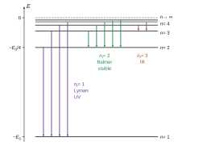
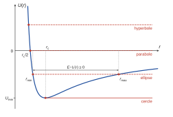
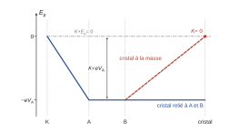
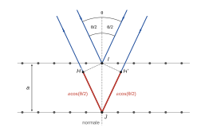
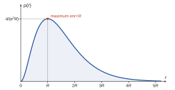

# Mines-Ponts MPI — Physique 1 2026 · Corrigé guidé

*Corrigé rédigé par IA, non officiel. Signalez toute erreur.*

## Présentation du sujet

**Thème.** « Du spectre à la structure de l'hydrogène » retrace la naissance de la mécanique quantique à partir d'un fil conducteur, l'**impulsion** $p$ et la relation de de Broglie $\lambda=h/p$. On part de mesures (les raies visibles de l'hydrogène), on les interprète par le modèle semi-classique de Bohr, puis par les ondes de matière et l'équation de Schrödinger.

**Découpage (25 questions, 3 heures, sans calculatrice).**

- **Partie I (Q1–Q5)** : relation de Planck-Einstein, exploitation de la figure 1 (droite de Balmer), valeur de $E_0$, relation de Rydberg, domaines spectraux des séries. Accessible dès les premières minutes.
- **Partie II (Q6–Q12)** : mécanique du point en force centrale (énergie potentielle coulombienne, conservation du moment cinétique, énergie potentielle effective, discussion graphique des orbites) puis règle de Bohr et rayon de Bohr. Les questions 6 à 9 sont du cours de première année.
- **Partie III (Q13–Q25)** : ondes de matière. III.A interprétation de la fonction d'onde et onde plane ; III.B puits infini et neutron confiné dans un noyau ; III.C expérience de Davisson et Germer (électrostatique, courant de probabilité, interférences sur un réseau de plans, exploitation d'un document historique) ; III.D état fondamental de l'hydrogène par l'équation de Schrödinger en symétrie sphérique.

**Notions du programme mobilisées.** Photon, quantification de l'énergie, mécanique en force centrale conservative, énergie potentielle effective, dualité onde-corpuscule, fonction d'onde et densité de probabilité, équation de Schrödinger, puits infini, courant de probabilité, interférences à ondes multiples (différence de marche), lecture et exploitation de graphes, applications numériques sans calculatrice.

**Difficulté et gestion du temps.** Le rapport 2026 juge que « La longueur du sujet est bien adaptée » et qu'il s'agit d'« un sujet classique, ne présentant pas de difficulté majeure » (p. 19). Les trois parties sont presque indépendantes : on peut traiter III.A, III.B et III.D même si la partie II a résisté.

Questions abordables à ne pas laisser passer : Q1, Q3, Q4, Q6, Q10, Q13, Q16, Q19. D'après le rapport 2026 (p. 76), les questions qui ont fait la différence sont :

- **Q7**, dont la démonstration de la planéité est jugée « assez discriminante » ;
- **Q21**, « Question très mal traitée » (schéma, trigonométrie) ;
- **Q23**, où l'intégration en sphériques est souvent omise ;
- **Q22, Q24 et Q25**, peu abordées mais réussies par les meilleurs candidats : Q22 est « parfois couronnée de succès », et Q24 comme Q25 est jugée « Peu traitée mais brillamment réussie par certains candidats ».

Sans calculatrice, préparer les applications numériques avec $hc\simeq1{,}2$ eV·µm et les puissances de dix, et garder deux chiffres significatifs. Le rapport rappelle « qu’une application numérique donnée sans unité vaut 0 » (p. 18).

## Partie I — Les raies d'émission de l'hydrogène atomique

On transforme des longueurs d'onde mesurées en niveaux d'énergie. Outils : $\epsilon=h\nu$, lecture d'une droite (pente, ordonnée à l'origine), monotonie d'une suite d'entiers.

### Question 1

> [!INDICATION]
> Deux relations à raccorder : l'énergie emportée par le photon, et le lien entre énergie du photon, fréquence et longueur d'onde dans le vide.

#### Solution

Le photon emporte $\epsilon=E_i-E_f>0$. D'après la relation de Planck-Einstein, $\epsilon=h\nu$, et dans le vide $\nu=c/\lambda_0$. Donc

$$\boxed{\lambda_0=\frac{hc}{E_i-E_f}}$$

> [!JURY]
> Le rapport 2026 relève « Des erreurs inacceptables sur la relation fréquence-longueur d’onde » (p. 76). Écrire $\nu=c/\lambda_0$ en toutes lettres, et vérifier l'homogénéité : $hc$ est une énergie fois une longueur.

### Question 2

> [!INDICATION]
> Partir de la loi (2), calculer $1/\lambda_0$ pour la transition $n_i=k+2\to n_f=2$ grâce à Q1, et l'écrire en fonction de $X=1/(k+2)^2$.

> [!INDICATION]
> « Compatible » ne se limite pas à « affine » : la loi prévoit aussi un rapport précis entre la pente et l'ordonnée à l'origine. Le vérifier sur la figure.

#### Solution

Avec (2), $n_i=k+2$ et $n_f=2$ :

$$\frac1{\lambda_0}=\frac{E_0}{hc}\left(\frac14-\frac1{(k+2)^2}\right).$$

Avec $X=1/(k+2)^2$, c'est une loi affine :

$$\boxed{\frac1{\lambda_0}=b-\alpha X}$$

$$\begin{aligned}
b&=\frac{E_0}{4hc}\\
\alpha&=\frac{E_0}{hc}=4b
\end{aligned}$$

C'est une fonction affine décroissante de $X$, comme la droite en pointillés. Contrôle quantitatif : l'ordonnée à l'origine vaut $b\simeq2{,}7\ \mu\text{m}^{-1}$. La droite passe par le point $k=1$, d'abscisse $X\simeq0{,}111$ et d'ordonnée $1/0{,}66\simeq1{,}5\ \mu\text{m}^{-1}$. D'où

$$\alpha\simeq\frac{2{,}7-1{,}5}{0{,}111}\ \mu\text{m}^{-1}\simeq11\ \mu\text{m}^{-1}\simeq4b.$$

Les cinq points sont alignés aux barres d'erreur près : **la figure est compatible avec (2)**.

> [!PIEGE]
> Croire que le rapport pente/ordonnée teste le zéro des énergies. Une loi $E_n=A-E_0/n^2$ donnerait exactement la même droite, car la constante $A$ disparaît des différences d'énergie.
>
> Ce que la figure teste, c'est la dépendance en $1/n^2$ et la valeur $n_f=2$ (rapport $n_f^2=4$) ; le choix $E_n\to0$ pour $n\to\infty$ est une convention.

> [!JURY]
> Rapport 2026 (p. 76) : « Ne pas mélanger expressions littérales et valeurs numériques. » On établit d'abord la loi littérale $1/\lambda_0=b-\alpha X$, puis seulement on lit les valeurs sur la figure.

### Question 3

> [!INDICATION]
> Relier l'ordonnée à l'origine (ou la pente) à $E_0$ grâce à Q2, et utiliser la donnée $hc\simeq1{,}2$ eV·µm en gardant $1/\lambda_0$ en $\mu\text{m}^{-1}$.

#### Solution

On lit $b\simeq2{,}7\ \mu\text{m}^{-1}$, et $E_0=4hc\,b$ :

$$E_0\simeq4\times1{,}2\times2{,}7\ \text{eV}$$

$$\boxed{E_0\simeq13\ \text{eV}}$$

La pente donne le même résultat : $hc\,\alpha\simeq1{,}2\times11\simeq13$ eV.

> [!METHODE]
> Sans calculatrice, choisir l'unité qui évite les conversions : avec $1/\lambda_0$ en $\mu\text{m}^{-1}$ et $hc$ en eV·µm, l'énergie sort directement en électronvolts.

> [!PIEGE]
> Oublier le facteur $4$ conduit à $E_0\simeq3{,}2$ eV, valeur trop faible pour une énergie de liaison atomique (de l'ordre de la dizaine d'eV).

> [!JURY]
> Le rapport 2026 regrette que la valeur soit parfois donnée de mémoire, « sans aucun calcul » (p. 76). Connaître les $13{,}6$ eV de l'hydrogène sert de contrôle, pas de réponse : la question demande de déduire $E_0$ de la figure.

### Question 4

> [!INDICATION]
> Refaire le calcul de Q2 avec un état final $n_f$ quelconque, puis identifier.

#### Solution

Pour $n_i>n_f$, la question 1 et la loi (2) donnent

$$\frac1{\lambda_0}=\frac{E_0}{hc}\left(\frac1{n_f^2}-\frac1{n_i^2}\right),$$

d'où, par identification avec (3),

$$\boxed{R_\infty=\frac{E_0}{hc}}$$

Numériquement $R_\infty\simeq13/1{,}2\simeq11\ \mu\text{m}^{-1}$, donc

$$\boxed{\frac1{R_\infty}\simeq92\ \text{nm}}$$

Contrôle : $\text{H}_\alpha$ ($3\to2$) donne $\lambda_0=\frac{36}5\times92\simeq6{,}6\times10^2$ nm, la valeur tabulée.

> [!METHODE]
> Un contrôle sur une donnée de l'énoncé (ici une raie du tableau) coûte une ligne et sécurise toute la suite de la partie.

### Question 5

> [!INDICATION]
> Pour chaque série, étudier comment varie $\frac1{n_f^2}-\frac1{n_i^2}$ lorsque $n_i$ (et éventuellement $n_f$) parcourt les valeurs permises, puis inverser l'inégalité.

> [!INDICATION]
> Pour $n_f=1$, la borne est atteinte pour la plus petite valeur de $n_i$.
>
> Pour $n_f\geqslant3$, majorer $\frac1{n_f^2}-\frac1{n_i^2}$ par une quantité indépendante de $n_i$ et de $n_f$. Comparer enfin aux bornes du visible (environ $400$–$800$ nm).

#### Solution

**Cas $n_f=1$.** Le minimum de $1-1/n_i^2$ est atteint en $n_i=2$ :

$$\frac1{\lambda_0}=R_\infty\left(1-\frac1{n_i^2}\right)\geqslant\frac34R_\infty,$$

donc

$$\boxed{\lambda_0\leqslant\lambda_{\max}=\frac4{3R_\infty}\simeq1{,}2\times10^2\ \text{nm}}$$

Ces raies sont dans l'**ultraviolet** (série de Lyman).

**Cas $n_f\geqslant3$.**

$$\begin{aligned}
\frac1{\lambda_0}&<\frac{R_\infty}{n_f^2}\\
&\leqslant\frac{R_\infty}9,
\end{aligned}$$

donc

$$\boxed{\lambda_0>\lambda_{\min}=\frac9{R_\infty}\simeq8{,}3\times10^2\ \text{nm}}$$

La borne n'est pas atteinte. Ces raies sont dans l'**infrarouge**.

**Raies visibles.** Seule la série $n_f=2$ (Balmer) peut tomber dans le visible :

$$\frac4{R_\infty}<\lambda_0\leqslant\frac{36}{5R_\infty},$$

soit $370$ nm $<\lambda_0\leqslant660$ nm.

Les raies visibles sont celles de Balmer avec $n_i=3$ à $7$, c'est-à-dire **les cinq raies du tableau, de $\text{H}_\alpha$ à $\text{H}_\epsilon$**. Les suivantes, au-dessous de $400$ nm, s'accumulent vers $370$ nm dans le proche ultraviolet.

> [!PIEGE]
> Majorer $1/\lambda_0$ revient à minorer $\lambda_0$ : un sens d'inégalité inversé transforme l'ultraviolet en infrarouge. Repère sûr : les courtes longueurs d'onde (moins de $400$ nm) sont l'ultraviolet, les grandes (plus de $800$ nm) l'infrarouge.

> [!JURY]
> Rapport 2026 (p. 76) : « Les valeurs numériques sont parfois étonnantes. Il y a des confusions entre ultra-violet et infra-rouge. » Le jury ajoute qu'« Il est inacceptable que le spectre électromagnétique, et en particulier les domaines ultra-violet et infra-rouge, soient mal connus » (p. 19).

## Partie II — Le modèle de Bohr pour l'atome d'hydrogène

### II.A Énergie potentielle effective

Mécanique du point dans un champ de force central conservatif : on ramène le mouvement à un problème radial à un degré de liberté, que l'on discute graphiquement.

### Question 6

> [!INDICATION]
> Écrire la force de Coulomb entre $+e$ et $-e$, puis son travail élémentaire, et identifier $\delta W=-dE_p$.

#### Solution

La force de Coulomb exercée par le noyau sur l'électron est

$$\vec F=-\frac{e^2}{4\pi\varepsilon_0r^2}\,\vec e_r.$$

Son travail élémentaire vaut

$$\delta W=-\frac{e^2}{4\pi\varepsilon_0r^2}\,dr,$$

et il s'identifie à $-dE_p$. La condition $E_p(\infty)=0$ fixe la constante d'intégration :

$$\boxed{E_p(r)=-\frac{e^2}{4\pi\varepsilon_0\,r}}$$

> [!PIEGE]
> Le signe : l'interaction est attractive, $E_p$ est négative et croissante. Un $E_p$ positif interdirait tout état lié. Autre erreur : une force en $1/r$ (au lieu de $1/r^2$), qui donnerait une énergie potentielle en $\ln r$.

> [!JURY]
> Le rapport 2026 signale « Trop de fautes de calcul (signe, primitive) ainsi que d’erreurs sur l’expression de la force de Coulomb » (p. 76). Écrire la force vectoriellement, avec $\vec e_r$ orienté de $O$ vers $M$, avant d'intégrer.

### Question 7

> [!INDICATION]
> Dériver $\vec s=\vec r\wedge\vec p$ par rapport au temps dans le référentiel galiléen où $O$ est fixe, et utiliser le principe fondamental de la dynamique.

> [!INDICATION]
> Pour la planéité, que vaut $\vec r\cdot\vec s$ à chaque instant ? Penser au cas particulier $\vec s=\vec 0$.

#### Solution

Dans le référentiel galiléen où le noyau est fixe en $O$, le principe fondamental de la dynamique donne $d\vec p/dt=\vec F$, d'où

$$\frac{d\vec s}{dt}=\vec v\wedge m_e\vec v+\vec r\wedge\vec F.$$

Le premier terme est nul, et le second aussi car la force est centrale. **$\vec s$ est constant.**

Comme $\vec r\cdot\vec s=0$ à tout instant, si $\vec s\neq\vec0$, $M$ reste dans le plan fixe passant par $O$ et normal à $\vec s$. **Le mouvement est plan, dans un plan contenant le noyau.**

Si $\vec s=\vec0$, le mouvement est rectiligne sur une droite passant par $O$ (cas écarté ensuite).

> [!METHODE]
> Conservation du vecteur moment cinétique : vérifier explicitement les hypothèses (référentiel galiléen, point fixe, force centrale). La planéité exige que le **vecteur** soit constant, pas seulement sa norme.

> [!JURY]
> Pour le rapport 2026, « La démonstration de la planéité du mouvement est assez discriminante » (p. 76). Le jury note aussi que « Des oublis du référentiel sont encore constatés en mécanique » (p. 19) : nommer le référentiel galiléen dès la première ligne.

### Question 8

> [!INDICATION]
> Écrire l'énergie mécanique en coordonnées polaires, puis éliminer $\dot\theta$ à l'aide de la constante $s$.

#### Solution

En polaires, $v^2=\dot r^2+r^2\dot\theta^2$. De plus $s=m_er^2|\dot\theta|$, donc

$$\frac12m_er^2\dot\theta^2=\frac{s^2}{2m_er^2}.$$

L'énergie mécanique se conserve (force conservative) et s'écrit $E=\frac12m_e\dot r^2+U(r)$ avec

$$\boxed{U(r)=\frac{s^2}{2m_er^2}-\frac{e^2}{4\pi\varepsilon_0\,r}}$$

> [!PIEGE]
> Le rapport 2026 juge anormal d'écrire le carré de la vitesse sous la forme $(\dot r+r\dot\theta)^2$ au lieu de $\dot r^2+r^2\dot\theta^2$ (p. 76). La base polaire est orthonormée : le carré de la norme est la somme des carrés des composantes.

### Question 9

> [!INDICATION]
> Étudier les limites de $U$ en $0^+$ et en $+\infty$, puis le signe de $U'$. Le mouvement radial n'est possible que là où $E-U(r)\geqslant0$.

> [!INDICATION]
> Classer selon la position de $E$ par rapport à deux valeurs remarquables de $U$ : son minimum et sa limite à l'infini. Cela donne quatre cas, dont un cas limite.

> [!INDICATION]
> Pour l'orbite circulaire, $r$ est constant : $r_c$ est la position du minimum de $U$, et sur un cercle $\vec r\perp\vec p$.

#### Solution

On note $k_e=\dfrac{e^2}{4\pi\varepsilon_0}$. $U\to+\infty$ en $0^+$ et $U\to0^-$ en $+\infty$. La dérivée vaut

$$U'(r)=\frac1{r^3}\left(k_er-\frac{s^2}{m_e}\right).$$

$U$ décroît jusqu'à $r_c=s^2/(m_ek_e)$ puis croît. Elle forme un puits de minimum $U_{\min}=-k_e/(2r_c)<0$ et s'annule en $r_c/2$.

Comme $\frac12m_e\dot r^2=E-U(r)\geqslant0$ :

1. $E=U_{\min}$ : $r=r_c$ constant, orbite **circulaire** uniforme.
2. $U_{\min}<E<0$ : $r$ oscille entre $r_{\min}$ et $r_{\max}$, racines de $|E|r^2-k_er+\frac{s^2}{2m_e}=0$. État **lié**, **ellipse** de foyer $O$.
3. $E=0$ : seul rebroussement en $r_{\min}=r_c/2$, l'électron repart à l'infini avec une vitesse tendant vers $0$ : **parabole**.
4. $E>0$ : un seul point de rebroussement, vitesse non nulle à l'infini : **hyperbole** (état de diffusion), avec
$$r_{\min}=\frac{-k_e+\sqrt{k_e^2+2Es^2/m_e}}{2E}.$$

Orbites circulaires :

$$\boxed{r_c(s)=\frac{4\pi\varepsilon_0s^2}{m_ee^2}}$$

$$\boxed{p_c(s)=\frac s{r_c}=\frac{m_ee^2}{4\pi\varepsilon_0s}}$$

$$\boxed{E_c(s)=-\frac{m_ee^4}{32\pi^2\varepsilon_0^2s^2}}$$

On remarque que $E_c=-p_c^2/(2m_e)=\frac12E_p(r_c)$.

> [!METHODE]
> Discussion graphique d'un potentiel effectif : tracer des droites horizontales $E=\text{cte}$ ; les intersections avec la courbe sont les points de rebroussement, la portion sous la droite est la zone accessible.

> [!PIEGE]
> Oublier le cas limite $E=0$ (on ne trouve alors que trois types d'orbites) ou ne pas donner les rayons caractéristiques demandés. La nature conique des trajectoires est admise, pas démontrée.

### II.B L'hypothèse de quantification de Bohr

On impose une onde stationnaire sur l'orbite circulaire : le moment cinétique, puis le rayon et l'énergie, deviennent quantifiés.

### Question 10

> [!INDICATION]
> Écrire la condition « périmètre $=n$ longueurs d'onde » avec la relation de de Broglie, et reconnaître le moment cinétique d'une orbite circulaire.

> [!INDICATION]
> Pourquoi la longueur d'onde est-elle la même tout le long du cercle ?

#### Solution

Sur une orbite circulaire, $r_c$ et $s$ sont constants, donc la vitesse est uniforme : $p_c$, et avec elle $\lambda=h/p_c$, est le même en tout point du cercle. La condition de Bohr s'écrit

$$2\pi r_c=n\frac h{p_c}.$$

Comme $\vec r\perp\vec p$ sur un cercle, $s=r_cp_c$, d'où

$$\boxed{s=\frac{nh}{2\pi}}$$

avec $n\in\mathbb N^*$.

> [!JURY]
> Rapport 2026 (p. 76) : « Une justification concise mais nécessaire est attendue. » Deux arguments suffisent : la longueur d'onde est uniforme sur l'orbite, et $s=r_cp_c$ parce que $\vec r\perp\vec p$.

### Question 11

> [!INDICATION]
> Reporter la valeur quantifiée de $s$ dans les trois expressions de Q9, en suivant soigneusement les facteurs $\pi$.

> [!INDICATION]
> Pour la comparaison, identifier $E_c(n)$ à la forme (2) et faire l'application numérique de $E_0$.

#### Solution

$$\boxed{r_c(n)=\frac{\varepsilon_0h^2}{\pi m_ee^2}n^2}$$

$$\boxed{p_c(n)=\frac{m_ee^2}{2\varepsilon_0h\,n}}$$

$$\boxed{E_c(n)=-\frac{m_ee^4}{8\varepsilon_0^2h^2}\cdot\frac1{n^2}}$$

On retrouve la forme (2) avec

$$\boxed{E_0=\frac{m_ee^4}{8\varepsilon_0^2h^2}}$$

Numériquement,

$$E_0\simeq\frac{9{,}1\times10^{-31}\times6{,}6\times10^{-76}}{8\times7{,}9\times10^{-23}\times4{,}4\times10^{-67}}\ \text{J}\simeq2{,}2\times10^{-18}\ \text{J},$$

soit $E_0\simeq14$ eV ($13{,}5$ eV avant arrondi). C'est en accord avec la lecture de Q3, compte tenu de la précision graphique et des données à deux chiffres.

> [!METHODE]
> Le contrôle numérique est le meilleur détecteur d'un facteur $4\pi^2$ égaré : un écart d'un facteur $10$ ou $40$ avec Q3 signale une erreur d'algèbre.

### Question 12

> [!INDICATION]
> Comment $r_c(n)$ varie-t-il avec $n$ ? L'application numérique se fait avec un seul chiffre significatif.

> [!INDICATION]
> Pour commenter, comparer à la taille connue des atomes et revenir au problème que le modèle planétaire classique ne savait pas résoudre.

#### Solution

$r_c$ croît comme $n^2$, donc le rayon minimal est obtenu pour $n=1$ :

$$\boxed{r_{c,\min}=r_c(1)=\frac{\varepsilon_0h^2}{\pi m_ee^2}}$$

$$r_{c,\min}\simeq\frac{8{,}9\times10^{-12}\times4{,}4\times10^{-67}}{3{,}1\times9{,}1\times10^{-31}\times2{,}6\times10^{-38}}\ \text{m}$$

$$\boxed{r_{c,\min}\simeq5\times10^{-11}\ \text{m}}$$

C'est le rayon de Bohr, de l'ordre du dixième de nanomètre : la taille des atomes est obtenue à partir des seules constantes fondamentales, la constante de Planck fixant l'échelle.

Le rayon minimal non nul assure la stabilité de l'atome, que le modèle classique ne pouvait expliquer : un électron en orbite rayonnerait et s'effondrerait sur le noyau. Le modèle reste semi-classique (trajectoire conservée, quantification postulée).

> [!JURY]
> Le rapport 2026 note des « Valeurs numériques parfois fantaisistes » (p. 76). Un rayon atomique doit sortir vers $10^{-10}$ m : c'est le commentaire attendu, et le meilleur contrôle de l'application numérique.

## Partie III — Ondes de matière en physique microscopique

### III.A États quantiques stationnaires

Cours sur la fonction d'onde : interprétation probabiliste, séparation des variables, onde plane et relation de de Broglie.

### Question 13

> [!INDICATION]
> $|\Psi|^2$ est une densité volumique de probabilité ; $S\,dx$ est un volume. Que vaut la probabilité totale pour une particule confinée dans $\mathscr D$ ?

> [!INDICATION]
> Injecter la forme $\psi(x)e^{-i\omega t}$ dans (4) et simplifier par le facteur temporel, qui ne s'annule pas.

#### Solution

L'intégrale est **la probabilité de trouver la particule dans $\mathscr D$**, égale à $1$ (normalisation). Une probabilité étant sans dimension :

$$\boxed{[\Psi]=L^{-3/2}}$$

Avec $\Psi=\psi e^{-i\omega t}$, on a $i\hbar\partial_t\Psi=\hbar\omega\Psi$, et, après simplification par $e^{-i\omega t}$,

$$\boxed{-\frac{\hbar^2}{2m}\frac{d^2\psi}{dx^2}+V(x)\psi=E\psi}$$

$$\boxed{E=\hbar\omega}$$

> [!PIEGE]
> Écrire $[\Psi]=L^{-1/2}$ en raisonnant à une dimension : c'est le facteur $S$ de l'intégrale qui impose une densité volumique.

> [!JURY]
> Le rapport 2026 déplore « un nombre bien trop important de fautes de dimension » et une confusion entre dimension et unité, la dimension masse « M » étant parfois prise pour le mètre (p. 19). Une dimension s'écrit avec $M$, $L$, $T$… comme le rappelle l'énoncé, pas en unités.

### Question 14

> [!INDICATION]
> Avec $V_0$ constant, l'équation est linéaire à coefficients constants : discuter selon le signe de $E-V_0$.

> [!INDICATION]
> Dans le cas oscillant, lire la période spatiale, puis appliquer la relation de de Broglie à une seule onde progressive et comparer à l'expression classique de l'énergie cinétique.

#### Solution

L'équation devient

$$\psi''+\frac{2m(E-V_0)}{\hbar^2}\psi=0.$$

Si $E<V_0$, les solutions sont des exponentielles réelles (onde évanescente). Si $E=V_0$, $\psi$ est affine. Dans les deux cas, il n'y a pas de propagation.

Si $E>V_0$, avec $k=\sqrt{2m(E-V_0)}/\hbar$ :

$$\boxed{\psi=Ae^{ikx}+Be^{-ikx}}$$

ce sont deux ondes progressives d'amplitude constante. **Condition : $E>V_0$.** La longueur d'onde vaut

$$\boxed{\lambda=\frac{2\pi}k=\frac h{\sqrt{2m(E-V_0)}}}$$

Pour un seul sens de propagation, $p=h/\lambda=\hbar k$, d'où

$$\boxed{K=E-V_0=\frac{p^2}{2m}}$$

C'est **la même relation qu'en mécanique classique non relativiste** ; seul le sens de $p$ change (relié à la longueur d'onde, plus à une trajectoire).

> [!JURY]
> Le rapport 2026 regrette que certaines questions proches du cours soient traitées « en mode pilote automatique, avec des blocs de cours récités sans aucune adaptation à la question posée », et vise « notamment » les solutions stationnaires de l'équation de Schrödinger (p. 19). Ici, la question demande une condition, une longueur d'onde, une impulsion et une comparaison : répondre à chacune, rien de plus.

### III.B Ondes stationnaires et états liés

Puits infini : la quantification résulte des conditions aux limites. Application à l'échelle nucléaire.

### Question 15

> [!INDICATION]
> Écrire chacune des deux conditions sous la forme « longueur disponible $=$ nombre entier de … ».

> [!INDICATION]
> Distance entre deux nœuds consécutifs d'une onde stationnaire ? Le cercle de Bohr impose-t-il des nœuds ?

#### Solution

Non, elles ne sont pas identiques, bien qu'elles relèvent du même principe d'onde stationnaire.

- Bohr : l'onde se referme sur le cercle et doit être en phase avec elle-même après un tour, $2\pi r_c=n\lambda$. C'est un **nombre entier de longueurs d'onde**, sans nœud imposé.
- Figure 4 : $\Psi$ s'annule aux deux bords, et les $n+1$ nœuds sont espacés de $\lambda/2$, d'où $\ell=n\lambda/2$. C'est un **nombre entier de demi-longueurs d'onde**.

Le cercle déroulé n'admettrait qu'un nombre pair de demi-longueurs d'onde.

> [!PIEGE]
> Compter les nœuds au lieu des intervalles conduit à $\ell=(n+1)\lambda/2$, ce qui fausse Q16.

> [!JURY]
> Rapport 2026 (p. 76) : « Un raisonnement est attendu. » Un « oui » ou un « non » sec ne rapporte rien : écrire les deux conditions et les comparer.

### Question 16

> [!INDICATION]
> Utiliser Q14 avec $V_0=0$ et imposer $\psi(0)=0$ puis $\psi(\ell)=0$. Commencer par exclure les énergies négatives ou nulles.

> [!INDICATION]
> Écarter la solution identiquement nulle ; exprimer le résultat avec $h$ et non $\hbar$.

#### Solution

Pour $E\leqslant0$, les solutions (exponentielles réelles, fonction affine) ne s'annulent aux deux extrémités que si $\psi$ est identiquement nulle. Donc $E>0$ et, avec $k=\sqrt{2mE}/\hbar$,

$$\psi=C\sin kx+D\cos kx.$$

La condition $\psi(0)=0$ impose $D=0$. La condition $\psi(\ell)=0$ avec $C\neq0$ impose $k\ell=n\pi$, $n\in\mathbb N^*$. Ainsi

$$\begin{aligned}
E_n&=\frac{\hbar^2\pi^2n^2}{2m\ell^2}\\
&=\frac{n^2h^2}{8m\ell^2}.
\end{aligned}$$

$$\boxed{E_n=\frac{n^2h^2}{8m\ell^2}}$$

> [!METHODE]
> Contrôle express : $\ell=n\lambda/2$, $p=h/\lambda$ et $E=p^2/(2m)$ redonnent le même résultat.

### Question 17

> [!INDICATION]
> Écrire $E_2-E_1$ à l'aide de Q16 avec la masse du neutron, puis isoler $\ell$. Convertir les MeV en joules.

> [!INDICATION]
> Comparer la longueur obtenue aux tailles connues (atome, noyau). Quelles interactions peuvent agir sur une particule neutre ?

#### Solution

L'écart vaut

$$\Delta E=\frac{3h^2}{8m_n\ell^2},$$

donc

$$\ell=h\sqrt{\frac3{8m_n\Delta E}},$$

avec $\Delta E=4{,}8\times10^{-12}$ J. Numériquement :

$$\begin{aligned}
\ell&=6{,}6\times10^{-34}\sqrt{\frac3{6{,}5\times10^{-38}}}\ \text{m}\\
&\simeq6{,}6\times10^{-34}\times6{,}8\times10^{18}\ \text{m}
\end{aligned}$$

$$\boxed{\ell\simeq4{,}5\times10^{-15}\ \text{m}}$$

Quelques femtomètres : c'est la taille d'un **noyau**, environ $10^4$ fois plus petit que l'atome. La situation est celle d'un **nucléon confiné dans un noyau**, avec des écarts d'énergie de l'ordre de la dizaine de MeV, typiques de la physique nucléaire.

Le neutron est neutre (pas d'interaction électromagnétique) et la gravitation est négligeable : c'est l'**interaction forte**, attractive et de portée de l'ordre du femtomètre, qui le confine. Le puits infini à une dimension n'est qu'un modèle d'ordre de grandeur.

> [!PIEGE]
> Utiliser $m_e$ au lieu de $m_n$ donnerait environ $2\times10^{-13}$ m, sans signification ici.

### III.C Ondes progressives et diffraction

L'expérience de Davisson et Germer : préparer un faisceau d'électrons d'impulsion connue, le décrire par une onde plane, puis exploiter les interférences sur les plans atomiques.

### Question 18

> [!INDICATION]
> Que produit une charge accumulée sur le cristal dans la région où les électrons sont censés voler librement ? Quelle grandeur, essentielle pour l'expérience, n'est alors plus maîtrisée ?

> [!INDICATION]
> Pour le choix de la connexion, raisonner sur l'énergie cinétique des électrons à leur arrivée sur le cristal selon le potentiel auquel celui-ci est porté, en partant de K.

#### Solution

Le cristal isolé se charge négativement et crée un champ qui freine et dévie les électrons avant l'impact, de plus en plus au cours du temps. Leur impulsion, donc leur longueur d'onde, n'est plus fixée par $V_A$, et le faisceau finit par être repoussé. **On perd le contrôle de $\lambda$.**

Il faut **relier le cristal aux électrodes A et B**. Un électron parti de K (potentiel nul, vitesse négligeable) a, en un point de potentiel $V$, l'énergie cinétique $eV$.

- Cristal au potentiel $V_A$ : la région B–cristal est équipotentielle, les électrons y volent librement avec l'énergie $eV_A$.
- Cristal à la masse : leur énergie cinétique serait nulle au niveau du cristal. Ils seraient freinés entre B et le cristal et rebrousseraient chemin.

> [!PIEGE]
> Répondre « à la masse, pour évacuer les charges » : le cristal doit certes être relié à un conducteur pour évacuer les électrons, mais au potentiel des grilles, pour préserver l'équipotentialité de la zone de vol.

> [!JURY]
> Le rapport 2026 décrit des « Réponses qui donnent souvent une impression de "pile ou face" » (p. 76). Le choix de la connexion vaut surtout par sa justification énergétique : comparer l'énergie cinétique à l'arrivée dans les deux cas.

### Question 19

> [!INDICATION]
> Théorème de l'énergie cinétique entre K et A, pour une charge $-e$. Préciser ensuite l'origine des énergies potentielles retenue pour $E$.

#### Solution

Le théorème de l'énergie cinétique entre K et A, dans le référentiel du laboratoire, donne

$$\frac12m_ev^2=(-e)(V_K-V_A)=eV_A,$$

d'où

$$\boxed{p=\sqrt{2m_eeV_A}}$$

Dans la région de vol libre, prise comme origine des énergies potentielles (cohérente avec l'onde plane $\Psi_\text{inc}$) :

$$\boxed{E=\frac{p^2}{2m_e}=eV_A}$$

> [!PIEGE]
> Le signe du travail : $W=q(V_\text{départ}-V_\text{arrivée})$ avec $q=-e$. Une énergie cinétique négative signale une erreur de signe.

### Question 20

> [!INDICATION]
> Utiliser la dimension de $\Psi$ trouvée en Q13. Reconnaître dans $\vec J$ la structure « densité $\times$ vitesse ».

> [!INDICATION]
> Comparer la définition de $\Phi_0$ donnée par l'énoncé à la norme de $\vec J$ pour l'onde incidente. Pour la dernière question : une phase constante est-elle observable ?

#### Solution

$$\begin{aligned}
[\vec J]&=L^{-3}\cdot L\,T^{-1}\\
&=L^{-2}T^{-1}
\end{aligned}$$

$$\boxed{[\vec J]=L^{-2}T^{-1}}$$

$\vec J=|\Psi|^2\vec v$ est la **densité de courant de probabilité** : son flux à travers une surface est le nombre de particules la traversant par unité de temps. Pour $\Psi_\text{inc}$, $J=\psi_0^2p/m_e$, qui doit valoir $\Phi_0$ :

$$\boxed{\psi_0=\sqrt{\frac{m_e\Phi_0}p}}$$

**Aucune perte de généralité** : une amplitude complexe ne diffère que par un facteur de phase global constant, sans effet sur $|\Psi|^2$, $\vec J$ ou toute observable.

Remarque : l'onde $\Psi_\text{inc}$ de l'énoncé est la conjuguée de la forme en $e^{-i\omega t}$ de III.A. Elle se propage toujours vers les $x$ croissants et $|\Psi_\text{inc}|^2$ n'en dépend pas : les résultats sont inchangés.

### Question 21

> [!INDICATION]
> Sur la figure 6, repérer laquelle des droites est le plan réticulaire et laquelle est sa normale : regarder le long de quelle droite la distance $a$ est mesurée.

> [!INDICATION]
> Exprimer la différence de marche entre deux rayons réfléchis en deux points d'une même normale séparés de $a$, en projetant $\vec{IJ}$ sur les directions incidente et diffractée.

> [!INDICATION]
> Condition d'interférences constructives pour un grand nombre de plans équidistants : une condition entre deux plans consécutifs suffit.

#### Solution

La distance $a$ est mesurée le long de la droite en pointillés, perpendiculaire aux alignements d'atomes : les pointillés sont la **normale** aux plans, bissectrice de l'angle $\theta$ (loi de la réflexion). L'angle d'incidence par rapport à la normale est $\theta/2$.

Soit $\vec{IJ}=a\vec n$, avec $\vec n$ la normale orientée vers l'intérieur du cristal, et $\vec u$, $\vec u\,'$ les directions incidente et diffractée :

$$\vec n\cdot\vec u=\cos\frac\theta2$$

$$\vec n\cdot\vec u\,'=-\cos\frac\theta2$$

Les surfaces d'onde passant par $I$ étant orthogonales aux rayons, le rayon réfléchi en $J$ parcourt en plus

$$\delta=\vec{IJ}\cdot(\vec u-\vec u\,'),$$

$$\boxed{\delta=2a\cos\frac\theta2}$$

L'intensité est maximale lorsque deux plans consécutifs sont en phase :

$$\boxed{2a\cos\frac\theta2=q\lambda,\qquad q\in\mathbb N^*}$$

> [!PIEGE]
> Appliquer machinalement la formule de Bragg $2d\sin\alpha=q\lambda$ avec $\alpha=\theta/2$ : dans cette formule $\alpha$ est l'angle **rasant** (entre le rayon et le plan), qui vaut ici $90^\circ-\theta/2$. Le sinus conduirait en Q22 à $a\simeq4\times10^{-10}$ m, supérieur au paramètre de maille du nickel.

> [!PIEGE]
> Citer le théorème de Malus sans dire à quoi il sert. Il ne sert ici qu'à une chose : placer les surfaces d'onde perpendiculairement aux rayons, pour savoir entre quels points comparer les chemins ($H$, $J$, $H'$ sur la figure 4).

> [!JURY]
> Rapport 2026 (p. 76) : « Question très mal traitée. Schémas souvent faux et trop petits pour être exploités correctement. Des erreurs inadmissibles de trigonométrie et de géométrie de base. Evocation quasi-systématique mais incantatoire et sans contexte du théorème de Malus. » Faire un schéma grand, y reporter les angles $\theta/2$, et justifier chaque projection.

### Question 22

> [!INDICATION]
> Combiner Q19 et Q21 : comment l'ordre $q$ dépend-il de $V$ à angle fixé ? Qu'en déduire sur la répartition des maxima selon l'axe choisi ?

> [!INDICATION]
> Deux maxima consécutifs correspondent à des ordres consécutifs : mesurer l'écart moyen entre maxima plutôt que leurs positions absolues.

#### Solution

Avec $\lambda=h/\sqrt{2m_eeV}$, la condition de Q21 donne

$$q=\frac{2a\cos(\theta/2)\sqrt{2m_ee}}h\sqrt V.$$

**$q$ est proportionnel à $\sqrt V$ : les maxima sont équidistants en $\sqrt V$.**

Les maxima se lisent aux abscisses suivantes (en $\text{V}^{1/2}$) :

$$\sqrt V\simeq8{,}0\ ;\ 11{,}4\ ;\ 14{,}7\ ;\ 18{,}2\ ;\ 21{,}2\ ;\ 24{,}3.$$

D'où $\Delta\sqrt V\simeq16{,}3/5\simeq3{,}3\ \text{V}^{1/2}$ pour $\Delta q=1$, et

$$a=\frac h{2\cos(\theta/2)\sqrt{2m_ee}\,\Delta\sqrt V}$$

$$a\simeq\frac{6{,}6\times10^{-34}}{2\times0{,}91\times5{,}4\times10^{-25}\times3{,}3}\ \text{m}$$

$$\boxed{a\simeq2\times10^{-10}\ \text{m}}$$

C'est l'ordre de grandeur des distances interatomiques dans un métal. Il est comparable à la longueur d'onde des électrons de quelques dizaines d'eV ($\simeq1{,}5\times10^{-10}$ m à $64$ V) : c'est la condition d'observation de la diffraction, et une confirmation quantitative de la relation de de Broglie.

Les positions absolues ne sont pas des multiples entiers de $\Delta\sqrt V$ ($8{,}0/3{,}3\simeq2{,}5$) : le modèle simple néglige la modification de la longueur d'onde dans le cristal, d'où l'intérêt de travailler sur l'écart.

> [!METHODE]
> Exploiter un document : choisir une variable qui linéarise la loi (ici $\sqrt V$), puis mesurer une différence (pente, écart moyen) plutôt qu'une position absolue, plus sensible aux effets parasites.

### III.D Retour sur l'atome d'hydrogène

L'équation de Schrödinger en symétrie sphérique redonne, sans postulat ad hoc, les résultats de Bohr pour l'état fondamental.

### Question 23

> [!INDICATION]
> Intégrer $|\Psi|^2$ sur la coquille comprise entre $r$ et $r+dr$ : écrire le volume élémentaire en sphériques, puis utiliser l'intégrale angulaire donnée.

> [!INDICATION]
> Normaliser à l'aide de $\int_0^\infty x^2e^{-x}dx$, puis étudier le signe de $\rho'$ pour situer le maximum.

#### Solution

En sphériques, $d\tau=r^2\sin\theta\,dr\,d\theta\,d\varphi$, et $|\Psi|^2=\psi_0^2e^{-2r/R}$ ne dépend que de $r$. L'intégrale angulaire valant $4\pi$,

$$d\mathbb P=4\pi\psi_0^2r^2e^{-2r/R}\,dr.$$

Donc $\rho(r)=4\pi\psi_0^2r^2e^{-2r/R}$. La normalisation, avec $x=2r/R$, donne $4\pi\psi_0^2R^3/4=1$, d'où

$$\boxed{\rho(r)=\frac4{R^3}r^2e^{-2r/R}}$$

On a $\rho(0)=0$ et $\rho\to0$ à l'infini. La dérivée vaut

$$\rho'(r)=\frac{8r}{R^3}e^{-2r/R}\left(1-\frac rR\right).$$

Le maximum est en $r=R$, de valeur $4e^{-2}/R\simeq0{,}54/R$.

**$R$ est la distance électron–noyau la plus probable.**

> [!PIEGE]
> Confondre la densité radiale $\rho$ avec la densité volumique $|f|^2$, maximale en $r=0$ : c'est le facteur $r^2$ (surface de la coquille) qui crée le maximum en $R$.

> [!JURY]
> Rapport 2026 (p. 76) : « L’intégration sur le volume élémentaire en sphérique est fréquemment omise ou mal réalisée. » Le jury relève aussi une interprétation de $R$ souvent donnée de façon arbitraire, sans avoir obtenu $\rho(r)$. L'interprétation se déduit de l'étude de $\rho$, pas l'inverse.

### Question 24

> [!INDICATION]
> Écrire l'équation de Schrödinger stationnaire à trois dimensions avec le potentiel coulombien de Q6, et calculer le laplacien de $f$ (seule la partie radiale intervient).

> [!INDICATION]
> L'équation obtenue doit être vraie pour tout $r>0$ : séparer les termes constants et les termes en $1/r$.

#### Solution

Le laplacien se réduit à sa partie radiale :

$$\Delta f=\frac1{r^2}\frac{d}{dr}\left(r^2f'\right)$$

$$\Delta f=\left(\frac1{R^2}-\frac2{Rr}\right)f$$

On reporte dans $-\dfrac{\hbar^2}{2m_e}\Delta f-\dfrac{e^2}{4\pi\varepsilon_0r}f=Ef$ et on divise par $f$. Pour tout $r>0$ :

$$\left(-\frac{\hbar^2}{2m_eR^2}-E\right)+\left(\frac{\hbar^2}{m_eR}-\frac{e^2}{4\pi\varepsilon_0}\right)\frac1r=0.$$

Les deux coefficients sont nuls (faire $r\to\infty$, puis multiplier par $r$ et faire $r\to0$) :

$$\boxed{R=\frac{\varepsilon_0h^2}{\pi m_ee^2}}$$

$$\boxed{E=-\frac{\hbar^2}{2m_eR^2}=-\frac{m_ee^4}{8\varepsilon_0^2h^2}}$$

Ce sont le rayon $r_c(1)\simeq5\times10^{-11}$ m et l'énergie $-E_0$ du niveau fondamental de Bohr. Mais $R$ est maintenant la distance la plus probable d'un électron délocalisé et non le rayon d'une trajectoire. Et la quantification découle de l'équation d'onde au lieu d'être postulée.

> [!METHODE]
> Identification « pour tout $r$ » : une relation $A+B/r=0$ valable sur un intervalle impose $A=B=0$. C'est cette étape qui fixe à la fois $R$ et $E$.

### Question 25

> [!INDICATION]
> La moyenne de $V(r)$ se calcule avec la densité radiale de Q23 ; l'intégrale $\int_0^\infty xe^{-x}dx$ est donnée.

> [!INDICATION]
> L'énergie totale est la somme des moyennes des énergies cinétique et potentielle. Pour commenter, comparer le rapport obtenu à celui de l'orbite circulaire classique (Q9).

#### Solution

$$\begin{aligned}
\langle V\rangle&=-\frac{e^2}{4\pi\varepsilon_0}\cdot\frac4{R^3}\int_0^\infty re^{-2r/R}dr\\
&=-\frac{e^2}{4\pi\varepsilon_0}\cdot\frac4{R^3}\cdot\frac{R^2}4
\end{aligned}$$

$$\boxed{\langle V\rangle=-\frac{e^2}{4\pi\varepsilon_0R}}$$

$$\begin{aligned}
\langle V\rangle&=-\frac{m_ee^4}{4\varepsilon_0^2h^2}\\
&=-2E_0\simeq-27\ \text{eV}
\end{aligned}$$

Avec $E=-E_0$ (Q24) :

$$\begin{aligned}
\langle K\rangle&=E-\langle V\rangle\\
&=-E=E_0
\end{aligned}$$

$$\boxed{\langle K\rangle=E_0\simeq14\ \text{eV}}$$

**Commentaire.** $\langle K\rangle>0$, $\langle V\rangle<0$ et $E<0$ : état lié. La relation $2\langle K\rangle+\langle V\rangle=0$ est celle de l'orbite circulaire classique ($E_c=\frac12E_p$, Q9), caractéristique des potentiels en $1/r$ (théorème du viriel). Modèle ondulatoire et modèle de Bohr s'accordent aussi sur la répartition de l'énergie.

$E_0$ est l'énergie d'ionisation depuis l'état fondamental. Enfin $\sqrt{\langle v^2\rangle}=\sqrt{2E_0/m_e}\simeq2\times10^6$ m/s, très inférieure à $c$ : le traitement non relativiste est justifié.

> [!PIEGE]
> Moyenner $V$ avec la densité volumique $|f|^2$ sans le facteur $4\pi r^2$, ou oublier la normalisation : le résultat n'a alors plus la dimension d'une énergie.

## Bilan

**Méthodes à retenir.**

- Passer d'une mesure à une loi : linéariser (ici $1/\lambda_0$ en fonction de $1/(k+2)^2$, puis intensité en fonction de $\sqrt V$), lire pente et ordonnée, contrôler sur une donnée.
- Mouvement à force centrale : conservation du moment cinétique, planéité, énergie potentielle effective, discussion graphique selon le niveau d'énergie.
- Quantification par onde stationnaire : nombre entier de longueurs d'onde sur une boucle, de demi-longueurs d'onde entre deux nœuds.
- Équation de Schrödinger stationnaire : séparation des variables, discussion du signe de $E-V$, conditions aux limites, identification terme à terme.
- Interférences à ondes multiples : différence de marche par projection sur un schéma soigné, condition d'accord de phase entre éléments consécutifs.

**Ce que le rapport 2026 retient.** Les points perdus l'ont été sur des bases : relation $\nu=c/\lambda_0$ (Q1), domaines UV et IR (Q5), force de Coulomb et primitives (Q6), vitesse en polaires (Q8), géométrie et trigonométrie du schéma de diffraction (Q21), élément de volume sphérique (Q23). La planéité (Q7) et Q21 ont départagé les copies ; Q22, Q24 et Q25, peu abordées, ont été réussies par les meilleurs.

**Prérequis à revoir.** Force de Coulomb et énergie potentielle ; théorème du moment cinétique ; théorème de l'énergie cinétique pour une charge dans un potentiel ; densité de probabilité et normalisation ; laplacien et élément de volume en coordonnées sphériques ; ordres de grandeur (taille d'un atome $\sim10^{-10}$ m, d'un noyau $\sim10^{-15}$ m, énergies atomiques en eV, nucléaires en MeV) ; bornes du spectre visible.

**Questions classiques transposables.** Séries spectrales de l'hydrogène (Lyman, Balmer, Paschen) ; rayon de Bohr et énergie d'ionisation ; puits infini et énergie de confinement ; diffraction d'électrons et relation de de Broglie ; courant de probabilité d'une onde plane ; état fondamental de l'hydrogène et théorème du viriel.
