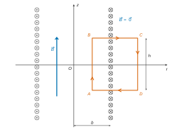
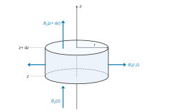
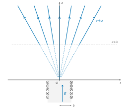
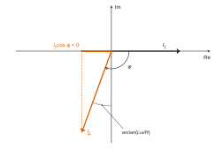
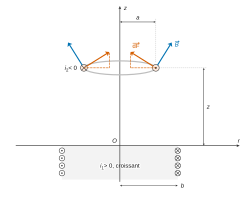

# Mines-Ponts MPI — Physique 2 2026 · Corrigé brut

*Corrigé rédigé par IA, non officiel. Signalez toute erreur.*

**Le « jumping ring » d'Elihu Thomson.** Épreuve de 3 heures, sans calculatrice. Les applications numériques sont données avec un chiffre significatif, la valeur non arrondie étant conservée pour les calculs suivants.

Remarque sur l'énoncé : $\mu_0=4\pi\cdot10^{-7}$ H·m⁻¹ est la perméabilité *magnétique* du vide (et non « diélectrique ») ; la valeur et l'unité sont correctes.

## I — Champ magnétique créé par un solénoïde

### Question 1

Schéma : la coupe méridienne de la figure 1 (question 2) porte le point $M$ et la base locale $(\vec e_r,\vec e_\theta,\vec e_z)$.
Le courant y circule dans le sens $+\vec e_\theta$ : $\odot$ à gauche, $\otimes$ à droite, comme sur la figure 2 de l'énoncé.

*Invariances.* La distribution de courants est invariante par rotation autour de $(Oz)$ et par translation le long de $(Oz)$ (solénoïde infini, bobinage uniforme). Les composantes cylindriques de $\vec B$ ne dépendent donc que de $r$.

*Antisymétrie.* Le plan $(M,\vec e_r,\vec e_z)$ contenant l'axe est un plan d'antisymétrie de la distribution : les courants, orthoradiaux, lui sont orthogonaux. Le champ magnétique, pseudo-vecteur, appartient aux plans d'antisymétrie passant par $M$, d'où $B_\theta=0$.

*Symétrie.* Le plan $(M,\vec e_r,\vec e_\theta)$ perpendiculaire à l'axe est un plan de symétrie (solénoïde infini). $\vec B$ est orthogonal aux plans de symétrie passant par $M$, d'où $B_r=0$.

$$\boxed{\vec B(M)=B(r)\,\vec e_z}$$

### Question 2



**Théorème d'Ampère** (magnétostatique) : pour tout contour fermé orienté $\mathcal C$,

$$\oint_{\mathcal C}\vec B\cdot\mathrm d\vec\ell=\mu_0\,I_{\text{enl}},$$

où $I_{\text{enl}}$ est l'intensité algébrique enlacée, comptée positivement dans le sens de la normale associée à l'orientation de $\mathcal C$ par la règle de la main droite.

*Contour.* On prend un rectangle $ABCD$ dans un plan méridien :

- côté $AB$ intérieur (rayon $r<b$), parcouru selon $+\vec e_z$ ;
- côté $CD$ extérieur (rayon $r'>b$), parcouru selon $-\vec e_z$ ;
- ces deux côtés ont la longueur $h$ et sont reliés par les côtés radiaux $BC$ et $DA$.

*Orientation.* Ainsi parcouru, le contour a pour normale $+\vec e_\theta$. Il enlace $nh$ spires parcourues par $I$ dans le sens $+\vec e_\theta$ (figure 2), d'où $I_{\text{enl}}=nhI$.

*Circulation, côté par côté.*

- Sur $BC$ et $DA$, $\mathrm d\vec\ell$ est radial et $\vec B$ axial (Q1) : contribution nulle.
- Sur $CD$, $\vec B=\vec 0$ par hypothèse : contribution nulle.
- Sur $AB$, $B(r)$ est constant et $\mathrm d\vec\ell=\mathrm dz\,\vec e_z$.

D'où :

$$\begin{aligned}
\oint_{ABCD}\vec B\cdot\mathrm d\vec\ell&=\int_{AB}B(r)\,\mathrm dz+\int_{BC}0+\int_{CD}0+\int_{DA}0\\
&=B(r)\,h .
\end{aligned}$$

Le théorème d'Ampère donne $B(r)\,h=\mu_0nhI$, quel que soit $r<b$ :

$$\boxed{\vec B=\mu_0 nI\,\vec e_z\ \ (r<b)}$$

Le champ intérieur est uniforme.

### Question 3

Le noyau, linéaire de perméabilité relative $\mu_r$, remplit le solénoïde : on remplace $\mu_0$ par $\mu_0\mu_r$, à courants inchangés.

$$\boxed{\vec B=\mu_0\mu_r nI\,\vec e_z}$$

Le champ est multiplié par $\mu_r=100$. Application numérique :

$$\begin{aligned}
\mu_0 nI&=4\pi\cdot10^{-7}\times10^3\times10{,}0=4\pi\cdot10^{-3}\ \text{T}\\
B&=100\times4\pi\cdot10^{-3}\simeq1{,}3\ \text{T}
\end{aligned}$$

$$\boxed{B\simeq1\ \text{T}}$$

(Le champ magnétique s'exprime en teslas. C'est l'ordre de grandeur de la saturation d'un ferromagnétique : le modèle linéaire est à la limite de sa validité.)

### Question 4

Équations de Maxwell :

$$\begin{aligned}
&\text{Maxwell-Gauss :} && \operatorname{div}\vec E=\frac{\rho}{\varepsilon_0}\\
&\text{Maxwell-flux :} && \operatorname{div}\vec B=0\\
&\text{Maxwell-Faraday :} && \overrightarrow{\operatorname{rot}}\,\vec E=-\frac{\partial\vec B}{\partial t}\\
&\text{Maxwell-Ampère :} && \overrightarrow{\operatorname{rot}}\,\vec B=\mu_0\vec\jmath+\mu_0\varepsilon_0\frac{\partial\vec E}{\partial t}
\end{aligned}$$

Soit $\Sigma$ une surface fermée quelconque, orientée vers l'extérieur, limitant le volume $V$. Le théorème de Green-Ostrogradski et l'équation de Maxwell-flux donnent

$$\begin{aligned}
\phi_B&=\oiint_\Sigma\vec B\cdot\mathrm d\vec S\\
&=\iiint_V\operatorname{div}\vec B\,\mathrm d\tau\\
&=0 .
\end{aligned}$$

**Le flux de $\vec B$ à travers toute surface fermée est nul : $\vec B$ est à flux conservatif.**

### Question 5



On écrit que le flux sortant du cylindre d'axe $(Oz)$, de rayon $r$, compris entre $z$ et $z+\mathrm dz$, est nul (Q4). Normales sortantes :

- disque supérieur : $+\vec e_z$, flux $\pi r^2B_z(z+\mathrm dz)$ ;
- disque inférieur : $-\vec e_z$, flux $-\pi r^2B_z(z)$ ;
- surface latérale : $+\vec e_r$, flux $2\pi r\,\mathrm dz\,B_r(r,z)$.

Pour $r$ petit, on assimile $B_z$ à sa valeur sur l'axe sur chaque disque. Par symétrie de révolution, $B_r$ vaut $B_r(r,z)$ sur toute la surface latérale.

$$\pi r^2\big[B_z(z+\mathrm dz)-B_z(z)\big]+2\pi r\,\mathrm dz\,B_r(r,z)=0$$

En divisant par $\pi r\,\mathrm dz$ :

$$\boxed{B_r(r,z)=-\frac r2\,\frac{\mathrm dB_z}{\mathrm dz}}$$

Dérivée de l'expression admise :

$$\begin{aligned}
\frac{\mathrm d}{\mathrm dz}\frac{z}{\sqrt{b^2+z^2}}&=\frac{(b^2+z^2)-z^2}{(b^2+z^2)^{3/2}}=\frac{b^2}{(b^2+z^2)^{3/2}}\\
\frac{\mathrm dB_z}{\mathrm dz}&=-\frac{\mu_0nI}{2}\,\frac{b^2}{(b^2+z^2)^{3/2}}
\end{aligned}$$

$$\boxed{B_r(r,z)=\frac{\mu_0nIr}{4}\,\frac{b^2}{(b^2+z^2)^{3/2}}}$$

$B_r>0$ : les lignes de champ s'écartent de l'axe au-dessus de l'extrémité.

### Question 6

Pour $z\gg b$, $(b^2+z^2)^{3/2}\sim z^3$. Dans $B_z$, l'ordre 0 de la parenthèse s'annule, il faut l'ordre suivant :

$$\begin{aligned}
1-\frac{z}{\sqrt{b^2+z^2}}&=1-\left(1+\frac{b^2}{z^2}\right)^{-1/2}\\
&=\frac{b^2}{2z^2}+o\!\left(\frac{b^2}{z^2}\right)
\end{aligned}$$

En ne gardant que le terme dominant de chaque composante :

$$\boxed{B_r\simeq\frac{\mu_0nIb^2}{4}\,\frac{r}{z^3}}$$

$$\boxed{B_z\simeq\frac{\mu_0nIb^2}{4}\,\frac{1}{z^2}}$$

*Lignes de champ.* On écrit $\mathrm d\vec\ell=\mathrm dr\,\vec e_r+r\,\mathrm d\theta\,\vec e_\theta+\mathrm dz\,\vec e_z$ et $\vec B=B_r\vec e_r+B_z\vec e_z$. Les composantes de $\mathrm d\vec\ell\wedge\vec B=\vec 0$ sur $\vec e_r$, $\vec e_\theta$, $\vec e_z$ donnent :

$$\begin{aligned}
r\,\mathrm d\theta\,B_z&=0\\
\mathrm dz\,B_r-\mathrm dr\,B_z&=0\\
-r\,\mathrm d\theta\,B_r&=0
\end{aligned}$$

Donc $\mathrm d\theta=0$ : chaque ligne est dans un plan méridien. La deuxième équation, avec les équivalents ci-dessus, s'intègre par séparation des variables :

$$\begin{aligned}
\frac{\mathrm dr}{\mathrm dz}&=\frac{B_r}{B_z}=\frac rz\\
\frac{\mathrm dr}{r}&=\frac{\mathrm dz}{z}\\
\ln r&=\ln z+\text{cte}
\end{aligned}$$

$$\boxed{r=kz}$$

**Allure.** Dans un plan méridien, les lignes de champ sont des demi-droites issues du point $O$ (centre de la face supérieure du solénoïde), réparties en éventail autour de l'axe. L'axe lui-même est une ligne de champ ($k=0$).

Elles sont orientées en s'éloignant de $O$, vers les $z$ croissants ($B_z>0$ pour $I>0$). L'ensemble se déduit par rotation autour de $(Oz)$ : le champ lointain près de l'axe ressemble à celui d'une « source ponctuelle » placée en $O$.



## II — Lévitation magnétique

### Question 7

**Loi de Lenz** : les effets de l'induction s'opposent, par leurs conséquences, aux causes qui leur ont donné naissance. Ici, le courant induit crée un champ dont le flux à travers l'anneau tend à s'opposer à la *variation* du flux inducteur (et non au champ inducteur lui-même).

Pour prévoir le sens de $i_2$ :

1. on oriente l'anneau (sens $+\vec e_\theta$, donc normale $+\vec e_z$) ;
2. on détermine le signe de la variation $\mathrm d\Phi_1/\mathrm dt$ du flux inducteur $\Phi_1=M i_1$ ;
3. $i_2$ circule dans le sens qui crée un flux propre de signe opposé à $\mathrm d\Phi_1/\mathrm dt$. Quantitativement, c'est le signe de la force électromotrice $e=-\mathrm d\Phi/\mathrm dt$ (loi de Faraday).

Ainsi, quand $|i_1|$ croît, $i_2$ est de sens opposé à $i_1$ (répulsion) ; quand $|i_1|$ décroît, il est de même sens (attraction).

### Question 8

On se place dans l'ARQS : le dispositif, de taille $\sim10$ cm, est très petit devant la longueur d'onde ($\lambda=c/f\sim6\cdot10^3$ km à 50 Hz). Le champ est alors à chaque instant celui du régime statique avec le courant instantané. Avec $I\to i_1(t)=I_1\cos(\omega t)$, près de l'axe et pour $z>0$ :

$$\boxed{\vec B(r,z,t)=\mu_0nI_1\cos(\omega t)\left[\frac{r\,b^2}{4(b^2+z^2)^{3/2}}\,\vec e_r+\frac12\left(1-\frac{z}{\sqrt{b^2+z^2}}\right)\vec e_z\right]}$$

(Comme l'impose la suite de l'énoncé, on garde le modèle de la partie I sans noyau, en $\mu_0$.)

### Question 9

*Orientation.* L'anneau (rayon $a$) est fixe. On l'oriente selon $+\vec e_\theta$, comme les spires de la bobine (Q7) : sa normale est $+\vec e_z$ et $i_2>0$ correspond à un courant dans le sens $+\vec e_\theta$.

*Flux inducteur.* En assimilant $B_z$ à sa valeur sur l'axe sur le disque de rayon $a$ (on a $a<b$) :

$$\Phi_{1\to2}=\pi a^2B_z(z,t)=M(z)\,i_1(t)$$

$$\boxed{M(z)=\frac{\mu_0n\pi a^2}{2}\left(1-\frac{z}{\sqrt{b^2+z^2}}\right)}$$

*Flux total.* L'anneau crée en outre son flux propre $L\,i_2$, d'où $\Phi=M(z)\,i_1+L\,i_2$. Avec $M$ et $L$ indépendants du temps (anneau immobile), la loi de Faraday donne la force électromotrice induite, orientée dans le sens de $i_2$ :

$$e=-\frac{\mathrm d\Phi}{\mathrm dt}=-M(z)\frac{\mathrm di_1}{\mathrm dt}-L\frac{\mathrm di_2}{\mathrm dt}$$

*Circuit électrique équivalent.* L'anneau est une seule maille fermée : un générateur de f.é.m. $e$ (convention générateur, flèche de $e$ dans le sens de $i_2$) en série avec la résistance $R$, aux bornes de laquelle la tension $u_R=R\,i_2$ est fléchée en convention récepteur. La loi des mailles s'écrit $e=R\,i_2$ :

$$\boxed{R\,i_2+L\frac{\mathrm di_2}{\mathrm dt}+M(z)\frac{\mathrm di_1}{\mathrm dt}=0}$$

### Question 10

On pose $\underline{i_1}=I_1e^{\mathrm j\omega t}$ et $\underline{i_2}=\underline{I_2}e^{\mathrm j\omega t}$ (régime forcé ; le transitoire s'amortit en $L/R=10^{-4}$ s). La dérivation devient une multiplication par $\mathrm j\omega$ :

$$(R+\mathrm jL\omega)\underline{I_2}+\mathrm jM\omega I_1=0$$

$$\boxed{\underline{i_2}(t)=\frac{-\mathrm jM(z)\,\omega\,I_1}{R+\mathrm jL\omega}\,e^{\mathrm j\omega t}}$$

On multiplie par le conjugué du dénominateur :

$$\underline{I_2}=\frac{M\omega I_1(-L\omega-\mathrm jR)}{R^2+L^2\omega^2}$$

Comme $M>0$, on l'écrit $\underline{I_2}=I_2(z)\,e^{\mathrm j\varphi}$ avec un module et une phase identifiés séparément :

$$\boxed{I_2(z)=\frac{M(z)\,\omega\,I_1}{\sqrt{R^2+L^2\omega^2}}}$$

$$\boxed{\cos\varphi=\frac{-L\omega}{\sqrt{R^2+L^2\omega^2}}}$$

$$\boxed{\sin\varphi=\frac{-R}{\sqrt{R^2+L^2\omega^2}}}$$

En prenant la partie réelle, $i_2(t)=I_2(z)\cos(\omega t+\varphi)$ avec $\varphi\in\,]-\pi,-\pi/2[$.



### Question 11

Élément d'anneau $\mathrm d\vec\ell=a\,\mathrm d\theta\,\vec e_\theta$, dans le champ $\vec B(a,z,t)=B_r\vec e_r+B_z\vec e_z$ indépendant de $\theta$. Avec $\vec e_\theta\wedge\vec e_r=-\vec e_z$ et $\vec e_\theta\wedge\vec e_z=\vec e_r$ :

$$\begin{aligned}
\mathrm d\vec F&=i_2\,\mathrm d\vec\ell\wedge\vec B\\
&=i_2a\,\mathrm d\theta\,\big(B_z\,\vec e_r-B_r\,\vec e_z\big)
\end{aligned}$$

Le vecteur $\vec e_r$ dépend de $\theta$ : on le projette sur la base fixe avant d'intégrer. La partie radiale de la résultante vaut

$$\begin{aligned}
\vec F_r&=i_2aB_z\int_0^{2\pi}\vec e_r\,\mathrm d\theta\\
&=i_2aB_z\int_0^{2\pi}(\cos\theta\,\vec e_x+\sin\theta\,\vec e_y)\,\mathrm d\theta\\
&=\vec 0
\end{aligned}$$

$$\boxed{F_r=0}$$

(Deux éléments diamétralement opposés subissent des forces radiales opposées.)

### Question 12



D'après Q11, la composante axiale vient du seul terme en $B_r$, indépendant de $\theta$ :

$$F_z(t)=-2\pi a\,i_2(t)\,B_r(a,z,t)$$

On remplace $B_r$ (Q8, en $r=a$) et $i_2$ (Q10) par leurs expressions :

$$\begin{aligned}
B_r(a,z,t)&=\frac{\mu_0nI_1a}{4}\,\frac{b^2}{(b^2+z^2)^{3/2}}\cos(\omega t)\\
F_z(t)&=-\frac{\pi\,\mu_0nI_1\,I_2(z)\,a^2b^2}{2\,(b^2+z^2)^{3/2}}\cos(\omega t)\cos(\omega t+\varphi)
\end{aligned}$$

Par linéarisation, $\cos(\omega t)\cos(\omega t+\varphi)=\frac12[\cos\varphi+\cos(2\omega t+\varphi)]$. Le second terme est de moyenne nulle, d'où $\langle\cos(\omega t)\cos(\omega t+\varphi)\rangle_t=\frac12\cos\varphi$ :

$$\boxed{\langle F_z\rangle_t=\frac{K(z)}{(b^2+z^2)^{3/2}}}$$

$$\boxed{K(z)=-\frac{\pi}{4}\,(\mu_0nI_1)\,a^2b^2\,I_2(z)\cos\varphi}$$

Comme $\cos\varphi<0$, $K(z)>0$ : la force moyenne est ascendante. Explicitement :

$$K(z)=\frac{\pi}{4}\,\mu_0nI_1^2a^2b^2\,\frac{L\omega^2M(z)}{R^2+L^2\omega^2}$$

Pour $z\gg b$, $M\simeq\mu_0n\pi a^2b^2/(4z^2)$ et $\langle F_z\rangle_t\propto z^{-5}$, ce qui est la forme (2) de la partie III.

### Question 13

Si $L=0$ : $\cos\varphi=0$, donc $K=0$ et

$$\boxed{\langle F_z\rangle_t=0}$$

Le courant induit est alors en quadrature avec $B_r$ ($i_2\propto\sin\omega t$, $B_r\propto\cos\omega t$) : la force oscille à $2\omega$ avec une moyenne nulle. C'est le déphasage supplémentaire dû à $L$ qui crée la force moyenne répulsive.

Pour empêcher la lévitation : **fendre l'anneau** (entaille radiale). Le circuit est ouvert, aucun courant induit ne circule, la force est nulle. À défaut, on peut rendre l'anneau très résistif ($R\gg L\omega$), puisque $\langle F_z\rangle_t\propto L\omega^2/(R^2+L^2\omega^2)$ tend vers 0 quand $R\to\infty$.

## III — « Jumping ring »

### Question 14

*Système* : l'anneau, assimilé à un point matériel de masse $m$. *Référentiel* : terrestre, supposé galiléen. *Forces* : le poids $-mg\,\vec e_z$, la force de Laplace moyenne $\langle F_z\rangle_t\,\vec e_z$ et la réaction du barreau, horizontale en l'absence de frottement solide.

À l'équilibre en $z_{eq}$, la projection sur $\vec e_z$ de la somme des forces est nulle :

$$\frac{K'}{z_{eq}^5}=mg$$

$$\boxed{K'=mg\,z_{eq}^5}$$

Application numérique, par carrés successifs :

$$\begin{aligned}
(0{,}15)^2&=2{,}25\cdot10^{-2}\\
(0{,}15)^4&\simeq5{,}06\cdot10^{-4}\\
(0{,}15)^5&\simeq7{,}6\cdot10^{-5}\ \text{m}^5\\
K'&\simeq3\cdot10^{-3}\times9{,}81\times7{,}6\cdot10^{-5}\simeq2{,}2\cdot10^{-6}\ \text{N·m}^5
\end{aligned}$$

$$\boxed{K'\simeq2\cdot10^{-6}\ \text{N·m}^5}$$

(L'équilibre est stable : $K'/z^5$ décroît avec $z$.)

### Question 15

Le travail d'une force sur un déplacement est $W=\int\vec F\cdot\mathrm d\vec\ell$ ; la force de Laplace moyenne dépend de $z$, il faut intégrer. Le déplacement est vertical, de $z_0$ à $\ell$ :

$$\begin{aligned}
W_1&=\int_{z_0}^{\ell}\frac{K'}{z^5}\,\mathrm dz\\
&=\frac{K'}{4}\left(\frac1{z_0^4}-\frac1{\ell^4}\right)\\
&\simeq\frac{K'}{4z_0^4}
\end{aligned}$$

car $1/z_0^4=1{,}6\cdot10^5$ m⁻⁴ $\gg1/\ell^4=1$ m⁻⁴. Application numérique :

$$W_1\simeq\frac{2{,}23\cdot10^{-6}\times1{,}6\cdot10^5}{4}\simeq8{,}9\cdot10^{-2}\ \text{J}$$

$$\boxed{W_1\simeq9\cdot10^{-2}\ \text{J}}$$

Le poids est constant et l'anneau monte : son travail est résistant.

$$W_2=-mg(\ell-z_0)=-3\cdot10^{-3}\times9{,}81\times0{,}95\simeq-2{,}8\cdot10^{-2}\ \text{J}$$

$$\boxed{W_2\simeq-3\cdot10^{-2}\ \text{J}}$$

### Question 16

*Système* : l'anneau ; *référentiel* terrestre galiléen ; *forces* : poids, force de Laplace moyenne, réaction du barreau. Sans frottement solide, la réaction est normale au déplacement et ne travaille pas. Théorème de l'énergie cinétique entre $z_0$ (départ au repos) et $\ell$ :

$$E_{c,0}=W_1+W_2\simeq6{,}1\cdot10^{-2}\ \text{J}$$

$$\boxed{E_{c,0}\simeq6\cdot10^{-2}\ \text{J}}$$

$$\begin{aligned}
v_0&=\sqrt{\frac{2E_{c,0}}{m}}=\sqrt{\frac{2\times6{,}1\cdot10^{-2}}{3\cdot10^{-3}}}\\
&\simeq\sqrt{41}\simeq6{,}4\ \text{m·s}^{-1}
\end{aligned}$$

$$\boxed{v_0\simeq6\ \text{m·s}^{-1}}$$

Après la sortie du barreau, l'anneau n'est soumis qu'à son poids. Son énergie mécanique se conserve et il s'élève de $v_0^2/(2g)=41/19{,}6\simeq2{,}1$ m au-dessus du sommet du barreau. Comptée depuis la bobine (origine de $z_0$ et $z_{eq}$) :

$$z_{\max}=\ell+\frac{v_0^2}{2g}\simeq3{,}1\ \text{m}$$

$$\boxed{z_{\max}\simeq3\ \text{m au-dessus de la bobine, soit}\simeq2\ \text{m au-dessus du sommet du barreau}}$$

### Question 17

*Système* : l'anneau ; *référentiel* terrestre galiléen. *Forces* : le poids $m\vec g$ et le frottement de l'air $-\alpha v\,\vec v$. La force de Laplace ne s'exerce plus (anneau sorti du barreau). Principe fondamental de la dynamique :

$$\boxed{m\frac{\mathrm d\vec v}{\mathrm dt}=m\vec g-\alpha\,\|\vec v\|\,\vec v}$$

À la montée, $\vec v=v\vec e_z$ avec $v>0$, donc $\|\vec v\|\,\vec v=v^2\vec e_z$. Avec $\beta=\alpha/m$, l'équation, non linéaire, s'écrit

$$\frac{\mathrm dv}{\mathrm dt}+\beta v^2=-g .$$

On pose $v_\ell=\sqrt{g/\beta}$ et $\omega_0=\sqrt{g\beta}$, et on sépare les variables entre $0$ et $t$ :

$$\begin{aligned}
\frac{\mathrm dv}{g+\beta v^2}&=-\mathrm dt\\
\frac1{\omega_0}\arctan\frac{v}{v_\ell}&=\frac1{\omega_0}\arctan\frac{v_0}{v_\ell}-t
\end{aligned}$$

$$\boxed{v(t)=\sqrt{\frac g\beta}\,\tan\!\left(\arctan\!\left(v_0\sqrt{\frac\beta g}\right)-\sqrt{g\beta}\,t\right)}\quad\text{tant que }v\geq0 .$$

La vitesse s'annule (hauteur maximale) en

$$\boxed{t_1=\frac{1}{\sqrt{g\beta}}\arctan\!\left(v_0\sqrt{\frac\beta g}\right)}$$

Application numérique : $\sqrt{\beta/g}\simeq1{,}4\cdot10^{-3}$ s·m⁻¹, donc $x=v_0\sqrt{\beta/g}\simeq9\cdot10^{-3}\ll1$. Alors $\arctan x\simeq x$ :

$$t_1\simeq\frac{v_0}{g}\simeq\frac{6{,}4}{9{,}81}\simeq0{,}65\ \text{s}$$

$$\boxed{t_1\approx0{,}7\ \text{s}}$$

Le frottement est négligeable ($v_\ell\simeq7\cdot10^2$ m·s⁻¹ $\gg v_0$) : on retrouve la chute libre.

### Question 18

*Système* : l'anneau ; *référentiel* terrestre galiléen. *Forces* : le poids $m\vec g=-mg\,\vec e_z$ et le frottement $-\gamma\vec v$ (la force de Laplace ne s'exerce plus). Le principe fondamental de la dynamique s'écrit $m\,\mathrm d\vec v/\mathrm dt=m\vec g-\gamma\vec v$. On le projette sur la base fixe $(\vec e_x,\vec e_z)$ :

$$\boxed{\frac{\mathrm dv_x}{\mathrm dt}=-\frac{\gamma}{m}\,v_x}$$

$$\boxed{\frac{\mathrm dv_z}{\mathrm dt}=-g-\frac{\gamma}{m}\,v_z}$$

Conditions initiales : $v_x(0)=v_0\cos\theta$ et $v_z(0)=v_0\sin\theta$. L'angle $\theta$ n'intervient que par elles.

### Question 19

Pour $u'=F(u,t)$, $u(0)=u_0$, le schéma d'Euler explicite est $u_{k+1}=u_k+\mathrm dt\,F(u_k,t_k)$, avec $t_k=k\,\mathrm dt$ :

```python
def euler(u0, F, dt, N):
    """Euler explicite pour u' = F(u, t), u(0) = u0.
    Renvoie la liste [u_0, ..., u_N] aux instants t_k = k*dt."""
    U = [u0]
    for k in range(N):
        U.append(U[k] + dt * F(U[k], k * dt))
    return U
```

### Question 20

`Fx` et `Fz` sont les seconds membres des deux équations de Q18, avec la signature `F(u, t)` attendue par `euler`. Les paramètres que l'énoncé ne fixe pas ($\gamma$, $\theta$, pas de temps) sont déclarés.

```python
from math import cos, sin, pi

m, g = 3e-3, 9.81          # kg, m.s^-2
v0 = 6.4                   # m.s^-1 (question 16)
gamma = 4e-7               # kg.s^-1, de l'ordre de alpha*v0 = beta*m*v0
theta = pi / 4             # inclinaison du barreau (rad)
dt, N = 1e-3, 3000         # pas (s) et nombre de pas : 3 s simulées

def Fx(vx, t):
    return -gamma / m * vx

def Fz(vz, t):
    return -g - gamma / m * vz

Vx = euler(v0 * cos(theta), Fx, dt, N)
Vz = euler(v0 * sin(theta), Fz, dt, N)
```

### Question 21

On intègre $\dot x=v_x$ et $\dot z=v_z$ par le même schéma, à partir de $O$ (sommet du barreau) :

```python
X, Z = [0.0], [0.0]
for k in range(N):
    X.append(X[k] + dt * Vx[k])
    Z.append(Z[k] + dt * Vz[k])
```

`X[k]` et `Z[k]` sont les coordonnées approchées à l'instant $t_k$ ; les listes ont $N+1$ éléments.

### Question 22

L'énoncé ne précise pas l'altitude du sol : on la passe en paramètre `zsol`, par défaut $0$ (retour au niveau du point de lancement $O$). La flèche est le maximum de `Z`. La portée est l'abscisse du premier passage de `Z` sous `zsol` après le départ, affinée par interpolation linéaire entre les deux points qui l'encadrent.

```python
def fleche(X, Z):
    """Hauteur maximale atteinte, comptée depuis O."""
    return max(Z)

def portee(X, Z, zsol=0.0):
    """Distance horizontale parcourue quand l'anneau retombe à l'altitude zsol.
    Renvoie None si l'anneau n'est pas retombé pendant la simulation."""
    for k in range(1, len(Z)):
        if Z[k - 1] > zsol >= Z[k]:
            return X[k - 1] + (X[k] - X[k - 1]) * (Z[k - 1] - zsol) / (Z[k - 1] - Z[k])
    return None
```

Avec les paramètres de Q20 : `fleche(X, Z)` $\simeq1{,}05$ m et `portee(X, Z)` $\simeq4{,}18$ m. La parabole sans frottement donne $v_0^2\sin2\theta/g\simeq4{,}17$ m.

Pour le sol réel, il suffit de donner à `zsol` l'altitude du sol sous $O$ (négative). Par exemple, `portee(X, Z, -1.0)` $\simeq5{,}0$ m si le sol est à 1 m sous $O$.

## IV — Température de l'anneau

### Question 23

Le courant $i_2$ est celui de la partie II : il suit l'anneau, il est donc **orthoradial**, porté par $\vec e_\theta$. Avec l'orientation de Q9, $i_2>0$ correspond au sens $+\vec e_\theta$, et son signe alterne au cours d'une période.

Par définition, l'intensité est le flux de la densité de courant à travers une section droite $S$ du conducteur, orientée par $\vec e_\theta$ :

$$i_2=\iint_S\vec\jmath_2\cdot\mathrm d\vec S$$

La section droite est le rectangle $e\times d$, sur lequel $\vec\jmath_2$ est uniforme, d'où $i_2=j_2\,e\,d$ :

$$\boxed{\vec\jmath_2(t)=\frac{I_2\cos(\omega t)}{e\,d}\,\vec e_\theta}$$

Amplitude : $I_2/(ed)=15/(10^{-3}\times5\cdot10^{-3})=3\cdot10^6$ A·m⁻².

### Question 24

Loi d'Ohm locale : $\vec\jmath_2=\gamma\vec E$. La puissance volumique cédée par le champ aux porteurs vaut

$$\begin{aligned}
p&=\vec\jmath_2\cdot\vec E=\frac{j_2^2}{\gamma}\\
&=\frac{I_2^2\cos^2(\omega t)}{\gamma e^2d^2}
\end{aligned}$$

Avec $\langle\cos^2\rangle=1/2$ :

$$\boxed{p_J=\frac{I_2^2}{2\gamma e^2d^2}}$$

Application numérique :

$$p_J=\frac{(3\cdot10^6)^2}{2\times6\cdot10^7}=7{,}5\cdot10^4\ \text{W·m}^{-3}$$

$$\boxed{p_J\simeq8\cdot10^4\ \text{W·m}^{-3}}$$

### Question 25

Loi de Newton : la densité surfacique de flux cédée par l'anneau à l'air vaut $h(T-T_0)$. Les deux faces latérales (rayons $a$ et $a\pm e$) ont, pour $e\ll a$, la même aire $2\pi ad$. L'aire d'échange vaut donc $4\pi ad$.

Flux thermique total **cédé par l'anneau à l'air** :

$$\boxed{\Phi_{\text{th}}=4\pi a\,d\,h\,\big(T(t)-T_0\big)}$$

Il est positif quand l'anneau est plus chaud que l'air. Le flux reçu par l'anneau est $-\Phi_{\text{th}}$.

### Question 26

*Système* : l'anneau entier, solide indéformable de volume $V=2\pi a\,e\,d$ et de masse $\rho V$, de température uniforme $T(t)$. *Transformation* : entre $t$ et $t+\mathrm dt$.

Premier principe, sous forme infinitésimale : $\mathrm dU=\delta W+\delta Q$, avec

$$\begin{aligned}
\mathrm dU&=\rho Vc\,\mathrm dT\\
\delta W&=p_J\,V\,\mathrm dt\\
\delta Q&=-\Phi_{\text{th}}\,\mathrm dt=-4\pi adh\,(T-T_0)\,\mathrm dt
\end{aligned}$$

Ici $\delta W$ est le travail électrique reçu, dissipé par effet Joule ; $\delta Q$ est le transfert thermique reçu, négatif quand $T>T_0$. On divise par $\rho Vc\,\mathrm dt$ ; le rayon $a$ s'élimine :

$$\frac{\mathrm dT}{\mathrm dt}+\frac{2h}{\rho ce}(T-T_0)=\frac{p_J}{\rho c}$$

$$\boxed{\tau=\frac{\rho\,c\,e}{2h}}$$

$$\boxed{A=\frac{I_2^2}{2\gamma\rho c\,e^2d^2}}$$

On a bien $\tau>0$ : l'écart à l'équilibre relaxe au lieu de diverger. Applications numériques :

$$\begin{aligned}
\tau&=\frac{9\cdot10^3\times380\times10^{-3}}{2\times0{,}5}\simeq3{,}4\cdot10^3\ \text{s}\approx3\cdot10^3\ \text{s}\\
A&=\frac{7{,}5\cdot10^4}{9\cdot10^3\times380}\simeq2{,}2\cdot10^{-2}\ \text{K·s}^{-1}\approx2\cdot10^{-2}\ \text{K·s}^{-1}
\end{aligned}$$

### Question 27

Équation linéaire du premier ordre à coefficients constants. La solution de l'équation homogène est $\lambda e^{-t/\tau}$ ; une solution particulière constante est $T_0+A\tau$. La solution générale est donc

$$T(t)=T_0+A\tau+\lambda e^{-t/\tau}.$$

La condition initiale $T(0)=T_0$, appliquée à cette solution générale, donne $\lambda=-A\tau$ :

$$\boxed{T(t)=T_0+A\tau\left(1-e^{-t/\tau}\right)}$$

$T$ croît de façon monotone vers la température limite :

$$\begin{aligned}
T_\infty&=T_0+A\tau=T_0+\frac{p_Je}{2h}\\
&=300+\frac{7{,}5\cdot10^4\times10^{-3}}{1}=375\ \text{K}
\end{aligned}$$

Soit $T_\infty\approx4\cdot10^2$ K, environ $100$ °C. La fusion a lieu à $\theta_{\text{fus}}=1085$ °C, soit $1358$ K. Pour tout $t$, $T(t)<T_\infty\ll1358$ K :

**L'anneau ne fond pas : sa température plafonne vers $1\cdot10^2$ °C.** (Le modèle néglige le rayonnement et prend un $h$ faible : $T_\infty$ est plutôt surestimé, ce qui renforce la conclusion.)
