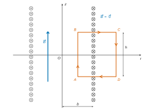
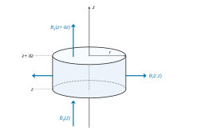
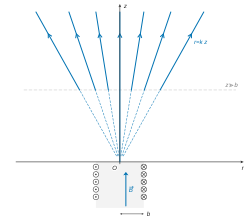
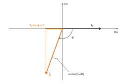
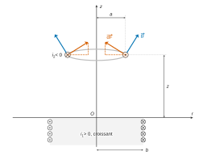

# Mines-Ponts MPI — Physique 2 2026 · Corrigé guidé

*Corrigé rédigé par IA, non officiel. Signalez toute erreur.*

## Présentation du sujet

**Thème.** Le sujet décortique l'expérience du « *jumping ring* » d'Elihu Thomson (1877) : un anneau conducteur enfilé sur le noyau d'une bobine alimentée en alternatif est éjecté vers le haut. Le fil conducteur est une chaîne de causes : **géométrie du champ → induction → force → mouvement → échauffement**.

L'idée physique centrale : la force axiale sur l'anneau provient de la composante **radiale** du champ, qui n'existe qu'au voisinage de l'extrémité de la bobine. Sa valeur moyenne n'est non nulle que grâce à l'**auto-inductance** de l'anneau.

**Découpage (27 questions, 3 heures, sans calculatrice).** Les quatre parties sont déclarées indépendantes.

- **Partie I (Q1–Q6)** : solénoïde infini (symétries, théorème d'Ampère, noyau de fer), équations de Maxwell, puis composante radiale $B_r$ près de l'axe d'un solénoïde semi-infini par conservation du flux, et allure des lignes de champ loin de l'extrémité.
- **Partie II (Q7–Q13)** : loi de Lenz, mutuelle $M(z)$, équation électrique de l'anneau, régime sinusoïdal forcé, force de Laplace moyenne et rôle de $L$.
- **Partie III (Q14–Q22)** : mécanique de l'anneau soumis à $\langle F_z\rangle_t=K'/z^5$ (équilibre, travaux, énergie cinétique), frottement quadratique résolu analytiquement, frottement linéaire intégré par la méthode d'Euler en Python (vitesses, positions, flèche, portée).
- **Partie IV (Q23–Q27)** : densité de courant, effet Joule, conducto-convection, bilan d'énergie et équation du premier ordre en température.

**Notions du programme mobilisées.** Symétries et invariances des distributions de courants, théorème d'Ampère, équations de Maxwell et flux conservatif, induction de Neumann (Faraday, Lenz, inductances propre et mutuelle), notation complexe, force de Laplace et valeur moyenne d'un produit de sinusoïdes, théorème de l'énergie cinétique, frottements fluides, méthode d'Euler, loi d'Ohm locale, effet Joule, loi de Newton de la conducto-convection, premier principe. Une bonne part relève du programme de première année : électricité, mécanique, représentation complexe.

**Difficulté et gestion du temps.** Sujet court (6 pages), exigeant sur les signes, les orientations et les applications numériques sans calculatrice. Le rapport 2026 range les questions en deux groupes :

- **classiques et proches du cours** : Q1, Q2, Q4, Q7, Q9, Q10, Q14 à Q16, Q18, Q24, Q25 et Q27, à ne pas laisser passer, même si certaines sont peu guidées ;
- **discriminantes**, qui demandent des prises d'initiative et des calculs plus développés : Q5, Q6, Q11 à Q13, Q17 et Q26.

D'après le même rapport, la partie I a été la mieux traitée, tandis que le début de la partie II, pourtant peu difficile, a été mal traité. Q11, Q17 et Q26 ont été rarement réussies. La partie IV reste un bon placement de fin d'épreuve, à condition de mener le bilan de Q26 avec rigueur.

> [!JURY]
> Le rapport 2026 insiste sur la forme : questions numérotées et traitées dans l'ordre au sein de chaque partie, phrases complètes, flèches sur les vecteurs, résultats encadrés. Il demande aussi que « Les calculs doivent être menés de façon uniquement littérale, sans valeurs numériques au milieu de grandeurs littérales. » Les applications numériques se donnent au format scientifique, avec une unité.

## Partie I — Champ magnétique créé par un solénoïde

On établit le champ d'un solénoïde infini, puis on « coupe » le solénoïde : l'invariance par translation disparaît et une composante radiale apparaît, que l'on obtient sans calcul intégral grâce à la conservation du flux.

> [!JURY]
> Pour toute cette partie, le rapport 2026 prévient : « La rédaction des calculs de flux et de circulations doit être bien détaillée : orientation de surface/sens de parcours, partition détaillée du calcul. Sinon la totalité des points n’est pas attribuée. »

### Question 1

> [!INDICATION]
> Deux étapes distinctes : les invariances fixent les variables dont dépendent les composantes, les plans de symétrie ou d'antisymétrie fixent la direction.

> [!INDICATION]
> Un plan méridien contient l'axe et les courants lui sont orthogonaux ; un plan perpendiculaire à l'axe contient les courants. Rappelez-vous que $\vec B$ est un pseudo-vecteur.

#### Solution

Schéma : la coupe méridienne de la figure 1 (question 2) porte le point $M$ et la base locale $(\vec e_r,\vec e_\theta,\vec e_z)$.
Le courant y circule dans le sens $+\vec e_\theta$ : $\odot$ à gauche, $\otimes$ à droite, comme sur la figure 2 de l'énoncé.

*Invariances.* La distribution est invariante par rotation autour de $(Oz)$ et par translation le long de $(Oz)$ (solénoïde infini, bobinage uniforme). Les composantes cylindriques de $\vec B$ ne dépendent donc ni de $\theta$ ni de $z$.

*Antisymétrie.* Le plan $(M,\vec e_r,\vec e_z)$ est un plan d'antisymétrie : la réflexion renverse les courants orthoradiaux. $\vec B$ appartient à tout plan d'antisymétrie passant par $M$, d'où $B_\theta=0$.

*Symétrie.* Le plan $(M,\vec e_r,\vec e_\theta)$, perpendiculaire à l'axe, est un plan de symétrie : il contient les courants et le solénoïde est infini. $\vec B$ est orthogonal à tout plan de symétrie passant par $M$, d'où $B_r=0$.

$$\boxed{\vec B(M)=B(r)\,\vec e_z}$$

> [!PIEGE]
> Inverser les règles : pour $\vec B$ (pseudo-vecteur), le champ est **orthogonal** aux plans de symétrie et **contenu** dans les plans d'antisymétrie, à l'inverse de $\vec E$. Et le plan méridien seul ne suffit pas : il laisse subsister $B_r$, que seul le caractère infini élimine (c'est précisément ce qui change en Q5).

> [!JURY]
> Question bien traitée selon le rapport 2026, mais « le jury regrette l’absence quasi systématique d’un schéma complété ». Un schéma où figurent $M$, la base locale, le sens du courant et les plans utilisés justifie à lui seul une bonne partie de la réponse.

### Question 2

> [!INDICATION]
> Choisir un contour rectangulaire dans un plan méridien, avec deux côtés parallèles à l'axe, l'un à l'intérieur, l'autre à l'extérieur.

> [!INDICATION]
> Les côtés radiaux ne contribuent pas d'après Q1 ; compter les spires enlacées sur une hauteur $h$ et orienter le contour de façon cohérente avec le sens du courant de la figure 2.

#### Solution



**Théorème d'Ampère** : pour tout contour fermé orienté $\mathcal C$,

$$\oint_{\mathcal C}\vec B\cdot\mathrm d\vec\ell=\mu_0\,I_{\text{enl}},$$

où l'intensité enlacée $I_{\text{enl}}$ est comptée positivement dans le sens de la normale associée à l'orientation de $\mathcal C$ (règle de la main droite).

*Contour* $ABCD$ du plan $(\vec e_r,\vec e_z)$ :

- $AB$ intérieur (rayon $r<b$), parcouru selon $+\vec e_z$ ;
- $CD$ extérieur (rayon $r'>b$), parcouru selon $-\vec e_z$ ;
- ces deux côtés ont la longueur $h$ et sont reliés par deux segments radiaux.

*Orientation.* Ce sens de parcours donne une normale $+\vec e_\theta$, sens du courant dans les spires ($\odot$ à gauche, $\otimes$ à droite sur la figure 2). Le contour enlace $nh$ spires : $I_{\text{enl}}=nhI$.

*Circulation, côté par côté.* Les segments radiaux ne contribuent pas ($\vec B\perp\vec e_r$), le côté extérieur non plus ($\vec B=\vec 0$) :

$$\begin{aligned}
\oint_{ABCD}\vec B\cdot\mathrm d\vec\ell&=\int_{AB}B(r)\,\mathrm dz+0+0+0\\
&=B(r)\,h
\end{aligned}$$

Le théorème d'Ampère donne $B(r)\,h=\mu_0\,nh\,I$ :

$$\boxed{\vec B=\mu_0nI\,\vec e_z\quad(r<b)}$$

Le champ intérieur est uniforme : c'est un résultat (indépendance vis-à-vis de $r$), pas une hypothèse.

> [!METHODE]
> Théorème d'Ampère : symétries d'abord (direction et variables), puis contour adapté sur lequel $\vec B$ est soit tangent et constant, soit orthogonal, soit nul ; l'intensité enlacée se compte avec l'orientation donnée par la règle de la main droite.

> [!JURY]
> Selon le rapport 2026, « le théorème d’Ampère est souvent énoncé de façon erronée » : le rond de $\oint$, qui signale un contour fermé, n'est pas décoratif. Et « L’orientation du contour a souvent été oubliée. » Énoncer le théorème, dessiner le contour orienté, puis découper la circulation côté par côté.

### Question 3

> [!INDICATION]
> Les milieux magnétiques ne sont pas au programme : l'énoncé fournit $\mu_r$, qu'on utilise simplement par sa définition.

#### Solution

À courants inchangés, le noyau linéaire remplissant le solénoïde revient à remplacer $\mu_0$ par $\mu_0\mu_r$ :

$$\boxed{\vec B=\mu_0\mu_rnI\,\vec e_z}$$

Le champ est multiplié par $\mu_r=100$. Application numérique :

$$\begin{aligned}
\mu_0nI&=4\pi\cdot10^{-7}\times10^3\times10{,}0=4\pi\cdot10^{-3}\ \text{T}\\
B&=100\times4\pi\cdot10^{-3}\simeq1{,}3\ \text{T}
\end{aligned}$$

$$\boxed{B\simeq1\ \text{T}}$$

> [!PIEGE]
> L'unité est le tesla. Et $1$ T est déjà l'ordre de grandeur de la saturation du fer : un $\mu_r$ constant est un modèle linéaire à la limite de sa validité ; le signaler est apprécié.

> [!JURY]
> Le rapport 2026 note que « L’unité du champ magnétique n’est pas connue par beaucoup de candidat.e.s » : on a lu des H·A⁻¹ ou des H·m⁻¹, et des champs de $10^7$ T qui n'ont pas étonné leurs auteurs. Un ordre de grandeur connu (le tesla pour un électroaimant) sert de contrôle.

### Question 4

> [!INDICATION]
> Restituer les quatre équations avec leurs noms et sans oublier le courant de déplacement. Pour la seconde partie, une seule d'entre elles concerne la divergence de $\vec B$.

> [!INDICATION]
> Passer d'une propriété locale à une propriété intégrale sur une surface fermée : quel théorème relie flux et divergence ?

#### Solution

$$\begin{aligned}
&\text{Maxwell-Gauss :} && \operatorname{div}\vec E=\frac{\rho}{\varepsilon_0}\\
&\text{Maxwell-flux :} && \operatorname{div}\vec B=0\\
&\text{Maxwell-Faraday :} && \overrightarrow{\operatorname{rot}}\,\vec E=-\frac{\partial\vec B}{\partial t}\\
&\text{Maxwell-Ampère :} && \overrightarrow{\operatorname{rot}}\,\vec B=\mu_0\vec\jmath+\mu_0\varepsilon_0\frac{\partial\vec E}{\partial t}
\end{aligned}$$

Soit $\Sigma$ une surface fermée quelconque, orientée vers l'extérieur, limitant le volume $V$. Le théorème de Green-Ostrogradski et l'équation de Maxwell-flux donnent

$$\begin{aligned}
\phi_B&=\oiint_\Sigma\vec B\cdot\mathrm d\vec S\\
&=\iiint_V\operatorname{div}\vec B\,\mathrm d\tau\\
&=0 .
\end{aligned}$$

**$\vec B$ est à flux conservatif.**

> [!METHODE]
> Conséquence pratique : le flux de $\vec B$ à travers une surface ouverte ne dépend que du contour qui la borde. C'est ce qui donne un sens au « flux à travers un circuit » utilisé en partie II.

> [!JURY]
> Question très bien traitée selon le rapport 2026, qui regrette pourtant « que les équations de Maxwell ne soient pas toujours nommées, et des oublis de flèches sur les vecteurs ». Il rappelle que le rond de l'intégrale double $\oiint$, qui signale une surface fermée, est indispensable pour justifier la conservation du flux.

### Question 5

> [!INDICATION]
> Écrire que le flux sortant du petit cylindre est nul : trois surfaces (deux disques et la surface latérale), chacune avec sa normale sortante.

> [!INDICATION]
> Pour $r$ petit, on peut assimiler $B_z$ sur chaque disque à sa valeur sur l'axe. Diviser par $\mathrm dz$ fait apparaître une dérivée. Il reste à dériver l'expression admise de $B_z(z)$.

#### Solution



Le flux sortant du cylindre de rayon $r$ entre $z$ et $z+\mathrm dz$ est nul (Q4). Normales sortantes : $+\vec e_z$ pour le disque du haut, $-\vec e_z$ pour celui du bas, $+\vec e_r$ pour la surface latérale.

$$\underbrace{\pi r^2B_z(z+\mathrm dz)}_{\text{disque du haut}}\ \underbrace{-\ \pi r^2B_z(z)}_{\text{disque du bas}}\ +\ \underbrace{2\pi r\,\mathrm dz\,B_r(r,z)}_{\text{surface latérale}}=0$$

En divisant par $\pi r\,\mathrm dz$ :

$$\boxed{B_r(r,z)=-\frac r2\,\frac{\mathrm dB_z}{\mathrm dz}}$$

Dérivée de l'expression admise :

$$\begin{aligned}
\frac{\mathrm d}{\mathrm dz}\frac{z}{\sqrt{b^2+z^2}}&=\frac{b^2}{(b^2+z^2)^{3/2}}\\
\frac{\mathrm dB_z}{\mathrm dz}&=-\frac{\mu_0nI}{2}\,\frac{b^2}{(b^2+z^2)^{3/2}}
\end{aligned}$$

$$\boxed{B_r(r,z)=\frac{\mu_0nIr}{4}\,\frac{b^2}{(b^2+z^2)^{3/2}}}$$

Contrôle : $B_z$ décroît quand on s'éloigne de la bobine, donc $B_r>0$ : les lignes de champ s'évasent en sortant du solénoïde.

> [!PIEGE]
> Oublier le signe $-$ du disque inférieur (normale sortante vers le bas) ou celui de la dérivée. Autre confusion relevée par le rapport 2026 : « à flux conservatif » ne veut pas dire « constant ». C'est le flux à travers une surface fermée qui est nul, pas le champ qui est uniforme.

> [!JURY]
> Le rapport 2026 signale « de nombreuses erreurs », « notamment dans le calcul du flux », et dénonce les copies « qui concluent sur la bonne expression malgré des erreurs de signes dans les lignes de calculs précédentes ». Le résultat étant donné, seule la démarche rapporte : bilan à trois termes orientés et approximation « $r$ proche de l'axe » énoncée.

> [!METHODE]
> Relation à retenir : près de l'axe d'une distribution à symétrie de révolution, $B_r\simeq-\dfrac r2\dfrac{\partial B_z}{\partial z}(0,z)$. Elle donne la composante radiale sans aucune intégrale de Biot et Savart.

### Question 6

> [!INDICATION]
> Pour $B_r$, l'équivalent est immédiat. Pour $B_z$, la parenthèse est une différence de deux termes qui tendent vers 1 : il faut un développement limité à l'ordre suivant en $b/z$.

> [!INDICATION]
> Développer $\mathrm d\vec\ell\wedge\vec B$ en coordonnées cylindriques : une composante donne une équation à variables séparables entre $r$ et $z$.

#### Solution

Pour $z\gg b$, $(b^2+z^2)^{3/2}\sim z^3$. Dans $B_z$, l'ordre 0 s'annule :

$$\begin{aligned}
1-\frac{z}{\sqrt{b^2+z^2}}&=1-\left(1+\frac{b^2}{z^2}\right)^{-1/2}\\
&=\frac{b^2}{2z^2}+o\!\left(\frac{b^2}{z^2}\right)
\end{aligned}$$

En ne gardant qu'un seul terme dominant :

$$\boxed{B_r\simeq\frac{\mu_0nIb^2}{4}\,\frac{r}{z^3}}$$

$$\boxed{B_z\simeq\frac{\mu_0nIb^2}{4}\,\frac{1}{z^2}}$$

*Lignes de champ.* Avec $\mathrm d\vec\ell=\mathrm dr\,\vec e_r+r\,\mathrm d\theta\,\vec e_\theta+\mathrm dz\,\vec e_z$ et $B_\theta=0$, les composantes de $\mathrm d\vec\ell\wedge\vec B=\vec 0$ sur $\vec e_r$, $\vec e_\theta$, $\vec e_z$ s'écrivent :

$$\begin{aligned}
r\,\mathrm d\theta\,B_z&=0\\
\mathrm dz\,B_r-\mathrm dr\,B_z&=0\\
-r\,\mathrm d\theta\,B_r&=0
\end{aligned}$$

Les lignes sont donc dans un plan méridien ($\mathrm d\theta=0$). La deuxième équation se sépare :

$$\begin{aligned}
\frac{\mathrm dr}{\mathrm dz}&=\frac{B_r}{B_z}=\frac rz\\
\ln r&=\ln z+\text{cte}
\end{aligned}$$

$$\boxed{r=kz}$$

**Allure.** Dans un plan méridien : un éventail de demi-droites issues de $O$ (centre de la face supérieure), l'axe étant la ligne $k=0$.

Elles sont orientées vers les $z$ croissants ($B_z>0$ pour $I>0$) ; l'ensemble s'obtient par rotation autour de $(Oz)$. Loin de l'extrémité, le champ près de l'axe est celui d'une « source ponctuelle » en $O$.



> [!PIEGE]
> Écrire $z/\sqrt{b^2+z^2}\simeq1$ donne $B_z\simeq0$ et bloque toute la suite. Le rapport 2026 relève les deux erreurs symétriques : $B_r\approx0$ donné comme « équivalent », et $B_z$ laissé avec deux termes alors que l'énoncé demande un seul terme dominant.

> [!JURY]
> Pour la fin de la question, plus originale et moins bien réussie, le rapport 2026 est net : « Le résultat étant fourni le jury attend le détail des calculs pour l’obtenir. » Il faut écrire les composantes du produit vectoriel, puis la séparation des variables.

## Partie II — Lévitation magnétique

Le solénoïde est alimenté en sinusoïdal. On écrit l'équation électrique de l'anneau (flux inducteur et flux propre), on la résout en complexes, puis on calcule la force de Laplace moyenne. Le résultat clé : sans auto-inductance, pas de lévitation.

> [!JURY]
> Le rapport 2026 regrette que le début de cette partie, peu difficile et fondé sur le cours de première année, ait été mal traité. L'électricité y est trop rarement bien traitée, avec typiquement une « invocation de la loi des mailles sans représenter de tensions, parfois sans même dessiner le circuit ».

### Question 7

> [!INDICATION]
> Énoncer la loi de modération en précisant ce à quoi le courant induit s'oppose exactement.

> [!INDICATION]
> Pour la méthode : orientation du circuit, signe du flux inducteur, signe de sa variation.

#### Solution

**Loi de Lenz** : les effets de l'induction s'opposent, par leurs conséquences, aux causes qui leur ont donné naissance. Le courant induit crée un champ dont le flux tend à s'opposer à la **variation** du flux inducteur, et non au champ inducteur lui-même.

Méthode :

1. on oriente l'anneau ($+\vec e_\theta$, normale $+\vec e_z$) ;
2. le flux inducteur $\Phi_1=Mi_1$ est du signe de $i_1$ ; on cherche le signe de $\mathrm d\Phi_1/\mathrm dt$ ;
3. $i_2$ circule dans le sens qui crée un flux propre de signe opposé à $\mathrm d\Phi_1/\mathrm dt$.

Quand $|i_1|$ croît, $i_2$ est de sens opposé à $i_1$ (courants antiparallèles, répulsion) ; quand $|i_1|$ décroît, il est de même sens (attraction).

> [!PIEGE]
> Conclure que l'anneau est repoussé à tout instant. La force instantanée change de signe au cours d'une période ; seule sa **moyenne** est ascendante, et Q13 montre qu'elle serait nulle sans $L$.

> [!JURY]
> D'après le rapport 2026, « La loi de Lenz a souvent été confondue avec la loi de Faraday ou avec la définition de l’inductance propre. » Il cite deux réponses insuffisantes : la « règle de la main droite » sans dire à partir de quoi, et « le champ magnétique créé par l’anneau s’oppose au champ magnétique créé par la bobine ». C'est à la **variation** du flux que s'oppose le courant induit.

### Question 8

> [!INDICATION]
> Les résultats de la partie I sont statiques : quelle approximation permet d'y remplacer $I$ par $i_1(t)$ ? La justifier par une comparaison d'échelles.

#### Solution

Le dispositif (taille $\sim10$ cm) est très petit devant la longueur d'onde à la fréquence du secteur ($\lambda=c/f\sim6\cdot10^3$ km à 50 Hz). Dans l'ARQS, le champ vaut à chaque instant le champ statique créé par $i_1(t)$. Près de l'axe, pour $z>0$ :

$$\boxed{\vec B(r,z,t)=\mu_0nI_1\cos(\omega t)\left[\frac{r\,b^2}{4(b^2+z^2)^{3/2}}\,\vec e_r+\frac12\left(1-\frac{z}{\sqrt{b^2+z^2}}\right)\vec e_z\right]}$$

On garde le modèle sans noyau (en $\mu_0$), conformément aux grandeurs imposées en Q9 et Q12.

> [!PIEGE]
> Ne donner que $B_z$. C'est $B_r$ qui produira la force axiale (Q12).

### Question 9

> [!INDICATION]
> Le flux total à travers l'anneau a deux origines : la bobine et l'anneau lui-même.

> [!INDICATION]
> Pour le flux inducteur, assimiler $B_z$ à sa valeur sur l'axe sur tout le disque de rayon $a$. Puis : Faraday, et loi des mailles sur le circuit équivalent dessiné avec ses tensions.

#### Solution

*Orientation.* Anneau fixe, orienté selon $+\vec e_\theta$ comme en Q7 : normale $+\vec e_z$, et $i_2>0$ dans le sens $+\vec e_\theta$.

*Flux inducteur* (champ $B_z$ assimilé à sa valeur sur l'axe sur le disque de rayon $a$) :

$$\Phi_{1\to2}\simeq\pi a^2B_z(z,t)=M(z)\,i_1(t)$$

$$\boxed{M(z)=\frac{\mu_0n\pi a^2}{2}\left(1-\frac{z}{\sqrt{b^2+z^2}}\right)}$$

*Flux total* : $\Phi=M(z)i_1+Li_2$, avec $M$ et $L$ constants (anneau immobile). Loi de Faraday, f.é.m. orientée dans le sens de $i_2$ :

$$e=-\frac{\mathrm d\Phi}{\mathrm dt}=-M(z)\frac{\mathrm di_1}{\mathrm dt}-L\frac{\mathrm di_2}{\mathrm dt}$$

*Circuit équivalent* : une seule maille, formée d'un générateur de f.é.m. $e$ (fléchée dans le sens de $i_2$) en série avec la résistance $R$, de tension $u_R=Ri_2$ en convention récepteur. Loi des mailles $e=Ri_2$ :

$$\boxed{R\,i_2+L\frac{\mathrm di_2}{\mathrm dt}+M(z)\frac{\mathrm di_1}{\mathrm dt}=0}$$

> [!PIEGE]
> Oublier le flux propre $Li_2$ : c'est lui qui fournit le terme en $L$ dont tout dépend en Q13. L'approximation « champ uniforme sur le disque » est raisonnable ($a=1$ cm, $b=5$ cm) mais doit être dite.

> [!JURY]
> Le rapport 2026 juge que la rigueur a très souvent manqué : « le circuit électrique a été trop peu présent ou très incomplet », et le calcul du flux n'a pas tenu compte de l'orientation du courant dans l'anneau fixée à la question précédente. Orientation, flux signé, f.é.m., schéma électrique fléché : chaque étape est attendue.

### Question 10

> [!INDICATION]
> Régime sinusoïdal forcé d'une équation linéaire : la dérivation devient une multiplication par $\mathrm j\omega$.

> [!INDICATION]
> Pour trouver $\varphi$ sans ambiguïté, mettre l'amplitude complexe sous forme algébrique (multiplier par le conjugué du dénominateur) et identifier parties réelle et imaginaire, plutôt que de passer par une tangente.

#### Solution

On pose $\underline{i_1}=I_1e^{\mathrm j\omega t}$ et $\underline{i_2}=\underline{I_2}e^{\mathrm j\omega t}$. Le transitoire, de constante de temps $L/R=10^{-4}$ s, est vite amorti.

$$(R+\mathrm jL\omega)\underline{I_2}+\mathrm jM\omega I_1=0$$

$$\boxed{\underline{i_2}(t)=\frac{-\mathrm jM(z)\,\omega\,I_1}{R+\mathrm jL\omega}\,e^{\mathrm j\omega t}}$$

Forme algébrique, en multipliant par le conjugué du dénominateur :

$$\underline{I_2}=\frac{M\omega I_1(-L\omega-\mathrm jR)}{R^2+L^2\omega^2}$$

On l'écrit $I_2(z)\,e^{\mathrm j\varphi}$ ($M>0$), d'où :

$$\boxed{I_2(z)=\frac{M(z)\,\omega\,I_1}{\sqrt{R^2+L^2\omega^2}}}$$

$$\boxed{\cos\varphi=\frac{-L\omega}{\sqrt{R^2+L^2\omega^2}}}$$

$$\boxed{\sin\varphi=\frac{-R}{\sqrt{R^2+L^2\omega^2}}}$$

En prenant la partie réelle, $i_2(t)=I_2(z)\cos(\omega t+\varphi)$ avec $\varphi\in\,]-\pi,-\pi/2[$.



> [!PIEGE]
> Donner seulement $\tan\varphi=R/(L\omega)$ : cette relation ne distingue pas $\varphi$ de $\varphi+\pi$, alors que le **signe** de $\cos\varphi$ décide du sens de la force en Q12.

> [!JURY]
> Le début de la question a été bien réussi ; la fin, plus inégalement, « à cause d’une méconnaissance du cours de MP2I sur la représentation complexe » (rapport 2026). Passage de $\underline{i_2}$ à $i_2(t)$ par la partie réelle, module et argument : c'est ce cours qui est évalué.

### Question 11

> [!INDICATION]
> Écrire la force de Laplace sur un élément $a\,\mathrm d\theta\,\vec e_\theta$ et séparer les deux produits vectoriels.

> [!INDICATION]
> Le vecteur $\vec e_r$ dépend de $\theta$ : il ne sort pas de l'intégrale.

#### Solution

$$\begin{aligned}
\mathrm d\vec F&=i_2\,a\,\mathrm d\theta\,\vec e_\theta\wedge(B_r\vec e_r+B_z\vec e_z)\\
&=i_2a\,\mathrm d\theta\,(B_z\vec e_r-B_r\vec e_z)
\end{aligned}$$

$B_r$ et $B_z$ ne dépendent pas de $\theta$. On projette $\vec e_r$ sur la base fixe avant d'intégrer :

$$\begin{aligned}
\int_0^{2\pi}\vec e_r\,\mathrm d\theta&=\int_0^{2\pi}(\cos\theta\,\vec e_x+\sin\theta\,\vec e_y)\,\mathrm d\theta\\
&=\vec 0
\end{aligned}$$

$$\boxed{F_r=0}$$

> [!METHODE]
> Pour intégrer un vecteur de base mobile, on le projette sur une base fixe. Argument équivalent : deux éléments diamétralement opposés subissent des forces radiales opposées.

> [!JURY]
> Verdict du rapport 2026 : « Question rarement convenablement traitée, et fréquemment de façon malhonnête. » Affirmer $F_r=0$ « par symétrie » sans écrire $\mathrm d\vec F$ ni traiter la base mobile ne rapporte rien.

### Question 12

> [!INDICATION]
> Seul l'un des deux termes de Q11 donne une composante axiale : lequel ? On obtient $F_z(t)$ comme un produit de deux sinusoïdes de même pulsation.

> [!INDICATION]
> Linéariser le produit $\cos(\omega t)\cos(\omega t+\varphi)$ avant de moyenner ; ne pas confondre avec le produit des moyennes.

#### Solution



La composante axiale vient du seul terme en $B_r$ :

$$F_z(t)=-2\pi a\,i_2(t)\,B_r(a,z,t)$$

On remplace $B_r$ (Q8, en $r=a$) et $i_2$ (Q10) par leurs expressions :

$$\begin{aligned}
B_r(a,z,t)&=\frac{\mu_0nI_1a}{4}\,\frac{b^2}{(b^2+z^2)^{3/2}}\cos(\omega t)\\
F_z(t)&=-\frac{\pi\,\mu_0nI_1\,I_2(z)\,a^2b^2}{2(b^2+z^2)^{3/2}}\cos(\omega t)\cos(\omega t+\varphi)
\end{aligned}$$

Par linéarisation, $\cos(\omega t)\cos(\omega t+\varphi)=\frac12[\cos\varphi+\cos(2\omega t+\varphi)]$, de moyenne $\frac12\cos\varphi$ :

$$\boxed{\langle F_z\rangle_t=\frac{K(z)}{(b^2+z^2)^{3/2}}}$$

$$\boxed{K(z)=-\frac{\pi}{4}\,(\mu_0nI_1)\,a^2b^2\,I_2(z)\cos\varphi}$$

Comme $\cos\varphi<0$ (Q10), $K(z)>0$ : la force moyenne est **ascendante**. Explicitement :

$$K(z)=\frac\pi4\,\mu_0nI_1^2a^2b^2\,\frac{L\omega^2M(z)}{R^2+L^2\omega^2}$$

Contrôle avec la partie III : pour $z\gg b$, $M\simeq\mu_0n\pi a^2b^2/(4z^2)$ et $(b^2+z^2)^{3/2}\simeq z^3$. D'où $\langle F_z\rangle_t\propto z^{-5}$, la forme (2).

> [!PIEGE]
> Écrire $F_z\propto B_z$ : c'est $\vec e_\theta\wedge\vec e_r=-\vec e_z$ qui donne la composante axiale, donc $B_r$. Une force moyenne dirigée vers le bas signale une erreur de signe sur $\cos\varphi$.

> [!JURY]
> Le rapport 2026 relève de nombreux problèmes de calcul de la moyenne : soit on oublie de remplacer le champ et $i_2$ par leurs expressions, soit on bute sur $\langle\cos(\omega t)\cos(\omega t+\varphi)\rangle$. D'où les deux étapes séparées ci-dessus : substitution, puis linéarisation.

### Question 13

> [!INDICATION]
> Reporter $L=0$ dans l'expression de $\cos\varphi$. Interpréter : quel est alors le déphasage entre le courant induit et le champ radial ?

> [!INDICATION]
> Pour empêcher la lévitation, agir sur ce qui crée la force : le courant induit lui-même.

#### Solution

Si $L=0$ : $\cos\varphi=0$, donc $K=0$ et

$$\boxed{\langle F_z\rangle_t=0}$$

Le courant induit est en quadrature avec $B_r$ ($i_2\propto\sin\omega t$, $B_r\propto\cos\omega t$) : la force oscille à $2\omega$, de moyenne nulle. C'est le déphasage supplémentaire apporté par $L$ qui crée une force moyenne répulsive.

Pour empêcher la lévitation : **fendre l'anneau** (entaille radiale). Le circuit est ouvert, aucun courant ne circule, la force est nulle.

À défaut, un anneau très résistif ($R\gg L\omega$) rend la force négligeable, puisque $\langle F_z\rangle_t\propto L\omega^2/(R^2+L^2\omega^2)$.

> [!PIEGE]
> « Alourdir l'anneau » ne supprime pas la force ; la réponse attendue agit sur la cause, le courant induit, et doit être justifiée par elle.

## Partie III — « Jumping ring »

On exploite la loi de force (2) en mécanique du point : énergie, puis frottements, puis simulation numérique de la trajectoire quand le barreau est incliné.

> [!JURY]
> Le rapport 2026 rappelle que « tout exercice de mécanique doit impérativement commencer par la définition du système étudié, du référentiel d’étude, et du bilan des forces ». Et ici : « Le bilan des forces étant différent d’une question à l’autre, il était nécessaire de le refaire. » D'où les trois lignes qui ouvrent chaque solution de cette partie.

### Question 14

> [!INDICATION]
> À l'équilibre, deux forces se compensent.

> [!INDICATION]
> Pour l'application numérique sans calculatrice, calculer $0{,}15^5$ par carrés successifs ; attention à l'unité de $K'$.

#### Solution

*Système* : l'anneau, assimilé à un point de masse $m$. *Référentiel* : terrestre, galiléen. *Forces* : poids $-mg\,\vec e_z$, force de Laplace moyenne $\langle F_z\rangle_t\,\vec e_z$, réaction horizontale du barreau.

À l'équilibre, la somme des forces est nulle ; en projection sur $\vec e_z$ :

$$\frac{K'}{z_{eq}^5}=mg$$

$$\boxed{K'=mg\,z_{eq}^5}$$

Application numérique, par carrés successifs :

$$\begin{aligned}
(0{,}15)^2&=2{,}25\cdot10^{-2}\\
(0{,}15)^4&\simeq5{,}06\cdot10^{-4}\\
(0{,}15)^5&\simeq7{,}6\cdot10^{-5}\ \text{m}^5\\
K'&\simeq3\cdot10^{-3}\times9{,}81\times7{,}6\cdot10^{-5}\simeq2{,}2\cdot10^{-6}\ \text{N·m}^5
\end{aligned}$$

$$\boxed{K'\simeq2\cdot10^{-6}\ \text{N·m}^5}$$

L'équilibre est stable : $K'/z^5$ décroît avec $z$, donc un anneau écarté vers le haut retombe et un anneau écarté vers le bas remonte.

> [!PIEGE]
> $K'$ n'est pas une force : il s'exprime en N·m⁵.

> [!JURY]
> Question bien traitée, mais « L’application numérique s’est avérée délicate » (rapport 2026). Le rapport conseille de s'entraîner au calcul numérique sans calculatrice : les puissances successives et l'écriture scientifique évitent les erreurs d'un facteur 10.

### Question 15

> [!INDICATION]
> La force de Laplace moyenne dépend de $z$ : son travail est une intégrale. Le poids est constant.

> [!INDICATION]
> Comparer les deux termes $1/z_0^4$ et $1/\ell^4$ avant de faire l'application numérique.

#### Solution

Le travail d'une force est $W=\int\vec F\cdot\mathrm d\vec\ell$ ; le déplacement est vertical, de $z_0$ à $\ell$ :

$$\begin{aligned}
W_1&=\int_{z_0}^{\ell}\frac{K'}{z^5}\,\mathrm dz\\
&=\frac{K'}{4}\left(\frac1{z_0^4}-\frac1{\ell^4}\right)\\
&\simeq\frac{K'}{4z_0^4}
\end{aligned}$$

car $1/z_0^4=1{,}6\cdot10^5$ m⁻⁴ $\gg1$ m⁻⁴. Avec $K'=2{,}23\cdot10^{-6}$ N·m⁵, on trouve $W_1\simeq8{,}9\cdot10^{-2}$ J :

$$\boxed{W_1\simeq9\cdot10^{-2}\ \text{J}}$$

Le poids est constant et l'anneau monte : son travail est résistant.

$$W_2=-mg(\ell-z_0)=-3\cdot10^{-3}\times9{,}81\times0{,}95\simeq-2{,}8\cdot10^{-2}\ \text{J}$$

$$\boxed{W_2\simeq-3\cdot10^{-2}\ \text{J}}$$

> [!METHODE]
> Contrôle de signe systématique : travail moteur positif (force et déplacement de même sens), travail résistant négatif. Ici presque tout le travail moteur est fourni sur les premiers centimètres.

> [!PIEGE]
> Écrire $W_1=F\times(\ell-z_0)$ comme pour une force constante. Le rapport 2026 le dit sans détour : « Toute force n’est pas constante ! » Il s'étonne aussi d'intégrales de $K'/z^5$ fausses et de candidats qui ne s'étonnent pas d'un travail du poids positif.

### Question 16

> [!INDICATION]
> Théorème de l'énergie cinétique entre le départ au repos et le sommet du barreau ; dire pourquoi la réaction du barreau ne travaille pas.

> [!INDICATION]
> Après la sortie, seul le poids agit : conservation de l'énergie mécanique. Préciser l'origine de l'altitude donnée.

#### Solution

*Système* : l'anneau ; *référentiel* terrestre galiléen ; *forces* : poids, force de Laplace moyenne, réaction du barreau. Sans frottement solide, la réaction est normale au déplacement et ne travaille pas. Départ au repos :

$$E_{c,0}=W_1+W_2\simeq6{,}1\cdot10^{-2}\ \text{J}$$

$$\boxed{E_{c,0}\simeq6\cdot10^{-2}\ \text{J}}$$

$$v_0=\sqrt{\frac{2E_{c,0}}{m}}\simeq\sqrt{41}\simeq6{,}4\ \text{m·s}^{-1}$$

$$\boxed{v_0\simeq6\ \text{m·s}^{-1}}$$

Après la sortie, seul le poids agit : l'énergie mécanique se conserve et l'anneau monte encore de $v_0^2/(2g)\simeq2{,}1$ m. Avec l'origine des altitudes de la partie III (haut de la bobine) :

$$z_{\max}=\ell+\frac{v_0^2}{2g}\simeq3{,}1\ \text{m}$$

$$\boxed{z_{\max}\simeq3\ \text{m au-dessus de la bobine, soit}\simeq2\ \text{m au-dessus du sommet du barreau}}$$

> [!PIEGE]
> L'énoncé change d'origine juste après cette question ($O$ au sommet du barreau) : toujours préciser par rapport à quoi une hauteur est comptée.

### Question 17

> [!INDICATION]
> Refaire le bilan des forces : l'anneau a quitté le barreau. Écrire le PFD vectoriel, puis le projeter à la montée en tenant compte du signe de $v$ dans $\|\vec v\|\,\vec v$.

> [!INDICATION]
> L'équation scalaire est à variables séparables ; factoriser pour faire apparaître $\int\mathrm du/(1+u^2)$.

> [!INDICATION]
> Pour l'application numérique, évaluer l'argument de l'arctangente avant tout calcul : s'il est petit, un développement suffit.

#### Solution

*Système* : l'anneau ; *référentiel* terrestre galiléen. *Forces* : poids $m\vec g$ et frottement $-\alpha v\,\vec v$ ; la force de Laplace ne s'exerce plus.

$$\boxed{m\frac{\mathrm d\vec v}{\mathrm dt}=m\vec g-\alpha\,\|\vec v\|\,\vec v}$$

À la montée ($\vec v=v\vec e_z$, $v>0$), avec $\beta=\alpha/m$, l'équation est non linéaire :

$$\frac{\mathrm dv}{\mathrm dt}+\beta v^2=-g$$

On pose $v_\ell=\sqrt{g/\beta}$ et $\omega_0=\sqrt{g\beta}$, puis on sépare les variables :

$$\frac{\mathrm dv}{g+\beta v^2}=-\mathrm dt$$

$$\boxed{v(t)=\sqrt{\frac g\beta}\,\tan\!\left(\arctan\!\left(v_0\sqrt{\frac\beta g}\right)-\sqrt{g\beta}\,t\right)}\quad(v\geq0)$$

La vitesse s'annule au sommet de la trajectoire, en

$$\boxed{t_1=\frac{1}{\sqrt{g\beta}}\arctan\!\left(v_0\sqrt{\frac\beta g}\right)}$$

Application numérique : $v_0\sqrt{\beta/g}\simeq6{,}4\times1{,}4\cdot10^{-3}\simeq9\cdot10^{-3}\ll1$. Donc $t_1\simeq v_0/g\simeq0{,}65$ s :

$$\boxed{t_1\approx0{,}7\ \text{s}}$$

Le frottement est négligeable ($v_\ell\simeq7\cdot10^2$ m·s⁻¹ $\gg v_0$) : c'est la chute libre.

> [!PIEGE]
> À la descente, l'équation devient $\dot v=-g+\beta v^2$ ($v<0$) : une seule équation pour tout le mouvement est fausse, d'où la consigne « partie ascendante ». Autre piège relevé par le rapport 2026 : garder la force de Laplace, qui ne s'exerce plus dans cette question et les suivantes.

> [!JURY]
> L'équation non linéaire a dérouté beaucoup de candidats. Le rapport 2026 signale que remplacer le frottement par $-\alpha\vec v$, en jugeant l'énoncé erroné, ou traiter $v$ comme une constante cachée dans $\alpha$, « cela n’a apporté aucun point ». Question délicate et rarement traitée : la séparation des variables suffit.

### Question 18

> [!INDICATION]
> Un frottement linéaire se projette composante par composante : le système se découple.

#### Solution

*Système* : l'anneau ; *référentiel* terrestre galiléen ; *forces* : poids $m\vec g=-mg\,\vec e_z$ et frottement $-\gamma\vec v$. Le PFD s'écrit $m\,\mathrm d\vec v/\mathrm dt=m\vec g-\gamma\vec v$. Projection sur la base fixe $(\vec e_x,\vec e_z)$ :

$$\boxed{\frac{\mathrm dv_x}{\mathrm dt}=-\frac\gamma m\,v_x}$$

$$\boxed{\frac{\mathrm dv_z}{\mathrm dt}=-g-\frac\gamma m\,v_z}$$

Conditions initiales : $v_x(0)=v_0\cos\theta$ et $v_z(0)=v_0\sin\theta$. L'angle $\theta$ n'intervient que par elles.

> [!METHODE]
> Le modèle quadratique couplerait $v_x$ et $v_z$ par $\sqrt{v_x^2+v_z^2}$ ; Q17 ayant montré que la vitesse reste de l'ordre de $v_0$, on linéarise en $\gamma\simeq\alpha v_0$. Attention : la lettre $\gamma$ désigne aussi la conductivité en partie IV.

> [!JURY]
> Le rapport 2026 a souvent lu « des résolutions complètes non demandées par l’énoncé » : les « équations du mouvement » sont les équations différentielles, pas leurs solutions. Il signale aussi des projections hasardeuses de la vitesse instantanée faisant intervenir $\theta$, alors que $\theta$ ne fixe que les conditions initiales. Les solutions exponentielles peuvent servir au brouillon pour contrôler la simulation, sans figurer dans la réponse.

### Question 19

> [!INDICATION]
> Écrire la relation de récurrence $u_{k+1}=u_k+\mathrm dt\,F(\dots)$ et fixer clairement la signature de `F`.

#### Solution

Pour $u'=F(u,t)$, $u(0)=u_0$, le schéma d'Euler explicite est $u_{k+1}=u_k+\mathrm dt\,F(u_k,t_k)$, avec $t_k=k\,\mathrm dt$ :

```python
def euler(u0, F, dt, N):
    """Euler explicite pour u' = F(u, t), u(0) = u0.
    Renvoie la liste [u_0, ..., u_N] aux instants t_k = k*dt."""
    U = [u0]
    for k in range(N):
        U.append(U[k] + dt * F(U[k], k * dt))
    return U
```

La liste contient $N+1$ valeurs.

> [!PIEGE]
> Repartir de `u0` à chaque pas au lieu de la dernière valeur, ou se tromper sur la longueur de la liste.

> [!JURY]
> Pour Q19 à Q22, plutôt bien réussies par ceux qui les ont abordées, le rapport 2026 écrit : « Nous regrettons que peu de candidat.e.s aient explicité les différents arguments, et la mise en place des algorithmes. » Une phrase qui annonce la récurrence et la signature de `F` suffit.

### Question 20

> [!INDICATION]
> Les fonctions `Fx` et `Fz` sont les seconds membres de Q18, écrits avec la signature attendue par `euler`. Les paramètres non fournis numériquement doivent être déclarés.

#### Solution

`Fx` et `Fz` sont les seconds membres des deux équations de Q18. Les paramètres que l'énoncé ne fixe pas ($\gamma$, $\theta$, pas de temps) sont déclarés.

```python
from math import cos, sin, pi

m, g = 3e-3, 9.81          # kg, m.s^-2
v0 = 6.4                   # m.s^-1 (question 16)
gamma = 4e-7               # kg.s^-1, de l'ordre de alpha*v0 = beta*m*v0
theta = pi / 4             # inclinaison du barreau (rad)
dt, N = 1e-3, 3000         # pas (s) et nombre de pas : 3 s simulées

def Fx(vx, t):
    return -gamma / m * vx

def Fz(vz, t):
    return -g - gamma / m * vz

Vx = euler(v0 * cos(theta), Fx, dt, N)
Vz = euler(v0 * sin(theta), Fz, dt, N)
```

> [!PIEGE]
> Oublier la division par $m$, intervertir $\cos\theta$ et $\sin\theta$, ou simuler une durée $N\,\mathrm dt$ plus courte que le vol (environ 1 s ici).

### Question 21

> [!INDICATION]
> Les positions se déduisent des vitesses par la même idée de schéma : $\dot x=v_x$. Préciser l'origine.

#### Solution

On intègre $\dot x=v_x$ et $\dot z=v_z$ par le même schéma, à partir de $O$, sommet du barreau :

```python
X, Z = [0.0], [0.0]
for k in range(N):
    X.append(X[k] + dt * Vx[k])
    Z.append(Z[k] + dt * Vz[k])
```

`X` et `Z` ont $N+1$ éléments, comme `Vx` et `Vz`.

### Question 22

> [!INDICATION]
> La flèche est un maximum. Pour la portée, il faut détecter le premier instant où l'altitude passe sous celle du sol, après le départ.

> [!INDICATION]
> L'énoncé ne donne pas l'altitude du sol dans le repère d'origine $O$ : en faire un paramètre explicite, et soigner le cas où l'anneau n'est pas retombé pendant la simulation.

#### Solution

Par défaut, on prend le sol au niveau du point de lancement ($z=0$), seule référence définie par l'énoncé. On interpole linéairement entre les deux points qui encadrent la chute.

```python
def fleche(X, Z):
    """Hauteur maximale atteinte, comptée depuis O."""
    return max(Z)

def portee(X, Z, zsol=0.0):
    """Distance horizontale parcourue quand l'anneau retombe à l'altitude zsol.
    Renvoie None si l'anneau n'est pas retombé pendant la simulation."""
    for k in range(1, len(Z)):
        if Z[k - 1] > zsol >= Z[k]:
            return X[k - 1] + (X[k] - X[k - 1]) * (Z[k - 1] - zsol) / (Z[k - 1] - Z[k])
    return None
```

Avec les paramètres de Q20 : flèche $\simeq1{,}05$ m, portée $\simeq4{,}18$ m. La parabole sans frottement donne $v_0^2\sin2\theta/g\simeq4{,}17$ m.

Pour un sol réel situé sous $O$, on passe son altitude (négative) : par exemple `portee(X, Z, -1.0)` $\simeq5{,}0$ m.

> [!PIEGE]
> Tester `Z[k] <= zsol` dès $k=0$ : avec `zsol = 0`, le test est vrai au départ et la fonction renvoie 0. Et la « distance parcourue » demandée est la distance horizontale `X`, pas la longueur de la trajectoire.

## Partie IV — Température de l'anneau

Bilan d'énergie d'un petit solide chauffé par effet Joule et refroidi par l'air : on aboutit à une équation du premier ordre, dont l'asymptote décide de la fusion.

### Question 23

> [!INDICATION]
> Le courant suit le conducteur, et c'est le même $i_2$ qu'en partie II. La densité de courant se relie à l'intensité par un flux à travers la surface que le courant **traverse**.

#### Solution

Le courant $i_2$ est celui de la partie II : il suit l'anneau, il est **orthoradial** ($\vec e_\theta$). Avec l'orientation de Q9, $i_2>0$ correspond au sens $+\vec e_\theta$.

Par définition, l'intensité est le flux de $\vec\jmath_2$ à travers une section droite $S$, orientée par $\vec e_\theta$ :

$$i_2=\iint_S\vec\jmath_2\cdot\mathrm d\vec S$$

La section droite est le rectangle $e\times d$, où $\vec\jmath_2$ est uniforme, d'où $i_2=j_2\,e\,d$ :

$$\boxed{\vec\jmath_2(t)=\frac{I_2\cos(\omega t)}{e\,d}\,\vec e_\theta}$$

Amplitude : $15/(10^{-3}\times5\cdot10^{-3})=3\cdot10^6$ A·m⁻².

> [!PIEGE]
> Diviser par la surface latérale $2\pi ad$ (parallèle au courant), par $\pi a^2$, ou même par un volume : le rapport 2026 a souvent lu $j_2=i_2/V$, qui n'est même pas homogène.

> [!JURY]
> Le rapport 2026 regrette que peu de candidats aient relié la direction et le sens de $i_2$ ici au courant $i_2$ de la partie II, et que le lien entre intensité et densité volumique de courant soit mal su : « La connaissance des définitions du cours est indispensable. »

### Question 24

> [!INDICATION]
> Puissance volumique cédée par le champ aux porteurs : $\vec\jmath\cdot\vec E$, avec la loi d'Ohm locale. Puis la moyenne d'un cosinus au carré.

#### Solution

Loi d'Ohm locale $\vec\jmath_2=\gamma\vec E$ ; puissance volumique cédée aux porteurs :

$$\begin{aligned}
p&=\vec\jmath_2\cdot\vec E=\frac{j_2^2}{\gamma}\\
&=\frac{I_2^2\cos^2(\omega t)}{\gamma e^2d^2}
\end{aligned}$$

Avec $\langle\cos^2\rangle=\frac12$ :

$$\boxed{p_J=\frac{I_2^2}{2\gamma e^2d^2}}$$

Application numérique :

$$p_J=\frac{9\cdot10^{12}}{1{,}2\cdot10^8}=7{,}5\cdot10^4\ \text{W·m}^{-3}$$

$$\boxed{p_J\simeq8\cdot10^4\ \text{W·m}^{-3}}$$

> [!PIEGE]
> $\gamma$ est une conductivité : $p=j^2/\gamma$, pas $\gamma j^2$ (l'analyse dimensionnelle tranche). Ne pas oublier le facteur $1/2$. Et le rapport 2026 relève la « confusion entre la puissance volumique dissipée par effet Joule et la puissance reçue par une résistance $R$ » : $p_J$ s'exprime en W·m⁻³, pas en watts.

### Question 25

> [!INDICATION]
> Loi de Newton de la conducto-convection, appliquée à deux surfaces. L'hypothèse $e\ll a$ sert à simplifier leurs aires.

#### Solution

La densité de flux cédée par le solide à l'air est $h(T-T_0)$. Les deux faces latérales ont, pour $e\ll a$, la même aire $2\pi ad$ (surface latérale d'un cylindre de rayon $a$ et de hauteur $d$). L'aire d'échange vaut $4\pi ad$.

Flux thermique total **cédé par l'anneau à l'air** :

$$\boxed{\Phi_{\text{th}}=4\pi a\,d\,h\,\big(T(t)-T_0\big)}$$

Le flux reçu par l'anneau est $-\Phi_{\text{th}}$, négatif quand $T>T_0$.

> [!PIEGE]
> Ne compter qu'une face : le rapport 2026 note que beaucoup ont oublié que « l’anneau échangeait du transfert thermique sur ses deux faces latérales ». Il relève aussi que la surface latérale d'un cylindre n'est pas toujours connue.

> [!JURY]
> Le rapport 2026 relève que « rares ont été les candidat.e.s à préciser s’il s’agissait du flux reçu par l’anneau ou reçu par l’air », d'où des erreurs de signe en Q26. Dire en toutes lettres quel flux on écrit.

### Question 26

> [!INDICATION]
> Définir le système et la transformation, puis écrire le premier principe sous forme infinitésimale, terme par terme.

> [!INDICATION]
> Le volume de l'anneau est celui d'une couronne mince ; après division, le rayon $a$ doit disparaître.

#### Solution

*Système* : l'anneau entier, solide indéformable de volume $V=2\pi a\,e\,d$ et de masse $\rho V$, de température uniforme $T(t)$. La masse vaut environ $2{,}8$ g, cohérente avec les 3 g de la partie III. *Transformation* : entre $t$ et $t+\mathrm dt$.

Premier principe : $\mathrm dU=\delta W+\delta Q$, avec

$$\begin{aligned}
\mathrm dU&=\rho Vc\,\mathrm dT\\
\delta W&=p_J\,V\,\mathrm dt\\
\delta Q&=-\Phi_{\text{th}}\,\mathrm dt=-4\pi adh\,(T-T_0)\,\mathrm dt
\end{aligned}$$

$\delta W$ est le travail électrique reçu, dissipé par effet Joule ; $\delta Q$ est le transfert thermique reçu. On divise par $\rho Vc\,\mathrm dt$ :

$$\frac{\mathrm dT}{\mathrm dt}+\frac{2h}{\rho ce}(T-T_0)=\frac{p_J}{\rho c}$$

$$\boxed{\tau=\frac{\rho\,c\,e}{2h}}$$

$$\boxed{A=\frac{I_2^2}{2\gamma\rho c\,e^2d^2}}$$

A.N. : $\tau\simeq3{,}4\cdot10^3$ s (environ une heure) et $A\simeq2{,}2\cdot10^{-2}$ K·s⁻¹.

> [!METHODE]
> Contrôles d'un bilan thermique : signe (le terme d'échange doit donner une relaxation $+(T-T_0)/\tau$), homogénéité ($\tau$ en secondes, $A$ en K/s) et disparition des grandeurs que l'énoncé n'autorise pas dans le résultat.

> [!PIEGE]
> Erreurs relevées par le rapport 2026 sur le travail électrique : signe, oubli du volume ($p_J$ est une puissance **volumique**), oubli du facteur $\mathrm dt$. Mélanger $\mathrm dU$ et $\Delta U$ dans une même égalité est aussi sanctionné.

> [!JURY]
> Question discriminante, « très rarement convenablement traitée » selon le rapport 2026 : « Peu de candidat.e.s ont défini précisément le système et la transformation étudiés. » Il ajoute un contrôle de bon sens : « La température ne pouvant pas diverger, $\tau$ qui intervient dans une telle équation différentielle doit être positif. »

### Question 27

> [!INDICATION]
> Équation linéaire du premier ordre à coefficients constants : solution homogène plus solution particulière constante, puis condition initiale.

> [!INDICATION]
> Pour conclure sur la fusion, comparer l'asymptote à la température de fusion, dans la même unité.

#### Solution

La solution de l'équation homogène est $\lambda e^{-t/\tau}$ ; une solution particulière constante est $T_0+A\tau$. Solution générale :

$$T(t)=T_0+A\tau+\lambda e^{-t/\tau}$$

La condition $T(0)=T_0$, appliquée à cette solution générale, donne $\lambda=-A\tau$ :

$$\boxed{T(t)=T_0+A\tau\left(1-e^{-t/\tau}\right)}$$

$T$ croît de façon monotone vers la température limite :

$$\begin{aligned}
T_\infty&=T_0+A\tau=T_0+\frac{p_Je}{2h}\\
&=300+75=375\ \text{K}
\end{aligned}$$

Soit $T_\infty\approx4\cdot10^2$ K, environ $100$ °C. Or $\theta_{\text{fus}}=1085$ °C $=1358$ K. Pour tout $t$, $T(t)<T_\infty\ll1358$ K :

**L'anneau ne fond pas : sa température plafonne vers $1\cdot10^2$ °C.**

Le modèle néglige le rayonnement et prend un $h$ faible : $T_\infty$ est plutôt surestimé, ce qui renforce la conclusion.

> [!PIEGE]
> Comparer $375$ à $1085$ sans convertir, ou conclure à partir d'une valeur à un instant particulier : c'est la majoration $T(t)<T_\infty$ pour tout $t$ qui interdit la fusion.

> [!JURY]
> Le rapport 2026 a trop souvent vu « la détermination de la constante d’intégration sur la solution de l’équation homogène et non sur la solution générale de l’équation différentielle étudiée ». La condition initiale s'applique à $T_0+A\tau+\lambda e^{-t/\tau}$, jamais à $\lambda e^{-t/\tau}$ seul. La conclusion sur la fusion a été peu traitée : elle demande une réponse explicite et argumentée.

## Bilan

**Méthodes à retenir.**

- Symétries et invariances avant tout calcul de champ ; $\vec B$ pseudo-vecteur (orthogonal aux plans de symétrie, contenu dans les plans d'antisymétrie).
- Flux et circulations rédigés en détail : surface ou contour orienté, découpage en morceaux, contribution de chacun.
- Conservation du flux sur un petit cylindre : $B_r\simeq-\frac r2\,\partial_zB_z$ près de l'axe, sans aucune intégrale.
- Développement limité au premier ordre **non nul** quand des termes se compensent.
- Induction : orientation du circuit, flux total $Mi_1+Li_2$, puis Faraday et loi des mailles sur un circuit dessiné ; en sinusoïdal, identifier séparément $\cos\varphi$ et $\sin\varphi$.
- Valeur moyenne d'un produit de sinusoïdes : $\langle\cos(\omega t)\cos(\omega t+\varphi)\rangle=\frac12\cos\varphi$.
- Mécanique : système, référentiel et bilan des forces à chaque question ; théorème de l'énergie cinétique avec une force dépendant de la position ; frottement quadratique résolu par séparation des variables.
- Python : schéma d'Euler générique, tests de franchissement de seuil et cas limites.
- Thermique : système et transformation définis, premier principe en écriture infinitésimale homogène, constante d'intégration fixée sur la solution générale.

**Questions discriminantes selon le rapport 2026.** Q5, Q6, Q11 à Q13, Q17 et Q26, qui demandaient initiative et calculs développés. Q11, Q17 et Q26 ont été rarement réussies : ce sont elles qui ont fait la différence.

**Prérequis à revoir.** Théorème d'Ampère et symétries ; équations de Maxwell ; inductances propre et mutuelle ; électricité et notation complexe de première année ; travail d'une force variable ; méthode d'Euler ; loi d'Ohm locale et effet Joule ; loi de Newton de la conducto-convection ; premier principe.

**Questions classiques transposables.** Champ d'un solénoïde (Q1–Q3), composante radiale près de l'axe (Q5, aussi pour une spire ou une bobine de Helmholtz), lignes de champ (Q6), circuits couplés par mutuelle (Q9–Q10, transformateur, plaque à induction), force entre circuits et valeur moyenne (Q12), chute avec frottement quadratique (Q17), tir balistique simulé en Python (Q19–Q22), échauffement d'un conducteur jusqu'au régime permanent (Q26–Q27, fusible, résistance chauffante).
