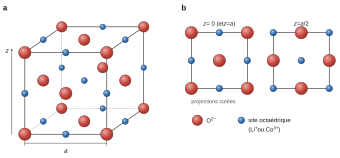
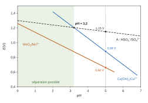
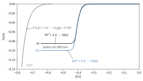
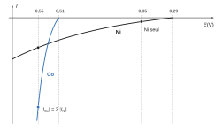

# Mines-Ponts PC — Chimie 2026 · Corrigé brut

*Corrigé rédigé par IA, non officiel. Signalez toute erreur.*

Épreuve de 4 heures, calculatrice interdite. Deux parties indépendantes. Notations : TBS = tert-butyldiméthylsilyle, OTBS = O–Si(CH₃)₂C(CH₃)₃ ; les structures sont données en toutes lettres et, si utile, en SMILES (stéréochimie omise sauf mention).

## Partie I — Synthèse de la cyrnéine A

## Études préliminaires

### Q1

Le signe $(-)$ indique que la $(R)$-carvone est **lévogyre** : en solution, elle fait tourner le plan de polarisation d'une lumière polarisée rectilignement vers la gauche pour un observateur qui reçoit la lumière (pouvoir rotatoire $\alpha<0$). Ce signe est une grandeur expérimentale, sans lien a priori avec le descripteur $R$ (règles CIP).

Expérience : mesure au **polarimètre** (de Laurent). Une lumière monochromatique (raie D du sodium, 589 nm) traverse un polariseur, une cuve de longueur $\ell$ contenant la solution de carvone de concentration $c$, puis un analyseur ; on tourne l'analyseur pour retrouver l'extinction (ou l'égalité d'éclairement des plages) et on lit l'angle $\alpha$, relié au pouvoir rotatoire spécifique par la loi de Biot :

$$\alpha=[\alpha]_\lambda^T\,\ell\,c ,\qquad \alpha<0 \text{ ici.}$$

### Q2

Numérotation du Schéma 1 : cycle à cinq C1 (CHOH), C2 (CH₂), C3 (=C–iPr), C4 (=C, jonction 5/6), C9 (quaternaire, CH₃) ; cycle à six C9, C4, C5, C6, C7 (CH₂), C8 (CH₂) ; cycle à sept C5, C10 (=CH), C11 (=CH), C12 (=C–CHO), C13 (CH₂), C14 (CHOH), C6. Doubles liaisons C3=C4, C5=C10, C11=C12.

Les carbones sp² (C3, C4, C5, C10, C11, C12, CHO), les CH₂ (C2, C7, C8, C13), les méthyles et le CH de l'isopropyle (deux méthyles identiques) ne sont pas stéréogènes. Restent quatre carbones portant quatre substituants deux à deux différents :

| Carbone | Substituants |
|---|---|
| C1 (CH carbinolique) | OH, H, C2, C9 |
| C6 (quaternaire, jonction 6/7) | CH₃, C5, C7, C14 |
| C9 (quaternaire, jonction 5/6) | CH₃, C1, C4, C8 |
| C14 (CH carbinolique) | OH, H, C6, C13 |

**La cyrnéine A possède quatre centres stéréogènes, les carbones asymétriques C1, C6, C9 et C14.** Les doubles liaisons sont endocycliques dans des cycles à 5 et 7 chaînons : leur configuration est imposée par le cycle, elles ne sont pas des éléments stéréogènes exploitables.

### Q3

**C9.** Les quatre atomes liés à C9 sont des carbones (C1, C4, C8, CH₃) : on départage au rang suivant (arbre des priorités).

| Branche | Atomes au rang 2 | Rang |
|---|---|---|
| C1 | (O, C, H) | 1 |
| C4 | (C, C, C) : C3 dupliqué par la double liaison, C5 | 2 |
| C8 | (C, H, H) | 3 |
| CH₃ | (H, H, H) | 4 |

C1 l'emporte sur C4 car O > C dès le premier atome comparé ; C4 l'emporte sur C8 car (C, C, C) > (C, H, H).

Représentation simplifiée de C9, dans le plan du dessin du Schéma 1 :

```text
                C8 (3)
               /
   C1 (1) — C9
               \
                C4 (2)          CH3 (4) : en avant (coin plein)
```

Le parcours 1 → 2 → 3 (C1 → C4 → C8) tourne dans le sens anti-horaire. Le groupe 4 pointe vers l'observateur, donc on inverse le sens lu :

$$\boxed{\text{C9 : } R}$$

**C6.** Même démarche :

| Branche | Atomes au rang 2 | Rang |
|---|---|---|
| C14 | (O, C, H) | 1 |
| C5 | (C, C, C) : C10 dupliqué, C4 | 2 |
| C7 | (C, H, H) | 3 |
| CH₃ | (H, H, H) | 4 |

Représentation simplifiée de C6 :

```text
                C7 (3)
                |
               C6           CH3 (4) : en arrière (hachures)
              /   \
        C5 (2)     C14 (1)
```

Le parcours C14 → C5 → C7 (bas droite → bas gauche → haut) tourne dans le sens horaire, et le groupe 4 est en arrière : le sens lu est le bon.

$$\boxed{\text{C6 : } R}$$

### Q4

Carvone : 2-méthyl-5-(prop-1-én-2-yl)cyclohex-2-én-1-one, C₁₀H₁₄O, SMILES `CC1=CC[C@H](CC1=O)C(C)=C`. Elle porte 14 H, conforme à la somme des intégrations (1+1+1+2+1+2+3+3).

Numérotation de l'énoncé (figure à côté de Q4) :

- H$_a$ : H vinylique du cycle (sur C3, en β du carbonyle) ;
- H$_b$ : CH₂ allylique du cycle (C4) ;
- H$_c$ : méthine (C5) portant l'isopropényle ;
- H$_d$ : CH₂ en α du carbonyle (C6) ;
- H$_e$ : méthyle sur C2 ;
- H$_f$ : méthyle de l'isopropényle ;
- H$_g$/H$_{g'}$ : =CH₂ terminal.

| δ (ppm) | Signal | Attribution | Justification |
|---|---|---|---|
| 6,74 | 1H, t, $J$ = 6,1 Hz | H$_a$ | H éthylénique (4,5–7,2 ppm) en haut de gamme : H en β d'une énone, appauvri par conjugaison avec C=O ; triplet : deux voisins H$_b$, $^3J$ vicinal ≈ 6 Hz |
| 4,79 et 4,74 | 1H chacun, s l | H$_g$, H$_{g'}$ | H éthyléniques d'une double liaison isolée (bas de la gamme 4,5–7,2) ; inéquivalents (l'un en *cis* du méthyle, l'autre en *cis* du cycle) ; pas de voisin vicinal, couplage géminé sur sp² (0–3 Hz) et allylique faibles, d'où des singulets larges ; attribution individuelle impossible |
| 2,81–2,98 | 2H, m | H$_d$ | CH₂ en α de C=O (1,9–3,1 ppm), seule gamme atteignant 2,9 ppm ; multiplet : couplages entre les deux H$_d$ (diastéréotopes) et avec H$_c$ |
| 2,32–2,43 | 1H, m | H$_c$ | seul signal à 1H restant : méthine allylique (1,5–2,4 ppm), couplé à H$_b$ et H$_d$ |
| 1,79–2,01 | 2H, m | H$_b$ | CH₂ allylique du cycle (1,5–2,4 ppm), couplé à H$_a$ et H$_c$ |
| 1,77 | 3H, s | H$_e$ | méthyle sur carbone sp² (allylique), sans voisin vicinal ; porté par le carbone α de l'énone, légèrement plus déblindé (attribution proposée) |
| 1,73 | 3H, s | H$_f$ | méthyle de l'isopropényle, singulet |

## Synthèse du composé 3 à partir de la (–)-(R)-carvone

### Q5

Entre 2 et 6, la cétone devient un éther silylé d'alcool allylique et l'isopropényle devient isopropyle ; entre 6 et 8, le cycle passe de six à cinq chaînons (ouverture par ozonolyse, fermeture par aldolisation) ; entre 8 et 3, l'aldéhyde devient CH₂–O–CH=CH₂.

| Étape | Conditions | Produit |
|---|---|---|
| 2 → 4 | NaBH₄, CeCl₃, MeOH (réduction 1,2 de l'énone, conditions de Luche) | **4** : 2-méthyl-5-(prop-1-én-2-yl)cyclohex-2-én-1-ol (carvéol), `CC1=CCC(CC1O)C(C)=C` |
| 4 → 5 | H₂ (1 éq.), catalyseur chimiosélectif (catalyseur de Wilkinson RhCl(PPh₃)₃, ou Pd/C en conditions contrôlées) : hydrogénation de l'alcène 1,1-disubstitué, le moins encombré | **5** : 5-isopropyl-2-méthylcyclohex-2-én-1-ol, `CC1=CCC(CC1O)C(C)C` |
| 5 → 6 | TBSCl, imidazole (Document 1) | **6** (donné) |
| 6 → 7 | O₃ puis Me₂S (Document 1) : coupure de C(CH₃)=CH du cycle | **7** : CH₃–CO–CH(OTBS)–CH₂–CH(iPr)–CH₂–CHO, `CC(=O)C(O[Si](C)(C)C(C)(C)C)CC(C(C)C)CC=O` (céto-aldéhyde) |
| 7 → 8 | base (HO⁻ dilué ou amine secondaire), chauffage : aldolisation intramoléculaire de l'énolate de l'aldéhyde sur la méthylcétone (cycle à cinq) puis crotonisation | **8** (donné) |
| 8 → 9 | NaBH₄ (CeCl₃), MeOH : réduction 1,2 de l'aldéhyde conjugué | **9** : [3-(tert-butyldiméthylsilyloxy)-2-méthyl-5-isopropylcyclopent-1-én-1-yl]méthanol, `CC1=C(CO)C(C(C)C)CC1O[Si](C)(C)C(C)(C)C` |
| 9 → 3 | Hg(OAc)₂ (cat.), éther éthylvinylique en excès (Document 1) : transvinylation | **3** (donné) |

Régiosélectivité de l'hydrogénation (4 → 5) : 4 contient deux liaisons C=C. Celle du cycle est trisubstituée et encadrée par le cycle et le méthyle ; celle de l'isopropényle est 1,1-disubstituée et terminale (=CH₂), donc la moins encombrée. L'hydrogénation catalytique se fait après adsorption de l'alcène sur le catalyseur, d'autant plus vite que l'alcène est peu substitué et peu encombré. Avec un seul équivalent de H₂, seule la liaison C=C de l'isopropényle est réduite ; celle du cycle est conservée, car l'ozonolyse 6 → 7 doit la couper.

Étape 7 → 8 : la base seule donne l'aldol ; le **chauffage** est nécessaire pour la crotonisation (déshydratation E1cb) qui crée la double liaison conjuguée C=C–CHO de 8.

L'ordre des deux premières étapes peut être inversé (hydrogénation sélective de l'isopropényle de la carvone, puis réduction de Luche). Aucune étape d'hydrolyse n'est détaillée, conformément au Document 1.

## Synthèse d'un intermédiaire avancé 18

### Q6

Une transformation est **concertée** lorsqu'elle se fait en un **seul acte élémentaire** : toutes les ruptures et formations de liaisons ont lieu au cours du franchissement d'un unique état de transition, sans intermédiaire réactionnel (elles peuvent être plus ou moins avancées dans l'état de transition, mais il n'y a qu'une barrière).

Exemple au programme : la **substitution nucléophile bimoléculaire $\mathrm{S_N2}$**, $\mathrm{Nu^-}+\mathrm{R{-}X}\to\mathrm{R{-}Nu}+\mathrm{X^-}$ : la liaison Nu–C se forme pendant que la liaison C–X se rompt (attaque anti du groupe partant), en un seul acte ; preuves : loi de vitesse $v=k[\mathrm{Nu^-}][\mathrm{RX}]$ et inversion de Walden. L'élimination E2 ou la cycloaddition de Diels-Alder (réaction péricyclique, comme le réarrangement de Claisen) sont d'autres exemples.

### Q7

Réarrangement [3,3] sur le motif $\mathrm{C_e{=}C_d{-}O{-}C_a{-}C_b{=}C_c}$ (partie vinylique, partie allylique) ; produit $\mathrm{O{=}C_d{-}C_e{-}C_c{-}C_b{=}C_a}$. Bilan sur les liaisons du motif :

| Avant (3) | | Après (10) | |
|---|---|---|---|
| C$_e$=C$_d$ | 610 | C$_e$–C$_d$ | 350 |
| C$_d$–O | 350 | C$_d$=O | 740 |
| O–C$_a$ | 350 | C$_a$=C$_b$ | 610 |
| C$_a$–C$_b$ | 350 | C$_b$–C$_c$ | 350 |
| C$_b$=C$_c$ | 610 | C$_c$–C$_e$ | 350 |
| **total** | **2270** | **total** | **2400** |

$$\Delta_rH^\circ\approx\sum D_{\text{rompues}}-\sum D_{\text{formées}}=2270-2400=\boxed{-130\ \mathrm{kJ\cdot mol^{-1}}}$$

**La formation de 10 à partir de 3 est exothermique** : en net, une liaison π C=C (≈ 610 − 350 = 260 kJ·mol⁻¹) est remplacée par une liaison π C=O (≈ 740 − 350 = 390 kJ·mol⁻¹), les liaisons σ C–O et C–C se compensant.

Hypothèses du calcul : les énergies de liaison sont définies pour des réactifs et des produits à l'état gazeux, et ce sont des valeurs moyennes. Ici la réaction a lieu dans le toluène : on néglige la différence des enthalpies de vaporisation (ou de solvatation) de 3 et de 10, deux isomères de structures voisines. Le résultat est un ordre de grandeur, dont seul le signe est sûr.

### Q8

Condensation de Knoevenagel (aldolisation-crotonisation) entre la cyclohexane-1,3-dione, notée Z–CH₂–Z′ (CH₂ entre les deux C=O), et l'aldéhyde 10, noté R–CHO.

1. Déprotonation (acide-base) : $\mathrm{Z{-}CH_2{-}Z'}+\mathrm{HO^-}\rightleftharpoons\mathrm{Z{-}CH^-{-}Z'}+\mathrm{H_2O}$, $K=10^{14-9}=10^5$ : quantitative. Flèche du doublet de HO⁻ vers le H du CH₂, flèche de la liaison C–H vers le carbone. L'énolate est stabilisé par délocalisation de la charge sur les deux oxygènes ; les H en α de l'aldéhyde (p$K_a$ ≈ 20) ne sont pas touchés.
2. Addition nucléophile : le carbone nucléophile de l'énolate attaque le carbone du carbonyle de R–CHO (flèche du doublet C vers C=O, flèche de la liaison π C=O vers O) : alcoolate R–CH(O⁻)–CH(Z)(Z′).
3. Protonation par l'eau : aldol R–CH(OH)–CH(Z)(Z′) + HO⁻.
4. Crotonisation E1cb (reflux) : HO⁻ arrache le H du carbone entre les deux carbonyles (encore très acide), puis le carbanion expulse HO⁻ du carbone voisin (flèche du doublet vers la liaison C–C, flèche de la liaison C–O vers O) : R–CH=C(Z)(Z′) = **11**.

Bilan : $\mathbf{10}+\text{cyclohexane-1,3-dione}\to\mathbf{11}+\mathrm{H_2O}$, HO⁻ catalytique. La double liaison formée est conjuguée aux deux carbonyles, ce qui rend la déshydratation favorable.

### Q9

**Non.** 11 contient deux doubles liaisons C=C : l'alcène de l'ène-dione (à réduire) et l'alcène exocyclique 1,1-disubstitué C=CH₂ du cycle à cinq, isolé, qui doit être conservé car c'est lui que l'ozonolyse coupe ensuite pour former la cétone de 14. L'hydrogénation H₂, Pd/C n'est pas chimiosélective entre alcènes ; elle est même plus rapide sur un alcène peu substitué et peu encombré comme C=CH₂. L'ester de Hantzsch, donneur d'hydrure, ne réduit que l'alcène appauvri par conjugaison avec les carbonyles (addition conjuguée) et laisse intact l'alcène isolé.

### Q10

Ester de Hantzsch : 2,6-diméthyl-1,4-dihydropyridine-3,5-dicarboxylate de diéthyle (C₁₃H₁₉NO₄), noté HEH ; il s'aromatise en pyridine (2,6-diméthylpyridine-3,5-dicarboxylate de diéthyle, C₁₃H₁₇NO₄) en cédant un hydrure (de C4) et un proton (de N–H).

$$\mathrm{RCH{=}CR^1COR^2}+\mathrm{C_{13}H_{19}NO_4}\longrightarrow\mathrm{RCH_2{-}CHR^1{-}COR^2}+\mathrm{C_{13}H_{17}NO_4}$$

Mécanisme (acide acétique comme solvant et source de protons ; le carbonyle peut être activé par protonation) :

1. Transfert d'hydrure, addition conjuguée : le doublet de l'azote se délocalise dans le cycle et la liaison C4–H part avec son doublet vers le **carbone β** (celui qui porte R) ; simultanément la liaison π C=C bascule vers C$_\alpha$–C=O et la liaison π C=O vers O. On obtient l'énolate $\mathrm{RCH_2{-}C(R^1){=}C(O^-)R^2}$ et un ion pyridinium.
2. Le pyridinium perd le proton porté par l'azote (pris par l'acétate) : pyridine aromatique, force motrice de la réaction.
3. L'énolate est protoné par l'acide acétique (sur l'oxygène puis tautomérie, ou directement sur le carbone α) : $\mathrm{RCH_2{-}CHR^1{-}COR^2}$.

### Q11

**Site basique** : l'azote **imine** (N sp² de la fonction amidine N–C=N).

Doublets non liants : chaque azote du DBU en porte un. Celui de l'azote « amine » (N trisubstitué, lié à C, C et au carbone de l'amidine) est conjugué avec la liaison C=N : il est délocalisé, donc peu disponible. Celui de l'azote imine est dans une orbitale sp² du plan, orthogonale au système π : il n'est pas délocalisé et reste disponible pour capter un proton.

Sa protonation donne un cation amidinium dont la charge est délocalisée sur les deux azotes (deux formes mésomères équivalentes), d'où un p$K_a$ élevé (≈ 14). La protonation de l'autre azote donnerait un ammonium sans cette stabilisation, et détruirait la conjugaison.

**Avantages** :

- base forte (p$K_a$ ≈ 14) : elle déprotone quantitativement la 1,3-dione, $K=10^{14-9}=10^5$, sans déprotoner les positions α d'une cétone simple ($K=10^{14-20}=10^{-6}$) : un seul énolate, alkylation au bon endroit ;
- **peu nucléophile** (azote encombré) : elle ne consomme pas l'iodométhane et n'additionne pas sur les carbonyles ;
- soluble dans le THF : milieu homogène et anhydre, compatible avec l'éther silylé et sans risque de coupure de la dione par HO⁻ en milieu aqueux.

### Q12

1. Déprotonation : $\mathbf{12}+\mathrm{DBU}\rightleftharpoons\mathbf{12}^-+\mathrm{DBUH^+}$, $K=10^5$ (flèche du doublet de l'azote imine vers le H du carbone entre les deux C=O, flèche de la liaison C–H vers le carbone). Énolate stabilisé sur les deux oxygènes.
2. $\mathrm{S_N2}$ : le carbone nucléophile de l'énolate attaque CH₃–I à l'opposé de l'iode (flèche du doublet vers C de CH₃, flèche de la liaison C–I vers I) ; départ concerté de I⁻. C-alkylation (électrophile mou CH₃I, liaison C–C formée et deux C=O conservés).

$$\mathbf{12}+\mathrm{CH_3I}+\mathrm{DBU}\longrightarrow\mathbf{13}+\mathrm{DBUH^+}+\mathrm{I^-}$$

### Q13

Interactions frontières (Annexe 7) :

| Interaction | Écart |
|---|---|
| HO(alcène) −9,6 eV / BV(O₃) −3,1 eV | **6,5 eV** |
| HO(O₃) −12,7 eV / BV(alcène) +1,3 eV | 14,0 eV |

L'interaction prépondérante est **HO(alcène)–BV(ozone)** (plus petit écart) : l'alcène est nucléophile, l'ozone électrophile. Symétrie : la HO de l'alcène (π) a des lobes de même signe sur les deux carbones d'une même face ; la BV de l'ozone (π* à trois centres) a des coefficients de même signe sur les deux oxygènes terminaux. En approchant les deux molécules dans des plans parallèles, les deux recouvrements C···O terminaux sont en phase : les deux liaisons C–O se forment simultanément, sur la même face de l'alcène. C'est la cycloaddition 1,3-dipolaire concertée (3 + 2 atomes) annoncée par le Document 2.

**Molozonide** : cycle à cinq chaînons C–C–O–O–O (1,2,3-trioxolane). Pour le 2-méthylpropène : 4,4-diméthyl-1,2,3-trioxolane, C₄H₈O₃, SMILES `CC1(C)COOO1` (conforme au Document 2). Pour 13 : trioxolane spiro sur le carbone du cycle à cinq qui portait =CH₂.

### Q14

Le molozonide C₄H₈O₃ se coupe en CH₂O (issu du =CH₂) et en **Z** = C₄H₈O₃ − CH₂O = C₃H₆O₂ : l'**oxyde de carbonyle** (intermédiaire de Criegee) de l'acétone, zwitterion non cyclique

$$(\mathrm{CH_3})_2\mathrm{C}{=}\overset{+}{\mathrm{O}}{-}\mathrm{O^-}\;\longleftrightarrow\;(\mathrm{CH_3})_2\overset{+}{\mathrm{C}}{-}\mathrm{O}{-}\mathrm{O^-}$$

(SMILES de la forme carbocationique : `C[C+](C)O[O-]`). Pour 13, Z est l'oxyde de carbonyle porté par le carbone du cycle à cinq.

Mécanisme :

1. Rétro-cycloaddition 1,3-dipolaire du molozonide, en un acte : rupture de la liaison C–C et d'une liaison O–O, formation de C=O (méthanal) et du dipôle C=O⁺–O⁻. La charge positive se place sur le carbone le plus substitué (stabilisé par les deux groupes alkyle) : Z porte le carbone disubstitué, le méthanal vient du CH₂.
2. Cycloaddition 1,3-dipolaire de Z (dipôle C–O–O) sur la double liaison C=O du méthanal (dipolarophile) : l'oxygène terminal O⁻ de Z se lie au carbone du méthanal, l'oxygène du méthanal se lie au carbone de Z, simultanément.

On obtient l'**ozonide** 3,3-diméthyl-1,2,4-trioxolane (C₄H₈O₃, `CC1(C)OCOO1`) : deux oxygènes contigus et un troisième entre les deux carbones. Me₂S le réduit ensuite en acétone + CH₂O + Me₂SO.

### Q15

14 = C₂₄H₄₂O₄Si (tricétone) et 15 = C₂₄H₄₄O₄Si = 14 + H₂ : **une seule** cétone est réduite en alcool secondaire. D'après 16 (mésylate sur le cycle à six, en α du carbone quaternaire), c'est l'une des cétones de la cyclohexane-1,3-dione 2,2-disubstituée :

**15** : 14 dans lequel un C=O du cycle à six est remplacé par CH–OH, soit la 3-hydroxy-2-méthyl-2-{2-[3-(tert-butyldiméthylsilyloxy)-2-méthyl-5-isopropyl-1-oxocyclopentan-2-yl]éthyl}cyclohexan-1-one ; la cyclopentanone et l'éther silylé sont inchangés. SMILES (sans stéréochimie) : `CC(C)C1CC(O[Si](C)(C)C(C)(C)C)C(C)(CCC2(C)C(O)CCCC2=O)C1=O`.

Stéréochimie à représenter : NaBH₄ ne touche aucun des trois centres stéréogènes du cycle à cinq (carbone portant OTBS, carbone quaternaire portant le méthyle et la chaîne, carbone portant l'isopropyle). On les dessine donc avec les mêmes coins et hachures que dans 14. La réduction crée deux nouveaux centres sur le cycle à six (le CH–OH et le carbone quaternaire qui le jouxte) ; leur configuration n'est pas demandée.

### Q16

Fonction formée : **ester sulfonique**, méthanesulfonate d'alkyle (**mésylate**) R–O–SO₂–CH₃, par action de l'anhydride méthanesulfonique (pyridine, DMAP).

Intérêt : **activer** l'alcool en le transformant en bon groupe partant. HO⁻ (base forte, p$K_a$ = 14) est un très mauvais nucléofuge ; l'ion méthanesulfonate CH₃SO₃⁻, base conjuguée d'un acide fort, stabilisée par délocalisation sur trois oxygènes, est un excellent nucléofuge. L'élimination qui conduit à l'alcène 17 devient possible dans des conditions douces (Li₂CO₃), compatibles avec les cétones et l'éther silylé.

## Suite et fin de la synthèse de la cyrnéine A

### Q17

Dans 19, C* (carbone carbinolique, porteur de O⁻Li⁺ et de CHBrLi) est lié dans le cycle à C10 (carbone vinylique, =CH–) et à C13 (CH₂). Le carbone carbénoïde C$_b$ porte H, Br et Li.

Acte concerté (migration 1,2, de type semipinacolique) :

- le doublet de l'alcoolate forme la liaison π C*=O ;
- la liaison C*–C10 migre avec son doublet de C* vers C$_b$, en anti de la liaison C$_b$–Br ;
- l'ion bromure part (LiBr).

C$_b$ s'insère dans le cycle entre C10 et le carbonyle : le cycle passe de six à sept chaînons. C$_b$ porte encore Li, en α du carbonyle : c'est un **énolate de lithium** (C$_b$=C*–O⁻Li⁺). L'hydrolyse le protone en CH₂ : cétone **20**, dont le cycle à sept chaînons s'écrit C5=C10–CH₂–C(=O)–CH₂–C14H(OTBS)–C6. La migration du carbone vinylique (et non de C13) est imposée par la position du CH₂ dans 20.

### Q18

Lecture des entrées et sorties du Schéma 6 :

| Lettre | Espèce | Rôle |
|---|---|---|
| **A** | $2\,\mathrm{PPh_3}$ | deux molécules de triphénylphosphine libérées |
| **B** | $\mathrm{CO}$ | entre à l'étape 2 |
| **C** | $\mathrm{PPh_3}$ | sort à l'étape 2 |
| **D** | $\mathrm{PPh_3}$ | entre à l'étape 3 |

A désigne deux phosphines indépendantes, et non un dimère PPh₃–PPh₃. Monoxyde de carbone : schéma de Lewis $|\mathrm{C}{\equiv}\mathrm{O}|$, 10 électrons de valence, charge formelle −1 sur C et +1 sur O ; il se lie au palladium par le carbone.

- $\mathrm{Pd(PPh_3)_4}\rightleftharpoons\mathrm{Pd(PPh_3)_2}+2\,\mathrm{PPh_3}$ (formation de l'espèce active) ;
- étape 2 : $\mathrm{R{-}Pd(PPh_3)_2{-}X}+\mathrm{CO}\to\mathrm{R{-}Pd(CO)(PPh_3){-}X}+\mathrm{PPh_3}$ ;
- étape 3 : après insertion de CO, une phosphine vient occuper le site libéré : $\mathrm{RC(O){-}Pd(PPh_3)_2{-}X}$.

### Q19

| Étape | Nom | Pd |
|---|---|---|
| 1 | **addition oxydante** de R–X | Pd(0) → Pd(II) |
| 2 | **substitution (échange) de ligand** : CO remplace PPh₃ | Pd(II) |
| 3 | **insertion migratoire** de CO dans la liaison Pd–R (formation du ligand acyle) | Pd(II) |
| 5 | **élimination réductrice** de R–CHO | Pd(II) → Pd(0) |

(L'étape 4 est une transmétallation : H passe de l'étain au palladium, X du palladium à l'étain.)

### Q20

Somme des étapes, les espèces du palladium se simplifient :

$$\boxed{\mathrm{R{-}OTf}+\mathrm{CO}+\mathrm{Bu_3SnH}\xrightarrow{\ \mathrm{Pd(PPh_3)_4}\ \text{cat.}\ }\mathrm{R{-}CHO}+\mathrm{Bu_3SnOTf}}$$

soit $\mathbf{21}+\mathrm{CO}+\mathrm{Bu_3SnH}\to\mathbf{22}+\mathrm{Bu_3SnOTf}$.

## Partie II — Recyclage des batteries lithium-ion

## Traitement des cathodes à base de LiCoO₂

### Q21

$Z=3$ : $\mathrm{Li}:\ 1s^2\,2s^1$. Première colonne, hydrogène excepté : famille des **métaux alcalins**. Couche de valence $n=2$ occupée par un seul électron : **1 électron de valence**. En perdant cet électron (faible énergie de première ionisation), l'atome acquiert la configuration $1s^2$ de l'hélium (couche saturée) ; arracher un second électron, de cœur, coûterait beaucoup trop d'énergie. Ion le plus courant : $\boxed{\mathrm{Li^+}}$.

### Q22

Électroneutralité avec Li(+I) et O(−II) (oxyde, pas de liaison O–O) : $(+1)+x+2(-2)=0$, d'où

$$\boxed{\text{n.o.(Co)}=+\mathrm{III}}$$

(Co : [Ar]$3d^74s^2$, Co³⁺ : [Ar]$3d^6$.)

### Q23

Maille cubique de côté $a$ ; ions O²⁻ aux 8 sommets et aux centres des 6 faces (CFC) : $8\times\frac18+6\times\frac12=4$ anions par maille.

Sites octaédriques : au **centre du cube** (1 site propre) et au **milieu des 12 arêtes** (chacun partagé entre 4 mailles) : $1+12\times\frac14=\boxed{4}$ sites octaédriques par maille (autant que d'anions).

Stœchiométrie LiCoO₂ : pour 4 O²⁻, 2 Li⁺ et 2 Co³⁺, soit 4 cations : **tous les sites octaédriques sont occupés**, moitié par Li⁺, moitié par Co³⁺ (électroneutralité : $2(+1)+2(+3)+4(-2)=0$). Les 8 sites tétraédriques (centres des 8 petits cubes d'arête $a/2$) restent vides.



À la cote 0 : O²⁻ aux sommets et au centre de la face du bas, sites aux milieux des arêtes du bas. À la cote $a/2$ : O²⁻ aux centres des quatre faces latérales, sites aux milieux des quatre arêtes verticales et au centre du cube.

### Q24

H₂O₂ : $2\times1+2\times6=14$ électrons de valence, 7 doublets. Squelette H–O–O–H : 3 doublets liants (O–H, O–O, O–H) et 2 doublets non liants sur chaque oxygène ; octet pour O, duet pour H, aucune charge formelle.


Géométrie coudée autour de chaque O (AX₂E₂), molécule non plane ; n.o.(O) = −I.

### Q25

Ce n'est pas une simple dissolution physique. Le cobalt(III) n'est pas stable en solution aqueuse : $E^\circ(\mathrm{Co^{3+}/Co^{2+}})=1{,}9$ V dépasse $E^\circ(\mathrm{O_2/H_2O})=1{,}2$ V, Co³⁺ oxyderait l'eau. Le cobalt(III) du solide se comporte donc en oxydant vis-à-vis de H₂O₂ : Co(+III) est réduit en Co²⁺, et H₂O₂ est le réducteur, oxydé en O₂ (couple O₂/H₂O₂, $E^\circ=0{,}8$ V).

Les ions oxyde du réseau sont des bases infiniment fortes dans l'eau : ils sont captés par H⁺ et sortent sous forme d'eau. L'équation ne fait donc pas apparaître O²⁻.

Demi-équations :

$$\mathrm{LiCoO_2(s)}+4\,\mathrm{H^+}+\mathrm{e^-}=\mathrm{Li^+}+\mathrm{Co^{2+}}+2\,\mathrm{H_2O}$$

$$\mathrm{H_2O_2}=\mathrm{O_2}+2\,\mathrm{H^+}+2\,\mathrm{e^-}$$

$$\boxed{2\,\mathrm{LiCoO_2(s)}+\mathrm{H_2O_2}+6\,\mathrm{H^+}\longrightarrow 2\,\mathrm{Li^+}+2\,\mathrm{Co^{2+}}+\mathrm{O_2(g)}+4\,\mathrm{H_2O}}$$

(Vérification : O 6 = 6, H 8 = 8, charges +6 = +6.)

### Q26

$-\dfrac{\mathrm dr}{\mathrm dt}=k$ constante, $r(0)=r_0$ :

$$\boxed{r(t)=r_0-k\,t}$$

Cette loi vaut pour $0\le t\le r_0/k$ (disparition complète de la particule).

### Q27

Volume initial de la particule : $V_0=\frac43\pi r_0^3$. Volume du cœur non encore transformé à l'instant $t$ : $V=\frac43\pi r^3$. Le volume transformé est $V_0-V$ :

$$\begin{aligned}
X&=\frac{V_0-V}{V_0}\\
&=\frac{r_0^3-r^3}{r_0^3}\\
&=1-\left(\frac{r}{r_0}\right)^3
\end{aligned}$$

Avec Q26 :

$$\boxed{X=1-\left(1-\frac{k\,t}{r_0}\right)^3}$$

d'où la forme linéarisée $1-(1-X)^{1/3}=\dfrac{k}{r_0}\,t$.

### Q28

Le modèle à cœur rétractant sous contrôle chimique prévoit que $1-(1-X)^{1/3}$ est **proportionnel au temps**, de pente $k/r_0$. Sur la Figure 2, à chaque température les points sont alignés sur une droite passant au voisinage de l'origine (ordonnées à l'origine faibles, de l'ordre de la dispersion des points), et la pente croît avec la température (50 → 75 °C), comme $k$ selon la loi d'Arrhenius ($r_0$ ne dépend pas de $T$). Les résultats sont donc en accord avec le modèle : l'extraction du lithium est limitée par la réaction chimique à la surface du cœur.

### Q29

$k=A\,e^{-E_a/RT}$, donc $\ln(k/r_0)=\ln(A/r_0)-\dfrac{E_a}{R}\cdot\dfrac1T$ : la pente vaut $-E_a/R=-4000$ K.

$$\begin{aligned}
E_a&=4000\ \mathrm K\times8\ \mathrm{J\cdot K^{-1}\cdot mol^{-1}}\\
&=3{,}2\times10^4\ \mathrm{J\cdot mol^{-1}}
\end{aligned}$$

$$\boxed{E_a\approx32\ \mathrm{kJ\cdot mol^{-1}}}$$

## Extraction des métaux présents dans le lixiviat

### Q30

Dans HSO₅⁻ comme dans SO₄²⁻, le soufre est au degré +VI : les électrons sont échangés par les oxygènes (pont peroxyde). On calcule la pente de chaque frontière à partir de sa demi-équation.

Couple HSO₅⁻/SO₄²⁻ :

$$\mathrm{HSO_5^-}+\mathrm{H^+}+2\,\mathrm{e^-}=\mathrm{SO_4^{2-}}+\mathrm{H_2O}$$

$$E=E^\circ_1+0{,}03\log\frac{[\mathrm{HSO_5^-}]\,[\mathrm{H^+}]}{[\mathrm{SO_4^{2-}}]}$$

Couple SO₅•⁻/HSO₅⁻ :

$$\mathrm{SO_5^{\bullet-}}+\mathrm{H^+}+\mathrm{e^-}=\mathrm{HSO_5^-}$$

$$E=E^\circ_2+0{,}06\log\frac{[\mathrm{SO_5^{\bullet-}}]\,[\mathrm{H^+}]}{[\mathrm{HSO_5^-}]}$$

Ordonnées à l'origine : chaque couple oppose deux espèces dissoutes de même atomicité en soufre. Avec la convention d'égalité des concentrations à la frontière, le terme de concentration disparaît et l'ordonnée à l'origine vaut $E^\circ$, quelle que soit la concentration de travail. Les frontières sont donc :

- couple HSO₅⁻/SO₄²⁻ : $E=E^\circ_1-0{,}03\,\mathrm{pH}$, avec $E^\circ_1\approx1{,}3$ V (Annexe 2) ;
- couple SO₅•⁻/HSO₅⁻ : $E=E^\circ_2-0{,}06\,\mathrm{pH}$.

Lecture de la Figure 3. La droite A va de 1,3 V (pH 0) à ≈ 0,95 V (pH 12) : pente ≈ −0,03 V/pH, ordonnée à l'origine 1,3 V. La droite B va de ≈ 1,5 V à ≈ 0,8 V : pente ≈ −0,06 V/pH. Les deux critères concordent :

$$\boxed{\mathbf A:\ \mathrm{HSO_5^-/SO_4^{2-}}}$$

$$\boxed{\mathbf B:\ \mathrm{SO_5^{\bullet-}/HSO_5^-}\ (E^\circ_2\approx1{,}5\ \mathrm V)}$$

Remarque : un classement par degré d'oxydation ne suffirait pas à conclure. Les deux droites, de pentes différentes, se coupent vers pH ≈ 6,7 ($1{,}3-0{,}03\,\mathrm{pH}=1{,}5-0{,}06\,\mathrm{pH}$). Au-delà, A est au-dessus de B et HSO₅⁻ serait thermodynamiquement instable (dismutation en SO₄²⁻ et SO₅•⁻) ; en deçà, il est stable. Les droites en pointillés sont seulement superposées au diagramme, sans tracé du domaine de chaque espèce soufrée ; dans la zone utile (pH < 6), HSO₅⁻ a bien un domaine entre B et A.

### Q31

$\mathrm{Co(OH)_3(s)}+3\,\mathrm{H^+}+\mathrm{e^-}=\mathrm{Co^{2+}}+3\,\mathrm{H_2O}$. En présence du solide, $[\mathrm{Co^{3+}}]=K_s/[\mathrm{HO^-}]^3=K_s[\mathrm{H^+}]^3/K_e^3$, d'où

$$E=1{,}9+0{,}06\log\frac{[\mathrm{Co^{3+}}]}{[\mathrm{Co^{2+}}]}=\underbrace{1{,}9+0{,}06\log\frac{K_s}{K_e^3}}_{E^\circ}-0{,}18\,\mathrm{pH}-0{,}06\log[\mathrm{Co^{2+}}]$$

$$\boxed{E^\circ(\mathrm{Co(OH)_3/Co^{2+}})=1{,}9+0{,}06\,(-45+42)=1{,}72\ \mathrm V}$$

Frontière avec $[\mathrm{Co^{2+}}]=0{,}1$ mol·L⁻¹ :

$$\boxed{E=1{,}78-0{,}18\,\mathrm{pH}\ \ (\mathrm V)}$$

(contrôle : 0,57 V à pH 6,8, conforme à la Figure 3).

### Q32

À pH 5, l'espèce oxydée stable du manganèse au-dessus de Mn²⁺ est MnO₂(s). Frontière MnO₂/Mn²⁺ ($[\mathrm{Mn^{2+}}]=0{,}01$) : $E=1{,}26-0{,}12\,\mathrm{pH}=0{,}66$ V à pH 5, sous la droite A ($1{,}3-0{,}15=1{,}15$ V) : la réaction est favorable.

$$\boxed{\mathrm{Mn^{2+}}+\mathrm{HSO_5^-}+\mathrm{H_2O}\longrightarrow\mathrm{MnO_2(s)}+\mathrm{SO_4^{2-}}+3\,\mathrm{H^+}}$$

Deux électrons échangés, $E^\circ(\mathrm{HSO_5^-/SO_4^{2-}})=1{,}3$ V et $E^\circ(\mathrm{MnO_2/Mn^{2+}})=1{,}2$ V :

$$\begin{aligned}
\log K^\circ&=\frac{2\,(1{,}3-1{,}2)}{0{,}06}\\
&\approx3{,}3
\end{aligned}$$

$$\boxed{K^\circ\approx2\times10^{3}}$$

$K^\circ$ ne dépend pas du pH ; à pH 5 fixé, la constante apparente $K'=K^\circ/[\mathrm{H^+}]^3=10^{18{,}3}$ montre que la réaction est quantitative.

### Q33

À pH 5 : droite A à 1,15 V, frontière Co(OH)₃/Co²⁺ à $1{,}78-0{,}90=0{,}88$ V. Les domaines de HSO₅⁻ et de Co²⁺ sont disjoints : **Co²⁺ est aussi oxydé**, en Co(OH)₃(s) :

$$2\,\mathrm{Co^{2+}}+\mathrm{HSO_5^-}+5\,\mathrm{H_2O}\longrightarrow2\,\mathrm{Co(OH)_3(s)}+\mathrm{SO_4^{2-}}+5\,\mathrm{H^+}$$

À pH 5, pas de sélectivité thermodynamique.

Séparation : il faut oxyder Mn²⁺ ($1{,}3-0{,}03\,\mathrm{pH}>1{,}26-0{,}12\,\mathrm{pH}$, vrai pour tout pH ≥ 0) sans oxyder Co²⁺ ($1{,}3-0{,}03\,\mathrm{pH}<1{,}78-0{,}18\,\mathrm{pH}$, soit pH < 3,2). Graphiquement, la droite A coupe la frontière supérieure du domaine de Co²⁺ vers pH ≈ 3,3.

$$\boxed{\text{séparation envisageable pour }\mathrm{pH}\lesssim3{,}2}$$



### Q34

- Thermodynamique (Figure 3, Q33) : pH ≲ 3,2 pour ne pas oxyder Co²⁺ ; au-delà, l'écart entre la droite A et la frontière du cobalt croît de 0,15 V par unité de pH.
- Cinétique (Figure 4) : la vitesse d'oxydation de Mn(II) croît fortement avec le pH : moins de 10 % oxydés en 90 min à pH 3, ≈ 55 % à pH 4, ≈ 80 % à pH 4,5, oxydation complète en moins d'une heure à pH ≥ 5.

Compromis : se placer **juste sous la limite thermodynamique, pH ≈ 3 à 3,5**, la valeur la plus haute compatible avec la non-oxydation du cobalt, en compensant la lenteur de l'oxydation du manganèse par une durée de traitement plus longue. Un pH ≥ 4,5, rapide pour Mn, précipiterait aussi le cobalt.

### Q35

$$K_1^\circ=\frac{a(\overline{\mathrm{Ni}})\,a(\mathrm{H^+})^{2n}}{a(\mathrm{Ni^{2+}})^n\,a(\overline{\mathrm{HOx}})^p\,a(\mathrm{H_2O})^h}$$

Solutions diluées : $a(\mathrm{H_2O})=1$ (solvant), $a=[\,\cdot\,]/c^\circ$ en phase aqueuse, $a=[\,\cdot\,]/\overline{c^\circ}$ dans le dodécane :

$$\boxed{K_1^\circ=\frac{\dfrac{[\overline{\mathrm{Ni}}]}{\overline{c^\circ}}\left(\dfrac{[\mathrm{H^+}]}{c^\circ}\right)^{2n}}{\left(\dfrac{[\mathrm{Ni^{2+}}]}{c^\circ}\right)^{n}\left(\dfrac{[\overline{\mathrm{HOx}}]}{\overline{c^\circ}}\right)^{p}}}$$

### Q36

$$\boxed{P=\frac{[\overline{\mathrm{Ni}}]}{[\mathrm{Ni^{2+}}]}=K_1^\circ\,\frac{\overline{c^\circ}}{c^\circ}\left(\frac{[\mathrm{Ni^{2+}}]}{c^\circ}\right)^{n-1}\left(\frac{[\overline{\mathrm{HOx}}]}{\overline{c^\circ}}\right)^{p}\left(\frac{c^\circ}{[\mathrm{H^+}]}\right)^{2n}}$$

soit, avec $c^\circ=\overline{c^\circ}=1$ mol·L⁻¹ :

$$\log P=\log K_1^\circ+(n-1)\log[\mathrm{Ni^{2+}}]+p\log[\overline{\mathrm{HOx}}]+2n\,\mathrm{pH}$$

Commentaire. Le logarithme de P est une fonction affine de chacune des trois variables expérimentales :

- de $\log[\mathrm{Ni^{2+}}]$, avec la pente $n-1$ ;
- de $\log[\overline{\mathrm{HOx}}]$, avec la pente $p$ ;
- du pH, avec la pente $2n$.

Pour accéder à n et p, il faut faire varier **une seule** de ces variables en maintenant les deux autres constantes, ainsi que la température et le sel de fond (dont dépend la constante, par les activités). La pente mesurée est alors directement le coefficient cherché. C'est le protocole de la Figure 5, dont la légende précise les grandeurs maintenues fixes.

### Q37

- Figure 5(a), $[\overline{\mathrm{HOx}}]=0{,}28$ mol·L⁻¹ et pH fixés : $\log P$ est indépendant de $\log[\mathrm{Ni^{2+}}]$ pour chaque milieu, pente $n-1=0$, donc $n=1$ ;
- Figure 5(b), $[\overline{\mathrm{HOx}}]$ et $[\mathrm{Ni^{2+}}]$ fixés : droites de pente 2,0 $=2n$, donc $n=1$ (confirmation) ;
- Figure 5(c), $[\mathrm{Ni^{2+}}]$ et pH fixés : droites de pente 5,0 $=p$.

$$\boxed{n=1}$$

$$\boxed{p=5}$$

Complexe extrait mononucléaire : $\overline{\mathrm{NiOx_2(HOx)_3(H_2O)_h}}$ ; $h$ n'est pas accessible par cette méthode ($a(\mathrm{H_2O})=1$). Les trois séries d'un même graphe sont parallèles : la nature du sel de fond ne change ni $n$ ni $p$, seulement l'ordonnée à l'origine.

### Q38

Approximation d'Ellingham : $\ln K_1^\circ=-\dfrac{\Delta_rH^\circ}{RT}+\dfrac{\Delta_rS^\circ}{R}$. À concentrations et pH fixés, $\ln P=\ln K_1^\circ+\text{cste}$, donc avec $x=1000/(RT)$ :

$$\ln P=-\frac{\Delta_rH^\circ}{1000}\,x+\text{cste}$$

Identification avec la pente de la droite $y=9{,}4\,x-3{,}9$ ($\Delta_rH^\circ$ en J·mol⁻¹) :

$$-\frac{\Delta_rH^\circ}{1000\ \mathrm{J\cdot mol^{-1}}}=9{,}4$$

$$\boxed{\Delta_rH^\circ=-9{,}4\ \mathrm{kJ\cdot mol^{-1}}<0:\ \text{réaction (1) exothermique}}$$

(l'extraction est un peu moins efficace à chaud).

## Électrodéposition sélective de métaux

### Q39

Espèces réductibles : le cation métallique et l'eau. Li⁺ ($E^\circ\approx-3$ V) n'est pas réduit avant l'eau ; Cl⁻ (n.o. −I minimal) ne peut pas être réduit.

- Solution A : $\mathrm{Ni^{2+}}+2\,\mathrm e^-\to\mathrm{Ni(s)}$ et $2\,\mathrm{H_2O}+2\,\mathrm e^-\to\mathrm{H_2(g)}+2\,\mathrm{HO^-}$ ;
- Solution B : $\mathrm{Co^{2+}}+2\,\mathrm e^-\to\mathrm{Co(s)}$ et $2\,\mathrm{H_2O}+2\,\mathrm e^-\to\mathrm{H_2(g)}+2\,\mathrm{HO^-}$.

Potentiels d'équilibre : $E(\mathrm{M^{2+}/M})=-0{,}3+0{,}03\log(10^{-2})=-0{,}36$ V pour les deux métaux ; $E(\mathrm{H_2O/H_2})\approx-0{,}06\,\mathrm{pH}\approx-0{,}42$ V à pH ≈ 7 (solution non tamponnée).

### Q40

Reproduction de la Figure 6 du sujet (courants cathodiques comptés négativement) :



| Branche | Allure | Réaction cathodique |
|---|---|---|
| courbe Ni (solution A) | vague à partir de ≈ −0,35 V, palier ≈ −0,085 mA | $\mathrm{Ni^{2+}}+2\,\mathrm e^-\to\mathrm{Ni(s)}$ |
| courbe Co (solution B) | vague à partir de ≈ −0,35 V, palier ≈ −0,10 mA | $\mathrm{Co^{2+}}+2\,\mathrm e^-\to\mathrm{Co(s)}$ |
| courbe H₂O | mur à partir de ≈ −0,65 V, sans palier | $2\,\mathrm{H_2O}+2\,\mathrm e^-\to\mathrm{H_2(g)}+2\,\mathrm{HO^-}$ |

### Q41

- **Ni²⁺/Ni et Co²⁺/Co : systèmes rapides.** Le courant cathodique apparaît dès ≈ −0,35 V, au voisinage du potentiel d'équilibre calculé en Q39 (−0,36 V, et non le potentiel standard −0,3 V) : surtension négligeable.
- **H₂O/H₂ : système lent.** Potentiel d'équilibre ≈ −0,42 V ; le courant reste négligeable devant les courants de palier (≈ 0,1 mA) jusqu'à −0,6 V et ne devient notable que vers −0,65 V : surtension cathodique ≈ −0,2 V sur l'électrode utilisée.
- La rapidité d'un système se lit à l'écart entre le début de la vague et le potentiel d'équilibre ; elle est indépendante de la présence d'un palier.
- **Paliers** (courbes Ni et Co) : **courant limite de diffusion**. Grâce au sel de fond (LiCl, dix fois plus concentré), les ions M²⁺ n'arrivent à l'électrode que par diffusion à travers la couche de diffusion d'épaisseur $\delta$. Quand le potentiel est assez négatif, leur concentration à la surface s'annule et le flux atteint son maximum : $\lvert I_{\text{lim}}\rvert=2FSD\,c/\delta$, proportionnel à la concentration (paliers voisins pour deux solutions à 10 mmol·L⁻¹, l'écart venant des coefficients de diffusion). L'eau, solvant (≈ 55 mol·L⁻¹), n'est pas limitée par le transport : pas de palier.
- **Conclusion** : les deux couples ont le même $E^\circ$, le même potentiel d'équilibre et sont rapides ; leurs vagues sont quasi superposées. **Aucune réduction sélective** de Ni²⁺ ou de Co²⁺ n'est possible dans ces conditions.

### Q42

$[\mathrm{CoCl_4}]^{2-}+2\,\mathrm e^-=\mathrm{Co(s)}+4\,\mathrm{Cl^-}$, somme de la dissociation $[\mathrm{CoCl_4}]^{2-}=\mathrm{Co^{2+}}+4\,\mathrm{Cl^-}$ ($K_D^\circ$) et de $\mathrm{Co^{2+}}+2\,\mathrm e^-=\mathrm{Co(s)}$. Égalité des potentiels de Nernst avec $[\mathrm{Co^{2+}}]=K_D^\circ[\mathrm{CoCl_4^{2-}}]/[\mathrm{Cl^-}]^4$ :

$$\boxed{E^\circ([\mathrm{CoCl_4}]^{2-}/\mathrm{Co})=E^\circ(\mathrm{Co^{2+}/Co})+\frac{0{,}06}{2}\log K_D^\circ}$$

Application numérique :

$$\begin{aligned}
E^\circ([\mathrm{CoCl_4}]^{2-}/\mathrm{Co})&=-0{,}30+0{,}03\times(-7)\\
&=-0{,}51\ \mathrm V
\end{aligned}$$

$$\boxed{E^\circ([\mathrm{CoCl_4}]^{2-}/\mathrm{Co})\approx-0{,}51\ \mathrm V}$$

La complexation stabilise Co(II) et rend sa réduction plus difficile ; elle l'écarte de 0,22 V du couple du nickel complexé (−0,29 V).

### Q43

Pour $\mathrm{M^{2+}}+2\,\mathrm e^-=\mathrm M$, avec $v=\mathrm d\xi/\mathrm dt$ (mol·s⁻¹), la charge échangée est $\mathrm dq=2F\,\mathrm d\xi$ :

$$\boxed{\lvert I\rvert=2\,F\,v}$$

Avec la convention $I>0$ en oxydation, $I=-2Fv$ pour une réduction.

Si deux métaux se déposent simultanément, le rapport des quantités déposées est le rapport des courants partiels : $n(\mathrm{Co})/n(\mathrm{Ni})=\lvert I_{\mathrm{Co}}\rvert/\lvert I_{\mathrm{Ni}}\rvert$.

### Q44

Hypothèses de l'énoncé : pas de surpotentiel, donc chaque courbe de réduction démarre au potentiel seuil du couple ; vitesses fixées par le transfert de charge, donc **pas de palier de diffusion** dans le domaine étudié : le courant croît en valeur absolue d'autant plus vite que le système est rapide.

Seuils retenus : **−0,29 V** pour $[\mathrm{Ni(H_2O)_5Cl}]^+/\mathrm{Ni}$ (donnée) et **−0,51 V** pour $[\mathrm{CoCl_4}]^{2-}/\mathrm{Co}$ (Q42). (Avec les concentrations, Nernst les décalerait tous deux vers les potentiels plus négatifs, de −0,06 V au moins, ce qui rendrait les deux observations impossibles ; dans LiCl à 10 mol·L⁻¹ les activités diffèrent fortement des concentrations, et l'on raisonne sur les potentiels fournis.)

Traduction des mesures (Q43, même nombre d'électrons) :

- à −0,35 V : dépôt majoritairement de nickel ; seule la courbe du nickel a démarré (−0,35 V > −0,51 V) ;
- à −0,55 V : $\lvert I_{\mathrm{Co}}\rvert=3\,\lvert I_{\mathrm{Ni}}\rvert$, alors que le cobalt n'est qu'à 0,04 V au-delà de son seuil et le nickel à 0,26 V au-delà du sien : la courbe du cobalt est **beaucoup plus raide** que celle du nickel et les deux courbes **se croisent entre −0,51 et −0,55 V**.

Allure proposée (courants cathodiques comptés négativement, comme sur la Figure 6 du sujet ; unités arbitraires) :



Interprétation : à −0,35 V, seul le nickel peut se déposer, le dépôt est majoritairement du nickel ; à −0,55 V, la croissance rapide du courant du cobalt après −0,51 V lui fait dépasser le courant du nickel, le dépôt devient majoritairement du cobalt. Le choix du potentiel imposé oriente ainsi la composition du dépôt.

Limite du modèle : la présence de cobalt à −0,35 V (Co/Ni = 0,3) ne peut pas provenir du dépôt de cobalt pur, impossible au-dessus de son potentiel seuil (le courant net du couple y serait anodique). Elle traduit une codéposition du cobalt dans un alliage Ni–Co (activité du cobalt dans le solide inférieure à 1, ce qui décale son seuil vers les potentiels moins négatifs), phénomène hors du modèle simple demandé. La séparation obtenue est un enrichissement (0,3 puis 3), pas une séparation totale.
