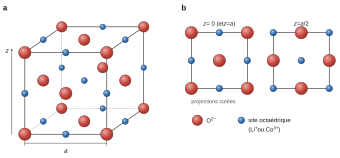
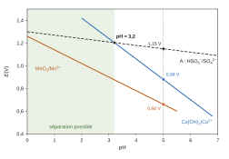
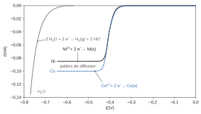
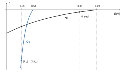

# Mines-Ponts PC — Chimie 2026 · Corrigé guidé

*Corrigé rédigé par IA, non officiel. Signalez toute erreur.*

## Présentation du sujet

**Format.** 4 heures, calculatrice et tout dispositif électronique interdits, 44 questions réparties en deux problèmes indépendants. Les données (potentiels standard, p$K_a$, $K_s$, $K_D^\circ$, énergies de liaison, orbitales frontières, tables de RMN) sont regroupées en annexe ; les calculs sont prévus pour se faire de tête ($R\approx8$ J·K⁻¹·mol⁻¹, $RT\ln10/F\approx0{,}06$ V).

**Partie I — Synthèse de la cyrnéine A (Q1–Q20).** On suit la synthèse totale d'un diterpène tricyclique 5-6-7 à partir de la $(-)$-$(R)$-carvone, molécule du « réservoir de chiralité ».

- *Études préliminaires (Q1–Q4)* : activité optique, centres stéréogènes, descripteurs CIP, attribution d'un spectre RMN ¹H.
- *Synthèse de 3 (Q5)* : une séquence de sept étapes à reconstituer (réduction, hydrogénation, protection, ozonolyse, aldolisation intramoléculaire, réduction, éther vinylique).
- *Synthèse de 18 (Q6–Q16)* : réarrangement de Claisen (caractère concerté, bilan enthalpique), condensation de Knoevenagel, chimiosélectivité d'une réduction, alkylation d'énolate, ozonolyse étudiée par les orbitales frontières, mésylation.
- *Fin de synthèse (Q17–Q20)* : agrandissement de cycle par migration 1,2 sur un carbénoïde, cycle catalytique de la formylation de Stille.

**Partie II — Recyclage des batteries lithium-ion (Q21–Q44).** Trois sous-parties indépendantes.

- *LiCoO₂ (Q21–Q29)* : atomistique, cristallographie CFC, structure de Lewis, équation de dissolution, modèle cinétique du cœur rétractant, loi d'Arrhenius.
- *Extraction (Q30–Q38)* : diagrammes E-pH superposés pour séparer Mn(II) et Co(II) par précipitation oxydante, compromis thermodynamique/cinétique ; extraction liquide-liquide du nickel par une oxime (méthode des pentes, van't Hoff).
- *Électrodéposition (Q39–Q44)* : courbes courant-potentiel, systèmes rapides et lents, paliers de diffusion, effet de la complexation sur un potentiel standard, construction d'une allure de courbes à partir de résultats expérimentaux.

**Notions du programme mobilisées.** Stéréochimie et règles CIP, RMN ¹H, mécanismes ioniques (addition nucléophile, aldolisation-crotonisation, $\mathrm{S_N2}$, élimination), acido-basicité en chimie organique, protection et activation de groupes, approximation des orbitales frontières, reconnaissance des étapes d'un cycle catalytique, configuration électronique, cristallographie, Lewis, oxydoréduction et diagrammes E-pH, cinétique (Arrhenius), constantes d'équilibre et relation de van't Hoff, courbes courant-potentiel.

**Difficulté et gestion du temps.** Sujet long (environ 5 minutes par question) mais très progressif. Questions abordables à ne pas laisser passer : Q1, Q2, Q3, Q6, Q7, Q9, Q16, Q18–Q22, Q24–Q27, Q29, Q30, Q35–Q39, Q42, Q43. Questions qui demandent le plus de construction : Q5, Q8, Q10, Q14, Q17, Q31, Q33–Q34, Q41 et Q44. Les deux parties étant indépendantes, il est raisonnable de commencer par la partie II si l'on est plus à l'aise en chimie générale, puis de traiter les nombreuses questions courtes de la partie I.

**Ce qu'a relevé le jury (rapport 2026).** Le rapport qualifie de classantes ou discriminantes Q5 (séquence à trous, classante « pour les bonnes comme les moins bonnes copies »), Q10 (pour départager les bonnes et très bonnes copies), Q14, Q16 (connaissance du cours de première année) et surtout Q20 (« particulièrement classante »). Q17 a rencontré peu de succès, Q25 « n'a inspiré que peu de candidats », Q31 a été « rarement abordée avec succès », et peu de copies dénombrent correctement les sites octaédriques en Q23. Le rapport ne donne aucune statistique chiffrée. Il insiste sur la justification (descripteurs CIP, attribution RMN, commentaire de courbes en citant la figure), sur la représentation complète des molécules et des mécanismes (doublets, charges, sous-produits) et sur les unités des applications numériques. Il signale enfin que l'énoncé de la partie électrochimie comportait « des approximations notables » et que le barème a été ajusté en conséquence.

## Partie I.1 — Études préliminaires

Quatre questions de cours appliquées à deux molécules du Schéma 1 : savoir ce que mesure un polarimètre, repérer les carbones asymétriques, appliquer les règles CIP sans se tromper de sens, exploiter déplacements, intégrations et multiplicités.

### Question 1

> [!INDICATION]
> Le signe entre parenthèses ne vient pas de la nomenclature : quelle propriété physique d'une molécule chirale décrit-il ?

> [!INDICATION]
> L'appareil est au programme de travaux pratiques ; décrire le trajet de la lumière et la grandeur lue.

#### Solution

Le signe $(-)$ indique que la $(R)$-carvone est **lévogyre** : elle fait tourner le plan de polarisation d'une lumière polarisée rectilignement vers la gauche pour un observateur qui reçoit la lumière ; son pouvoir rotatoire $\alpha$ est négatif. C'est une donnée expérimentale, sans lien a priori avec le descripteur $R$.

On l'observe au **polarimètre** (de Laurent) : lumière monochromatique (raie D du sodium, 589 nm), polariseur, cuve de longueur $\ell$ contenant la solution de concentration $c$, analyseur que l'on tourne pour retrouver l'extinction ; l'angle lu vérifie la loi de Biot

$$\alpha=[\alpha]_\lambda^T\,\ell\,c,\qquad\alpha<0 .$$

> [!PIEGE]
> Confondre $(+)/(-)$ et $R/S$ : aucune règle ne permet de déduire le signe du pouvoir rotatoire de la configuration absolue.

> [!JURY]
> Rapport 2026 : pour obtenir tous les points, le jury attendait l'expression « plan de polarisation de la lumière polarisée rectilignement ». Dire seulement que la molécule « dévie la lumière » ne suffit pas.

### Question 2

> [!INDICATION]
> Passer en revue tous les carbones tétraédriques ; les carbones trigonaux, les CH₂ et le CH de l'isopropyle s'éliminent vite.

> [!INDICATION]
> Un carbone asymétrique n'a pas besoin de porter un hydrogène : regarder aussi les deux carbones quaternaires des jonctions de cycles.

#### Solution

Squelette (numérotation du Schéma 1) : cycle à cinq C1–C2–C3–C4–C9, cycle à six C9–C4–C5–C6–C7–C8, cycle à sept C5–C10–C11–C12–C13–C14–C6 ; doubles liaisons C3=C4, C5=C10, C11=C12 ; OH sur C1 et C14, CH₃ sur C9 et C6, isopropyle sur C3, CHO sur C12.

Sont exclus : les carbones sp² (C3, C4, C5, C10, C11, C12, CHO), les CH₂ (C2, C7, C8, C13), les méthyles et le CH de l'isopropyle. Les quatre carbones restants portent quatre substituants différents :

| Carbone | Substituants |
|---|---|
| C1 | OH, H, C2, C9 |
| C6 | CH₃, C5, C7, C14 |
| C9 | CH₃, C1, C4, C8 |
| C14 | OH, H, C6, C13 |

**Quatre centres stéréogènes : les carbones asymétriques C1, C6, C9 et C14.** Les doubles liaisons, endocycliques dans des cycles à 5 et 7 chaînons, ont une configuration imposée et ne constituent pas des éléments stéréogènes exploitables.

> [!PIEGE]
> Oublier C6 et C9 parce qu'ils ne portent pas d'hydrogène : c'est précisément sur eux que porte la question suivante.

> [!JURY]
> Rapport 2026 : question sans difficulté d'ensemble ; le jury rappelle que la géométrie des doubles liaisons C=C est bloquée par les cycles, d'où l'absence de stéréoisomérie Z/E à compter.

### Question 3

> [!INDICATION]
> Classer les quatre substituants par numéros atomiques, rang par rang, en dupliquant l'atome engagé dans une double liaison.

> [!INDICATION]
> Repérer sur le dessin où se trouve le groupe de plus faible priorité : en avant (coin plein) ou en arrière (hachures). Le sens lu doit être inversé dans un cas.

#### Solution

**C9.** Les quatre atomes liés à C9 sont des carbones : on départage au rang suivant.

| Branche | Atomes au rang 2 | Rang |
|---|---|---|
| C1 | (O, C, H) | 1 |
| C4 | (C, C, C), avec C3 dupliqué | 2 |
| C8 | (C, H, H) | 3 |
| CH₃ | (H, H, H) | 4 |

Représentation simplifiée, dans le plan du Schéma 1 :

```text
                C8 (3)
               /
   C1 (1) — C9
               \
                C4 (2)          CH3 (4) : en avant (coin plein)
```

C1 → C4 → C8 tourne dans le sens anti-horaire ; comme le groupe 4 est en avant, on inverse.

$$\boxed{\text{C9 : } R}$$

**C6.**

| Branche | Atomes au rang 2 | Rang |
|---|---|---|
| C14 | (O, C, H) | 1 |
| C5 | (C, C, C), avec C10 dupliqué | 2 |
| C7 | (C, H, H) | 3 |
| CH₃ | (H, H, H) | 4 |

```text
                C7 (3)
                |
               C6           CH3 (4) : en arrière (hachures)
              /   \
        C5 (2)     C14 (1)
```

C14 → C5 → C7 tourne dans le sens horaire, groupe 4 en arrière : le sens lu est le bon.

$$\boxed{\text{C6 : } R}$$

> [!METHODE]
> Écrire explicitement le triplet d'atomes de chaque branche, puis le classement, avant de lire le sens de rotation : un descripteur sans classement justifié n'est pas vérifiable.

> [!JURY]
> Rapport 2026 : beaucoup de candidats n'ont pas eu tous les points. Le jury attend à la fois l'ordre des priorités justifié (par exemple par un arbre) et une représentation du centre, même simplifiée, montrant la position des groupes et le sens de rotation : « Ces deux points de justification sont indispensables afin de justifier de manière complète la réponse. » Il rappelle ailleurs que « La probabilité d'une réponse juste étant de 0,5, le jury doit s'assurer que le résultat annoncé n'est pas dû au hasard. »

### Question 4

> [!INDICATION]
> Commencer par les signaux les plus contraints : ceux dont l'intégration (1H, 3H) ou le déplacement ne laissent qu'une possibilité.

> [!INDICATION]
> Pour les CH₂ et le CH du cycle, comparer les gammes de l'Annexe 8 : « en α d'un carbonyle » monte plus haut que « allylique ». Pour les multiplicités, compter les voisins vicinaux et utiliser l'Annexe 9.

#### Solution

Carvone : C₁₀H₁₄O (14 H, égal à la somme des intégrations). Numérotation de l'énoncé :

- H$_a$ : H vinylique du cycle (β de l'énone) ;
- H$_b$ : CH₂ allylique du cycle ;
- H$_c$ : méthine portant l'isopropényle ;
- H$_d$ : CH₂ en α du C=O ;
- H$_e$ : méthyle sur le carbone α de l'énone ;
- H$_f$ : méthyle de l'isopropényle ;
- H$_g$/H$_{g'}$ : =CH₂ terminal.

| δ (ppm) | Signal | Attribution | Justification |
|---|---|---|---|
| 6,74 | 1H, t, 6,1 Hz | H$_a$ | H éthylénique en haut de la gamme 4,5–7,2 : β d'une énone, déblindé par conjugaison avec C=O ; triplet : deux voisins H$_b$ ($^3J$ ≈ 6 Hz) |
| 4,79 ; 4,74 | 1H, s l chacun | H$_g$, H$_{g'}$ | H éthyléniques d'une double liaison isolée ; inéquivalents (l'un en *cis* du méthyle, l'autre en *cis* du cycle) ; pas de voisin vicinal, couplages géminé sp² (0–3 Hz) et allyliques faibles, d'où des singulets larges |
| 2,81–2,98 | 2H, m | H$_d$ | seule gamme qui atteint 2,9 ppm : CH₂ en α du C=O (1,9–3,1) ; couplés entre eux et à H$_c$ |
| 2,32–2,43 | 1H, m | H$_c$ | seul signal à 1H restant ; méthine allylique (1,5–2,4) |
| 1,79–2,01 | 2H, m | H$_b$ | CH₂ allylique du cycle (1,5–2,4), couplé à H$_a$ et H$_c$ |
| 1,77 | 3H, s | H$_e$ | méthyle sur C sp², sans voisin ; sur le carbone α de l'énone (attribution proposée) |
| 1,73 | 3H, s | H$_f$ | méthyle de l'isopropényle |

> [!PIEGE]
> La colonne 13–18 Hz de l'Annexe 9 concerne deux H vinyliques en *trans*, pas deux H géminés d'un CH₂ : ne pas l'invoquer pour les H$_d$. Et les deux méthyles (0,04 ppm d'écart) ne se départagent que par un argument faible : présenter l'attribution comme une proposition.

> [!JURY]
> Rapport 2026 : la justification « ne consiste pas à recopier les données dans un tableau ». Chaque attribution doit s'appuyer sur le déplacement chimique (gamme de l'annexe citée), l'intégration, la multiplicité et la constante de couplage ; renvoyer aux données sans les exploiter ne suffit pas. Le non-respect de la numérotation imposée par l'énoncé (H$_a$ à H$_g$) a été sanctionné.

## Partie I.2 — Synthèse du composé 3 à partir de la (–)-(R)-carvone

Une seule question, mais longue : il faut placer sept étapes entre des structures encadrantes. La clé est le passage d'un cycle à six (6) à un cycle à cinq (8).

### Question 5

> [!INDICATION]
> Comparer 2 et 6 : quels groupes ont changé ? Comparer 6 et 8 : combien d'atomes compte chaque cycle, et quel atome du cycle de 6 est devenu le carbone de l'aldéhyde de 8 ?

> [!INDICATION]
> Aucune réaction du Document 1 ne contracte un cycle : il faut l'ouvrir (coupure d'une double liaison) puis le refermer par une réaction du cours qui crée une liaison C–C entre deux carbonyles.

> [!INDICATION]
> Pour 3, partir de la fin : quel alcool faut-il soumettre à la deuxième ligne du Document 1 ?

#### Solution

| Étape | Conditions | Produit |
|---|---|---|
| 2 → 4 | NaBH₄, CeCl₃, MeOH (réduction 1,2 de l'énone) | **4** : carvéol, 2-méthyl-5-(prop-1-én-2-yl)cyclohex-2-én-1-ol, `CC1=CCC(CC1O)C(C)=C` |
| 4 → 5 | H₂ (1 éq.), catalyseur chimiosélectif (catalyseur de Wilkinson, ou Pd/C contrôlé) : seul l'alcène 1,1-disubstitué, le moins encombré, est hydrogéné | **5** : 5-isopropyl-2-méthylcyclohex-2-én-1-ol, `CC1=CCC(CC1O)C(C)C` |
| 5 → 6 | TBSCl, imidazole | **6** |
| 6 → 7 | O₃ puis Me₂S : coupure de la double liaison trisubstituée du cycle | **7** : CH₃–CO–CH(OTBS)–CH₂–CH(iPr)–CH₂–CHO |
| 7 → 8 | base (HO⁻ dilué ou amine secondaire), chauffage : l'énolate de l'aldéhyde attaque la méthylcétone (cycle à cinq), puis crotonisation | **8** |
| 8 → 9 | NaBH₄ (CeCl₃), MeOH : réduction 1,2 de l'aldéhyde | **9** : [3-(tert-butyldiméthylsilyloxy)-2-méthyl-5-isopropylcyclopent-1-én-1-yl]méthanol |
| 9 → 3 | Hg(OAc)₂ (cat.), éther éthylvinylique en excès | **3** |

L'ozonolyse transforme le carbone qui portait le méthyle en méthylcétone et le CH voisin en aldéhyde ; l'aldolisation de l'énolate de l'aldéhyde (CH₂ en α du CHO) sur la cétone ferme un cycle à cinq dont le carbone de la cétone devient C(CH₃)= et le carbone α de l'aldéhyde devient =C–CHO : c'est 8. L'autre aldolisation (énolate de la cétone sur l'aldéhyde) fermerait un cycle à sept et ne donnerait pas 8. La base seule donne l'aldol : le **chauffage** est nécessaire pour la crotonisation qui crée la double liaison conjuguée de 8.

Régiosélectivité de l'hydrogénation (4 → 5) : la liaison C=C du cycle est trisubstituée et encombrée ; celle de l'isopropényle est 1,1-disubstituée et terminale. L'hydrogénation catalytique, qui passe par l'adsorption de l'alcène sur le métal, est d'autant plus rapide que l'alcène est peu substitué : avec un seul équivalent de H₂, seul l'isopropényle est réduit, et la double liaison du cycle, nécessaire à l'ozonolyse 6 → 7, est conservée.

L'ordre des deux premières étapes peut être échangé (hydrogénation sélective de l'isopropényle de la carvone, puis réduction de Luche).

> [!METHODE]
> Dans une séquence à trous, encadrer chaque intermédiaire inconnu par les structures connues, lister ce qui change, et répartir les modifications entre les flèches. Une contraction de cycle se lit presque toujours comme « coupure oxydante puis cyclisation ».

> [!PIEGE]
> Choisir O₃/H₂O₂ : on obtiendrait un acide carboxylique au lieu de l'aldéhyde nécessaire à 8. Plus généralement, le jury a relevé une confusion récurrente entre oxydation et réduction : vérifier, pour chaque flèche, si le carbone fonctionnel gagne ou perd des liaisons à l'oxygène.

> [!JURY]
> Rapport 2026 : question au format inhabituel, qui évaluait à la fois le cours et l'usage d'une banque de réactions ; elle a été classante. Le jury attendait la justification de la régiosélectivité de l'hydrogénation, et note que les conditions de l'étape 7 → 8 sont rarement complètes : le chauffage est requis pour la crotonisation.

## Partie I.3 — Synthèse d'un intermédiaire avancé 18

Réarrangement de Claisen, condensation de Knoevenagel, réduction chimiosélective, alkylation, ozonolyse et activation d'un alcool : un tour d'horizon des mécanismes ioniques et péricycliques, avec des données numériques (p$K_a$, énergies de liaison, orbitales) à exploiter.

### Question 6

> [!INDICATION]
> La définition fait intervenir les notions d'acte élémentaire, d'état de transition et d'intermédiaire réactionnel.

> [!INDICATION]
> Chercher dans le cours de première année une substitution ou une élimination qui se fait en une seule étape.

#### Solution

Une transformation est **concertée** si elle se fait en un **seul acte élémentaire** : toutes les ruptures et formations de liaisons ont lieu au cours du franchissement d'un unique état de transition, sans intermédiaire réactionnel (les liaisons peuvent être inégalement avancées dans l'état de transition, mais le profil ne présente qu'une barrière).

Exemple : la **$\mathrm{S_N2}$**, $\mathrm{Nu^-}+\mathrm{R{-}X}\to\mathrm{R{-}Nu}+\mathrm{X^-}$. La liaison Nu–C se forme pendant que C–X se rompt, le nucléophile attaquant à l'opposé du groupe partant ; on le prouve par la loi de vitesse $v=k[\mathrm{Nu^-}][\mathrm{RX}]$ et par l'inversion de Walden. L'élimination E2 et la cycloaddition de Diels-Alder (réaction péricyclique, comme le réarrangement de Claisen) sont d'autres exemples.

### Question 7

> [!INDICATION]
> Avec des énergies de liaison, on fait un bilan « liaisons rompues moins liaisons formées ». Ne compter que les liaisons du motif à six atomes qui change.

> [!INDICATION]
> Écrire le motif C=C–O–C–C=C de 3 et le motif O=C–C–C–C=C de 10, puis dresser la liste des liaisons de part et d'autre.

#### Solution

Motif $\mathrm{C_e{=}C_d{-}O{-}C_a{-}C_b{=}C_c}$ dans 3, $\mathrm{O{=}C_d{-}C_e{-}C_c{-}C_b{=}C_a}$ dans 10 (la nouvelle liaison est $\mathrm{C_c{-}C_e}$).

| Avant | kJ·mol⁻¹ | Après | kJ·mol⁻¹ |
|---|---|---|---|
| C$_e$=C$_d$ | 610 | C$_e$–C$_d$ | 350 |
| C$_d$–O | 350 | C$_d$=O | 740 |
| O–C$_a$ | 350 | C$_a$=C$_b$ | 610 |
| C$_a$–C$_b$ | 350 | C$_b$–C$_c$ | 350 |
| C$_b$=C$_c$ | 610 | C$_c$–C$_e$ | 350 |
| total | 2270 | total | 2400 |

$$\Delta_rH^\circ\approx2270-2400=\boxed{-130\ \mathrm{kJ\cdot mol^{-1}}}$$

**La réaction est exothermique.** En net, une liaison π C=C (≈ 260 kJ·mol⁻¹) est remplacée par une liaison π C=O (≈ 390 kJ·mol⁻¹).

Hypothèses : les énergies de liaison sont des moyennes définies pour des espèces à l'état gazeux. La réaction se fait dans le toluène ; on néglige l'écart des enthalpies de vaporisation de deux isomères voisins. Seul le signe du résultat est sûr.

> [!PIEGE]
> Le signe : $\Delta_rH^\circ=\sum D_{\text{rompues}}-\sum D_{\text{formées}}$, car rompre une liaison coûte de l'énergie. Un résultat positif pour une réaction qui crée un C=O doit alerter.

> [!JURY]
> Rapport 2026 : question en apparence simple, mais le décompte des liaisons formées et rompues a posé de nombreux problèmes. Les meilleures copies ont discuté les hypothèses du calcul (énergie de liaison définie à partir de réactifs et de produits gazeux).

### Question 8

> [!INDICATION]
> Comparer 10 et 11 : le carbone de l'aldéhyde est désormais doublement lié au carbone central de la dione. Quelle suite de réactions crée une liaison C–C puis une double liaison C=C entre deux carbonyles ?

> [!INDICATION]
> L'Annexe 3 dit quel proton HO⁻ arrache. Penser ensuite à la déshydratation en milieu basique, qui passe par un carbanion.

#### Solution

Notations : Z–CH₂–Z′ pour la cyclohexane-1,3-dione, R–CHO pour 10.

1. **Déprotonation** : $\mathrm{Z{-}CH_2{-}Z'}+\mathrm{HO^-}\rightleftharpoons\mathrm{Z{-}CH^-{-}Z'}+\mathrm{H_2O}$, $K=10^{14-9}=10^5$. Flèches : doublet de HO⁻ vers H, liaison C–H vers C. Énolate délocalisé sur les deux oxygènes ; les H en α de l'aldéhyde (p$K_a$ ≈ 20) ne sont pas arrachés.
2. **Addition nucléophile** du carbone de l'énolate sur le carbone du carbonyle de l'aldéhyde (la liaison π C=O bascule sur O) : alcoolate R–CH(O⁻)–CH(Z)(Z′).
3. **Protonation** par l'eau : aldol R–CH(OH)–CH(Z)(Z′), HO⁻ régénéré.
4. **Crotonisation E1cb** (reflux) : déprotonation du CH entre les carbonyles, puis expulsion de HO⁻ par le carbanion (le doublet forme la liaison C=C). Produit : R–CH=C(Z)(Z′) = **11**.

Bilan : $\mathbf{10}+\text{dione}\to\mathbf{11}+\mathrm{H_2O}$, HO⁻ catalytique ; la déshydratation est favorisée par la conjugaison de la double liaison avec les deux carbonyles.

> [!METHODE]
> Dans un mécanisme en milieu basique, chaque transfert de proton est un acte élémentaire à écrire, avec un p$K_a$ pour justifier le site déprotoné.

> [!PIEGE]
> Écrire la déshydratation comme une E2 ou une E1 : en milieu basique, avec un hydrogène très acide en α de deux carbonyles, c'est une E1cb en deux actes (carbanion, puis départ de HO⁻).

> [!JURY]
> Rapport 2026 : l'acidité du proton en α de la dicétone n'est que rarement justifiée, et le mécanisme de la crotonisation (E1cb) a souvent été mal écrit.

### Question 9

> [!INDICATION]
> Combien de doubles liaisons C=C compte 11 ? Laquelle doit survivre jusqu'à 14 ?

> [!INDICATION]
> Comparer le mode d'action des deux réducteurs : catalyse hétérogène peu sensible à l'activation électronique, ou transfert d'hydrure qui exige un alcène appauvri.

#### Solution

**Non.** 11 contient l'alcène de l'ène-dione, à réduire, et l'alcène exocyclique C=CH₂ du cycle à cinq, isolé, qui doit être conservé : c'est lui que l'ozonolyse coupera pour donner la cétone de 14. H₂/Pd-C hydrogène les deux alcènes, et même plus vite l'alcène 1,1-disubstitué, peu encombré. L'ester de Hantzsch, donneur d'hydrure, ne réduit que l'alcène activé par les carbonyles (addition conjuguée) : il est chimiosélectif.

### Question 10

> [!INDICATION]
> L'ester de Hantzsch est une 1,4-dihydropyridine : en quoi se transforme-t-il en perdant un hydrure et un proton ? C'est la force motrice.

> [!INDICATION]
> L'hydrure attaque le carbone électrophile d'un accepteur de Michael : lequel des deux carbones de la double liaison ? L'intermédiaire est ensuite protoné par le solvant.

#### Solution

Ester de Hantzsch (2,6-diméthyl-1,4-dihydropyridine-3,5-dicarboxylate de diéthyle, C₁₃H₁₉NO₄) → pyridine aromatique C₁₃H₁₇NO₄.

$$\mathrm{RCH{=}CR^1COR^2}+\mathrm{C_{13}H_{19}NO_4}\longrightarrow\mathrm{RCH_2{-}CHR^1{-}COR^2}+\mathrm{C_{13}H_{17}NO_4}$$

1. **Transfert d'hydrure (addition 1,4)** : le doublet de l'azote se délocalise dans le cycle et expulse un H de C4 avec son doublet vers le **carbone β** (celui qui porte R) ; la liaison π C=C bascule vers C$_\alpha$–C, la liaison π C=O vers O. On obtient l'énolate $\mathrm{RCH_2{-}C(R^1){=}C(O^-)R^2}$ et un ion pyridinium.
2. Le pyridinium perd son proton N–H (pris par l'acétate) : pyridine aromatique.
3. L'énolate est protoné par l'acide acétique (sur O puis tautomérie céto-énolique, ou sur C) : $\mathrm{RCH_2{-}CHR^1{-}COR^2}$.

> [!PIEGE]
> Faire attaquer l'hydrure sur le carbone du carbonyle (addition 1,2) : on réduirait la cétone, pas la double liaison.

> [!JURY]
> Rapport 2026 : question délicate, qui a classé les bonnes et très bonnes copies. Tout mécanisme cohérent, partiel ou complet, a été valorisé, y compris un mécanisme simplifié écrit avec un ion hydrure ; le site électrophile (le carbone β) a en revanche souvent été mal choisi.

### Question 11

> [!INDICATION]
> Le DBU contient une amidine N–C=N. Quel azote, une fois protoné, donne un cation stabilisé par mésomérie ?

> [!INDICATION]
> Pour les avantages, penser à la force de la base (Annexe 3), à sa nucléophilie et au solvant.

#### Solution

**Site basique** : l'azote imine (sp²) de l'amidine.

Chaque azote porte un doublet non liant. Celui de l'azote « amine » (trisubstitué) est conjugué avec C=N, donc délocalisé et peu disponible. Celui de l'azote imine, dans une orbitale sp² du plan, n'est pas délocalisé : il est disponible. L'acide conjugué, un amidinium, a sa charge délocalisée sur les deux azotes, d'où p$K_a$ ≈ 14.

**Avantages** :

- base forte : déprotonation quantitative de la dione ($K=10^{14-9}=10^5$) sans toucher les positions α d'une cétone simple ($K=10^{-6}$), donc un seul énolate ;
- base **peu nucléophile** (azote encombré) : elle ne réagit pas avec CH₃I et ne s'additionne pas sur les carbonyles ;
- **soluble dans le THF** : milieu homogène et anhydre, compatible avec l'éther silylé.

> [!PIEGE]
> Dire « c'est l'azote sp² car il est sp² » : l'argument décisif est la stabilisation de l'acide conjugué par délocalisation, ou la disponibilité du doublet.

> [!JURY]
> Rapport 2026 : justifications trop souvent superficielles. L'encombrement et la faible nucléophilie sont cités, mais la solubilité en solvant organique est trop souvent oubliée. Le choix de l'azote le plus basique ne se justifie que si tous les doublets non liants figurent sur la structure ; les deux arguments (stabilité de l'acide conjugué, disponibilité du doublet) ont été acceptés.

### Question 12

> [!INDICATION]
> Comparer 12 et 13 : quel carbone a gagné un méthyle ? Il faut d'abord le rendre nucléophile.

> [!INDICATION]
> Deux actes élémentaires : une réaction acide-base puis une substitution nucléophile sur un halogénure de méthyle.

#### Solution

1. $\mathbf{12}+\mathrm{DBU}\rightleftharpoons\mathbf{12}^-+\mathrm{DBUH^+}$, $K=10^5$ : le doublet de l'azote imine arrache le H du carbone situé entre les deux C=O ; énolate délocalisé.
2. **$\mathrm{S_N2}$** : le carbone de l'énolate attaque CH₃ de l'iodométhane à l'opposé de l'iode, départ concerté de I⁻ (C-alkylation).

$$\mathbf{12}+\mathrm{CH_3I}+\mathrm{DBU}\longrightarrow\mathbf{13}+\mathrm{DBUH^+}+\mathrm{I^-}$$

Le carbone quaternaire de 13 est ainsi créé. Le DBU est un réactif stœchiométrique.

> [!JURY]
> Rapport 2026 : question plutôt bien traitée, mais il ne fallait pas oublier l'ion iodure I⁻ formé. Même si l'on simplifie les parties passives des molécules, « il est préférable que les groupements fonctionnels sièges de la réaction soient écrits en toutes lettres » : CH₃I et non MeI, pour montrer le carbone substitué et ses hydrogènes.

### Question 13

> [!INDICATION]
> L'Annexe 7 donne les énergies des orbitales frontières : comparer les deux interactions HO d'un partenaire / BV de l'autre.

> [!INDICATION]
> Regarder ensuite les signes des lobes sur les deux atomes qui vont se lier, de chaque côté : le recouvrement doit être en phase aux deux extrémités pour former deux liaisons à la fois.

#### Solution

| Interaction | Écart |
|---|---|
| HO(alcène) −9,6 eV / BV(O₃) −3,1 eV | **6,5 eV** |
| HO(O₃) −12,7 eV / BV(alcène) +1,3 eV | 14,0 eV |

L'interaction prépondérante est **HO(alcène)/BV(ozone)** : l'alcène est nucléophile, l'ozone électrophile. La HO π de l'alcène a des lobes de même signe sur les deux carbones (sur une même face) ; la BV de l'ozone (π* à trois centres) a des coefficients de même signe sur les deux oxygènes terminaux (et de signe opposé sur l'oxygène central). Les deux molécules s'approchent dans des plans parallèles, les recouvrements C···O terminaux sont tous deux en phase : les deux liaisons C–O se forment simultanément, sur une même face de l'alcène. C'est la **cycloaddition 1,3-dipolaire concertée**.

**Molozonide** : 1,2,3-trioxolane (cycle C–C–O–O–O). Pour le 2-méthylpropène : 4,4-diméthyl-1,2,3-trioxolane, C₄H₈O₃ (`CC1(C)COOO1`), conforme au Document 2.

> [!METHODE]
> Approximation des orbitales frontières : (1) choisir l'interaction de plus petit écart énergétique ; (2) vérifier la compatibilité des signes des lobes sur les atomes qui se lient ; (3) en déduire qui est nucléophile et où se forment les liaisons.

> [!JURY]
> Rapport 2026 : la question visait à réinvestir les orbitales frontières par analogie avec la réaction de Diels-Alder (le Document 2 parle de cycloaddition). Le calcul des deux écarts HO-BV, compétence attendue, a été trop souvent omis, et le barème en a tenu compte.

### Question 14

> [!INDICATION]
> Le Document 2 donne la formule du molozonide et dit qu'il libère du méthanal : déduire la formule de Z par différence.

> [!INDICATION]
> Z est un zwitterion non cyclique à trois atomes C–O–O, analogue de l'ozone. Le passage du molozonide à l'ozonide se fait par une réaction inverse d'une cycloaddition, puis par une nouvelle cycloaddition.

#### Solution

$\mathbf Z=\mathrm{C_4H_8O_3}-\mathrm{CH_2O}=\mathrm{C_3H_6O_2}$ : **oxyde de carbonyle** (intermédiaire de Criegee) de l'acétone,

$$(\mathrm{CH_3})_2\mathrm{C}{=}\overset{+}{\mathrm{O}}{-}\mathrm{O^-}\;\longleftrightarrow\;(\mathrm{CH_3})_2\overset{+}{\mathrm{C}}{-}\mathrm{O}{-}\mathrm{O^-}$$

1. **Rétro-cycloaddition 1,3-dipolaire** du molozonide, en un acte : rupture de la liaison C–C et d'une liaison O–O, formation de CH₂=O et du dipôle. La charge positive se place sur le carbone le plus substitué (stabilisé par les deux groupes alkyle) : Z porte ce carbone, le méthanal vient du CH₂.
2. **Cycloaddition 1,3-dipolaire** de Z sur la liaison C=O du méthanal : O⁻ terminal de Z sur le carbone du méthanal, oxygène du méthanal sur le carbone de Z, simultanément.

**Ozonide** : 3,3-diméthyl-1,2,4-trioxolane, C₄H₈O₃ (`CC1(C)OCOO1`), deux oxygènes contigus et un oxygène entre les deux carbones ; Me₂S le réduit en acétone + méthanal + Me₂SO. Pour 13, Z est porté par le carbone du cycle à cinq et l'ozonide conduit à la cyclopentanone de 14.

### Question 15

> [!INDICATION]
> Calculer la formule brute de 14 et la comparer à celle de 15.

> [!INDICATION]
> Lire la structure de 16, deux flèches plus loin : où se trouve l'oxygène estérifié ?

#### Solution

14 = C₂₄H₄₂O₄Si ; 15 = C₂₄H₄₄O₄Si = 14 + H₂ : **une seule** cétone réduite en alcool secondaire. Le mésylate de 16 est porté par le cycle à six, en α du carbone quaternaire : c'est l'une des cétones de la dione qui est réduite.

**15** : 3-hydroxy-2-méthyl-2-{2-[3-(tert-butyldiméthylsilyloxy)-2-méthyl-5-isopropyl-1-oxocyclopentan-2-yl]éthyl}cyclohexan-1-one, c'est-à-dire 14 dont un C=O du cycle à six est devenu CH–OH ; SMILES sans stéréochimie `CC(C)C1CC(O[Si](C)(C)C(C)(C)C)C(C)(CCC2(C)C(O)CCCC2=O)C1=O`.

Stéréochimie : NaBH₄ ne touche pas les trois centres du cycle à cinq (carbone portant OTBS, carbone quaternaire, carbone portant l'isopropyle), que l'on dessine avec les mêmes coins et hachures que dans 14. Les deux centres créés sur le cycle à six (CH–OH et carbone quaternaire voisin) ne sont pas demandés.

> [!JURY]
> Rapport 2026 : aucune stéréochimie n'était attendue pour l'alcool formé, mais la représentation complète de 15, et notamment la stéréochimie des autres centres, l'était.

> [!METHODE]
> Une formule brute donnée par l'énoncé se compare toujours à celle du précurseur : la différence (ici H₂) dit combien de fonctions ont réagi.

### Question 16

> [!INDICATION]
> Que forme un alcool avec un anhydride d'acide sulfonique ?

> [!INDICATION]
> Regarder l'étape suivante (Li₂CO₃, formation d'une double liaison) : quel est le défaut d'un groupe OH dans ce type de réaction ?

#### Solution

Fonction formée : **ester sulfonique** (méthanesulfonate d'alkyle, **mésylate**) R–O–SO₂–CH₃.

Intérêt : **activation** de l'alcool. HO⁻, base forte, est un très mauvais nucléofuge ; CH₃SO₃⁻, base conjuguée d'un acide fort, stabilisée par délocalisation sur trois oxygènes, est un excellent nucléofuge. L'élimination qui donne l'alcène 17 devient possible en conditions douces (Li₂CO₃), compatibles avec les cétones et l'éther silylé.

> [!PIEGE]
> Parler de « protection » : une protection rend un groupe inerte, la mésylation le rend au contraire réactif.

> [!JURY]
> Rapport 2026 : question discriminante, qui vérifiait la connaissance du cours de première année (activation d'un alcool).

## Partie I.4 — Suite et fin de la synthèse de la cyrnéine A

Un agrandissement de cycle sur un carbénoïde, puis la lecture d'un cycle catalytique au palladium : le programme exige seulement d'en reconnaître les étapes.

### Question 17

> [!INDICATION]
> 19 porte un alcoolate et, sur le carbone voisin, un carbone qui porte à la fois Li et un bon groupe partant. Quelle liaison peut migrer vers ce carbone pendant que le bromure part ?

> [!INDICATION]
> Comparer 19 et 20 : entre quels atomes se trouve le nouveau CH₂ dans le cycle à sept ? Cela désigne la liaison qui a migré.

#### Solution

Dans 19, le carbone carbinolique C* (O⁻Li⁺, CHBrLi) est lié dans le cycle à C10 (vinylique) et à C13 (CH₂). En un acte concerté (migration 1,2 de type semipinacolique) :

- le doublet de l'alcoolate forme la liaison π C*=O ;
- la liaison C*–C10 migre, avec son doublet, de C* vers le carbone carbénoïde C$_b$, en anti de la liaison C$_b$–Br ;
- Br⁻ est expulsé (LiBr).

C$_b$ s'insère entre C10 et le carbonyle : le cycle à six devient un cycle à sept. C$_b$ porte encore le lithium en α du carbonyle : c'est un **énolate de lithium**, protoné lors de l'hydrolyse en CH₂. On obtient **20** : C5=C10–CH₂–C(=O)–CH₂–CH(OTBS)–C6 dans le cycle à sept. La position du CH₂ (entre C10 et C=O) montre que c'est le carbone vinylique qui a migré, et non C13.

> [!METHODE]
> Pour un réarrangement, suivre les doublets : la source d'électrons (ici l'alcoolate) pousse, une liaison σ migre vers le carbone déficitaire, le groupe partant s'en va. Puis vérifier sur la structure du produit quelle liaison a migré.

> [!JURY]
> Rapport 2026 : question particulièrement délicate, peu réussie ; les mécanismes partiels ou complets raisonnables au regard du programme ont été valorisés. Il vaut donc la peine d'écrire au moins le départ du bromure et la migration.

### Question 18

> [!INDICATION]
> Pour chaque lettre, comparer les ligands du complexe avant et après la flèche correspondante.

> [!INDICATION]
> Le palladium ne garde que deux phosphines dans l'espèce active ; à l'étape 3, compter les ligands avant et après l'insertion.

#### Solution

| Lettre | Espèce |
|---|---|
| **A** | $2\,\mathrm{PPh_3}$ (deux molécules libres) |
| **B** | $\mathrm{CO}$ |
| **C** | $\mathrm{PPh_3}$ |
| **D** | $\mathrm{PPh_3}$ |

- $\mathrm{Pd(PPh_3)_4}\rightleftharpoons\mathrm{Pd(PPh_3)_2}+2\,\mathrm{PPh_3}$ : A sort ;
- étape 2 : CO (B) entre, une phosphine (C) sort : $\mathrm{R{-}Pd(CO)(PPh_3){-}X}$ ;
- étape 3 : après la formation du ligand acyle, une phosphine (D) vient occuper le site libéré : $\mathrm{RC(O){-}Pd(PPh_3)_2{-}X}$.

CO a pour schéma de Lewis $|\mathrm{C}{\equiv}\mathrm{O}|$ (10 électrons de valence, charge formelle −1 sur C, +1 sur O) ; il se lie au palladium par le carbone.

> [!PIEGE]
> Écrire A comme un dimère PPh₃–PPh₃ : ce sont deux phosphines indépendantes, 2 PPh₃. Et si l'on dessine CO, vérifier le schéma de Lewis (triple liaison, un doublet non liant sur chaque atome) : le jury a vu des erreurs sur les deux points.

### Question 19

> [!INDICATION]
> Suivre le degré d'oxydation du palladium et le nombre de ligands à chaque étape.

> [!INDICATION]
> Vocabulaire attendu : addition oxydante, échange de ligand, insertion, élimination réductrice.

#### Solution

| Étape | Nom | Pd |
|---|---|---|
| 1 | **addition oxydante** de R–X | 0 → +II |
| 2 | **substitution (échange) de ligand** PPh₃ → CO | +II |
| 3 | **insertion migratoire** de CO dans la liaison Pd–R | +II |
| 5 | **élimination réductrice** de R–CHO | +II → 0 |

(Étape 4 : transmétallation, H passe de l'étain au palladium et X du palladium à l'étain.)

### Question 20

> [!INDICATION]
> Additionner toutes les étapes du cycle : seules restent les espèces qui entrent et qui sortent.

#### Solution

$$\boxed{\mathrm{R{-}OTf}+\mathrm{CO}+\mathrm{Bu_3SnH}\xrightarrow{\ \mathrm{Pd(PPh_3)_4}\ \text{cat.}\ }\mathrm{R{-}CHO}+\mathrm{Bu_3SnOTf}}$$

soit $\mathbf{21}+\mathrm{CO}+\mathrm{Bu_3SnH}\to\mathbf{22}+\mathrm{Bu_3SnOTf}$. Le catalyseur figure sur la flèche, pas dans le bilan.

> [!JURY]
> Rapport 2026 : question « particulièrement classante ». Le jury recommande de faire le bilan des espèces entrantes et sortantes du cycle catalytique pour éviter les étourderies.

## Partie II.1 — Traitement des cathodes à base de LiCoO₂

Atomistique et cristallographie de première année, une équation d'oxydoréduction, puis un modèle cinétique simple dont on teste l'accord avec l'expérience avant d'en tirer une énergie d'activation.

### Question 21

> [!INDICATION]
> Écrire la configuration électronique à partir de $Z=3$ ; tout le reste en découle.

#### Solution

$\mathrm{Li}:\ 1s^2\,2s^1$. Famille des **métaux alcalins** (première colonne, hydrogène excepté). **Un électron de valence** ($2s^1$). En le perdant, l'atome prend la configuration $1s^2$ de l'hélium (couche saturée), et une seconde ionisation arracherait un électron de cœur, très coûteuse : l'ion courant est $\boxed{\mathrm{Li^+}}$.

> [!PIEGE]
> Invoquer la règle de l'octet : Li⁺ a un duet ($1s^2$), pas un octet. Et ne pas confondre les familles : le jury a lu « halogènes » ou « alcalino-terreux » pour la première colonne.

### Question 22

> [!INDICATION]
> Écrire l'électroneutralité avec les nombres d'oxydation usuels de Li et de O dans un oxyde.

#### Solution

$(+1)+x+2(-2)=0$, donc $\boxed{\text{n.o.(Co)}=+\mathrm{III}}$ (Co³⁺ : [Ar]$3d^6$).

### Question 23

> [!INDICATION]
> Dessiner la maille CFC des anions et dénombrer les anions par maille. Où se trouvent les cavités entourées de six anions ?

> [!INDICATION]
> Un site au milieu d'une arête est partagé entre quatre mailles. Comparer ensuite le nombre de sites au nombre de cations imposé par la formule.

#### Solution

O²⁻ aux 8 sommets et aux 6 centres des faces : $8\times\frac18+6\times\frac12=4$ anions par maille.

Sites octaédriques : centre du cube (1) et milieux des 12 arêtes ($12\times\frac14=3$), soit **4 sites par maille**.

Pour 4 O²⁻, LiCoO₂ impose 2 Li⁺ et 2 Co³⁺ : **les 4 sites octaédriques sont tous occupés**, moitié par Li⁺, moitié par Co³⁺ ; électroneutralité $2(+1)+2(+3)+4(-2)=0$. Les 8 sites tétraédriques restent vides.



> [!PIEGE]
> Compter un site d'arête pour 1/2 ou 1/8 : la bonne fraction est 1/4 (quatre cubes partagent une arête). Et ne pas confondre sites octaédriques (centre et milieux des arêtes) et sites tétraédriques (centres des huit petits cubes).

> [!JURY]
> Rapport 2026 : peu de copies dénombrent correctement les sites octaédriques. Beaucoup associent à un schéma correct le chiffre de 13 sites, sans la pondération indispensable pour les sites situés sur les arêtes ; de nombreux candidats confondent sites octaédriques et tétraédriques.

### Question 24

> [!INDICATION]
> Compter les électrons de valence, en déduire le nombre de doublets, placer le squelette H–O–O–H.

#### Solution

$2\times1+2\times6=14$ électrons, 7 doublets : 3 liants (O–H, O–O, O–H) et 2 non liants par oxygène.


Octet pour chaque O, duet pour chaque H, aucune charge formelle ; géométrie coudée autour de chaque O (AX₂E₂). Le nombre d'oxydation de O y vaut −I.

> [!JURY]
> Rapport 2026 : « un attendu de base », mais de nombreuses copies proposent des structures où la règle de l'octet n'est pas respectée pour les oxygènes. Compter les doublets autour de chaque O avant de rendre.

### Question 25

> [!INDICATION]
> Le cobalt est réduit : H₂O₂ joue donc le rôle de réducteur. Choisir le couple correspondant parmi les deux de l'Annexe 2.

> [!INDICATION]
> Écrire la demi-équation de LiCoO₂ en milieu acide, avec Li⁺ comme spectateur rédox mais produit de la dissolution.

#### Solution

Ce n'est pas une simple dissolution physique : Co³⁺ n'est pas stable dans l'eau ($E^\circ(\mathrm{Co^{3+}/Co^{2+}})=1{,}9$ V, au-dessus de $E^\circ(\mathrm{O_2/H_2O})=1{,}2$ V). Le cobalt(III) du solide oxyde H₂O₂, qui est oxydé en O₂. Les ions oxyde, bases infiniment fortes dans l'eau, sont captés par H⁺ : l'équation ne fait pas apparaître O²⁻.

$$\mathrm{LiCoO_2(s)}+4\,\mathrm{H^+}+\mathrm{e^-}=\mathrm{Li^+}+\mathrm{Co^{2+}}+2\,\mathrm{H_2O}$$

$$\mathrm{H_2O_2}=\mathrm{O_2}+2\,\mathrm{H^+}+2\,\mathrm{e^-}$$

$$\boxed{2\,\mathrm{LiCoO_2(s)}+\mathrm{H_2O_2}+6\,\mathrm{H^+}\longrightarrow2\,\mathrm{Li^+}+2\,\mathrm{Co^{2+}}+\mathrm{O_2(g)}+4\,\mathrm{H_2O}}$$

Vérifications : O 6 = 6, H 8 = 8, charges +6 = +6.

> [!PIEGE]
> Utiliser H₂O₂/H₂O par réflexe : H₂O₂ serait alors oxydant, alors que l'énoncé dit que le cobalt est réduit.

> [!JURY]
> Rapport 2026 : la question « n'a inspiré que peu de candidats ». Il fallait voir que le cobalt(III) n'est pas stable en solution aqueuse, que le cobalt(III) du réseau oxyde le peroxyde d'hydrogène, et qu'une équation faisant apparaître des ions oxyde est exclue.

### Question 26

> [!INDICATION]
> Intégrer une dérivée constante avec la condition initiale $r(0)=r_0$.

#### Solution

$$\boxed{r(t)=r_0-k\,t}$$

valable pour $0\le t\le r_0/k$.

### Question 27

> [!INDICATION]
> $X$ est un rapport de volumes de sphères : il fait intervenir les cubes des rayons.

#### Solution

Volume initial $\frac43\pi r_0^3$, volume non encore transformé $\frac43\pi r^3$ :

$$\begin{aligned}
X&=\frac{r_0^3-r^3}{r_0^3}\\
&=1-\left(\frac{r}{r_0}\right)^3
\end{aligned}$$

Avec Q26 :

$$\boxed{X=1-\left(1-\frac{k\,t}{r_0}\right)^3}$$

d'où la forme linéarisée $1-(1-X)^{1/3}=\dfrac{k}{r_0}\,t$.

> [!PIEGE]
> Écrire le numérateur $r^3$ (c'est le volume restant, pas le volume transformé) ou $(r_0-r)^3$ (ce n'est le volume d'aucune sphère) : le volume transformé est la différence des deux volumes, $\frac43\pi(r_0^3-r^3)$.

> [!JURY]
> Rapport 2026 : établir la dépendance de X avec le temps a été l'écueil principal de la partie cinétique ; le jury donne l'expression attendue, $X(t)=1-r(t)^3/r_0^3$, et relève les deux erreurs ci-dessus dans de nombreuses copies.

### Question 28

> [!INDICATION]
> Que prévoit le modèle pour la grandeur tracée en ordonnée ? Confronter cette prévision aux quatre séries de points.

#### Solution

Le modèle prévoit $1-(1-X)^{1/3}=(k/r_0)\,t$ : une droite passant par l'origine, de pente $k/r_0$. Sur la Figure 2, pour chaque température, les points sont alignés sur une droite qui passe au voisinage de l'origine (à la dispersion des points près), et la pente augmente de 50 à 75 °C, comme $k$ (loi d'Arrhenius ; $r_0$ ne dépend pas de $T$). **Accord avec le modèle** : la vitesse est limitée par la réaction chimique à la surface du cœur.

> [!METHODE]
> Justifier un accord modèle/expérience : énoncer la prévision du modèle (forme et paramètres), puis confronter point par point (linéarité, ordonnée à l'origine, évolution de la pente).

> [!JURY]
> Rapport 2026 (conseils généraux) : un vague « on voit bien » ne suffit pas pour commenter une courbe. Il faut citer la figure numérotée et rappeler que le comportement attendu d'une grandeur, bien précisée, en fonction d'une autre, bien précisée, est effectivement suivi.

### Question 29

> [!INDICATION]
> Écrire la loi d'Arrhenius pour $k$, diviser par $r_0$ et prendre le logarithme : identifier la pente.

#### Solution

$\ln(k/r_0)=\ln(A/r_0)-\dfrac{E_a}{R}\cdot\dfrac1T$, pente $-E_a/R=-4000$ K :

$$\begin{aligned}
E_a&=4000\ \mathrm K\times8\ \mathrm{J\cdot K^{-1}\cdot mol^{-1}}\\
&=3{,}2\times10^4\ \mathrm{J\cdot mol^{-1}}
\end{aligned}$$

$$\boxed{E_a\approx32\ \mathrm{kJ\cdot mol^{-1}}}$$

## Partie II.2 — Extraction des métaux présents dans le lixiviat

Deux techniques : la précipitation oxydante (diagrammes E-pH, compromis avec la cinétique) et l'extraction liquide-liquide (constante d'équilibre biphasique, méthode des pentes, van't Hoff).

### Question 30

> [!INDICATION]
> Écrire les deux demi-équations en milieu acide et en déduire la pente de chaque frontière. Le soufre reste au degré +VI dans HSO₅⁻ et SO₄²⁻ : où sont les électrons échangés ?

> [!INDICATION]
> Lire les pentes des droites A et B entre pH 0 et pH 12 ; l'ordonnée à l'origine de l'une est dans l'Annexe 2.

#### Solution

Couple HSO₅⁻/SO₄²⁻ :

$$\mathrm{HSO_5^-}+\mathrm{H^+}+2\,\mathrm e^-=\mathrm{SO_4^{2-}}+\mathrm{H_2O}$$

$$E=E^\circ_1-0{,}03\,\mathrm{pH}$$

Couple SO₅•⁻/HSO₅⁻ :

$$\mathrm{SO_5^{\bullet-}}+\mathrm{H^+}+\mathrm e^-=\mathrm{HSO_5^-}$$

$$E=E^\circ_2-0{,}06\,\mathrm{pH}$$

Les deux frontières séparent deux espèces dissoutes contenant chacune un soufre : avec la convention d'égalité des concentrations, l'ordonnée à l'origine est $E^\circ$, sans terme de concentration.

Droite A : de 1,3 V à ≈ 0,95 V entre pH 0 et 12, pente −0,03 V/pH, ordonnée à l'origine $E^\circ(\mathrm{HSO_5^-/SO_4^{2-}})=1{,}3$ V. Droite B : de ≈ 1,5 V à ≈ 0,8 V, pente −0,06 V/pH.

$$\boxed{\mathbf A:\ \mathrm{HSO_5^-/SO_4^{2-}}}$$

$$\boxed{\mathbf B:\ \mathrm{SO_5^{\bullet-}/HSO_5^-}}$$

Les deux droites se coupent vers pH ≈ 6,7. Au-delà, A passe au-dessus de B : HSO₅⁻ serait instable (dismutation en SO₄²⁻ et SO₅•⁻). Un simple classement par degré d'oxydation ne pouvait donc pas trancher ; seules les pentes le permettent.

> [!PIEGE]
> Équilibrer HSO₅⁻/SO₄²⁻ avec deux protons : l'équilibrage en oxygène n'en laisse qu'un, et c'est cette différence de pente qui permet l'attribution.

> [!JURY]
> Rapport 2026 : question traitée avec « de nombreuses approximations ». La bonne démarche exigeait le calcul des pentes des deux couples ; un classement par degrés d'oxydation croissants ne permettait pas de conclure (les frontières, seulement suggérées, laissent en suspens dismutation et médiamutation), et un potentiel standard seul ne suffit pas si l'ordonnée à l'origine n'est pas déterminée en tenant compte de la concentration de travail.

### Question 31

> [!INDICATION]
> Écrire la demi-équation Co(OH)₃/Co²⁺ en milieu acide, puis la relation de Nernst du couple Co³⁺/Co²⁺ en remplaçant [Co³⁺] grâce au produit de solubilité.

> [!INDICATION]
> Les ions HO⁻ s'expriment avec $K_e$ et $[\mathrm{H^+}]$. Ne pas oublier la convention de tracé pour la concentration de Co²⁺.

#### Solution

$\mathrm{Co(OH)_3(s)}+3\,\mathrm{H^+}+\mathrm e^-=\mathrm{Co^{2+}}+3\,\mathrm{H_2O}$ ; en présence du solide $[\mathrm{Co^{3+}}]=K_s[\mathrm{H^+}]^3/K_e^3$ :

$$E=1{,}9+0{,}06\log\frac{K_s}{K_e^3}-0{,}18\,\mathrm{pH}-0{,}06\log[\mathrm{Co^{2+}}]$$

$$\boxed{E^\circ(\mathrm{Co(OH)_3/Co^{2+}})=1{,}9+0{,}06\,(-45+42)=1{,}72\ \mathrm V}$$

Frontière ($[\mathrm{Co^{2+}}]=0{,}1$ mol·L⁻¹) :

$$\boxed{E=1{,}78-0{,}18\,\mathrm{pH}}$$

Contrôle : 0,57 V à pH 6,8, ce qu'on lit sur la Figure 3.

> [!METHODE]
> Pour un couple faisant intervenir un hydroxyde, combiner le couple des ions libres et le produit de solubilité, puis vérifier le résultat en un point du diagramme fourni.

> [!JURY]
> Rapport 2026 : question « rarement abordée avec succès ». Les candidats oublient souvent l'autoprotolyse de l'eau dans la relation de Nernst ; pour utiliser le bon potentiel standard, il fallait écrire la demi-équation avec les ions oxonium (et non HO⁻).

### Question 32

> [!INDICATION]
> Lire sur le diagramme du manganèse l'espèce oxydée stable juste au-dessus de Mn²⁺ à pH 5.

> [!INDICATION]
> Combiner la demi-équation du soufre établie en Q30 et celle du manganèse ; la constante se calcule à partir des potentiels standard.

#### Solution

À pH 5, l'oxydé est MnO₂(s) ; frontière MnO₂/Mn²⁺ ($[\mathrm{Mn^{2+}}]=0{,}01$) : $E=1{,}26-0{,}12\,\mathrm{pH}=0{,}66$ V, sous la droite A (1,15 V).

$$\boxed{\mathrm{Mn^{2+}}+\mathrm{HSO_5^-}+\mathrm{H_2O}\longrightarrow\mathrm{MnO_2(s)}+\mathrm{SO_4^{2-}}+3\,\mathrm{H^+}}$$

$$\begin{aligned}
\log K^\circ&=\frac{2\,(1{,}3-1{,}2)}{0{,}06}\\
&\approx3{,}3
\end{aligned}$$

$$\boxed{K^\circ\approx2\times10^{3}}$$

$K^\circ$ ne dépend pas du pH ; à pH 5, la constante apparente $K^\circ/[\mathrm{H^+}]^3=10^{18{,}3}$ rend la réaction quantitative.

> [!PIEGE]
> Oxyder Mn²⁺ en MnO₄⁻ par réflexe : le diagramme montre que c'est MnO₂ qui est stable à ce potentiel et à ce pH.

### Question 33

> [!INDICATION]
> Comparer, à pH 5, le potentiel de la droite A et celui de la frontière Co(OH)₃/Co²⁺ trouvée en Q31.

> [!INDICATION]
> Pour séparer, il faut deux conditions : la droite A au-dessus de la frontière du manganèse, et en dessous de celle du cobalt. Résoudre chaque inéquation.

#### Solution

À pH 5 : droite A à 1,15 V, frontière du cobalt à 0,88 V. Les domaines de HSO₅⁻ et de Co²⁺ sont disjoints : **Co²⁺ est oxydé lui aussi**,

$$2\,\mathrm{Co^{2+}}+\mathrm{HSO_5^-}+5\,\mathrm{H_2O}\longrightarrow2\,\mathrm{Co(OH)_3(s)}+\mathrm{SO_4^{2-}}+5\,\mathrm{H^+}$$

et il n'y a pas de sélectivité à pH 5.

Conditions : oxyder Mn²⁺, $1{,}3-0{,}03\,\mathrm{pH}>1{,}26-0{,}12\,\mathrm{pH}$, vrai pour tout pH ≥ 0 ; ne pas oxyder Co²⁺, $1{,}3-0{,}03\,\mathrm{pH}<1{,}78-0{,}18\,\mathrm{pH}$, soit pH < 3,2 (graphiquement, intersection vers pH ≈ 3,3).

$$\boxed{\text{séparation envisageable pour }\mathrm{pH}\lesssim3{,}2}$$



> [!PIEGE]
> Les deux diagrammes ne sont pas tracés avec la même concentration de frontière (0,1 mol·L⁻¹ pour le cobalt, 0,01 pour le manganèse) : utiliser les équations de droites plutôt qu'une superposition au jugé.

### Question 34

> [!INDICATION]
> La Figure 3 donne une contrainte thermodynamique (Q33) ; la Figure 4 une contrainte cinétique. Dans quel sens chacune pousse-t-elle le pH ?

> [!INDICATION]
> Lire des ordres de grandeur sur la Figure 4 (fraction oxydée au bout de 90 min) pour pH 3, 4, 5.

#### Solution

- Thermodynamique : pH ≲ 3,2 pour que Co²⁺ ne soit pas oxydé ; au-delà, l'écart entre la droite A et la frontière du cobalt croît de 0,15 V par unité de pH.
- Cinétique : l'oxydation de Mn(II) accélère fortement avec le pH (moins de 10 % en 90 min à pH 3, ≈ 55 % à pH 4, ≈ 80 % à pH 4,5, totale en moins d'une heure à pH ≥ 5).

Compromis : **pH ≈ 3 à 3,5**, juste sous la limite thermodynamique, la valeur la plus élevée compatible avec la non-oxydation du cobalt, en allongeant la durée de traitement pour compenser la lenteur. Un pH de 5, rapide pour le manganèse, précipiterait aussi le cobalt.

> [!JURY]
> Une question qui demande de tenir compte de deux figures attend que les deux contraintes soient énoncées, chiffrées et confrontées explicitement, et que la conclusion assume le compromis.

### Question 35

> [!INDICATION]
> Écrire la constante avec les activités, puis exprimer chaque activité selon la phase de l'espèce (eau, dodécane) et sa nature (soluté ou solvant).

#### Solution

$$K_1^\circ=\frac{a(\overline{\mathrm{Ni}})\,a(\mathrm{H^+})^{2n}}{a(\mathrm{Ni^{2+}})^n\,a(\overline{\mathrm{HOx}})^p\,a(\mathrm{H_2O})^h}$$

avec $a(\mathrm{H_2O})=1$ (solvant) et, pour des solutions diluées, $a=[\,\cdot\,]/c^\circ$ (eau), $a=[\,\cdot\,]/\overline{c^\circ}$ (dodécane) :

$$\boxed{K_1^\circ=\frac{\dfrac{[\overline{\mathrm{Ni}}]}{\overline{c^\circ}}\left(\dfrac{[\mathrm{H^+}]}{c^\circ}\right)^{2n}}{\left(\dfrac{[\mathrm{Ni^{2+}}]}{c^\circ}\right)^{n}\left(\dfrac{[\overline{\mathrm{HOx}}]}{\overline{c^\circ}}\right)^{p}}}$$

> [!JURY]
> Rapport 2026 (Q35 à Q37) : le passage des activités aux concentrations doit être rigoureux, en distinguant explicitement le solvant (activité 1) des solutés (concentration rapportée à la concentration standard de leur phase).

### Question 36

> [!INDICATION]
> Isoler $[\overline{\mathrm{Ni}}]$ dans $K_1^\circ$ puis diviser par $[\mathrm{Ni^{2+}}]$ : attention à l'exposant qui reste sur $[\mathrm{Ni^{2+}}]$.

#### Solution

$$\boxed{P=K_1^\circ\,\frac{\overline{c^\circ}}{c^\circ}\left(\frac{[\mathrm{Ni^{2+}}]}{c^\circ}\right)^{n-1}\left(\frac{[\overline{\mathrm{HOx}}]}{\overline{c^\circ}}\right)^{p}\left(\frac{c^\circ}{[\mathrm{H^+}]}\right)^{2n}}$$

d'où, avec des concentrations standard égales à 1 mol·L⁻¹ :

$$\log P=\log K_1^\circ+(n-1)\log[\mathrm{Ni^{2+}}]+p\log[\overline{\mathrm{HOx}}]+2n\,\mathrm{pH}$$

Commentaire : le logarithme de P est affine en chacune des trois variables, avec les pentes $n-1$, $p$ et $2n$. Pour mesurer n et p, on fait varier une seule variable en maintenant constantes les deux autres, ainsi que la température et le sel de fond : la pente lue est alors le coefficient cherché.

> [!JURY]
> Rapport 2026 : l'expression de P « exigeait un commentaire approfondi », en particulier expliquer que la détermination de n et p impose de maintenir constants tous les paramètres expérimentaux sauf celui dont on étudie l'influence.

> [!METHODE]
> Méthode des pentes : écrire $\log P$ comme fonction affine de chaque variable expérimentale ; les pentes donnent les coefficients stœchiométriques.

### Question 37

> [!INDICATION]
> Chaque graphe fait varier une seule variable : relier chaque pente mesurée au coefficient correspondant dans la relation de Q36.

> [!INDICATION]
> Deux graphes donnent $n$ : vérifier qu'ils concordent.

#### Solution

- (a), HOx et pH fixés : $\log P$ indépendant de $\log[\mathrm{Ni^{2+}}]$, pente $n-1=0$ ;
- (b), HOx et Ni²⁺ fixés : pente 2,0 $=2n$ ;
- (c), Ni²⁺ et pH fixés : pente 5,0 $=p$.

$$\boxed{n=1}$$

$$\boxed{p=5}$$

Complexe mononucléaire $\overline{\mathrm{NiOx_2(HOx)_3(H_2O)_h}}$ ; $h$ reste inaccessible ($a(\mathrm{H_2O})=1$). Les séries d'un même graphe sont parallèles : le sel de fond ne change pas la stœchiométrie, seulement l'ordonnée à l'origine.

> [!PIEGE]
> Lire la pente de (a) comme $n$ et conclure $n=0$ : la division par $[\mathrm{Ni^{2+}}]$ dans la définition de $P$ fait apparaître $n-1$.

### Question 38

> [!INDICATION]
> Approximation d'Ellingham : $\ln K^\circ$ est une fonction affine de $1/T$. À composition fixée, $\ln P$ et $\ln K_1^\circ$ ne diffèrent que d'une constante.

> [!INDICATION]
> L'abscisse est $1000/(RT)$ : soigner le facteur 1000 et le signe.

#### Solution

Dans l'approximation d'Ellingham :

$$\ln K_1^\circ=-\frac{\Delta_rH^\circ}{RT}+\frac{\Delta_rS^\circ}{R}$$

À composition fixée, avec $x=1000/(RT)$ et $\Delta_rH^\circ$ en J·mol⁻¹ :

$$\ln P=-\frac{\Delta_rH^\circ}{1000}\,x+\text{cste}$$

La pente 9,4 donne

$$\boxed{\Delta_rH^\circ=-9{,}4\ \mathrm{kJ\cdot mol^{-1}}}$$

**Réaction (1) exothermique** : l'extraction est légèrement favorisée à basse température.

> [!PIEGE]
> « Pente positive donc endothermique » : c'est l'inverse, puisque la pente vaut $-\Delta_rH^\circ$ (en kJ·mol⁻¹).

## Partie II.3 — Électrodéposition sélective de métaux

Lecture de courbes courant-potentiel (rapidité, paliers), effet d'une complexation sur un potentiel standard, puis construction raisonnée d'une allure de courbes.

### Question 39

> [!INDICATION]
> À la cathode ont lieu des réductions : inventorier toutes les espèces réductibles présentes, y compris le solvant et les ions du sel de fond.

#### Solution

- Solution A : $\mathrm{Ni^{2+}}+2\,\mathrm e^-\to\mathrm{Ni(s)}$ ; $2\,\mathrm{H_2O}+2\,\mathrm e^-\to\mathrm{H_2(g)}+2\,\mathrm{HO^-}$.
- Solution B : $\mathrm{Co^{2+}}+2\,\mathrm e^-\to\mathrm{Co(s)}$ ; $2\,\mathrm{H_2O}+2\,\mathrm e^-\to\mathrm{H_2(g)}+2\,\mathrm{HO^-}$.

Li⁺ ($E^\circ\approx-3$ V) n'est pas réduit avant l'eau ; Cl⁻ (n.o. minimal −I) n'est pas réductible. Potentiels d'équilibre : $-0{,}3+0{,}03\log(10^{-2})=-0{,}36$ V pour les deux métaux, $\approx-0{,}42$ V pour l'eau à pH ≈ 7.

### Question 40

> [!INDICATION]
> Repérer les trois courbes de la Figure 6 et rapprocher le début de chaque vague des potentiels d'équilibre de Q39.

#### Solution



| Branche | Réaction cathodique |
|---|---|
| Ni : vague dès ≈ −0,35 V, palier ≈ −0,085 mA | $\mathrm{Ni^{2+}}+2\,\mathrm e^-\to\mathrm{Ni(s)}$ |
| Co : vague dès ≈ −0,35 V, palier ≈ −0,10 mA | $\mathrm{Co^{2+}}+2\,\mathrm e^-\to\mathrm{Co(s)}$ |
| H₂O : mur dès ≈ −0,65 V, sans palier | $2\,\mathrm{H_2O}+2\,\mathrm e^-\to\mathrm{H_2(g)}+2\,\mathrm{HO^-}$ |

### Question 41

> [!INDICATION]
> Rapidité : comparer le potentiel où le courant devient notable au potentiel d'équilibre. Palier : qu'est-ce qui limite l'arrivée des ions à l'électrode ?

> [!INDICATION]
> Pourquoi l'eau n'a-t-elle pas de palier ? Pour la sélectivité, comparer les positions des deux vagues.

#### Solution

- **Ni²⁺/Ni et Co²⁺/Co : rapides** : courant dès ≈ −0,35 V, au potentiel d'équilibre calculé (−0,36 V, et non au potentiel standard −0,3 V), surtension négligeable.
- **H₂O/H₂ : lent** : équilibre ≈ −0,42 V ; le courant reste négligeable devant les courants de palier (≈ 0,1 mA) jusque vers −0,6 V et ne devient notable que vers −0,65 V : surtension ≈ −0,2 V sur cette électrode.
- **Paliers** : courant limite de diffusion. Avec le sel de fond en excès, M²⁺ n'arrive à l'électrode que par diffusion à travers une couche d'épaisseur $\delta$ ; quand sa concentration à la surface s'annule, le flux est maximal : $\lvert I_{\text{lim}}\rvert=2FSD\,c/\delta$, proportionnel à $c$ (paliers voisins à concentrations égales, différence due aux coefficients de diffusion). L'eau, solvant à ≈ 55 mol·L⁻¹, n'est pas limitée par le transport : pas de palier.
- **Conclusion** : même $E^\circ$, systèmes rapides, vagues quasi superposées : **pas de réduction sélective** possible dans ces conditions.

> [!METHODE]
> Système rapide ou lent : se lit à la position du début de vague par rapport au potentiel d'équilibre, pas à la raideur de la courbe.

> [!PIEGE]
> Trois confusions relevées par le jury : associer le caractère lent d'un couple à l'existence d'un palier (le palier traduit la diffusion, il existe aussi pour un système rapide) ; évaluer la surtension par rapport au potentiel standard au lieu du potentiel d'équilibre ; qualifier une intensité de « nulle » sans la comparer aux courants de palier.

### Question 42

> [!INDICATION]
> Écrire la demi-équation du couple complexé comme la somme de la dissociation du complexe et du couple Co²⁺/Co.

> [!INDICATION]
> Égaler les deux expressions de Nernst, en exprimant [Co²⁺] à l'aide de $K_D^\circ$.

#### Solution

$[\mathrm{CoCl_4}]^{2-}+2\,\mathrm e^-=\mathrm{Co(s)}+4\,\mathrm{Cl^-}$, avec $[\mathrm{Co^{2+}}]=K_D^\circ[\mathrm{CoCl_4^{2-}}]/[\mathrm{Cl^-}]^4$ :

$$\boxed{E^\circ([\mathrm{CoCl_4}]^{2-}/\mathrm{Co})=E^\circ(\mathrm{Co^{2+}/Co})+0{,}03\log K_D^\circ}$$

$$\begin{aligned}
E^\circ([\mathrm{CoCl_4}]^{2-}/\mathrm{Co})&=-0{,}30+0{,}03\times(-7)\\
&=-0{,}51\ \mathrm V
\end{aligned}$$

La complexation stabilise Co(II), rend sa réduction plus difficile et l'écarte de 0,22 V du nickel complexé (−0,29 V).

> [!PIEGE]
> Utiliser une constante de formation à la place de la constante de dissociation donnée : le décalage changerait de signe. Contrôle qualitatif : complexer l'oxydant abaisse toujours le potentiel standard.

### Question 43

> [!INDICATION]
> Relier la charge échangée à l'avancement de la demi-réaction, puis dériver par rapport au temps.

#### Solution

$\mathrm dq=2F\,\mathrm d\xi$, donc

$$\boxed{\lvert I\rvert=2\,F\,v}$$

où $v=\mathrm d\xi/\mathrm dt$ est la vitesse de la réaction, en mol·s⁻¹.

($I=-2Fv$ pour une réduction avec la convention $I>0$ en oxydation). Pour deux dépôts simultanés à deux électrons, $n(\mathrm{Co})/n(\mathrm{Ni})=\lvert I_{\mathrm{Co}}\rvert/\lvert I_{\mathrm{Ni}}\rvert$.

### Question 44

> [!INDICATION]
> Traduire les deux hypothèses : pas de surpotentiel (où démarre chaque courbe ?) ; vitesses fixées par le transfert de charge (y a-t-il un palier ?).

> [!INDICATION]
> Avec Q43, chaque rapport molaire Co/Ni devient un rapport de courants. À −0,55 V, comparer la distance de chaque métal à son propre seuil et en déduire laquelle des deux courbes est la plus raide.

> [!INDICATION]
> À −0,35 V, le cobalt peut-il se déposer à l'état pur ? Si non, dire honnêtement que la petite quantité de cobalt observée sort du modèle.

#### Solution

**Hypothèses.** Sans surpotentiel, chaque courbe de réduction démarre au seuil thermodynamique du couple ; avec des vitesses fixées par le transfert de charge, il n'y a **pas de palier de diffusion** : le courant croît en valeur absolue quand le potentiel diminue, d'autant plus vite que le système est rapide.

**Seuils** : −0,29 V pour $[\mathrm{Ni(H_2O)_5Cl}]^+/\mathrm{Ni}$ (donné) et −0,51 V pour $[\mathrm{CoCl_4}]^{2-}/\mathrm{Co}$ (Q42). Avec les concentrations, Nernst décalerait les deux seuils vers des potentiels plus négatifs d'au moins 0,06 V et rendrait les deux observations impossibles : dans LiCl à 10 mol·L⁻¹, les activités s'écartent fortement des concentrations, et l'on raisonne sur les potentiels fournis.

**Traduction des mesures** (Q43) :

- −0,35 V : dépôt majoritairement de nickel ; seule la courbe du nickel a démarré ;
- −0,55 V : $\lvert I_{\mathrm{Co}}\rvert=3\lvert I_{\mathrm{Ni}}\rvert$, alors que le cobalt n'est qu'à 0,04 V au-delà de son seuil et le nickel à 0,26 V : la courbe du cobalt est **beaucoup plus raide**, et **les courbes se croisent entre −0,51 et −0,55 V**.

Allure proposée (courants cathodiques comptés négativement, comme sur la Figure 6 du sujet ; unités arbitraires) :



**Interprétation.** À −0,35 V, seul le nickel peut se déposer : dépôt majoritairement de nickel. À −0,55 V, le courant du cobalt, qui croît très vite au-delà de −0,51 V, dépasse celui du nickel : dépôt majoritairement de cobalt. Le potentiel imposé oriente la composition du dépôt.

**Limite du modèle.** Le cobalt minoritaire à −0,35 V (Co/Ni = 0,3) ne peut pas venir du dépôt de cobalt pur, impossible au-dessus de son seuil (le courant net du couple y serait anodique) : il traduit une codéposition du cobalt dans un alliage Ni–Co, où son activité inférieure à 1 décale son seuil vers les potentiels moins négatifs, phénomène hors du modèle simple. On obtient un enrichissement (0,3 puis 3), pas une séparation totale.

> [!PIEGE]
> Dessiner un palier de diffusion alors que l'énoncé impose un contrôle par le transfert de charge, ou faire démarrer une réduction avant le potentiel d'équilibre du couple : aucun dépôt d'un métal pur n'a lieu au-dessus de ce potentiel.

> [!JURY]
> Quand l'énoncé demande d'expliciter le raisonnement qui justifie un tracé, le dessin seul ne suffit pas : il faut annoncer les hypothèses, les traduire (point de départ, présence ou absence de palier, raideur relative) et vérifier que l'allure rend compte de chaque résultat expérimental, en signalant ce qu'elle n'explique pas. Le rapport 2026 reconnaît que l'énoncé de cette partie comportait « des approximations notables » et que le barème a été ajusté pour ne pas léser les candidats : un raisonnement cohérent qui signale la difficulté est la bonne réponse.

## Bilan

**Méthodes à retenir.**

- Chimie organique : comparer les structures encadrantes pour identifier les transformations (Q5, Q15, Q17) ; justifier tout site de déprotonation par les p$K_a$ (Q8, Q11, Q12) ; écrire chaque acte élémentaire avec des flèches partant d'un doublet ; exploiter une formule brute fournie (Q14, Q15).
- Orbitales frontières : plus petit écart HO/BV, puis compatibilité des signes sur les atomes qui se lient (Q13).
- Catalyse : lire un cycle par les entrées et sorties, nommer les étapes par la variation du degré d'oxydation et du nombre de ligands (Q18–Q20).
- Oxydoréduction : combiner un couple et un équilibre ($K_s$, $K_D^\circ$) pour obtenir un potentiel standard (Q31, Q42) ; comparer des frontières par leurs équations plutôt qu'à l'œil (Q32–Q33).
- Méthode des pentes et van't Hoff : écrire la relation logarithmique avant de lire les graphes (Q36–Q38).
- Courbes courant-potentiel : rapidité lue par rapport au potentiel d'équilibre, palier = diffusion, courants partiels proportionnels aux vitesses de dépôt (Q41, Q43, Q44).

**Prérequis à revoir.** Règles CIP avec duplication des liaisons multiples ; aldolisation-crotonisation et mécanisme E1cb ; addition conjuguée ; activation d'un alcool (sulfonates) ; maille CFC et sites interstitiels ; relation de Nernst avec un solide ; loi de Biot ; loi de Fick et courant limite.

**Questions discriminantes selon le jury (rapport 2026).** Q5, Q10, Q14, Q16 et Q20 ont classé les candidats ; Q17, Q25, Q27 et Q31 ont été peu réussies ; en Q23, peu de copies dénombrent correctement les sites octaédriques. Les points perdus le plus souvent tiennent à des justifications absentes (arbre CIP et représentation en Q3, attribution RMN argumentée en Q4, acidité en Q8, solubilité du DBU en Q11, pentes en Q30).

**Questions classiques transposables.** Bilan enthalpique par énergies de liaison (Q7) ; chimiosélectivité d'une hydrogénation (Q9) ; potentiel standard d'un couple hydroxyde ou complexé (Q31, Q42) ; compromis thermodynamique/cinétique pour une séparation (Q34) ; méthode des pentes en extraction liquide-liquide (Q37) ; interprétation et construction de courbes courant-potentiel (Q41, Q44).
