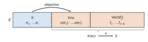
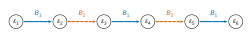
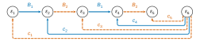

# Mines-Ponts PC — Maths 1 2026 · Corrigé brut

*Corrigé rédigé par IA, non officiel. Signalez toute erreur.*

**Sommes d'endomorphismes de carré nul.** Durée 3 h, calculatrice interdite. Tous les espaces sont des $\mathbb C$-espaces vectoriels de dimension finie.

On note $\mathcal C(E)=\{u\in\mathcal L(E):u^2=0\}$ et $\Sigma_p\mathcal C(E)$ l'ensemble des sommes de $p$ éléments de $\mathcal C(E)$. Enfin $\Sigma_\infty\mathcal C(E)=\bigcup_{p\ge1}\Sigma_p\mathcal C(E)$.

## A — Réduction des endomorphismes de carré nul

$E$ est de dimension $n>0$, $u\in\mathcal L(E)$ vérifie $u^2=0$ et $u\neq0$ ; on note $r=\operatorname{rg}(u)$.

### Question 1

Soit $\lambda$ une valeur propre de $u$ et $x\neq0$ tel que $u(x)=\lambda x$. Alors $0=u^2(x)=\lambda^2x$.

Comme $x\neq0$, on obtient $\lambda=0$.

La seule valeur propre possible est donc $0$, et c'en est bien une : $\chi_u$ est de degré $n\ge1$, donc admet une racine dans $\mathbb C$.

Ainsi $\operatorname{Sp}(u)=\{0\}$ et, $\chi_u$ étant scindé, $\chi_u=X^n$.

Sur $\mathbb C$, $\chi_u$ est scindé, $u$ est trigonalisable, et la trace est la somme des valeurs propres comptées avec leur multiplicité. D'où
$$\boxed{\begin{aligned}{}&\operatorname{Sp}(u)=\{0\},\\ &\operatorname{tr}(u)=0.\end{aligned}}$$

### Question 2

Si $y=u(x)\in\operatorname{Im}u$, alors $u(y)=u^2(x)=0$ : $\operatorname{Im}u\subset\operatorname{Ker}u$.

Par le théorème du rang, $\dim\operatorname{Ker}u=n-r$, donc $r\le n-r$, soit
$$\boxed{r\le\frac n2.}$$

### Question 3

En dimension finie, $\operatorname{Ker}u$ admet un supplémentaire $S$, de dimension $n-(n-r)=r$, avec $r\ge1$ puisque $u\neq0$.

Une base $(e_1,\dots,e_r)$ de $S$ est une famille libre telle que $\operatorname{Ker}(u)\oplus\operatorname{Vect}(e_1,\dots,e_r)=E$.

Soient $\lambda_1,\dots,\lambda_r$ tels que $\sum_i\lambda_iu(e_i)=0$. Le vecteur $x=\sum_i\lambda_ie_i$ vérifie $u(x)=0$.

Ainsi $x\in\operatorname{Ker}u\cap S=\{0\}$, donc $x=0$, et la liberté de $(e_i)$ donne $\lambda_i=0$ pour tout $i$. **La famille $(u(e_1),\dots,u(e_r))$ est libre.**

### Question 4

La famille $(u(e_1),\dots,u(e_r))$ est libre et contenue dans $\operatorname{Im}u$, de dimension $r$ : c'est une base de $\operatorname{Im}u$.

Comme $\operatorname{Im}u\subset\operatorname{Ker}u$ (Q2), on la complète en une base $(u(e_1),\dots,u(e_r),f_1,\dots,f_{n-2r})$ **de $\operatorname{Ker}u$** (aucun $f_j$ si $n=2r$).

Comme $E=S\oplus\operatorname{Ker}u$, la concaténation
$$\mathcal B=(e_1,\dots,e_r,\;u(e_1),\dots,u(e_r),\;f_1,\dots,f_{n-2r})$$
est une base de $E$.

Lisons les colonnes. Pour $i\le r$, $u(e_i)$ est le $(r+i)$-ième vecteur de $\mathcal B$.

Ensuite $u(u(e_i))=u^2(e_i)=0$. Enfin $u(f_j)=0$ car $f_j\in\operatorname{Ker}u$. D'où
$$\boxed{\operatorname{Mat}_{\mathcal B}(u)=\begin{pmatrix}0_r&0_r&(0)\\ I_r&0_r&(0)\\ (0)&(0)&0_{n-2r}\end{pmatrix}.}$$

### Question 5

Notons $M_m$ la matrice par blocs de l'énoncé ($1\le m\le n/2$).

*Existence* : $m=r$ convient (Q4), et $r>0$ car $u\neq0$.

*Unicité* : les $m$ premières colonnes de $M_m$ sont les vecteurs $\varepsilon_{m+1},\dots,\varepsilon_{2m}$ de la base canonique, les autres sont nulles. Donc $\operatorname{rg}M_m=m$.

Si $u$ est représenté par $M_m$ dans une base, alors $m=\operatorname{rg}M_m=\operatorname{rg}u=r$, car le rang d'un endomorphisme est celui de sa matrice dans toute base. Donc
$$\boxed{m=r=\operatorname{rg}(u)\ \text{est l'unique entier convenable.}}$$

## B — Somme d'un nombre arbitraire d'endomorphismes de carré nul

$E$ est de dimension $n\ge2$ et $\mathcal H(E)=\{u\in\mathcal L(E):\operatorname{tr}u=0\}$. On utilise la règle $E_{i,j}E_{k,l}=\delta_{j,k}E_{i,l}$.

### Question 6

Par la règle rappelée, $(E_{i,j})^2=\delta_{j,i}E_{i,j}$. C'est $E_{i,i}\neq0$ si $i=j$, et $0$ si $i\neq j$.
$$\boxed{(E_{i,j})^2=0\iff i\neq j.}$$

Soient $i\neq j$. La matrice $F_{i,j}$ est nulle hors des lignes et colonnes $i$ et $j$.

L'endomorphisme $f$ de $\mathbb C^n$ associé annule les $\varepsilon_k$ pour $k\notin\{i,j\}$, et
$$\begin{aligned}f(\varepsilon_i)&=\varepsilon_i-\varepsilon_j,\\ f(\varepsilon_j)&=\varepsilon_i-\varepsilon_j.\end{aligned}$$

Alors $f^2(\varepsilon_i)=f^2(\varepsilon_j)=f(\varepsilon_i)-f(\varepsilon_j)=0$, et $f^2(\varepsilon_k)=0$ pour les autres $k$.

Autrement dit, dans $(\varepsilon_i,\varepsilon_j)$, le bloc utile est $\begin{pmatrix}1&1\\-1&-1\end{pmatrix}$, de carré nul. Les produits ne commutant pas, on ne développe pas $F_{i,j}^2$ par une identité remarquable.
$$\boxed{\forall i\neq j,\quad (F_{i,j})^2=0_n.}$$

### Question 7

Soit $A=(a_{i,j})\in\mathcal H_n$, donc $a_{n,n}=-\sum_{i=1}^{n-1}a_{i,i}$.

Pour $i\le n-1$, la définition de $F_{i,n}$ donne
$$E_{i,i}-E_{n,n}=F_{i,n}-E_{i,n}+E_{n,i}.$$

La partie diagonale de $A$ s'écrit donc
$$\begin{aligned}\sum_{i=1}^na_{i,i}E_{i,i}&=\sum_{i=1}^{n-1}a_{i,i}(E_{i,i}-E_{n,n})\\ &=\sum_{i=1}^{n-1}a_{i,i}\big(F_{i,n}-E_{i,n}+E_{n,i}\big),\end{aligned}$$
et
$$\boxed{\begin{aligned}A={}&\sum_{i\neq j}a_{i,j}E_{i,j}+\sum_{i=1}^{n-1}a_{i,i}F_{i,n}\\ &-\sum_{i=1}^{n-1}a_{i,i}E_{i,n}+\sum_{i=1}^{n-1}a_{i,i}E_{n,i},\end{aligned}}$$
combinaison linéaire de matrices $E_{i,j}$ ($i\neq j$) et $F_{i,n}$ ($1\le i\le n-1$).

### Question 8

On procède par double inclusion.

*$\Sigma_\infty\mathcal C(E)\subset\mathcal H(E)$.* Soit $u=u_1+\dots+u_p$ avec $u_k^2=0$.

Chaque $u_k$ est de trace nulle (Q1 si $u_k\neq0$, évident si $u_k=0$), donc $\operatorname{tr}u=0$ par linéarité de la trace.

*$\mathcal H(E)\subset\Sigma_\infty\mathcal C(E)$.* Soit $u\in\mathcal H(E)$ et $A$ sa matrice dans une base $\mathcal B$ fixée : $\operatorname{tr}A=0$.

Par Q7, $A=\sum_k\lambda_kM_k$ où chaque $M_k$ est un $E_{i,j}$ ($i\neq j$) ou un $F_{i,n}$, donc de carré nul (Q6).

Comme $(\lambda_kM_k)^2=\lambda_k^2M_k^2=0$, la matrice $A$ est une somme finie de matrices de carré nul.

L'application $f\mapsto\operatorname{Mat}_{\mathcal B}(f)$ étant un isomorphisme d'algèbres, $u$ est une somme finie d'éléments de $\mathcal C(E)$. Les deux inclusions donnent
$$\boxed{\Sigma_\infty\mathcal C(E)=\mathcal H(E).}$$

## C — Somme de trois endomorphismes de carré nul

$E$ est de dimension $n\ge5$ ; $u$ est de trace nulle, $1$ est valeur propre de $u$ et $d=\dim\operatorname{Ker}(u-\mathrm{id}_E)>\frac{3n}4$.

### Question 9

*Rôle de $n\ge5$.* Pour tout $u$ de trace nulle, $u\neq\mathrm{id}_E$ car $\operatorname{tr}(\mathrm{id}_E)=n\neq0$. Donc $d\le n-1$.

Les contraintes imposent alors $n-1\ge d>\frac{3n}4$, soit $n>4$ : elles ne peuvent être satisfaites que si $n\ge5$.

*Construction.* Dans une base $(\varepsilon_1,\dots,\varepsilon_n)$, soit $u$ de matrice $D=\operatorname{diag}(1,\dots,1,-(n-1))$, avec $n-1$ fois la valeur $1$.

Alors $\operatorname{tr}u=(n-1)-(n-1)=0$.

Comme $-(n-1)\neq1$, la matrice $D-I_n=\operatorname{diag}(0,\dots,0,-n)$ est de rang $1$. Donc $d=n-1$, et $1$ est valeur propre.

Enfin
$$n-1>\frac{3n}4\iff n>4,$$
vrai car $n\ge5$. **Un tel endomorphisme existe.**

### Question 10

On pose $w=u-\mathrm{id}_E$. Comme $\operatorname{Ker}w=\operatorname{Ker}(u-\mathrm{id}_E)$ est de dimension $d$, le théorème du rang donne $\operatorname{rg}w=n-d<\frac n4$.

Comme $v^2=0$, et sans supposer que $v$ et $w$ commutent :
$$\begin{aligned}(w-v)^2&=w^2-wv-vw+v^2\\ &=w\circ(w-v)-v\circ w.\end{aligned}$$

*Sous-additivité du rang.* Pour $f,g\in\mathcal L(E)$, on a $\operatorname{Im}(f+g)\subset\operatorname{Im}f+\operatorname{Im}g$.

La réunion d'une base de $\operatorname{Im}f$ et d'une base de $\operatorname{Im}g$ engendre $\operatorname{Im}f+\operatorname{Im}g$. Donc
$$\operatorname{rg}(f+g)\le\dim(\operatorname{Im}f+\operatorname{Im}g)\le\operatorname{rg}f+\operatorname{rg}g.$$

*Rang d'une composée* (cours de première année) : $\operatorname{rg}(f\circ g)\le\min(\operatorname{rg}f,\operatorname{rg}g)$.

D'où $\operatorname{rg}\big(w\circ(w-v)\big)\le\operatorname{rg}w$ et $\operatorname{rg}(v\circ w)\le\operatorname{rg}w$, puis
$$\operatorname{rg}\big((w-v)^2\big)\le2\operatorname{rg}w<\frac n2.$$
$$\boxed{\operatorname{rg}\big((w-v)^2\big)<\frac n2.}$$

### Question 11

Soit $K=\operatorname{Ker}\big((w-v)^2\big)$, de dimension $k=n-\operatorname{rg}\big((w-v)^2\big)$. Par Q10, $k>\frac n2>0$.

*Stabilité.* Si $x\in K$, alors
$$(w-v)^2\big((w-v)(x)\big)=(w-v)\big((w-v)^2(x)\big)=0,$$
donc $(w-v)(x)\in K$ : $K$ est stable par $w-v$.

L'endomorphisme $g$ induit par $w-v$ sur $K$ vérifie $g^2=0$. Par Q1 si $g\ne0$ (évident sinon), $\chi_g=X^k$.

Comme $u-v=(w-v)+\mathrm{id}_E$, $K$ est stable par $u-v$, qui y induit $g+\mathrm{id}_K$. Son polynôme caractéristique est $\chi_g(X-1)=(X-1)^k$.

Dans une base de $E$ obtenue en complétant une base de $K$, la matrice de $u-v$ est triangulaire par blocs $\begin{pmatrix}G&\ast\\0&G'\end{pmatrix}$, où $G$ représente $g+\mathrm{id}_K$. Donc
$$\chi_{u-v}=\chi_G\,\chi_{G'}=(X-1)^k\chi_{G'}.$$
**$1$ est valeur propre de $u-v$, de multiplicité au moins $n-\operatorname{rg}\big((w-v)^2\big)$.**

### Question 12

Posons $a=u-v$ et supposons $-a=\varphi\circ a\circ\varphi^{-1}$. Deux endomorphismes semblables ont même polynôme caractéristique, donc $\chi_a=\chi_{-a}$.

Si $A$ représente $a$ dans une base,
$$\begin{aligned}\chi_{-a}(X)&=\det(XI_n+A)\\ &=(-1)^n\det(-XI_n-A)\\ &=(-1)^n\chi_a(-X).\end{aligned}$$

Soit $\mu$ la multiplicité de $1$ dans $\chi_a$ : $\chi_a=(X-1)^\mu R$ avec $R(1)\neq0$. Alors
$$\begin{aligned}\chi_a(X)&=(-1)^n\chi_a(-X)\\ &=(-1)^{n+\mu}(X+1)^\mu R(-X).\end{aligned}$$

Le polynôme $R(-X)$ ne s'annule pas en $-1$, puisque $R(1)\neq0$. Donc $-1$ est racine de $\chi_a$ de multiplicité exactement $\mu$.

Par Q10 et Q11, $\mu\ge n-\operatorname{rg}\big((w-v)^2\big)>n-\frac n2$. Donc
$$\boxed{1\text{ et }-1\text{ sont valeurs propres de }u-v,\ \text{de multiplicité }\mu>\frac n2.}$$

### Question 13

Raisonnons par l'absurde : supposons $u=v_1+v_2+v_3$ avec $v_1,v_2,v_3\in\mathcal C(E)$.

Avec $v=v_3\in\mathcal C(E)$, on a $u-v=v_1+v_2\in\Sigma_2\mathcal C(E)$. Le théorème de Wang et Wu (condition nécessaire) fournit $\varphi\in GL(E)$ tel que $-(u-v)=\varphi\circ(u-v)\circ\varphi^{-1}$.

Par Q12, $1$ et $-1$, distincts, sont racines de $\chi_{u-v}$, de multiplicités strictement supérieures à $\frac n2$ chacune.

Or $\chi_{u-v}$ est de degré $n$, donc la somme des multiplicités de ses racines vaut $n$. On obtiendrait $n>\frac n2+\frac n2=n$ : contradiction. Donc
$$\boxed{u\notin\Sigma_3\mathcal C(E).}$$
Comme $\operatorname{tr}u=0$, Q8 donne néanmoins $u\in\Sigma_\infty\mathcal C(E)$.

## D — Intermède : matrices de Hessenberg

$n\ge2$. Pour $C=(c_1,\dots,c_{n-1})\in\mathbb C^{n-1}$, $E_C=\sum_{k=1}^{n-1}c_kE_{k,n}$. Enfin $J_n=\sum_{j=1}^{n-1}E_{j+1,j}$.

### Question 14

Soit $B(x)=xI_n-A$ et $N(x)=\widetilde{B(x)}^{(k,n)}$ : ses lignes sont les lignes $1,\dots,k-1,k+1,\dots,n$ de $B(x)$, ses colonnes les colonnes $1,\dots,n-1$.

On découpe les lignes en $\{1,\dots,k-1\}\cup\{k+1,\dots,n\}$ et les colonnes en $\{1,\dots,k-1\}\cup\{k,\dots,n-1\}$ :
$$N(x)=\begin{pmatrix}xI_{k-1}-A_{k-1}&\ast\\ Z&T\end{pmatrix},$$
où $A_{k-1}$ est le bloc supérieur gauche de taille $k-1$ de $A$.

- $Z$ : ses coefficients sont des $b_{i,j}$ avec $i\ge k+1$ et $j\le k-1$, donc $i\ge j+2$. Ainsi $b_{i,j}=-a_{i,j}=0$ (Hessenberg).
- $T\in\mathcal M_{n-k}(\mathbb C)$ : son coefficient $(p,q)$ est $b_{k+p,\,k-1+q}$.
  Si $p>q$, alors $k+p\ge(k-1+q)+2$, d'où $0$.
  Si $p=q$, il vaut $-a_{k+p,k+p-1}\neq0$ (régularité).

Donc $T$ est triangulaire supérieure de diagonale $(-a_{k+1,k},\dots,-a_{n,n-1})$, indépendante de $x$.

Le déterminant d'une matrice triangulaire par blocs est le produit des déterminants des blocs diagonaux :
$$\det N(x)=\chi_{A_{k-1}}(x)\prod_{i=k}^{n-1}(-a_{i+1,i}),$$
avec les conventions $\chi_{A_0}=1$ ($k=1$) et produit vide égal à $1$ ($k=n$).

Le polynôme $P_k=\Big(\prod_{i=k}^{n-1}(-a_{i+1,i})\Big)\chi_{A_{k-1}}$ convient. Il est de degré exactement $k-1$, car $\chi_{A_{k-1}}$ est unitaire de degré $k-1$ et le produit est non nul.

Il est unique : deux polynômes qui coïncident sur $\mathbb C$, ensemble infini, sont égaux. Son coefficient dominant est
$$\boxed{(-1)^{n-k}\prod_{i=k}^{n-1}a_{i+1,i}\neq0,\ \text{avec}\ \deg P_k=k-1.}$$

### Question 15

$E_C$ ne modifie que la colonne $n$. La sous-matrice $\widetilde{(xI_n-A-E_C)}^{(k,n)}$ ne contient pas cette colonne : elle vaut $\widetilde{(xI_n-A)}^{(k,n)}$, de déterminant $P_k(x)$.

Le déterminant est linéaire par rapport à la dernière colonne. Celle de $xI_n-A-E_C$ est celle de $xI_n-A$ moins $(c_1,\dots,c_{n-1},0)^\top$.

En développant le second terme selon la colonne $n$, on obtient $\chi_{A+E_C}=\chi_A-\Phi(C)$, où
$$\Phi(C)=\sum_{k=1}^{n-1}(-1)^{k+n}c_kP_k.$$

L'application $\Phi:\mathbb C^{n-1}\to\mathbb C_{n-2}[X]$ est linéaire. Les $P_k$ ($1\le k\le n-1$) sont de degrés $0,1,\dots,n-2$ (Q14).

Cette famille échelonnée en degrés est libre, de cardinal $n-1=\dim\mathbb C_{n-2}[X]$ : c'est une base. L'application $\Phi$ envoie la base canonique sur la base $\big((-1)^{k+n}P_k\big)_k$, c'est donc un isomorphisme.

$P$ et $\chi_A$ sont unitaires de degré $n$ et ont le même coefficient $-\operatorname{tr}A$ sur $X^{n-1}$ : $\chi_A-P\in\mathbb C_{n-2}[X]$. Alors
$$\begin{aligned}\chi_{A+E_C}=P&\iff\Phi(C)=\chi_A-P\\ &\iff C=\Phi^{-1}(\chi_A-P).\end{aligned}$$
$$\boxed{\exists!\,C\in\mathbb C^{n-1},\quad\chi_{A+E_C}=P.}$$

### Question 16

$J_n$ est de Hessenberg régulière et de trace nulle. La matrice $xI_n-J_n$ est triangulaire inférieure de diagonale $(x,\dots,x)$, donc $\chi_{J_n}=X^n$.

Ainsi $C=0$ convient. Le polynôme $X^n$ est unitaire, de coefficient $0=-\operatorname{tr}J_n$ sur $X^{n-1}$ : l'unicité de Q15 s'applique et donne
$$\boxed{C=0.}$$

Plus précisément, Q14 donne $P_k=(-1)^{n-k}X^{k-1}$ pour $J_n$, et Q15 donne
$$\chi_{J_n+E_C}=X^n-\sum_{k=1}^{n-1}c_kX^{k-1},$$
qui vaut $X^n$ si et seulement si $C=0$.

### Question 17

Soit $A=(a_{i,j})$ la matrice de $u$ dans $(e_1,\dots,e_n)$. Comme $A$ est de Hessenberg, $u(e_j)=\sum_{i\le\min(j+1,n)}a_{i,j}e_i$.

Posons $\pi_k=\prod_{i=1}^ka_{i+1,i}$, non nul par régularité. Montrons par récurrence sur $k\in[\![0,n-1]\!]$ que
$$u^k(e_1)\in\pi_ke_{k+1}+\operatorname{Vect}(e_1,\dots,e_k).$$

Pour $k=0$ : $u^0(e_1)=e_1$ et $\pi_0=1$.

Si c'est vrai au rang $k\le n-2$, alors $u^{k+1}(e_1)=\pi_ku(e_{k+1})+\sum_{i\le k}\lambda_iu(e_i)$.

Les $u(e_i)$, $i\le k$, sont dans $\operatorname{Vect}(e_1,\dots,e_{k+1})$, et $u(e_{k+1})\in a_{k+2,k+1}e_{k+2}+\operatorname{Vect}(e_1,\dots,e_{k+1})$. D'où le rang $k+1$, avec $\pi_{k+1}=\pi_ka_{k+2,k+1}\neq0$.

La matrice de $(u^k(e_1))_{0\le k\le n-1}$ dans $(e_1,\dots,e_n)$ est donc triangulaire supérieure de diagonale $(\pi_0,\dots,\pi_{n-1})$. Aucun $\pi_k$ n'est nul : elle est inversible.
$$\boxed{(u^k(e_1))_{0\le k\le n-1}\ \text{est une base de }E.}$$

### Question 18

Soit $u$ l'endomorphisme de $\mathbb C^n$ canoniquement associé à $A$, et $(e_1,\dots,e_n)$ la base canonique.

*$u^n=0$.* Par le théorème de Cayley-Hamilton, $\chi_u(u)=0$, et $\chi_u=\chi_A=X^n$, donc $u^n=0$.

*Base cyclique.* Par Q17, la famille $(f_1,\dots,f_n)$ définie par $f_k=u^{k-1}(e_1)$ est une base.

On a $u(f_k)=f_{k+1}$ pour $k\le n-1$, et $u(f_n)=u^n(e_1)=0$. La matrice de $u$ dans cette base est donc $(\delta_{i,j+1})=J_n$.

Les matrices $A$ et $J_n$ représentent le même endomorphisme dans deux bases :
$$\boxed{A\ \text{est semblable à}\ J_n.}$$

## E — Somme de quatre endomorphismes de carré nul

$n\ge2$ ; $V=\sum_{j=1}^{n-2}E_{j+1,j}$ (les lignes de $J_n$, sauf la dernière, nulle).

### Question 19

*$A+V$ est de Hessenberg.* Si $i>j+1$, alors $i>j$ et $(i,j)\neq(n,n-1)$, donc $a_{i,j}=0$ ; de plus $v_{i,j}=0$.

*$A+V$ est régulière.* Pour $i\le n-2$, le coefficient $(i+1,i)$ de $A+V$ vaut $0+1=1$.

Le coefficient $(n,n-1)$ vaut $a_{n,n-1}+0\neq0$.

*Trace.* $V$ est de diagonale nulle, donc $\operatorname{tr}(A+V)=\operatorname{tr}A=0$.

Appliquons Q15 à $A+V$ et $P=X^n$, unitaire de degré $n$, de coefficient $0=-\operatorname{tr}(A+V)$ sur $X^{n-1}$.

Il existe $C_0$ tel que $\chi_{A+V+E_{C_0}}=X^n$.

Or $E_{C_0}$ ne touche que la colonne $n$, aux lignes $1$ à $n-1$.

Il ne touche donc ni la zone $i>j+1$ (qui impose $j\le n-2$), ni les coefficients sous-diagonaux (colonnes $\le n-1$).

Ainsi $A+V+E_{C_0}$ est de Hessenberg régulière, de polynôme caractéristique $X^n$. Par Q18,
$$\boxed{A+V+E_{C_0}\ \text{est semblable à}\ J_n.}$$

### Question 20

On répartit les coefficients de $J_n$ selon la parité de la colonne :
$$\begin{aligned}B_1&=\sum_{\substack{1\le j\le n-1\\ j\text{ impair}}}E_{j+1,j},\\ B_2&=\sum_{\substack{1\le j\le n-1\\ j\text{ pair}}}E_{j+1,j}.\end{aligned}$$

Alors $B_1+B_2=J_n$, et en toute position l'une des deux matrices est nulle.

Le carré de $B_1$ se calcule par la règle des $E_{i,j}$, la somme portant sur $j,j'$ impairs :
$$B_1^2=\sum E_{j+1,j}E_{j'+1,j'}=\sum\delta_{j,j'+1}E_{j+1,j'}.$$
Cette somme est nulle car $j-j'$ est pair, donc différent de $1$. De même $B_2^2=0$ ($B_2=0$ si $n=2$).
$$\boxed{\begin{aligned}{}&J_n=B_1+B_2,\\ &B_1^2=B_2^2=0.\end{aligned}}$$

### Question 21

Posons
$$\begin{aligned}B_1&=\sum_{\substack{j\le n-2\\ j\text{ impair}}}E_{j+1,j}+\sum_{\substack{i\le n-1\\ i\text{ pair}}}c_iE_{i,n},\\ B_2&=\sum_{\substack{j\le n-2\\ j\text{ pair}}}E_{j+1,j}+\sum_{\substack{i\le n-1\\ i\text{ impair}}}c_iE_{i,n}.\end{aligned}$$

Clairement $B_1+B_2=V+E_C$. Lisons $B_1$ sur la base canonique $(\varepsilon_j)$ :

- pour $j\le n-2$ impair, $B_1\varepsilon_j=\varepsilon_{j+1}$, avec $j+1\le n-1$ pair ;
- pour $j\le n-1$ pair, ou $j=n-1$, $B_1\varepsilon_j=0$ ;
- $B_1\varepsilon_n=\sum_{i\le n-1,\ i\text{ pair}}c_i\varepsilon_i$.

Ainsi $B_1$ envoie chaque $\varepsilon_j$ dans $\operatorname{Vect}(\varepsilon_i:\ i\le n-1,\ i\text{ pair})$. Or $B_1$ annule tous ces $\varepsilon_i$. Donc $B_1^2=0$.

Symétriquement, $B_2$ envoie chaque $\varepsilon_j$ dans $\operatorname{Vect}(\varepsilon_i:\ i\le n-1,\ i\text{ impair})$.

Ce sous-espace est annulé par $B_2$ : pour $i$ impair, $i$ n'est pas une colonne paire $\le n-2$ et $i\neq n$, donc $B_2\varepsilon_i=0$.

Ainsi $B_2^2=0$.
$$\boxed{\begin{aligned}{}&V+E_C=B_1+B_2,\\ &B_1^2=B_2^2=0.\end{aligned}}$$

### Question 22

$v$ n'étant pas une homothétie, $n\ge2$. Comme $\chi_v$ est scindé sur $\mathbb C$, on distingue deux cas.

*Cas 1 : $v$ a deux valeurs propres distinctes $\lambda\neq\mu$*, de vecteurs propres $x$ et $y$.

Ces vecteurs forment une famille libre, et $P=\operatorname{Vect}(x,y)$ est un plan stable. Le vecteur $z=x+y\neq0$ n'est pas propre.

En effet, $v(z)=\nu z$ donnerait $\lambda x+\mu y=\nu x+\nu y$, donc $\lambda=\nu=\mu$ par liberté, ce qui est exclu.

*Cas 2 : $v$ a une seule valeur propre $\lambda$.* Alors $\chi_v=(X-\lambda)^n$. Soit $(h_1,\dots,h_n)$ une base de trigonalisation et $H_k=\operatorname{Vect}(h_1,\dots,h_k)$.

La matrice de $N=v-\lambda\,\mathrm{id}$ y est triangulaire supérieure stricte. Donc $N(H_k)\subset H_{k-1}$, puis $N^n=0$.

De plus $N\neq0$ car $v$ n'est pas une homothétie.

Soit $y$ avec $Ny\neq0$, et $p\ge1$ le plus grand entier tel que $N^py\neq0$ (on a $p\le n-1$).

Le vecteur $x=N^{p-1}y$ vérifie $Nx\neq0$ et $N^2x=0$.

La famille $(x,Nx)$ est libre. Si $\alpha x+\beta Nx=0$, appliquer $N$ donne $\alpha Nx=0$, donc $\alpha=0$, puis $\beta=0$.

Le plan $P=\operatorname{Vect}(x,Nx)$ est stable, car
$$\begin{aligned}v(x)&=\lambda x+Nx,\\ v(Nx)&=\lambda Nx.\end{aligned}$$

Enfin $x$ n'est pas propre : $v(x)=\nu x$ donnerait $Nx=(\nu-\lambda)x$, contraire à la liberté de $(x,Nx)$.

**Dans les deux cas, il existe un plan stable par $v$ contenant un vecteur non nul qui n'est pas vecteur propre de $v$.**

### Question 23

Soit $M\notin\operatorname{Vect}(I_n)$ et $v$ l'endomorphisme canoniquement associé : $v$ n'est pas une homothétie.

Par Q22, soit $P$ un plan stable et $f_1\in P$ non nul et non propre. Alors $f_2=v(f_1)\in P$, et $(f_1,f_2)$ est libre, sinon $f_1$ serait propre : c'est une base de $P$.

On la complète en une base $\mathcal F=(f_1,\dots,f_n)$. Comme $v(P)\subset P$,
$$\begin{aligned}\operatorname{Mat}_{\mathcal F}(v)&=\begin{pmatrix}B&D\\0&C'\end{pmatrix},\\ B&=\begin{pmatrix}0&b_{1,2}\\1&b_{2,2}\end{pmatrix}.\end{aligned}$$
Puisque $v(f_1)=f_2$, on a $b_{2,1}=1\neq0$.

La matrice $C'\in\mathcal M_{n-2}(\mathbb C)$ est trigonalisable : $C'=QCQ^{-1}$ avec $C$ triangulaire supérieure. Avec $R=\begin{pmatrix}I_2&0\\0&Q\end{pmatrix}$,
$$R^{-1}\begin{pmatrix}B&D\\0&C'\end{pmatrix}R=\begin{pmatrix}B&DQ\\0&C\end{pmatrix}.$$

Par transitivité de la similitude, $M$ est semblable à
$$\boxed{\begin{pmatrix}B&(?)\\(0)&C\end{pmatrix},\ \text{avec}\ b_{2,1}\neq0\ \text{et}\ C\ \text{triangulaire supérieure.}}$$
(Pour $n=2$, le bloc $C$ est vide.)

### Question 24

Soit $M\notin\operatorname{Vect}(I_n)$. Alors $M^\top\notin\operatorname{Vect}(I_n)$.

Par Q23, il existe $S\in GL_n(\mathbb C)$ telle que $M^\top=SNS^{-1}$, avec $N=\begin{pmatrix}B&X\\0&C\end{pmatrix}$, $b_{2,1}\neq0$ et $C$ triangulaire supérieure.

En transposant, $M=(S^\top)^{-1}N^\top S^\top$ : $M$ est semblable à
$$N^\top=\begin{pmatrix}B^\top&0\\X^\top&C^\top\end{pmatrix}.$$

Au-dessus de la diagonale, $N^\top$ n'a qu'un seul coefficient éventuellement non nul : le coefficient $(1,2)$, égal à $b_{2,1}\neq0$. En effet, le bloc en haut à droite est nul et $C^\top$ est triangulaire inférieure.

Soit $W=\sum_{i=1}^nE_{i,n+1-i}$, matrice de la permutation $i\mapsto n+1-i$. On a $W^2=I_n$ et
$$(WN^\top W)_{i,j}=(N^\top)_{n+1-i,\,n+1-j}.$$

Pour $i>j$, on a $n+1-i<n+1-j$. Ce coefficient est donc nul, sauf si $(n+1-i,n+1-j)=(1,2)$, c'est-à-dire $(i,j)=(n,n-1)$, où il vaut $b_{2,1}\neq0$.

Donc $A=WN^\top W$ est presque triangulaire supérieure, et
$$\boxed{M\ \text{est semblable à la matrice presque triangulaire supérieure}\ A=WN^\top W.}$$

### Question 25

Soit $u\in\mathcal L(E)$ de trace nulle, $n=\dim E$.

*Homothéties.* Si $u=\lambda\,\mathrm{id}_E$, alors $n\lambda=0$, donc $u=0=0+0+0+0\in\Sigma_4\mathcal C(E)$. Cela règle en particulier le cas $n=1$.

*Cas général* ($n\ge2$, $u$ non homothétique). Soit $M$ la matrice de $u$ dans une base : $M\notin\operatorname{Vect}(I_n)$ et $\operatorname{tr}M=0$.

Par Q24, $M=SAS^{-1}$ avec $A$ presque triangulaire supérieure, et $\operatorname{tr}A=\operatorname{tr}M=0$.

Par Q19, il existe $C_0$ et $Q\in GL_n(\mathbb C)$ tels que $A+V+E_{C_0}=QJ_nQ^{-1}$.

Par Q20, $J_n=B_1+B_2$, et par Q21, $V+E_{C_0}=B_3+B_4$, avec $B_k^2=0$ pour $k=1,2,3,4$. Donc
$$A=QB_1Q^{-1}+QB_2Q^{-1}+(-B_3)+(-B_4).$$

C'est une somme de quatre matrices de carré nul, car $(QB_kQ^{-1})^2=QB_k^2Q^{-1}=0$ et $(-B_k)^2=B_k^2=0$. Puis
$$M=SQB_1(SQ)^{-1}+SQB_2(SQ)^{-1}-SB_3S^{-1}-SB_4S^{-1},$$
encore somme de quatre matrices de carré nul.

Par l'isomorphisme d'algèbres $f\mapsto\operatorname{Mat}(f)$, on obtient $u=u_1+u_2+u_3+u_4$ avec $u_k\in\mathcal C(E)$ :
$$\boxed{u\in\Sigma_4\mathcal C(E).}$$

Avec Q8 et Q13, pour $n\ge5$ :
$$\begin{aligned}{}&\Sigma_3\mathcal C(E)\subsetneq\Sigma_4\mathcal C(E),\\ &\Sigma_4\mathcal C(E)=\Sigma_\infty\mathcal C(E)=\mathcal H(E),\end{aligned}$$
et le nombre $4$ est optimal.
