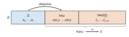
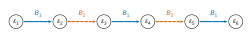
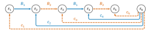

# Mines-Ponts PC — Maths 1 2026 · Corrigé guidé

*Corrigé rédigé par IA, non officiel. Signalez toute erreur.*

## Présentation du sujet

**Thème.** Le problème étudie les endomorphismes d'un $\mathbb C$-espace vectoriel de dimension finie qui s'écrivent comme somme d'endomorphismes de **carré nul**. Une somme de tels endomorphismes est forcément de trace nulle.

Le sujet montre que cette condition suffit, puis cherche combien de termes il faut : trois ne suffisent pas toujours, quatre suffisent toujours.

Notations : $\mathcal C(E)=\{u:u^2=0\}$ ; $\Sigma_p\mathcal C(E)$ désigne les sommes de $p$ éléments de $\mathcal C(E)$, et $\Sigma_\infty\mathcal C(E)$ la réunion des $\Sigma_p\mathcal C(E)$.

**Découpage (25 questions, 3 heures, sans calculatrice).**

- **Partie A (Q1–Q5)** : forme réduite d'un endomorphisme de carré nul, avec le bloc $I_r$ sous la diagonale ; le rang en est le seul invariant. Cours de réduction pur.
- **Partie B (Q6–Q8)** : calcul sur les matrices élémentaires $E_{i,j}$ et sur $F_{i,j}$ ; on obtient $\Sigma_\infty\mathcal C(E)=\{u:\operatorname{tr}u=0\}$. Au passage, Q7 montre qu'au plus $n^2-1$ termes suffisent.
- **Partie C (Q9–Q13)** : en dimension $n\ge5$, un endomorphisme de trace nulle qui n'est pas somme de trois carrés nuls. Le théorème de Wang et Wu est admis. Argument de rang, puis de multiplicités de valeurs propres.
- **Partie D (Q14–Q18)** : matrices de Hessenberg. En modifiant seulement la dernière colonne, on peut imposer n'importe quel polynôme caractéristique de trace donnée (Q15). Une Hessenberg régulière nilpotente est semblable à $J_n$ (Q18).
- **Partie E (Q19–Q25)** : assemblage. Q19 utilise Q15 et Q18 ; Q20–Q21 sont des constructions explicites ; Q22–Q24 forment un bloc de réduction autonome ; Q25 combine Q19, Q20, Q21 et Q24.

**Notions mobilisées.** Valeurs propres, polynôme caractéristique et multiplicités, trace, théorème du rang, supplémentaires et bases adaptées, matrices par blocs et déterminant triangulaire par blocs. Aussi : développement d'un déterminant selon une colonne, trigonalisation sur $\mathbb C$, théorème de Cayley-Hamilton, similitude, sous-espaces stables, familles de polynômes échelonnées en degrés.

**Difficulté et gestion du temps.** Sujet long mais très guidé, sans calcul lourd. Les parties sont largement indépendantes : seule E utilise D.

À ne pas laisser passer : Q1, Q2, Q6, Q9, Q16 et Q25, qu'on peut rédiger en admettant les résultats antérieurs. Le rapport 2026 rappelle que les questions faciles du début doivent être correctement rédigées pour rapporter tous leurs points.

**Ce que le rapport 2026 juge discriminant.** Selon le rapport, la partie A a été très bien réussie par les bons candidats, mais trahit souvent un cours mal su. La liberté de $(u(e_1),\dots,u(e_r))$ en Q3 a permis de valoriser les candidats rigoureux. « La troisième partie, un peu plus délicate a permis aux très bons candidats de se distinguer » (p. 10).

En détail : l'inégalité de rang de Q10 a été très rarement obtenue, la fin de Q11 très peu traitée, Q14 a posé « d'immenses difficultés », Q15 a été très peu réussie (p. 68–69). Q20 n'a été réussie que par quelques candidats, et les questions Q21 à Q25 ont très peu été abordées.

**Énoncé.** Coquille sans incidence en Q14 : « Présiser » pour « Préciser ». Les deux versions du sujet (scan officiel et version recomposée) ont le même texte.

## Partie A — Réduction des endomorphismes de carré nul

On travaille avec $u\neq0$, $u^2=0$ et $r=\operatorname{rg}u$. L'idée directrice est l'inclusion $\operatorname{Im}u\subset\operatorname{Ker}u$, qui permet de construire une base adaptée à $\operatorname{Im}u\subset\operatorname{Ker}u\subset E$.

### Question 1

> [!INDICATION]
> Un polynôme annulateur de $u$ s'annule en toute valeur propre de $u$.

> [!INDICATION]
> Pour la trace, se souvenir que sur $\mathbb C$ tout endomorphisme est trigonalisable, et de ce que vaut alors la trace.

#### Solution

Soit $\lambda$ une valeur propre et $x\neq0$ tel que $u(x)=\lambda x$. Alors $0=u^2(x)=\lambda^2x$, donc $\lambda=0$ car $x\neq0$.

Et $0$ est bien valeur propre : $\chi_u$, de degré $n\ge1$, a une racine dans $\mathbb C$. Donc $\operatorname{Sp}(u)=\{0\}$ et $\chi_u=X^n$.

Sur $\mathbb C$, $u$ est trigonalisable et sa trace est la somme de ses valeurs propres comptées avec multiplicité :
$$\boxed{\begin{aligned}{}&\operatorname{Sp}(u)=\{0\},\\ &\operatorname{tr}(u)=0.\end{aligned}}$$

> [!JURY]
> Le rapport 2026 (p. 68) note que la première étape a été bien réussie, mais demande ensuite de bien préciser que, dans $\mathbb C$, « la trace est la somme des valeurs propres comptées avec leur multiplicité ».

> [!PIEGE]
> « La seule valeur propre est $0$ donc la trace est nulle » n'est un argument que si l'on précise que la trace est la somme des valeurs propres **avec multiplicité**, ce qui demande un polynôme caractéristique scindé. Sur $\mathbb R$, une matrice peut ne pas avoir de valeur propre du tout.

### Question 2

> [!INDICATION]
> Traduire $u^2=0$ en une inclusion entre $\operatorname{Im}u$ et $\operatorname{Ker}u$, puis passer aux dimensions.

#### Solution

Si $y=u(x)$, alors $u(y)=u^2(x)=0$ : $\operatorname{Im}u\subset\operatorname{Ker}u$.

Donc $r\le\dim\operatorname{Ker}u=n-r$ par le théorème du rang :
$$\boxed{r\le\frac n2.}$$

> [!METHODE]
> Pour deux endomorphismes, $v\circ u=0\iff\operatorname{Im}u\subset\operatorname{Ker}v$. C'est le premier réflexe devant toute relation du type $u^2=0$ ou $uv=0$.

### Question 3

> [!INDICATION]
> En dimension finie, tout sous-espace admet un supplémentaire. Quelle est sa dimension ?

> [!INDICATION]
> Pour la liberté, partir d'une combinaison linéaire nulle des $u(e_i)$ et faire « remonter » la linéarité de $u$ : quel vecteur est alors dans le noyau ?

#### Solution

$\operatorname{Ker}u$ admet un supplémentaire $S$, de dimension $n-(n-r)=r\ge1$ (car $u\neq0$).

Toute base $(e_1,\dots,e_r)$ de $S$ convient : elle est libre et $\operatorname{Ker}(u)\oplus\operatorname{Vect}(e_1,\dots,e_r)=E$.

Si $\sum_i\lambda_iu(e_i)=0$, le vecteur $x=\sum_i\lambda_ie_i$ vérifie $u(x)=0$. Il est dans $\operatorname{Ker}u$ **et** dans $S$, donc nul.

La liberté des $e_i$ donne alors $\lambda_i=0$ pour tout $i$. **La famille $(u(e_1),\dots,u(e_r))$ est libre.**

> [!PIEGE]
> Le rapport 2026 signale « un nombre non négligeable de copies » qui prennent les $e_i$ dans $\operatorname{Im}u$. C'est impossible : $\operatorname{Im}u\subset\operatorname{Ker}u$ (Q2), et un vecteur non nul de $\operatorname{Ker}u$ ne peut pas être dans un supplémentaire de $\operatorname{Ker}u$.

> [!JURY]
> Pour l'existence, le jury accepte l'existence d'un supplémentaire comme le théorème de la base incomplète. La liberté de $(u(e_1),\dots,u(e_r))$ « a permis de valoriser les candidats rigoureux » (rapport 2026, p. 68) : chaque implication doit être écrite.

> [!METHODE]
> La restriction de $u$ à un supplémentaire du noyau est injective (c'est la preuve du théorème du rang). Elle envoie donc toute famille libre de ce supplémentaire sur une famille libre.

### Question 4

> [!INDICATION]
> La famille de Q3 est une base de $\operatorname{Im}u$. Dans quel sous-espace plus grand vit-elle, d'après Q2 ?

> [!INDICATION]
> Compléter cette famille en une base de $\operatorname{Ker}u$, puis assembler avec les $e_i$. Pour placer le bloc $I_r$ **sous** la diagonale, réfléchir à l'ordre des vecteurs.

#### Solution

$(u(e_1),\dots,u(e_r))$ est libre, de cardinal $r=\dim\operatorname{Im}u$ : c'est une base de $\operatorname{Im}u\subset\operatorname{Ker}u$.

On la complète en une base $(u(e_1),\dots,u(e_r),f_1,\dots,f_{n-2r})$ **de $\operatorname{Ker}u$**, avec $n-2r\ge0$ par Q2 (aucun $f_j$ si $n=2r$). Comme $E=S\oplus\operatorname{Ker}u$,
$$\mathcal B=(e_1,\dots,e_r,\;u(e_1),\dots,u(e_r),\;f_1,\dots,f_{n-2r})$$
est une base de $E$.

On lit les colonnes : $u(e_i)$ est le $(r+i)$-ième vecteur de $\mathcal B$, $u(u(e_i))=0$ et $u(f_j)=0$. Donc
$$\boxed{\operatorname{Mat}_{\mathcal B}(u)=\begin{pmatrix}0_r&0_r&(0)\\ I_r&0_r&(0)\\ (0)&(0)&0_{n-2r}\end{pmatrix}.}$$



Image mentale : $u$ envoie bijectivement $S$ sur $\operatorname{Im}u$, puis annule tout $\operatorname{Ker}u$.

> [!PIEGE]
> Erreur fréquente selon le rapport 2026 : compléter $(e_1,\dots,e_r,u(e_1),\dots,u(e_r))$ en une base de $E$ quelconque. Si les vecteurs ajoutés ne sont pas dans $\operatorname{Ker}u$, leurs images ne sont pas nulles et la matrice n'a pas la forme voulue. C'est **dans $\operatorname{Ker}u$** qu'il faut compléter.

> [!PIEGE]
> Mettre les $u(e_i)$ avant les $e_i$ place le bloc $I_r$ au-dessus de la diagonale : on obtient la transposée de la matrice demandée.

### Question 5

> [!INDICATION]
> L'existence est donnée par Q4. Pour l'unicité, chercher un invariant de similitude qui se lit directement sur la matrice par blocs.

#### Solution

*Existence* : $m=r>0$ convient (Q4, $u\neq0$).

*Unicité* : la matrice par blocs $M_m$ a pour colonnes non nulles $\varepsilon_{m+1},\dots,\varepsilon_{2m}$, qui forment une famille libre, donc $\operatorname{rg}M_m=m$.

Si $u$ est représenté par $M_m$ dans une base, $m=\operatorname{rg}M_m=\operatorname{rg}u=r$.
$$\boxed{m=\operatorname{rg}(u).}$$

> [!METHODE]
> Pour prouver l'unicité d'une forme réduite, on lit sur elle un invariant de similitude (rang, trace, polynôme caractéristique, dimension d'un noyau). Ici, deux endomorphismes de carré nul sont semblables si et seulement s'ils ont le même rang.

## Partie B — Somme d'un nombre arbitraire d'endomorphismes de carré nul

On veut $\Sigma_\infty\mathcal C(E)=\{\operatorname{tr}=0\}$. Une inclusion découle de Q1. Pour l'autre, on exhibe une famille génératrice de l'hyperplan des matrices de trace nulle formée de matrices de carré nul.

### Question 6

> [!INDICATION]
> Utiliser la règle $E_{i,j}E_{k,l}=\delta_{j,k}E_{i,l}$.

> [!INDICATION]
> Pour $F_{i,j}$, plutôt que de développer seize produits, regarder ce que fait l'endomorphisme associé sur les vecteurs de base $\varepsilon_i$ et $\varepsilon_j$.

#### Solution

Par la règle rappelée, $(E_{i,j})^2=\delta_{j,i}E_{i,j}$ vaut $E_{i,i}\neq0$ si $i=j$, et $0$ sinon :
$$\boxed{(E_{i,j})^2=0\iff i\neq j.}$$

Pour $i\neq j$, l'endomorphisme $f$ associé à $F_{i,j}$ annule les $\varepsilon_k$, $k\notin\{i,j\}$, et
$$\begin{aligned}f(\varepsilon_i)&=\varepsilon_i-\varepsilon_j,\\ f(\varepsilon_j)&=\varepsilon_i-\varepsilon_j.\end{aligned}$$

Donc $f^2(\varepsilon_i)=f^2(\varepsilon_j)=f(\varepsilon_i)-f(\varepsilon_j)=0$.

Matriciellement, le bloc utile, lignes et colonnes $i,j$, est $\begin{pmatrix}1&1\\-1&-1\end{pmatrix}$, de carré nul :
$$\boxed{(F_{i,j})^2=0_n\quad(i\neq j).}$$

> [!JURY]
> Le rapport 2026 (p. 68) regrette que la règle $E_{i,j}E_{k,\ell}=\delta_{j,k}E_{i,\ell}$ ne soit pas systématiquement rappelée : on l'énonce avant de s'en servir.

> [!PIEGE]
> Développer $F_{i,j}^2$ comme $(D+N)^2=D^2+2DN+N^2$ est faux : selon le rapport 2026, « l'utilisation d'une identité remarquable ne peut pas aboutir car les matrices ne commutent pas ».

> [!METHODE]
> Une matrice $2\times2$ de trace et de déterminant nuls est de carré nul : son polynôme caractéristique est $X^2$. Ici, la trace vaut $1-1=0$ et le déterminant $-1+1=0$.

### Question 7

> [!INDICATION]
> Seule la partie diagonale de $A$ pose problème ; les coefficients hors diagonale s'écrivent directement avec des $E_{i,j}$, $i\neq j$.

> [!INDICATION]
> Que vaut $F_{i,n}+E_{n,i}-E_{i,n}$ ? Et comment la condition de trace nulle permet-elle d'écrire la partie diagonale avec des différences $E_{i,i}-E_{n,n}$ ?

#### Solution

Soit $A\in\mathcal H_n$ : $a_{n,n}=-\sum_{i<n}a_{i,i}$. Pour $i\le n-1$, la définition de $F_{i,n}$ donne
$$E_{i,i}-E_{n,n}=F_{i,n}-E_{i,n}+E_{n,i}.$$

La partie diagonale de $A$ s'écrit donc
$$\begin{aligned}\sum_{i=1}^na_{i,i}E_{i,i}&=\sum_{i=1}^{n-1}a_{i,i}(E_{i,i}-E_{n,n})\\ &=\sum_{i=1}^{n-1}a_{i,i}\big(F_{i,n}-E_{i,n}+E_{n,i}\big).\end{aligned}$$

D'où
$$\boxed{\begin{aligned}A={}&\sum_{i\neq j}a_{i,j}E_{i,j}+\sum_{i=1}^{n-1}a_{i,i}F_{i,n}\\ &-\sum_{i=1}^{n-1}a_{i,i}E_{i,n}+\sum_{i=1}^{n-1}a_{i,i}E_{n,i}.\end{aligned}}$$
Les termes parasites $E_{i,n}$ et $E_{n,i}$ sont hors diagonale car $i\neq n$.

> [!JURY]
> Le rapport 2026 (p. 68) exige une combinaison explicite ou un argument de dimension complet : « une explication vague sur la façon dont on peut écrire une matrice de trace nulle comme combinaison linéaire des matrices de l'énoncé en pensant que le correcteur va combler les détails n'est pas envisageable ».

> [!METHODE]
> Variante par la dimension, acceptée par le jury : la famille a $n(n-1)+(n-1)=n^2-1$ éléments, tous dans $\mathcal H_n$, de dimension $n^2-1$. Il faut alors **prouver** sa liberté (par exemple en lisant les coefficients hors diagonale, puis diagonaux) pour conclure que c'est une base.

### Question 8

> [!INDICATION]
> Double inclusion. Une inclusion repose sur Q1 et la linéarité de la trace.

> [!INDICATION]
> Pour l'autre, la propriété « être de carré nul » est-elle stable par multiplication par un scalaire ? Par passage de la matrice à l'endomorphisme ?

#### Solution

*$\subset$.* Si $u=u_1+\dots+u_p$ avec $u_k^2=0$, chaque $u_k$ est de trace nulle (Q1 si $u_k\neq0$, évident sinon). Donc $\operatorname{tr}u=0$ par linéarité.

*$\supset$.* Si $\operatorname{tr}u=0$, la matrice $A$ de $u$ dans une base est de trace nulle.

Par Q7, $A=\sum_k\lambda_kM_k$ avec $M_k^2=0$ (Q6), et $(\lambda_kM_k)^2=\lambda_k^2M_k^2=0$.

Donc $A$ est une somme finie de matrices de carré nul. Par l'isomorphisme d'algèbres $f\mapsto\operatorname{Mat}(f)$, $u$ est une somme finie d'éléments de $\mathcal C(E)$.
$$\boxed{\Sigma_\infty\mathcal C(E)=\{u\in\mathcal L(E):\operatorname{tr}u=0\}.}$$

> [!PIEGE]
> Le rapport 2026 relève que « des candidats ont montré une inclusion et ont conclu qu'il y avait égalité sans aucune explication supplémentaire » (p. 68). Les deux inclusions sont à démontrer.

> [!PIEGE]
> $\mathcal C(E)$ n'est pas un sous-espace vectoriel : une combinaison linéaire de matrices de carré nul n'est pas de carré nul en général. Ce qui est vrai, c'est que **chaque terme** $\lambda_kM_k$ est de carré nul. C'est tout l'enjeu du problème.

## Partie C — Somme de trois endomorphismes de carré nul

Ici $n\ge5$, et $u$ est de trace nulle avec $d=\dim\operatorname{Ker}(u-\mathrm{id})>3n/4$ : $u$ est « presque » l'identité.

On montre que $u-v$, pour $v$ de carré nul, garde la valeur propre $1$ avec une multiplicité énorme. C'est incompatible avec la symétrie spectrale que donne le théorème de Wang et Wu. C'est la partie que le jury juge la plus sélective.

### Question 9

> [!INDICATION]
> Chercher un exemple diagonal : beaucoup de $1$ sur la diagonale, et le moins possible d'autres coefficients, choisis pour que la trace soit nulle.

> [!INDICATION]
> Avant de construire, se demander quelle valeur maximale peut prendre $d$ pour un endomorphisme de trace nulle : c'est là que sert $n\ge5$.

#### Solution

*Rôle de $n\ge5$.* Un endomorphisme de trace nulle n'est pas $\mathrm{id}_E$, de trace $n\neq0$. Donc $d\le n-1$.

Les contraintes imposent alors $n-1\ge d>\frac{3n}4$, soit $n>4$ : elles ne sont réalisables que si $n\ge5$.

*Construction.* Soit $u$ de matrice $D=\operatorname{diag}(1,\dots,1,-(n-1))$ dans une base, avec $n-1$ fois la valeur $1$. Sa trace est nulle.

Comme $-(n-1)\neq1$, $D-I_n=\operatorname{diag}(0,\dots,0,-n)$ est de rang $1$. Donc $1$ est valeur propre et $d=n-1$.

Enfin
$$n-1>\frac{3n}4\iff n>4,$$
vrai pour $n\ge5$. **Un tel endomorphisme existe.**

> [!JURY]
> Selon le rapport 2026 (p. 68), « la nécessité que $n$ soit supérieure ou égal à 5 n'a pas souvent été expliquée ». On écrit l'équivalence $n-1>\frac{3n}4\iff n>4$, et l'on dit pourquoi $d$ ne peut pas dépasser $n-1$.

> [!PIEGE]
> Vérifier que le sous-espace propre n'est pas plus gros qu'annoncé : ici, $-(n-1)\neq1$.

### Question 10

> [!INDICATION]
> Que vaut $\operatorname{rg}w$ en fonction de $d$ ? Développer $(w-v)^2$ sans supposer que $v$ et $w$ commutent.

> [!INDICATION]
> Majorer chaque terme séparément ne donne que $3\operatorname{rg}w$, insuffisant. Regrouper deux des termes pour faire apparaître $w$ en facteur à gauche.

#### Solution

$\operatorname{Ker}w=\operatorname{Ker}(u-\mathrm{id}_E)$, donc $\operatorname{rg}w=n-d<\frac n4$. Avec $v^2=0$ :
$$\begin{aligned}(w-v)^2&=w^2-wv-vw\\ &=w\circ(w-v)-v\circ w.\end{aligned}$$

*Sous-additivité, à démontrer.* Pour $f,g\in\mathcal L(E)$, $\operatorname{Im}(f+g)\subset\operatorname{Im}f+\operatorname{Im}g$.

Ce dernier espace est engendré par la réunion d'une base de $\operatorname{Im}f$ et d'une base de $\operatorname{Im}g$. Donc
$$\operatorname{rg}(f+g)\le\dim(\operatorname{Im}f+\operatorname{Im}g)\le\operatorname{rg}f+\operatorname{rg}g.$$

*Composée, cours de première année.* $\operatorname{rg}(f\circ g)\le\min(\operatorname{rg}f,\operatorname{rg}g)$.

Ainsi $w\circ(w-v)$ et $v\circ w$ sont de rang au plus $\operatorname{rg}w$, et
$$\operatorname{rg}\big((w-v)^2\big)\le2\operatorname{rg}w<\frac n2.$$
$$\boxed{\operatorname{rg}\big((w-v)^2\big)<\frac n2.}$$

> [!PIEGE]
> Écrire $(w-v)^2=w^2-2wv+v^2$ : l'anneau $\mathcal L(E)$ n'est pas commutatif. Le rapport 2026 note que « de trop nombreuses copies ont utilisé l'identité remarquable, alors que $w$ et $v$ ne commutent pas ».

> [!JURY]
> Le rapport 2026 (p. 68) donne la même factorisation et précise le niveau de preuve : « La première inégalité doit être démontrée dans la copie mais pas les deux suivantes car elles sont en page 23 du programme de PCSI. » La sous-additivité se prouve donc en deux lignes ; les inégalités sur la composée se citent.

> [!METHODE]
> On a souvent intérêt à factoriser avant de majorer un rang : chaque facteur commun $w$ apporte la petite borne $\operatorname{rg}w$.

### Question 11

> [!INDICATION]
> Sur $K=\operatorname{Ker}\big((w-v)^2\big)$, l'endomorphisme induit par $w-v$ est de carré nul. Que dit la partie A de son polynôme caractéristique ?

> [!INDICATION]
> Passer de $w-v$ à $u-v$ par translation de l'identité, puis faire remonter l'information de $K$ à $E$ avec une matrice triangulaire par blocs dans une base adaptée à $K$.

#### Solution

$K$ est de dimension $k=n-\operatorname{rg}\big((w-v)^2\big)$, et $k>\frac n2>0$ par Q10.

*Stabilité, à démontrer.* Pour $x\in K$,
$$(w-v)^2\big((w-v)x\big)=(w-v)\big((w-v)^2x\big)=0.$$
Donc $K$ est stable par $w-v$, qui y induit $g$ avec $g^2=0$. Par Q1 (ou trivialement si $g=0$), $\chi_g=X^k$.

Comme $u-v=(w-v)+\mathrm{id}_E$, $K$ est stable par $u-v$, qui y induit $g+\mathrm{id}_K$. Son polynôme caractéristique est $\det\big((X-1)\mathrm{id}_K-g\big)=\chi_g(X-1)=(X-1)^k$.

Dans une base de $E$ complétant une base de $K$, la matrice de $u-v$ est $\begin{pmatrix}G&\ast\\0&G'\end{pmatrix}$, d'où
$$\chi_{u-v}=(X-1)^k\chi_{G'}.$$
**$1$ est valeur propre de $u-v$ de multiplicité au moins $n-\operatorname{rg}\big((w-v)^2\big)$.**

> [!JURY]
> Le rapport 2026 (p. 68) rappelle que, devant « en remarquant que », « il est attendu que ce résultat soit démontré » : la stabilité de $K$ se prouve. Il conseille ensuite d'étudier la restriction à $K$, de carré nul, et d'utiliser Q1 pour la trigonaliser avec des zéros sur la diagonale : c'est la démarche ci-dessus.

> [!PIEGE]
> Il s'agit de la multiplicité comme racine du polynôme caractéristique, pas de la dimension du sous-espace propre. Celle-ci peut être bien plus petite : $g$ n'est pas nul en général.

> [!METHODE]
> Si $F$ est stable par $a$, le polynôme caractéristique de l'endomorphisme induit divise $\chi_a$ : on le voit sur la matrice triangulaire par blocs dans une base adaptée.

### Question 12

> [!INDICATION]
> Deux endomorphismes semblables ont le même polynôme caractéristique. Exprimer $\chi_{-a}$ à l'aide de $\chi_a$.

> [!INDICATION]
> Pour transférer la multiplicité de $1$ à $-1$, factoriser $\chi_a$ par la bonne puissance de $(X-1)$ et substituer $-X$ à $X$.

#### Solution

Soit $a=u-v$ avec $-a=\varphi a\varphi^{-1}$. Alors $\chi_a=\chi_{-a}$. Si $A$ représente $a$,
$$\begin{aligned}\chi_{-a}(X)&=\det(XI_n+A)\\ &=(-1)^n\chi_a(-X).\end{aligned}$$
Donc $\chi_a(X)=(-1)^n\chi_a(-X)$.

Écrivons $\chi_a=(X-1)^\mu R$ avec $R(1)\neq0$. Alors
$$\begin{aligned}\chi_a(X)&=(-1)^n(-X-1)^\mu R(-X)\\ &=(-1)^{n+\mu}(X+1)^\mu R(-X),\end{aligned}$$
et $R(-X)$ ne s'annule pas en $-1$. Donc $-1$ est racine de multiplicité exactement $\mu$.

Par Q10–Q11, $\mu\ge n-\operatorname{rg}\big((w-v)^2\big)>\frac n2$ :
$$\boxed{1\text{ et }-1\text{ sont valeurs propres de }u-v\text{ de multiplicité }>\frac n2.}$$

> [!JURY]
> Une fois la similitude de $u-v$ et $-(u-v)$ remarquée, le rapport 2026 (p. 68) précise qu'« il faut une démonstration du résultat, pas une affirmation ». L'identité $\chi_a(X)=(-1)^n\chi_a(-X)$ et la factorisation par $(X-1)^\mu$ sont cette démonstration.

> [!PIEGE]
> « Si $\lambda$ est valeur propre, $-\lambda$ aussi » ne parle que des valeurs propres, pas des multiplicités. L'identité polynomiale est nécessaire.

### Question 13

> [!INDICATION]
> Par l'absurde : si $u=v_1+v_2+v_3$, quel endomorphisme est dans $\Sigma_2\mathcal C(E)$ ?

> [!INDICATION]
> Deux racines distinctes d'un polynôme de degré $n$ ne peuvent pas avoir chacune une multiplicité strictement supérieure à $n/2$.

#### Solution

Supposons par l'absurde $u=v_1+v_2+v_3$ avec $v_k\in\mathcal C(E)$. Posons $v=v_3$ : $u-v=v_1+v_2\in\Sigma_2\mathcal C(E)$.

Le théorème de Wang et Wu (sens « il faut ») fournit $\varphi$ avec $-(u-v)=\varphi(u-v)\varphi^{-1}$.

Par Q12, $1$ et $-1$ ont dans $\chi_{u-v}$ des multiplicités $>\frac n2$ ; leur somme dépasserait $n=\deg\chi_{u-v}$. Contradiction :
$$\boxed{u\notin\Sigma_3\mathcal C(E).}$$
Comme $\operatorname{tr}u=0$, $u\in\Sigma_\infty\mathcal C(E)$ (Q8) : trois termes ne suffisent pas toujours.

> [!JURY]
> « Dans cette question, on attendait un raisonnement par l'absurde rigoureux » (rapport 2026, p. 68) : hypothèse explicite, application de Wang et Wu à $u-v_3$, contradiction nommée. Le rapport général critique aussi les preuves qui se terminent par « donc impossible » sans dire ce qui est contredit.

> [!PIEGE]
> Appliquer le théorème de Wang et Wu à $u$ lui-même n'a pas de sens : c'est $u-v_3$ qui est somme de **deux** carrés nuls.

## Partie D — Intermède : matrices de Hessenberg

Une matrice de Hessenberg est nulle strictement sous la sous-diagonale ; elle est régulière si sa sous-diagonale n'a aucun zéro. Profil pour $n=5$ ($\ast$ quelconque, $\bullet$ non nul) :

```text
* * * * *
• * * * *
0 • * * *
0 0 • * *
0 0 0 • *
```

L'objectif est double : modifier la dernière colonne pour imposer le polynôme caractéristique (Q15) ; reconnaître $J_n$ derrière toute Hessenberg régulière nilpotente (Q18).

### Question 14

> [!INDICATION]
> Écrire la sous-matrice (lignes privées de $k$, colonnes $1$ à $n-1$) et la découper en séparant les lignes avant et après $k$, et les colonnes avant $k$ et à partir de $k$.

> [!INDICATION]
> Que deviennent, dans cette sous-matrice, les coefficients sous-diagonaux de $xI_n-A$ ? Repérer un bloc triangulaire et un bloc nul, puis calculer le déterminant par blocs.

#### Solution

Notons $B(x)=xI_n-A$ et $N(x)$ la sous-matrice. On découpe les lignes en $\{1..k-1\}\cup\{k+1..n\}$ et les colonnes en $\{1..k-1\}\cup\{k..n-1\}$ :
$$N(x)=\begin{pmatrix}xI_{k-1}-A_{k-1}&\ast\\ Z&T\end{pmatrix},$$
où $A_{k-1}$ est le bloc supérieur gauche de taille $k-1$ de $A$.

- $Z$ : ligne $i\ge k+1$, colonne $j\le k-1$, donc $i\ge j+2$ et $b_{i,j}=-a_{i,j}=0$.
- $T$ : son coefficient $(p,q)$ est $b_{k+p,k-1+q}$. Il est nul si $p>q$, car $k+p\ge(k-1+q)+2$.
  Il vaut $-a_{k+p,k+p-1}\neq0$ si $p=q$.

$T$ est donc triangulaire supérieure de diagonale $(-a_{k+1,k},\dots,-a_{n,n-1})$, sans $x$. Par le déterminant triangulaire par blocs,
$$\det N(x)=\chi_{A_{k-1}}(x)\prod_{i=k}^{n-1}(-a_{i+1,i}),$$
avec les conventions $\chi_{A_0}=1$ et produit vide égal à $1$.

Ce polynôme $P_k$ est de degré exactement $k-1$. Il est unique car deux polynômes égaux sur $\mathbb C$, ensemble infini, sont égaux. Son coefficient dominant est
$$\boxed{(-1)^{n-k}\prod_{i=k}^{n-1}a_{i+1,i}\neq0,\ \text{avec}\ \deg P_k=k-1.}$$

> [!JURY]
> « Cette question a posé d'immenses difficultés aux candidats » (rapport 2026, p. 68–69) : signes des coefficients de $xI_n-A$, forme d'une Hessenberg régulière, suppression de la $k$-ième ligne et de la $n$-ième colonne. Le jury attendait exactement deux déterminants : un polynôme caractéristique de taille $k-1$ et celui d'un bloc triangulaire supérieur. Il encourage les calculs « soigneux, étape par étape ».

> [!PIEGE]
> Les cas extrêmes : pour $k=1$, $P_1$ est la constante $\prod_{i=1}^{n-1}(-a_{i+1,i})$ ; pour $k=n$, $P_n=\chi_{A_{n-1}}$ est unitaire. Raisonner sur les indices d'origine évite les décalages après suppression d'une ligne.

### Question 15

> [!INDICATION]
> $E_C$ ne touche que la dernière colonne. Développer $\det(xI_n-A-E_C)$ selon cette colonne : quels cofacteurs apparaissent, et dépendent-ils de $C$ ?

> [!INDICATION]
> On obtient $\chi_{A+E_C}=\chi_A-\Phi(C)$ avec $\Phi$ linéaire. Pourquoi les $P_k$, $k\le n-1$, forment-ils une base d'un espace de polynômes bien choisi ? Où vit $\chi_A-P$ ?

#### Solution

Les sous-matrices obtenues en retirant la colonne $n$ ne dépendent pas de $C$ : leurs déterminants sont les $P_k(x)$.

Par linéarité du déterminant par rapport à la dernière colonne, puis développement selon celle-ci, $\chi_{A+E_C}=\chi_A-\Phi(C)$, où
$$\Phi(C)=\sum_{k=1}^{n-1}(-1)^{k+n}c_kP_k.$$

Les $P_1,\dots,P_{n-1}$ ont pour degrés $0,\dots,n-2$ (Q14). Cette famille échelonnée est libre, de cardinal $n-1$ : c'est une base de $\mathbb C_{n-2}[X]$.

L'application linéaire $\Phi:\mathbb C^{n-1}\to\mathbb C_{n-2}[X]$ envoie la base canonique sur une base : c'est un isomorphisme.

$P$ et $\chi_A$ sont unitaires de degré $n$, de même coefficient $-\operatorname{tr}A$ en $X^{n-1}$, donc $\chi_A-P\in\mathbb C_{n-2}[X]$. Ainsi
$$\begin{aligned}\chi_{A+E_C}=P&\iff\Phi(C)=\chi_A-P\\ &\iff C=\Phi^{-1}(\chi_A-P).\end{aligned}$$
$$\boxed{\exists!\,C\in\mathbb C^{n-1},\quad\chi_{A+E_C}=P.}$$

> [!JURY]
> Le rapport 2026 (p. 69) la juge « très peu réussie ». Elle se rédige pourtant en admettant Q14 : seuls comptent les degrés des $P_k$.

> [!METHODE]
> Une famille de polynômes de degrés deux à deux distincts est libre ; si elle a pour degrés exactement $0,1,\dots,m$, c'est une base de $\mathbb K_m[X]$. C'est l'outil standard pour l'existence et l'unicité de coefficients.

> [!PIEGE]
> La condition sur le coefficient de $X^{n-1}$ n'est pas décorative : $\operatorname{tr}(A+E_C)=\operatorname{tr}A$ pour tout $C$, et sans elle $\chi_A-P$ n'est pas dans $\mathbb C_{n-2}[X]$.

### Question 16

> [!INDICATION]
> Calculer d'abord le polynôme caractéristique de $J_n$ lui-même, puis invoquer l'unicité.

#### Solution

$xI_n-J_n$ est triangulaire de diagonale $(x,\dots,x)$ : $\chi_{J_n}=X^n$.

Les hypothèses de Q15 sont réunies : $J_n$ est de Hessenberg régulière, et $X^n$ est unitaire, de coefficient $0=-\operatorname{tr}J_n$ en $X^{n-1}$. Comme $C=0$ convient, l'unicité donne
$$\boxed{C=0.}$$

Vérification de cohérence : pour $J_n$, $P_k=(-1)^{n-k}X^{k-1}$, et
$$\chi_{J_n+E_C}=X^n-\sum_{k=1}^{n-1}c_kX^{k-1},$$
qui vaut $X^n$ si et seulement si $C=0$. La matrice $J_n+E_C$ est la matrice compagnon de ce polynôme.

### Question 17

> [!INDICATION]
> Dans quel sous-espace $\operatorname{Vect}(e_1,\dots,e_m)$ se trouve $u(e_j)$ pour une matrice de Hessenberg ?

> [!INDICATION]
> Par récurrence sur $k$, déterminer le plus grand indice $m$ tel que $u^k(e_1)$ ait une composante non nulle sur $e_m$, et calculer cette composante.

#### Solution

Hessenberg donne $u(e_j)\in\operatorname{Vect}(e_1,\dots,e_{j+1})$, avec la composante $a_{j+1,j}$ sur $e_{j+1}$.

Posons $\pi_k=\prod_{i=1}^ka_{i+1,i}$. Montrons par récurrence sur $k\le n-1$ que
$$u^k(e_1)\in\pi_ke_{k+1}+\operatorname{Vect}(e_1,\dots,e_k).$$

Initialisation : $\pi_0=1$. Hérédité : dans $u^{k+1}(e_1)=\pi_ku(e_{k+1})+\sum_{i\le k}\lambda_iu(e_i)$, seul $u(e_{k+1})$ apporte une composante sur $e_{k+2}$, égale à $a_{k+2,k+1}$.

D'où $\pi_{k+1}=\pi_ka_{k+2,k+1}$. Par régularité, aucun $a_{i+1,i}$ n'est nul, donc aucun $\pi_k$.

La matrice de $(u^k(e_1))_{0\le k\le n-1}$ dans $(e_i)$ est triangulaire supérieure de diagonale $(\pi_0,\dots,\pi_{n-1})$, sans zéro : elle est inversible.
$$\boxed{(u^k(e_1))_{0\le k\le n-1}\text{ est une base de }E.}$$

> [!JURY]
> Selon le rapport 2026 (p. 69), les candidats voient que la matrice est triangulaire supérieure, mais la justification que sa diagonale est sans zéro, tirée de la régularité, a manqué de rigueur. La récurrence avec le coefficient explicite $\pi_k$ règle ce point.

### Question 18

> [!INDICATION]
> Avec Q17, écrire la matrice de $u$ dans la base $(e_1,u(e_1),\dots,u^{n-1}(e_1))$. Il manque une seule information : $u^n(e_1)$.

> [!INDICATION]
> Quel théorème du cours relie un endomorphisme à son polynôme caractéristique ?

#### Solution

Soit $u$ associé à $A$ dans la base canonique.

*$u^n=0$.* Par le théorème de Cayley-Hamilton, $\chi_u(u)=0$. Or $\chi_u=X^n$, donc $u^n=0$.

*Matrice dans la base cyclique.* Posons $f_k=u^{k-1}(e_1)$ : c'est une base par Q17. On a $u(f_k)=f_{k+1}$ pour $k\le n-1$, et $u(f_n)=u^n(e_1)=0$.

La matrice de $u$ dans $(f_k)$ est donc $J_n$ :
$$\boxed{A\text{ est semblable à }J_n.}$$

> [!PIEGE]
> Le rapport 2026 (p. 69) met en garde : « le fait que $A$ et $J_n$ aient le même polynôme caractéristique ne permet pas de conclure ». Par exemple, $0_n$ et $J_n$ ont tous deux $X^n$ pour polynôme caractéristique sans être semblables. C'est la base de Q17 qui fait le travail.

> [!METHODE]
> Pour montrer qu'une matrice est semblable à une matrice donnée, on cherche une base dans laquelle l'endomorphisme associé a cette matrice, en lisant la matrice cible colonne par colonne. Ici $J_n$ dit : $f_1\mapsto f_2\mapsto\dots\mapsto f_n\mapsto0$.

> [!METHODE]
> Le rapport 2026 utilise Q17 et Cayley-Hamilton. Variante sans Cayley-Hamilton : dans une base de trigonalisation $(h_k)$, la diagonale est nulle, donc $u(H_k)\subset H_{k-1}$ pour $H_k=\operatorname{Vect}(h_1,\dots,h_k)$, et $u^n=0$.

## Partie E — Somme de quatre endomorphismes de carré nul

On assemble. Une matrice presque triangulaire de trace nulle, augmentée de $V+E_{C_0}$, devient semblable à $J_n$ (Q19). $J_n$ et $V+E_{C_0}$ sont chacune somme de deux carrés nuls (Q20, Q21).

Toute matrice non scalaire se ramène à la forme presque triangulaire (Q22–Q24). D'où quatre termes (Q25).

Profil d'une matrice presque triangulaire supérieure pour $n=5$ :

```text
* * * * *
0 * * * *
0 0 * * *
0 0 0 * *
0 0 0 • *
```

### Question 19

> [!INDICATION]
> Montrer que $A+V$ est de Hessenberg régulière : qui fournit chacun des coefficients sous-diagonaux ?

> [!INDICATION]
> Enchaîner Q15 (avec quel polynôme $P$ ?) puis Q18, en vérifiant que l'ajout de $E_{C_0}$ ne détruit pas la structure.

#### Solution

*Hessenberg* : si $i>j+1$, alors $(i,j)\neq(n,n-1)$, donc $a_{i,j}=0$, et $v_{i,j}=0$.

*Régulière* : pour $i\le n-2$, le coefficient $(i+1,i)$ vaut $0+1=1$ ; en $(n,n-1)$, il vaut $a_{n,n-1}\neq0$.

*Trace* : $\operatorname{tr}(A+V)=\operatorname{tr}A=0$.

Par Q15 avec $P=X^n$, il existe $C_0$ tel que $\chi_{A+V+E_{C_0}}=X^n$.

L'ajout de $E_{C_0}$ ne modifie que la colonne $n$, aux lignes $1$ à $n-1$ : la matrice reste de Hessenberg régulière. Par Q18 :
$$\boxed{A+V+E_{C_0}\text{ est semblable à }J_n.}$$

> [!JURY]
> Le rapport 2026 (p. 69) attend l'usage de Q15 et Q18, et ajoute qu'« il est bien entendu essentiel de s'assurer que les hypothèses d'application sont bien vérifiées ». Trois vérifications : régularité de $A+V$ (c'est là que sert $a_{n,n-1}\neq0$), trace nulle, structure conservée par l'ajout de $E_{C_0}$.

### Question 20

> [!INDICATION]
> $J_n$ envoie $\varepsilon_1\mapsto\varepsilon_2\mapsto\dots\mapsto\varepsilon_n\mapsto0$. Une matrice de carré nul ne doit pas contenir deux « flèches » consécutives de cette chaîne.

> [!INDICATION]
> Répartir les coefficients de $J_n$ entre $B_1$ et $B_2$ selon une règle d'alternance.

#### Solution

$$\begin{aligned}B_1&=\sum_{\substack{1\le j\le n-1\\ j\text{ impair}}}E_{j+1,j},\\ B_2&=\sum_{\substack{1\le j\le n-1\\ j\text{ pair}}}E_{j+1,j}.\end{aligned}$$

On a $B_1+B_2=J_n$, et en chaque position l'une des deux est nulle.

$B_1^2$ est une somme de $E_{j+1,j}E_{j'+1,j'}=\delta_{j,j'+1}E_{j+1,j'}$ avec $j,j'$ impairs.

Or $j-j'$ est pair, donc jamais égal à $1$ : $B_1^2=0$. De même $B_2^2=0$.
$$\boxed{\begin{aligned}{}&J_n=B_1+B_2,\\ &B_1^2=B_2^2=0.\end{aligned}}$$



> [!JURY]
> Question d'initiative, réussie par quelques candidats seulement selon le rapport 2026 (p. 69). Le jury conseille de tester ses essais : « On les encourage à vérifier par le calcul que les matrices proposées fonctionnent ». Un essai sur $J_3$ ou $J_4$ suffit à voir l'alternance.

### Question 21

> [!INDICATION]
> Garder pour la partie $V$ l'alternance de Q20 (la chaîne s'arrête désormais à $\varepsilon_{n-1}$). Les coefficients $c_i$ de $E_C$ correspondent à des flèches $\varepsilon_n\to\varepsilon_i$.

> [!INDICATION]
> Pour qu'un $B_k$ reste de carré nul, chaque flèche $\varepsilon_n\to\varepsilon_i$ doit arriver sur un vecteur que ce même $B_k$ annule. Lequel des deux paquets annule $\varepsilon_i$ ? Cela dépend de la parité de $i$.

#### Solution

$$\begin{aligned}B_1&=\sum_{\substack{j\le n-2\\ j\text{ impair}}}E_{j+1,j}+\sum_{\substack{i\le n-1\\ i\text{ pair}}}c_iE_{i,n},\\ B_2&=\sum_{\substack{j\le n-2\\ j\text{ pair}}}E_{j+1,j}+\sum_{\substack{i\le n-1\\ i\text{ impair}}}c_iE_{i,n}.\end{aligned}$$

Alors $B_1+B_2=V+E_C$.

L'image de $B_1$ est contenue dans $\operatorname{Vect}(\varepsilon_i:i\le n-1\text{ pair})$.

En effet, les colonnes impaires $j\le n-2$ donnent $\varepsilon_{j+1}$ avec $j+1$ pair, et la colonne $n$ donne une combinaison des $\varepsilon_i$, $i$ pair.

Or $B_1$ annule les $\varepsilon_i$ d'indice pair $\le n-1$ : ce ne sont ni des colonnes impaires, ni la colonne $n$. Donc $B_1^2=0$.

De même, l'image de $B_2$ est contenue dans $\operatorname{Vect}(\varepsilon_i:i\le n-1\text{ impair})$, que $B_2$ annule : $B_2^2=0$.
$$\boxed{\begin{aligned}{}&V+E_C=B_1+B_2,\\ &B_1^2=B_2^2=0.\end{aligned}}$$



Pour $n=2$ : $V=0$, $B_1=0$ et $B_2=c_1E_{1,2}$.

> [!PIEGE]
> Mettre tout $E_C$ dans $B_1$ échoue : $B_1^2$ contient alors $\sum_{j\text{ impair}\le n-2}c_jE_{j+1,n}$, non nul dès qu'un tel $c_j$ est non nul.

> [!METHODE]
> Voir une matrice à coefficients $0/1$ comme un graphe de flèches entre vecteurs de base : $B^2=0$ signifie qu'aucune flèche n'arrive sur un vecteur d'où part une autre flèche, ou, plus généralement, que $\operatorname{Im}B\subset\operatorname{Ker}B$.

### Question 22

> [!INDICATION]
> Distinguer selon que $v$ a au moins deux valeurs propres distinctes ou une seule.

> [!INDICATION]
> Avec deux valeurs propres, penser à la somme de deux vecteurs propres. Avec une seule valeur propre $\lambda$, utiliser une base de trigonalisation pour étudier $N=v-\lambda\,\mathrm{id}$, et chercher $x$ tel que $Nx\neq0$ mais $N^2x=0$.

#### Solution

Comme $v$ n'est pas une homothétie, $n\ge2$.

*Deux valeurs propres $\lambda\neq\mu$*, de vecteurs propres $x$ et $y$ : ils sont libres, et $\operatorname{Vect}(x,y)$ est stable.

Le vecteur $x+y$ n'est pas propre, car $v(x+y)=\nu(x+y)$ forcerait $\lambda=\nu=\mu$.

*Une seule valeur propre $\lambda$* : dans une base de trigonalisation, $N=v-\lambda\,\mathrm{id}$ est triangulaire supérieure stricte. Donc $N^n=0$ (argument de drapeau), et $N\neq0$.

Soit $y$ avec $Ny\neq0$, et $p\ge1$ maximal tel que $N^py\neq0$.

Le vecteur $x=N^{p-1}y$ vérifie alors $Nx\neq0$ et $N^2x=0$.

La famille $(x,Nx)$ est libre : $\alpha x+\beta Nx=0$ donne, en appliquant $N$, $\alpha=0$, puis $\beta=0$.

Le plan $\operatorname{Vect}(x,Nx)$ est stable, car
$$\begin{aligned}v(x)&=\lambda x+Nx,\\ v(Nx)&=\lambda Nx.\end{aligned}$$
Enfin $x$ n'est pas propre : $v(x)=\nu x$ donnerait $Nx=(\nu-\lambda)x$.

**Il existe un plan stable par $v$ contenant un vecteur non nul non propre.**

> [!PIEGE]
> Prendre $x$ non propre et poser $P=\operatorname{Vect}(x,v(x))$ ne marche pas : ce plan n'a aucune raison d'être stable. Il faut à la fois la stabilité et un vecteur non propre.

### Question 23

> [!INDICATION]
> Dans le plan de Q22, prendre comme premier vecteur de base un vecteur non propre $f_1$ ; quel second vecteur, naturel, est dans le plan et donne $b_{2,1}\neq0$ ?

> [!INDICATION]
> Compléter en une base de $\mathbb C^n$ ; le bloc en bas à droite n'est pas triangulaire, mais on peut le trigonaliser sans toucher au bloc $B$ en conjuguant par une matrice diagonale par blocs.

#### Solution

L'endomorphisme $v$ associé à $M$ n'est pas une homothétie.

Par Q22, soit $P$ stable et $f_1\in P$ non propre ; $f_2=v(f_1)\in P$ et $(f_1,f_2)$ est une base de $P$.

On complète en $\mathcal F=(f_1,\dots,f_n)$ ; par stabilité de $P$,
$$\operatorname{Mat}_{\mathcal F}(v)=\begin{pmatrix}B&D\\0&C'\end{pmatrix}.$$
Comme $v(f_1)=f_2$, on a $b_{2,1}=1$.

On trigonalise $C'=QCQ^{-1}$ et, avec $R=\operatorname{diag}(I_2,Q)$ (par blocs),
$$R^{-1}\begin{pmatrix}B&D\\0&C'\end{pmatrix}R=\begin{pmatrix}B&DQ\\0&C\end{pmatrix}.$$

Donc $M$ est semblable à
$$\boxed{\begin{pmatrix}B&(?)\\(0)&C\end{pmatrix},\ \text{avec}\ b_{2,1}\neq0\ \text{et}\ C\ \text{triangulaire supérieure.}}$$

> [!JURY]
> On écrit « est semblable à » en toutes lettres. Le rapport 2026 (p. 6) déconseille le symbole $\sim$ pour la similitude, « porteur de confusion avec l'équivalence entre matrices », sauf à le définir dès sa première utilisation.

> [!METHODE]
> Conjuguer par $\operatorname{diag}(I_p,Q)$ agit sur le bloc diagonal inférieur par similitude ($C'\mapsto Q^{-1}C'Q$) sans changer le bloc supérieur gauche. C'est la technique standard pour réduire un bloc à la fois.

### Question 24

> [!INDICATION]
> La forme de Q23 a son bloc $2\times2$ « non triangulaire » en haut à gauche ; on le veut en bas à droite. Retourner l'ordre de la base envoie le haut à gauche en bas à droite, mais transforme « triangulaire supérieure » en « triangulaire inférieure ». Quelle autre opération échange triangulaire inférieure et supérieure ?

> [!INDICATION]
> Appliquer Q23 à la transposée $M^\top$, transposer la similitude obtenue, puis conjuguer par la matrice de la permutation $i\mapsto n+1-i$.

#### Solution

$M^\top\notin\operatorname{Vect}(I_n)$. Par Q23, $M^\top=SNS^{-1}$ avec $N=\begin{pmatrix}B&X\\0&C\end{pmatrix}$, $b_{2,1}\neq0$ et $C$ triangulaire supérieure.

En transposant, $M=(S^\top)^{-1}N^\top S^\top$ est semblable à
$$N^\top=\begin{pmatrix}B^\top&0\\X^\top&C^\top\end{pmatrix}.$$
Le seul coefficient éventuellement non nul strictement au-dessus de la diagonale de $N^\top$ est le coefficient $(1,2)$, égal à $b_{2,1}\neq0$.

Soit $W=\sum_iE_{i,n+1-i}$. On a $W^2=I_n$ et
$$(WN^\top W)_{i,j}=(N^\top)_{n+1-i,n+1-j}.$$

Pour $i>j$, on a $n+1-i<n+1-j$. Ce coefficient est donc nul, sauf pour $(n+1-i,n+1-j)=(1,2)$, soit $(i,j)=(n,n-1)$, où il vaut $b_{2,1}\neq0$.
$$\boxed{M\text{ est semblable à }WN^\top W,\text{ presque triangulaire supérieure.}}$$

Exemple de contrôle ($n=4$) : si $N^\top$ a pour profil ($\bullet$ = $b_{2,1}$)

```text
* • 0 0          * * * *
* * 0 0   W..W   0 * * *
* * * 0   ---->  0 0 * *
* * * *          0 0 • *
```

> [!METHODE]
> Deux opérations à connaître pour déplacer des zéros. La conjugaison par $W$ (retournement de la base) symétrise par rapport au centre de la matrice. La transposition, via « $M$ semblable à $N$ implique $M^\top$ semblable à $N^\top$ », échange haut et bas. Combinées, elles échangent les coins sans changer le caractère triangulaire supérieur.

> [!PIEGE]
> Une autre voie est une récurrence sur $n$ : on isole une droite propre $\mathbb Cg_1$ et l'on applique l'hypothèse de récurrence au bloc de taille $n-1$. Elle est correcte, mais il faut alors choisir $g_1$ pour que ce bloc ne soit pas scalaire, ce qui demande une discussion (cas où $v-\mu\,\mathrm{id}$ est de rang $1$). Ne pas oublier cette discussion si l'on choisit cette voie.

### Question 25

> [!INDICATION]
> Écarter d'abord le cas où $u$ est une homothétie : que vaut-elle si sa trace est nulle ?

> [!INDICATION]
> Sinon, enchaîner Q24, Q19, puis Q20 et Q21 sur les deux morceaux de $A=QJ_nQ^{-1}-(V+E_{C_0})$. Vérifier que conjugaison et passage à l'opposé conservent la propriété « de carré nul ».

#### Solution

*Homothétie* : $u=\lambda\,\mathrm{id}$ avec $n\lambda=0$, donc $u=0=0+0+0+0\in\Sigma_4\mathcal C(E)$. Cela couvre $n=1$.

*Sinon* ($n\ge2$) : la matrice $M$ de $u$ n'est pas scalaire et $\operatorname{tr}M=0$.

Par Q24, $M=SAS^{-1}$ avec $A$ presque triangulaire supérieure et $\operatorname{tr}A=0$.

Par Q19, $A+V+E_{C_0}=QJ_nQ^{-1}$. Par Q20, $J_n=B_1+B_2$ ; par Q21, $V+E_{C_0}=B_3+B_4$ ; tous sont de carré nul. Donc
$$A=QB_1Q^{-1}+QB_2Q^{-1}+(-B_3)+(-B_4),$$
avec $(QB_kQ^{-1})^2=QB_k^2Q^{-1}=0$ et $(-B_k)^2=0$.

En conjuguant par $S$, $M$ est somme de quatre matrices de carré nul. Par l'isomorphisme d'algèbres $f\mapsto\operatorname{Mat}(f)$, $u=u_1+u_2+u_3+u_4$ avec $u_k^2=0$ :
$$\boxed{u\in\Sigma_4\mathcal C(E).}$$

Bilan du problème, pour $n\ge5$ :
$$\begin{aligned}{}&\Sigma_3\mathcal C(E)\subsetneq\Sigma_4\mathcal C(E),\\ &\Sigma_4\mathcal C(E)=\Sigma_\infty\mathcal C(E)=\{u:\operatorname{tr}u=0\}.\end{aligned}$$

> [!PIEGE]
> Q24 ne s'applique qu'aux matrices non scalaires : sans le cas des homothéties traité à part, la démonstration a un trou. Et le signe moins devant $V+E_{C_0}$ ne coûte aucun terme supplémentaire.

> [!JURY]
> Le rapport 2026 (p. 10) rappelle que « lorsqu'une question fait appel à des résultats précédents il faut citer précisément les numéros des questions utilisées ». Ici, Q24, Q19, Q20, Q21 sont citées avec leurs hypothèses. Cette question est rédigeable même si Q19 à Q24 n'ont pas été démontrées.

## Bilan

**Méthodes à retenir.**

- $v\circ u=0\iff\operatorname{Im}u\subset\operatorname{Ker}v$ ; construction d'une base adaptée à $\operatorname{Im}u\subset\operatorname{Ker}u\subset E$, en complétant **dans** $\operatorname{Ker}u$ (Q2–Q4).
- Unicité d'une forme réduite par un invariant de similitude (rang, Q5).
- Calcul dans $\mathcal M_n(\mathbb C)$ sans identité remarquable : les matrices ne commutent pas (Q6, Q10).
- Majorations de rang : sous-additivité (à démontrer), rang d'une composée (à citer), en factorisant avant de majorer (Q10).
- Sous-espace stable : le polynôme caractéristique de l'induit divise celui de l'endomorphisme (matrice triangulaire par blocs, Q11) ; multiplicités via une identité polynomiale (Q12).
- Déterminant d'une sous-matrice de Hessenberg par découpage en blocs (Q14) ; développement selon une colonne pour rendre un problème linéaire en $C$ (Q15) ; familles de polynômes échelonnées en degrés.
- Bases cycliques $(x,u(x),\dots,u^{n-1}(x))$ et matrice $J_n$ (Q17–Q18) ; nilpotence par Cayley-Hamilton. Même polynôme caractéristique ne veut pas dire semblables.
- Décomposition d'une matrice en carrés nuls en lisant ses coefficients comme des flèches entre vecteurs de base (Q20–Q21).
- Transposition et retournement de la base pour déplacer un bloc (Q24).

**Ce que retient le rapport 2026.** Bon étalement des notes. Partie A souvent pénalisée par un cours mal su ; partie B exigeante sur la double inclusion ; partie C sélective. En partie D, Q14 et Q15 ont été les plus difficiles ; en partie E, Q19 a été assez bien réussie par ceux qui l'ont atteinte, Q20 par quelques-uns, la suite presque pas abordée.

**Prérequis à revoir.** Théorème du rang et supplémentaires ; polynôme caractéristique, multiplicité, trace et déterminant d'une matrice trigonalisable ; théorème de Cayley-Hamilton ; déterminants par blocs et développement selon une ligne ou une colonne ; trigonalisation sur $\mathbb C$ ; similitude et changement de base ; règle $E_{i,j}E_{k,l}=\delta_{j,k}E_{i,l}$.

**Questions classiques transposables.** Forme réduite des endomorphismes de carré nul ou nilpotents d'indice 2 ; base de l'hyperplan des matrices de trace nulle ; spectre de $a$ semblable à $-a$ ; matrice compagnon et complétion d'un polynôme caractéristique ; vecteur cyclique d'une matrice de Hessenberg régulière ; existence d'un plan stable pour un endomorphisme d'un $\mathbb C$-espace.
