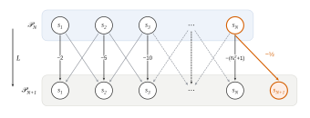

# Mines-Ponts PC — Maths 2 2026 · Corrigé brut

*Corrigé rédigé par IA, non officiel. Signalez toute erreur.*

**Solutions périodiques d'équations différentielles.** Durée 3 heures, calculatrice et tout dispositif électronique interdits. 25 questions.

Notations de l'énoncé : $(E)\ :\ y''+b(x)y=c(x)$ avec $b,c$ continues et $2\pi$-périodiques, et $(EH)$ l'équation homogène.

On note $\mathcal S(E)$, $\mathcal S(H)$ les ensembles de solutions (définies sur $\mathbb R$) et $\mathcal B(E)$, $\mathcal B(H)$ les solutions bornées.

La norme est $\|f\|=\sup_{\mathbb R}|f|$ sur $\mathbf B(\mathbb R,\mathbb R)$.

**Principe de superposition.** L'application $y\mapsto y''+by$ est linéaire. Donc la différence de deux éléments de $\mathcal S(E)$ est dans $\mathcal S(H)$, et la somme d'un élément de $\mathcal S(E)$ et d'un élément de $\mathcal S(H)$ est dans $\mathcal S(E)$.

**Lemme d'unicité.** Le théorème de Cauchy n'est pas au programme de PC pour les équations d'ordre 2 à coefficients non constants. On démontre donc directement la seule conséquence utile au problème : si $h\in\mathcal S(H)$ vérifie $h(0)=h'(0)=0$, alors $h=0$.

*Preuve.* La fonction $b$ est continue et $2\pi$-périodique, donc bornée (résultat admis par l'énoncé) ; on pose $K=1+\|b\|$.

La fonction $E=h^2+h'^2$ est de classe $\mathcal C^1$, positive et nulle en $0$. Avec $h''=-bh$ :
$$\begin{aligned}
E'&=2hh'+2h'h''\\
&=2(1-b)hh'.
\end{aligned}$$
Comme $2|hh'|\le h^2+h'^2$, on obtient $|E'|\le KE$ sur $\mathbb R$.

- Sur $[0,+\infty[$, la fonction $x\mapsto e^{-Kx}E(x)$ a pour dérivée $e^{-Kx}(E'-KE)\le0$. Elle est décroissante, positive et nulle en $0$, donc nulle.
- Sur $]-\infty,0]$, la fonction $x\mapsto e^{Kx}E(x)$ a pour dérivée $e^{Kx}(E'+KE)\ge0$. Elle est croissante, positive et nulle en $0$, donc nulle.

Ainsi $E=0$ sur $\mathbb R$, d'où $h=0$.

*Conséquence.* L'application $g\mapsto(g(0),g'(0))$ est linéaire de $\mathcal S(H)$ dans $\mathbb R^2$, et injective par le lemme. Donc $\dim\mathcal S(H)\le2$.

## Partie 1 — Résultats généraux

### Question 1

On a $\mathcal B(H)=\mathcal S(H)\cap\mathbf B(\mathbb R,\mathbb R)\subset\mathcal S(H)$. La fonction nulle est une solution bornée de $(EH)$.

Soient $g_1,g_2\in\mathcal B(H)$ et $\lambda\in\mathbb R$. Alors $\lambda g_1+g_2\in\mathcal S(H)$, car $\mathcal S(H)$ est un espace vectoriel. Pour tout $x$,
$$|\lambda g_1(x)+g_2(x)|\le|\lambda|\,\|g_1\|+\|g_2\|,$$
majorant indépendant de $x$ : $\lambda g_1+g_2$ est bornée.

**$\mathcal B(H)$ est un sous-espace vectoriel de $\mathcal S(H)$.**

### Question 2

Soit $f_0\in\mathcal B(E)$. On montre l'égalité d'ensembles par double inclusion.

- Si $f\in\mathcal B(E)$, alors $g=f-f_0\in\mathcal S(H)$ par superposition, et $\|g\|\le\|f\|+\|f_0\|$. Donc $g\in\mathcal B(H)$ et $f=f_0+g$.
- Si $g\in\mathcal B(H)$, alors $f_0+g\in\mathcal S(E)$ par superposition, et $f_0+g$ est bornée comme somme de fonctions bornées. Donc $f_0+g\in\mathcal B(E)$.

$$\boxed{\mathcal B(E)=\{f_0+g,\ g\in\mathcal B(H)\}.}$$

### Question 3

Soit $f\in\mathcal S(E)$. La fonction $T(f)$ est la composée de $f$ et de $x\mapsto x+2\pi$, donc de classe $\mathcal C^2$, avec $T(f)''(x)=f''(x+2\pi)$.

Pour tout $x$, par $2\pi$-périodicité de $b$ puis de $c$ :
$$\begin{aligned}
T(f)''(x)+b(x)T(f)(x)&=f''(x+2\pi)+b(x+2\pi)f(x+2\pi)\\
&=c(x+2\pi)\\
&=c(x).
\end{aligned}$$
**$T(f)$ est solution de $(E)$.**

Le même calcul avec $c=0$ montre que $T$ envoie $\mathcal S(H)$ dans $\mathcal S(H)$.

De plus, pour $f$ bornée, $\|T(f)\|=\|f\|$ (le sup sur $\mathbb R$ est invariant par translation).

### Question 4

Soit $h=T(f)-f$. Par la question 3 et la superposition, $h\in\mathcal S(H)$. De plus :
$$\begin{aligned}
h(0)&=f(2\pi)-f(0)\\
&=0,\\[1mm]
h'(0)&=f'(2\pi)-f'(0)\\
&=0.
\end{aligned}$$
Par le lemme d'unicité, $h=0$, c'est-à-dire $f(x+2\pi)=f(x)$ pour tout $x\in\mathbb R$.

**$f$ est $2\pi$-périodique.**

## Partie 2 — Un exemple d'équation à coefficients constants

Ici $\omega>0$, $\omega\neq1$, et $(E)\ :\ y''+\omega^2y=\cos x$.

### Question 5

Pour $f_0=d\cos$, on a $f_0''+\omega^2f_0=d(\omega^2-1)\cos$. Cette fonction est égale à $\cos$ si et seulement si $d(\omega^2-1)=1$. Comme $\omega^2\neq1$ :
$$\boxed{d=\frac{1}{\omega^2-1}.}$$
L'équation caractéristique $r^2+\omega^2=0$ a pour racines $\pm i\omega$.

Les solutions réelles de $(EH)$ sont les $x\mapsto\alpha\cos(\omega x)+\beta\sin(\omega x)$, de valeur $\alpha$ et de dérivée $\beta\omega$ en $0$. D'où
$$\boxed{u(x)=\cos(\omega x)}$$
$$\boxed{v(x)=\frac{\sin(\omega x)}{\omega}.}$$

### Question 6

On a $\mathcal S(H)=\operatorname{Vect}(u,v)$ et $\mathcal S(E)=f_0+\mathcal S(H)$ :
$$\boxed{\mathcal S(E)=\Big\{x\mapsto\frac{\cos x}{\omega^2-1}+A\cos(\omega x)+\frac{B}{\omega}\sin(\omega x),\ (A,B)\in\mathbb R^2\Big\}.}$$
Toute solution est bornée, par $\frac{1}{|\omega^2-1|}+|A|+\frac{|B|}{\omega}$. Donc
$$\boxed{\mathcal B(E)=\mathcal S(E).}$$

### Question 7

Soit $T>0$ une période de $f$. En dérivant deux fois $f(x+T)=f(x)$, on obtient $f''(x+T)=f''(x)$. On part de la périodicité de $f$ et on la reporte dans l'équation : pour tout $x$,
$$\begin{aligned}
\cos(x+T)&=f''(x+T)+\omega^2f(x+T)\\
&=f''(x)+\omega^2f(x)\\
&=\cos x.
\end{aligned}$$
En $x=0$ : $\cos T=1$, donc $T\in2\pi\mathbb Z$. Comme $T>0$ :
$$\boxed{T=2k\pi,\quad k\in\mathbb N^*.}$$

### Question 8

Posons $\theta=2k\pi\omega$. On a :
$$\begin{aligned}
f(x)&=d\cos x+A\cos(\omega x)+\frac B\omega\sin(\omega x),\\
f'(x)&=-d\sin x-A\omega\sin(\omega x)+B\cos(\omega x).
\end{aligned}$$
Comme $\cos(2k\pi)=1$ et $\sin(2k\pi)=0$ :
$$\begin{aligned}
f(0)&=d+A,\\
f(2k\pi)&=d+A\cos\theta+\frac B\omega\sin\theta,\\
f'(0)&=B,\\
f'(2k\pi)&=-A\omega\sin\theta+B\cos\theta.
\end{aligned}$$
La $2k\pi$-périodicité de $f$ (et donc de $f'$) donne $f(2k\pi)=f(0)$ et $f'(2k\pi)=f'(0)$, soit
$$\boxed{\begin{cases}(\cos(2k\pi\omega)-1)A+\dfrac{\sin(2k\pi\omega)}{\omega}B=0\\[2mm]-\omega\sin(2k\pi\omega)A+(\cos(2k\pi\omega)-1)B=0.\end{cases}}$$

### Question 9

$$\begin{aligned}
\det M&=(\cos\theta-1)^2+\sin^2\theta\\
&=2(1-\cos\theta)\\
&=4\sin^2(k\pi\omega).
\end{aligned}$$
Ce déterminant est nul si et seulement si $k\pi\omega\in\pi\mathbb Z$, c'est-à-dire $k\omega\in\mathbb Z$.

Supposons $\omega\notin\mathbb Q$, et soit $f$ une solution périodique, de période $2k\pi$ avec $k\in\mathbb N^*$ (question 7).

Si l'on avait $k\omega=m\in\mathbb Z$, alors $\omega=m/k$ serait rationnel. Donc $k\omega\notin\mathbb Z$ et $\det M\neq0$.

La matrice $M$ est inversible : le système homogène de la question 8 est de Cramer, sa seule solution est $A=B=0$, et $f=f_0$. Réciproquement, $f_0=d\cos$ est une solution $2\pi$-périodique.

**Si $\omega\notin\mathbb Q$, la seule solution périodique de $(E)$ est $f_0$.**

### Question 10

Soit $\omega=p/q$ avec $p,q\in\mathbb N^*$, et soit $f\in\mathcal S(E)$ quelconque (question 6). On a $\cos(x+2q\pi)=\cos x$, et $\omega(x+2q\pi)=\omega x+2p\pi$.

Donc $\cos(\omega(x+2q\pi))=\cos(\omega x)$ et $\sin(\omega(x+2q\pi))=\sin(\omega x)$. Ainsi $f(x+2q\pi)=f(x)$ pour tout $x$.

$$\boxed{2q\pi\ \text{est une période commune à toutes les solutions.}}$$

## Partie 3 — Unicité lorsque la fonction $b$ est négative

Ici $b(x)=-(1+\cos x)$, et $(EH)\ :\ y''=(1+\cos x)y$.

### Question 11

*Critère utilisé (rappel).* Si $\varphi\in\mathcal C^2(\mathbb R,\mathbb R)$ et $\varphi''\ge0$, alors $\varphi$ est convexe.

En effet $\varphi'$ est croissante. Soient $x<y$, $\lambda\in\,]0,1[$ et $z=\lambda x+(1-\lambda)y$, de sorte que $z-x=(1-\lambda)(y-x)$ et $y-z=\lambda(y-x)$.

L'égalité des accroissements finis donne $c_1\in\,]x,z[$ et $c_2\in\,]z,y[$ avec
$$\lambda\varphi(x)+(1-\lambda)\varphi(y)-\varphi(z)=\lambda(1-\lambda)(y-x)\big(\varphi'(c_2)-\varphi'(c_1)\big),$$
quantité positive car $c_1<c_2$.

*Application.* Soit $g\in\mathcal S(H)$ et $\varphi=g^2$, de classe $\mathcal C^2$. Alors $\varphi'=2gg'$ et
$$\begin{aligned}
\varphi''&=2g'^2+2gg''\\
&=2g'^2+2(1+\cos x)g^2\\
&\ge0,
\end{aligned}$$
puisque $1+\cos x\ge0$ pour tout $x$. **$g^2$ est convexe.**

### Question 12

Soit $g\in\mathcal B(H)$. Alors $\varphi=g^2$ est convexe et majorée par $\|g\|^2$. Par le résultat admis, $\varphi$ est constante. Donc $\varphi''=0$ :
$$\forall x\in\mathbb R,\quad 2g'(x)^2+2(1+\cos x)g(x)^2=0.$$
Les deux termes sont positifs, donc nuls. En $x=0$, on obtient $4g(0)^2=0$. Ainsi $g^2$ est la constante $g(0)^2=0$, et $g=0$.

$$\boxed{\mathcal B(H)=\{0\}.}$$

### Question 13

Soient $f_1,f_2\in\mathcal B(E)$. Par superposition $f_1-f_2\in\mathcal S(H)$, et cette différence est bornée. Donc $f_1-f_2\in\mathcal B(H)=\{0\}$ (question 12), et $f_1=f_2$.

**$(E)$ possède au plus une solution bornée.**

### Question 14

Soit $f\in\mathcal B(E)$. Par la question 3, $T(f)\in\mathcal S(E)$, et $\|T(f)\|=\|f\|<+\infty$, donc $T(f)\in\mathcal B(E)$.

Par l'unicité de la question 13, $T(f)=f$ : $f(x+2\pi)=f(x)$ pour tout $x$.

**La solution bornée est elle-même $2\pi$-périodique ; $(E)$ possède donc une solution $2\pi$-périodique.**

## Partie 4 — Existence d'une solution périodique

Ici $b(x)=-(1+\cos x)$. La suite $(a_n)_{n\ge1}$ est bornée par $M$ et vérifie $(n^2+1)a_n+\frac12(a_{n+1}+a_{n-1})=0$ pour $n\ge2$, et $4a_1+a_2=-2$.

### Question 15

La relation est à coefficients non constants : on ne la résout pas, on s'en sert pour majorer. Pour $n\ge2$, les indices $n\pm1$ sont dans $\mathbb N^*$, donc
$$\begin{aligned}
|a_n|&\le\frac{|a_{n+1}|+|a_{n-1}|}{2(n^2+1)}\\
&\le\frac{M}{n^2+1}\\
&\le\frac{M}{n^2}.\qquad(\ast)
\end{aligned}$$
Par comparaison à la série de Riemann convergente $\sum1/n^2$, **$\sum a_n$ converge absolument**.

Pour $n\ge3$, on a $n-1\ge2$ et $n+1\ge2$, donc $(\ast)$ s'applique aux rangs $n\pm1$ : $|a_{n\pm1}|\le\frac{M}{(n-1)^2}$. En reportant dans la relation :
$$\begin{aligned}
|a_n|&\le\frac{1}{2(n^2+1)}\cdot\frac{2M}{(n-1)^2}\\
&\le\frac{M}{n^2(n-1)^2},
\end{aligned}$$
donc
$$n^2|a_n|\le\frac{M}{(n-1)^2}\qquad(n\ge3).$$
Par comparaison, **$\sum n^2a_n$ converge absolument.**

### Question 16

Soit $u_n(x)=a_n\sin(nx)$, de classe $\mathcal C^2$, avec $u_n'(x)=na_n\cos(nx)$ et $u_n''(x)=-n^2a_n\sin(nx)$. Pour tout $x$ :
$$\begin{aligned}
|u_n(x)|&\le|a_n|,\\
|u_n'(x)|&\le n^2|a_n|,\\
|u_n''(x)|&\le n^2|a_n|.
\end{aligned}$$
Par la question 15, $\sum u_n$, $\sum u_n'$ et $\sum u_n''$ convergent normalement, donc uniformément, sur $\mathbb R$.

*Théorème de dérivation terme à terme (classe $\mathcal C^2$).* On suppose les $u_n$ de classe $\mathcal C^2$ sur un intervalle $I$.

Si $\sum u_n$ et $\sum u_n'$ convergent simplement sur $I$, et si $\sum u_n''$ converge uniformément sur $I$, alors la somme est de classe $\mathcal C^2$ sur cet intervalle et ses dérivées s'obtiennent terme à terme.

Les hypothèses sont satisfaites sur $I=\mathbb R$ : $g$ est de classe $\mathcal C^2$ et
$$g''(x)=-\sum_{n\ge1}n^2a_n\sin(nx).$$

On a $\cos x\sin(nx)=\frac12\big(\sin((n+1)x)+\sin((n-1)x)\big)$. Les séries obtenues convergent absolument (termes majorés par $|a_n|$) : on peut les séparer et réindexer.
$$\cos x\,g(x)=\frac12\sum_{n\ge2}a_{n-1}\sin(nx)+\frac12\sum_{n\ge1}a_{n+1}\sin(nx),$$
le terme $n=1$ de $\sum a_n\sin((n-1)x)$ étant nul. Donc
$$g''(x)-(1+\cos x)g(x)=-\Big(2a_1+\frac{a_2}{2}\Big)\sin x-\sum_{n\ge2}\Big[(n^2+1)a_n+\frac12(a_{n+1}+a_{n-1})\Big]\sin(nx).$$
Chaque crochet est nul. De plus $2a_1+\frac{a_2}2=\frac12(4a_1+a_2)=-1$. Ainsi
$$\boxed{\forall x\in\mathbb R,\quad g''(x)-(1+\cos x)g(x)=\sin x.}$$

### Question 17

Pour $n,m\in\mathbb N^*$, $\sin(nt)\sin(mt)=\frac12\big(\cos((n-m)t)-\cos((n+m)t)\big)$. Pour $p\in\mathbb Z^*$, $\int_0^{2\pi}\cos(pt)\,\mathrm dt=0$. Comme $n+m\neq0$ :
$$\int_0^{2\pi}s_n(t)s_m(t)\,\mathrm dt=\begin{cases}0&\text{si }n\neq m,\\ \pi&\text{si }n=m.\end{cases}$$
Si $\sum_{k=1}^N\beta_ks_k=0$, on multiplie par $s_m$ ($1\le m\le N$) et on intègre sur $[0,2\pi]$ (somme finie) : $\pi\beta_m=0$. La famille est libre ; elle engendre $\mathcal P_N$ par définition.

**$(s_1,\dots,s_N)$ est une base de $\mathcal P_N$, et $\dim\mathcal P_N=N$.**

### Question 18

On a $s_n''=-n^2s_n$ et $\cos x\sin(nx)=\frac12\big(s_{n+1}(x)+s_{n-1}(x)\big)$, y compris pour $n=1$ avec $s_0=0$. Donc, pour tout $n\ge1$ :
$$\boxed{L(s_n)=-(n^2+1)s_n-\frac12s_{n+1}-\frac12s_{n-1}.}$$
En particulier $L(s_1)=-2s_1-\frac12s_2$.

### Question 19

*Endomorphisme.* $L$ est linéaire, et $L(s_n)\in\mathcal P_{n+1}\subset\mathcal P$ pour tout $n$. Comme $\mathcal P=\operatorname{Vect}(s_n)_{n\ge1}$, on a $L(\mathcal P)\subset\mathcal P$.

*Observation clé.* Soit $p\in\mathcal P\setminus\{0\}$. Par la question 17, il s'écrit de façon unique $p=\sum_{k=1}^N\beta_ks_k$ avec $\beta_N\neq0$. Par la question 18, $L(p)\in\mathcal P_{N+1}$.

Dans la base de $\mathcal P_{N+1}$, la coordonnée de $L(p)$ sur $s_{N+1}$ ne provient que du terme $k=N$ : elle vaut $-\frac12\beta_N\neq0$.

*Injectivité.* Si $p\neq0$, $L(p)$ a une coordonnée non nulle, donc $L(p)\neq0$ : $\ker L=\{0\}$.

*$s_1\notin\operatorname{Im}L$.* Si $s_1=L(p)$, alors $p\neq0$ (car $s_1\neq0$).

Avec $N$ comme ci-dessus, la coordonnée de $L(p)$ sur $s_{N+1}$, où $N+1\ge2$, est non nulle. Celle de $s_1$ est nulle : contradiction par unicité des coordonnées. Donc $L$ n'est pas surjective.

**$L$ est un endomorphisme injectif de $\mathcal P$ et $s_1\notin\operatorname{Im}L$.**

### Question 20

Soit $N\ge1$. Par la question 18, $L(s_k)\in\mathcal P_{k+1}\subset\mathcal P_{N+1}$ pour $k\le N$. Donc $L(\mathcal P_N)\subset\mathcal P_{N+1}$ ; et $\mathcal P_1\subset\mathcal P_{N+1}$.

Soit $y\in L(\mathcal P_N)\cap\mathcal P_1$ : $y=L(p)=\lambda s_1$. Si $\lambda\neq0$, alors $s_1=L(p/\lambda)\in\operatorname{Im}L$, ce qui contredit la question 19. Donc $\lambda=0$ et $y=0$ : la somme est directe.

$L$ est injective, donc $\dim L(\mathcal P_N)=\dim\mathcal P_N=N$. Par suite $\dim\big(L(\mathcal P_N)\oplus\mathcal P_1\big)=N+1=\dim\mathcal P_{N+1}$. Un sous-espace de même dimension finie que l'espace qui le contient lui est égal :
$$\boxed{L(\mathcal P_N)\oplus\mathcal P_1=\mathcal P_{N+1}.}$$

### Question 21

Soit $c\in\mathcal P$ : il existe $N$ avec $c\in\mathcal P_N\subset\mathcal P_{N+1}$. Par la question 20, $c=L(p)+\lambda s_1$ avec $p\in\mathcal P_N$ et $\lambda\in\mathbb R$.

Posons $f=p+\lambda g$, où $g$ est la fonction de la question 16. Alors $f\in\mathcal C^2$ et
$$\begin{aligned}
f''-(1+\cos x)f&=L(p)+\lambda\big(g''-(1+\cos x)g\big)\\
&=L(p)+\lambda s_1\\
&=c,
\end{aligned}$$
donc $f\in\mathcal S(E)$.

La fonction $p$ est $2\pi$-périodique (combinaison finie de $s_k$).

La fonction $g$ aussi : chaque somme partielle $g_K:x\mapsto\sum_{n=1}^{K}a_n\sin(nx)$ est $2\pi$-périodique, et l'égalité $g_K(x+2\pi)=g_K(x)$ passe à la limite $K\to+\infty$.

**$f=p+\lambda g$ est une solution $2\pi$-périodique de $(E)$.**

## Partie 5 — Un théorème général

Ici $b,c$ sont continues et $2\pi$-périodiques, avec $c\neq0$. La fonction $f_0\in\mathcal S(E)$ est bornée ainsi que $f_0'$.

On note $M_0=\|f_0\|$, $M_1=\|f_0'\|$ et $\mathcal A=\{f\in\mathcal B(E),\ \|f\|\le M_0\}$.

### Question 22

On pose
$$\boxed{\mathcal H=\mathbb Rf_0\oplus\mathcal B(H).}$$
*La somme est directe.* Si $\lambda f_0\in\mathcal B(H)$ avec $\lambda\neq0$, alors $f_0\in\mathcal S(H)$, d'où $c=f_0''+bf_0=0$, ce qui est exclu.

*$\mathcal H$ convient.* $f_0$ est bornée et $\mathcal B(H)$ est un sous-espace vectoriel de $\mathbf B(\mathbb R,\mathbb R)$ (question 1). Donc $\mathcal H$ est un sous-espace vectoriel de $\mathbf B(\mathbb R,\mathbb R)$.

Sa dimension vaut $1+\dim\mathcal B(H)\le1+\dim\mathcal S(H)\le3$ (lemme d'unicité).

Comme $f_0\in\mathcal B(E)$, la question 2 donne $\mathcal A\subset\mathcal B(E)=f_0+\mathcal B(H)\subset\mathcal H$. Tous les éléments de $\mathcal H$ sont de classe $\mathcal C^2$.

- *Non vide* : $f_0\in\mathcal B(E)$ et $\|f_0\|=M_0$, donc $f_0\in\mathcal A$.
- *Bornée* : $\mathcal A$ est contenue dans la boule fermée de centre $0$ et de rayon $M_0$ (elle n'est pas égale à cette boule, car ses éléments doivent être solutions de $(E)$).
- *Fermée* (caractérisation séquentielle) : soit $(f_n)$ une suite de $\mathcal A$ convergeant dans $(\mathcal H,\|\cdot\|)$ vers $f\in\mathcal H$.

Pour $x\in\mathbb R$ fixé, $\ell_x:h\mapsto h''(x)+b(x)h(x)$ est une forme linéaire sur $\mathcal H$, continue car $\mathcal H$ est de dimension finie. Donc
$$\ell_x(f)=\lim_{n\to+\infty}\ell_x(f_n)=c(x).$$
Ceci pour tout $x$ : $f\in\mathcal S(E)$, et $f$ est bornée car $f\in\mathcal H$.

Enfin, pour tout $n$ :
$$\begin{aligned}
\|f\|&\le\|f-f_n\|+\|f_n\|\\
&\le\|f-f_n\|+M_0.
\end{aligned}$$
En faisant tendre $n$ vers $+\infty$, $\|f\|\le M_0$. Donc $f\in\mathcal A$.

**$\mathcal A$ est une partie fermée, bornée, non vide de $\mathcal H$, espace de dimension finie.**

### Question 23

Soit $\Phi:\mathcal H\to\mathbb R$, $\Phi(f)=|f(2\pi)-f(0)|+|f'(2\pi)-f'(0)|$, bien définie car $\mathcal H\subset\mathcal C^2$. On a $\mathcal I=\Phi(\mathcal A)$.

$\mathcal I$ est non vide ($\mathcal A\neq\varnothing$) et minorée par $0$ : sa borne inférieure $\alpha$ existe et $\alpha\ge0$.

Les quatre applications $f\mapsto f(0)$, $f\mapsto f(2\pi)$, $f\mapsto f'(0)$ et $f\mapsto f'(2\pi)$ sont des formes linéaires sur $\mathcal H$.

Comme $\mathcal H$ est de dimension finie, elles sont continues ; par opérations, $\Phi$ est continue sur $\mathcal H$.

*Théorème des bornes atteintes.* Une fonction réelle continue sur une partie non vide, fermée et bornée d'un espace vectoriel normé de dimension finie est bornée et atteint ses bornes. Appliqué à $\Phi$ sur $\mathcal A$ (question 22), il donne :
$$\boxed{\exists f_1\in\mathcal A,\quad\alpha=|f_1(2\pi)-f_1(0)|+|f_1'(2\pi)-f_1'(0)|.}$$

### Question 24

Par récurrence et la question 3, $T^k(f_0)\in\mathcal S(E)$ pour tout $k\in\mathbb N$, avec $\|T^k(f_0)\|=M_0$. La fonction $g_n=\frac1{n+1}\sum_{k=0}^nT^k(f_0)$ est de classe $\mathcal C^2$ et
$$\begin{aligned}
g_n''+bg_n&=\frac1{n+1}\sum_{k=0}^n c\\
&=c,
\end{aligned}$$
donc $g_n\in\mathcal S(E)$. De plus $\|g_n\|\le\frac1{n+1}\sum_{k=0}^n\|T^k(f_0)\|=M_0$. Ainsi $g_n\in\mathcal A$.

On a $T^k(f_0)(2\pi)=f_0(2(k+1)\pi)$ et $T^k(f_0)(0)=f_0(2k\pi)$. Par télescopage :
$$\begin{aligned}
g_n(2\pi)-g_n(0)&=\frac{f_0(2(n+1)\pi)-f_0(0)}{n+1},\\
g_n'(2\pi)-g_n'(0)&=\frac{f_0'(2(n+1)\pi)-f_0'(0)}{n+1}.
\end{aligned}$$
Ces quantités ont des valeurs absolues respectivement majorées par $\frac{2M_0}{n+1}$ et $\frac{2M_1}{n+1}$. Comme $\Phi(g_n)\in\mathcal I$ :
$$\boxed{\begin{aligned}
\forall n\in\mathbb N,\quad\alpha&\le\Phi(g_n)\\
&\le\frac{2(M_0+M_1)}{n+1}.
\end{aligned}}$$

### Question 25

De $0\le\alpha\le\frac{2(M_0+M_1)}{n+1}$ pour tout $n$, on tire $\alpha=0$ en faisant tendre $n$ vers $+\infty$.

La fonction $f_1$ de la question 23 vérifie donc $|f_1(2\pi)-f_1(0)|+|f_1'(2\pi)-f_1'(0)|=0$. C'est une somme de deux termes positifs : chacun est nul, et $f_1(2\pi)=f_1(0)$, $f_1'(2\pi)=f_1'(0)$.

Comme $f_1\in\mathcal A\subset\mathcal S(E)$, la question 4 s'applique.

**$f_1$ est une solution $2\pi$-périodique de $(E)$ : le théorème est démontré.**
