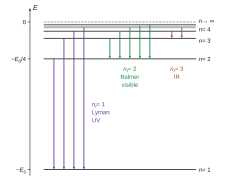
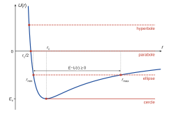
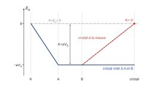
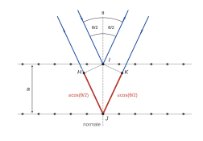
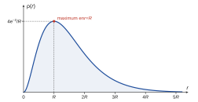

# Mines-Ponts PC — Physique 1 2026 · Corrigé brut

*Corrigé rédigé par IA, non officiel. Signalez toute erreur.*

**Du spectre à la structure de l'hydrogène.** Durée 3 h, calculatrice interdite. Applications numériques à deux chiffres significatifs sauf indication contraire.

## I — Les raies d'émission de l'hydrogène atomique

### Question 1

Le photon emporte l'énergie $\epsilon=E_i-E_f>0$. La relation de Planck-Einstein donne $\epsilon=h\nu$ et, pour une onde dans le vide, $\nu=c/\lambda_0$. Donc

$$\boxed{\lambda_0=\frac{hc}{E_i-E_f}}$$

### Question 2

Avec $E_n=-E_0/n^2$, $n_i=k+2$ et $n_f=2$ :

$$E_i-E_f=E_0\left(\frac14-\frac{1}{(k+2)^2}\right),$$

quantité positive pour $k\geq1$. Posons $X=1/(k+2)^2$. La relation de Q1 donne

$$\begin{aligned}
\frac{1}{\lambda_0}&=\frac{E_i-E_f}{hc}\\
&=\underbrace{\frac{E_0}{4hc}}_{b}-\underbrace{\frac{E_0}{hc}}_{|\alpha|}\,X .
\end{aligned}$$

C'est une relation **affine** entre $1/\lambda_0$ et $X$, et non une relation de proportionnalité, puisque $b\neq0$. Le modèle fait donc deux prédictions vérifiables sur la figure 1 :

- $1/\lambda_0$ est une fonction affine décroissante de $X$ : les cinq points sont alignés aux barres d'erreur près, sur la droite en pointillés. Ce test valide la loi en $1/n^2$ avec $n_i=k+2$.
- la pente $\alpha=-E_0/(hc)$ et l'ordonnée à l'origine $b=E_0/(4hc)$ sont dans le rapport $\alpha/b=-4$, indépendant de $E_0$. Ce test valide $n_f=2$.

Lecture de la figure 1 : l'ordonnée à l'origine vaut $b\simeq2{,}7\ \mu\text{m}^{-1}$. Le point $k=1$ a pour abscisse $X=1/9\simeq0{,}11$ et pour ordonnée $1/0{,}66\simeq1{,}5\ \mu\text{m}^{-1}$. D'où

$$\alpha\simeq\frac{1{,}5-2{,}7}{0{,}11}\simeq-11\ \mu\text{m}^{-1},$$

$$-4b\simeq-11\ \mu\text{m}^{-1}.$$

Le rapport mesuré entre la pente et l'ordonnée à l'origine vaut $-4$, comme prévu. **La droite de Balmer est compatible avec $E_n=-E_0/n^2$, $n_i=k+2$, $n_f=2$.**

### Question 3

L'ordonnée à l'origine donne $E_0=4hc\,b$. Avec l'aide au calcul $hc\simeq1{,}2$ eV·µm et $b\simeq2{,}7\ \mu\text{m}^{-1}$ :

$$E_0\simeq4\times1{,}2\times2{,}7\ \text{eV}\simeq13\ \text{eV}.$$

Contrôle par la pente : $hc\,|\alpha|\simeq1{,}2\times10{,}9$ eV, soit encore $13$ eV.

$$\boxed{E_0\simeq13\ \text{eV}}$$

### Question 4

Pour une transition $n_i\to n_f$ avec $n_i>n_f$, la relation de Q1 et la loi (2) donnent

$$\begin{aligned}
\frac{1}{\lambda_0}&=\frac{E_i-E_f}{hc}\\
&=\frac{1}{hc}\left(\frac{E_0}{n_f^2}-\frac{E_0}{n_i^2}\right)\\
&=\frac{E_0}{hc}\left(\frac{1}{n_f^2}-\frac{1}{n_i^2}\right).
\end{aligned}$$

C'est la relation (3), avec

$$\boxed{R_\infty=\frac{E_0}{hc}}$$

La condition $n_i>n_f$ assure $1/\lambda_0>0$. Numériquement :

$$\begin{aligned}
\frac{1}{R_\infty}&=\frac{hc}{E_0}\\
&\simeq\frac{1{,}2\ \text{eV·µm}}{13\ \text{eV}}\\
&\simeq0{,}092\ \text{µm},
\end{aligned}$$

$$\boxed{\frac{1}{R_\infty}\simeq92\ \text{nm}}$$

### Question 5

À $n_f$ fixé, $1/n_f^2-1/n_i^2$ est strictement croissante en $n_i$ et majorée par $1/n_f^2$, sa limite quand $n_i\to\infty$.

**Série $n_f=1$.** On a $n_i\geq2$, et $1-1/n_i^2$ est minimale pour $n_i=2$. Donc

$$\begin{aligned}
\frac{1}{\lambda_0}&=R_\infty\left(1-\frac{1}{n_i^2}\right)\\
&\geq\frac{3R_\infty}{4},
\end{aligned}$$

soit, en inversant l'inégalité entre nombres positifs,

$$\begin{aligned}
\lambda_0\leq\lambda_{\max}&=\frac{4}{3R_\infty}\\
&\simeq\frac43\times92\ \text{nm},
\end{aligned}$$

$$\boxed{\lambda_{\max}\simeq1{,}2\times10^{2}\ \text{nm}}$$

La borne est atteinte pour la transition $2\to1$ ; la limite de la série est $1/R_\infty\simeq92$ nm. Toutes ces raies sont dans l'**ultraviolet** (série de Lyman).

**Séries $n_f>2$.** On a $n_f\geq3$ et $1/n_i^2>0$, donc

$$\begin{aligned}
\frac{1}{\lambda_0}&<\frac{R_\infty}{n_f^2}\\
&\leq\frac{R_\infty}{9},
\end{aligned}$$

soit

$$\begin{aligned}
\lambda_0>\lambda_{\min}&=\frac{9}{R_\infty}\\
&\simeq9\times92\ \text{nm},
\end{aligned}$$

$$\boxed{\lambda_{\min}\simeq8{,}3\times10^{2}\ \text{nm}}$$

La borne n'est pas atteinte : c'est la limite de la série $n_f=3$. Toutes ces raies sont dans l'**infrarouge**.

**Raies visibles.** Le domaine visible s'étend d'environ $400$ nm (violet) à $800$ nm (rouge). Les séries $n_f=1$ et $n_f\geq3$ en sont exclues : seule la série $n_f=2$ (Balmer) peut contribuer. Pour celle-ci,

$$\lambda_0=\frac{1}{R_\infty}\left(\frac14-\frac{1}{n_i^2}\right)^{-1}$$

décroît de $6{,}6\times10^2$ nm ($n_i=3$) vers la limite $4/R_\infty\simeq3{,}7\times10^2$ nm :

| $n_i$ | 3 | 4 | 5 | 6 | 7 | 8 |
|---|---|---|---|---|---|---|
| $\lambda_0$ (nm) | 660 | 490 | 440 | 410 | 400 | 390 |

La raie $n_i=8$, vers $390$ nm, est déjà dans l'ultraviolet, comme toutes les suivantes. **Les seules raies visibles sont les cinq raies H$_\alpha$ à H$_\epsilon$ du tableau, transitions $n_i=3,\dots,7\to n_f=2$.**

La raie H$_\epsilon$, à $400$ nm, est à la limite du violet.

## II — Le modèle de Bohr pour l'atome d'hydrogène

### II.A — Énergie potentielle effective

### Question 6

Le noyau, de charge $+e$, crée en $M$ le champ $\vec E=\dfrac{e}{4\pi\varepsilon_0r^2}\vec u_r$, avec $\vec u_r=\vec r/r$. L'électron, de charge $-e$, subit la force de Coulomb

$$\begin{aligned}
\vec F&=-e\vec E\\
&=-\frac{e^2}{4\pi\varepsilon_0r^2}\,\vec u_r .
\end{aligned}$$

Cette force dérive d'une énergie potentielle : $\vec F=-\overrightarrow{\text{grad}}\,E_p$, relation à ne pas confondre avec $\vec E=-\overrightarrow{\text{grad}}\,V$. Lors d'un déplacement élémentaire, $\vec u_r\cdot d\overrightarrow{OM}=dr$ et le travail de la force vaut

$$\begin{aligned}
\delta W&=\vec F\cdot d\overrightarrow{OM}\\
&=-\frac{e^2}{4\pi\varepsilon_0r^2}\,dr\\
&=-d\left(-\frac{e^2}{4\pi\varepsilon_0r}\right).
\end{aligned}$$

Comme $\delta W=-dE_p$, on a $E_p(r)=-\dfrac{e^2}{4\pi\varepsilon_0r}+C$. La condition $E_p\to0$ quand $r\to\infty$ impose $C=0$ :

$$\boxed{E_p(r)=-\frac{e^2}{4\pi\varepsilon_0r}}$$

### Question 7

Le référentiel est galiléen et $O$ y est un point fixe. Le théorème du moment cinétique en $O$, appliqué à l'électron soumis à la seule force $\vec F$, donne

$$\frac{d\vec s}{dt}=\overrightarrow{OM}\wedge\vec F .$$

Or $\vec F$ est colinéaire à $\overrightarrow{OM}$ (force centrale), donc $\overrightarrow{OM}\wedge\vec F=\vec 0$ et

$$\boxed{\vec s=\vec r\wedge\vec p=\overrightarrow{\text{cte}}}$$

Par propriété du produit vectoriel, $\vec s=\vec r\wedge\vec p$ est orthogonal à $\vec r$ à chaque instant : $\vec r\cdot\vec s=0$.

Si $\vec s\neq\vec0$, ce vecteur est fixe : $\overrightarrow{OM}$ reste dans le plan **fixe** passant par $O$ et orthogonal à $\vec s$. **Le mouvement est donc plan et son plan contient $O$.**

Si $\vec s=\vec0$, $\vec p$ reste colinéaire à $\vec r$ : le mouvement est rectiligne sur une droite passant par $O$, cas exclu dans la suite.

### Question 8

En coordonnées polaires dans le plan $(Oxy)$, la vitesse s'écrit $\vec v=\dot r\,\vec u_r+r\dot\theta\,\vec u_\theta$ et l'impulsion $\vec p=m_e\vec v$. Le moment cinétique vaut donc

$$\vec s=m_er^2\dot\theta\,\vec u_z ,$$

d'où $s=m_er^2|\dot\theta|$. La force étant conservative, l'énergie mécanique se conserve et vaut

$$\begin{aligned}
E&=\frac12m_e\left(\dot r^2+r^2\dot\theta^2\right)+E_p(r)\\
&=\frac12m_e\dot r^2+\frac{s^2}{2m_er^2}-\frac{e^2}{4\pi\varepsilon_0r}.
\end{aligned}$$

Elle a la forme $E=\frac12m_e\dot r^2+U(r)$ avec

$$\boxed{U(r)=\frac{s^2}{2m_er^2}-\frac{e^2}{4\pi\varepsilon_0r}}\qquad(r>0)$$

### Question 9

On suppose $s\neq0$ et on note $A=e^2/(4\pi\varepsilon_0)$.

**Allure.** Quand $r\to0^+$, le terme en $1/r^2$ domine et $U(r)\to+\infty$.

Quand $r\to\infty$, le terme $-A/r$ domine et $U(r)\to0^-$. La dérivée vaut

$$U'(r)=\frac{1}{r^3}\left(Ar-\frac{s^2}{m_e}\right).$$

Elle s'annule en changeant de signe en un seul point $r_c$. La fonction $U$ décroît sur $]0,r_c[$ puis croît sur $]r_c,+\infty[$ : son minimum, unique et négatif, est atteint en $r_c$.

La courbe coupe l'axe $U=0$ en $r=r_c/2$ et son minimum vaut $E_c<0$ (figure 2).

**Types d'orbites.** Le mouvement radial vérifie $\frac12m_e\dot r^2=E-U(r)\geq0$. Les rayons accessibles sont ceux où $U(r)\leq E$, ce qui impose $E\geq E_c$.

Les rayons caractéristiques sont les racines de $U(r)=E$, où $\dot r$ s'annule :

| Énergie | Mouvement radial | Trajectoire |
|---|---|---|
| $E=E_c$ | $r=r_c$ constant | **cercle** de rayon $r_c$ (état lié) |
| $E_c<E<0$ | $r_{\min}\leq r\leq r_{\max}$, racines de $U(r)=E$ | **ellipse** de foyer $O$ (état lié), péricentre $r_{\min}$, apocentre $r_{\max}$ |
| $E=0$ | $r\geq r_{\min}=r_c/2$ ; vitesse tendant vers $0$ à l'infini | **parabole** (état libre, cas limite) |
| $E>0$ | $r\geq r_{\min}$, unique racine de $U(r)=E$ ; vitesse non nulle à l'infini | **hyperbole** (état libre, de diffusion) |

Aucun mouvement n'est possible pour $E<E_c$. La nature conique des trajectoires est un résultat de cours.

**Trajectoire circulaire.** Sur un cercle, $r$ est constant : on est au minimum de $U$, et $U'(r_c)=0$ donne

$$\boxed{r_c(s)=\frac{4\pi\varepsilon_0s^2}{m_ee^2}}$$

Sur le cercle, $\dot r=0$ : $\vec p$ est orthoradial, donc perpendiculaire à $\vec r$, et $s=r_cp_c$. D'où

$$\boxed{p_c(s)=\frac{s}{r_c}=\frac{m_ee^2}{4\pi\varepsilon_0s}}$$

L'énergie sur l'orbite circulaire est l'énergie **mécanique** $E_c=U(r_c)$ :

$$\begin{aligned}
E_c(s)&=\frac{s^2}{2m_er_c^2}-\frac{A}{r_c}\\
&=\frac{m_eA^2}{2s^2}-\frac{m_eA^2}{s^2},
\end{aligned}$$

$$\boxed{E_c(s)=-\frac{m_ee^4}{32\pi^2\varepsilon_0^2s^2}}$$

L'énergie cinétique sur ce cercle, $p_c^2/(2m_e)$, vaut $-E_c(s)>0$ : elle est l'opposée de l'énergie mécanique.

### II.B — L'hypothèse de quantification de Bohr

### Question 10

D'après l'énoncé, le périmètre $2\pi r$ de l'orbite contient exactement $n$ longueurs d'onde de de Broglie $\lambda=h/p$ :

$$2\pi r=n\,\frac{h}{p}.$$

Sur l'orbite circulaire, $\vec p$ est perpendiculaire à $\vec r$ (Q9), donc $s=\|\vec r\wedge\vec p\|=rp$. En multipliant la relation précédente par $p/(2\pi)$ :

$$\boxed{s=n\,\frac{h}{2\pi},\ n\in\mathbb N^*}$$

### Question 11

On reporte $s=nh/(2\pi)$ dans les résultats de Q9 et on simplifie complètement :

$$\boxed{r_c(n)=\frac{\varepsilon_0h^2}{\pi m_ee^2}\,n^2}$$

$$\boxed{p_c(n)=\frac{m_ee^2}{2\varepsilon_0h}\,\frac1n}$$

$$\boxed{E_c(n)=-\frac{m_ee^4}{8\varepsilon_0^2h^2}\,\frac{1}{n^2}}$$

On retrouve exactement la forme (2), $E_n=-E_0/n^2$, avec une constante positive comme en Q2 :

$$E_0=\frac{m_ee^4}{8\varepsilon_0^2h^2}.$$

Numériquement :

$$\begin{aligned}
E_0&=\frac{9{,}1\times10^{-31}\times(1{,}6\times10^{-19})^4}{8\times(8{,}9\times10^{-12})^2\times(6{,}6\times10^{-34})^2}\ \text{J}\\
&\simeq2{,}2\times10^{-18}\ \text{J}\\
&\simeq14\ \text{eV}.
\end{aligned}$$

Le calcul non arrondi donne $13{,}5$ eV. Cette valeur, obtenue à partir des seules constantes fondamentales, est en accord avec les $13$ eV déduits du spectre en Q3, compte tenu de la précision de la lecture graphique (quelques pourcents). **Le modèle de Bohr explique la loi de Balmer-Rydberg et prédit $E_0$.**

### Question 12

$r_c(n)$ croît comme $n^2$. Le minimum est atteint pour $n=1$, car $n=0$ est exclu (il donnerait $s=0$) :

$$\boxed{r_{c,\min}=\frac{\varepsilon_0h^2}{\pi m_ee^2}}$$

$$\begin{aligned}
r_{c,\min}&=\frac{8{,}9\times10^{-12}\times4{,}4\times10^{-67}}{3{,}1\times9{,}1\times10^{-31}\times2{,}6\times10^{-38}}\ \text{m}\\
&\simeq5\times10^{-11}\ \text{m}.
\end{aligned}$$

$$\boxed{r_{c,\min}\simeq5\times10^{-11}\ \text{m}}$$

C'est le rayon de Bohr : il donne le bon ordre de grandeur de la taille des atomes (dixième de nanomètre). L'existence d'un rayon minimal non nul assure la stabilité de l'atome, que la physique classique ne garantit pas : un électron accéléré rayonne et devrait tomber sur le noyau. Ce résultat repose toutefois sur un postulat ad hoc.

## III — Ondes de matière en physique microscopique

### III.A — États quantiques stationnaires

### Question 13

$|\underline\Psi(x,t)|^2$ est la **densité** volumique de probabilité de présence, et non une probabilité : $|\underline\Psi|^2S\,dx$ est la probabilité de trouver la particule dans la tranche de volume $S\,dx$.

**L'intégrale $\int_{\mathscr D}|\underline\Psi|^2S\,dx$ est donc la probabilité de trouver la particule dans $\mathscr D$ à l'instant $t$ ; elle vaut $1$** (condition de normalisation, la particule étant confinée dans $\mathscr D$).

Une probabilité est sans dimension et $S\,dx$ est un volume, donc $\boxed{[\underline\Psi]=L^{-3/2}}$.

Avec $\underline\Psi=\underline\psi(x)e^{-i\omega t}$, on a $i\hbar\,\partial\underline\Psi/\partial t=\hbar\omega\underline\Psi$. Les deux égalités de (4), simplifiées par $e^{-i\omega t}\neq0$, donnent

$$\begin{aligned}
\hbar\omega\,\underline\psi&=-\frac{\hbar^2}{2m}\underline\psi''+V(x)\underline\psi\\
&=E\underline\psi,
\end{aligned}$$

d'où l'équation de Schrödinger stationnaire

$$\boxed{\underline\psi''(x)+\frac{2m}{\hbar^2}\big(E-V(x)\big)\underline\psi(x)=0}$$

et l'énergie de la particule

$$\boxed{E=\hbar\omega=\frac{h\omega}{2\pi}}$$

### Question 14

Pour $V=V_0$, l'équation devient $\underline\psi''+\dfrac{2m(E-V_0)}{\hbar^2}\underline\psi=0$, à coefficients constants.

- Si $E<V_0$ : solutions en $e^{\pm\kappa x}$ avec $\kappa=\sqrt{2m(V_0-E)}/\hbar$ ; ondes évanescentes, pas de propagation.
- Si $E=V_0$ : solutions affines, pas d'onde.
- Si $E>V_0$ : solutions oscillantes d'amplitude constante.

**Propagation sans atténuation si et seulement si $E>V_0$**, c'est-à-dire $K=E-V_0>0$. On pose

$$k=\frac{\sqrt{2m(E-V_0)}}{\hbar}.$$

La forme générale de $\underline\psi$ et la longueur d'onde associée sont alors

$$\boxed{\underline\psi(x)=\underline A\,e^{ikx}+\underline B\,e^{-ikx}}$$

$$\boxed{\lambda=\frac{2\pi}{k}=\frac{h}{\sqrt{2m(E-V_0)}}}$$

Pour un sens unique de propagation, par exemple $\underline B=0$ (onde $e^{i(kx-\omega t)}$ vers les $x$ croissants), la relation de de Broglie donne

$$\begin{aligned}
p&=\frac h\lambda\\
&=\hbar k,
\end{aligned}$$

$$\boxed{p=\sqrt{2m(E-V_0)}}$$

soit $K=E-V_0=\dfrac{p^2}{2m}$ : **c'est la même relation qu'en mécanique classique non relativiste.**

### III.B — Ondes stationnaires et états liés

### Question 15

**Segment (figure 4).** L'onde s'annule aux deux extrémités, imposées par le dispositif, et $n+1$ fois en tout. Deux zéros consécutifs sont distants de $\lambda/2$, donc le segment contient $n$ demi-longueurs d'onde :

$$\ell=n\,\frac{\lambda}{2},\ n\in\mathbb N^*.$$

Toutes les valeurs de $n$ conviennent, paires comme impaires.

**Orbite de Bohr (figure 3).** Le périmètre contient $n$ longueurs d'onde **entières** :

$$\begin{aligned}
2\pi r&=n\lambda\\
&=2n\,\frac{\lambda}{2}.
\end{aligned}$$

Aucun point n'est un nœud imposé : la condition traduit le raccordement de l'onde à elle-même après un tour (périodicité). L'onde stationnaire s'annule $2n$ fois sur le cercle, soit dix fois pour $n=5$.

**Les deux conditions ne sont pas identiques.** Sur le segment, la condition vient de l'annulation aux bords et admet tout nombre entier de demi-longueurs d'onde. Sur le cercle, elle vient de la périodicité et n'admet qu'un nombre pair de demi-longueurs d'onde, c'est-à-dire un nombre entier de longueurs d'onde. Elles ont en commun de ne sélectionner qu'une suite discrète de longueurs d'onde, donc d'impulsions et d'énergies.

### Question 16

Sur $[0,\ell]$, $V=0$ et l'équation de Q13 s'écrit $\underline\psi''+\dfrac{2mE}{\hbar^2}\underline\psi=0$.

Si $E\leq0$, les solutions (exponentielles réelles, ou affines si $E=0$) ne peuvent s'annuler en $0$ et en $\ell$ sans être identiquement nulles.

Donc $E>0$ et, avec $k=\sqrt{2mE}/\hbar$,

$$\underline\psi(x)=\underline A\sin(kx)+\underline B\cos(kx).$$

En $x=0$, la condition $\underline\psi(0)=0$ impose $\underline B=0$.

En $x=\ell$, la condition $\underline\psi(\ell)=\underline A\sin(k\ell)=0$, avec $\underline A\neq0$ puisque la fonction d'onde n'est pas nulle, impose $\sin(k\ell)=0$ :

$$k=\frac{n\pi}{\ell},\ n\in\mathbb N^*$$

($n=0$ donne la fonction nulle, $n<0$ ne donne pas de nouvel état). La relation $E=\hbar^2k^2/(2m)$ donne alors

$$\boxed{E_n=\frac{n^2h^2}{8m\ell^2},\ n\in\mathbb N^*}$$

On vérifie que $\lambda=2\pi/k=2\ell/n$, conformément à Q15.

### Question 17

D'après Q16, avec la masse $m_n$ du neutron :

$$\begin{aligned}
\Delta E&=E_2-E_1\\
&=\frac{3h^2}{8m_n\ell^2},
\end{aligned}$$

donc

$$\boxed{\ell=h\sqrt{\frac{3}{8m_n\Delta E}}}$$

Avec $\Delta E=30\times10^6\times1{,}6\times10^{-19}\ \text{J}=4{,}8\times10^{-12}$ J :

$$\begin{aligned}
\ell&=6{,}6\times10^{-34}\sqrt{\frac{3}{8\times1{,}7\times10^{-27}\times4{,}8\times10^{-12}}}\ \text{m}\\
&\simeq6{,}6\times10^{-34}\times6{,}8\times10^{18}\ \text{m},
\end{aligned}$$

$$\boxed{\ell\simeq4{,}5\times10^{-15}\ \text{m}}$$

Quelques femtomètres : c'est la **taille d'un noyau atomique**. Le modèle décrit un **neutron confiné dans un noyau** ; les écarts d'énergie de l'ordre de la dizaine de MeV sont typiques de la physique nucléaire (contre quelques eV pour l'atome). Le neutron étant neutre, l'interaction qui le confine n'est pas électromagnétique, et la gravitation est négligeable : c'est l'**interaction forte**, attractive et de très courte portée (de l'ordre du femtomètre), qui lie les nucléons.

### III.C — Ondes progressives et diffraction

### Question 18

Un cristal isolé accumulerait la charge négative apportée par les électrons : son potentiel deviendrait négatif, de plus en plus grand en valeur absolue. Il créerait un champ qui freinerait et dévierait les électrons incidents. Leur impulsion à l'arrivée, donc leur longueur d'onde, ne serait plus fixée par $V_A$ ; l'angle d'incidence serait modifié, les mesures dériveraient dans le temps et le faisceau finirait par être repoussé.

**Il faut relier le cristal aux électrodes A et B.** L'énoncé impose qu'entre les grilles et le cristal les électrons ne subissent aucune interaction : cette région doit être équipotentielle, au potentiel $V_A=V_B$.

Relié à la masse ($V=0$), le cristal créerait entre B et lui une tension retardatrice. Le travail de la force électrique entre B et le cristal vaudrait $(-e)(V_B-0)=-eV_A$ et annulerait exactement l'énergie cinétique acquise entre K et A : les électrons n'atteindraient pas le cristal.

### Question 19

Entre K et A, l'électron n'est soumis qu'à la force électrique (poids négligeable), conservative, d'énergie potentielle $-eV$. Le théorème de l'énergie mécanique s'applique : l'énergie mécanique se conserve. En K, le potentiel est nul et la vitesse négligeable ; en A, le potentiel vaut $V_A$ et la vitesse $v_A$ :

$$\frac12m_ev_A^2-eV_A=0,$$

d'où

$$\frac12m_ev_A^2=eV_A .$$

Au-delà de A, l'électron ne subit plus aucune interaction : il garde la vitesse $v_A$ et son impulsion vaut

$$\boxed{p=m_ev_A=\sqrt{2m_eeV_A}}$$

$E$ est l'énergie **totale** de la particule : la somme de son énergie cinétique et de l'énergie potentielle $V(x)$ qui décrit ses interactions (III.A). Entre les grilles et le cristal, il n'y a aucune interaction : $V(x)$ y est uniforme, et on la prend nulle, ce qui est cohérent avec l'énergie $E>0$ imposée par l'énoncé. L'énergie totale se réduit alors à l'énergie cinétique :

$$\boxed{E=\frac{p^2}{2m_e}=eV_A}$$

Avec l'origine des énergies potentielles en K, l'énergie potentielle de l'électron vaudrait $-eV_A$ dans cette région, et son énergie totale serait nulle, ce que l'énoncé exclut.

### Question 20

$|\underline\Psi|^2$ est en $L^{-3}$ (Q13) et $\vec p/m_e=\vec v$ en $L\cdot T^{-1}$, donc $\boxed{[\vec J\,]=L^{-2}\cdot T^{-1}}$.

$\vec J=|\underline\Psi|^2\vec v$ est le **vecteur densité de courant de probabilité**. Pour un faisceau de nombreux électrons, $|\underline\Psi|^2$ s'interprète comme une densité volumique d'électrons.

Alors $\vec J\cdot\vec n\,dS\,dt$ est le nombre d'électrons qui traversent la surface $dS$ pendant $dt$ : c'est l'analogue de $\vec\jmath=\rho\vec v$ en électrocinétique.

Pour l'onde incidente, $|\underline\Psi_{\rm inc}|^2=\psi_0^2$ (exponentielle de module $1$). Le flux $\Phi_0$ est la norme de $\vec J$ :

$$\Phi_0=\psi_0^2\,\frac{p}{m_e},$$

d'où

$$\boxed{\psi_0=\sqrt{\frac{m_e\Phi_0}{p}}}$$

**Aucune perte de généralité** : un facteur de phase global $e^{i\varphi}$ ne modifie ni $|\underline\Psi|^2$ ni $\vec J$. Il n'est pas observable, et l'on peut choisir $\psi_0$ réel positif.

*Remarque* : l'onde de l'énoncé varie en $e^{+iEt/\hbar}$, convention opposée à celle de III.A ($e^{-i\omega t}$ avec $E=\hbar\omega$), dans laquelle on écrirait $\psi_0e^{\frac{i}{\hbar}(px-Et)}$. Seuls les modules interviennent ici : le résultat est inchangé.

### Question 21

Sur la figure 6, la droite en pointillés est perpendiculaire aux plans réticulaires : c'est leur normale. Elle fait un angle $\theta/2$ avec le faisceau incident (pris vers la source) comme avec le faisceau réfléchi, conformément à la loi de la réflexion. L'angle d'incidence par rapport à la normale vaut donc $\theta/2$, et l'angle rasant $\pi/2-\theta/2$.

Soient deux rayons parallèles réfléchis en $I$ sur un plan et en $J$ sur le plan suivant, avec $IJ=a$ porté par la normale (figure 4).

On note $H$ et $K$ les projetés orthogonaux de $I$ sur le rayon incident et sur le rayon réfléchi qui passent par $J$. D'après le théorème de Malus, les surfaces d'onde sont orthogonales aux rayons : les chemins sont égaux en amont de $H$ et en aval de $K$.

La différence de marche vaut donc

$$\begin{aligned}
\delta&=HJ+JK\\
&=a\cos\frac\theta2+a\cos\frac\theta2,
\end{aligned}$$

$$\boxed{\delta=2a\cos\left(\frac\theta2\right)}$$

C'est la différence de marche d'une lame d'air d'épaisseur $a$ éclairée sous l'incidence $i=\theta/2$, comme dans l'interféromètre de Michelson réglé en lame à faces parallèles ($\delta=2a\cos i$).

Le faisceau diffracté est intense quand les ondes réfléchies par tous les plans sont en phase, c'est-à-dire quand $\delta$ est un multiple **entier** de $\lambda$ :

$$\boxed{2a\cos\left(\frac\theta2\right)=q\lambda,\ q\in\mathbb N^*}$$

L'ordre d'interférence $q$ est un entier, strictement positif puisque $\delta>0$.

### Question 22

D'après Q19, sous la tension $V$, l'impulsion vaut $p=\sqrt{2m_eeV}$ et la longueur d'onde

$$\lambda=\frac{h}{\sqrt{2m_ee}}\,\frac{1}{\sqrt V}.$$

La condition de Q21 devient

$$\sqrt V=q\,\frac{h}{2a\cos(\theta/2)\sqrt{2m_ee}} .$$

À $\theta$ fixé, **les maxima sont équidistants en $\sqrt V$** : l'ordre $q$ est proportionnel à $\sqrt V$, et l'écart entre deux maxima consécutifs vaut

$$\Delta\sqrt V=\frac{h}{2a\cos(\theta/2)\sqrt{2m_ee}} .$$

C'est pourquoi on porte $\sqrt V$ en abscisse.

Sur la figure 7, les maxima sont vers $\sqrt V\simeq8{,}0\,;\ 11{,}4\,;\ 14{,}6\,;\ 18{,}2\,;\ 21{,}2\,;\ 24{,}2\ \text{V}^{1/2}$. Sur les cinq intervalles :

$$\Delta\sqrt V\simeq\frac{24{,}2-8{,}0}{5}\simeq3{,}2\ \text{V}^{1/2}.$$

Avec les données de l'énoncé :

$$\begin{aligned}
\frac{h}{\sqrt{2m_ee}}&=\frac{6{,}6\times10^{-34}}{\sqrt{2\times9{,}1\times10^{-31}\times1{,}6\times10^{-19}}}\ \text{m·V}^{1/2}\\
&\simeq1{,}2\times10^{-9}\ \text{m·V}^{1/2}.
\end{aligned}$$

D'où, avec $\cos25^\circ=0{,}91$ :

$$\begin{aligned}
a&=\frac{h}{2\cos(\theta/2)\sqrt{2m_ee}\,\Delta\sqrt V}\\
&\simeq\frac{1{,}2\times10^{-9}}{2\times0{,}91\times3{,}2}\ \text{m},
\end{aligned}$$

$$\boxed{a\simeq2\times10^{-10}\ \text{m}}$$

C'est l'ordre de grandeur des distances interatomiques dans un solide (quelques rayons de Bohr). C'est aussi l'ordre de grandeur de la longueur d'onde des électrons ($\lambda\simeq0{,}15$ nm pour $\sqrt V=8$ V$^{1/2}$) : la condition pour observer la diffraction est remplie. L'expérience confirme le caractère ondulatoire des électrons et la relation $\lambda=h/p$.

Les maxima ne tombent pas exactement sur des multiples de $\Delta\sqrt V$ : ce décalage, dû à des effets à l'entrée du cristal que le modèle ne prend pas en compte, n'affecte pas l'écart entre pics.

### III.D — Retour sur l'atome d'hydrogène

### Question 23

On a $|\underline\Psi|^2=\psi_0^2e^{-2r/R}$. La probabilité de présence dans la coquille comprise entre $r$ et $r+dr$ s'obtient en intégrant sur les angles l'élément de volume $r^2\sin\theta\,dr\,d\theta\,d\varphi$ :

$$\begin{aligned}
d\mathbb P&=\psi_0^2e^{-2r/R}r^2dr\int_0^\pi\!\!\int_0^{2\pi}\sin\theta\,d\theta\,d\varphi\\
&=4\pi\psi_0^2r^2e^{-2r/R}dr .
\end{aligned}$$

On élimine $\psi_0$ par la normalisation. Avec $x=2r/R$ :

$$\begin{aligned}
\int_0^\infty4\pi\psi_0^2r^2e^{-2r/R}dr&=4\pi\psi_0^2\,\frac{R^3}{8}\int_0^\infty x^2e^{-x}dx\\
&=\pi\psi_0^2R^3\\
&=1,
\end{aligned}$$

donc $\psi_0^2=\dfrac{1}{\pi R^3}$ et

$$\boxed{\rho(r)=\frac{4r^2}{R^3}\,e^{-2r/R}}$$

La dérivée vaut

$$\rho'(r)=\frac{8r}{R^3}\left(1-\frac rR\right)e^{-2r/R}.$$

La densité $\rho$ part de $0$ en $r=0$, en $r^2$ (tangente horizontale).

Elle croît jusqu'à son maximum en $r=R$, où $\rho(R)=4e^{-2}/R\simeq0{,}54/R$, puis décroît exponentiellement vers $0$.

**$R$ est la distance la plus probable entre l'électron et le noyau** : rayon de la sphère au voisinage de laquelle on a le plus de chances de trouver l'électron.

### Question 24

On admet la généralisation de (4) à trois dimensions, avec l'énergie potentielle de Q6 :

$$-\frac{\hbar^2}{2m_e}\Delta f+E_p(r)f=Ef .$$

Comme $f$ ne dépend que de $r$, seul le premier terme du laplacien subsiste. Avec $f'=-f/R$ :

$$\begin{aligned}
\Delta f&=\frac{1}{r^2}\frac{d}{dr}\left(r^2\frac{df}{dr}\right)\\
&=\frac{1}{r^2}\frac{d}{dr}\left(-\frac{r^2}{R}f\right)\\
&=\left(\frac{1}{R^2}-\frac{2}{rR}\right)f .
\end{aligned}$$

Après simplification par $f\neq0$ :

$$\left(-\frac{\hbar^2}{2m_eR^2}-E\right)+\left(\frac{\hbar^2}{m_eR}-\frac{e^2}{4\pi\varepsilon_0}\right)\frac1r=0\quad\text{pour tout }r>0 .$$

Les fonctions $1$ et $1/r$ étant linéairement indépendantes sur $]0,+\infty[$, les deux coefficients sont nuls. Exprimés avec $h$ :

$$\boxed{R=\frac{\varepsilon_0h^2}{\pi m_ee^2}}$$

$$\begin{aligned}
E&=-\frac{\hbar^2}{2m_eR^2}\\
&=-\frac{m_ee^4}{8\varepsilon_0^2h^2},
\end{aligned}$$

$$\boxed{E=-\frac{m_ee^4}{8\varepsilon_0^2h^2}}$$

**Comparaison avec Bohr** : $R=r_{c,\min}=r_c(1)\simeq5\times10^{-11}$ m et $E=E_c(1)=-E_0$. Les deux modèles donnent les mêmes valeurs pour l'état fondamental. Mais $R$ n'est plus le rayon d'une trajectoire : c'est la distance la plus probable (Q23), et la quantification découle de l'équation de Schrödinger sans postulat supplémentaire.

### Question 25

$$\begin{aligned}
\langle V\rangle&=\int_0^\infty E_p(r)\rho(r)\,dr\\
&=-\frac{e^2}{4\pi\varepsilon_0}\,\frac{4}{R^3}\int_0^\infty re^{-2r/R}dr\\
&=-\frac{e^2}{4\pi\varepsilon_0}\,\frac{4}{R^3}\,\frac{R^2}{4}\int_0^\infty xe^{-x}dx,
\end{aligned}$$

$$\boxed{\langle V\rangle=-\frac{e^2}{4\pi\varepsilon_0R}}$$

Avec l'expression de $R$ (Q24), $\langle V\rangle=-\dfrac{m_ee^4}{4\varepsilon_0^2h^2}$, soit $\langle V\rangle=2E$.

L'énergie totale est la somme des énergies cinétique et potentielle moyennes, $E=\langle K\rangle+\langle V\rangle$. Donc

$$\begin{aligned}
\langle K\rangle&=E-\langle V\rangle\\
&=-E\\
&=\frac{m_ee^4}{8\varepsilon_0^2h^2},
\end{aligned}$$

$$\boxed{\langle K\rangle=E_0}$$

Numériquement, avec la valeur de Q11, $\langle K\rangle\simeq14$ eV et $\langle V\rangle=-2E_0\simeq-27$ eV.

**Commentaire.** $\langle K\rangle>0$ bien que l'état soit lié ($E<0$) : l'électron confiné dans une région de taille $R$ possède une énergie cinétique non nulle.

Elle est d'ordre $\hbar^2/(2m_eR^2)=|E|$ : c'est une énergie de confinement, cohérente avec l'inégalité de Heisenberg $\Delta p\gtrsim\hbar/R$.

On a $2\langle K\rangle+\langle V\rangle=0$ : c'est le même partage que pour l'orbite circulaire de Bohr, où $p_c^2/(2m_e)=-E_c$ et $E_p(r_c)=2E_c$. Enfin, l'énergie d'ionisation $-E=E_0$ est égale à l'énergie cinétique moyenne de l'électron.
