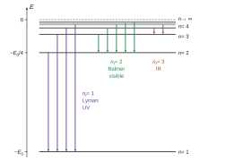
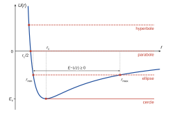
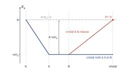
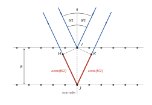
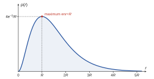

# Mines-Ponts PC — Physique 1 2026 · Corrigé guidé

*Corrigé rédigé par IA, non officiel. Signalez toute erreur.*

## Présentation du sujet

**Thème.** « Du spectre à la structure de l'hydrogène » refait le chemin historique qui mène des raies d'émission de l'hydrogène à sa description quantique. Le fil conducteur est l'**impulsion** $p$ et la relation de de Broglie $\lambda=h/p$ : on la postule dans le modèle de Bohr, on la mesure avec Davisson et Germer, et elle fixe la taille de l'atome dans la description ondulatoire.

**Découpage (25 questions, 3 heures, sans calculatrice ni document).**

- **Partie I (Q1–Q5) — spectre de l'hydrogène.** Relation de Planck-Einstein, exploitation d'une droite (figure 1 : $1/\lambda_0$ en fonction de $1/(k+2)^2$), valeur de $E_0$, relation de Rydberg, encadrement des longueurs d'onde des séries et raies visibles. Phénoménologie pure, très rentable.
- **Partie II (Q6–Q12) — modèle de Bohr.** Mécanique du point dans un champ newtonien : énergie potentielle coulombienne, conservation du moment cinétique, énergie potentielle effective et discussion graphique (II.A), puis règle de quantification de Bohr, niveaux d'énergie et rayon de Bohr (II.B).
- **Partie III (Q13–Q25) — ondes de matière.** III.A : interprétation de la fonction d'onde, équation stationnaire, onde plane en potentiel constant. III.B : puits infini, application à un neutron dans un noyau. III.C : expérience de Davisson et Germer (électrostatique du montage, courant de probabilité, différence de marche sur un réseau de plans, exploitation d'un document historique). III.D : état fondamental de l'hydrogène par l'équation de Schrödinger en symétrie sphérique.

**Notions du programme mobilisées.** Photon et quantification de l'énergie ; force centrale conservative, moment cinétique, énergie potentielle effective (PCSI) ; dualité onde-corpuscule, fonction d'onde, densité de probabilité, équation de Schrödinger à une dimension, puits infini, courant de probabilité (PC) ; interférences à ondes multiples et différence de marche ; analyse dimensionnelle ; lecture et linéarisation de graphes ; applications numériques sans calculatrice.

**Difficulté et longueur.** Sujet long mais très guidé, de difficulté croissante. Les trois parties sont presque indépendantes : III.A, III.B et III.D se traitent même si la partie II a résisté (les résultats utiles sont rappelés ou se retrouvent).

**Ce qu'en dit le rapport 2026.** Le jury souligne que « Les questions proches du cours (Q6, Q7, Q8, Q9, Q13 et Q14) étaient particulièrement valorisées » : bien traitées, elles suffisaient à dépasser la moyenne. Il relève aussi de nombreuses applications numériques insuffisantes (fractions laissées telles quelles, puissances de dix fausses, unités absentes ou « SI »), alors que l'épreuve sans calculatrice évalue précisément cette compétence. Enfin, « La dernière partie, consacrée à l’équation de Schrödinger en trois dimensions, plus délicate, a été peu abordée. » ; Q22 l'a été peu aussi.

**Questions à ne pas laisser passer** : Q1, Q3, Q4, Q6, Q7, Q8, Q10, Q13, Q14, Q16, Q19, Q23. **Questions qui séparent les copies** : Q2 (que veut dire « compatible » ?), Q3 (son application numérique conditionne la suite), Q5 (sens des inégalités, bornes du visible), Q9 (discussion complète avec les rayons caractéristiques), Q15 et Q18 (raisonnements justifiés), Q21–Q22 (schéma de la figure 6, exploitation de la figure 7) et Q23–Q25, peu traitées par les candidats.

**Gestion du temps.** Environ 7 minutes par question en moyenne. Sans calculatrice, préparer les puissances de dix à part et utiliser $hc\simeq1{,}2$ eV·µm dès que des électronvolts et des micromètres apparaissent. Garder deux chiffres significatifs, un seul quand l'énoncé le demande (Q12, Q22), et toujours une unité.

## Partie I — Les raies d'émission de l'hydrogène atomique

On transforme des longueurs d'onde mesurées en niveaux d'énergie. Outils : $\epsilon=h\nu$, lecture d'une droite (pente, ordonnée à l'origine), monotonie d'une suite d'entiers.

### Question 1

> [!INDICATION]
> Deux relations à enchaîner : l'énergie d'un photon en fonction de sa fréquence, puis le lien fréquence–longueur d'onde dans le vide.

#### Solution

Le photon emporte l'énergie $\epsilon=E_i-E_f>0$. La relation de Planck-Einstein donne $\epsilon=h\nu$ et, pour une onde dans le vide, $\nu=c/\lambda_0$. Donc

$$\boxed{\lambda_0=\frac{hc}{E_i-E_f}}$$

> [!PIEGE]
> Écrire $\epsilon=\hbar\nu$ ou $\epsilon=h\omega$ fait perdre un facteur $2\pi$ qui se propage dans toute la partie I.

> [!JURY]
> Le rapport 2026 attend une réponse de la forme $\lambda=\dots$ et précise : « Un signe faux ou l’utilisation de valeur absolue ne sont pas acceptés. » Ici $E_i>E_f$ : le signe se justifie, il ne se corrige pas par une valeur absolue.

### Question 2

> [!INDICATION]
> Calculer $1/\lambda_0$ grâce à Q1 pour la transition $n_i=k+2\to n_f=2$, puis l'écrire en fonction de $X=1/(k+2)^2$.

> [!INDICATION]
> « Compatible » ne se réduit pas à « c'est une droite » : le modèle prévoit aussi une relation précise entre la pente et l'ordonnée à l'origine. La vérifier sur le graphe.

#### Solution

Avec $E_n=-E_0/n^2$, $n_i=k+2$ et $n_f=2$ :

$$E_i-E_f=E_0\left(\frac14-\frac{1}{(k+2)^2}\right),$$

quantité positive pour $k\geq1$. Posons $X=1/(k+2)^2$. La relation de Q1 donne

$$\begin{aligned}
\frac{1}{\lambda_0}&=\frac{E_i-E_f}{hc}\\
&=\underbrace{\frac{E_0}{4hc}}_{b}-\underbrace{\frac{E_0}{hc}}_{|\alpha|}\,X .
\end{aligned}$$

C'est une relation **affine** entre $1/\lambda_0$ et $X$, et non une relation de proportionnalité, puisque $b\neq0$. Deux prédictions sont à tester sur la figure 1 :

- $1/\lambda_0$ est une fonction affine décroissante de $X$ : les cinq points sont alignés aux barres d'erreur près, sur la droite en pointillés. Cela valide la loi en $1/n^2$ avec $n_i=k+2$.
- la pente $\alpha=-E_0/(hc)$ et l'ordonnée à l'origine $b=E_0/(4hc)$ sont dans le rapport $\alpha/b=-4$, indépendant de $E_0$. Cela valide $n_f=2$.

On lit $b\simeq2{,}7\ \mu\text{m}^{-1}$. Le point $k=1$ a pour abscisse $X=1/9\simeq0{,}11$ et pour ordonnée $1/0{,}66\simeq1{,}5\ \mu\text{m}^{-1}$. D'où

$$\alpha\simeq\frac{1{,}5-2{,}7}{0{,}11}\simeq-11\ \mu\text{m}^{-1},$$

$$-4b\simeq-11\ \mu\text{m}^{-1}.$$

Le rapport mesuré vaut $-4$, comme prévu : la relation de Balmer est compatible avec (2).

> [!METHODE]
> Pour tester un modèle sur une droite, on compare **les deux** paramètres prévus (pente et ordonnée à l'origine) aux valeurs lues, ou leur rapport quand une constante inconnue ($E_0$) est commune.

> [!PIEGE]
> L'axe est gradué en µm⁻¹ alors que le tableau donne $\lambda_0$ en nm : convertir ($660$ nm $=0{,}660$ µm) avant toute lecture.

> [!JURY]
> Le rapport 2026 rappelle qu'« une fonction affine ne traduit pas une relation de proportionnalité » et qu'écrire $1/\lambda_0$ comme une fonction de $1/(k+2)^2$ ne prouve pas que la courbe est une droite. En revanche, « L’étude du rapport numérique entre l’ordonnée à l’origine et la pente a été valorisée. »

### Question 3

> [!INDICATION]
> L'ordonnée à l'origine (ou la pente) vient d'être exprimée en fonction de $E_0$, $h$ et $c$. Quelle donnée de l'énoncé évite de passer par les joules ?

#### Solution

L'ordonnée à l'origine donne $E_0=4hc\,b$. Avec l'aide au calcul $hc\simeq1{,}2$ eV·µm et $b\simeq2{,}7\ \mu\text{m}^{-1}$ :

$$E_0\simeq4\times1{,}2\times2{,}7\ \text{eV}\simeq13\ \text{eV}.$$

Contrôle par la pente : $hc\,|\alpha|\simeq1{,}2\times10{,}9$ eV, soit encore $13$ eV.

$$\boxed{E_0\simeq13\ \text{eV}}$$

> [!METHODE]
> $hc\simeq1{,}2$ eV·µm transforme directement un nombre d'onde en µm⁻¹ en énergie en eV : c'est l'outil des AN sans calculatrice en spectroscopie.

> [!JURY]
> Le rapport 2026 insiste : la valeur est demandée en électronvolts, avec l'aide au calcul fournie, et « La réussite des questions suivantes dépendait fortement de la bonne application numérique à cette question ». Prendre le temps d'obtenir deux chiffres significatifs fiables.

### Question 4

> [!INDICATION]
> Reprendre le calcul de Q2 sans fixer $n_f$, puis identifier avec (3).

#### Solution

Pour une transition $n_i\to n_f$ avec $n_i>n_f$, la relation de Q1 et la loi (2) donnent

$$\begin{aligned}
\frac{1}{\lambda_0}&=\frac{E_i-E_f}{hc}\\
&=\frac{1}{hc}\left(\frac{E_0}{n_f^2}-\frac{E_0}{n_i^2}\right)\\
&=\frac{E_0}{hc}\left(\frac{1}{n_f^2}-\frac{1}{n_i^2}\right).
\end{aligned}$$

C'est la relation (3), avec

$$\boxed{R_\infty=\frac{E_0}{hc}}$$

La condition $n_i>n_f$ garantit $1/\lambda_0>0$. Numériquement :

$$\begin{aligned}
\frac{1}{R_\infty}&=\frac{hc}{E_0}\\
&\simeq\frac{1{,}2\ \text{eV·µm}}{13\ \text{eV}}\\
&\simeq0{,}092\ \text{µm},
\end{aligned}$$

$$\boxed{\frac{1}{R_\infty}\simeq92\ \text{nm}}$$

> [!PIEGE]
> Le rapport 2026 relève trop d'erreurs de signe : $E_f=-E_0/n_f^2$ est le terme **soustrait**, d'où le $+1/n_f^2$. Par ailleurs, $R_\infty$ est l'inverse d'une longueur ($E_0/h$ serait une fréquence), et l'énoncé demande $1/R_\infty$ en nanomètres, avec deux chiffres significatifs.

### Question 5

> [!INDICATION]
> À $n_f$ fixé, étudier le sens de variation de $1/n_f^2-1/n_i^2$ en fonction de $n_i>n_f$ : où sont ses bornes ?

> [!INDICATION]
> Encadrer d'abord $1/\lambda_0$, et n'inverser l'inégalité qu'à la fin. Pour $n_f>2$, utiliser $1/n_i^2>0$ puis $n_f\geq3$.

> [!INDICATION]
> Pour la dernière sous-question, écrire les bornes du domaine visible, les comparer aux bornes trouvées, puis examiner la série restante raie par raie.

#### Solution

À $n_f$ fixé, $1/n_f^2-1/n_i^2$ est strictement croissante en $n_i$ et majorée par $1/n_f^2$, sa limite quand $n_i\to\infty$.

**Série $n_f=1$.** On a $n_i\geq2$, et $1-1/n_i^2$ est minimale pour $n_i=2$. Donc

$$\begin{aligned}
\frac{1}{\lambda_0}&=R_\infty\left(1-\frac{1}{n_i^2}\right)\\
&\geq\frac{3R_\infty}{4},
\end{aligned}$$

soit, en inversant l'inégalité entre nombres positifs,

$$\begin{aligned}
\lambda_0\leq\lambda_{\max}&=\frac{4}{3R_\infty}\\
&\simeq\frac43\times92\ \text{nm},
\end{aligned}$$

$$\boxed{\lambda_{\max}\simeq1{,}2\times10^{2}\ \text{nm}}$$

Toutes ces raies (série de Lyman, entre $92$ et $120$ nm) sont dans l'**ultraviolet**.

**Séries $n_f>2$.** On a $n_f\geq3$ et $1/n_i^2>0$, donc

$$\begin{aligned}
\frac{1}{\lambda_0}&<\frac{R_\infty}{n_f^2}\\
&\leq\frac{R_\infty}{9},
\end{aligned}$$

soit

$$\begin{aligned}
\lambda_0>\lambda_{\min}&=\frac{9}{R_\infty}\\
&\simeq9\times92\ \text{nm},
\end{aligned}$$

$$\boxed{\lambda_{\min}\simeq8{,}3\times10^{2}\ \text{nm}}$$

La borne n'est pas atteinte (limite de la série $n_f=3$). Toutes ces raies sont dans l'**infrarouge**.

**Visible.** Le domaine visible s'étend d'environ $400$ nm (violet) à $800$ nm (rouge). Seule la série $n_f=2$ (Balmer) peut donc contribuer. Pour celle-ci,

$$\lambda_0=\frac{1}{R_\infty}\left(\frac14-\frac{1}{n_i^2}\right)^{-1}$$

décroît de $660$ nm ($n_i=3$) vers $4/R_\infty\simeq370$ nm :

| $n_i$ | 3 | 4 | 5 | 6 | 7 | 8 |
|---|---|---|---|---|---|---|
| $\lambda_0$ (nm) | 660 | 490 | 440 | 410 | 400 | 390 |

La raie $n_i=8$ est déjà ultraviolette, comme les suivantes. **Les seules raies visibles sont les cinq raies H$_\alpha$ à H$_\epsilon$ du tableau ($n_i=3$ à $7$, $n_f=2$).**

> [!PIEGE]
> L'inversion des inégalités : $1/\lambda_0$ minoré donne $\lambda_0$ **majoré**. Le rapport 2026 note que des candidats encadrent $\lambda$ mais se trompent sur les indices minimaux et maximaux : justifier la monotonie avant d'affirmer où est l'extremum.

> [!JURY]
> Le rapport 2026 demande deux chiffres significatifs et ajoute : « Peu de candidats précisent l’encadrement du visible qui rapportait des points. » Écrire explicitement les bornes du visible avant de conclure.

## Partie II — Le modèle de Bohr pour l'atome d'hydrogène

Cours de mécanique de PCSI (force centrale conservative, énergie potentielle effective), puis une règle de quantification « importée » des ondes. La question 9 commande toute la suite de la partie.

### Question 6

> [!INDICATION]
> Écrire la force de Coulomb sur l'électron, calculer son travail élémentaire et l'identifier à $-dE_p$.

#### Solution

Le noyau, de charge $+e$, crée en $M$ le champ $\vec E=\dfrac{e}{4\pi\varepsilon_0r^2}\vec u_r$, avec $\vec u_r=\vec r/r$. L'électron, de charge $-e$, subit la force de Coulomb

$$\begin{aligned}
\vec F&=-e\vec E\\
&=-\frac{e^2}{4\pi\varepsilon_0r^2}\,\vec u_r .
\end{aligned}$$

Cette force dérive d'une énergie potentielle : $\vec F=-\overrightarrow{\text{grad}}\,E_p$. Lors d'un déplacement élémentaire, $\vec u_r\cdot d\overrightarrow{OM}=dr$ et le travail de la force vaut

$$\begin{aligned}
\delta W&=\vec F\cdot d\overrightarrow{OM}\\
&=-\frac{e^2}{4\pi\varepsilon_0r^2}\,dr\\
&=-d\left(-\frac{e^2}{4\pi\varepsilon_0r}\right).
\end{aligned}$$

Comme $\delta W=-dE_p$, on a $E_p(r)=-\dfrac{e^2}{4\pi\varepsilon_0r}+C$. La condition $E_p\to0$ quand $r\to\infty$ impose $C=0$ :

$$\boxed{E_p(r)=-\frac{e^2}{4\pi\varepsilon_0r}}$$

> [!PIEGE]
> Le signe : interaction attractive, donc $E_p<0$ et croissante avec $r$. Avec le mauvais signe, $U(r)$ n'a plus de minimum en Q9 et toute la partie II s'effondre. Autre confusion relevée par le rapport 2026 : $\vec E=-\overrightarrow{\text{grad}}\,V$ concerne le champ, $\vec F=-\overrightarrow{\text{grad}}\,E_p$ la force.

> [!JURY]
> Le rapport 2026 est net : « Dans cette question une démonstration était requise. » Donner la formule de $E_p$ ne suffit pas ; il faut partir de la force et intégrer. Il signale aussi des égalités entre vecteurs et scalaires.

### Question 7

> [!INDICATION]
> Quel théorème donne la dérivée du moment cinétique en un point fixe ? Que vaut le moment d'une force centrale en son centre ?

> [!INDICATION]
> Pour le caractère plan : que vaut $\vec r\cdot\vec s$ ? Pourquoi la constance de $\vec s$ est-elle indispensable ?

#### Solution

Le référentiel est galiléen et $O$ y est un point fixe. Le théorème du moment cinétique en $O$, appliqué à l'électron soumis à la seule force $\vec F$, donne

$$\frac{d\vec s}{dt}=\overrightarrow{OM}\wedge\vec F .$$

Or $\vec F$ est colinéaire à $\overrightarrow{OM}$ (force centrale), donc $\overrightarrow{OM}\wedge\vec F=\vec 0$ et

$$\boxed{\vec s=\vec r\wedge\vec p=\overrightarrow{\text{cte}}}$$

Par propriété du produit vectoriel, $\vec s=\vec r\wedge\vec p$ est orthogonal à $\vec r$ à chaque instant : $\vec r\cdot\vec s=0$.

Si $\vec s\neq\vec0$, ce vecteur est fixe : $M$ reste dans le plan **fixe** passant par $O$ et orthogonal à $\vec s$. Le mouvement est plan et son plan contient $O$.

Si $\vec s=\vec0$, le mouvement est rectiligne sur une droite passant par $O$ ; ce cas est exclu de la suite.

> [!METHODE]
> Force centrale $\Rightarrow$ moment cinétique conservé $\Rightarrow$ mouvement plan et loi des aires. Énoncer le théorème **avec ses hypothèses** (référentiel galiléen, point fixe).

> [!PIEGE]
> Deux raisonnements fautifs relevés par le rapport 2026 : relier la conservation du moment cinétique au caractère conservatif de la force (c'est le caractère **central** qui compte), et se placer d'emblée en coordonnées polaires, ce qui présuppose le mouvement plan qu'on veut démontrer.

> [!JURY]
> Rapport 2026 : « La condition d’application du théorème du moment cinétique (point fixe du référentiel galiléen) est trop souvent absente. » Pour la planéité, « il faut s’appuyer sur les propriétés du produit vectoriel ».

### Question 8

> [!INDICATION]
> Écrire l'énergie mécanique en coordonnées polaires, puis exprimer $\dot\theta$ à l'aide de $s$.

#### Solution

En coordonnées polaires dans le plan $(Oxy)$, la vitesse s'écrit $\vec v=\dot r\,\vec u_r+r\dot\theta\,\vec u_\theta$ et l'impulsion $\vec p=m_e\vec v$. Le moment cinétique vaut donc

$$\vec s=m_er^2\dot\theta\,\vec u_z ,$$

d'où $s=m_er^2|\dot\theta|$ et $\frac12m_er^2\dot\theta^2=\dfrac{s^2}{2m_er^2}$. La force étant conservative, l'énergie mécanique se conserve :

$$\begin{aligned}
E&=\frac12m_e\left(\dot r^2+r^2\dot\theta^2\right)+E_p(r)\\
&=\frac12m_e\dot r^2+U(r),
\end{aligned}$$

$$\boxed{U(r)=\frac{s^2}{2m_er^2}-\frac{e^2}{4\pi\varepsilon_0r}}$$

> [!PIEGE]
> Le rapport 2026 met en garde contre l'oubli de la masse dans le moment cinétique : $s=m_er^2|\dot\theta|$, pas $r^2|\dot\theta|$ (qui est la constante des aires). Par ailleurs, $U$ est une énergie potentielle **effective** : le terme $s^2/(2m_er^2)$ est de l'énergie cinétique orthoradiale réécrite grâce à la constante $s$.

### Question 9

> [!INDICATION]
> Étudier les limites de $U$ en $0^+$ et en $+\infty$ (quel terme domine ?), puis le signe de $U'$.

> [!INDICATION]
> L'inégalité $\frac12m_e\dot r^2\geq0$ impose $E\geq U(r)$ : placer des droites horizontales d'énergie $E$ sur la courbe et distinguer selon que $E$ est égale au minimum, entre le minimum et $0$, nulle ou positive. Où ces droites coupent-elles la courbe ?

> [!INDICATION]
> Sur une trajectoire circulaire, $r$ est constant : où se trouve-t-on sur la courbe ? Que devient le lien entre $s$, $r$ et $p$ ?

#### Solution

On suppose $s\neq0$ et on pose $A=e^2/(4\pi\varepsilon_0)$.

**Allure.** Quand $r\to0^+$, le terme en $1/r^2$ l'emporte et $U\to+\infty$. Quand $r\to+\infty$, le terme $-A/r$ l'emporte et $U\to0^-$. La dérivée vaut

$$U'(r)=\frac{1}{r^3}\left(Ar-\frac{s^2}{m_e}\right).$$

La fonction $U$ décroît sur $]0,r_c[$ et croît sur $]r_c,+\infty[$. La courbe coupe l'axe en $r_c/2$ et atteint un minimum négatif $E_c$ en $r_c$ (figure 2).

**Quatre types d'orbites.** Les rayons caractéristiques sont les racines de $U(r)=E$, où $\dot r$ s'annule :

| Énergie | Mouvement radial | Trajectoire |
|---|---|---|
| $E=E_c$ | $r=r_c$ | cercle (état lié) |
| $E_c<E<0$ | $r_{\min}\leq r\leq r_{\max}$ | ellipse de foyer $O$ (état lié) |
| $E=0$ | $r\geq r_{\min}=r_c/2$, vitesse nulle à l'infini | parabole (état libre, cas limite) |
| $E>0$ | $r\geq r_{\min}$, vitesse non nulle à l'infini | hyperbole (état libre, diffusion) |

Aucun mouvement n'est possible pour $E<E_c$.

**Trajectoire circulaire.** On est au minimum de $U$ : $U'(r_c)=0$. Puis $\dot r=0$, donc $\vec p\perp\vec r$ et $s=r_cp_c$. Enfin $E_c=U(r_c)$ est l'énergie **mécanique** :

$$\boxed{r_c(s)=\frac{4\pi\varepsilon_0s^2}{m_ee^2}}$$

$$\boxed{p_c(s)=\frac{m_ee^2}{4\pi\varepsilon_0s}}$$

$$\boxed{E_c(s)=-\frac{m_ee^4}{32\pi^2\varepsilon_0^2s^2}}$$

> [!METHODE]
> Discussion graphique d'un mouvement à un degré de liberté : on lit sur $U(r)$ les zones accessibles ($E\geq U$), les points de rebroussement ($E=U$) et les positions d'équilibre ($U'=0$). Contrôle utile : $E_c=-p_c^2/(2m_e)=E_p(r_c)/2$.

> [!PIEGE]
> Oublier le cas $E=0$ (parabole) : l'énoncé annonce **quatre** types d'orbites. Et ne pas lire $E_c$ comme une énergie cinétique : l'énergie cinétique sur le cercle vaut $-E_c>0$.

> [!JURY]
> Le rapport 2026 constate que les quatre trajectoires sont en général bien placées, mais que peu de candidats font apparaître le rayon minimal pour la parabole et l'hyperbole, et les rayons minimal et maximal pour l'ellipse. Il ajoute : « L’énergie sur la trajectoire circulaire a trop souvent été confondue avec l’énergie cinétique. »

### Question 10

> [!INDICATION]
> Traduire la phrase de l'énoncé : périmètre $=n$ longueurs d'onde de de Broglie. Puis relier $s$ à $r$ et $p$ sur un cercle.

#### Solution

D'après l'énoncé, le périmètre $2\pi r$ de l'orbite contient exactement $n$ longueurs d'onde de de Broglie $\lambda=h/p$ :

$$2\pi r=n\,\frac{h}{p}.$$

Sur l'orbite circulaire, $\vec p$ est perpendiculaire à $\vec r$ (Q9), donc $s=\|\vec r\wedge\vec p\|=rp$. En multipliant par $p/(2\pi)$ :

$$\boxed{s=n\,\frac{h}{2\pi},\ n\in\mathbb N^*}$$

> [!JURY]
> Rapport 2026 : « Procéder par analyse dimensionnelle ne suffit pas à répondre correctement. » La condition de l'énoncé donne directement la relation, et la justification de $s=rp$ (impulsion orthoradiale) était valorisée.

### Question 11

> [!INDICATION]
> Substituer le résultat de Q10 dans les trois expressions de Q9, simplifier, puis identifier $E_c(n)$ à la forme (2).

> [!INDICATION]
> Pour « comparer », calculer la valeur de $E_0$ prédite et la confronter à celle de Q3.

#### Solution

$$\boxed{r_c(n)=\frac{\varepsilon_0h^2}{\pi m_ee^2}\,n^2}$$

$$\boxed{p_c(n)=\frac{m_ee^2}{2\varepsilon_0h}\,\frac1n}$$

$$\boxed{E_c(n)=-\frac{m_ee^4}{8\varepsilon_0^2h^2}\,\frac{1}{n^2}}$$

C'est la loi (2) avec une constante positive, comme en Q2 :

$$E_0=\frac{m_ee^4}{8\varepsilon_0^2h^2}.$$

Numériquement,

$$\begin{aligned}
E_0&=\frac{9{,}1\times10^{-31}\times6{,}6\times10^{-76}}{8\times7{,}9\times10^{-23}\times4{,}4\times10^{-67}}\ \text{J}\\
&\simeq2{,}2\times10^{-18}\ \text{J}\\
&\simeq14\ \text{eV}.
\end{aligned}$$

Le calcul non arrondi donne $13{,}5$ eV, en accord avec les $13$ eV lus en Q3 à la précision du relevé graphique près. Le modèle retrouve la forme en $1/n^2$ **et** la valeur de la constante à partir des seules constantes fondamentales.

> [!PIEGE]
> Les facteurs $2\pi$ : $s=nh/(2\pi)$, pas $nh$. Une erreur ici donne un $E_0$ faux d'un facteur $4\pi^2\simeq40$, que la comparaison avec Q3 permet de détecter. De même, un $E_0$ négatif doit alerter : le rapport 2026 juge problématique de trouver un signe opposé à celui de Q2.

> [!JURY]
> Rapport 2026 : « Si des simplifications sont encore possibles, le résultat n’est pas accepté. Le résultat est attendu en fonction de $h$ et non de $\hbar$. »

### Question 12

> [!INDICATION]
> Comment varie $r_c(n)$ avec $n$ ? Quelle est la plus petite valeur permise de $n$ ?

> [!INDICATION]
> Pour commenter : à quelle échelle de longueur connue comparer le résultat ? Quel problème de la physique classique ce rayon minimal résout-il ?

#### Solution

$r_c$ croît comme $n^2$ ; le minimum correspond à $n=1$ :

$$\boxed{r_{c,\min}=\frac{\varepsilon_0h^2}{\pi m_ee^2}}$$

$$\begin{aligned}
r_{c,\min}&=\frac{8{,}9\times10^{-12}\times4{,}4\times10^{-67}}{3{,}1\times9{,}1\times10^{-31}\times2{,}6\times10^{-38}}\ \text{m}\\
&\simeq5\times10^{-11}\ \text{m}.
\end{aligned}$$

C'est le rayon de Bohr, de l'ordre de la taille des atomes (dixième de nanomètre). Un rayon minimal non nul assure la stabilité de l'atome, que l'électromagnétisme classique ne garantit pas : une charge accélérée rayonne et devrait tomber sur le noyau. Ce résultat repose toutefois sur un postulat extérieur à la mécanique classique.

> [!METHODE]
> AN sans calculatrice : regrouper mantisses et puissances de dix séparément ($8{,}9\times4{,}4/(3{,}1\times9{,}1\times2{,}6)\simeq0{,}5$ et $10^{-12-67+31+38}=10^{-10}$). Selon le rapport 2026, ce sont les candidats allés au bout de l'application numérique qui ont reconnu le rayon de Bohr.

## Partie III — Ondes de matière en physique microscopique

Cours de PC sur l'approche ondulatoire : sens de la fonction d'onde, équation de Schrödinger stationnaire, ondes planes et puits infini, courant de probabilité, puis une expérience historique et le retour à l'hydrogène en trois dimensions.

### Question 13

> [!INDICATION]
> Que représente $|\underline\Psi|^2$ ? Que représente $S\,dx$ ?

> [!INDICATION]
> Reporter $\underline\Psi=\underline\psi(x)e^{-i\omega t}$ dans **chacune** des deux égalités de (4).

#### Solution

$|\underline\Psi|^2$ est une **densité** volumique de probabilité de présence, et $S\,dx$ le volume d'une tranche. **L'intégrale est la probabilité de trouver la particule dans $\mathscr D$, égale à $1$** (normalisation).

Une probabilité étant sans dimension, $\boxed{[\underline\Psi]=L^{-3/2}}$.

Avec $\underline\Psi=\underline\psi(x)e^{-i\omega t}$, on a $i\hbar\,\partial\underline\Psi/\partial t=\hbar\omega\underline\Psi$. Après simplification par $e^{-i\omega t}\neq0$ :

$$\begin{aligned}
\hbar\omega\,\underline\psi&=-\frac{\hbar^2}{2m}\underline\psi''+V\underline\psi\\
&=E\underline\psi,
\end{aligned}$$

d'où

$$\boxed{\underline\psi''+\frac{2m}{\hbar^2}\big(E-V(x)\big)\underline\psi=0}$$

$$\boxed{E=\hbar\omega=\frac{h\omega}{2\pi}}$$

> [!PIEGE]
> Répondre $L^{-1/2}$ en oubliant la section $S$ : la particule occupe un volume, et c'est pour cela que $S$ figure dans l'intégrale.

> [!JURY]
> Question proche du cours, globalement bien traitée selon le rapport 2026, qui note pourtant : « De nombreux candidats confondent densité de probabilité de présence et probabilité de présence. » Le mot « densité » doit figurer dans la réponse.

### Question 14

> [!INDICATION]
> Avec $V=V_0$, l'équation est à coefficients constants : discuter selon le signe de $E-V_0$.

> [!INDICATION]
> Pour l'impulsion, isoler une seule onde progressive et appliquer la relation de de Broglie ; comparer ensuite à $p^2/(2m)$.

#### Solution

Si $E<V_0$, les solutions sont en $e^{\pm\kappa x}$ (évanescentes). Si $E=V_0$, elles sont affines. Si $E>V_0$, elles sont oscillantes.

**Propagation sans atténuation si et seulement si $E>V_0$.** On pose alors

$$k=\frac{\sqrt{2m(E-V_0)}}{\hbar},$$

et

$$\boxed{\underline\psi=\underline Ae^{ikx}+\underline Be^{-ikx}}$$

$$\boxed{\lambda=\frac{2\pi}{k}=\frac{h}{\sqrt{2m(E-V_0)}}}$$

Pour une seule onde ($\underline B=0$, propagation vers les $x$ croissants), la relation de de Broglie donne $p=h/\lambda=\hbar k$ :

$$\boxed{p=\sqrt{2m(E-V_0)}}$$

soit $K=E-V_0=p^2/(2m)$ : **même relation qu'en mécanique classique non relativiste**.

> [!PIEGE]
> Ne pas confondre $\lambda$ (onde de matière) et $\lambda_0$ (onde lumineuse). Le rapport 2026 signale surtout une maîtrise insuffisante des relations entre les grandeurs $(\lambda,k,p)$ : $k=2\pi/\lambda$ et $p=h/\lambda=\hbar k$.

### Question 15

> [!INDICATION]
> Combien de longueurs d'onde, ou de demi-longueurs d'onde, occupent le segment dans un cas, le périmètre dans l'autre ? D'où vient chaque contrainte ?

> [!INDICATION]
> Compter les annulations de l'onde dans chaque cas, et regarder la parité du nombre de demi-longueurs d'onde.

#### Solution

**Segment (figure 4).** L'onde s'annule aux deux extrémités, imposées par le dispositif, et $n+1$ fois en tout. Deux zéros consécutifs sont distants de $\lambda/2$ :

$$\ell=n\,\frac{\lambda}{2},\ n\in\mathbb N^*.$$

Toutes les valeurs de $n$ conviennent, paires comme impaires.

**Orbite de Bohr (figure 3).** Le périmètre contient $n$ longueurs d'onde **entières** :

$$\begin{aligned}
2\pi r&=n\lambda\\
&=2n\,\frac{\lambda}{2}.
\end{aligned}$$

Aucun nœud n'est imposé : l'onde doit se raccorder à elle-même après un tour. Elle s'annule $2n$ fois sur le cercle.

**Les deux conditions ne sont pas identiques.** Le segment admet tout nombre entier de demi-longueurs d'onde (conditions d'annulation aux bords) ; le cercle n'en admet qu'un nombre pair (condition de périodicité). Elles ont en commun de discrétiser $\lambda$, donc $p$ et $E$.

> [!JURY]
> Rapport 2026 : « Une réponse justifiée était attendue » ; il cite comme arguments la parité de $n$, le nombre d'annulations en fonction de $n$, le nombre entier de longueurs d'onde ou de demi-longueurs d'onde. Un « non » sec ne rapporte rien.

### Question 16

> [!INDICATION]
> Résoudre l'équation de Q13 avec $V=0$ ; pourquoi $E$ doit-il être positif ?

> [!INDICATION]
> Imposer $\underline\psi(0)=0$ puis $\underline\psi(\ell)=0$ sans tomber sur la solution nulle.

#### Solution

Si $E\leq0$, les solutions (exponentielles réelles ou affines) ne peuvent s'annuler en deux points sans être nulles. Donc $E>0$ et, avec $k=\sqrt{2mE}/\hbar$,

$$\underline\psi=\underline A\sin(kx)+\underline B\cos(kx).$$

La condition $\underline\psi(0)=0$ impose $\underline B=0$.

La condition $\underline\psi(\ell)=0$, avec $\underline A\neq0$, impose $\sin(k\ell)=0$, soit $k\ell=n\pi$ avec $n\in\mathbb N^*$. Donc

$$\begin{aligned}
E_n&=\frac{\hbar^2k^2}{2m}\\
&=\frac{n^2h^2}{8m\ell^2}.
\end{aligned}$$

$$\boxed{E_n=\frac{n^2h^2}{8m\ell^2},\ n\in\mathbb N^*}$$

Contrôle : $\lambda=2\ell/n$ et $E=(h/\lambda)^2/(2m)$ redonnent le même résultat.

> [!METHODE]
> États liés = conditions aux limites sur une équation d'ondes : quantification de $k$, puis de $E$ par la relation de dispersion. L'énergie minimale $h^2/(8m\ell^2)$ est non nulle (énergie de confinement).

> [!PIEGE]
> Le rapport 2026 : « Beaucoup de candidats n’ont pas su correctement écrire les conditions aux limites ». Ce sont elles, et non la seule équation différentielle, qui donnent l'énergie : les écrire en toutes lettres, puis exclure $\underline A=0$.

### Question 17

> [!INDICATION]
> Écrire $E_2-E_1$ avec Q16, puis isoler $\ell$. Attention à la masse à utiliser.

> [!INDICATION]
> Comparer la longueur obtenue aux échelles connues de la physique (atome, noyau). Quelles interactions peuvent agir sur une particule neutre ?

#### Solution

Avec la masse $m_n$ du neutron :

$$\begin{aligned}
\Delta E&=E_2-E_1\\
&=\frac{3h^2}{8m_n\ell^2},
\end{aligned}$$

$$\boxed{\ell=h\sqrt{\frac{3}{8m_n\Delta E}}}$$

Avec $\Delta E=4{,}8\times10^{-12}$ J :

$$\begin{aligned}
\ell&=6{,}6\times10^{-34}\times\sqrt{\frac{3}{6{,}5\times10^{-38}}}\ \text{m}\\
&\simeq6{,}6\times10^{-34}\times6{,}8\times10^{18}\ \text{m},
\end{aligned}$$

$$\boxed{\ell\simeq4{,}5\times10^{-15}\ \text{m}}$$

Quelques femtomètres : la **taille d'un noyau**. On décrit un neutron confiné dans un noyau, avec des écarts d'énergie de l'ordre de la dizaine de MeV, typiques de la physique nucléaire. Le neutron étant neutre et la gravitation négligeable, c'est l'**interaction forte**, de très courte portée, qui le confine.

> [!PIEGE]
> Trois erreurs classiques : oublier le facteur $10^6$ de MeV, prendre $E_1$ au lieu de $\Delta E=E_2-E_1$ (facteur $3$), utiliser $m_e$ au lieu de $m_n$.

> [!JURY]
> Application numérique peu réussie selon le rapport 2026, qui renvoie à l'aide au calcul. Pour le commentaire : « Les meilleurs candidats ont su faire le lien avec la distance caractéristique du noyau et l’interaction forte. »

### Question 18

> [!INDICATION]
> Que produit sur les électrons incidents un cristal chargé négativement ? Quelle grandeur de l'expérience cesse alors d'être contrôlée ?

> [!INDICATION]
> Relire la phrase de l'énoncé sur la région située entre les grilles et le cristal : quel potentiel le cristal doit-il avoir pour qu'elle reste vraie ?

#### Solution

Chargé négativement, le cristal repousserait et dévierait les électrons : leur impulsion à l'arrivée, donc $\lambda$, ne serait plus fixée par $V_A$. L'incidence changerait, la mesure dériverait et le faisceau finirait par être arrêté.

**Il faut le relier aux électrodes A et B** : la région B–cristal reste alors équipotentielle, au potentiel $V_A=V_B$, sans champ, conformément à l'hypothèse « aucune interaction ».

Relié à la masse, le cristal serait au potentiel de K. Le travail de la force électrique entre B et le cristal, $(-e)(V_A-0)=-eV_A$, annulerait l'énergie cinétique acquise entre K et A : les électrons n'atteindraient pas le cristal.

> [!PIEGE]
> Le réflexe « on relie à la masse pour évacuer les charges » est faux ici : c'est le calcul du travail entre B et le cristal qui tranche.

> [!JURY]
> Question qualitative qui demandait, selon le rapport 2026, un raisonnement précis : « Une réponse non justifiée n’était pas acceptée. »

### Question 19

> [!INDICATION]
> Appliquer une loi de la mécanique entre K et A : laquelle évite tout calcul de trajectoire ?

> [!INDICATION]
> Relire l'énoncé : que désigne $E$ ? Où placer l'origine de l'énergie potentielle pour respecter $E>0$ ?

#### Solution

Entre K et A, l'électron n'est soumis qu'à la force électrique, conservative, d'énergie potentielle $-eV$. Le théorème de l'énergie mécanique s'applique. En K, le potentiel est nul et la vitesse négligeable ; en A, le potentiel vaut $V_A$ :

$$\frac12m_ev_A^2-eV_A=0,$$

d'où $\frac12m_ev_A^2=eV_A$. Au-delà de A, l'électron libre garde sa vitesse :

$$\boxed{p=m_ev_A=\sqrt{2m_eeV_A}}$$

$E$ est l'énergie **totale** : énergie cinétique plus énergie potentielle $V(x)$ des interactions (III.A). Entre les grilles et le cristal, il n'y a aucune interaction : $V(x)$ y est uniforme, et on la prend nulle, ce qui est cohérent avec $E>0$. Alors

$$\boxed{E=\frac{p^2}{2m_e}=eV_A}$$

Avec l'origine des énergies potentielles en K, l'énergie totale de l'électron serait nulle, ce que l'énoncé exclut.

> [!PIEGE]
> Écrire $E=\frac12m_ev_A^2$ sans dire pourquoi l'énergie potentielle est nulle dans cette zone : c'est précisément la confusion entre énergie totale et énergie cinétique que relève le jury. Contrôle d'homogénéité : $eV_A$ est une énergie, donc $p=\sqrt{2m_e\cdot eV_A}$.

> [!JURY]
> Le rapport 2026 invitait à une loi de la mécanique classique et précise : « Le théorème de l’énergie est dans ce cas beaucoup plus efficace. » Il ajoute : « D’après l’énoncé, $E$ est l’énergie totale de la particule, trop de candidats ont donné pour $E$ son énergie cinétique. »

### Question 20

> [!INDICATION]
> Analyse dimensionnelle : densité volumique multipliée par une vitesse. À quel vecteur bien connu de l'électrocinétique cela ressemble-t-il ?

> [!INDICATION]
> Calculer $|\underline\Psi_{\rm inc}|^2$ puis identifier $\|\vec J\|$ au flux $\Phi_0$. Pour la dernière sous-question, se demander ce qui est observable dans une fonction d'onde.

#### Solution

$[\vec J\,]=L^{-3}\cdot L\cdot T^{-1}$, soit $\boxed{L^{-2}\cdot T^{-1}}$.

$\vec J=|\underline\Psi|^2\vec v$ est le **vecteur densité de courant de probabilité**. Pour un faisceau, c'est la densité de courant de particules : $\vec J\cdot\vec n\,dS\,dt$ électrons traversent $dS$ pendant $dt$, comme pour $\vec\jmath=\rho\vec v$.

$|\underline\Psi_{\rm inc}|^2=\psi_0^2$, donc $\Phi_0=\psi_0^2p/m_e$ et $\boxed{\psi_0=\sqrt{m_e\Phi_0/p}}$.

**Pas de perte de généralité** : une phase globale ne change ni $|\underline\Psi|^2$ ni $\vec J$, elle n'est pas observable.

L'onde de l'énoncé varie en $e^{+iEt/\hbar}$, convention opposée à celle de III.A ($e^{-i\omega t}$). Avec cette dernière on écrirait $\psi_0e^{\frac i\hbar(px-Et)}$ ; seuls les modules interviennent ici.

> [!PIEGE]
> $\vec J$ n'est pas une densité de courant électrique (il manquerait la charge $-e$) : sa dimension ne contient pas $I$. Selon le rapport 2026, la dimension est en général juste, mais l'interprétation physique beaucoup moins : il faut dire ce que compte $\vec J$.

### Question 21

> [!INDICATION]
> Sur la figure 6, identifier la droite en pointillés : quelle est sa direction par rapport aux alignements d'atomes ? Quel angle fait-elle avec les rayons incident et réfléchi ?

> [!INDICATION]
> Tracer deux rayons réfléchis sur deux plans consécutifs et projeter le point de réflexion du premier sur les deux segments du second : la différence de marche est la somme de deux segments. Quel montage d'interférométrie du cours a la même géométrie ?

> [!INDICATION]
> Interférences constructives entre toutes les ondes réfléchies : à quoi doit être égale la différence de marche ? Quelle nature a l'ordre $q$ ?

#### Solution

La droite en pointillés est perpendiculaire aux plans : c'est leur normale, et elle fait un angle $\theta/2$ avec chacun des deux faisceaux (loi de la réflexion). L'angle d'incidence par rapport à la normale vaut $\theta/2$.

Soient deux rayons réfléchis en $I$ (premier plan) et $J$ (plan suivant), avec $IJ=a$ sur la normale.

On note $H$ et $K$ les projetés orthogonaux de $I$ sur le rayon incident et sur le rayon réfléchi passant par $J$. Par le théorème de Malus, les chemins sont égaux en amont de $H$ et en aval de $K$ :

$$\begin{aligned}
\delta&=HJ+JK\\
&=2a\cos\frac\theta2,
\end{aligned}$$

$$\boxed{\delta=2a\cos\left(\frac\theta2\right)}$$

On reconnaît la lame d'air d'épaisseur $a$ du Michelson, éclairée sous l'incidence $i=\theta/2$ : $\delta=2a\cos i$.

Le faisceau diffracté est intense quand $\delta$ est un multiple **entier** de $\lambda$ :

$$\boxed{2a\cos\left(\frac\theta2\right)=q\lambda,\ q\in\mathbb N^*}$$

> [!PIEGE]
> $\theta$ n'est pas l'angle rasant de la loi de Bragg usuelle $2d\sin\theta_B=q\lambda$ : ici l'angle rasant vaut $\pi/2-\theta/2$. Contrôle : pour $\theta\to0$ le faisceau repart vers la source, l'incidence est normale et $\delta\to2a$. L'énoncé fournit d'ailleurs $\cos25^\circ$.

> [!JURY]
> Rapport 2026 : « Faire un schéma (juste) pour montrer le trajet optique est une obligation pour répondre à ce genre de question ». Il regrette que peu de candidats reconnaissent le Michelson en lame à faces parallèles, et note : « Très peu de candidats signalent que $q$ doit être un entier. »

### Question 22

> [!INDICATION]
> Exprimer $\lambda$ en fonction de la tension accélératrice grâce à Q19, puis reporter dans la condition de Q21 : comment varie l'ordre $q$ avec $V$ ?

> [!INDICATION]
> Mesurer l'écart entre maxima consécutifs, de préférence sur tout le graphe (premier et dernier pic), plutôt que la position d'un seul pic dont on ne connaît pas l'ordre.

#### Solution

D'après Q19, $\lambda=\dfrac{h}{\sqrt{2m_eeV}}$. La condition de Q21 donne alors

$$q=\frac{2a\cos(\theta/2)\sqrt{2m_ee}}{h}\,\sqrt V .$$

**L'ordre est proportionnel à $\sqrt V$** : les maxima sont équidistants en $\sqrt V$, d'où le choix de l'axe. Leur écart vaut

$$\Delta\sqrt V=\frac{h}{2a\cos(\theta/2)\sqrt{2m_ee}} .$$

Maxima relevés : $\sqrt V\simeq8{,}0\,;\ 11{,}4\,;\ 14{,}6\,;\ 18{,}2\,;\ 21{,}2\,;\ 24{,}2\ \text{V}^{1/2}$, soit $\Delta\sqrt V\simeq16{,}2/5\simeq3{,}2$ V$^{1/2}$.

Avec $h/\sqrt{2m_ee}\simeq6{,}6\times10^{-34}/(5{,}4\times10^{-25})\simeq1{,}2\times10^{-9}$ m·V$^{1/2}$ :

$$a\simeq\frac{1{,}2\times10^{-9}}{2\times0{,}91\times3{,}2}\ \text{m},$$

$$\boxed{a\simeq2\times10^{-10}\ \text{m}}$$

C'est l'ordre de grandeur des distances interatomiques dans un solide (quelques rayons de Bohr, Q12). Il est comparable à la longueur d'onde des électrons, environ $0{,}15$ nm pour $\sqrt V=8$ V$^{1/2}$ : condition nécessaire pour observer la diffraction. L'expérience confirme l'onde de de Broglie.

Les pics ne tombent pas exactement sur des multiples de $\Delta\sqrt V$ (décalage dû à des effets à l'entrée du cristal, hors du modèle), ce qui n'affecte pas leur écart.

> [!PIEGE]
> Erreur sur l'angle en Q21 : $2a\sin\theta=q\lambda$ donnerait $a\simeq2{,}5\times10^{-10}$ m et $2a\sin(\theta/2)=q\lambda$ donnerait $a\simeq4{,}5\times10^{-10}$ m, des ordres de grandeur encore plausibles. Seule une géométrie soignée en Q21 protège : le rapport 2026 note d'ailleurs que Q22, peu abordée, dépendait de la précédente.

> [!METHODE]
> Linéariser une loi avant d'exploiter un graphe : on choisit l'abscisse qui rend les maxima équidistants, et l'on mesure un écart moyen sur l'ensemble des pics.

### Question 23

> [!INDICATION]
> La probabilité entre $r$ et $r+dr$ s'obtient en intégrant $|\underline\Psi|^2$ sur une coquille sphérique : quel est son volume ?

> [!INDICATION]
> « En fonction de $R$ et $r$ » : il faut éliminer $\psi_0$ par la normalisation, avec l'une des intégrales fournies.

> [!INDICATION]
> Pour l'interprétation, chercher le maximum de $\rho$.

#### Solution

On intègre sur les angles :

$$\begin{aligned}
d\mathbb P&=\psi_0^2e^{-2r/R}\,r^2dr\iint\sin\theta\,d\theta\,d\varphi\\
&=4\pi\psi_0^2r^2e^{-2r/R}dr .
\end{aligned}$$

Normalisation avec $x=2r/R$ :

$$\begin{aligned}
1&=4\pi\psi_0^2\,\frac{R^3}{8}\times2\\
&=\pi\psi_0^2R^3 .
\end{aligned}$$

D'où

$$\boxed{\rho(r)=\frac{4r^2}{R^3}e^{-2r/R}}$$

La dérivée vaut $\rho'(r)=\dfrac{8r}{R^3}\left(1-\dfrac rR\right)e^{-2r/R}$. La densité $\rho$ part de $0$, en $r^2$.

Elle croît jusqu'à son maximum $4e^{-2}/R\simeq0{,}54/R$ en $r=R$, puis décroît exponentiellement vers $0$. **$R$ est la distance la plus probable entre l'électron et le noyau.**

> [!PIEGE]
> Confondre $|f(r)|^2$, densité volumique maximale en $r=0$, et $\rho(r)$, densité radiale nulle en $0$ et maximale en $R$ : tout tient dans le facteur $4\pi r^2$, à justifier par le volume de la coquille.

> [!JURY]
> Questions peu traitées selon le rapport 2026, qui précise : « $\rho$ est attendu en fonction de $r$ et $R$, donc $\psi_0$ ne doit pas apparaître dans son expression. » La normalisation fait partie de la réponse.

### Question 24

> [!INDICATION]
> Écrire l'équation de Schrödinger stationnaire à trois dimensions (remplacer $\partial^2/\partial x^2$ par le laplacien) avec l'énergie potentielle de Q6. Seul le terme radial du laplacien subsiste.

> [!INDICATION]
> L'égalité obtenue doit être vraie pour tout $r$ : séparer les termes constants et les termes en $1/r$.

#### Solution

L'équation s'écrit

$$-\frac{\hbar^2}{2m_e}\Delta f-\frac{e^2}{4\pi\varepsilon_0r}f=Ef ,$$

avec

$$\begin{aligned}
\Delta f&=\frac{1}{r^2}\frac{d}{dr}\left(-\frac{r^2}{R}f\right)\\
&=\left(\frac{1}{R^2}-\frac{2}{rR}\right)f .
\end{aligned}$$

Après simplification par $f\neq0$ :

$$\left(-\frac{\hbar^2}{2m_eR^2}-E\right)+\left(\frac{\hbar^2}{m_eR}-\frac{e^2}{4\pi\varepsilon_0}\right)\frac1r=0\quad\forall r>0 .$$

Les fonctions $1$ et $1/r$ étant indépendantes, les deux coefficients sont nuls :

$$\boxed{R=\frac{\varepsilon_0h^2}{\pi m_ee^2}}$$

$$\boxed{E=-\frac{m_ee^4}{8\varepsilon_0^2h^2}}$$

**Comparaison.** $R=r_c(1)\simeq5\times10^{-11}$ m et $E=E_c(1)=-E_0$ : mêmes valeurs que Bohr pour l'état fondamental. Mais $R$ est une distance la plus probable, non un rayon de trajectoire, et la quantification résulte de l'équation elle-même, sans postulat ajouté.

> [!METHODE]
> Identification d'une égalité vraie pour tout $r$ : on regroupe par fonctions indépendantes ($1$, $1/r$, …) et on annule chaque coefficient. C'est ce qui fixe à la fois le paramètre de la solution ($R$) et la valeur propre ($E$).

> [!JURY]
> Le rapport 2026 rappelle qu'« Une affirmation isolée ne constitue pas une démonstration. » Ici, écrire que l'égalité vaut pour tout $r>0$ avant d'annuler les coefficients ; et « comparer » appelle une phrase sur le changement de statut de $R$, pas seulement l'égalité des formules.

### Question 25

> [!INDICATION]
> Une moyenne se calcule en pondérant par la densité de probabilité : $\langle V\rangle=\int E_p(r)\rho(r)\,dr$. Se ramener à l'une des intégrales fournies.

> [!INDICATION]
> L'énergie totale est la somme des énergies cinétique et potentielle moyennes. Pour commenter, comparer au partage des énergies sur l'orbite circulaire de la partie II.

#### Solution

$$\begin{aligned}
\langle V\rangle&=-\frac{e^2}{4\pi\varepsilon_0}\,\frac{4}{R^3}\int_0^\infty re^{-2r/R}dr\\
&=-\frac{e^2}{4\pi\varepsilon_0}\,\frac{4}{R^3}\,\frac{R^2}{4},
\end{aligned}$$

$$\boxed{\langle V\rangle=-\frac{e^2}{4\pi\varepsilon_0R}}$$

soit $\langle V\rangle=2E$ avec l'expression de $R$. Puis

$$\begin{aligned}
\langle K\rangle&=E-\langle V\rangle\\
&=-E,
\end{aligned}$$

$$\boxed{\langle K\rangle=E_0}$$

Numériquement, $\langle K\rangle\simeq14$ eV et $\langle V\rangle\simeq-27$ eV avec la valeur de Q11.

**Commentaire.** $\langle K\rangle>0$ pour un état lié : l'électron confiné dans une région de taille $R$ garde une énergie cinétique d'ordre $\hbar^2/(2m_eR^2)=|E|$. C'est une énergie de confinement, cohérente avec $\Delta p\gtrsim\hbar/R$.

La relation $2\langle K\rangle+\langle V\rangle=0$ est la même que sur l'orbite circulaire de Bohr, où $p_c^2/(2m_e)=-E_c$ et $E_p(r_c)=2E_c$ : le partage énergétique survit au changement de modèle.

Enfin, l'énergie d'ionisation $E_0$ mesurée sur le spectre (Q3) est égale à l'énergie cinétique moyenne de l'électron.

> [!PIEGE]
> Moyenner avec $|f|^2$ au lieu de $\rho$ : c'est le facteur $r^2$ de $\rho$ qui compense la singularité en $1/r$ du potentiel.

## Bilan

**Méthodes à retenir.**

- Spectroscopie : $\lambda_0=hc/\Delta E$, $hc\simeq1{,}2$ eV·µm ; tester un modèle sur une droite par la pente **et** l'ordonnée à l'origine ; encadrer $1/\lambda_0$ avant d'inverser.
- Force centrale : conservation du moment cinétique, mouvement plan, énergie potentielle effective, discussion graphique (états liés, diffusion), orbite circulaire par $U'(r_c)=0$.
- Quantification : condition d'onde stationnaire (Bohr : périodicité ; puits : nœuds aux bords), énergie de confinement $\sim h^2/(m\ell^2)$.
- Ondes de matière : $|\underline\Psi|^2$ densité de probabilité, $[\underline\Psi]=L^{-3/2}$, $E=\hbar\omega$, $p=\hbar k$, courant de probabilité $|\underline\Psi|^2\vec v$.
- Interférences sur un réseau de plans : différence de marche par projections orthogonales (géométrie du Michelson en lame d'air), condition $\delta=q\lambda$ avec $q$ entier ; linéarisation en $\sqrt V$.
- Calcul en symétrie sphérique : densité radiale $4\pi r^2|f|^2$, normalisation, identification terme à terme, valeurs moyennes.

**Ce que le rapport 2026 met en avant.** Les questions de cours (Q6 à Q9, Q13, Q14) font la note : elles exigent des démonstrations complètes et les hypothèses des théorèmes. Les applications numériques sans calculatrice comptent beaucoup et se perdent vite (fractions, puissances de dix, unités). Les questions discriminantes sont Q2, Q3, Q5, Q9, Q15, Q18, Q21, et la fin du sujet (Q22 à Q25), peu abordée.

**Prérequis à revoir.** Mécanique en force centrale (PCSI), équation de Schrödinger et puits infini (PC), interférences à $N$ ondes, théorème de l'énergie mécanique en électrostatique, intégrales $\int_0^\infty x^ne^{-x}dx$.

**Questions classiques transposables.** Linéarisation de Balmer et calcul de $R_\infty$ ; discussion de $U_{\rm eff}(r)$ ; niveaux de Bohr et rayon de Bohr ; niveaux du puits infini et ordre de grandeur nucléaire ; expérience de Davisson et Germer ; état fondamental de l'hydrogène et partage $2\langle K\rangle+\langle V\rangle=0$.

Trois nombres doivent se répondre dans toute copie : $E_0\simeq13$ eV, $r_{c,\min}\simeq5\times10^{-11}$ m, $a\simeq2\times10^{-10}$ m.
