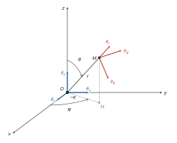
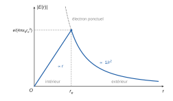
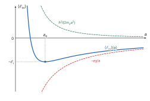
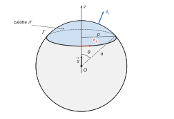
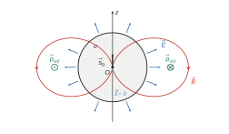

# Mines-Ponts PC — Physique 2 2026 · Corrigé brut

*Corrigé rédigé par IA, non officiel. Signalez toute erreur.*

**Quelques réflexions de Richard Feynman.** Durée 4 h, calculatrice interdite. Applications numériques à deux chiffres significatifs.

On note $\chi=e/(4\pi\epsilon_0)$, de sorte que $e^2/(4\pi\epsilon_0)=e\chi$.

## I — L'hypothèse atomique

### I.A — Taille de l'électron

### Question 1

L'électron est en $O$. Le point $M$ est repéré par ses coordonnées sphériques $(r,\theta,\varphi)$ :

- $r=OM>0$ est la distance de $O$ à $M$ ;
- $\theta\in[0,\pi/2]$ est l'angle entre $\hat e_z$ et $\overrightarrow{OM}$ (colatitude) ;
- $\varphi\in[0,\pi/2[$ est l'angle entre $\hat e_x$ et $\overrightarrow{OH}$, où $H$ est la projection orthogonale de $M$ sur le plan $(O,\hat e_x,\hat e_y)$.

Ainsi
$$\begin{aligned}
x&=r\sin\theta\cos\varphi\\
y&=r\sin\theta\sin\varphi\\
z&=r\cos\theta
\end{aligned}$$
et $M$ est dans le huitième d'espace où $x$, $y$ et $z$ sont positifs.

Figure en perspective cavalière ($\hat e_x$ vers l'avant-gauche, $\hat e_y$ vers la droite, $\hat e_z$ vers le haut), $H$ projection de $M$ sur le plan $(O,\hat e_x,\hat e_y)$ :

- $\hat e_r=\overrightarrow{OM}/r$, dirigé vers les $r$ croissants ;
- $\hat e_\theta$, tangent au méridien passant par $M$, orienté vers les $\theta$ croissants, donc **vers le bas** (vers l'équateur) pour $\theta<\pi/2$ : $\hat e_z=\cos\theta\,\hat e_r-\sin\theta\,\hat e_\theta$ ;
- $\hat e_\varphi$, horizontal, tangent au parallèle, orienté vers les $\varphi$ croissants.

$(\hat e_r,\hat e_\theta,\hat e_\varphi)$ est une base orthonormée directe **locale**, attachée au point $M$ (elle n'est pas définie de façon univoque sur l'axe $\theta=0$).

### Question 2

La charge $-e$ placée en $O$ crée en $M$, avec $\overrightarrow{OM}=r\,\hat e_r$, le champ coulombien
$$\boxed{\vec E(M)=-\frac{e}{4\pi\epsilon_0r^2}\,\hat e_r=-\frac{\chi}{r^2}\,\hat e_r}$$
radial et dirigé vers l'électron.

### Question 3

La densité volumique d'énergie électrique est
$$\boxed{w=\frac{\epsilon_0}{2}\,\vec E\cdot\vec E=\frac{\epsilon_0E^2}{2}}$$
soit ici
$$w(r)=\frac{e^2}{32\pi^2\epsilon_0r^4}.$$
En sommant sur des coquilles sphériques de volume $d\tau=4\pi r^2dr$ :
$$\begin{aligned}
W_e&=\int_0^{+\infty}\frac{e^2}{32\pi^2\epsilon_0r^4}\,4\pi r^2\,dr\\
&=\frac{e^2}{8\pi\epsilon_0}\int_0^{+\infty}\frac{dr}{r^2}.
\end{aligned}$$
L'intégrale converge en $+\infty$ mais diverge en $0$, car $\int_\eta^1dr/r^2=1/\eta-1$ tend vers $+\infty$ quand $\eta\to0$. Donc
$$\boxed{W_e=+\infty}$$
**Conclusion : l'énergie électrostatique propre d'un électron ponctuel est infinie ; la divergence provient du voisinage immédiat de la charge. Le modèle de l'électron ponctuel est donc incohérent en électrostatique classique.**

### Question 4

*Symétries et invariances.* La distribution (boule de centre $O$, rayon $r_e$, densité $\rho$ uniforme) est invariante par toute rotation autour de $O$ : le champ ne dépend que de $r$.

Tout plan contenant $O$ et $M$ est plan de symétrie de la distribution, donc $\vec E(M)$ appartient à l'intersection de ces plans, la droite $(OM)$. Ainsi $\vec E=E(r)\,\hat e_r$, avec la même notation pour l'intérieur et l'extérieur.

*Théorème de Gauss* sur la sphère de centre $O$ et de rayon $r$ :
$$4\pi r^2E(r)=\frac{Q_{\mathrm{int}}(r)}{\epsilon_0}.$$
La charge totale vaut $-e$, donc
$$\rho=-\frac{3e}{4\pi r_e^3}.$$
La charge intérieure vaut $Q_{\mathrm{int}}=-e\,r^3/r_e^3$ pour $r\le r_e$ et $Q_{\mathrm{int}}=-e$ pour $r\ge r_e$. D'où
$$\boxed{\vec E(M)=\begin{cases}-\dfrac{e\,r}{4\pi\epsilon_0r_e^3}\,\hat e_r & (r\le r_e)\\[2mm] -\dfrac{e}{4\pi\epsilon_0r^2}\,\hat e_r & (r\ge r_e)\end{cases}}$$
Le champ est continu en $r=r_e$ et nul en $O$.

*Énergie.* À l'intérieur :
$$\begin{aligned}
W_{\mathrm{int}}&=\int_0^{r_e}\frac{\epsilon_0}{2}\left(\frac{e\,r}{4\pi\epsilon_0r_e^3}\right)^2 4\pi r^2\,dr\\
&=\frac{e^2}{8\pi\epsilon_0r_e^6}\cdot\frac{r_e^5}{5}\\
&=\frac{e^2}{40\pi\epsilon_0r_e}.
\end{aligned}$$
À l'extérieur :
$$W_{\mathrm{ext}}=\int_{r_e}^{+\infty}\frac{\epsilon_0}{2}\left(\frac{e}{4\pi\epsilon_0r^2}\right)^2 4\pi r^2\,dr=\frac{e^2}{8\pi\epsilon_0r_e}.$$
Au total :
$$\begin{aligned}
W_e&=W_{\mathrm{int}}+W_{\mathrm{ext}}\\
&=\frac{3e^2}{20\pi\epsilon_0r_e}
\end{aligned}$$
$$\boxed{W_e=\frac35\,\frac{e\chi}{r_e}}$$

### Question 5

L'égalité $W_e=\mathcal E_{m,e}$ donne
$$\boxed{r_e=\frac35\,\frac{e\chi}{\mathcal E_{m,e}}}$$
A.N. :
$$\begin{aligned}
\mathcal E_{m,e}&=0{,}5\times10^6\times1{,}6\times10^{-19}=8{,}0\times10^{-14}\ \mathrm J\\
e\chi&=1{,}6\times10^{-19}\times1{,}5\times10^{-9}=2{,}4\times10^{-28}\ \mathrm{J\cdot m}\\
r_e&\simeq0{,}6\times3{,}0\times10^{-15}\ \mathrm m
\end{aligned}$$
$$\boxed{r_e\simeq1{,}8\times10^{-15}\ \mathrm m}$$
**Commentaire.** C'est l'ordre de grandeur de la taille d'un noyau ($10^{-15}$ m), soit environ $2\times10^{-5}$ fois la taille d'un atome ($10^{-10}$ m). Ce n'est pas pour autant la taille de l'électron : celui-ci n'est ni de la taille d'un atome ni de celle d'un noyau, et il se comporte comme ponctuel dans les expériences de diffusion jusqu'à des échelles bien plus petites (moins de $10^{-18}$ m). $r_e$ est l'échelle en dessous de laquelle l'électrostatique classique attribuerait à l'électron une énergie propre supérieure à son énergie de masse : c'est la limite de validité de la description classique.

### I.B — Taille d'un atome

### Question 6

D'après le postulat de Born, $|\Psi(M,t)|^2$ est la **densité volumique de probabilité de présence** de l'électron. La probabilité de le trouver à l'instant $t$ dans le volume $d\tau$ autour de $M$ est
$$\boxed{dP=|\Psi(M,t)|^2\,d\tau}$$
avec la condition de normalisation
$$\iiint_{\mathrm{espace}}|\Psi|^2\,d\tau=1.$$
$dP$ est sans dimension, donc $|\Psi|^2$ s'exprime en m⁻³ : ce n'est pas une probabilité.

### Question 7

La dispersion en position est la taille de l'atome : $\Delta x\simeq a$, d'où $\Delta p\simeq\hbar/a$. L'électron lié ne dérive pas, donc $\langle\vec p\rangle=\vec 0$ et
$$\Delta p=\sqrt{\langle p^2\rangle-\langle p\rangle^2}=\sqrt{\langle p^2\rangle}.$$
Il vient
$$\boxed{\sqrt{\langle p^2\rangle}\simeq\frac{\hbar}{a}}$$
$$\boxed{\langle\mathcal E_c\rangle=\frac{\langle p^2\rangle}{2m_e}\simeq\frac{\hbar^2}{2m_ea^2}}$$

### Question 8

L'énergie potentielle d'interaction entre le noyau ($+e$) et l'électron ($-e$), à la distance typique $a$ (rayon, non diamètre, de l'atome), vaut $-e^2/(4\pi\epsilon_0a)=-e\chi/a$. D'où
$$\boxed{\langle\mathcal E_m\rangle(a)=\frac{\hbar^2}{2m_ea^2}-\frac{e\chi}{a}}$$

### Question 9

On dérive par rapport à $a$ :
$$\begin{aligned}
\frac{d\langle\mathcal E_m\rangle}{da}&=-\frac{\hbar^2}{m_ea^3}+\frac{e\chi}{a^2}\\
&=\frac{1}{a^3}\left(e\chi\,a-\frac{\hbar^2}{m_e}\right).
\end{aligned}$$
Cette dérivée est négative puis positive : $\langle\mathcal E_m\rangle$ décroît puis croît sur $]0,+\infty[$ et atteint son minimum (qui n'est pas nul, mais négatif) en
$$\boxed{a_0=\frac{\hbar^2}{m_ee\chi}=\frac{4\pi\epsilon_0\hbar^2}{m_ee^2}}$$
A.N. :
$$\begin{aligned}
m_ee\chi&=9{,}1\times10^{-31}\times2{,}4\times10^{-28}\simeq2{,}2\times10^{-58}\\
a_0&=\frac{1{,}0\times10^{-68}}{2{,}2\times10^{-58}}
\end{aligned}$$
$$\boxed{a_0\simeq4{,}6\times10^{-11}\ \mathrm m}$$

**Commentaire.** On retrouve l'ordre de grandeur de la taille des atomes ($10^{-10}$ m) et, à $13\,\%$ près, le rayon de Bohr ($53$ pm). C'est la relation d'indétermination qui empêche l'électron de tomber sur le noyau : le terme cinétique en $1/a^2$ l'emporte à courte distance.

### Question 10

Avec $a_0=\hbar^2/(m_ee\chi)$ :
$$\begin{aligned}
\frac{\hbar^2}{2m_ea_0^2}&=\frac{m_e(e\chi)^2}{2\hbar^2}\\
\frac{e\chi}{a_0}&=\frac{m_e(e\chi)^2}{\hbar^2}
\end{aligned}$$
donc $\langle\mathcal E_{m,0}\rangle=-m_e(e\chi)^2/(2\hbar^2)$. Comme $\alpha=e\chi/(\hbar c)$, on a $e\chi=\alpha\hbar c$ et
$$\boxed{\langle\mathcal E_{m,0}\rangle=-\frac{\alpha^2}{2}\,m_ec^2=-\frac{\alpha^2}{2}\,\mathcal E_{m,e}}$$
L'énergie d'ionisation est l'énergie à fournir pour amener l'électron au repos à l'infini ($\mathcal E_m=0$) :
$$\boxed{\mathcal E_i=-\langle\mathcal E_{m,0}\rangle=\frac{\alpha^2}{2}\,\mathcal E_{m,e}}$$
A.N. : $\alpha^2=1/18\,769\simeq5{,}3\times10^{-5}$ et $\mathcal E_{m,e}=5\times10^5$ eV, donc
$$\boxed{\mathcal E_i\simeq\tfrac12\times5{,}3\times10^{-5}\times5\times10^5\simeq13\ \mathrm{eV}}$$
en très bon accord avec la valeur mesurée ($13{,}6$ eV). L'ordre de grandeur (une dizaine d'eV) est bien celui des énergies atomiques ; un résultat en MeV ou en meV signalerait une erreur.

## II — Le paradoxe de Feynman

### II.A — Énergie et impulsion du champ électromagnétique

### Question 11

Dans le vide, il n'y a ni charge ni courant : $\rho=0$ et $\vec j=\vec 0$. Les équations de Maxwell s'écrivent
$$\begin{aligned}
\mathrm{div}\,\vec E&=0\\
\mathrm{div}\,\vec B&=0\\
\overrightarrow{\mathrm{rot}}\,\vec E&=-\frac{\partial\vec B}{\partial t}\\
\overrightarrow{\mathrm{rot}}\,\vec B&=\mu_0\epsilon_0\frac{\partial\vec E}{\partial t}
\end{aligned}$$
On prend le rotationnel de Maxwell-Faraday. Avec l'identité fournie et $\mathrm{div}\,\vec E=0$ :
$$\overrightarrow{\mathrm{rot}}(\overrightarrow{\mathrm{rot}}\,\vec E)=-\vec\Delta\vec E.$$
En permutant dérivées spatiales et temporelle (champs réguliers), puis avec Maxwell-Ampère :
$$\overrightarrow{\mathrm{rot}}\left(-\frac{\partial\vec B}{\partial t}\right)=-\frac{\partial}{\partial t}\overrightarrow{\mathrm{rot}}\,\vec B=-\mu_0\epsilon_0\frac{\partial^2\vec E}{\partial t^2}.$$
D'où, avec $c=1/\sqrt{\mu_0\epsilon_0}$,
$$\boxed{\vec\Delta\vec E-\frac{1}{c^2}\frac{\partial^2\vec E}{\partial t^2}=\vec 0}$$
C'est l'**équation de d'Alembert** (et non une équation de diffusion, qui serait du premier ordre en temps). Elle ne contient qu'une dérivée temporelle d'ordre deux : elle est invariante par $t\mapsto-t$, donc **réversible**.

Autre domaine : l'**acoustique** dans un fluide au repos. La surpression $p_1(M,t)$ vérifie
$$\Delta p_1-\frac{1}{c_s^2}\frac{\partial^2p_1}{\partial t^2}=0,$$
avec $c_s=1/\sqrt{\rho_0\chi_S}$, où $\rho_0$ est la masse volumique au repos et $\chi_S$ la compressibilité isentropique.

On peut citer aussi la corde vibrante : déplacement transversal $y(x,t)$, célérité $\sqrt{T_0/\mu}$ ($T_0$ tension, $\mu$ masse linéique).

### Question 12

La phase $\omega t-kz$ est constante pour $z=(\omega t-\text{cte})/k$, qui croît avec $t$ puisque $k>0$ : l'onde se propage **selon $+\hat e_z$**.

Le champ garde à tout instant et en tout point la direction fixe $\hat e_x$ : polarisation **rectiligne selon $\hat e_x$**. C'est la direction constante du champ, et non l'absence de phase à l'origine, qui fonde cette conclusion.

C'est une O.P.P.H. :

- **plane** : ses surfaces d'onde (lieux des points de même phase à $t$ fixé) sont les plans $z=$ cte, orthogonaux à la direction de propagation ;
- **progressive** : la dépendance en $\omega t-kz=\omega(t-z/v_\varphi)$ traduit un profil qui se translate sans déformation selon $+\hat e_z$ ;
- **harmonique** : elle est monochromatique, de pulsation unique $\omega$, d'où sa dépendance sinusoïdale.

Maxwell-Gauss est satisfaite : $\mathrm{div}\,\vec E=\partial E_x/\partial x=0$. Dans l'équation de d'Alembert :
$$\begin{aligned}
\vec\Delta\vec E&=-k^2\vec E\\
\frac{\partial^2\vec E}{\partial t^2}&=-\omega^2\vec E
\end{aligned}$$
donc $(-k^2+\omega^2/c^2)\vec E=\vec 0$ pour tout $(z,t)$. La solution est acceptable si et seulement si
$$\boxed{k=\frac{\omega}{c}}$$
avec $k>0$ et $\omega>0$ : c'est la relation de dispersion du vide, milieu non dispersif ($v_\varphi=c$).

### Question 13

Pour une O.P.P.H. dans le vide, Maxwell-Faraday donne directement la relation de structure $\vec B=\hat e_z\wedge\vec E/c$. On le vérifie :
$$\begin{aligned}
-\frac{\partial\vec B}{\partial t}&=\overrightarrow{\mathrm{rot}}\,\vec E\\
&=\frac{\partial E_x}{\partial z}\,\hat e_y\\
&=kE_0\sin(\omega t-kz)\,\hat e_y
\end{aligned}$$
En intégrant en temps (sans champ statique superposé, étranger à l'onde) et avec $k/\omega=1/c$ :
$$\boxed{\vec B(M,t)=\frac{E_0}{c}\cos(\omega t-kz)\,\hat e_y=\frac{\hat e_z\wedge\vec E}{c}}$$
Caractéristiques de l'onde :

- onde **transverse** : $\vec E$ et $\vec B$ sont orthogonaux à $\hat e_z$ ;
- $(\vec E,\vec B,\hat e_z)$ est un trièdre **direct** ;
- $\vec E$ et $\vec B$ sont **en phase**, avec $\|\vec B\|=\|\vec E\|/c$ ; pour une charge de vitesse $v$, le rapport des forces magnétique et électrique est donc au plus $v/c$ ;
- polarisation rectiligne ; propagation à $c$ sans dispersion ni atténuation.

### Question 14

Le vecteur de Poynting vaut
$$\vec\Pi=\frac{\vec E\wedge\vec B}{\mu_0}=\frac{E_0^2}{\mu_0c}\cos^2(\omega t-kz)\,\hat e_z.$$
La relation de dispersion $c^2=1/(\mu_0\epsilon_0)$ donne $1/(\mu_0c)=\epsilon_0c$, d'où
$$\boxed{\vec\Pi=\epsilon_0cE_0^2\cos^2(\omega t-kz)\,\hat e_z}$$
Avec $\langle\cos^2\rangle=1/2$ et $\vec\Pi$ uniforme sur $\mathscr S$, orientée selon $+\hat e_z$ :
$$\boxed{\langle\mathcal P\rangle=\frac12\,\epsilon_0\,c\,E_0^2\,\mathscr S}$$

### Question 15

Le faisceau, de section $\mathscr S$, se propage selon $+\hat e_z$.

Pendant $dt$, l'énergie $\langle\mathcal P\rangle\,dt$ traverse la section du faisceau. Elle est portée par les $dN_\gamma$ photons qui la franchissent pendant $dt$, chacun d'énergie $\mathcal E_\gamma=h\nu=hc/\lambda$. Donc
$$\langle\mathcal P\rangle\,dt=dN_\gamma\,\frac{hc}{\lambda}$$
$$\boxed{\frac{dN_\gamma}{dt}=\frac{\langle\mathcal P\rangle\,\lambda}{h\,c}}$$

### Question 16

Pendant $dt$, les photons qui traversent $\mathscr S$ sont ceux du cylindre de base $\mathscr S$ et de longueur $c\,dt$ situé en amont, car ils se déplacent à la célérité $c$ selon la direction de propagation.

Ce cylindre contient $n_\gamma\,\mathscr S\,c\,dt$ photons, chacun d'énergie $h\nu$ :
$$\boxed{\delta\mathcal E=n_\gamma\,h\nu\,c\,\mathscr S\,dt}$$
Cette énergie est aussi le flux moyen du vecteur de Poynting : $\delta\mathcal E=\|\langle\vec\Pi\rangle\|\,\mathscr S\,dt$. D'où
$$\boxed{\|\langle\vec\Pi\rangle\|=n_\gamma\,h\nu\,c}$$
La densité volumique d'énergie $n_\gamma h\nu$ vaut donc $\|\langle\vec\Pi\rangle\|/c$.

Pour un photon ($m=0$), $\mathcal E=\sqrt{\vec p\cdot\vec p\,c^2}$ donne $\|\vec p_\gamma\|=h\nu/c$, avec $\vec p_\gamma$ selon la propagation $\hat e_z$. La densité volumique d'impulsion est donc
$$\begin{aligned}
\vec p_{\gamma,\mathrm{vol}}&=n_\gamma\frac{h\nu}{c}\,\hat e_z\\
&=\frac{\langle\vec\Pi\rangle}{c^2}\\
&=\frac{\langle\vec E\wedge\vec B\rangle}{\mu_0c^2}\\
&=\epsilon_0\,\langle\vec E\wedge\vec B\rangle
\end{aligned}$$
soit
$$\boxed{\xi=\epsilon_0=\frac{1}{\mu_0c^2}}$$
Contrôle d'unités : $\epsilon_0EB$ s'exprime en $\mathrm{F\cdot m^{-1}\cdot V\cdot m^{-1}\cdot T}=\mathrm{kg\cdot m^{-2}\cdot s^{-1}}$, c'est-à-dire en $(\mathrm{kg\cdot m\cdot s^{-1}})\cdot\mathrm{m^{-3}}$ : une impulsion par unité de volume.

**Le champ électromagnétique transporte une impulsion, de densité volumique $\epsilon_0\vec E\wedge\vec B=\vec\Pi/c^2$.**

### II.B — Mise en rotation d'une coquille uniformément chargée en surface par extinction d'un moment magnétique

### Question 17

On raisonne sur la distribution de **courant** : la spire de centre $O$, d'axe $(O,\hat e_z)$, contenue dans le plan $(O,\hat e_x,\hat e_y)$, qui crée $\vec s(t)=s(t)\,\hat e_z$. On travaille dans la base sphérique, adaptée à la géométrie.

- *Invariance* : la spire et son courant sont invariants par toute rotation autour de $(O,\hat e_z)$ ; les champs créés ne dépendent pas de $\varphi$.
- *Plans d'antisymétrie des courants* : tout plan contenant l'axe $(O,\hat e_z)$, en particulier le plan méridien $(M,\hat e_r,\hat e_\theta)$ passant par $M$, laisse la spire invariante mais inverse le sens du courant.
- *Plan de symétrie des courants* : le plan de la spire $(O,\hat e_x,\hat e_y)$.

Le champ électrique induit est un vrai vecteur (polaire), engendré par la variation des courants : il a les propriétés de symétrie de $\vec E=-\partial\vec A/\partial t$, $\vec A$ ayant les symétries des courants. D'après le principe de Curie, les effets possèdent au moins les symétries des causes. En un point $M$ d'un plan d'antisymétrie des courants, $\vec E(M,t)$ est donc **orthogonal** à ce plan, c'est-à-dire porté par $\hat e_\varphi$. L'invariance par rotation interdit la dépendance en $\varphi$ :
$$\boxed{\vec E(M,t)=E_\varphi(r,\theta,t)\,\hat e_\varphi}$$
À l'inverse, le pseudo-vecteur $\vec B$ est contenu dans ce plan d'antisymétrie. Contrôle : avec $\vec s=s(\cos\theta\,\hat e_r-\sin\theta\,\hat e_\theta)$,
$$\vec B=\frac{\mu_0s}{4\pi r^3}\left(2\cos\theta\,\hat e_r+\sin\theta\,\hat e_\theta\right)$$
est bien contenu dans le plan méridien, sans composante sur $\hat e_\varphi$.

### Question 18

Équation de Maxwell-Faraday :
$$\overrightarrow{\mathrm{rot}}\,\vec E=-\frac{\partial\vec B}{\partial t}.$$
Soit $\Gamma$ un contour fermé fixe et orienté, et $\mathscr S$ une surface s'appuyant sur $\Gamma$, orientée à partir de $\Gamma$ par la règle de la main droite.

On intègre le flux des deux membres à travers $\mathscr S$ ; le théorème de Stokes transforme le premier en circulation de $\vec E$ le long de $\Gamma$ et, le contour étant fixe, la dérivée temporelle sort de l'intégrale :
$$\boxed{\oint_\Gamma\vec E\cdot d\vec\ell=-\frac{d\Phi}{dt}}$$
où $\Phi=\iint_{\mathscr S}\vec B\cdot d\vec S$ est le flux de $\vec B$ à travers $\mathscr S$.
$\Gamma$ est orienté selon $\hat e_\varphi$ ; la calotte $\mathscr S$ (portion de sphère de rayon $a$ avec $0\le\theta'\le\theta$) est alors orientée par $\hat e_r$, et
$$d\vec S=a^2\sin\theta'\,d\theta'\,d\varphi'\,\hat e_r.$$
Sur la calotte, $\vec s\cdot\hat e_r=s\cos\theta'$ (relation rappelée), donc, par la formule dipolaire (licite si la spire est petite devant $a$),
$$\vec B\cdot\hat e_r=\frac{\mu_0s}{4\pi a^3}\,2\cos\theta'.$$
Le flux vaut
$$\begin{aligned}
\Phi&=\int_0^{2\pi}\!\!\int_0^\theta\frac{\mu_0s}{4\pi a^3}\,2\cos\theta'\,a^2\sin\theta'\,d\theta'\,d\varphi'\\
&=\frac{\mu_0s}{a}\int_0^\theta\sin\theta'\cos\theta'\,d\theta'\\
&=\frac{\mu_0s}{2a}\sin^2\theta
\end{aligned}$$
$$\boxed{\Phi=\frac{\mu_0\,s(t)}{2a}\sin^2\theta}$$
$$\boxed{n=2}$$

### Question 19

Le même calcul sur une sphère de rayon $r$ donne
$$\Phi(r,\theta,t)=\frac{\mu_0s(t)}{2r}\sin^2\theta.$$
Le long du cercle de colatitude $\theta$, de rayon $r\sin\theta$ (et non $r$), l'élément de contour vaut $d\vec\ell=r\sin\theta\,d\varphi\,\hat e_\varphi$. Seule la composante $E_\varphi$ contribue à la circulation (c'est d'ailleurs la seule non nulle, Q17), et elle est uniforme sur le cercle :
$$\oint_\Gamma\vec E\cdot d\vec\ell=2\pi r\sin\theta\,E_\varphi.$$
Maxwell-Faraday intégrale donne
$$2\pi r\sin\theta\,E_\varphi=-\frac{\mu_0\sin^2\theta}{2r}\frac{ds}{dt},$$
d'où
$$\boxed{\vec E(M,t)=-\frac{\mu_0\sin\theta}{4\pi r^2}\,\frac{ds}{dt}\,\hat e_\varphi}$$
et, sur la coquille ($r=a$),
$$\boxed{\vec E=-\frac{\mu_0\sin\theta}{4\pi a^2}\,\frac{ds}{dt}\,\hat e_\varphi}$$
L'amplitude du champ sur la coquille est $\dfrac{\mu_0\sin\theta}{4\pi a^2}\left|\dfrac{ds}{dt}\right|$. La circulation $\oint\vec E\cdot d\vec\ell$ est la force électromotrice $e$ le long de $\Gamma$ : c'est une grandeur intégrale, distincte du champ $\vec E$.

Validité : $r$ grand devant la taille de la spire (formule dipolaire) et $r\ll c\,\Delta t$, où $\Delta t$ est la durée de l'extinction (approximation des régimes quasi stationnaires).

Pendant l'extinction, $ds/dt<0$, donc $E_\varphi>0$ : des charges positives circulant selon $+\hat e_\varphi$ recréeraient un champ selon $+\hat e_z$, ce qui s'oppose à la diminution du flux (loi de Lenz).

### Question 20

L'élément $d\mathscr S$ porte la charge $\sigma\,d\mathscr S$ et subit, de la part du champ induit,
$$\boxed{d\vec F_e=\sigma\,d\mathscr S\,\vec E=-\frac{\mu_0\sigma\sin\theta}{4\pi a^2}\,\frac{ds}{dt}\,d\mathscr S\,\hat e_\varphi}$$
Le champ électrostatique propre de la coquille ajoute une force radiale, sans moment par rapport à l'axe.

Le moment par rapport à l'axe est $d\mathscr M_{e,z}=(\overrightarrow{OM}\wedge d\vec F_e)\cdot\hat e_z$, avec $\overrightarrow{OM}=a\,\hat e_r$. On utilise $\hat e_r\wedge\hat e_\varphi=-\hat e_\theta$ et $\hat e_\theta\cdot\hat e_z=-\sin\theta$ :
$$d\mathscr M_{e,z}=a\sin\theta\,dF_{e,\varphi}.$$
Le bras de levier est la distance $a\sin\theta$ de $M$ à l'axe. Avec $d\mathscr S=a^2\sin\theta\,d\theta\,d\varphi$ :
$$\boxed{d\mathscr M_{e,z}=-\frac{\mu_0\sigma a}{4\pi}\,\frac{ds}{dt}\,\sin^3\theta\,d\theta\,d\varphi}$$

### Question 21

On intègre sur toute la sphère, $\theta\in[0,\pi]$ et $\varphi\in[0,2\pi]$, avec l'intégrale fournie :
$$\begin{aligned}
\mathscr M_{e,z}&=-\frac{\mu_0\sigma a}{4\pi}\frac{ds}{dt}\int_0^{2\pi}\!d\varphi\int_0^\pi\sin^3\theta\,d\theta\\
&=-\frac{\mu_0\sigma a}{4\pi}\frac{ds}{dt}\times2\pi\times\frac43
\end{aligned}$$
$$\boxed{\mathscr M_{e,z}=-\frac23\,\mu_0\,\sigma\,a\,\frac{ds}{dt}}$$
Ce moment est positif pendant l'extinction si $\sigma>0$.

### Question 22

La coquille est un solide en rotation autour de l'axe fixe $(O,\hat e_z)$ d'un référentiel galiléen, la liaison étant supposée parfaite. Le théorème du moment cinétique scalaire, en ne retenant que l'action du champ induit, donne
$$\begin{aligned}
J\frac{d\omega}{dt}&=\mathscr M_{e,z}\\
\frac23ma^2\frac{d\omega}{dt}&=-\frac23\mu_0\sigma a\frac{ds}{dt}
\end{aligned}$$
On intègre entre l'état initial ($\omega=0$, $s=s_0$) et l'état final ($\omega=\omega_F$, $s=0$) :
$$\boxed{\omega_F=\frac{\mu_0\,\sigma\,s_0}{m\,a}}$$
Ce résultat est indépendant de la loi d'extinction $s(t)$.

*Force magnétique.* Un élément de charge de la coquille a la vitesse
$$\vec v=\omega\,\hat e_z\wedge a\,\hat e_r=\omega a\sin\theta\,\hat e_\varphi,$$
et le champ du dipôle s'écrit $\vec B=B_r\hat e_r+B_\theta\hat e_\theta$ (Q17). Donc
$$\vec v\wedge\vec B=\omega a\sin\theta\,(B_r\,\hat e_\theta-B_\theta\,\hat e_r).$$
La force magnétique $\sigma\,d\mathscr S\,\vec v\wedge\vec B$ est contenue dans le plan méridien de $M$, qui contient l'axe. Le moment $\overrightarrow{OM}\wedge d\vec F_m$ est alors porté par $\hat e_\varphi$, orthogonal à $\hat e_z$. **La force magnétique n'a pas de composante orthoradiale : son moment par rapport à $(O,\hat e_z)$ est nul.**

### Question 23

D'après II.A, le champ électromagnétique porte une densité volumique d'impulsion $\epsilon_0\vec E\wedge\vec B$, donc une densité volumique de moment cinétique $\overrightarrow{OM}\wedge(\epsilon_0\vec E\wedge\vec B)$. Le système isolé n'est pas $\{\vec s$-coquille$\}$ seul mais $\{\vec s$-coquille-champ$\}$ ; c'est son moment cinétique **total** qui se conserve.

Dans l'état initial coexistent, pour $r>a$, le champ électrostatique radial de la coquille (nul pour $r<a$)
$$\vec E=\frac{\sigma a^2}{\epsilon_0r^2}\,\hat e_r$$
et le champ du dipôle. La densité d'impulsion est orthoradiale :
$$\epsilon_0\vec E\wedge\vec B=\frac{\mu_0\sigma a^2s_0\sin\theta}{4\pi r^5}\,\hat e_\varphi.$$
Le moment cinétique du champ par rapport à l'axe vaut
$$\begin{aligned}
L_{\mathrm{champ},z}&=\int_a^{+\infty}\!\!\int_0^\pi\!\!\int_0^{2\pi}r\sin\theta\cdot\frac{\mu_0\sigma a^2s_0\sin\theta}{4\pi r^5}\,r^2\sin\theta\,dr\,d\theta\,d\varphi\\
&=\frac{\mu_0\sigma a^2s_0}{4\pi}\cdot\frac1a\cdot\frac43\cdot2\pi\\
&=\frac23\,\mu_0\sigma a\,s_0
\end{aligned}$$
C'est exactement $J\omega_F=\frac23ma^2\cdot\mu_0\sigma s_0/(ma)$.

**Explication : le moment cinétique initialement stocké dans le champ électromagnétique (coexistence du champ électrique de la coquille et du champ magnétique du dipôle) est transféré à la coquille quand $\vec B$ disparaît ; le moment cinétique total, matière plus champ, est conservé.** Le champ propre de la coquille en rotation, effet du second ordre en $\sigma$, est négligé comme dans tout le II.B.

## III — La force de l'électron sur lui-même

### III.A — Moment cinétique d'un atome

### Question 24

Par le même raisonnement qu'en Q4 (symétrie sphérique, théorème de Gauss) avec la charge $+e$ répartie dans la boule de rayon $a$, pour $r\le a$ :
$$\boxed{\vec E_{\mathrm{noy}}(M)=\frac{e\,r}{4\pi\epsilon_0a^3}\,\hat e_r=\frac{e}{4\pi\epsilon_0a^3}\,\overrightarrow{OM}}$$
Ce champ est centrifuge. Pour l'électron en $\overrightarrow{OM}=x\,\hat e_x$, avec $|x|\le a$ :
$$\begin{aligned}
\vec F_{\mathrm{noy}}&=-e\vec E_{\mathrm{noy}}\\
&=-\frac{e^2}{4\pi\epsilon_0a^3}\,x\,\hat e_x\\
&=-m_e\omega_0^2\,x\,\hat e_x
\end{aligned}$$
$$\boxed{\omega_0=\sqrt{\frac{e^2}{4\pi\epsilon_0m_ea^3}}=\sqrt{\frac{e\chi}{m_ea^3}}}$$
C'est une force de rappel élastique.

### Question 25

Le PFD appliqué à l'électron, projeté sur $\hat e_x$ et intégré **en temps**, donne $\ddot x+\omega_0^2x=0$, avec $x(0)=x_0$ et $\dot x(0)=0$ :
$$\boxed{x(t)=x_0\cos(\omega_0t)}$$
L'énergie mécanique est la somme des énergies cinétique et potentielle :
$$\mathcal E=\frac12m_e\dot x^2+\frac12m_e\omega_0^2x^2=\frac12m_e\omega_0^2x_0^2.$$
Elle est constante (seule force, conservative), donc égale à sa moyenne :
$$\boxed{\langle\mathcal E\rangle=\frac12\,m_e\,\omega_0^2\,x_0^2}$$
Contrôle : $\langle\sin^2\rangle=\langle\cos^2\rangle=1/2$, donc $\langle\mathcal E_c\rangle=\langle\mathcal E_p\rangle=\frac14m_e\omega_0^2x_0^2$, aucune des deux n'étant nulle.

### Question 26

L'accélération vaut $\gamma=\ddot x=-\omega_0^2x_0\cos(\omega_0t)$, donc $\langle\gamma^2\rangle=\frac12\omega_0^4x_0^2$. La formule de Larmor (avec $q^2=e^2$) donne, en éliminant $x_0^2$ grâce à Q25 :
$$\begin{aligned}
\langle\mathcal P\rangle&=\frac{e^2\omega_0^4x_0^2}{12\pi\epsilon_0c^3}\\
&=\frac{e^2\omega_0^2}{6\pi\epsilon_0m_ec^3}\,\langle\mathcal E\rangle
\end{aligned}$$
$$\boxed{\langle\mathcal P\rangle=\Gamma\langle\mathcal E\rangle}$$
avec
$$\boxed{\Gamma=\frac{e^2\omega_0^2}{6\pi\epsilon_0m_ec^3}}$$
En régime quasi statique, le théorème de la puissance mécanique s'écrit avec un signe moins : la puissance rayonnée $\langle\mathcal P\rangle>0$ est **cédée** par l'électron, dont l'énergie diminue.
$$\frac{d\langle\mathcal E\rangle}{dt}=-\langle\mathcal P\rangle$$
$$\boxed{\frac{d\langle\mathcal E\rangle}{dt}+\Gamma\langle\mathcal E\rangle=0}$$
$$\boxed{\langle\mathcal E\rangle(t)=\mathcal E_0\,e^{-\Gamma t}}$$
A.N. : on suppose que l'électron oscille à la fréquence de la lumière émise.
$$\begin{aligned}
\omega_0&=\frac{2\pi c}{\lambda_0}=\frac{2\pi\times3{,}0\times10^8}{4{,}861\times10^{-7}}\simeq3{,}9\times10^{15}\ \mathrm{rad\cdot s^{-1}}\\
\omega_0^2&\simeq1{,}5\times10^{31}\ \mathrm{s^{-2}}\\
\Gamma&=5{,}7\times10^{-54}\times\frac{1{,}5\times10^{31}}{9{,}1\times10^{-31}}
\end{aligned}$$
$$\boxed{\Gamma\simeq9{,}4\times10^{7}\ \mathrm s^{-1}}$$
soit $1/\Gamma\simeq1{,}1\times10^{-8}$ s.

### Question 27

L'émission dure environ $1/\Gamma$ ; le train d'onde a pour longueur
$$\mathcal L\simeq\frac{c}{\Gamma}=\frac{3{,}0\times10^8}{9{,}4\times10^7}$$
$$\boxed{\mathcal L\simeq3{,}2\ \mathrm m}$$
**Commentaire :** longueur macroscopique, soit environ $6{,}6\times10^6$ longueurs d'onde ; la raie est quasi monochromatique. Les trains d'onde réels des lampes spectrales sont bien plus courts (élargissements Doppler et collisionnel) : $\mathcal L$ est la limite due au seul amortissement radiatif.

La période vaut $T_0=\lambda_0/c\simeq1{,}6\times10^{-15}$ s, donc
$$\frac{1/\Gamma}{T_0}\simeq\frac{1{,}1\times10^{-8}}{1{,}6\times10^{-15}}\simeq6{,}6\times10^{6}\gg1.$$
L'énergie varie très peu sur une période, ce qui justifie le calcul de $\langle\mathcal P\rangle$ à amplitude constante sur une période et l'hypothèse quasi statique de Q26.

### Question 28

La puissance de $\vec F_{\mathrm{rad}}=m_e\tau\overset{...}{x}\,\hat e_x$ est $m_e\tau\,\overset{...}{x}\,\dot x$. Par intégration par parties sur une période, le crochet étant nul par périodicité :
$$\begin{aligned}
\langle\vec F_{\mathrm{rad}}\cdot\vec v\rangle&=\frac{m_e\tau}{T_0}\int_0^{T_0}\overset{...}{x}\,\dot x\,dt\\
&=\frac{m_e\tau}{T_0}\left(\big[\ddot x\,\dot x\big]_0^{T_0}-\int_0^{T_0}\ddot x^2\,dt\right)\\
&=-m_e\tau\langle\gamma^2\rangle
\end{aligned}$$
Pour $\tau>0$, cette puissance moyenne est **négative** : l'électron **reçoit** de $\vec F_{\mathrm{rad}}$ une puissance négative, c'est-à-dire qu'il **cède** en moyenne l'énergie $m_e\tau\langle\gamma^2\rangle$ par unité de temps au rayonnement. La puissance rayonnée est donc
$$\langle\mathcal P\rangle=-\langle\vec F_{\mathrm{rad}}\cdot\vec v\rangle=m_e\tau\langle\gamma^2\rangle.$$
L'identification avec Larmor, $\langle\mathcal P\rangle=e^2\langle\gamma^2\rangle/(6\pi\epsilon_0c^3)$, donne
$$\boxed{\tau=\frac{e^2}{6\pi\epsilon_0m_ec^3}=\frac{\Gamma}{\omega_0^2}}$$
$$\tau=\frac{5{,}7\times10^{-54}}{9{,}1\times10^{-31}}\simeq6{,}3\times10^{-24}\ \mathrm s.$$

### Question 29

À l'ordre 0, $|\overset{...}{x}|\sim\omega_0^3x_0$ et $|x|\sim x_0$, donc $\|\vec F_{\mathrm{rad}}\|/\|\vec F_{\mathrm{noy}}\|\sim\tau\omega_0$ (rapport sans dimension). La force de rayonnement est une perturbation si
$$\boxed{\tau\,\omega_0\ll1}$$
ce qui est le cas : $\tau\omega_0\simeq6{,}3\times10^{-24}\times3{,}9\times10^{15}\simeq2{,}4\times10^{-8}$.

L'équation du mouvement est
$$\ddot x+\omega_0^2x=\tau\overset{...}{x}.$$
Le second membre est d'ordre 1 : on peut y utiliser le mouvement d'ordre 0, $\ddot x=-\omega_0^2x$, que l'on dérive : $\overset{...}{x}=-\omega_0^2\dot x$ (erreur d'ordre 2). Il vient
$$\boxed{\ddot x+\tau\omega_0^2\,\dot x+\omega_0^2x=0}$$
C'est l'équation d'un oscillateur amorti $\ddot x+(\omega_0/Q)\,\dot x+\omega_0^2x=0$, avec
$$\boxed{Q=\frac{1}{\tau\omega_0}=\frac{\omega_0}{\Gamma}}$$
$$\boxed{Q\simeq\frac{3{,}9\times10^{15}}{9{,}4\times10^7}\simeq4{,}1\times10^{7}}$$
**Commentaire :** facteur de qualité gigantesque (sans dimension) ; l'oscillateur est très faiblement amorti, d'où une raie très fine. La largeur relative naturelle vaut $\Delta\omega/\omega_0=1/Q\simeq2{,}4\times10^{-8}$, soit $\Delta\lambda\simeq1{,}2\times10^{-14}$ m.

Pour la suite, on retient : l'électron est soumis à $\vec F_{\mathrm{noy}}=-\dfrac{d\mathcal E_p}{dr}\hat e_r$ et à $\vec F_{\mathrm{rad}}=\tau(\vec v\cdot\overrightarrow{\mathrm{grad}})\vec F_{\mathrm{noy}}$.

### Question 30

On note $F_r(r)=-\mathcal E_p'(r)$ et $F_\theta=0$ les composantes de $\vec F_{\mathrm{noy}}=-\overrightarrow{\mathrm{grad}}\,\mathcal E_p$. La vitesse vaut $\vec v=\dot r\,\hat e_r+r\dot\theta\,\hat e_\theta$.

On applique la formule fournie avec $\vec A=\vec v$ et $\vec B=\vec F_{\mathrm{noy}}$, sachant que $\partial F_r/\partial\theta=0$ et $F_\theta=0$ :
$$\begin{aligned}
(\vec v\cdot\overrightarrow{\mathrm{grad}})\vec F_{\mathrm{noy}}&=\dot r\,F_r'(r)\,\hat e_r+\frac{r\dot\theta\,F_r}{r}\,\hat e_\theta\\
&=-\dot r\,\mathcal E_p''(r)\,\hat e_r-\dot\theta\,\mathcal E_p'(r)\,\hat e_\theta
\end{aligned}$$
La résultante des forces est
$$\boxed{\vec F=-\left[\frac{d\mathcal E_p}{dr}+\tau\,\dot r\,\frac{d^2\mathcal E_p}{dr^2}\right]\hat e_r-\tau\,\dot\theta\,\frac{d\mathcal E_p}{dr}\,\hat e_\theta}$$

### Question 31

Le moment cinétique orbital, masse comprise, vaut
$$\vec L_O=r\,\hat e_r\wedge m_e(\dot r\,\hat e_r+r\dot\theta\,\hat e_\theta)=m_er^2\dot\theta\,\hat e_z.$$
Le théorème du moment cinétique en $O$, fixe dans le référentiel galiléen d'étude, donne
$$\begin{aligned}
\frac{d\vec L_O}{dt}&=r\,\hat e_r\wedge(F_r\hat e_r+F_\theta\hat e_\theta)\\
&=-\tau\,r\,\dot\theta\,\mathcal E_p'(r)\,\hat e_z
\end{aligned}$$
Comme $\dot\theta\,\hat e_z=\vec L_O/(m_er^2)$ pour $r\ne0$ :
$$\boxed{\frac{d\vec L_O}{dt}=f(r)\,\frac{d\mathcal E_p}{dr}\,\vec L_O}$$
$$\boxed{f(r)=-\frac{\tau}{m_e\,r}}$$
Homogénéité : $f(r)\,\mathcal E_p'$ s'exprime en $\mathrm{s\cdot kg^{-1}\cdot m^{-1}\cdot N}=\mathrm{s^{-1}}$, comme il se doit.

### Question 32

$\vec F_{\mathrm{noy}}=-m_e\omega_0^2r\,\hat e_r$ donne $\mathcal E_p'(r)=m_e\omega_0^2r$. Le facteur $r$ se simplifie :
$$\frac{d\vec L_O}{dt}=-\tau\omega_0^2\,\vec L_O=-\Gamma\vec L_O$$
$$\boxed{\vec L_O(t)=\vec L_O(0)\,e^{-\tau\omega_0^2t}=\vec L_O(0)\,e^{-\Gamma t}}$$
La durée caractéristique de décroissance, homogène à un temps, vaut
$$\boxed{\frac{1}{\tau\omega_0^2}=\frac1\Gamma\simeq1{,}1\times10^{-8}\ \mathrm s}$$
pour la raie bleue, la même que pour l'énergie.

**Le moment cinétique perdu par l'atome est emporté par le champ électromagnétique rayonné**, qui possède une densité de moment cinétique $\overrightarrow{OM}\wedge\epsilon_0\vec E\wedge\vec B$ (II.A et Q23) : le moment cinétique total (électron + champ) se conserve. Le noyau, fixe et exerçant une force centrale, n'en reçoit pas.

### III.B — Stabilité d'un atome classique

### Question 33

Le noyau de charge $Ze$, en $O$, exerce sur l'électron de charge $-e$ la force coulombienne
$$\boxed{\vec F=-\frac{Ze^2}{4\pi\epsilon_0r^2}\,\hat e_r=-\frac{Ze\chi}{r^2}\,\hat e_r}$$
En polaires, l'accélération vaut
$$\vec a=(\ddot r-r\dot\theta^2)\,\hat e_r+(r\ddot\theta+2\dot r\dot\theta)\,\hat e_\theta.$$
Pour une orbite circulaire, $r$ est constant. La projection du PFD sur $\hat e_\theta$ donne $m_er\ddot\theta=0$ (force centrale) : $\dot\theta$ est constant, donc $v=r|\dot\theta|$ aussi, et **le mouvement est uniforme**. C'est la constance de $r$ qui permet cette conclusion : la conservation du moment cinétique seule ne suffirait pas.

La projection sur $\hat e_r$ donne $m_ev^2/r=Ze\chi/r^2$ :
$$\boxed{v=\sqrt{\frac{Ze\chi}{m_er}}=\sqrt{\frac{Ze^2}{4\pi\epsilon_0m_er}}}$$
$$\boxed{T=\frac{2\pi r}{v}=2\pi\sqrt{\frac{m_er^3}{Ze\chi}}}$$
$T^2/r^3=4\pi^2m_e/(Ze\chi)$ est constant : c'est la **troisième loi de Kepler**. Enfin $\mathcal E_c=Ze\chi/(2r)$ et $\mathcal E_p=-Ze\chi/r$ :
$$\boxed{\mathcal E=-\frac{Ze\chi}{2r}=-\frac{Ze^2}{8\pi\epsilon_0r}}$$

### Question 34

L'accélération est centripète : $\gamma=v^2/r=Ze\chi/(m_er^2)$. La formule de Larmor donne, avec $\tau$ de Q28,
$$\mathcal P=\frac{e^2\gamma^2}{6\pi\epsilon_0c^3}=\frac{\tau\,(Ze\chi)^2}{m_e\,r^4}.$$
Le bilan quasi statique s'écrit $d\mathcal E/dt=-\mathcal P$, avec
$$\frac{d\mathcal E}{dt}=\frac{Ze\chi}{2r^2}\,\dot r.$$
On obtient l'équation différentielle
$$\boxed{r^2\frac{dr}{dt}=-K}$$
$$\boxed{K=\frac{2\tau Ze\chi}{m_e}=\frac{Ze^4}{12\pi^2\epsilon_0^2m_e^2c^3}}$$
d'où $\dfrac{d(r^3)}{dt}=-3K$ et
$$\boxed{r(t)=\left(r_0^3-3Kt\right)^{1/3}}$$
L'électron atteint le noyau à l'instant
$$\boxed{t_c=\frac{r_0^3}{3K}=\frac{m_er_0^3}{6\tau Ze\chi}}$$
soit $t_c=4\pi^2\epsilon_0^2m_e^2c^3r_0^3/(Ze^4)$.

A.N. ($Z=1$, $r_0=53$ pm) :
$$\begin{aligned}
K&=\frac{2\times6{,}3\times10^{-24}\times2{,}4\times10^{-28}}{9{,}1\times10^{-31}}\simeq3{,}3\times10^{-21}\ \mathrm{m^3\cdot s^{-1}}\\
r_0^3&\simeq1{,}5\times10^{-31}\ \mathrm{m^3}\\
t_c&\simeq\frac{1{,}5\times10^{-31}}{9{,}9\times10^{-21}}
\end{aligned}$$
$$\boxed{t_c\simeq1{,}5\times10^{-11}\ \mathrm s}$$
*Nombre de tours.* La pulsation instantanée vaut $\Omega(r)=\sqrt{Ze\chi/(m_er^3)}$, et $dt=-r^2dr/K$. Donc
$$\begin{aligned}
N&=\int_0^{t_c}\frac{\Omega}{2\pi}\,dt\\
&=\frac{1}{2\pi K}\sqrt{\frac{Ze\chi}{m_e}}\int_0^{r_0}\sqrt r\,dr\\
&=\frac{r_0^{3/2}}{3\pi K}\sqrt{\frac{Ze\chi}{m_e}}
\end{aligned}$$
$$\boxed{N=\frac{1}{6\pi\tau}\sqrt{\frac{m_er_0^3}{Ze\chi}}=\frac{2\,t_c}{T(r_0)}}$$
A.N. :
$$\begin{aligned}
\Omega_0&=\sqrt{\frac{2{,}4\times10^{-28}}{9{,}1\times10^{-31}\times1{,}5\times10^{-31}}}\simeq4{,}2\times10^{16}\ \mathrm{rad\cdot s^{-1}}\\
N&=\frac{1}{6\pi\tau\Omega_0}=\frac{1}{6\pi\times6{,}3\times10^{-24}\times4{,}2\times10^{16}}
\end{aligned}$$
$$\boxed{N\simeq2{,}0\times10^{5}\ \text{tours}}$$
**L'atome classique s'effondrerait en une quinzaine de picosecondes, après environ deux cent mille tours : la physique classique ne peut pas rendre compte de la stabilité des atomes.** L'hypothèse quasi statique cesse d'être valable tout près du noyau, mais l'essentiel de la durée s'écoule aux grands rayons : l'ordre de grandeur est robuste.

### Question 35

Les deux difficultés (décroissance continue du moment cinétique en Q32, effondrement en Q34) viennent de ce qu'en physique classique l'électron suit une trajectoire et peut perdre continûment énergie et moment cinétique. La mécanique quantique y remédie ainsi.

- **Orbites quantifiées.** Dans le modèle de Bohr, seules certaines orbites sont permises : le moment cinétique y est quantifié, $L=n\hbar$ avec $n$ entier non nul, d'où des rayons $r_n=n^2a_B$ ($a_B\simeq53$ pm, l'ordre de grandeur trouvé en Q9) et des énergies $\mathcal E_n=-13{,}6\ \mathrm{eV}/n^2$. Sur une orbite permise, l'électron ne rayonne pas (postulat de Bohr) : il ne spirale pas vers le noyau.
- **États stationnaires.** En mécanique quantique, l'électron est décrit par une fonction d'onde, non par une trajectoire ; dans un état stationnaire, $|\Psi|^2$ ne dépend pas du temps : la distribution de charge est statique et ne rayonne pas.
- **Énergie quantifiée.** L'atome ne peut perdre de l'énergie que par sauts entre niveaux, en émettant un photon $h\nu=\mathcal E_{\mathrm{initial}}-\mathcal E_{\mathrm{final}}$ (raies spectrales, dont la raie à $486{,}1$ nm).
- **État fondamental.** Il existe un niveau d'énergie minimale : la relation d'indétermination rend le confinement coûteux en énergie cinétique ($\hbar^2/(2m_ea^2)$, partie I.B), ce qui interdit la chute sur le noyau et fixe la taille $a_0$ de l'atome. Aucun niveau inférieur n'existe : l'état fondamental est stable.
- **Moment cinétique quantifié.** Il ne décroît donc pas exponentiellement comme en Q32 : il ne peut varier que par sauts, chaque photon émis emportant un quantum. En mécanique quantique complète, le moment cinétique orbital de l'état fondamental de l'hydrogène est même nul.

**La mécanique quantique remplace la descente continue par des orbites et des niveaux discrets, et impose un niveau fondamental stable qui ne rayonne pas.** Le modèle classique garde une valeur d'ordre de grandeur : $1/\Gamma\sim10^{-8}$ s est bien l'ordre de grandeur des durées de vie des niveaux excités.
