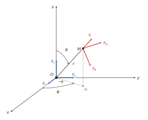
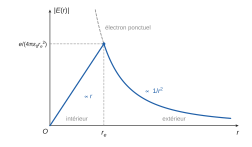
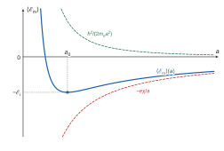
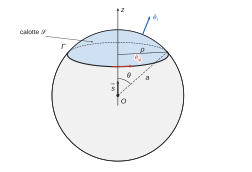
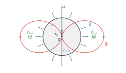

# Mines-Ponts PC — Physique 2 2026 · Corrigé guidé

*Corrigé rédigé par IA, non officiel. Signalez toute erreur.*

## Présentation du sujet

**Thème.** Sous le titre « Quelques réflexions de Richard Feynman », le sujet suit un fil unique : *une théorie classique de l'électron se heurte à ses propres limites, et c'est le champ électromagnétique qui porte la clé*. On calcule l'énergie propre de l'électron (infinie s'il est ponctuel), on estime la taille de l'atome par la relation d'indétermination, on montre que le champ porte de l'impulsion et du moment cinétique (paradoxe de la coquille de Feynman), puis on fait payer à l'électron accéléré le prix de son rayonnement : amortissement de l'oscillateur atomique, force d'Abraham-Lorentz, effondrement de l'atome classique.

**Découpage (35 questions, 4 heures, sans calculatrice ni document).**

- **Partie I (Q1–Q10), l'hypothèse atomique.** I.A : champ et énergie électrostatique d'une charge ponctuelle (divergente), puis d'une boule uniformément chargée ; « rayon classique » de l'électron. I.B : interprétation de $|\Psi|^2$, estimation de Feynman de la taille de l'atome d'hydrogène et de son énergie d'ionisation.
- **Partie II (Q11–Q23), le paradoxe de Feynman.** II.A : équation de d'Alembert, OPPH, vecteur de Poynting, photons, densité d'impulsion $\epsilon_0\vec E\wedge\vec B$. II.B : une coquille chargée se met à tourner quand on éteint un dipôle magnétique placé en son centre ; symétries, induction, théorème du moment cinétique, puis résolution du paradoxe par le moment cinétique du champ.
- **Partie III (Q24–Q35), la force de l'électron sur lui-même.** III.A : modèle de Thomson, oscillateur harmonique, formule de Larmor, amortissement radiatif, force d'Abraham-Lorentz, facteur de qualité, décroissance du moment cinétique. III.B : orbite circulaire coulombienne, chute en spirale, temps d'effondrement et nombre de tours.

**Notions mobilisées.** Électrostatique (symétries, théorème de Gauss, densité d'énergie $\epsilon_0E^2/2$) ; mécanique quantique de première année (fonction d'onde, relation d'indétermination) ; équations de Maxwell, équation de d'Alembert, OPPH, vecteur de Poynting, photon ; induction (Maxwell-Faraday intégrale, principe de Curie) ; mécanique du solide en rotation autour d'un axe fixe ; oscillateurs harmonique et amorti, facteur de qualité ; mouvement dans un champ de force centrale, lois de Kepler ; raisonnement perturbatif et ordres de grandeur.

**Difficulté et gestion du temps.** Sujet long mais très guidé, avec beaucoup de questions de cours (Q2, Q3, Q6, Q7, Q11–Q15, Q25, Q33) à ne pas laisser passer. Les applications numériques (Q5, Q9, Q10, Q26, Q27, Q29, Q34) se font sans calculatrice : les données groupées $\chi=e/(4\pi\epsilon_0)$ et $e^2/(6\pi\epsilon_0c^3)$ sont fournies exactement pour cela. Les trois parties sont largement indépendantes. Compter environ 1 h 15 pour la partie I et II.A, 1 h pour II.B, 1 h 30 pour la partie III.

**Ce que dit le rapport 2026.** Le jury note qu'une majorité de candidats a bien avancé dans le sujet. Il juge **sélectives** Q16 (impulsion du faisceau, « rarement réussie »), Q18 (flux à travers la calotte), Q26 (expression de $\Gamma$, application numérique « pratiquement jamais réussie ») et Q28 (signe de la puissance). Q20 et Q21 ont permis de « valoriser les candidats rigoureux » ; Q30 à Q32 ont permis « à certains candidats de faire la différence ». Q22, Q27, Q29, Q34 et Q35 ont été peu abordées ou rarement réussies. À l'inverse, Q7 a souvent été réussie et la démonstration de l'équation d'onde (Q11) « n'est pas sélective ».

Les applications numériques sont attendues avec deux chiffres significatifs : le jury a donné la moitié des points quand seul le premier chiffre était juste. Une valeur sans unité ou non aboutie (fraction, facteur $\pi$ restant) ne rapporte rien.

Notations : $\chi=e/(4\pi\epsilon_0)$, donc $e^2/(4\pi\epsilon_0)=e\chi$.

## Partie I — L'hypothèse atomique

On compare deux modèles de l'électron (ponctuel, puis boule chargée) par leur énergie électrostatique, puis on estime la taille d'un atome par un argument quantique. Outils : symétries et théorème de Gauss, densité d'énergie électrique, relation d'indétermination, minimisation d'une fonction d'une variable.

### I.A — Taille de l'électron

### Question 1

> [!INDICATION]
> Commencer par définir chacune des trois coordonnées, puis écrire $x$, $y$, $z$ en fonction de $(r,\theta,\varphi)$ : c'est ce qui fixe sans ambiguïté le sens de chaque angle.

> [!INDICATION]
> La base sphérique est attachée au point $M$, pas à l'origine. Pour orienter $\hat e_\theta$, regarder dans quel sens se déplace $M$ quand $\theta$ augmente.

#### Solution

L'électron est en $O$. Les coordonnées sphériques de $M$ sont :

- $r=OM>0$, distance de $O$ à $M$ ;
- $\theta\in[0,\pi/2]$, angle entre $\hat e_z$ et $\overrightarrow{OM}$ ;
- $\varphi\in[0,\pi/2[$, angle entre $\hat e_x$ et $\overrightarrow{OH}$, où $H$ est la projection de $M$ sur le plan $(O,\hat e_x,\hat e_y)$.

$$\begin{aligned}
x&=r\sin\theta\cos\varphi\\
y&=r\sin\theta\sin\varphi\\
z&=r\cos\theta
\end{aligned}$$
Avec ces intervalles, $M$ est dans le huitième d'espace où $x$, $y$ et $z$ sont positifs.

Figure en perspective usuelle ($\hat e_x$ vers l'avant-gauche, $\hat e_y$ vers la droite, $\hat e_z$ vers le haut), $H$ projection de $M$ sur le plan $(O,\hat e_x,\hat e_y)$ :

- $\hat e_r=\overrightarrow{OM}/r$ ;
- $\hat e_\theta$ tangent au méridien, orienté vers les $\theta$ croissants, donc vers le bas pour $\theta<\pi/2$ ; on vérifie avec la relation rappelée en Q18 : $\hat e_z=\cos\theta\,\hat e_r-\sin\theta\,\hat e_\theta$ ;
- $\hat e_\varphi$ horizontal, tangent au parallèle, vers les $\varphi$ croissants.

$(\hat e_r,\hat e_\theta,\hat e_\varphi)$ est orthonormée directe et **locale** : elle change avec $M$.

> [!PIEGE]
> Dessiner la base sphérique à l'origine, ou orienter $\hat e_\theta$ vers le haut. Contrôle immédiat : $\hat e_r\wedge\hat e_\theta=\hat e_\varphi$.

> [!JURY]
> Rapport 2026 : « Le jury a observé beaucoup d'erreurs dans la définition des coordonnées sphériques, avec des oublis de définition de certaines coordonnées (dont souvent $r$). » Il ajoute que les schémas dans l'espace sont souvent peu lisibles : un dessin net, avec $H$ et les trois angles ou longueurs nommés, est attendu.

### Question 2

> [!INDICATION]
> Résultat de cours : champ coulombien d'une charge ponctuelle. Attention au signe de la charge.

#### Solution

$$\boxed{\vec E(M)=-\frac{e}{4\pi\epsilon_0r^2}\,\hat e_r=-\frac{\chi}{r^2}\,\hat e_r}$$
Le champ est radial et dirigé vers l'électron (charge négative).

> [!JURY]
> Rapport 2026 : de nombreux candidats ont redémontré ce résultat par le théorème de Gauss, souvent avec des erreurs, « au lieu d'utiliser directement la formule du champ créé par une charge ponctuelle ». Une question simple appelle une réponse courte.

### Question 3

> [!INDICATION]
> La densité d'énergie électrique est une grandeur volumique ; intégrer sur tout l'espace en découpant en coquilles sphériques.

> [!INDICATION]
> Regarder séparément le comportement de l'intégrale en $r\to0$ et en $r\to+\infty$.

#### Solution

$$\boxed{w=\frac{\epsilon_0}{2}\,E^2}$$
soit ici
$$w(r)=\frac{e^2}{32\pi^2\epsilon_0r^4}.$$
Avec $d\tau=4\pi r^2dr$ :
$$W_e=\frac{e^2}{8\pi\epsilon_0}\int_0^{+\infty}\frac{dr}{r^2}.$$
L'intégrale converge en $+\infty$ mais diverge en $0$, car $\int_\eta^1dr/r^2=1/\eta-1$. Donc $\boxed{W_e=+\infty}$.

**Conclusion :** un électron ponctuel aurait une énergie propre infinie, la divergence venant du voisinage immédiat de la charge. Le modèle ponctuel est incohérent en électrostatique classique ; d'où l'idée de donner une taille à l'électron.

> [!METHODE]
> Pour une distribution à symétrie sphérique, toute intégrale de volume d'une fonction de $r$ seul se ramène à $\int f(r)\,4\pi r^2\,dr$. Dire **où** l'intégrale diverge fait partie de la réponse.

> [!JURY]
> Rapport 2026 : « La formule du cours de la densité locale d'énergie électrique n'est souvent pas bien connue. » Surtout, « l'interprétation sur la divergence de l'énergie pour remettre en cause le modèle n'est pas suffisamment présente dans les copies » : le « Conclure » de l'énoncé attend cette phrase.

### Question 4

> [!INDICATION]
> Écrire les invariances puis les plans de symétrie passant par $M$, pour obtenir la direction et la dépendance du champ ; puis appliquer le théorème de Gauss sur une sphère de rayon $r$.

> [!INDICATION]
> Deux cas, $r<r_e$ et $r>r_e$. Pour l'énergie, ne pas oublier la contribution de l'intérieur de la boule.

#### Solution

*Symétries.* La boule est invariante par toute rotation autour de $O$ : $E$ ne dépend que de $r$.

Tout plan contenant $O$ et $M$ est plan de symétrie, donc $\vec E(M)$ est porté par $(OM)$ : $\vec E=E(r)\,\hat e_r$, avec la même notation dans les deux régions.

*Gauss* sur la sphère de rayon $r$ :
$$4\pi r^2E(r)=\frac{Q_{\mathrm{int}}}{\epsilon_0}.$$
La charge totale $-e$ fixe la densité :
$$\rho=-\frac{3e}{4\pi r_e^3}.$$
On a $Q_{\mathrm{int}}=-e\,r^3/r_e^3$ si $r\le r_e$, et $Q_{\mathrm{int}}=-e$ sinon :
$$\boxed{\vec E=\begin{cases}-\dfrac{e\,r}{4\pi\epsilon_0r_e^3}\,\hat e_r & (r\le r_e)\\[2mm] -\dfrac{e}{4\pi\epsilon_0r^2}\,\hat e_r & (r\ge r_e)\end{cases}}$$

*Énergie.*
$$\begin{aligned}
W_{\mathrm{int}}&=\int_0^{r_e}\frac{\epsilon_0}{2}\frac{e^2r^2}{16\pi^2\epsilon_0^2r_e^6}4\pi r^2dr=\frac{e^2}{40\pi\epsilon_0r_e}\\
W_{\mathrm{ext}}&=\int_{r_e}^{+\infty}\frac{e^2}{8\pi\epsilon_0r^2}dr=\frac{e^2}{8\pi\epsilon_0r_e}\\
W_e&=W_{\mathrm{int}}+W_{\mathrm{ext}}=\frac{3e^2}{20\pi\epsilon_0r_e}
\end{aligned}$$
$$\boxed{W_e=\frac35\,\frac{e\chi}{r_e}}$$

> [!PIEGE]
> Oublier $W_{\mathrm{int}}$ donne $e^2/(8\pi\epsilon_0r_e)$, soit un facteur $5/6$ d'erreur. Le champ n'est nul à l'intérieur que pour une **coquille** chargée en surface (situation de la partie II.B), pas pour une boule chargée en volume.

> [!JURY]
> Rapport 2026 : « Si le candidat introduit une densité volumique de charge, le jury attend qu'il donne sa valeur en fonction des grandeurs de l'énoncé. » Le jury relève aussi des problèmes d'homogénéité entre grandeurs vectorielles et scalaires : on n'écrit pas qu'un vecteur est égal à un scalaire.

### Question 5

> [!INDICATION]
> Égaler les deux énergies et isoler $r_e$ ; faire apparaître $e\chi=e^2/(4\pi\epsilon_0)$ pour l'application numérique.

> [!INDICATION]
> Convertir $0{,}5$ MeV en joules avec le facteur $10^6$. Pour commenter, comparer à la taille d'un atome et à celle d'un noyau.

#### Solution

$$\boxed{r_e=\frac35\,\frac{e\chi}{\mathcal E_{m,e}}}$$
A.N. :
$$\begin{aligned}
\mathcal E_{m,e}&=0{,}5\times10^6\times1{,}6\times10^{-19}=8{,}0\times10^{-14}\ \mathrm J\\
e\chi&=2{,}4\times10^{-28}\ \mathrm{J\cdot m}\\
r_e&\simeq0{,}6\times\frac{2{,}4\times10^{-28}}{8{,}0\times10^{-14}}
\end{aligned}$$
$$\boxed{r_e\simeq1{,}8\times10^{-15}\ \mathrm m}$$
**Commentaire.** C'est la taille d'un noyau ($10^{-15}$ m), environ $2\times10^{-5}$ fois celle d'un atome ($10^{-10}$ m). Ce n'est pas la taille de l'électron : les expériences de diffusion montrent qu'il se comporte comme ponctuel jusqu'à des échelles bien plus petites (moins de $10^{-18}$ m). $r_e$ est l'échelle en dessous de laquelle l'électrostatique classique d'une charge élémentaire cesse d'être cohérente.

> [!JURY]
> Rapport 2026 : connaître les ordres de grandeur des atomes et des noyaux permet des commentaires valorisés, mais « Le seul commentaire "résultat cohérent", n'est pas valorisé. » Le jury rappelle aussi que « la taille caractéristique d'un électron n'est pas de $10^{-10}$ m ou $10^{-15}$ m » : on ne confond pas l'électron avec l'atome ni avec le noyau.

### I.B — Taille d'un atome

Feynman estime la taille de l'atome d'hydrogène en équilibrant le coût cinétique du confinement (relation d'indétermination) et le gain d'énergie potentielle coulombienne. Outils : interprétation probabiliste, minimisation d'une fonction d'une variable.

### Question 6

> [!INDICATION]
> $|\Psi|^2$ n'est pas une probabilité mais une densité : il manque un élément de volume.

#### Solution

$|\Psi(M,t)|^2$ est la **densité volumique de probabilité de présence** de l'électron :
$$\boxed{dP=|\Psi(M,t)|^2\,d\tau}$$
avec la normalisation
$$\iiint_{\mathrm{espace}}|\Psi|^2d\tau=1.$$
$dP$ est la probabilité de trouver l'électron à l'instant $t$ dans le volume $d\tau$ autour de $M$ ; elle est sans dimension, donc $|\Psi|^2$ s'exprime en m⁻³.

> [!JURY]
> Rapport 2026 : « la dimension du carré de la fonction d'onde est bien une densité de probabilité de présence, et non pas une probabilité de présence (qui n'a pas de dimension) ». Le jury dit avoir souvent trouvé cette confusion.

### Question 7

> [!INDICATION]
> Identifier $\Delta x$ à la taille $a$ de l'atome, puis utiliser la relation d'indétermination sous la forme donnée par l'énoncé.

> [!INDICATION]
> Pour passer de l'écart-type $\Delta p$ à $\sqrt{\langle p^2\rangle}$, il faut connaître $\langle p\rangle$ pour un électron lié.

#### Solution

$\Delta x\simeq a$, donc $\Delta p\simeq\hbar/a$. L'électron lié ne dérive pas : $\langle\vec p\rangle=\vec 0$, donc
$$\Delta p^2=\langle p^2\rangle-\langle p\rangle^2=\langle p^2\rangle.$$
$$\boxed{\sqrt{\langle p^2\rangle}\simeq\frac{\hbar}{a}}$$
$$\boxed{\langle\mathcal E_c\rangle=\frac{\langle p^2\rangle}{2m_e}\simeq\frac{\hbar^2}{2m_ea^2}}$$

> [!PIEGE]
> Utiliser $\Delta x\,\Delta p\ge\hbar/2$ au lieu de la forme imposée $\Delta x\,\Delta p\simeq\hbar$ change les facteurs numériques de toute la suite. On suit l'énoncé.

### Question 8

> [!INDICATION]
> Ajouter à l'énergie cinétique l'énergie potentielle coulombienne d'interaction entre le noyau et l'électron, évaluée à la distance typique $a$.

#### Solution

$$\boxed{\langle\mathcal E_m\rangle(a)=\frac{\hbar^2}{2m_ea^2}-\frac{e\chi}{a}}$$
Un terme positif en $1/a^2$ (confinement) s'oppose à un terme négatif en $-1/a$ (attraction).

> [!PIEGE]
> Le rapport 2026 relève des confusions entre rayon et diamètre de l'atome. Ici $a$ est la distance typique électron-noyau, donc un rayon : c'est elle qui figure dans l'énergie coulombienne.

### Question 9

> [!INDICATION]
> Étudier les variations de $a\mapsto\langle\mathcal E_m\rangle(a)$ sur $]0,+\infty[$ : le signe de la dérivée prouve qu'il s'agit d'un minimum.

> [!INDICATION]
> Pour l'A.N., $m_e\,e\chi$ se calcule à partir de la donnée $\chi$ ; $\hbar$ vaut $1{,}0\times10^{-34}$ J·s, à ne pas confondre avec $h$.

#### Solution

$$\begin{aligned}
\frac{d\langle\mathcal E_m\rangle}{da}&=-\frac{\hbar^2}{m_ea^3}+\frac{e\chi}{a^2}\\
&=\frac{1}{a^3}\left(e\chi\,a-\frac{\hbar^2}{m_e}\right)
\end{aligned}$$
La dérivée est négative puis positive : le minimum est atteint en
$$\boxed{a_0=\frac{\hbar^2}{m_ee\chi}=\frac{4\pi\epsilon_0\hbar^2}{m_ee^2}}$$
A.N. : $m_ee\chi=9{,}1\times10^{-31}\times2{,}4\times10^{-28}\simeq2{,}2\times10^{-58}$, donc
$$\boxed{a_0\simeq\frac{1{,}0\times10^{-68}}{2{,}2\times10^{-58}}\simeq4{,}6\times10^{-11}\ \mathrm m}$$

**Commentaire :** c'est l'ordre de grandeur de la taille des atomes ($0{,}1$ nm), à $13\,\%$ près du rayon de Bohr ($53$ pm). L'estimation est grossière (« l'analyse n'est pas très précise »), mais l'idée est juste : le confinement quantique interdit la chute de l'électron sur le noyau.

> [!METHODE]
> Estimation « à la Feynman » : remplacer les grandeurs moyennes par des ordres de grandeur liés par la relation d'indétermination, puis minimiser l'énergie. La même démarche donne l'ordre de grandeur d'une énergie de confinement dans un noyau ou un puits quantique.

> [!JURY]
> Rapport 2026 : « l'énergie minimale n'est pas forcément nulle » ; certains candidats ne pensent pas à dériver l'énergie pour obtenir la condition sur $a$. Le jury précise que « les candidats peuvent citer le rayon de l'atome de Bohr pour valoriser le commentaire ».

### Question 10

> [!INDICATION]
> Reporter $a_0$ dans $\langle\mathcal E_m\rangle$, puis réécrire $e\chi$ à l'aide de $\alpha$, $\hbar$ et $c$.

> [!INDICATION]
> L'énergie d'ionisation est une énergie à fournir : elle est positive. Garder $\mathcal E_{m,e}$ en eV pour l'application numérique.

#### Solution

$$\begin{aligned}
\frac{\hbar^2}{2m_ea_0^2}&=\frac{m_e(e\chi)^2}{2\hbar^2}\\
\frac{e\chi}{a_0}&=\frac{m_e(e\chi)^2}{\hbar^2}
\end{aligned}$$
donc $\langle\mathcal E_{m,0}\rangle=-m_e(e\chi)^2/(2\hbar^2)$. Avec $e\chi=\alpha\hbar c$ :
$$\boxed{\langle\mathcal E_{m,0}\rangle=-\frac{\alpha^2}{2}\,\mathcal E_{m,e}}$$
$$\boxed{\mathcal E_i=-\langle\mathcal E_{m,0}\rangle=\frac{\alpha^2}{2}\,\mathcal E_{m,e}}$$
A.N. : $\alpha^2\simeq5{,}3\times10^{-5}$ et $\mathcal E_{m,e}=5\times10^5$ eV :
$$\boxed{\mathcal E_i\simeq13\ \mathrm{eV}}$$
très proche de la valeur mesurée $13{,}6$ eV.

> [!METHODE]
> Faire apparaître une constante sans dimension ($\alpha$) devant une énergie de référence ($m_ec^2$) donne à la fois un contrôle d'homogénéité et une interprétation : les énergies atomiques valent $\alpha^2\sim5\times10^{-5}$ fois l'énergie de masse, d'où un électron non relativiste ($v/c\sim\alpha$).

> [!JURY]
> Rapport 2026 : « des résultats numériques aberrants doivent alerter le candidat ». Une énergie d'ionisation en MeV ou en meV signale une erreur de puissance de dix ou de conversion.

## Partie II — Le paradoxe de Feynman

### II.A — Énergie et impulsion du champ électromagnétique

Partie de cours sur les ondes électromagnétiques dans le vide, qui débouche sur le résultat clé du sujet : le champ porte une impulsion de densité $\epsilon_0\vec E\wedge\vec B$.

### Question 11

> [!INDICATION]
> Écrire les quatre équations dans le vide en disant pourquoi les sources disparaissent, puis prendre le rotationnel de Maxwell-Faraday et utiliser l'identité fournie.

> [!INDICATION]
> Pour la réversibilité, examiner l'effet du changement $t\mapsto-t$ sur chaque terme. Pour l'analogie, penser aux ondes mécaniques du programme.

#### Solution

Dans le vide, $\rho=0$ et $\vec j=\vec 0$ :
$$\begin{aligned}
\mathrm{div}\,\vec E&=0\\
\mathrm{div}\,\vec B&=0\\
\overrightarrow{\mathrm{rot}}\,\vec E&=-\frac{\partial\vec B}{\partial t}\\
\overrightarrow{\mathrm{rot}}\,\vec B&=\mu_0\epsilon_0\frac{\partial\vec E}{\partial t}
\end{aligned}$$
On prend le rotationnel de Maxwell-Faraday ; les champs étant réguliers, on permute les dérivations :
$$\begin{aligned}
\overrightarrow{\mathrm{rot}}(\overrightarrow{\mathrm{rot}}\,\vec E)&=\overrightarrow{\mathrm{grad}}(\mathrm{div}\,\vec E)-\vec\Delta\vec E=-\vec\Delta\vec E\\
\overrightarrow{\mathrm{rot}}\left(-\frac{\partial\vec B}{\partial t}\right)&=-\frac{\partial}{\partial t}\overrightarrow{\mathrm{rot}}\,\vec B=-\mu_0\epsilon_0\frac{\partial^2\vec E}{\partial t^2}
\end{aligned}$$
D'où, avec $c=1/\sqrt{\mu_0\epsilon_0}$,
$$\boxed{\vec\Delta\vec E-\frac{1}{c^2}\frac{\partial^2\vec E}{\partial t^2}=\vec 0}$$
C'est l'**équation de d'Alembert**. Elle ne contient qu'une dérivée temporelle d'ordre deux, donc elle est invariante par $t\mapsto-t$ : elle est **réversible**.

Elle régit aussi la surpression acoustique $p_1$ dans un fluide :
$$\Delta p_1-\frac{1}{c_s^2}\frac{\partial^2p_1}{\partial t^2}=0,$$
avec $c_s=1/\sqrt{\rho_0\chi_S}$ (masse volumique $\rho_0$, compressibilité isentropique $\chi_S$). Elle régit encore le déplacement transversal $y(x,t)$ d'une corde, de célérité $\sqrt{T_0/\mu}$.

> [!PIEGE]
> Confondre équation de d'Alembert et équation de diffusion : la seconde est du premier ordre en temps, donc irréversible. Autre oubli fréquent : ne pas invoquer $\mathrm{div}\,\vec E=0$ pour éliminer le terme en gradient. Et la question contient cinq sous-questions.

> [!JURY]
> Rapport 2026 : « La justification du milieu vide de charges et de courants est souvent oubliée » ; le jury rappelle aussi « qu'il faut justifier le caractère réversible par l'ordre de dérivation temporelle ». La démonstration elle-même est jugée non sélective.

### Question 12

> [!INDICATION]
> Suivre un point de phase constante pour la direction ; lire la direction de $\vec E$ pour la polarisation.

> [!INDICATION]
> Pour « plane », penser aux surfaces d'onde. Injecter ensuite la solution dans l'équation de d'Alembert, sans oublier de vérifier Maxwell-Gauss.

#### Solution

À phase $\omega t-kz$ constante, $z$ croît avec $t$ : propagation **selon $+\hat e_z$**.

$\vec E$ garde en tout point et à tout instant la direction fixe $\hat e_x$ : polarisation **rectiligne selon $\hat e_x$**.

O.P.P.H. :

- **plane** : les surfaces d'onde (points de même phase à $t$ fixé) sont les plans $z=$ cte ;
- **progressive** : dépendance en $t-z/v_\varphi$, profil translaté sans déformation selon $+\hat e_z$ ;
- **harmonique** : l'onde est monochromatique, de pulsation unique $\omega$.

Maxwell-Gauss est vérifiée : $\mathrm{div}\,\vec E=\partial_xE_x=0$. L'équation de d'Alembert donne $(-k^2+\omega^2/c^2)\vec E=\vec 0$ pour tout $(z,t)$. La solution est acceptable si et seulement si
$$\boxed{k=\frac{\omega}{c}}$$
(relation de dispersion du vide, non dispersif).

> [!PIEGE]
> Un champ $E_0\cos(\omega t-kz)\,\hat e_z$ vérifierait aussi l'équation de d'Alembert mais pas $\mathrm{div}\,\vec E=0$ : l'équation de propagation seule ne suffit pas. Autre confusion relevée par le jury : direction de propagation ($\hat e_z$) et direction de polarisation ($\hat e_x$).

> [!JURY]
> Rapport 2026 : la justification « plane car ses surfaces d'onde sont des plans » est trop rare ; « le caractère harmonique vient du caractère monochromatique de l'onde » ; et « une polarisation rectiligne n'est en aucun cas justifiée par une phase nulle dans le cosinus ». La polarisation se lit sur la direction fixe du champ.

### Question 13

> [!INDICATION]
> Pour une OPPH dans le vide, une relation de structure donne $\vec B$ en une ligne ; Maxwell-Faraday la justifie.

> [!INDICATION]
> Contrôler le résultat par le caractère direct du trièdre formé par $\vec E$, $\vec B$ et la direction de propagation.

#### Solution

Maxwell-Faraday donne
$$-\frac{\partial\vec B}{\partial t}=\overrightarrow{\mathrm{rot}}\,\vec E=kE_0\sin(\omega t-kz)\,\hat e_y.$$
On intègre en temps (sans champ statique, étranger à l'onde), avec $k/\omega=1/c$ :
$$\boxed{\vec B=\frac{E_0}{c}\cos(\omega t-kz)\,\hat e_y=\frac{\hat e_z\wedge\vec E}{c}}$$
Caractéristiques :

- onde **transverse** ;
- $(\vec E,\vec B,\hat e_z)$ **direct** ;
- champs **en phase**, avec $\|\vec B\|=\|\vec E\|/c$ ;
- polarisation rectiligne ; propagation à $c$ sans dispersion ni atténuation.

Pour une charge de vitesse $v$, le rapport des forces magnétique et électrique est au plus $v/c$.

> [!PIEGE]
> Écrire « $B\ll E$ » n'a pas de sens : ces grandeurs n'ont pas la même dimension. On compare les **forces** : $qvB/(qE)=v/c$.

> [!JURY]
> Rapport 2026 : le jury a souvent observé « des calculs longs et lourds pour un résultat qui peut s'obtenir de manière directe ». La relation de structure de l'OPPH, ou le rotationnel d'un champ à une seule composante, suffit.

### Question 14

> [!INDICATION]
> $\vec\Pi=\vec E\wedge\vec B/\mu_0$, puis moyenne temporelle d'un $\cos^2$ et flux à travers une surface plane orthogonale à la propagation. Pour faire apparaître $\epsilon_0$, se servir de la relation entre $\mu_0$, $\epsilon_0$ et $c$.

#### Solution

$$\vec\Pi=\frac{E_0^2}{\mu_0c}\cos^2(\omega t-kz)\,\hat e_z.$$
Comme $c^2=1/(\mu_0\epsilon_0)$, on a $1/(\mu_0c)=\epsilon_0c$ :
$$\boxed{\vec\Pi=\epsilon_0cE_0^2\cos^2(\omega t-kz)\,\hat e_z}$$
Avec $\langle\cos^2\rangle=\frac12$ :
$$\boxed{\langle\mathcal P\rangle=\frac12\,\epsilon_0\,c\,E_0^2\,\mathscr S}$$

> [!PIEGE]
> Le facteur $1/2$ de la moyenne d'un $\cos^2$.

> [!JURY]
> Rapport 2026 : malgré la proximité avec le cours, les formules ne sont pas toujours sues, et $\epsilon_0$ est mal introduit dans la puissance moyenne : « Pour cela, il fallait utiliser la relation de dispersion. »

### Question 15

> [!INDICATION]
> Faire un schéma du faisceau et de la section $\mathscr S$. La puissance est le débit de photons multiplié par l'énergie d'un photon, à exprimer avec $\lambda$.

#### Solution

Le faisceau de section $\mathscr S$ se propage selon $+\hat e_z$. Pendant $dt$, l'énergie $\langle\mathcal P\rangle\,dt$ traverse la section ; elle est portée par les $dN_\gamma$ photons qui la franchissent, chacun d'énergie $hc/\lambda$ :
$$\langle\mathcal P\rangle=\frac{dN_\gamma}{dt}\,\frac{hc}{\lambda}$$
$$\boxed{\frac{dN_\gamma}{dt}=\frac{\langle\mathcal P\rangle\,\lambda}{h\,c}}$$
Ordre de grandeur : $1$ W de lumière visible correspond à environ $3\times10^{18}$ photons par seconde.

> [!JURY]
> Rapport 2026 : cette question « mettait à l'honneur le sens physique des candidats » et « Le jury s'est étonné de ne pas rencontrer régulièrement un schéma pour répondre à cette question. » Un dessin du faisceau, de la section et des photons qui la traversent pendant $dt$ est attendu.

### Question 16

> [!INDICATION]
> Compter les photons qui franchissent $\mathscr S$ pendant $dt$ : ils occupent un cylindre dont il faut trouver la longueur.

> [!INDICATION]
> Pour l'impulsion, appliquer la relation énergie-impulsion avec $m=0$, puis multiplier par la densité de photons.

#### Solution

Les photons qui traversent $\mathscr S$ pendant $dt$ sont dans le cylindre de base $\mathscr S$ et de longueur $c\,dt$ :
$$\boxed{\delta\mathcal E=n_\gamma\,h\nu\,c\,\mathscr S\,dt}$$
C'est aussi $\|\langle\vec\Pi\rangle\|\,\mathscr S\,dt$, donc
$$\boxed{\|\langle\vec\Pi\rangle\|=n_\gamma h\nu\,c}$$
La densité volumique d'énergie vaut $n_\gamma h\nu=\|\langle\vec\Pi\rangle\|/c$.

Pour $m=0$ : $\|\vec p_\gamma\|=h\nu/c$, selon $\hat e_z$. D'où
$$\begin{aligned}
\vec p_{\gamma,\mathrm{vol}}&=n_\gamma\frac{h\nu}{c}\,\hat e_z\\
&=\frac{\langle\vec\Pi\rangle}{c^2}\\
&=\frac{\langle\vec E\wedge\vec B\rangle}{\mu_0c^2}
\end{aligned}$$
$$\boxed{\xi=\epsilon_0=\frac{1}{\mu_0c^2}}$$
Contrôle d'unités : $\epsilon_0EB$ s'exprime en $\mathrm{kg\cdot m^{-2}\cdot s^{-1}}$, soit $(\mathrm{kg\cdot m\cdot s^{-1}})\cdot\mathrm{m^{-3}}$, une impulsion volumique.

**Le champ porte une impulsion de densité volumique $\epsilon_0\vec E\wedge\vec B$** : c'est le résultat qui résoudra le paradoxe de II.B.

> [!METHODE]
> Le « cylindre de longueur $v\,dt$ » est l'outil standard pour relier un flux (à travers une surface) à une densité volumique : il sert pour un courant électrique ($\vec j=nq\vec v$), un flux de particules ou d'énergie.

> [!JURY]
> Rapport 2026 : « Cette question s'est avérée sélective et rarement réussie. De nombreux candidats font des erreurs d'unités. » Vérifier l'unité de $\xi$ en fin de calcul est un contrôle peu coûteux.

### II.B — Mise en rotation d'une coquille uniformément chargée en surface par extinction d'un moment magnétique

On calcule le champ électrique induit par l'extinction du dipôle, son moment sur la coquille chargée, et la vitesse de rotation finale. Le moment cinétique de la matière n'est pas conservé : il faut y ajouter celui du champ. Outils : principe de Curie, Maxwell-Faraday intégrale, théorème du moment cinétique.

### Question 17

> [!INDICATION]
> Raisonner sur la spire et son courant, pas sur le vecteur $\vec s$ : quels plans contenant $M$ laissent la spire invariante, et que deviennent les courants par ces symétries ? Travailler en coordonnées sphériques.

> [!INDICATION]
> Le champ électrique induit est un vrai vecteur qui a les symétries des courants qui le créent. En un point d'un plan d'antisymétrie, quelle est sa direction ?

#### Solution

Le dipôle est créé par une spire de centre $O$, d'axe $(O,\hat e_z)$. On travaille en coordonnées sphériques.

- La spire est invariante par toute rotation autour de $(O,\hat e_z)$ : aucune dépendance en $\varphi$.
- Tout plan contenant l'axe, en particulier le plan méridien $(M,\hat e_r,\hat e_\theta)$, laisse la spire invariante mais inverse le sens du courant : plan d'**antisymétrie** des courants.

Le champ induit ($\vec E=-\partial\vec A/\partial t$) est un vrai vecteur. D'après le principe de Curie, il est orthogonal en $M$ au plan d'antisymétrie des courants qui contient $M$, donc porté par $\hat e_\varphi$, et il ne dépend pas de $\varphi$ :
$$\boxed{\vec E(M,t)=E_\varphi(r,\theta,t)\,\hat e_\varphi}$$
Contrôle : le champ du dipôle,
$$\vec B=\frac{\mu_0s}{4\pi r^3}\left(2\cos\theta\,\hat e_r+\sin\theta\,\hat e_\theta\right),$$
est contenu dans le plan méridien, comme attendu pour un pseudo-vecteur.

> [!PIEGE]
> Appliquer les règles des vrais vecteurs à $\vec s$ ou à $\vec B$, qui sont des pseudo-vecteurs : on conclurait à tort que $\vec E$ est dans le plan méridien. D'où le conseil de l'énoncé de raisonner sur la spire.

> [!JURY]
> Rapport 2026 : il s'agissait des symétries d'une distribution « de courant et non de charges ». Le jury demande de bien distinguer les plans de symétrie ou d'antisymétrie du courant de ceux des champs $\vec E$ et $\vec B$, et regrette que « trop de candidats travaillent avec les coordonnées cartésiennes $(x, y, z)$ non adaptées pour cette question ».

### Question 18

> [!INDICATION]
> Forme intégrale : circulation de $\vec E$ sur un contour fixe et flux de $\vec B$ à travers une surface qui s'appuie sur ce contour, orientations liées par la règle de la main droite.

> [!INDICATION]
> Choisir comme surface la calotte sphérique elle-même : seule la composante radiale de $\vec B$ contribue au flux. Exprimer $\vec s\cdot\hat e_r$ grâce à la relation rappelée.

#### Solution

Maxwell-Faraday s'écrit $\overrightarrow{\mathrm{rot}}\,\vec E=-\partial\vec B/\partial t$. Pour un contour fermé fixe $\Gamma$ et une surface $\mathscr S$ s'appuyant sur $\Gamma$, orientée par la règle de la main droite, le théorème de Stokes donne
$$\boxed{\oint_\Gamma\vec E\cdot d\vec\ell=-\frac{d\Phi}{dt}}$$
où $\Phi=\iint_{\mathscr S}\vec B\cdot d\vec S$.

$\Gamma$ étant orienté selon $\hat e_\varphi$, la calotte qui contient le pôle nord est orientée par $\hat e_r$. L'élément de surface et la composante utile du champ valent
$$\begin{aligned}
d\vec S&=a^2\sin\theta'\,d\theta'\,d\varphi'\,\hat e_r\\
B_r(a,\theta')&=\frac{\mu_0s}{4\pi a^3}\,2\cos\theta'
\end{aligned}$$
Donc
$$\begin{aligned}
\Phi&=\frac{\mu_0s}{a}\int_0^\theta\sin\theta'\cos\theta'\,d\theta'\\
&=\frac{\mu_0s(t)}{2a}\sin^2\theta
\end{aligned}$$
$$\boxed{n=2}$$
La formule dipolaire est utilisée en $r=a$, ce qui suppose la spire petite devant la coquille.

> [!PIEGE]
> L'orientation : avec la calotte sud, la normale est $-\hat e_r$ et le flux change de signe ; il faut rester cohérent avec l'orientation de $\Gamma$ jusqu'au bout.

> [!JURY]
> Rapport 2026 : « L'expression intégrale de l'équation de Maxwell-Faraday n'est pas toujours donnée », et les termes (contour, surface, orientations) sont souvent mal définis ; l'écriture de la surface élémentaire et le produit scalaire avec $\vec B$ posent problème. En revanche, « utiliser le flux à travers la calotte a permis à des candidats de conclure efficacement pour cette question sélective ».

### Question 19

> [!INDICATION]
> Reprendre le calcul du flux sur une sphère de rayon $r$ quelconque, puis calculer la circulation de $\vec E$ sur le cercle de colatitude $\theta$ grâce à la Q17.

> [!INDICATION]
> Le rayon du cercle n'est pas $r$. Écrire l'élément $d\vec\ell$ pour voir quelle composante du champ intervient.

#### Solution

Sur une sphère de rayon $r$, le flux vaut $\Phi(r,\theta,t)=\dfrac{\mu_0s}{2r}\sin^2\theta$.

Sur le cercle, $d\vec\ell=r\sin\theta\,d\varphi\,\hat e_\varphi$ : seule $E_\varphi$ contribue, et elle ne dépend pas de $\varphi$. Donc
$$\oint\vec E\cdot d\vec\ell=2\pi r\sin\theta\,E_\varphi.$$
Maxwell-Faraday intégrale donne alors
$$\boxed{\vec E(M,t)=-\frac{\mu_0\sin\theta}{4\pi r^2}\frac{ds}{dt}\,\hat e_\varphi}$$
et, sur la coquille,
$$\boxed{\vec E=-\frac{\mu_0\sin\theta}{4\pi a^2}\frac{ds}{dt}\,\hat e_\varphi}$$
Résultat valable loin de la spire et dans l'approximation des régimes quasi stationnaires ($r\ll c\,\Delta t$). Pendant l'extinction, $\dot s<0$ et $E_\varphi>0$, en accord avec la loi de Lenz.

> [!METHODE]
> Champ induit à symétrie de révolution : direction par les symétries, valeur par Maxwell-Faraday intégrale sur un cercle d'axe $Oz$. C'est l'analogue exact du théorème d'Ampère pour $\vec B$.

> [!PIEGE]
> Confondre le champ $\vec E$ et la force électromotrice $e=\oint\vec E\cdot d\vec\ell$ : la seconde est une circulation, en volts, le premier un champ local, en V·m⁻¹.

> [!JURY]
> Rapport 2026 : le jury attendait que le candidat constate que la circulation n'est non nulle que pour une seule composante ; « de nombreux candidats ne vérifient pas la direction du champ électrique ».

### Question 20

> [!INDICATION]
> Force de Lorentz électrique sur la charge $\sigma\,d\mathscr S$, puis moment par rapport à l'axe : projection sur $\hat e_z$ de $\overrightarrow{OM}\wedge d\vec F_e$.

> [!INDICATION]
> Faire apparaître le bras de levier, distance de $M$ à l'axe, et exprimer $d\mathscr S$ en sphériques.

#### Solution

$$\boxed{d\vec F_e=\sigma\,d\mathscr S\,\vec E=-\frac{\mu_0\sigma\sin\theta}{4\pi a^2}\frac{ds}{dt}\,d\mathscr S\,\hat e_\varphi}$$
Le champ électrostatique propre de la coquille ajouterait une force radiale, sans moment par rapport à l'axe.

Avec $\hat e_r\wedge\hat e_\varphi=-\hat e_\theta$ et $\hat e_\theta\cdot\hat e_z=-\sin\theta$, on obtient $d\mathscr M_{e,z}=a\sin\theta\,dF_{e,\varphi}$ : le bras de levier est $a\sin\theta$. Avec $d\mathscr S=a^2\sin\theta\,d\theta\,d\varphi$ :
$$\boxed{d\mathscr M_{e,z}=-\frac{\mu_0\sigma a}{4\pi}\frac{ds}{dt}\sin^3\theta\,d\theta\,d\varphi}$$

> [!METHODE]
> Le moment par rapport à un axe est un scalaire : seule la composante orthoradiale de la force contribue, multipliée par la distance à l'axe. Le $\sin^3\theta$ (un facteur du champ, un du bras de levier, un de l'élément de surface) annonce l'intégrale fournie.

> [!JURY]
> Rapport 2026 : la force est souvent bien exprimée, mais « un certain nombre d'erreurs sont présentes dans l'expression du bras de levier ou dans la projection pour obtenir le moment scalaire ». Q20 et Q21 ont permis de valoriser les candidats rigoureux.

### Question 21

> [!INDICATION]
> Intégrer sur toute la sphère : bornes de $\theta$ et de $\varphi$, et intégrale fournie en fin d'énoncé.

#### Solution

$$\begin{aligned}
\mathscr M_{e,z}&=-\frac{\mu_0\sigma a}{4\pi}\frac{ds}{dt}\int_0^{2\pi}\!d\varphi\int_0^\pi\sin^3\theta\,d\theta\\
&=-\frac{\mu_0\sigma a}{4\pi}\frac{ds}{dt}\cdot2\pi\cdot\frac43
\end{aligned}$$
$$\boxed{\mathscr M_{e,z}=-\frac23\,\mu_0\sigma a\,\frac{ds}{dt}}$$

### Question 22

> [!INDICATION]
> Théorème du moment cinétique scalaire pour un solide en rotation autour d'un axe fixe : le second membre est une dérivée exacte.

> [!INDICATION]
> Pour la force magnétique : écrire la vitesse d'un point de la coquille, puis le produit vectoriel avec $\vec B$, et regarder dans quel plan se trouve la force.

#### Solution

$$\begin{aligned}
J\frac{d\omega}{dt}&=\mathscr M_{e,z}\\
\frac23ma^2\,d\omega&=-\frac23\mu_0\sigma a\,ds
\end{aligned}$$
Entre l'état initial ($\omega=0$, $s=s_0$) et l'état final ($\omega_F$, $s=0$) :
$$\boxed{\omega_F=\frac{\mu_0\,\sigma\,s_0}{m\,a}}$$
Ce résultat est indépendant de la manière dont on éteint le dipôle.

Force magnétique : un point de la coquille a la vitesse $\vec v=\omega a\sin\theta\,\hat e_\varphi$, et $\vec B=B_r\hat e_r+B_\theta\hat e_\theta$. Donc
$$\vec v\wedge\vec B=\omega a\sin\theta\,(B_r\hat e_\theta-B_\theta\hat e_r).$$
La force est dans le plan méridien, qui contient l'axe. **Elle n'a pas de composante orthoradiale ; son moment par rapport à $(O,\hat e_z)$ est nul.**

> [!PIEGE]
> Répondre « la force magnétique ne travaille pas » : c'est vrai mais ce n'est pas la question. Ne pas travailler et ne pas avoir de moment sont deux propriétés différentes.

> [!JURY]
> Rapport 2026 : question peu abordée, et « Peu de candidats justifient correctement l'absence de contribution de la force magnétique. » Le calcul de $\vec v\wedge\vec B$ et la remarque sur le plan méridien constituent cette justification.

### Question 23

> [!INDICATION]
> La partie II.A a montré que le champ porte une impulsion. Que porte-t-il alors par rapport à un point ?

> [!INDICATION]
> Dans l'état initial, où coexistent un champ électrique et un champ magnétique non nuls ? Que vaut $\epsilon_0\vec E\wedge\vec B$ à cet endroit ?

#### Solution

Le champ porte une densité d'impulsion $\epsilon_0\vec E\wedge\vec B$, donc une densité de moment cinétique $\overrightarrow{OM}\wedge(\epsilon_0\vec E\wedge\vec B)$. Le système isolé est $\{\vec s$, coquille, champ$\}$.

Dans l'état initial, pour $r>a$, le champ radial de la coquille coexiste avec le champ du dipôle :
$$\vec E=\frac{\sigma a^2}{\epsilon_0r^2}\,\hat e_r.$$
L'impulsion du champ « tourne » autour de l'axe :
$$\epsilon_0\vec E\wedge\vec B=\frac{\mu_0\sigma a^2s_0\sin\theta}{4\pi r^5}\,\hat e_\varphi.$$
Son moment par rapport à l'axe vaut
$$\begin{aligned}
L_{\mathrm{champ},z}&=\int_a^{\infty}\!\!\int_0^\pi\!\!\int_0^{2\pi}r\sin\theta\,\frac{\mu_0\sigma a^2s_0\sin\theta}{4\pi r^5}\,r^2\sin\theta\,dr\,d\theta\,d\varphi\\
&=\frac23\mu_0\sigma a\,s_0\\
&=J\omega_F
\end{aligned}$$

**Le moment cinétique initialement stocké dans le champ est intégralement transféré à la coquille quand $\vec B$ disparaît : le moment cinétique total (matière + champ) est conservé.** Le champ magnétique créé par la coquille en rotation est un effet du second ordre, négligé.

> [!METHODE]
> Devant une loi de conservation apparemment violée, faire l'inventaire complet du système : le champ électromagnétique stocke énergie, impulsion et moment cinétique.

> [!JURY]
> Rapport 2026 : « le jury a observé des explications souvent farfelues » et invite les candidats à « bien s'approprier le sujet ». L'énoncé pointe vers la partie II.A : la réponse attendue est l'impulsion, donc le moment cinétique, portés par le champ.

## Partie III — La force de l'électron sur lui-même

### III.A — Moment cinétique d'un atome

Dans le modèle de Thomson, l'électron est un oscillateur harmonique qui rayonne (formule de Larmor) et s'amortit. On modélise cette perte par la force d'Abraham-Lorentz, puis on étudie son effet sur le moment cinétique. Outils : théorème de Gauss, oscillateurs, bilans d'énergie moyennés, perturbation.

### Question 24

> [!INDICATION]
> Reprendre le résultat de la Q4 avec une charge $+e$ et un rayon $a$, pour un point intérieur, sans refaire le calcul.

#### Solution

Par analogie avec la Q4, pour $r\le a$ :
$$\boxed{\vec E_{\mathrm{noy}}(M)=\frac{e\,r}{4\pi\epsilon_0a^3}\,\hat e_r=\frac{e}{4\pi\epsilon_0a^3}\overrightarrow{OM}}$$
Ce champ est centrifuge. Pour l'électron en $x\,\hat e_x$, avec $|x|\le a$ :
$$\vec F_{\mathrm{noy}}=-e\vec E_{\mathrm{noy}}=-\frac{e^2}{4\pi\epsilon_0a^3}\,x\,\hat e_x$$
$$\boxed{\omega_0=\sqrt{\frac{e^2}{4\pi\epsilon_0m_ea^3}}=\sqrt{\frac{e\chi}{m_ea^3}}}$$
C'est la force qui est de rappel (centripète), pas le champ.

> [!JURY]
> Rapport 2026 : « Le jury rappelle aux candidats qu'il n'y a aucun intérêt à refaire ce qui a déjà été fait ! » « Par analogie avec la question 4 » invite à transposer le résultat.

### Question 25

> [!INDICATION]
> Oscillateur harmonique : solution générale, puis conditions initiales. Pour l'énergie, se demander si elle varie au cours du temps.

#### Solution

Le PFD, intégré en temps avec $x(0)=x_0$ et $\dot x(0)=0$, donne $\ddot x+\omega_0^2x=0$, puis
$$\boxed{x(t)=x_0\cos(\omega_0t)}$$
L'énergie mécanique est constante (force conservative seule) :
$$\mathcal E=\frac12m_e\dot x^2+\frac12m_e\omega_0^2x^2=\frac12m_e\omega_0^2x_0^2$$
$$\boxed{\langle\mathcal E\rangle=\frac12m_e\omega_0^2x_0^2}$$
Les deux termes sont de moyenne égale et non nulle : $\langle\mathcal E_c\rangle=\langle\mathcal E_p\rangle=\frac14m_e\omega_0^2x_0^2$.

> [!PIEGE]
> Rapport 2026 : trop de copies donnent $\langle\mathcal E_c\rangle=0$, voire $\langle\mathcal E_p\rangle=0$ quand $\langle\mathcal E_c\rangle$ est bien calculée.
> La moyenne d'un carré de sinus ou de cosinus vaut $1/2$, jamais $0$. Le jury signale aussi des intégrations du PFD par rapport à l'espace au lieu du temps.

### Question 26

> [!INDICATION]
> Accélération de l'oscillateur, moyenne de son carré, formule de Larmor ; éliminer $x_0^2$ au profit de $\langle\mathcal E\rangle$.

> [!INDICATION]
> Le théorème de la puissance mécanique relie la variation de l'énergie à la puissance perdue par rayonnement : attention au signe. Pour l'A.N., utiliser la donnée groupée $e^2/(6\pi\epsilon_0c^3)$.

#### Solution

On a $\langle\gamma^2\rangle=\frac12\omega_0^4x_0^2$ et $x_0^2=2\langle\mathcal E\rangle/(m_e\omega_0^2)$, donc
$$\begin{aligned}
\langle\mathcal P\rangle&=\frac{e^2\omega_0^4x_0^2}{12\pi\epsilon_0c^3}\\
&=\Gamma\langle\mathcal E\rangle
\end{aligned}$$
$$\boxed{\Gamma=\frac{e^2\omega_0^2}{6\pi\epsilon_0m_ec^3}}$$
La puissance rayonnée est cédée par l'électron. Le bilan quasi statique s'écrit donc
$$\frac{d\langle\mathcal E\rangle}{dt}=-\langle\mathcal P\rangle$$
$$\boxed{\frac{d\langle\mathcal E\rangle}{dt}+\Gamma\langle\mathcal E\rangle=0}$$
et $\langle\mathcal E\rangle=\mathcal E_0e^{-\Gamma t}$.

A.N. :
$$\begin{aligned}
\omega_0&=\frac{2\pi c}{\lambda_0}\simeq3{,}9\times10^{15}\ \mathrm{rad\cdot s^{-1}}\\
\omega_0^2&\simeq1{,}5\times10^{31}\ \mathrm{s^{-2}}\\
\Gamma&=5{,}7\times10^{-54}\times\frac{1{,}5\times10^{31}}{9{,}1\times10^{-31}}
\end{aligned}$$
$$\boxed{\Gamma\simeq9{,}4\times10^7\ \mathrm s^{-1}}$$
soit $1/\Gamma\simeq1{,}1\times10^{-8}$ s.

> [!PIEGE]
> Le signe du bilan (l'énergie diminue) et le $1/2$ de $\langle\cos^2\rangle$. Pour l'A.N. sans calculatrice, regrouper mantisses et puissances de dix séparément : $5{,}7\times1{,}5/9{,}1\simeq0{,}94$ et $10^{-54+31+31}=10^{8}$.

> [!JURY]
> Rapport 2026 : fréquentes erreurs de signe sur la puissance ; la question s'est avérée sélective pour l'expression littérale, et « l'application numérique n'est pratiquement jamais réussie ».

### Question 27

> [!INDICATION]
> Pendant combien de temps l'électron émet-il notablement ? Quelle distance parcourt l'onde pendant ce temps ?

> [!INDICATION]
> Comparer $1/\Gamma$ à la période : que signifie un rapport très grand pour la moyenne calculée en Q26 ?

#### Solution

$$\mathcal L\simeq\frac{c}{\Gamma}=\frac{3{,}0\times10^8}{9{,}4\times10^7}$$
$$\boxed{\mathcal L\simeq3{,}2\ \mathrm m}$$
Longueur macroscopique, d'environ $6{,}6\times10^6$ longueurs d'onde : émission quasi monochromatique. En pratique, les élargissements Doppler et collisionnel raccourcissent beaucoup les trains d'onde réels ; $\mathcal L$ est la limite due au seul rayonnement.

La période vaut $T_0=\lambda_0/c\simeq1{,}6\times10^{-15}$ s, et $(1/\Gamma)/T_0\simeq6{,}6\times10^6\gg1$. L'énergie varie donc très peu sur une période, ce qui justifie de calculer la moyenne sur une période à amplitude constante (hypothèse quasi statique de Q26).

> [!METHODE]
> Séparation des échelles de temps : une moyenne sur la période rapide est légitime quand la grandeur lente varie peu sur une période. On le vérifie toujours a posteriori.

### Question 28

> [!INDICATION]
> Écrire la puissance de $\vec F_{\mathrm{rad}}$, puis intégrer par parties sur une période en dérivant $\dot x$.

> [!INDICATION]
> Le terme tout intégré disparaît grâce à la périodicité ; comparer ensuite à la formule de Larmor, en faisant attention aux signes (puissance reçue par l'électron et puissance rayonnée).

#### Solution

$$\begin{aligned}
\langle\vec F_{\mathrm{rad}}\cdot\vec v\rangle&=\frac{m_e\tau}{T_0}\int_0^{T_0}\overset{...}{x}\,\dot x\,dt\\
&=\frac{m_e\tau}{T_0}\Big(\big[\ddot x\dot x\big]_0^{T_0}-\int_0^{T_0}\ddot x^2dt\Big)\\
&=-m_e\tau\langle\gamma^2\rangle
\end{aligned}$$
Cette puissance, **reçue** par l'électron, est négative : l'électron **cède** en moyenne l'énergie $m_e\tau\langle\gamma^2\rangle$ par unité de temps. C'est la puissance rayonnée :
$$\langle\mathcal P\rangle=m_e\tau\langle\gamma^2\rangle=\frac{e^2\langle\gamma^2\rangle}{6\pi\epsilon_0c^3}.$$
D'où
$$\boxed{\tau=\frac{e^2}{6\pi\epsilon_0m_ec^3}=\frac{\Gamma}{\omega_0^2}}$$
soit $\tau\simeq6{,}3\times10^{-24}$ s.

> [!PIEGE]
> La force d'Abraham-Lorentz ne reproduit la perte d'énergie qu'**en moyenne** sur une période ; instantanément, sa puissance n'est pas égale à l'opposé de la puissance de Larmor.

> [!JURY]
> Rapport 2026 : question « assez sélective », où « Le signe de la puissance n'a pas souvent donné lieu à une discussion entre puissance reçue ou cédée. » Le signe moins est le cœur de la réponse : il faut le commenter.

### Question 29

> [!INDICATION]
> Comparer les ordres de grandeur des deux forces sur le mouvement non perturbé.

> [!INDICATION]
> Dans le terme d'ordre 1, la dérivée troisième peut être calculée avec le mouvement d'ordre 0 ; dériver l'équation d'ordre 0.

#### Solution

Sur le mouvement d'ordre 0 :
$$\frac{\|\vec F_{\mathrm{rad}}\|}{\|\vec F_{\mathrm{noy}}\|}\sim\frac{m_e\tau\omega_0^3x_0}{m_e\omega_0^2x_0}=\tau\omega_0.$$
D'où la condition, sans dimension,
$$\boxed{\tau\omega_0\ll1}$$
vérifiée, puisque $\tau\omega_0\simeq2{,}4\times10^{-8}$.

L'équation du mouvement est $\ddot x+\omega_0^2x=\tau\overset{...}{x}$. À l'ordre 0, $\overset{...}{x}=-\omega_0^2\dot x$, d'où à l'ordre 1
$$\boxed{\ddot x+\tau\omega_0^2\,\dot x+\omega_0^2x=0}$$
$$\boxed{Q=\frac{1}{\tau\omega_0}=\frac{\omega_0}{\Gamma}\simeq4{,}1\times10^7}$$
**Commentaire :** amortissement extrêmement faible, bien plus que pour tout oscillateur macroscopique. La largeur relative naturelle de la raie vaut $1/Q\simeq2{,}4\times10^{-8}$, soit $\Delta\lambda\simeq1{,}2\times10^{-14}$ m.

> [!METHODE]
> Méthode perturbative : dans un terme déjà petit, on remplace les grandeurs par leur expression d'ordre 0 ; l'erreur commise est d'ordre 2. Contrôle de cohérence : $Q=2\pi\times(1/\Gamma)/T_0$ redonne le rapport de la Q27.

> [!PIEGE]
> Rapport 2026 : question peu abordée, avec de nombreux résultats non homogènes. $\tau\omega_0$ et $Q$ sont sans dimension : un $Q$ « en secondes » trahit une erreur.

### Question 30

> [!INDICATION]
> La force du noyau est radiale et ne dépend que de $r$ : écrire ses composantes à l'aide du gradient, puis appliquer la formule fournie avec $\vec A=\vec v$ en polaires.

> [!INDICATION]
> Un terme de la composante orthoradiale ne vient pas d'une dérivée de la force mais de la rotation de la base.

#### Solution

$\vec F_{\mathrm{noy}}=-\overrightarrow{\mathrm{grad}}\,\mathcal E_p$, donc $F_r=-\mathcal E_p'(r)$ et $F_\theta=0$. La vitesse vaut $\vec v=\dot r\,\hat e_r+r\dot\theta\,\hat e_\theta$, et la formule fournie donne
$$(\vec v\cdot\overrightarrow{\mathrm{grad}})\vec F_{\mathrm{noy}}=\dot r\,F_r'\,\hat e_r+\dot\theta\,F_r\,\hat e_\theta.$$
$$\boxed{\vec F=-\left[\frac{d\mathcal E_p}{dr}+\tau\dot r\frac{d^2\mathcal E_p}{dr^2}\right]\hat e_r-\tau\dot\theta\frac{d\mathcal E_p}{dr}\,\hat e_\theta}$$
La composante orthoradiale est la seule à pouvoir modifier le moment cinétique.

### Question 31

> [!INDICATION]
> Théorème du moment cinétique en $O$ ; seule la composante orthoradiale de la force intervient.

> [!INDICATION]
> Exprimer $\dot\theta$ en fonction de $\vec L_O$ pour fermer l'équation.

#### Solution

$\vec L_O=m_er^2\dot\theta\,\hat e_z$, masse comprise. Le théorème du moment cinétique en $O$ fixe donne
$$\frac{d\vec L_O}{dt}=rF_\theta\,\hat e_z=-\tau r\dot\theta\,\mathcal E_p'(r)\,\hat e_z.$$
Avec $\dot\theta\,\hat e_z=\vec L_O/(m_er^2)$ :
$$\boxed{\frac{d\vec L_O}{dt}=f(r)\frac{d\mathcal E_p}{dr}\vec L_O}$$
$$\boxed{f(r)=-\frac{\tau}{m_er}}$$
Contrôle : $f(r)\,\mathcal E_p'$ est l'inverse d'un temps.

> [!JURY]
> Rapport 2026 : Q30 « et les deux suivantes ont permis à certains candidats de faire la différence ». Pour Q31, l'expression de $f(r)$ est souvent non homogène et « La masse est souvent oubliée dans le calcul du moment cinétique orbital ».

### Question 32

> [!INDICATION]
> Pour la force harmonique, le facteur $r$ se simplifie : on obtient une équation linéaire à coefficient constant.

> [!INDICATION]
> Pour la dernière sous-question, revenir à la partie II.

#### Solution

$\mathcal E_p'(r)=m_e\omega_0^2r$, donc
$$\frac{d\vec L_O}{dt}=-\tau\omega_0^2\vec L_O$$
$$\boxed{\vec L_O(t)=\vec L_O(0)\,e^{-\tau\omega_0^2t}=\vec L_O(0)\,e^{-\Gamma t}}$$
La durée caractéristique vaut
$$\boxed{\frac{1}{\tau\omega_0^2}=\frac1\Gamma\simeq1{,}1\times10^{-8}\ \mathrm s}$$

**Le moment cinétique perdu est emporté par le rayonnement électromagnétique**, qui porte une densité de moment cinétique $\overrightarrow{OM}\wedge\epsilon_0\vec E\wedge\vec B$ ; le moment cinétique total électron + champ se conserve (même mécanisme qu'en II.B, en sens inverse).

> [!PIEGE]
> Répondre que le moment cinétique est « perdu » ou « dissipé » : il est transféré au champ. Autre erreur relevée par le jury : une durée caractéristique non homogène. $\tau\omega_0^2$ est bien l'inverse d'un temps.

### III.B — Stabilité d'un atome classique

On abandonne le modèle de Thomson : l'électron décrit une orbite circulaire autour d'un noyau ponctuel, rayonne, et sa trajectoire devient une spirale qui aboutit au noyau en un temps très court.

### Question 33

> [!INDICATION]
> Le noyau porte la charge $Ze$. Projeter le principe fondamental de la dynamique en polaires, avec $r$ constant.

> [!INDICATION]
> Pour l'énergie mécanique, utiliser la projection radiale pour exprimer l'énergie cinétique en fonction de $r$.

#### Solution

$$\boxed{\vec F=-\frac{Ze^2}{4\pi\epsilon_0r^2}\hat e_r=-\frac{Ze\chi}{r^2}\hat e_r}$$
L'orbite est circulaire : $r$ est constant. La projection sur $\hat e_\theta$ donne $m_er\ddot\theta=0$, donc $\dot\theta$ constant et $v=r|\dot\theta|$ constant : mouvement **uniforme**.

La projection radiale donne $m_ev^2/r=Ze\chi/r^2$ :
$$\boxed{v=\sqrt{\frac{Ze\chi}{m_er}}}$$
$$\boxed{T=2\pi\sqrt{\frac{m_er^3}{Ze\chi}}}$$
$T^2/r^3$ est constant : **troisième loi de Kepler**. Enfin
$$\begin{aligned}
\mathcal E&=\frac{Ze\chi}{2r}-\frac{Ze\chi}{r}\\
&=-\frac{Ze\chi}{2r}
\end{aligned}$$
$$\boxed{\mathcal E=-\frac{Ze^2}{8\pi\epsilon_0r}}$$

> [!METHODE]
> Pour un mouvement circulaire en champ newtonien, $\mathcal E=-\mathcal E_c=\mathcal E_p/2$ : contrôle immédiat, et rappel que perdre de l'énergie fait diminuer $r$ et augmenter $v$.

> [!PIEGE]
> Rapport 2026 : beaucoup de candidats oublient $Z$ dans la force coulombienne, et le jury rappelle « qu'un moment cinétique constant n'implique pas forcément une vitesse de norme constante ! » Sur une ellipse de Kepler, $\vec L_O$ est constant mais $v$ varie : c'est la constance de $r$ qui donne l'uniformité.

### Question 34

> [!INDICATION]
> Bilan d'énergie quasi statique : $d\mathcal E/dt=-\mathcal P$ avec $\mathcal E(r)$ de la Q33 et la formule de Larmor appliquée à l'accélération centripète.

> [!INDICATION]
> L'équation obtenue s'intègre en faisant apparaître la dérivée d'une puissance de $r$. Pour le nombre de tours, la période change au cours de la chute : intégrer la fréquence instantanée en changeant de variable.

#### Solution

L'accélération centripète vaut $\gamma=v^2/r=Ze\chi/(m_er^2)$. Larmor donne
$$\mathcal P=\frac{e^2\gamma^2}{6\pi\epsilon_0c^3}=\frac{\tau(Ze\chi)^2}{m_er^4}.$$
Avec $d\mathcal E/dt=Ze\chi\,\dot r/(2r^2)$, le bilan $d\mathcal E/dt=-\mathcal P$ donne
$$\boxed{r^2\dot r=-K}$$
$$\boxed{K=\frac{2\tau Ze\chi}{m_e}}$$
On intègre $d(r^3)/dt=-3K$ :
$$\boxed{r(t)=(r_0^3-3Kt)^{1/3}}$$
$$\boxed{t_c=\frac{r_0^3}{3K}=\frac{m_er_0^3}{6\tau Ze\chi}}$$
A.N. ($Z=1$) :
$$\begin{aligned}
K&\simeq\frac{2\times6{,}3\times10^{-24}\times2{,}4\times10^{-28}}{9{,}1\times10^{-31}}\simeq3{,}3\times10^{-21}\ \mathrm{m^3\cdot s^{-1}}\\
r_0^3&\simeq1{,}5\times10^{-31}\ \mathrm{m^3}
\end{aligned}$$
$$\boxed{t_c\simeq1{,}5\times10^{-11}\ \mathrm s}$$
Nombre de tours, avec $\Omega(r)=\sqrt{Ze\chi/(m_er^3)}$ et $dt=-r^2dr/K$ :
$$\begin{aligned}
N&=\int_0^{t_c}\frac{\Omega}{2\pi}dt\\
&=\frac{1}{2\pi K}\sqrt{\frac{Ze\chi}{m_e}}\int_0^{r_0}\sqrt r\,dr
\end{aligned}$$
$$\boxed{N=\frac{1}{6\pi\tau}\sqrt{\frac{m_er_0^3}{Ze\chi}}=\frac{2t_c}{T(r_0)}}$$
A.N. : $\Omega_0=\sqrt{2{,}4\times10^{-28}/(9{,}1\times10^{-31}\times1{,}5\times10^{-31})}\simeq4{,}2\times10^{16}$ rad·s⁻¹, d'où
$$\boxed{N=\frac{1}{6\pi\tau\Omega_0}\simeq2{,}0\times10^5\ \text{tours}}$$
**L'atome classique s'effondrerait en une quinzaine de picosecondes.** L'hypothèse quasi statique tombe en défaut près du noyau, mais l'essentiel de la durée s'écoule aux grands rayons.

> [!PIEGE]
> Injecter dans Larmor $dv/dt$ (nul) au lieu de l'accélération centripète ; ou calculer le nombre de tours par $t_c/T(r_0)$, ce qui donne la moitié du résultat.

> [!JURY]
> Rapport 2026 : « Le jury observe très peu de réussite pour cette question située en fin d'épreuve. » Les points se gagnent par étapes : équation différentielle, $r(t)$, $t_c$ littéral puis numérique.

### Question 35

> [!INDICATION]
> Lister ce que la mécanique quantique change par rapport à l'image classique d'une trajectoire : orbites permises, valeurs possibles de l'énergie, existence d'un niveau le plus bas.

> [!INDICATION]
> Relier explicitement la réponse aux deux difficultés : la perte continue de moment cinétique (Q32) et l'effondrement (Q34). La partie I.B fournit déjà l'argument décisif.

#### Solution

En physique classique, l'électron suit une trajectoire et peut perdre continûment énergie et moment cinétique. La mécanique quantique y remédie ainsi.

- **Orbites quantifiées** (modèle de Bohr) : seules sont permises les orbites où $L=n\hbar$, $n$ entier non nul, de rayons $r_n=n^2a_B$ ($a_B\simeq53$ pm) et d'énergies $-13{,}6\ \mathrm{eV}/n^2$. Sur ces orbites, l'électron ne rayonne pas et ne spirale pas.
- **États stationnaires** : l'électron est décrit par une fonction d'onde ; $|\Psi|^2$ y est indépendant du temps, la distribution de charge ne varie pas et ne rayonne pas.
- **Énergie quantifiée** : l'atome ne perd de l'énergie que par sauts entre niveaux, en émettant un photon $h\nu=\mathcal E_{\mathrm{initial}}-\mathcal E_{\mathrm{final}}$ ; c'est l'origine des raies, dont celle à $486{,}1$ nm.
- **État fondamental** : la relation d'indétermination rend le confinement coûteux ($\hbar^2/(2m_ea^2)$, partie I.B), d'où un minimum d'énergie atteint pour $a\sim a_0$ ; aucun niveau inférieur n'existe, l'électron ne tombe pas sur le noyau (réponse à Q34).
- **Moment cinétique quantifié** : il ne décroît pas continûment comme en Q32, chaque photon émis emportant un quantum ; en mécanique quantique complète, le moment cinétique orbital de l'état fondamental de l'hydrogène est même nul.

**La mécanique quantique remplace la descente continue par des orbites et des niveaux discrets, et garantit un état fondamental stable qui ne rayonne pas.** Le calcul classique conserve une valeur d'ordre de grandeur : $1/\Gamma\sim10^{-8}$ s est bien la durée de vie typique d'un niveau excité.

> [!PIEGE]
> Invoquer le principe de Pauli : il n'a aucun rôle pour un atome à un seul électron.

> [!JURY]
> Rapport 2026 : question très peu traitée, et « Peu de réponses font référence à l'orbite quantifiée de l'électron. » C'est pourtant l'idée attendue en premier.

## Bilan

**Méthodes à retenir.**

- Champ d'une distribution à haute symétrie : invariances, plans de symétrie ou d'antisymétrie passant par $M$, puis théorème intégral (Gauss pour $\vec E$ statique, Maxwell-Faraday intégral pour un champ induit, Ampère pour $\vec B$). Pour un champ induit, raisonner sur les courants (vrais vecteurs) et non sur $\vec B$ ou $\vec s$ (pseudo-vecteurs), dans une base adaptée.
- Énergie du champ électrostatique : intégrer $\epsilon_0E^2/2$ sur tout l'espace, sans oublier l'intérieur des distributions volumiques.
- Estimation par la relation d'indétermination puis minimisation de l'énergie (taille et énergie de l'atome).
- Le champ électromagnétique porte énergie ($\vec\Pi$), impulsion ($\epsilon_0\vec E\wedge\vec B$) et moment cinétique : penser à l'inclure dans tout bilan de conservation.
- Bilans d'énergie moyennés en régime quasi statique, validés par la séparation des échelles de temps ($1/\Gamma\gg T_0$). Le signe d'une puissance se discute : reçue ou cédée.
- Traitement perturbatif d'une petite force : remplacer dans le petit terme les grandeurs par leur valeur d'ordre 0.
- Moment par rapport à un axe : seule la composante orthoradiale compte, multipliée par la distance à l'axe.

**Questions discriminantes selon le rapport 2026.** Q16, Q18, Q26 et Q28 (sélectives) ; Q20–Q21 (rigueur du bras de levier et de la projection) ; Q30–Q32 (force d'Abraham-Lorentz et moment cinétique) ; Q34–Q35, rarement réussies. Les applications numériques, notamment celle de Q26, ont coûté beaucoup de points : deux chiffres significatifs et une unité, sans fraction ni $\pi$ restant.

**Prérequis à revoir.** Coordonnées et base sphériques ; théorème de Gauss ; équations de Maxwell et ondes planes ; vecteur de Poynting ; induction (Lenz, Faraday) ; théorème du moment cinétique pour un solide en rotation ; oscillateur amorti et facteur de qualité ; mouvement circulaire en force centrale, lois de Kepler ; postulats de base de la mécanique quantique.

**Questions classiques transposables.** Champ et énergie d'une boule uniformément chargée (Q4) ; OPPH et vecteur de Poynting (Q11–Q14) ; flux de photons (Q15–Q16) ; champ induit à symétrie de révolution (Q17–Q19) ; oscillateur amorti et facteur de qualité (Q29) ; chute d'un électron classique et temps d'effondrement (Q34), à rapprocher de la décroissance d'une orbite de satellite freiné.
