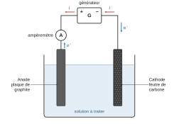
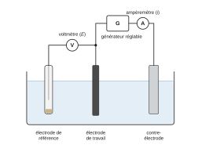
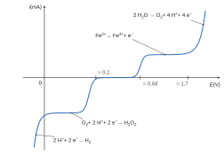
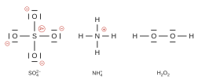
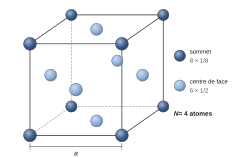
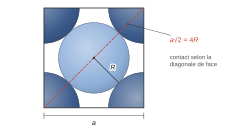

# Mines-Ponts PSI — Chimie 2026 · Corrigé brut

*Corrigé rédigé par IA, non officiel. Signalez toute erreur.*

Épreuve de 1 h 30, calculatrice interdite. « La chimie et le traitement des eaux » : deux parties indépendantes.

Approximations de l'annexe 1 :

- $\mathcal{N}_A\approx6\cdot10^{23}$ mol⁻¹ et $R\approx8$ J·K⁻¹·mol⁻¹ ;
- $\sqrt2\approx10/7\approx1{,}4$ et $\ln10\approx2{,}3$ ;
- $\frac{RT}{F}\ln x\approx0{,}06\log x$ (en V, à 298 K).

## Traitement des eaux par le procédé électro-Fenton

### Q1

On compare les potentiels standard des deux couples :

$$E^\circ(\mathrm{HO^\bullet/H_2O})=2{,}80\ \mathrm{V}$$

$$E^\circ(\mathrm{Cl_2/Cl^-})=1{,}36\ \mathrm{V}$$

L'oxydant le plus fort est celui du couple de plus haut potentiel standard. Comme $2{,}80\ \mathrm{V}>1{,}36\ \mathrm{V}$ :

**le radical hydroxyle $\mathrm{HO^\bullet}$ est plus oxydant que le dichlore.**

### Q2

- Électrode A : $\mathrm{H_2O}\to2\,\mathrm{H^+}+\tfrac12\,\mathrm{O_2}+2\,e^-$ (flèche « −2e⁻ »). Des électrons sont cédés et l'oxygène passe de −II à 0 : c'est une **oxydation**, donc **A est l'anode**.
- Électrode B : $\mathrm{O_2}+2\,\mathrm{H^+}+2\,e^-\to\mathrm{H_2O_2}$ et $\mathrm{Fe^{3+}}+e^-\to\mathrm{Fe^{2+}}$ (flèches « +2e⁻ », « +e⁻ »). Des électrons sont captés : ce sont des **réductions**, donc **B est la cathode**.

La réaction $\mathrm{Fe^{2+}}+\mathrm{H_2O_2}+\mathrm{H^+}\to\mathrm{Fe^{3+}}+\mathrm{H_2O}+\mathrm{HO^\bullet}$ (réaction de Fenton) a lieu en solution, pas à une électrode. Le Fe³⁺ formé retourne à la cathode : le fer joue le rôle de catalyseur.

### Q3

Le dispositif est un **électrolyseur** : les réactions aux électrodes sont forcées par un générateur extérieur (ce n'est pas une pile). L'anode, siège de l'oxydation, doit donc être reliée à la borne + du générateur.

Montage complété :

- un **générateur de tension continue** est relié par sa **borne + à l'anode** (plaque de graphite, oxydation) et par sa **borne − à la cathode** (feutre de carbone, réduction) ;
- un **ampèremètre** est placé **en série** dans ce circuit (par exemple entre la borne + et la plaque de graphite).

Sens de déplacement des **électrons** : ils sont libérés à l'anode par l'oxydation et parcourent le fil de l'anode vers la borne + du générateur. Ils traversent le générateur, sortent par la borne − et rejoignent la cathode, où ils sont consommés.

Le courant $i$ circule en sens inverse dans le circuit extérieur : il sort par la borne + vers l'anode. Dans la solution, le courant est assuré par la migration des ions (anions vers l'anode, cations vers la cathode), d'où le rôle d'électrolyte support de $\mathrm{Na_2SO_4}$.

### Q4

Montage à **trois électrodes** plongeant dans la solution étudiée, reliées à un potentiostat (ou à un générateur réglable, un voltmètre et un ampèremètre) :

- **électrode de travail** (carbone/graphite) : électrode étudiée, dont on impose le potentiel et dont on mesure le courant ;
- **électrode de référence** (par exemple au calomel saturé) : potentiel fixe et connu ; le voltmètre (ou l'entrée haute impédance du potentiostat), branché entre elle et l'électrode de travail, mesure $E$ ; elle n'est traversée par aucun courant ;
- **contre-électrode** (électrode auxiliaire, par exemple en platine) : ferme le circuit ; l'ampèremètre, en série entre le générateur et la contre-électrode (ou l'électrode de travail), mesure $i$.

Le générateur réglable (ou le potentiostat) est la source qui permet de faire varier le potentiel de l'électrode de travail. On relève $i$ point par point.

### Q5

Espèces électroactives présentes : $\mathrm{O_2}$ dissous, $\mathrm{Fe^{2+}}$, le solvant ($\mathrm{H_2O}$, $\mathrm{H^+}$). Pas de Fe³⁺ initialement, donc pas de vague de réduction du fer(III).

Les positions ci-dessous sont estimées à partir des potentiels standard (pH voisin de 0, le pH de la solution n'étant pas précisé). À pH 2, les vagues des couples faisant intervenir $\mathrm{H^+}$ sont toutes décalées d'environ −0,12 V ; celle du fer ne bouge pas.

- Réduction $\mathrm{O_2}\to\mathrm{H_2O_2}$ : système lent, vague décalée de −0,5 V par rapport à $E^\circ=0{,}69$ V, vers $0{,}2$ V. Palier de diffusion, car $\mathrm{O_2}$ dissous est en faible concentration.
- Oxydation $\mathrm{Fe^{2+}}\to\mathrm{Fe^{3+}}$ : système rapide, vague centrée vers $E^\circ\approx0{,}68$ V. Palier de diffusion (Fe²⁺ peu concentré).
- Oxydation de l'eau : système lent, mur vers $1{,}23+0{,}5\approx1{,}7$ V. Pas de palier : le solvant est en excès.
- Réduction de $\mathrm{H^+}$ : mur aux potentiels les plus bas (au voisinage de 0 V et en dessous).

Courbe reproduite, de gauche à droite. Convention : $i>0$ pour une oxydation (portions anodiques au-dessus de l'axe), $i<0$ pour une réduction (portions cathodiques en dessous).

| Portion de la courbe | Réaction électrochimique |
|---|---|
| mur cathodique, $i<0$ ($E$ au voisinage de 0 V et en dessous) | $2\,\mathrm{H^+}+2\,e^-\to\mathrm{H_2}$ |
| vague et palier cathodiques, $i<0$ (vague vers 0,2 V) | $\mathrm{O_2}+2\,\mathrm{H^+}+2\,e^-\to\mathrm{H_2O_2}$ |
| zone de courant nul (≈ 0,2 V à ≈ 0,6 V) | aucune réaction |
| vague et palier anodiques, $i>0$ (vers 0,68 V) | $\mathrm{Fe^{2+}}\to\mathrm{Fe^{3+}}+e^-$ |
| mur anodique, $i>0$ (vers 1,7 V) | $2\,\mathrm{H_2O}\to\mathrm{O_2}+4\,\mathrm{H^+}+4\,e^-$ |

### Q6

Il faut distinguer le potentiel de démarrage d'une réaction et le surpotentiel $\eta$ : pour un système lent, la réaction démarre au potentiel $E^\circ+\eta$, avec $\eta<0$ à la cathode et $\eta>0$ à l'anode.

À la cathode, la formation de $\mathrm{H_2O_2}$ commence vers :

$$E_c\approx E^\circ(\mathrm{O_2/H_2O_2})-0{,}5\approx0{,}2\ \mathrm{V}$$

À l'anode, le dégagement de $\mathrm{O_2}$ commence vers :

$$E_a\approx E^\circ(\mathrm{O_2/H_2O})+0{,}5\approx1{,}7\ \mathrm{V}$$

La tension minimale à appliquer est :

$$\begin{aligned}
U_{\min}&=E_a-E_c\\
&\approx(1{,}23+0{,}5)-(0{,}69-0{,}5)\\
&\approx0{,}54+1{,}0
\end{aligned}$$

$$\boxed{U_{\min}\approx1{,}5\ \mathrm{V}}$$

Elle ne dépend pas du pH : les deux couples échangent un $\mathrm{H^+}$ par électron, et leurs potentiels varient tous deux de $-0{,}06$ V par unité de pH. En pratique, il faut y ajouter la chute ohmique $R\,i$ dans la solution.

### Q7

Pour un élément des blocs s et p, le nombre d'électrons de valence se déduit de la colonne (colonne − 10 pour le bloc p) :

- N (2ᵉ ligne, 15ᵉ colonne : $15-10$) : **5 électrons de valence** ;
- O (2ᵉ ligne, 16ᵉ colonne : $16-10$) : **6 électrons de valence** ;
- S (3ᵉ ligne, même colonne que O, la 16ᵉ) : **6 électrons de valence**.

### Q8

**Ion sulfate** $\mathrm{SO_4^{2-}}$ : $6+4\times6+2=32$ électrons, soit 16 doublets. Structure respectant l'octet : S central lié à quatre O par des liaisons simples, trois doublets non liants sur chaque O. Charges formelles : $+2$ sur S et $-1$ sur chaque O (total −2).

Écriture équivalente admise (S de la 3ᵉ période, hypervalence) : deux liaisons S=O et deux liaisons S–O⁻, charge formelle nulle sur S. Les quatre liaisons sont équivalentes par mésomérie (tétraèdre régulier).

**Ion ammonium** $\mathrm{NH_4^+}$ : $5+4-1=8$ électrons, 4 doublets. Quatre liaisons N–H, aucun doublet non liant, charge formelle $+1$ sur N.

**Peroxyde d'hydrogène** $\mathrm{H_2O_2}$ : $2+12=14$ électrons, 7 doublets. Liaisons H–O, O–O, O–H et deux doublets non liants sur chaque O ; aucune charge formelle.

### Q9

Nombres d'oxydation du fer (O : −II, H : +I), notés $x$ :

- $\mathrm{Fe^{3+}}$ : +III ;
- $\mathrm{Fe(OH)_3}$ : $x+3\times(-1)=0$, soit +III ;
- $\mathrm{Fe^{2+}}$ : +II ;
- $\mathrm{Fe(OH)_2}$ : $x+2\times(-1)=0$, soit +II ;
- $\mathrm{Fe}$ : 0.

Verticalement, le nombre d'oxydation croît avec $E$ : trois étages, +III en haut, +II au milieu, 0 en bas.

Horizontalement, à nombre d'oxydation donné, on classe les espèces par acidité. L'ion libre est la forme acide : $\mathrm{Fe^{3+}}+3\,\mathrm{H_2O}=\mathrm{Fe(OH)_3}+3\,\mathrm{H^+}$ (de même pour Fe²⁺ et $\mathrm{Fe(OH)_2}$). L'hydroxyde, forme basique, occupe donc les pH élevés, et l'ion libre les pH faibles.

| Domaine | Espèce | n.o. du fer |
|---|---|---|
| **A** | $\mathrm{Fe^{3+}_{(aq)}}$ | +III |
| **B** | $\mathrm{Fe(OH)_{3(s)}}$ | +III |
| **C** | $\mathrm{Fe^{2+}_{(aq)}}$ | +II |
| **D** | $\mathrm{Fe(OH)_{2(s)}}$ | +II |
| **E** | $\mathrm{Fe_{(s)}}$ | 0 |

Contrôles sur les frontières :

- A/C est horizontale (Fe³⁺ + e⁻ = Fe²⁺, sans H⁺) ;
- A/B et C/D sont verticales (précipitations, pH ≈ 1,7 et ≈ 7) ;
- B/C a une pente de $-0{,}18$ V/pH ($\mathrm{Fe(OH)_3}+3\,\mathrm{H^+}+e^-=\mathrm{Fe^{2+}}+3\,\mathrm{H_2O}$) ;
- B/D et D/E ont une pente de $-0{,}06$ V/pH.

Les frontières verticales correspondent à une concentration de tracé de $10^{-1}$ mol·L⁻¹ : $14-(38-1)/3\approx1{,}7$ et $14-(15-1)/2=7$.

### Q10

Seul le sel de Mohr apporte Fe²⁺ :

$$n=4{,}5\cdot10^{-3}\times10\cdot10^{-3}=4{,}5\cdot10^{-5}\ \mathrm{mol}$$

Volume total (gouttes d'acide et volume du solide négligés) : $V=170+10=180$ mL. Par conservation de la quantité de fer(II) lors de la dilution :

$$C_0=\frac{n}{V}=\frac{4{,}5\cdot10^{-5}}{0{,}180}$$

$$\boxed{C_0=2{,}5\cdot10^{-4}\ \mathrm{mol\cdot L^{-1}}}$$

### Q11

Équilibre de dissolution : $\mathrm{Fe(OH)_{3(s)}}=\mathrm{Fe^{3+}_{(aq)}}+3\,\mathrm{HO^-_{(aq)}}$. Le précipité apparaît quand le quotient de réaction atteint $K_s$, tout le fer(III) étant encore dissous :

$$Q^{eq}=\frac{[\mathrm{Fe^{3+}}]\,[\mathrm{HO^-}]^3}{(c^\circ)^4}=K_s$$

$$K_s=10^{-\mathrm{p}K_s}=10^{-38}$$

avec $[\mathrm{Fe^{3+}}]=C_0'=1{,}0\cdot10^{-4}$ mol·L⁻¹. D'où :

$$\begin{aligned}
\log\frac{[\mathrm{HO^-}]}{c^\circ}&=\frac{1}{3}\left(-\mathrm{p}K_s-\log\frac{C_0'}{c^\circ}\right)=\frac{-38+4}{3}\\
\mathrm{pOH}&=\frac{34}{3}\approx11{,}3\\
\mathrm{pH}&=\mathrm{p}K_e-\mathrm{pOH}\approx14-11{,}3
\end{aligned}$$

$$\boxed{\mathrm{pH}\approx2{,}7}$$

Au-dessus de pH 2,7, $\mathrm{Fe(OH)_3}$ précipite ; en dessous, le fer(III) reste dissous. L'expérience est menée à pH = 2 < 2,7 : le fer(III) ne précipite pas. Il reste en solution, peut être réduit en Fe²⁺ à la cathode et entretenir le cycle de Fenton. **Les conditions de pH sont donc cohérentes avec le procédé.**

Même si tout le fer du bécher était à l'état +III, $[\mathrm{Fe^{3+}}]=2{,}5\cdot10^{-4}$ mol·L⁻¹ donnerait un pH de début de précipitation ≈ 2,5, encore supérieur à 2.

### Q12

On règle le spectrophotomètre au **maximum d'absorption** du bleu de méthylène, lu sur l'annexe 6 :

$$\boxed{\lambda\approx665\ \mathrm{nm}}$$

(un maximum secondaire, plus bas, apparaît vers 620 nm). Justification :

- $\varepsilon$ y est maximal, donc la sensibilité est maximale ;
- au voisinage d'un maximum, $A$ varie peu avec $\lambda$, d'où une mesure peu sensible à un léger défaut de réglage ;
- le BM étant la seule espèce colorée, l'absorbance ne mesure que lui.

### Q13

L'absorbance est proportionnelle à $[\mathrm{BM}]$ (seule espèce colorée) : $t_{1/2}$ est l'instant où $A=A_0/2=0{,}937$.

D'après le tableau, $A(240)=0{,}993$ et $A(300)=0{,}863$ encadrent 0,937. Par interpolation linéaire :

$$\begin{aligned}
t_{1/2}&\approx240+60\times\frac{0{,}993-0{,}937}{0{,}993-0{,}863}\\
&\approx240+26
\end{aligned}$$

$$\boxed{t_{1/2}\approx2{,}7\cdot10^{2}\ \mathrm{s}}$$

(soit environ 4,5 min ; encadrement sûr : 240 s < $t_{1/2}$ < 300 s).

### Q14

Pour une solution d'une espèce absorbante traversée par une lumière monochromatique de longueur d'onde $\lambda$ :

$$\boxed{A=\log\frac{I_0}{I}=\varepsilon_\lambda\,\ell\,c}$$

- $A$ : absorbance, sans dimension ($I_0$ intensité incidente, $I$ intensité transmise) ;
- $\varepsilon_\lambda$ : coefficient d'absorption molaire, en L·mol⁻¹·cm⁻¹ ;
- $\ell$ : longueur de solution traversée (épaisseur de la cuve), en cm ;
- $c$ : concentration de l'espèce absorbante, en mol·L⁻¹.

Valable pour des solutions diluées ; les absorbances de plusieurs espèces s'ajoutent.

### Q15

Loi de vitesse d'ordre 1, puis séparation des variables et intégration entre 0 et $t$ :

$$\begin{aligned}
v=-\frac{\mathrm{d}[\mathrm{BM}]}{\mathrm{d}t}&=k[\mathrm{BM}]\\
\frac{\mathrm{d}[\mathrm{BM}]}{[\mathrm{BM}]}&=-k\,\mathrm{d}t\\
\ln\frac{[\mathrm{BM}](t)}{[\mathrm{BM}]_0}&=-k\,t
\end{aligned}$$

Par Beer-Lambert (BM seule espèce colorée, $\lambda$ et cuve fixées), $A=\varepsilon\ell[\mathrm{BM}]$ et $A_0=\varepsilon\ell[\mathrm{BM}]_0$. Le rapport des concentrations est donc celui des absorbances :

$$\boxed{\ln A=\ln A_0-k\,t}$$

soit, de façon équivalente :

$$A(t)=A_0\,\mathrm{e}^{-kt}$$

### Q16

Si la réaction est d'ordre 1, la question 15 prévoit que $\ln A$ est une fonction affine décroissante de $t$, de pente $-k$.

Sur la figure 5, les points $\ln A$ en fonction de $t$ (en s) sont bien alignés sur la droite de régression $y=-2{,}23\cdot10^{-3}x+0{,}563$, sur tout le domaine étudié (0 à 600 s) : **l'allure justifie l'ordre 1** (elle est compatible avec lui).

Par identification de la pente $-k$ :

$$\boxed{k=2{,}23\cdot10^{-3}\ \mathrm{s^{-1}}}$$

Nuance : les $\ln A$ calculés à partir du tableau 1 s'écartent un peu de la droite aux extrémités (0,63 à $t=0$ contre 0,563 ; −0,70 à $t=600$ s contre −0,78). L'ordonnée à l'origine donne ainsi $\mathrm{e}^{0{,}563}\approx1{,}76$ au lieu de $A_0=1{,}873$. L'accord reste satisfaisant.

### Q17

Éliminer 99 % du BM, c'est atteindre $A/A_0=10^{-2}$. D'après la question 15 :

$$\begin{aligned}
t_{99}&=\frac{1}{k}\ln\frac{A_0}{A}=\frac{2\ln10}{k}\\
&\approx\frac{4{,}6}{2{,}23\cdot10^{-3}}
\end{aligned}$$

$$\boxed{t_{99}\approx2{,}1\cdot10^{3}\ \mathrm{s}\approx34\ \mathrm{min}}$$

Durée positive, comme il se doit : $\ln(A_0/A)=\ln100>0$. L'expérience de 10 min ne dégrade donc qu'environ 74 % du colorant ($0{,}495/1{,}873\approx0{,}26$ restant).

### Q18

Maille conventionnelle CFC : cube d'arête $a$, atomes aux 8 sommets et aux centres des 6 faces.

- Population : $N=8\times\frac18+6\times\frac12=\boxed{4\ \text{atomes par maille}}$.
- Coordinence (nombre de plus proches voisins d'un atome, à ne pas confondre avec la compacité) : un atome au centre d'une face a pour plus proches voisins, à la distance $a/\sqrt2$, les 4 sommets de cette face et 4 centres de faces dans chacune des deux mailles qui partagent cette face : $\boxed{12}$.

### Q19

Les atomes sont tangents le long de la diagonale d'une face (sommet, centre de face, sommet) : $a\sqrt2=4R$, donc $a=2\sqrt2\,R$.

Avec $\sqrt2\approx10/7$ :

$$a\approx2\times\frac{10}{7}\times140\ \mathrm{pm}$$

$$\boxed{a\approx4{,}0\cdot10^{2}\ \mathrm{pm}=4{,}0\cdot10^{-10}\ \mathrm{m}}$$

(La valeur sans approximation est 396 pm.)

### Q20

Masse des $N$ atomes d'une maille divisée par le volume $a^3$ de la maille, en unités SI :

$$\begin{aligned}
\rho&=\frac{N\,M(\mathrm{Pt})}{\mathcal{N}_A\,a^3}\\
&=\frac{4\times200\cdot10^{-3}}{6\cdot10^{23}\times(4{,}0\cdot10^{-10})^3}\\
&=\frac{0{,}8}{6\times64\cdot10^{-7}}\\
&=\frac{0{,}8}{3{,}84\cdot10^{-5}}\ \mathrm{kg\cdot m^{-3}}
\end{aligned}$$

$$\boxed{\rho\approx2{,}1\cdot10^{4}\ \mathrm{kg\cdot m^{-3}}=21\ \mathrm{g\cdot cm^{-3}}}$$

Valeur conforme à la masse volumique tabulée du platine (21,4 g·cm⁻³).

## Traitement des eaux par des procédés biologiques

### Traitement des eaux en milieu aérobie

### Q21

Bilan C, puis H, puis O :

$$\boxed{\mathrm{C_2H_6O_{(aq)}}+3\,\mathrm{O_{2(aq)}}\longrightarrow2\,\mathrm{CO_{2(g)}}+3\,\mathrm{H_2O_{(\ell)}}}$$

(C : 2 = 2 ; H : 6 = 6 ; O : 1 + 6 = 4 + 3.)

### Q22

Loi de Hess avec les données de l'annexe 5 (O₂ dissous : $\Delta_fH^\circ$ et $S_m^\circ$ non nuls) :

$$\Delta_rH^\circ=2(-400)+3(-300)-(-300)-3(-10)=-1370\ \mathrm{kJ\cdot mol^{-1}}$$

$$\Delta_rS^\circ=2(200)+3(50)-150-3(100)=+100\ \mathrm{J\cdot K^{-1}\cdot mol^{-1}}$$

$$\begin{aligned}
\Delta_rG^\circ&=\Delta_rH^\circ-T\Delta_rS^\circ\\
&=-1370-298\times0{,}100\\
&\approx-1370-30\ \mathrm{kJ\cdot mol^{-1}}
\end{aligned}$$

$$\boxed{\Delta_rG^\circ\approx-1{,}40\cdot10^{3}\ \mathrm{kJ\cdot mol^{-1}}}$$

De $\Delta_rG^\circ=-RT\ln K_1^\circ$ :

$$\begin{aligned}
\ln K_1^\circ&=-\frac{\Delta_rG^\circ}{RT}=\frac{1{,}40\cdot10^{6}}{8\times298}\approx5{,}9\cdot10^{2}\\
\log K_1^\circ&=\frac{\ln K_1^\circ}{\ln10}\approx\frac{587}{2{,}3}\approx255
\end{aligned}$$

$$\boxed{K_1^\circ\approx10^{255}}$$

Conclusion : $K_1^\circ\gg10^4$, la réaction est **thermodynamiquement totale** ; l'éthanol peut être entièrement minéralisé par le dioxygène dissous. Elle est en revanche lente sans catalyseur : ce sont les bactéries (leurs enzymes) qui la rendent effective.

### Traitement des eaux en milieu anaérobie (dépourvu d'oxygène)

### Q23

La somme des nombres d'oxydation vaut la charge de l'ion, avec O à −II :

$$x+3\times(-2)=-1$$

donc $\boxed{\mathrm{n.o.(N)}=+\mathrm{V}}$ dans $\mathrm{NO_3^-}$.

### Q24

$$\boxed{2\,\mathrm{NO^-_{3(aq)}}+12\,\mathrm{H^+_{(aq)}}+10\,e^-=\mathrm{N_{2(g)}}+6\,\mathrm{H_2O_{(\ell)}}}$$

(N : +V → 0, $2\times5=10$ électrons ; charges : $-2+12-10=0$.)

Relation de Nernst : l'oxydant $\mathrm{NO_3^-}$ et les $\mathrm{H^+}$ (côté oxydant) au numérateur, le réducteur $\mathrm{N_2}$ au dénominateur, l'eau (solvant) n'apparaît pas :

$$\boxed{E_1=E^\circ(\mathrm{NO_3^-/N_2})+\frac{0{,}06}{10}\log\frac{[\mathrm{NO_3^-}]^2\,[\mathrm{H^+}]^{12}}{(c^\circ)^{14}\,\dfrac{p_{\mathrm{N_2}}}{p^\circ}}}$$

avec $E^\circ=1{,}25$ V. Sous forme développée (en V) :

$$E_1=1{,}25+0{,}012\log\frac{[\mathrm{NO_3^-}]}{c^\circ}-0{,}072\,\mathrm{pH}-0{,}006\log\frac{p_{\mathrm{N_2}}}{p^\circ}$$

### Q25

$$\boxed{2\,\mathrm{CO_{2(g)}}+12\,\mathrm{H^+_{(aq)}}+12\,e^-=\mathrm{C_2H_6O_{(aq)}}+3\,\mathrm{H_2O_{(\ell)}}}$$

(C : +IV → −II en moyenne, $2\times6=12$ électrons.)

L'oxydant est $\mathrm{CO_2}$ (numérateur, avec les $\mathrm{H^+}$), le réducteur l'éthanol (dénominateur) :

$$\boxed{E_2=E^\circ(\mathrm{CO_2/C_2H_6O})+\frac{0{,}06}{12}\log\frac{\left(\dfrac{p_{\mathrm{CO_2}}}{p^\circ}\right)^2[\mathrm{H^+}]^{12}}{[\mathrm{C_2H_6O}]\,(c^\circ)^{11}}}$$

avec $E^\circ=-0{,}33$ V. Sous forme développée (en V) :

$$E_2=-0{,}33+0{,}01\log\frac{p_{\mathrm{CO_2}}}{p^\circ}-0{,}06\,\mathrm{pH}-0{,}005\log\frac{[\mathrm{C_2H_6O}]}{c^\circ}$$

### Q26

$E^\circ(\mathrm{NO_3^-/N_2})=1{,}25$ V est supérieur à $E^\circ(\mathrm{CO_2/C_2H_6O})=-0{,}33$ V : le nitrate oxyde l'éthanol. On combine $6\times$(Q24) et $5\times$(Q25 dans le sens de l'oxydation), soit 60 électrons échangés :

$$\boxed{5\,\mathrm{C_2H_6O_{(aq)}}+12\,\mathrm{NO^-_{3(aq)}}+12\,\mathrm{H^+_{(aq)}}=10\,\mathrm{CO_{2(g)}}+6\,\mathrm{N_{2(g)}}+21\,\mathrm{H_2O_{(\ell)}}}$$

(C 10 = 10 ; N 12 = 12 ; H 42 = 42 ; O 41 = 41 ; charges 0 = 0.)

À l'équilibre $E_1=E_2$, d'où, avec $n=60$ :

$$\begin{aligned}
\log K_2^\circ&=\frac{n\,(E_1^\circ-E_2^\circ)}{0{,}06}\\
&=\frac{60\times1{,}58}{0{,}06}=1580
\end{aligned}$$

$$\boxed{K_2^\circ\approx10^{1580}}$$

(Pour l'équation rapportée à une mole d'éthanol, $n=12$ et $K^\circ=10^{316}$.)

Conclusion : la réaction est **totale** ; en l'absence de dioxygène, les ions nitrate oxydent quantitativement l'éthanol en $\mathrm{CO_2}$ et sont éliminés sous forme de diazote gazeux (dénitrification). Comme en milieu aérobie, la réaction est lente sans catalyse bactérienne.
