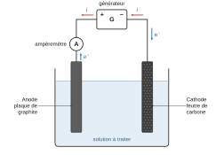
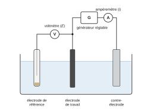
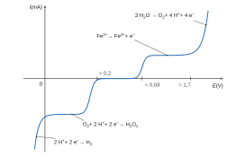
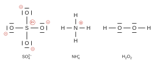
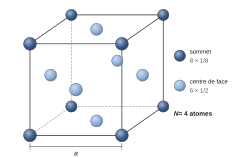
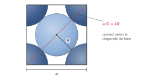

# Mines-Ponts PSI — Chimie 2026 · Corrigé guidé

*Corrigé rédigé par IA, non officiel. Signalez toute erreur.*

## Présentation du sujet

**Format.** 1 h 30, calculatrice et tout dispositif électronique interdits, 26 questions réparties en deux parties indépendantes. Les données sont regroupées en annexe, avec des approximations faites pour le calcul de tête :

- $\mathcal{N}_A\approx6\cdot10^{23}$ mol⁻¹ et $R\approx8$ J·K⁻¹·mol⁻¹ ;
- $\sqrt2\approx10/7\approx1{,}4$ et $\ln10\approx2{,}3$ ;
- $\frac{RT}{F}\ln x\approx0{,}06\log x$ V à 298 K.

Un résultat qui « tombe rond » (400 pm, $10^{1580}$…) est souvent le signe qu'on a suivi le chemin prévu.

**Thème.** La dépollution des eaux usées.

- **Partie I — Procédé électro-Fenton (Q1–Q20).** On fabrique par électrolyse les deux réactifs de Fenton ($\mathrm{Fe^{2+}}$ et $\mathrm{H_2O_2}$), qui produisent le radical $\mathrm{HO^\bullet}$, puis on suit la dégradation d'un colorant. Le parcours balaie presque tout le programme de chimie de PSI et de PCSI :
  - *électrochimie (Q1–Q6)* : pouvoir oxydant, anode et cathode, montage d'électrolyse, montage à trois électrodes, courbes courant-potentiel avec systèmes lents et rapides, tension minimale d'électrolyse ;
  - *structure de la matière (Q7–Q8)* : électrons de valence, schémas de Lewis ;
  - *solutions aqueuses (Q9–Q11)* : diagramme potentiel-pH du fer, dilution, produit de solubilité ;
  - *cinétique et spectrophotométrie (Q12–Q17)* : choix de la longueur d'onde, temps de demi-réaction, loi de Beer-Lambert, loi intégrée d'ordre 1, linéarisation ;
  - *cristallographie (Q18–Q20)* : structure CFC du platine, paramètre de maille, masse volumique.
- **Partie II — Procédés biologiques (Q21–Q26).** Oxydation de l'éthanol par le dioxygène dissous (équilibrage, $\Delta_rG^\circ$, $K^\circ$), puis par les ions nitrate en milieu anaérobie (nombre d'oxydation, demi-équations, relation de Nernst, constante d'équilibre d'une réaction d'oxydoréduction).

**Ce qu'en dit le jury.** Le rapport 2026 juge que « Le sujet était très proche du cours et a permis de classer les candidats de façon efficace ». Les questions qui ont fait la différence, d'après son analyse question par question :

- **Q3 et Q5**, « globalement mal traitée » et « généralement été mal traitée » : polarités du générateur, sens des électrons, signe des courants sur la courbe $i=f(E)$ ;
- **Q4**, réussie par une moitié des candidats seulement ;
- **Q6**, où « Peu de candidats fournissent la bonne valeur numérique » ;
- **Q10, Q11, Q15 et Q22**, faciles mais rarement menées au bout ou mal justifiées (dilution, relation $Q^{eq}=K_s$, intégration de la loi d'ordre 1, valeur numérique de $K^\circ$) ;
- **Q26**, peu traitée, faute de temps selon le jury, alors qu'elle n'avait rien de difficile.

À l'inverse, Q1, Q7, Q12, Q13, Q19, Q21 et Q23 ont été bien réussies : les manquer coûte cher.

**Difficulté et gestion du temps.** Environ 3,5 minutes par question : le sujet est court mais dense, et chaque question rapporte. Questions abordables à ne pas laisser passer : Q1, Q2, Q7, Q10, Q14, Q15, Q18–Q21, Q23. Celles qui demandent le plus de construction : Q3–Q6 (schémas et lecture des surpotentiels), Q8 (Lewis), Q9 (justifier), Q24–Q26 (équilibrages et combinaison à 60 électrons).

Plusieurs questions se terminent par « Justifier », « Cela est-il cohérent ? » ou « Conclure » : la phrase de conclusion fait partie de la réponse. Les deux parties étant indépendantes, on peut garder 15 minutes pour la partie II, très rentable : le jury constate que Q26 a souvent été sacrifiée.

## Partie I — Traitement des eaux par le procédé électro-Fenton

### Électrochimie du procédé

Six questions sur l'électrolyse : identifier les électrodes, câbler le montage, puis exploiter une courbe courant-potentiel dans laquelle les surpotentiels jouent le premier rôle. C'est le bloc le plus discriminant du sujet.

### Question 1

> [!INDICATION]
> Le pouvoir oxydant se compare à l'aide d'une grandeur fournie en annexe 3.

> [!INDICATION]
> L'oxydant le plus fort appartient au couple dont la grandeur en question est la plus grande.

#### Solution

On compare les potentiels standard des couples $\mathrm{HO^\bullet/H_2O}$ ($2{,}80$ V) et $\mathrm{Cl_2/Cl^-}$ ($1{,}36$ V). L'oxydant le plus fort est celui du couple de plus haut potentiel standard : **le radical hydroxyle $\mathrm{HO^\bullet}$ est plus oxydant que le dichlore.**

> [!PIEGE]
> Justifier par « c'est un radical » n'utilise pas la donnée et ne répond pas à « Justifier ». Un potentiel standard renseigne sur la thermodynamique, pas sur la vitesse de l'oxydation.

### Question 2

> [!INDICATION]
> Anode et cathode se définissent par la nature de la réaction qui s'y produit, pas par la borne du générateur.

> [!INDICATION]
> Lire sur la figure 1 si chaque électrode porte un gain ou une perte d'électrons.

#### Solution

- Électrode A : $\mathrm{H_2O}\to2\,\mathrm{H^+}+\tfrac12\,\mathrm{O_2}+2\,e^-$ (« −2e⁻ »). L'oxygène passe de −II à 0, c'est une **oxydation** : **A est l'anode**.
- Électrode B : $\mathrm{O_2}+2\,\mathrm{H^+}+2\,e^-\to\mathrm{H_2O_2}$ et $\mathrm{Fe^{3+}}+e^-\to\mathrm{Fe^{2+}}$ (« +2e⁻ », « +e⁻ »). Ce sont des **réductions** : **B est la cathode**.

La réaction de Fenton, $\mathrm{Fe^{2+}}+\mathrm{H_2O_2}+\mathrm{H^+}\to\mathrm{Fe^{3+}}+\mathrm{H_2O}+\mathrm{HO^\bullet}$, a lieu en solution. Le Fe³⁺ formé diffuse vers la cathode où il est régénéré en Fe²⁺ : le fer est un catalyseur, d'où la « quantité catalytique » de l'énoncé.

> [!METHODE]
> Anode = oxydation, cathode = réduction, que l'on soit en pile ou en électrolyse. Seule la correspondance avec les bornes change (anode reliée à la borne + en électrolyse, anode pôle − en pile).

> [!JURY]
> Le rapport 2026 précise : « L'identification seule ne suffisait pas mais devait être accompagnée d'une justification portant sur la nature des échanges observés (oxydation/réduction). » Écrire « A est l'anode » sans dire qu'il s'y produit une oxydation ne rapporte rien.

### Question 3

> [!INDICATION]
> Pile ou électrolyseur ? Ici, les réactions aux électrodes sont-elles spontanées ou forcées ?

> [!INDICATION]
> L'électrolyseur est un récepteur : c'est le générateur qui doit « aspirer » les électrons libérés à l'anode. Un ampèremètre mesure le courant qui le traverse : où doit-il être placé ?

#### Solution

Le dispositif est un **électrolyseur** : les réactions sont forcées par un générateur extérieur. L'anode, siège de l'oxydation, doit donc être reliée à la borne + du générateur.

Montage complété :

- un **générateur de tension continue** relié par sa **borne + à l'anode** (plaque de graphite) et par sa **borne − à la cathode** (feutre de carbone) ;
- un **ampèremètre en série** dans le circuit, par exemple entre la borne + et la plaque de graphite.

Les **électrons** sont libérés à l'anode par l'oxydation de l'eau et circulent dans le fil de l'anode vers la borne + du générateur. Ils le traversent et repartent par la borne − vers la cathode, où ils sont consommés.

Le courant $i$ circule en sens inverse dans le circuit extérieur. Dans la solution, ce sont les ions qui transportent le courant (anions vers l'anode, cations vers la cathode) : c'est le rôle du sulfate de sodium ajouté.

> [!PIEGE]
> Erreur relevée par le jury : des polarités incompatibles avec le sens des électrons dessiné. Les deux doivent se correspondre : les électrons entrent dans le générateur par la borne + et en sortent par la borne −. Un ampèremètre en dérivation court-circuite le générateur.

> [!JURY]
> Question « globalement mal traitée » selon le rapport 2026, qui note : « Les candidats confondent les dispositifs électrochimiques de type pile et électrolyseur. » Commencer la réponse par la nature du dispositif évite l'erreur de polarité.

### Question 4

> [!INDICATION]
> Pour tracer $i=f(E)$, il faut à la fois imposer ou mesurer le potentiel d'une électrode et mesurer le courant qui la traverse. Combien d'électrodes faut-il pour que la mesure du potentiel ne soit pas faussée par le passage du courant ?

> [!INDICATION]
> Une des électrodes sert d'origine des potentiels et ne doit être traversée par aucun courant. Et il faut bien une source pour faire varier le potentiel.

#### Solution

Montage à **trois électrodes** plongeant dans la solution étudiée, reliées à un potentiostat (ou à un générateur réglable, un voltmètre et un ampèremètre) :

- **électrode de travail** (carbone/graphite) : électrode étudiée, dont on fixe le potentiel et dont on mesure le courant ;
- **électrode de référence** (par exemple au calomel saturé) : potentiel fixe et connu ; le voltmètre est branché entre elle et l'électrode de travail ; elle n'est traversée par aucun courant ;
- **contre-électrode** (électrode auxiliaire, par exemple en platine) : elle ferme le circuit du courant ; le générateur et l'ampèremètre sont en série entre elle et l'électrode de travail.

Le générateur réglable est la source qui fait varier le potentiel de l'électrode de travail. On relève, point par point, $E$ (au voltmètre, par rapport à la référence) et $i$ (à l'ampèremètre).

> [!PIEGE]
> Avec deux électrodes seulement, la tension mesurée mêle les deux potentiels d'électrode et la chute ohmique : on ne connaît pas le potentiel de l'électrode étudiée. La question demande aussi de nommer chaque électrode.

> [!JURY]
> Le rapport 2026 indique que la question n'a été convenablement traitée que par une moitié des candidats : « Certains confondent l'attribution des électrodes tandis que d'autres ne positionnent aucune source permettant de faire varier le potentiel. »

### Question 5

> [!INDICATION]
> Commencer par recenser les espèces électroactives réellement présentes au départ (attention au fer).

> [!INDICATION]
> Pour un système rapide, la vague se place au voisinage du potentiel standard ; pour un système lent, il faut décaler du surpotentiel donné. Une espèce dissoute en faible concentration donne un palier, le solvant donne un mur.

> [!INDICATION]
> Ranger les vagues obtenues par potentiel croissant et les associer, de gauche à droite, aux portions de la figure 3, en vérifiant le signe de $i$ de chacune.

#### Solution

Espèces présentes : $\mathrm{O_2}$ dissous, $\mathrm{Fe^{2+}}$, le solvant ($\mathrm{H_2O}$, $\mathrm{H^+}$). Pas de Fe³⁺ au départ : aucune vague de réduction du fer(III).

Les positions sont estimées avec les potentiels standard (pH voisin de 0, le pH n'étant pas précisé). À pH 2, les vagues des couples qui font intervenir $\mathrm{H^+}$ se décalent toutes d'environ −0,12 V, celle du fer ne bouge pas : l'ordre des vagues est inchangé.

- Réduction $\mathrm{O_2}\to\mathrm{H_2O_2}$ : système lent, vague décalée de −0,5 V par rapport à $E^\circ=0{,}69$ V, donc vers 0,2 V. Palier de diffusion (O₂ dissous peu concentré).
- Oxydation $\mathrm{Fe^{2+}}\to\mathrm{Fe^{3+}}$ : système rapide, vague centrée vers $E^\circ\approx0{,}68$ V. Palier de diffusion.
- Oxydation de l'eau : système lent, mur vers $1{,}23+0{,}5\approx1{,}7$ V. Pas de palier : le solvant est en excès.
- Réduction des ions $\mathrm{H^+}$ en $\mathrm{H_2}$ : mur aux potentiels les plus bas.

Courbe reproduite et annotée, de gauche à droite. Convention : $i>0$ pour une oxydation (au-dessus de l'axe), $i<0$ pour une réduction (en dessous).

| Portion de la courbe | Réaction électrochimique |
|---|---|
| mur cathodique, $i<0$ (au voisinage de 0 V et en dessous) | $2\,\mathrm{H^+}+2\,e^-\to\mathrm{H_2}$ |
| vague puis palier cathodiques, $i<0$ (vague vers 0,2 V) | $\mathrm{O_2}+2\,\mathrm{H^+}+2\,e^-\to\mathrm{H_2O_2}$ |
| zone de courant nul (≈ 0,2 V à ≈ 0,6 V) | aucune réaction |
| vague puis palier anodiques, $i>0$ (vers 0,68 V) | $\mathrm{Fe^{2+}}\to\mathrm{Fe^{3+}}+e^-$ |
| mur anodique, $i>0$ (vers 1,7 V) | $2\,\mathrm{H_2O}\to\mathrm{O_2}+4\,\mathrm{H^+}+4\,e^-$ |

> [!PIEGE]
> Écrire une oxydation sur une portion où $i<0$, ou l'inverse : c'est l'erreur que le jury relève le plus souvent ici. Autres confusions : dessiner une vague de réduction de Fe³⁺ (absent au départ), oublier les surpotentiels (les vagues de O₂ et de Fe²⁺ seraient alors superposées vers 0,7 V), attribuer la vague cathodique à $\mathrm{O_2}\to\mathrm{H_2O}$ alors que le procédé repose sur la formation de $\mathrm{H_2O_2}$.

> [!JURY]
> D'après le rapport 2026, la question a été mal traitée : « les échanges proposés sont aléatoires et bien souvent incompatibles avec le signe conventionnel des intensités ».

> [!METHODE]
> Lecture d'une courbe courant-potentiel : palier = espèce dissoute limitée par la diffusion ; mur = solvant (ou électrode) ; vague raide au voisinage de $E^\circ$ = système rapide ; vague décalée = système lent.

### Question 6

> [!INDICATION]
> La tension à appliquer est la différence entre le potentiel où la réaction anodique voulue démarre et celui où la réaction cathodique voulue démarre.

> [!INDICATION]
> Chaque potentiel de démarrage s'obtient à partir d'un potentiel standard corrigé du surpotentiel correspondant, avec son signe.

#### Solution

Le surpotentiel $\eta$ n'est pas un potentiel : c'est l'écart à ajouter au potentiel standard pour qu'un système lent démarre ($\eta<0$ à la cathode, $\eta>0$ à l'anode).

Cathode : $\mathrm{H_2O_2}$ se forme à partir de :

$$E_c\approx0{,}69-0{,}5\approx0{,}2\ \mathrm{V}$$

Anode : $\mathrm{O_2}$ se dégage à partir de :

$$E_a\approx1{,}23+0{,}5\approx1{,}7\ \mathrm{V}$$

D'où :

$$\begin{aligned}
U_{\min}&=E_a-E_c\\
&\approx(1{,}23+0{,}5)-(0{,}69-0{,}5)\\
&\approx0{,}54+1{,}0
\end{aligned}$$

$$\boxed{U_{\min}\approx1{,}5\ \mathrm{V}}$$

Ce résultat ne dépend pas du pH : les deux couples échangent un proton par électron, et leurs potentiels varient tous deux de $-0{,}06$ V par unité de pH. Il faut en pratique appliquer davantage, à cause de la chute ohmique $R\,i$ dans la solution.

> [!PIEGE]
> $1{,}23-0{,}69=0{,}54$ V est la tension thermodynamique : elle ne ferait passer aucun courant. Les surpotentiels ne se compensent pas, ils s'ajoutent à la tension à fournir. Prendre $0{,}5$ V pour un potentiel d'électrode est la confusion que relève le jury.

> [!JURY]
> Rapport 2026 : « Beaucoup de candidats confondent potentiel et surpotentiel. Peu de candidats fournissent la bonne valeur numérique. »

### Structure de la matière

Le sel de Mohr fournit l'occasion de deux questions de cours sur la classification et les schémas de Lewis.

### Question 7

> [!INDICATION]
> L'annexe 2 donne la position des éléments, pas leur numéro atomique : c'est la colonne qui renseigne sur les électrons de valence.

#### Solution

Pour les blocs s et p, le nombre d'électrons de valence vaut le numéro de colonne (colonnes 1–2) ou ce numéro moins 10 (colonnes 13–18) :

- N : 2ᵉ ligne, 15ᵉ colonne ($15-10$) : **5 électrons de valence** ;
- O : 2ᵉ ligne, 16ᵉ colonne ($16-10$) : **6 électrons de valence** ;
- S : 3ᵉ ligne, même colonne que O, la 16ᵉ : **6 électrons de valence**.

### Question 8

> [!INDICATION]
> Commencer par le décompte des électrons de valence de chaque édifice, sans oublier la charge.

> [!INDICATION]
> Répartir les doublets pour satisfaire l'octet (duet pour H), puis calculer les charges formelles. Pour l'ammonium, que devient le doublet non liant de l'azote ? Pour le peroxyde, quels atomes sont liés entre eux ?

#### Solution

**Ion sulfate** $\mathrm{SO_4^{2-}}$ : $6+4\times6+2=32$ électrons, soit 16 doublets. Structure respectant l'octet : quatre liaisons simples S–O, trois doublets non liants sur chaque O. Charges formelles $+2$ sur S et $-1$ sur chaque O.

Écriture également admise (S est de la 3ᵉ période) : deux liaisons S=O et deux S–O⁻, charge formelle nulle sur S ; les quatre liaisons sont équivalentes par mésomérie.

**Ion ammonium** $\mathrm{NH_4^+}$ : $5+4-1=8$ électrons, 4 doublets liants N–H, aucun doublet non liant ; charge formelle $+1$ sur N.

**Peroxyde d'hydrogène** $\mathrm{H_2O_2}$ : $2+12=14$ électrons, 7 doublets : H–O–O–H et deux doublets non liants sur chaque O ; pas de charge formelle.

> [!PIEGE]
> Laisser un doublet non liant sur l'azote de l'ammonium lui donnerait dix électrons : impossible pour un élément de la 2ᵉ période. Dans $\mathrm{H_2O_2}$, la liaison O–O simple est la signature du peroxyde (oxygène au nombre d'oxydation −I).

> [!JURY]
> Question simple, mais le rapport 2026 rappelle : « Tous les doublets non liants doivent être convenablement positionnés, ainsi que les éventuelles charges formelles. »

### Diagramme potentiel-pH et solubilité

### Question 9

> [!INDICATION]
> Calculer le nombre d'oxydation du fer dans les cinq espèces : combien d'« étages » horizontaux attend-on ?

> [!INDICATION]
> Verticalement, le nombre d'oxydation croît avec $E$. Horizontalement, à nombre d'oxydation fixé, laquelle des deux espèces est la forme acide, laquelle la forme basique ?

#### Solution

Nombres d'oxydation du fer (O : −II, H : +I), notés $x$ :

- $\mathrm{Fe^{3+}}$ : +III ;
- $\mathrm{Fe(OH)_3}$ : $x+3\times(-1)=0$, soit +III ;
- $\mathrm{Fe^{2+}}$ : +II ;
- $\mathrm{Fe(OH)_2}$ : $x+2\times(-1)=0$, soit +II ;
- Fe : 0.

Trois étages : +III en haut, +II au milieu, 0 en bas.

À nombre d'oxydation fixé, l'ion libre est la forme acide et l'hydroxyde la forme basique : $\mathrm{Fe^{3+}}+3\,\mathrm{H_2O}=\mathrm{Fe(OH)_3}+3\,\mathrm{H^+}$ (de même au degré +II). L'ion occupe donc les pH acides, l'hydroxyde les pH basiques.

| Domaine | Espèce | n.o. du fer |
|---|---|---|
| **A** | $\mathrm{Fe^{3+}_{(aq)}}$ | +III |
| **B** | $\mathrm{Fe(OH)_{3(s)}}$ | +III |
| **C** | $\mathrm{Fe^{2+}_{(aq)}}$ | +II |
| **D** | $\mathrm{Fe(OH)_{2(s)}}$ | +II |
| **E** | $\mathrm{Fe_{(s)}}$ | 0 |

Contrôles sur les frontières :

- A/C est horizontale (couple Fe³⁺/Fe²⁺ sans échange de proton) ;
- A/B et C/D sont verticales (précipitations, pas d'électron échangé) ;
- B/C a une pente de $-0{,}18$ V/pH ($\mathrm{Fe(OH)_3}+3\,\mathrm{H^+}+e^-=\mathrm{Fe^{2+}}+3\,\mathrm{H_2O}$), plus forte que celles de B/D et D/E ($-0{,}06$ V/pH), conformément à la figure.

> [!METHODE]
> Pour attribuer les domaines d'un diagramme E-pH : n.o. croissant vers le haut, basicité croissante vers la droite (ions, puis hydroxydes ou oxydes, puis éventuellement complexes hydroxo). Les pentes des frontières se contrôlent par le rapport du nombre de protons au nombre d'électrons.

> [!JURY]
> Le calcul des nombres d'oxydation n'a pas posé de difficulté, mais selon le rapport 2026 « le jury attend une justification portant sur les nombres d'oxydation et sur l'acidité/basicité des différentes espèces afin de justifier complètement l'attribution proposée ». Le tableau seul ne suffit pas : il faut les deux arguments.

### Question 10

> [!INDICATION]
> Une seule des trois additions apporte du fer(II). Dans quel volume final est-il dilué ?

#### Solution

Seul le sel de Mohr apporte Fe²⁺ :

$$n=4{,}5\cdot10^{-3}\times10\cdot10^{-3}=4{,}5\cdot10^{-5}\ \mathrm{mol}$$

Le volume total vaut $170+10=180$ mL (gouttes d'acide et volume du sulfate de sodium négligés). La quantité de fer(II) se conserve lors de la dilution :

$$C_0=\frac{n}{V}=\frac{4{,}5\cdot10^{-5}}{0{,}180}$$

$$\boxed{C_0=2{,}5\cdot10^{-4}\ \mathrm{mol\cdot L^{-1}}}$$

> [!PIEGE]
> Recopier $4{,}5\cdot10^{-3}$ mol·L⁻¹ (oubli de la dilution) ou diviser par 170 mL seulement.

> [!JURY]
> Le rapport 2026 regrette que cette simple dilution ne soit « pas assez souvent menée à terme » : le calcul, sans calculatrice, doit aller jusqu'à la valeur et l'unité.

### Question 11

> [!INDICATION]
> Au tout début de la précipitation, le quotient de réaction de la dissolution atteint juste le produit de solubilité, tout le fer(III) étant encore dissous.

> [!INDICATION]
> En déduire $[\mathrm{HO^-}]$ puis le pH, et comparer au pH du protocole en disant pourquoi c'est souhaitable.

#### Solution

Équilibre de dissolution : $\mathrm{Fe(OH)_{3(s)}}=\mathrm{Fe^{3+}_{(aq)}}+3\,\mathrm{HO^-_{(aq)}}$. Au début de la précipitation :

$$Q^{eq}=\frac{[\mathrm{Fe^{3+}}]\,[\mathrm{HO^-}]^3}{(c^\circ)^4}=K_s$$

$$K_s=10^{-\mathrm{p}K_s}=10^{-38}$$

avec $[\mathrm{Fe^{3+}}]=C_0'=1{,}0\cdot10^{-4}$ mol·L⁻¹. D'où :

$$\begin{aligned}
\left(\frac{[\mathrm{HO^-}]}{c^\circ}\right)^3&=\frac{10^{-38}}{10^{-4}}=10^{-34}\\
\mathrm{pOH}&=\frac{34}{3}\approx11{,}3\\
\mathrm{pH}&=14-\mathrm{pOH}
\end{aligned}$$

$$\boxed{\mathrm{pH}\approx2{,}7}$$

Au-delà de pH 2,7, $\mathrm{Fe(OH)_3}$ précipite. L'expérience est menée à pH = 2 < 2,7 : le fer(III) ne précipite pas. Il reste en solution, peut être réduit à la cathode et entretenir le cycle de Fenton. **Les conditions sont cohérentes.**

Même si tout le fer du bécher était à l'état +III ($2{,}5\cdot10^{-4}$ mol·L⁻¹), on trouverait pH ≈ 2,5 > 2.

> [!PIEGE]
> Confondre pOH et pH (annoncer 11,3), ou oublier la puissance 3. Un cation aussi acide que Fe³⁺ précipite en milieu franchement acide : le résultat doit être un petit pH.

> [!JURY]
> Le rapport 2026 relève que trop de candidats ne savent pas écrire la relation de type $Q^{eq}=K_S$ et méconnaissent la définition de $K_S$. Il ajoute qu'écrire « c'est cohérent » n'est pas une justification : il faut comparer les deux pH et dire ce que cela implique pour le fer(III).

### Cinétique de dégradation du bleu de méthylène

Le suivi est spectrophotométrique : on choisit la longueur d'onde, on exploite le tableau, puis on établit et on vérifie la loi d'ordre 1.

### Question 12

> [!INDICATION]
> Sur le spectre de l'annexe 6, quelle longueur d'onde donne la mesure la plus sensible ?

> [!INDICATION]
> Penser aussi à la stabilité de la mesure si le réglage de $\lambda$ est légèrement imprécis.

#### Solution

On règle l'appareil au **maximum d'absorption** du bleu de méthylène :

$$\boxed{\lambda\approx665\ \mathrm{nm}}$$

(un maximum secondaire, plus bas, apparaît vers 620 nm). Justification :

- $\varepsilon$ y est maximal : sensibilité maximale ;
- au voisinage d'un maximum, $A$ varie peu avec $\lambda$ : une petite erreur de réglage a peu d'effet ;
- le BM étant la seule espèce colorée, l'absorbance mesurée ne dépend que de sa concentration.

Une solution qui absorbe dans l'orangé-rouge apparaît bien bleue (couleur complémentaire).

> [!PIEGE]
> Choisir une longueur d'onde « bleue » (vers 450–480 nm) confond couleur perçue et couleur absorbée.

### Question 13

> [!INDICATION]
> Relier l'absorbance à la concentration en BM pour traduire « la moitié du BM a disparu ».

> [!INDICATION]
> Encadrer la valeur cherchée par deux colonnes du tableau, puis interpoler.

#### Solution

$A$ est proportionnelle à $[\mathrm{BM}]$ (seule espèce colorée) : $t_{1/2}$ vérifie $A=A_0/2=0{,}937$.

Le tableau donne $A(240)=0{,}993$ et $A(300)=0{,}863$, qui encadrent 0,937. Par interpolation linéaire :

$$\begin{aligned}
t_{1/2}&\approx240+60\times\frac{0{,}993-0{,}937}{0{,}993-0{,}863}\\
&\approx240+26
\end{aligned}$$

$$\boxed{t_{1/2}\approx2{,}7\cdot10^{2}\ \mathrm{s}}$$

soit environ 4,5 min (encadrement sûr : entre 240 et 300 s).

> [!PIEGE]
> Chercher l'instant où $A=0{,}5$ au lieu de $A_0/2$. Utiliser $\ln2/k$ suppose l'ordre 1, qui n'est vérifié qu'en Q16 ; la question demande d'exploiter le tableau.

### Question 14

> [!INDICATION]
> Question de cours : donner la définition de l'absorbance, la loi, puis chaque grandeur avec son unité usuelle.

#### Solution

Pour une espèce absorbante en solution, éclairée en lumière monochromatique de longueur d'onde $\lambda$ :

$$\boxed{A=\log\frac{I_0}{I}=\varepsilon_\lambda\,\ell\,c}$$

- $A$ : absorbance, sans dimension ($I_0$ intensité incidente, $I$ intensité transmise) ;
- $\varepsilon_\lambda$ : coefficient d'absorption molaire, en L·mol⁻¹·cm⁻¹ ;
- $\ell$ : longueur de solution traversée (épaisseur de la cuve), en cm ;
- $c$ : concentration de l'espèce absorbante, en mol·L⁻¹.

La loi vaut pour des solutions diluées ; les absorbances de plusieurs espèces s'ajoutent.

> [!JURY]
> Rapport 2026 : « La loi de Beer-Lambert écrite sous la forme $A = kC$ sans explicitation de $k$ n'est pas acceptée. » L'énoncé demandait de nommer chaque terme avec des unités cohérentes entre elles.

### Question 15

> [!INDICATION]
> Écrire la loi de vitesse d'ordre 1, puis intégrer l'équation différentielle obtenue.

> [!INDICATION]
> Passer des concentrations aux absorbances grâce à la question précédente.

#### Solution

Loi de vitesse d'ordre 1, séparation des variables, puis intégration entre 0 et $t$ :

$$\begin{aligned}
v=-\frac{\mathrm{d}[\mathrm{BM}]}{\mathrm{d}t}&=k[\mathrm{BM}]\\
\frac{\mathrm{d}[\mathrm{BM}]}{[\mathrm{BM}]}&=-k\,\mathrm{d}t\\
\ln\frac{[\mathrm{BM}](t)}{[\mathrm{BM}]_0}&=-k\,t
\end{aligned}$$

Le BM étant la seule espèce colorée, à $\lambda$ et cuve fixées, $A=\varepsilon\ell[\mathrm{BM}]$ et $A_0=\varepsilon\ell[\mathrm{BM}]_0$. Le rapport des concentrations est celui des absorbances :

$$\boxed{\ln A=\ln A_0-k\,t}$$

soit $A(t)=A_0\,\mathrm{e}^{-kt}$.

> [!METHODE]
> Méthode intégrale : on postule un ordre, on écrit la fonction de la concentration (ou de l'absorbance) qui doit être affine en $t$, et on vérifie l'alignement. Ordre 1 : $\ln A$ ; ordre 2 : $1/[\mathrm{BM}]$.

> [!JURY]
> Le rapport 2026 note que cette « simple intégration d'une cinétique d'ordre 1 a posé problème à beaucoup de candidats qui se contentent de fournir un résultat connu par cœur ». « Établir » impose d'écrire l'équation différentielle et de l'intégrer.

### Question 16

> [!INDICATION]
> Que prédit la question précédente pour la courbe $\ln A=f(t)$ si l'ordre est 1 ?

> [!INDICATION]
> Identifier terme à terme le modèle et l'équation de la droite ; attention au signe et à l'unité.

#### Solution

Pour un ordre 1, la question 15 prévoit que $\ln A$ est une fonction affine décroissante de $t$, de pente $-k$.

Sur la figure 5, les points $\ln A$ en fonction de $t$ (en s) s'alignent sur la droite $y=-2{,}23\cdot10^{-3}x+0{,}563$ entre 0 et 600 s : **l'allure justifie l'ordre 1**. Par identification de la pente :

$$\boxed{k=2{,}23\cdot10^{-3}\ \mathrm{s^{-1}}}$$

On peut nuancer à partir du tableau 1 : les $\ln A$ calculés sont un peu au-dessus de la droite aux deux extrémités (0,63 contre 0,563 à $t=0$). L'ordonnée à l'origine donne ainsi $\mathrm{e}^{0{,}563}\approx1{,}76$ au lieu de $A_0=1{,}873$. Cette légère courbure explique l'écart entre le $t_{1/2}$ lu en Q13 (≈ 270 s) et $\ln2/k\approx310$ s.

> [!PIEGE]
> $k$ est positive : c'est la pente qui vaut $-k$. Et la constante de vitesse d'un ordre 1 s'exprime en s⁻¹ : le jury compte faux un résultat sans unité. Un alignement confirme un ordre supposé, il ne le démontre pas.

> [!JURY]
> Le rapport 2026 précise que seuls les candidats qui avaient établi la relation de Q15 ont pu prétendre aux points, et rappelle : « Un résultat sans unité est compté faux. »

### Question 17

> [!INDICATION]
> Traduire « éliminer 99 % » en rapport $A/A_0$.

> [!INDICATION]
> Inverser la loi de Q15 et utiliser l'approximation de $\ln10$ fournie.

#### Solution

Il reste 1 % du BM : $A/A_0=10^{-2}$, donc

$$\begin{aligned}
t_{99}&=\frac{1}{k}\ln\frac{A_0}{A}=\frac{2\ln10}{k}\\
&\approx\frac{4{,}6}{2{,}23\cdot10^{-3}}
\end{aligned}$$

$$\boxed{t_{99}\approx2{,}1\cdot10^{3}\ \mathrm{s}\approx34\ \mathrm{min}}$$

Les 10 minutes de l'expérience ne dégradent qu'environ trois quarts du colorant (il reste $0{,}495/1{,}873\approx26$ %).

> [!PIEGE]
> Écrire $t=\frac1k\ln\frac{A}{A_0}$ donne une durée négative ; le jury relève de nombreuses copies où cette durée « devient par magie positive à la ligne suivante ». Écrire $\ln(A_0/A)$, positif, dès le départ. Autre erreur : prendre $A/A_0=0{,}99$ (ce qui reste après avoir éliminé 1 %).

> [!JURY]
> Rapport 2026 : « De nombreuses erreurs de signe aboutissent à une durée négative qui devient par magie positive à la ligne suivante. » Une erreur rattrapée sans explication est sanctionnée : le rapport rappelle que la malhonnêteté ne paye pas.

### Cristallographie du platine

### Question 18

> [!INDICATION]
> Dans une structure CFC, où sont les atomes ? Par combien de mailles chaque position est-elle partagée ?

> [!INDICATION]
> Pour la coordinence, se placer sur un atome au centre d'une face et compter ses voisins les plus proches de part et d'autre de cette face.

#### Solution

Maille conventionnelle : cube d'arête $a$, atomes aux 8 sommets et aux centres des 6 faces.

- Population : $N=8\times\frac18+6\times\frac12=\boxed{4\ \text{atomes par maille}}$.
- Coordinence, c'est-à-dire nombre de plus proches voisins d'un atome : un atome au centre d'une face a pour plus proches voisins, à $a/\sqrt2$, les 4 sommets de cette face et 4 centres de faces dans chacune des deux mailles qui la partagent : $\boxed{12}$.

> [!PIEGE]
> Compter 14 atomes (oubli des partages) ou une coordinence de 8 (confusion avec la structure cubique centrée). Le jury signale aussi la confusion entre coordinence (un nombre de voisins) et compacité (une fraction du volume occupée, 0,74 en CFC).

> [!JURY]
> Question bien traitée, « même si de nombreux candidats méconnaissent la définition de la coordinence et la confondent avec la compacité de l'édifice » (rapport 2026). Donner la définition en une demi-ligne lève toute ambiguïté.

### Question 19

> [!INDICATION]
> Le long de quelle direction de la maille CFC les atomes sont-ils tangents ?

> [!INDICATION]
> Écrire cette condition de contact, puis utiliser l'approximation de $\sqrt2$ de l'annexe 1.

#### Solution

Les atomes sont tangents le long de la diagonale d'une face (sommet, centre de face, sommet opposé) : $a\sqrt2=4R$, soit $a=2\sqrt2\,R$.

Avec $\sqrt2\approx10/7$ :

$$a\approx2\times\frac{10}{7}\times140\ \mathrm{pm}$$

$$\boxed{a\approx4{,}0\cdot10^{2}\ \mathrm{pm}=4{,}0\cdot10^{-10}\ \mathrm{m}}$$

(Sans approximation : 396 pm.)

> [!METHODE]
> Contact selon l'arête : cubique simple ($a=2R$) ; selon la grande diagonale : cubique centrée ($a\sqrt3=4R$) ; selon la diagonale de face : CFC ($a\sqrt2=4R$).

### Question 20

> [!INDICATION]
> Masse volumique = masse des atomes d'une maille divisée par son volume.

> [!INDICATION]
> Convertir $a$ et $M$ dans un système cohérent avant de calculer.

#### Solution

En unités SI :

$$\begin{aligned}
\rho&=\frac{N\,M(\mathrm{Pt})}{\mathcal{N}_A\,a^3}\\
&=\frac{4\times200\cdot10^{-3}}{6\cdot10^{23}\times(4{,}0\cdot10^{-10})^3}\\
&=\frac{0{,}8}{3{,}84\cdot10^{-5}}\ \mathrm{kg\cdot m^{-3}}
\end{aligned}$$

$$\boxed{\rho\approx2{,}1\cdot10^{4}\ \mathrm{kg\cdot m^{-3}}=21\ \mathrm{g\cdot cm^{-3}}}$$

Cohérent avec la valeur tabulée du platine (21,4 g·cm⁻³), l'un des métaux les plus denses.

> [!PIEGE]
> Oublier $N=4$ (on trouverait environ 5 g·cm⁻³) ou se tromper de puissance de dix en élevant $a$ au cube.

> [!JURY]
> Le rapport 2026 indique que l'application numérique était acceptée avec une marge de tolérance : l'essentiel est la relation littérale juste, puis un ordre de grandeur correct avec son unité.

## Partie II — Traitement des eaux par des procédés biologiques

Deux oxydants pour l'éthanol, modèle de la matière organique : le dioxygène dissous (approche thermochimique) puis l'ion nitrate (approche par les potentiels). Dans les deux cas, la conclusion porte sur le caractère quantitatif et sur le rôle cinétique des bactéries.

### Question 21

> [!INDICATION]
> Équilibrer successivement le carbone, l'hydrogène, puis l'oxygène, avec le coefficient 1 imposé pour l'éthanol.

#### Solution

$$\boxed{\mathrm{C_2H_6O_{(aq)}}+3\,\mathrm{O_{2(aq)}}\longrightarrow2\,\mathrm{CO_{2(g)}}+3\,\mathrm{H_2O_{(\ell)}}}$$

Contrôle : C 2 = 2 ; H 6 = 6 ; O 1 + 6 = 4 + 3. Bilan électronique : 2 C passent de −II à +IV (12 électrons cédés), 3 O₂ en captent 12.

> [!PIEGE]
> Les états physiques comptent : le dioxygène est dissous, ce qui conditionne les données à utiliser à la question suivante.

### Question 22

> [!INDICATION]
> Loi de Hess pour $\Delta_rH^\circ$ et pour $\Delta_rS^\circ$, avec les données de l'annexe 5 telles quelles (regarder la ligne de $\mathrm{O_{2(aq)}}$).

> [!INDICATION]
> Attention aux unités en combinant $\Delta_rH^\circ$ (kJ) et $T\Delta_rS^\circ$ (J), puis relier $\Delta_rG^\circ$ à $K^\circ$ et passer au logarithme décimal.

#### Solution

$$\Delta_rH^\circ=2(-400)+3(-300)-(-300)-3(-10)=-1370\ \mathrm{kJ\cdot mol^{-1}}$$

$$\Delta_rS^\circ=2(200)+3(50)-150-3(100)=+100\ \mathrm{J\cdot K^{-1}\cdot mol^{-1}}$$

$$\begin{aligned}
\Delta_rG^\circ&=\Delta_rH^\circ-T\Delta_rS^\circ\\
&=-1370-298\times0{,}100\\
&\approx-1370-30\ \mathrm{kJ\cdot mol^{-1}}
\end{aligned}$$

$$\boxed{\Delta_rG^\circ\approx-1{,}40\cdot10^{3}\ \mathrm{kJ\cdot mol^{-1}}}$$

De $\Delta_rG^\circ=-RT\ln K_1^\circ$ :

$$\begin{aligned}
\ln K_1^\circ&=-\frac{\Delta_rG^\circ}{RT}=\frac{1{,}40\cdot10^{6}}{8\times298}\approx587\\
\log K_1^\circ&=\frac{587}{2{,}3}\approx255
\end{aligned}$$

$$\boxed{K_1^\circ\approx10^{255}}$$

Conclusion : la réaction est **thermodynamiquement totale** ; l'éthanol peut être entièrement minéralisé par le dioxygène dissous. Elle est cependant lente à température ambiante : ce sont les bactéries (leurs enzymes) qui la catalysent. Le terme entropique ($\approx30$ kJ·mol⁻¹) est négligeable devant le terme enthalpique.

> [!PIEGE]
> Prendre $\Delta_fH^\circ(\mathrm{O_2})=0$ : c'est vrai pour le gaz dans son état standard de référence, pas pour le dioxygène dissous, auquel l'annexe attribue −10 kJ·mol⁻¹. Oublier le facteur $10^{-3}$ dans $T\Delta_rS^\circ$ donnerait un $\Delta_rG^\circ$ absurde.

> [!JURY]
> Selon le rapport 2026, les relations sont connues mais peu de candidats aboutissent à une valeur acceptable de $K^\circ$ ; « Les candidats qui ont eu le courage de mener les calculs ont été récompensés. » Avec $8\times298\approx2{,}4\cdot10^3$ et $\ln10\approx2{,}3$, le calcul se fait de tête. La phrase de conclusion (réaction totale, mais lente sans catalyse) est attendue.

### Question 23

> [!INDICATION]
> La somme des nombres d'oxydation des atomes vaut la charge de l'ion.

#### Solution

Avec O à −II :

$$x+3\times(-2)=-1$$

d'où $\boxed{\mathrm{n.o.(N)}=+\mathrm{V}}$ : c'est le nombre d'oxydation maximal de l'azote (5 électrons de valence), l'ion nitrate ne peut être que réduit.

### Question 24

> [!INDICATION]
> Équilibrer l'azote, puis l'oxygène avec de l'eau, l'hydrogène avec des ions $\mathrm{H^+}$, et enfin les charges avec des électrons.

> [!INDICATION]
> Dans la relation de Nernst, chaque espèce apparaît par son activité : concentration rapportée à $c^\circ$ pour un soluté, pression partielle rapportée à $p^\circ$ pour un gaz ; l'eau n'apparaît pas.

#### Solution

$$\boxed{2\,\mathrm{NO^-_{3(aq)}}+12\,\mathrm{H^+_{(aq)}}+10\,e^-=\mathrm{N_{2(g)}}+6\,\mathrm{H_2O_{(\ell)}}}$$

Contrôle : $2\times(5-0)=10$ électrons ; charges $-2+12-10=0$.

L'oxydant $\mathrm{NO_3^-}$ et les $\mathrm{H^+}$ de son côté vont au numérateur, le réducteur $\mathrm{N_2}$ au dénominateur :

$$\boxed{E_1=1{,}25+\frac{0{,}06}{10}\log\frac{[\mathrm{NO_3^-}]^2\,[\mathrm{H^+}]^{12}}{(c^\circ)^{14}\,\dfrac{p_{\mathrm{N_2}}}{p^\circ}}}$$

soit, en V :

$$E_1=1{,}25+0{,}012\log\frac{[\mathrm{NO_3^-}]}{c^\circ}-0{,}072\,\mathrm{pH}-0{,}006\log\frac{p_{\mathrm{N_2}}}{p^\circ}$$

> [!PIEGE]
> Oublier le coefficient 2 devant $\mathrm{NO_3^-}$ (le diazote est diatomique) fausse le nombre d'électrons et toute la question 26.

### Question 25

> [!INDICATION]
> Même méthode ; le carbone de l'éthanol est en moyenne au nombre d'oxydation −II.

#### Solution

$$\boxed{2\,\mathrm{CO_{2(g)}}+12\,\mathrm{H^+_{(aq)}}+12\,e^-=\mathrm{C_2H_6O_{(aq)}}+3\,\mathrm{H_2O_{(\ell)}}}$$

Contrôle : $2\times(4-(-2))=12$ électrons, cohérent avec le bilan de Q21.

L'oxydant est ici $\mathrm{CO_2}$ (numérateur), le réducteur l'éthanol (dénominateur) :

$$\boxed{E_2=-0{,}33+\frac{0{,}06}{12}\log\frac{\left(\dfrac{p_{\mathrm{CO_2}}}{p^\circ}\right)^2[\mathrm{H^+}]^{12}}{[\mathrm{C_2H_6O}]\,(c^\circ)^{11}}}$$

soit, en V :

$$E_2=-0{,}33+0{,}01\log\frac{p_{\mathrm{CO_2}}}{p^\circ}-0{,}06\,\mathrm{pH}-0{,}005\log\frac{[\mathrm{C_2H_6O}]}{c^\circ}$$

> [!METHODE]
> Relation de Nernst : toujours « log (oxydant et espèces de son côté) sur (réducteur et espèces de son côté) », chaque activité élevée à son coefficient stœchiométrique.

> [!PIEGE]
> Inverser oxydant et réducteur dans le logarithme : c'est l'erreur que le rapport 2026 relève pour Q24 et Q25. Ici, l'éthanol est le réducteur ; il va au dénominateur.

> [!JURY]
> Rapport 2026, sur Q24 et Q25 : « L'écriture des demi-équations est parfois fausse, l'équation de Nernst n'est pas parfaitement connue de tous : certains candidats y confondent l'oxydant et le réducteur. »

### Question 26

> [!INDICATION]
> Repérer l'oxydant le plus fort et le réducteur le plus fort, puis combiner les deux demi-équations pour éliminer les électrons (plus petit commun multiple de 10 et 12).

> [!INDICATION]
> À l'équilibre, les potentiels des deux couples sont égaux ; en déduire $\log K^\circ$ en fonction de l'écart des potentiels standard et du nombre d'électrons échangés dans l'équation écrite.

#### Solution

$E^\circ(\mathrm{NO_3^-/N_2})=1{,}25$ V est supérieur à $E^\circ(\mathrm{CO_2/C_2H_6O})=-0{,}33$ V : le nitrate oxyde l'éthanol. On additionne $6\times$(Q24) et $5\times$(Q25 écrite dans le sens de l'oxydation), soit 60 électrons, puis on simplifie $\mathrm{H^+}$ et $\mathrm{H_2O}$ :

$$\boxed{5\,\mathrm{C_2H_6O_{(aq)}}+12\,\mathrm{NO^-_{3(aq)}}+12\,\mathrm{H^+_{(aq)}}=10\,\mathrm{CO_{2(g)}}+6\,\mathrm{N_{2(g)}}+21\,\mathrm{H_2O_{(\ell)}}}$$

Contrôle : C 10 = 10 ; N 12 = 12 ; H 42 = 42 ; O 41 = 41 ; charges 0 = 0.

À l'équilibre $E_1=E_2$, ce qui donne :

$$\begin{aligned}
\log K_2^\circ&=\frac{60\,(E_1^\circ-E_2^\circ)}{0{,}06}\\
&=\frac{60\times1{,}58}{0{,}06}=1580
\end{aligned}$$

$$\boxed{K_2^\circ\approx10^{1580}}$$

Pour l'équation rapportée à une mole d'éthanol (12 électrons), on trouverait $10^{316}$ : une constante d'équilibre dépend de l'écriture de l'équation.

Conclusion : la réaction est **totale**. En milieu anaérobie, les ions nitrate oxydent quantitativement l'éthanol en $\mathrm{CO_2}$ et sont eux-mêmes éliminés sous forme de diazote gazeux : c'est la dénitrification annoncée. Comme en milieu aérobie, la réaction n'a lieu à une vitesse notable qu'avec la catalyse bactérienne.

> [!PIEGE]
> Utiliser $n=10$ ou $n=12$ avec l'équation à 60 électrons. Le $n$ de la formule est celui de l'équation effectivement écrite.

> [!JURY]
> Le rapport 2026 constate que la question a été peu traitée, alors qu'elle ne présentait pas de difficulté particulière : les candidats ont probablement manqué de temps. Garder un quart d'heure pour la partie II.

## Bilan

**Méthodes à retenir.**

- Anode = oxydation, cathode = réduction ; en électrolyse, l'anode est reliée à la borne + du générateur.
- Courbes courant-potentiel : recenser les espèces présentes, placer chaque vague (au voisinage de $E^\circ$ pour un système rapide, décalée du surpotentiel pour un système lent), distinguer paliers de diffusion et murs du solvant, respecter le signe de $i$ ; tension minimale d'électrolyse = écart des potentiels de démarrage, plus la chute ohmique.
- Diagrammes E-pH : n.o. croissant vers le haut, formes acides à gauche et formes basiques à droite, pentes contrôlées par le rapport protons/électrons.
- Début de précipitation : $Q=K_s$ avec la concentration totale encore dissoute.
- Cinétique : Beer-Lambert pour passer de $[\mathrm{BM}]$ à $A$, loi intégrée d'ordre 1 établie par intégration, linéarisation et lecture de la pente ; $t_{99}=2\ln10/k$.
- CFC : 4 atomes par maille, coordinence 12, contact selon la diagonale de face.
- Thermochimie : loi de Hess, unités homogènes, $\Delta_rG^\circ=-RT\ln K^\circ$ ; oxydoréduction : $\log K^\circ=n\,\Delta E^\circ/0{,}06$ avec le $n$ de l'équation écrite.

**Questions discriminantes selon le jury.** Le bloc électrochimique Q3–Q6 (polarités, montage à trois électrodes, signes des courants, surpotentiels) et les applications numériques menées au bout (Q6, Q10, Q22). Le rapport 2026 insiste, pour la filière PSI, sur des « expressions littérales *suivies par* l'application numérique correspondante », sur des réponses toujours justifiées et sur des applications numériques avec leur unité.

**Prérequis à revoir.** Montage à trois électrodes, conventions de signe des courbes $i=f(E)$, écriture de la relation de Nernst avec les activités, schémas de Lewis des ions polyatomiques et charges formelles.

**Questions classiques transposables.** Tension minimale d'une électrolyse avec surpotentiels, pH de début de précipitation, choix de la longueur d'onde de travail, vérification d'un ordre par linéarisation, masse volumique d'un métal CFC, constante d'équilibre d'une réaction d'oxydoréduction à partir des potentiels standard : autant de questions qui reviennent d'un sujet à l'autre et qui doivent être traitées vite et sans erreur.
