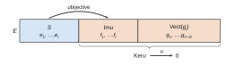
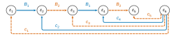

# Mines-Ponts PSI — Maths 1 2026 · Corrigé guidé

*Corrigé rédigé par IA, non officiel. Signalez toute erreur.*

## Présentation du sujet

**Thème.** Le problème étudie les endomorphismes d'un $\mathbb C$-espace vectoriel de dimension finie qui s'écrivent comme somme d'endomorphismes de **carré nul**.

Notations : $\mathcal C(E)=\{u:u^2=0\}$ ; $\Sigma_p\mathcal C(E)$ est l'ensemble des sommes de $p$ éléments de $\mathcal C(E)$ ; $\Sigma_\infty\mathcal C(E)$ est la réunion des $\Sigma_p\mathcal C(E)$.

Un endomorphisme de carré nul est de trace nulle, donc toute somme de tels endomorphismes aussi. Le sujet montre que cette condition suffit (partie B), puis cherche combien de termes il faut : trois ne suffisent pas toujours (partie C), quatre suffisent toujours (partie E).

**Découpage (25 questions, 3 heures, sans calculatrice).**

- **Partie A (Q1–Q5)** : forme réduite d'un endomorphisme de carré nul (bloc $I_r$ sous la diagonale) ; le rang en est le seul paramètre.
- **Partie B (Q6–Q8)** : calculs sur les matrices élémentaires $E_{i,j}$ et sur $F_{i,j}$ ; conclusion $\Sigma_\infty\mathcal C(E)=\{u:\operatorname{tr}u=0\}$.
- **Partie C (Q9–Q13)** : en dimension $n\geqslant5$, un endomorphisme de trace nulle qui n'est pas somme de trois carrés nuls. Le théorème de Wang et Wu est admis. On mêle majoration de rang et comptage de multiplicités.
- **Partie D (Q14–Q18)** : matrices de Hessenberg. En modifiant seulement la dernière colonne d'une Hessenberg régulière, on peut lui imposer n'importe quel polynôme caractéristique compatible avec la trace (Q15). Une Hessenberg régulière nilpotente est semblable à $J_n$ (Q18).
- **Partie E (Q19–Q25)** : assemblage. Q19 utilise Q15 et Q18 ; Q20–Q21 sont des constructions explicites ; Q22–Q24 forment un bloc de réduction autonome ; Q25 combine Q19, Q20, Q21 et Q24.

**Notions du programme mobilisées.** Valeurs propres, polynôme caractéristique et multiplicités, trace, théorème du rang, supplémentaires et bases adaptées, sous-espaces stables, matrices par blocs et déterminant triangulaire par blocs, développement d'un déterminant selon une colonne, trigonalisation sur $\mathbb C$, similitude, familles de polynômes échelonnées en degré.

**Difficulté et gestion du temps.** Le rapport 2026 juge le sujet « d’une longueur et d’une difficulté technique délicate par rapport à la durée de l’épreuve et aux attendus du programme de la filière PSI ». Les parties sont largement indépendantes : seule E utilise D. Il faut donc choisir ses questions.

- **À ne pas laisser passer** : Q1, Q2, Q3, Q5, Q6, Q8, Q9 et Q16. La partie A est la plus abordable ; le jury rappelle que les questions faciles doivent être correctement rédigées pour rapporter tous leurs points.
- **Questions discriminantes selon le rapport 2026** : Q4 (« Question assez discriminante »), la partie B, qui « a permis un tri efficace des candidats », et la partie D, qui a permis « de classer les meilleures copies entre elles ». Q9 puis Q19 à Q21 ont récompensé la créativité.
- **Questions peu réussies** : Q10, Q11, Q12 et Q18, souvent abordées mais rarement réussies ; Q22 à Q25, presque jamais traitées. Q25 se rédige pourtant en quelques lignes en admettant les résultats antérieurs.

**Énoncé.** Coquille sans incidence en Q14 : « Présiser » pour « Préciser ».

## Partie A — Réduction des endomorphismes de carré nul

On travaille avec $u\neq0$, $u^2=0$ et $r=\operatorname{rg}u$. Tout repose sur l'inclusion $\operatorname{Im}u\subset\operatorname{Ker}u$, qui permet de construire une base adaptée.

### Question 1

> [!INDICATION]
> Que dit un polynôme annulateur sur les valeurs propres ?

> [!INDICATION]
> Sur $\mathbb C$, le polynôme caractéristique est scindé ; relier ses racines, comptées avec multiplicité, à la trace.

#### Solution

Soit $\lambda$ une valeur propre et $x$ un vecteur propre associé. Alors

$$u^2(x)=\lambda^2x=0,$$

et $x\neq0$ impose $\lambda=0$.

Réciproquement, le corps est $\mathbb C$ : $\chi_u$, de degré $n\geqslant1$, admet une racine, qui est valeur propre. Donc

$$\boxed{\operatorname{Sp}(u)=\{0\}.}$$

Comme $\chi_u$ est scindé sur $\mathbb C$, $u$ est trigonalisable, et sa trace est la somme de ses valeurs propres **comptées avec leur multiplicité**.

Ici $\chi_u=X^n$ : la valeur propre $0$ est de multiplicité $n$, d'où

$$\boxed{\operatorname{tr}(u)=n\times0=0.}$$

> [!PIEGE]
> « La seule valeur propre est $0$, donc la trace est nulle » demande un argument : c'est le caractère scindé de $\chi_u$ sur $\mathbb C$ (ou la trigonalisation) qui relie la trace aux valeurs propres, avec leurs multiplicités.

> [!JURY]
> Rapport 2026 : « Question classique mais assez souvent mal traitée. Le corps des complexes est rarement mentionné pour justifier la trigonalisabilité de $u$ et les multiplicités sont souvent oubliées dans la formule de la trace. »

### Question 2

> [!INDICATION]
> Traduire $u^2=0$ en une inclusion entre $\operatorname{Im}u$ et $\operatorname{Ker}u$.

#### Solution

Si $y=u(x)$, alors $u(y)=u^2(x)=0$. Ainsi $\operatorname{Im}u\subset\operatorname{Ker}u$.

Le théorème du rang donne $\dim\operatorname{Ker}u=n-r$, d'où $r\leqslant n-r$ :

$$\boxed{r\leqslant\frac n2.}$$

> [!METHODE]
> $u^2=0\iff\operatorname{Im}u\subset\operatorname{Ker}u$. Plus généralement, $v\circ u=0\iff\operatorname{Im}u\subset\operatorname{Ker}v$.

### Question 3

> [!INDICATION]
> En dimension finie, tout sous-espace admet un supplémentaire. Quelle est sa dimension ?

> [!INDICATION]
> Pour la liberté, partir d'une combinaison linéaire nulle des $u(e_i)$ et regarder à quel(s) sous-espace(s) appartient $\sum\lambda_ie_i$.

#### Solution

Soit $S$ un supplémentaire de $\operatorname{Ker}u$. Par le théorème du rang,

$$\begin{aligned}
\dim S&=n-\dim\operatorname{Ker}u\\
&=n-(n-r)=r.
\end{aligned}$$

Une base $(e_1,\dots,e_r)$ de $S$ est libre et vérifie $\operatorname{Ker}u\oplus\operatorname{Vect}(e_1,\dots,e_r)=E$.

Supposons $\sum\lambda_iu(e_i)=0$. Le vecteur $x=\sum\lambda_ie_i$ vérifie $u(x)=0$, donc $x\in\operatorname{Ker}u\cap S=\{0\}$.

La liberté des $e_i$ donne alors $\lambda_i=0$ pour tout $i$. **La famille $(u(e_1),\dots,u(e_r))$ est libre.**

> [!METHODE]
> La restriction de $u$ à un supplémentaire du noyau est injective : c'est le cœur de la démonstration du théorème du rang.

> [!PIEGE]
> $\operatorname{Ker}u$ et $\operatorname{Im}u$ ne sont **pas** supplémentaires ici : $\operatorname{Im}u\subset\operatorname{Ker}u$ (Q2), et $u\neq0$. Le supplémentaire $S$ est un sous-espace quelconque, choisi.

> [!JURY]
> Rapport 2026 : « Le fait qu’un supplémentaire de Ker($u$) est de dimension $r$ est souvent énoncé sans justification. Un nombre non négligeable de candidats affirment que Ker($u$) et Im($u$) sont supplémentaires. »

### Question 4

> [!INDICATION]
> Où vivent les $u(e_i)$ ? Compléter la famille à l'intérieur de ce sous-espace.

> [!INDICATION]
> L'ordre des vecteurs de base décide de la place du bloc $I_r$ : la matrice de l'énoncé a $I_r$ en position (2,1).

#### Solution

Posons $f_i=u(e_i)$. La famille $(f_i)$ est libre (Q3) et contenue dans $\operatorname{Im}u\subset\operatorname{Ker}u$ (Q2).

On la complète **par des vecteurs du noyau** en une base $(f_1,\dots,f_r,g_1,\dots,g_{n-2r})$ de $\operatorname{Ker}u$, de dimension $n-r$ ; on a $n-2r\geqslant0$ par Q2. Comme $E=S\oplus\operatorname{Ker}u$, la famille

$$\mathcal B=(e_1,\dots,e_r,f_1,\dots,f_r,g_1,\dots,g_{n-2r})$$

est une base de $E$. Puisque $u(e_i)=f_i$, $u(f_i)=0$ et $u(g_j)=0$ :

$$\boxed{\operatorname{Mat}_{\mathcal B}(u)=\begin{pmatrix}0_r&0_r&(0)\\ I_r&0_r&(0)\\ (0)&(0)&0_{n-2r}\end{pmatrix}.}$$

> [!PIEGE]
> Ranger les $f_i$ avant les $e_i$ place $I_r$ en position (1,2) : c'est la transposée de la matrice demandée.

> [!JURY]
> Rapport 2026 : « Question assez discriminante ; il fallait bien observer que les vecteurs $u(e_i)$ sont dans Ker($u$) et penser à compléter cette famille par des vecteurs de ce noyau. »

### Question 5

> [!INDICATION]
> L'existence est donnée par Q4. Pour l'unicité, chercher un invariant par changement de base qui se lit sur la matrice.

#### Solution

*Existence* : $m=r>0$ convient (Q4, avec $u\neq0$).

*Unicité* : la matrice $M_m$ de l'énoncé a $m$ colonnes égales à des vecteurs distincts de la base canonique (indices $m+1,\dots,2m$) ; ses autres colonnes sont nulles. Donc $\operatorname{rg}M_m=m$.

Le rang est invariant par changement de base : si $u$ est représenté par $M_m$, alors $m=\operatorname{rg}u$.

$$\boxed{m=\operatorname{rg}(u)\text{ est l'unique entier convenable.}}$$

> [!METHODE]
> Deux endomorphismes de carré nul sont semblables si et seulement s'ils ont le même rang.

> [!JURY]
> Le rapport 2026 résume l'attendu : constater que $m$ est nécessairement égal au rang de $u$.

## Partie B — Somme d'un nombre arbitraire d'endomorphismes de carré nul

Calculs sur les matrices élémentaires, avec la règle $E_{a,b}E_{c,d}=\delta_{b,c}E_{a,d}$. La difficulté est la partie diagonale d'une matrice de trace nulle, que les $F_{i,n}$ permettent d'atteindre. Selon le rapport 2026, cette partie a permis un tri efficace et révélé des difficultés dans le produit des matrices canoniques.

### Question 6

> [!INDICATION]
> Utiliser la règle de produit des matrices élémentaires.

> [!INDICATION]
> Pour $F_{i,j}$, on peut développer les seize produits, ou observer que $F_{i,j}$ n'agit que sur le plan engendré par $\varepsilon_i$ et $\varepsilon_j$.

#### Solution

Par la règle de produit, $E_{i,j}^2=\delta_{j,i}E_{i,j}$ : c'est la matrice nulle si $i\neq j$, et $E_{i,i}\neq0$ si $i=j$.

**Les $E_{i,j}$ de carré nul sont exactement ceux avec $i\neq j$.**

Soient $i\neq j$. Lisons les colonnes de $F_{i,j}$. Elle annule $\varepsilon_k$ pour $k\notin\{i,j\}$, et

$$\begin{aligned}
F_{i,j}(\varepsilon_i)&=\varepsilon_i-\varepsilon_j,\\
F_{i,j}(\varepsilon_j)&=\varepsilon_i-\varepsilon_j.
\end{aligned}$$

Donc $F_{i,j}(\varepsilon_i-\varepsilon_j)=0$, puis $F_{i,j}^2(\varepsilon_i)=F_{i,j}^2(\varepsilon_j)=0$.

Par le calcul direct, en multipliant $F_{i,j}$ à gauche par chacun de ses termes :

$$\begin{aligned}
E_{i,i}F_{i,j}&=E_{i,i}+E_{i,j},\\
-E_{j,j}F_{i,j}&=E_{j,j}+E_{j,i},\\
E_{i,j}F_{i,j}&=-E_{i,j}-E_{i,i},\\
-E_{j,i}F_{i,j}&=-E_{j,i}-E_{j,j}.
\end{aligned}$$

La somme de ces quatre lignes est nulle :

$$\boxed{(F_{i,j})^2=0_n\quad(i\neq j).}$$

> [!PIEGE]
> Les matrices $E_{i,i}$, $E_{j,j}$, $E_{i,j}$, $E_{j,i}$ ne commutent pas : développer $F_{i,j}^2$ par une identité remarquable est faux. Et la question demande « lesquelles » : il faut aussi dire pourquoi les $E_{i,i}$ ne conviennent pas.

> [!JURY]
> Rapport 2026 : « La formule $E_{i,j}.E_{k,l}=\delta_{j,k}E_{i,l}$ est très peu souvent mentionnée. C’est regrettable car elle simplifiait les calculs. Trop de candidats utilisent une identité remarquable sans hypothèse de commutativité. »

### Question 7

> [!INDICATION]
> Décomposer $A$ sur la base canonique : seuls les termes diagonaux posent problème.

> [!INDICATION]
> La trace nulle permet d'écrire la partie diagonale comme combinaison des $E_{i,i}-E_{n,n}$. Comparer $E_{i,i}-E_{n,n}$ et $F_{i,n}$.

#### Solution

Soit $A\in\mathcal H_n$. On écrit $A=\sum_{i\neq j}a_{i,j}E_{i,j}+D$, où $D$ est la partie diagonale. Comme $\operatorname{tr}A=0$, on a $a_{n,n}=-\sum_{i<n}a_{i,i}$.

Pour $i\leqslant n-1$, la définition de $F_{i,n}$ donne $E_{i,i}-E_{n,n}=F_{i,n}-E_{i,n}+E_{n,i}$. Donc

$$\begin{aligned}
D&=\sum_{i=1}^{n-1}a_{i,i}(E_{i,i}-E_{n,n})\\
&=\sum_{i=1}^{n-1}a_{i,i}\big(F_{i,n}-E_{i,n}+E_{n,i}\big).
\end{aligned}$$

Ainsi

$$\boxed{\begin{aligned}A={}&\sum_{i\neq j}a_{i,j}E_{i,j}+\sum_{i=1}^{n-1}a_{i,i}F_{i,n}\\&-\sum_{i=1}^{n-1}a_{i,i}E_{i,n}+\sum_{i=1}^{n-1}a_{i,i}E_{n,i},\end{aligned}}$$

qui est une combinaison de $E_{i,j}$ ($i\neq j$, puisque $i\leqslant n-1$) et de $F_{i,n}$.

> [!METHODE]
> Les $E_{i,j}$ ($i\neq j$) et les $E_{i,i}-E_{n,n}$ ($i<n$) forment une base de $\mathcal H_n$, de dimension $n^2-1$. Retenir cette base des matrices de trace nulle.

> [!JURY]
> Le rapport 2026 note que les idées de preuve sont fréquentes, mais les démonstrations complètes et rigoureuses relativement rares : écrire explicitement la décomposition, pas seulement l'idée.

### Question 8

> [!INDICATION]
> Double inclusion. Une inclusion vient de Q1 et de la linéarité de la trace.

> [!INDICATION]
> Pour l'autre, passer en matrices et combiner Q6 et Q7 : un multiple d'une matrice de carré nul est-il de carré nul ?

#### Solution

$\subset$ : si $u=u_1+\dots+u_p$ avec $u_k^2=0$, chaque $u_k$ est de trace nulle (Q1 si $u_k\neq0$, évident sinon). Donc $\operatorname{tr}u=0$.

$\supset$ : soit $u$ de trace nulle et $A$ sa matrice dans une base $\mathcal B$, de sorte que $A\in\mathcal H_n$.

Par Q7, $A=\sum_{k=1}^N\lambda_kM_k$ avec $M_k^2=0$ (Q6), d'où $(\lambda_kM_k)^2=0$.

L'application $v\mapsto\operatorname{Mat}_{\mathcal B}(v)$ est un isomorphisme linéaire, et $\operatorname{Mat}_{\mathcal B}(v\circ v')=\operatorname{Mat}_{\mathcal B}(v)\operatorname{Mat}_{\mathcal B}(v')$. Les endomorphismes $u_k$ de matrices $\lambda_kM_k$ sont donc de carré nul, et $u=\sum u_k$.

$$\boxed{\Sigma_\infty\mathcal C(E)=\mathcal H(E).}$$

> [!PIEGE]
> Q1 suppose $u\neq0$ : traiter les termes nuls à part, en une ligne.

> [!JURY]
> Rapport 2026 : « Il fallait penser à prouver la double inclusion. »

## Partie C — Somme de trois endomorphismes de carré nul

On exhibe $u$ de trace nulle dont le sous-espace propre pour $1$ est très gros. Si $u=v_1+v_2+v_3$, alors $u-v_3\in\Sigma_2\mathcal C(E)$ serait semblable à son opposé (Wang et Wu). On montre que cela force deux valeurs propres $\pm1$ de multiplicités $>n/2$, ce qui est impossible.

### Question 9

> [!INDICATION]
> Chercher $u$ diagonal. Combien de coefficients égaux à $1$, et que mettre ailleurs pour annuler la trace sans agrandir le sous-espace propre ?

> [!INDICATION]
> Essayer $d=n-1$ ; c'est là que sert $n\geqslant5$.

#### Solution

Soit $n\geqslant5$ quelconque, et $d=n-1$. On a $4(n-1)>3n\iff n>4$, donc $d>\frac{3n}4$.

Soit $u$ l'endomorphisme de matrice $\operatorname{diag}(1,\dots,1,-(n-1))$ dans une base de $E$. Alors $\operatorname{tr}u=0$.

La matrice de $u-\mathrm{id}_E$ est $\operatorname{diag}(0,\dots,0,-n)$, de rang $1$. Donc $\dim\operatorname{Ker}(u-\mathrm{id}_E)=n-1=d$.

Ainsi $1$ est valeur propre, de sous-espace propre de dimension $d>\frac{3n}4$. **Un tel $u$ existe, pour tout $n\geqslant5$.**

> [!PIEGE]
> Vérifier la dimension **exacte** du sous-espace propre : le dernier coefficient diagonal doit être différent de $1$.

> [!JURY]
> Rapport 2026 : « Plusieurs candidats ne prouvent le résultat qu’en dimension 5 ; ils n’ont eu qu’une partie des points. » La construction doit valoir pour tout $n\geqslant5$.

### Question 10

> [!INDICATION]
> $w$ et $v$ ne commutent pas : développer avec soin, puis utiliser $v^2=0$. Que vaut $\operatorname{rg}w$ ?

> [!INDICATION]
> Majorer chacun des trois termes par $\operatorname{rg}w$ donne $3(n-d)$, insuffisant. Regrouper deux des termes pour faire apparaître $w$ en facteur à gauche.

#### Solution

$\operatorname{Ker}w$ est de dimension $d$, donc $\operatorname{rg}w=n-d<\frac n4$. Comme $v^2=0$,

$$\begin{aligned}
(w-v)^2&=w^2-wv-vw\\
&=w\circ(w-v)-v\circ w.
\end{aligned}$$

On utilise $\operatorname{rg}(a\circ b)\leqslant\min(\operatorname{rg}a,\operatorname{rg}b)$ (programme de première année) et $\operatorname{rg}(a+b)\leqslant\operatorname{rg}a+\operatorname{rg}b$. Cette dernière vient de $\operatorname{Im}(a+b)\subset\operatorname{Im}a+\operatorname{Im}b$ et de $\dim(F+G)\leqslant\dim F+\dim G$ :

$$\begin{aligned}
\operatorname{rg}\big((w-v)^2\big)&\leqslant\operatorname{rg}\big(w\circ(w-v)\big)+\operatorname{rg}(v\circ w)\\
&\leqslant2\operatorname{rg}w.
\end{aligned}$$

$$\boxed{\operatorname{rg}\big((w-v)^2\big)\leqslant2(n-d)<\frac n2.}$$

> [!METHODE]
> Pour une bonne majoration de rang, factoriser avant de majorer : ici, $w$ à gauche dans un terme, à droite dans l'autre.

> [!JURY]
> Rapport 2026 : « Très souvent abordée mais avec très peu de réussite. » Le jury désigne les deux inégalités de rang ci-dessus comme les ingrédients principaux.

### Question 11

> [!INDICATION]
> Restreindre $w-v$ au noyau $N$ de son carré : l'endomorphisme induit est de carré nul. Appliquer Q1.

> [!INDICATION]
> Dans une base adaptée à $N$, la matrice de $u-v$ est triangulaire par blocs. Relier $u-v$ et $w-v$ pour passer de la valeur propre $0$ à la valeur propre $1$.

#### Solution

Soit $N=\operatorname{Ker}(w-v)^2$, de dimension $q=n-\operatorname{rg}(w-v)^2>\frac n2$.

*Stabilité.* $(w-v)^2$ est un polynôme en $w-v$, donc commute avec $w-v$. Pour $x\in N$ :

$$\begin{aligned}
(w-v)^2\big((w-v)(x)\big)&=(w-v)\big((w-v)^2(x)\big)\\
&=0.
\end{aligned}$$

$N$ est donc stable par $w-v$, et par $u-v=(w-v)+\mathrm{id}_E$.

*Endomorphisme induit.* L'endomorphisme $s$ induit par $w-v$ sur $N$ vérifie $s^2=0$. Donc $\chi_s=X^q$ (argument de Q1, valable aussi si $s=0$).

L'endomorphisme induit par $u-v$ est $s+\mathrm{id}_N$, de polynôme caractéristique

$$\det\big((X-1)\mathrm{id}_N-s\big)=(X-1)^q.$$

*Multiplicité.* En complétant une base de $N$ en une base de $E$, la matrice de $u-v$ s'écrit $\begin{pmatrix}S&\ast\\0&T\end{pmatrix}$, d'où

$$\chi_{u-v}=(X-1)^q\chi_T.$$

$$\boxed{1\text{ est valeur propre de }u-v,\text{ de multiplicité}\geqslant n-\operatorname{rg}\big((w-v)^2\big)\ (>0).}$$

> [!PIEGE]
> Il s'agit de la multiplicité comme racine de $\chi_{u-v}$, pas de la dimension du sous-espace propre, qui peut être plus petite.

> [!METHODE]
> Le polynôme caractéristique d'un endomorphisme induit sur un sous-espace stable divise celui de l'endomorphisme : cela se redémontre en deux lignes par un déterminant triangulaire par blocs.

> [!JURY]
> Rapport 2026 : « La stabilité se prouvait simplement en observant que $(w-v)^2$ est un polynôme en $w-v$. » La suite, presque jamais traitée correctement, demandait de voir que l'endomorphisme induit par $w-v$ sur ce noyau est de carré nul.

### Question 12

> [!INDICATION]
> Deux endomorphismes semblables ont le même polynôme caractéristique. Exprimer $\chi_{-a}$ à l'aide de $\chi_a$.

> [!INDICATION]
> Écrire $\chi_a=(X-1)^{\mu}Q$ avec $Q(1)\neq0$ et substituer $-X$.

#### Solution

Soit $a=u-v$ et $\mu_\lambda$ la multiplicité de $\lambda$ dans $\chi_a$. Par Q10 et Q11, $\mu_1>\frac n2$.

Si $-a=\varphi a\varphi^{-1}$, alors $\chi_a=\chi_{-a}$, et

$$\begin{aligned}
\chi_{-a}(X)&=\det(X\,\mathrm{id}+a)\\
&=(-1)^n\det\big((-X)\mathrm{id}-a\big)\\
&=(-1)^n\chi_a(-X).
\end{aligned}$$

Avec $\chi_a=(X-1)^{\mu_1}Q$ et $Q(1)\neq0$ :

$$\chi_a(X)=(-1)^{n+\mu_1}(X+1)^{\mu_1}Q(-X),$$

et $Q(-X)$ ne s'annule pas en $-1$. Donc $\mu_{-1}=\mu_1$ :

$$\boxed{1\text{ et }-1\text{ sont valeurs propres de }u-v\text{ de multiplicités}>\frac n2.}$$

> [!PIEGE]
> Ne pas oublier le facteur $(-1)^n$ dans $\chi_{-a}$ ; il ne change pas les racines, mais il faut l'écrire pour que l'égalité soit juste.

> [!JURY]
> Rapport 2026 : « un certain nombre de candidats parvient à prouver que $-1$ est valeur propre mais les arguments sur la multiplicité ne sont pratiquement jamais avancés. » C'est la factorisation de $\chi_a$ qui transporte la multiplicité de $1$ à $-1$.

### Question 13

> [!INDICATION]
> Raisonner par l'absurde et isoler l'un des trois termes pour faire apparaître un élément de $\Sigma_2\mathcal C(E)$.

> [!INDICATION]
> Comparer la somme des multiplicités de deux racines distinctes au degré du polynôme caractéristique.

#### Solution

Supposons $u=v_1+v_2+v_3$ avec $v_k\in\mathcal C(E)$, et posons $v=v_3$. Alors $u-v=v_1+v_2\in\Sigma_2\mathcal C(E)$.

Le théorème de Wang et Wu donne $\varphi\in GL(E)$ avec $-(u-v)=\varphi(u-v)\varphi^{-1}$.

Par Q12, $1$ et $-1$, racines distinctes de $\chi_{u-v}$, ont chacune une multiplicité $>\frac n2$. Or $\chi_{u-v}$ est de degré $n$ :

$$n\geqslant\mu_1+\mu_{-1}>n,$$

ce qui est absurde.

$$\boxed{u\notin\Sigma_3\mathcal C(E).}$$

Pourtant $u\in\Sigma_\infty\mathcal C(E)$ (Q8) : trois termes ne suffisent pas en général.

> [!PIEGE]
> Wang et Wu s'applique à $u-v_3$, élément de $\Sigma_2\mathcal C(E)$, et non à $u$. Et l'argument de comptage porte sur les **multiplicités** : la somme des dimensions des sous-espaces propres ne donnerait rien, puisque Q12 ne les minore pas.

> [!JURY]
> Rapport 2026 : « on note toutefois trop souvent une confusion entre multiplicité d’une valeur propre et dimension du sous-espace propre associé. »

## Partie D — Intermède : matrices de Hessenberg

Une Hessenberg régulière a des zéros sous la sous-diagonale et une sous-diagonale sans zéro. On calcule les mineurs obtenus en retirant la dernière colonne, ce qui permet de régler le polynôme caractéristique en modifiant seulement cette colonne. On montre ensuite qu'une telle matrice nilpotente est semblable à $J_n$.

Le rapport 2026 juge cette partie exigeante en initiative et en technique ; elle a départagé les meilleures copies.

### Question 14

> [!INDICATION]
> Suivre l'indication : couper les lignes restantes en $\{1,\dots,k-1\}$ et $\{k+1,\dots,n\}$, les colonnes en $\{1,\dots,k-1\}$ et $\{k,\dots,n-1\}$.

> [!INDICATION]
> Un des blocs est nul (calcul d'indices), le bloc en haut à gauche est un $xI-A'$ de taille $k-1$, et le bloc en bas à droite est triangulaire. Où se trouvent ses coefficients diagonaux dans $A$ ?

#### Solution

Soit $M(x)=xI_n-A=(m_{i,j})$. On a $m_{i,j}=0$ si $i>j+1$, et $m_{i+1,i}=-a_{i+1,i}\neq0$. Avec le découpage ci-dessus :

- lignes $i\geqslant k+1$, colonnes $j\leqslant k-1$ : $i-j\geqslant2$, le bloc est nul ;
- lignes et colonnes $\leqslant k-1$ : c'est $xI_{k-1}-A_{k-1}$, où $A_{k-1}$ est le bloc principal de taille $k-1$ de $A$ ;
- lignes $k+p$, colonnes $k-1+q$ ($1\leqslant p,q\leqslant n-k$) : le bloc est nul si $p>q$, donc triangulaire supérieur, de diagonale $-a_{k+p,k+p-1}$. Il contient des $x$ au-dessus de sa diagonale, sans effet sur le déterminant.

Par le déterminant triangulaire par blocs :

$$\det\Big(\widetilde{(xI_n-A)}^{(k,n)}\Big)=\Big(\prod_{i=k}^{n-1}(-a_{i+1,i})\Big)\chi_{A_{k-1}}(x).$$

On convient que $\chi_{A_0}=1$ ($k=1$) et qu'un produit vide vaut $1$ ($k=n$). Le polynôme

$$P_k=\Big(\prod_{i=k}^{n-1}(-a_{i+1,i})\Big)\chi_{A_{k-1}}$$

convient. Il est de degré $k-1$ par régularité, et unique car un polynôme nul en tout point de $\mathbb C$ est nul.

$$\boxed{\deg P_k=k-1}$$

$$\boxed{\text{coefficient dominant de }P_k\ :\ (-1)^{n-k}\prod_{i=k}^{n-1}a_{i+1,i}\neq0.}$$

> [!PIEGE]
> Les indices de la sous-matrice sont décalés à partir de la ligne $k$ : la nullité des blocs se justifie par un calcul d'indices, pas par « c'est Hessenberg ». Et le signe du coefficient dominant vient des $n-k$ facteurs $-a_{i+1,i}$.

> [!JURY]
> Rapport 2026 : « Des erreurs fréquentes dans l’écriture par blocs et dans le signe du coefficient dominant. Bien peu de candidats reconnaissent un polynôme caractéristique dans le bloc en haut à gauche. »

### Question 15

> [!INDICATION]
> $E_C$ ne modifie que la dernière colonne : utiliser la linéarité du déterminant par rapport à cette colonne.

> [!INDICATION]
> Développer le déterminant correctif selon la dernière colonne fait apparaître les $P_k$. Que dire de la famille $(P_1,\dots,P_{n-1})$ et du degré de $\chi_A-P$ ?

#### Solution

Les matrices $xI_n-(A+E_C)$ et $xI_n-A$ ne diffèrent que par la dernière colonne. On passe de la seconde à la première en retranchant $\gamma={}^t(c_1,\dots,c_{n-1},0)$ à cette colonne.

Par linéarité selon cette colonne, $\chi_{A+E_C}(x)=\chi_A(x)-\det D(x)$. Ici $D(x)$ a les $n-1$ premières colonnes de $xI_n-A$ et $\gamma$ pour dernière colonne.

On développe $\det D(x)$ selon la dernière colonne ; sa suppression redonne les mineurs de $xI_n-A$. D'où la relation $(\ast)$ :

$$\chi_{A+E_C}=\chi_A-\sum_{k=1}^{n-1}(-1)^{k+n}c_kP_k.$$

Soit $P$ unitaire de degré $n$, de coefficient $-\operatorname{tr}A$ sur $X^{n-1}$. Alors $R=\chi_A-P$ appartient à $\mathbb C_{n-2}[X]$.

Par $(\ast)$, l'égalité $\chi_{A+E_C}=P$ équivaut à

$$\sum_{k=1}^{n-1}(-1)^{k+n}c_kP_k=R.$$

Les $P_k$ ($1\leqslant k\leqslant n-1$) sont de degrés $0,\dots,n-2$. Cette famille échelonnée est libre et a $n-1=\dim\mathbb C_{n-2}[X]$ éléments : c'est une base.

Si $R=\sum\mu_kP_k$, la condition équivaut à $c_k=(-1)^{k+n}\mu_k$ pour tout $k$ :

$$\boxed{\text{il existe un unique }C\in\mathbb C^{n-1}\text{ tel que }\chi_{A+E_C}=P.}$$

> [!METHODE]
> Une famille de polynômes de degrés $0,1,\dots,m$ est une base de $\mathbb C_m[X]$. C'est l'argument standard pour un « il existe un unique » sur des polynômes.

> [!PIEGE]
> L'hypothèse sur le coefficient de $X^{n-1}$ de $P$ est indispensable : sans elle, $\chi_A-P$ est de degré $n-1$ et ne peut pas être combinaison des $P_k$.

> [!JURY]
> Rapport 2026 : « Question délicate ; le jury a récompensé les idées pertinentes. » Même incomplète, la linéarité par rapport à la dernière colonne rapporte des points.

### Question 16

> [!INDICATION]
> Vérifier que Q15 s'applique, puis chercher une solution évidente.

#### Solution

$J_n$ est de Hessenberg régulière et de trace nulle. Le polynôme $X^n$ a un coefficient $0=-\operatorname{tr}J_n$ sur $X^{n-1}$ : Q15 assure l'unicité.

Comme $xI_n-J_n$ est triangulaire de diagonale $x$, $\chi_{J_n}=X^n$ : le vecteur nul convient.

$$\boxed{C=0.}$$

> [!PIEGE]
> Sans invoquer Q15, on a seulement exhibé une solution : l'énoncé demande « l'unique » vecteur.

> [!JURY]
> C'est la voie que suggère le rapport 2026 : observer que le vecteur nul convient et utiliser l'unicité établie en Q15.

### Question 17

> [!INDICATION]
> Suivre l'indication : montrer que $u^k(e_1)$ appartient à $\operatorname{Vect}(e_1,\dots,e_{k+1})$.

> [!INDICATION]
> La récurrence doit suivre aussi la coordonnée de $u^k(e_1)$ sur $e_{k+1}$ : la régularité sert à montrer qu'elle ne s'annule pas.

#### Solution

Pour $j\leqslant n-1$, $u(e_j)\in\operatorname{Vect}(e_1,\dots,e_{j+1})$, avec la coordonnée $a_{j+1,j}$ sur $e_{j+1}$.

Montrons par récurrence sur $k\in[\![0,n-1]\!]$ que $u^k(e_1)\in\operatorname{Vect}(e_1,\dots,e_{k+1})$, avec la coordonnée $\pi_k=\prod_{i=1}^ka_{i+1,i}$ sur $e_{k+1}$.

Pour $k=0$, c'est clair ($\pi_0=1$). Supposons-le au rang $k\leqslant n-2$, avec $u^k(e_1)=\sum_{i\leqslant k+1}\lambda_ie_i$ et $\lambda_{k+1}=\pi_k$.

Alors $u^{k+1}(e_1)=\sum\lambda_iu(e_i)$ appartient à $\operatorname{Vect}(e_1,\dots,e_{k+2})$. Seul $\lambda_{k+1}u(e_{k+1})$ a une composante sur $e_{k+2}$, égale à $\pi_ka_{k+2,k+1}=\pi_{k+1}$.

La matrice de la famille dans $(e_1,\dots,e_n)$ est triangulaire supérieure de diagonale $\pi_0,\dots,\pi_{n-1}$. Ces coefficients sont tous non nuls par régularité : la matrice est inversible.

$$\boxed{(u^k(e_1))_{0\leqslant k\leqslant n-1}\text{ est une base de }E.}$$

> [!JURY]
> Rapport 2026 : la démarche était souvent la bonne, « mais beaucoup oublient de préciser que la composante de $u^k(e_1)$ sur $e_{k+1}$ est non nulle ce qui est crucial. »

### Question 18

> [!INDICATION]
> Dans la base de Q17, la matrice de $u$ est presque $J_n$. Que manque-t-il pour la dernière colonne ?

> [!INDICATION]
> Il faut $u^n(e_1)=0$ : déduire de $\chi_A=X^n$ que $A$ est nilpotente, par exemple en trigonalisant.

#### Solution

Soit $u$ l'endomorphisme canoniquement associé à $A$.

*$A^n=0$.* $\chi_A=X^n$ est scindé, donc $A=QTQ^{-1}$ avec $T$ triangulaire supérieure de diagonale nulle (les valeurs propres).

Avec $G_k=\operatorname{Vect}(\varepsilon_1,\dots,\varepsilon_k)$, on a $TG_k\subset G_{k-1}$. Donc $T^n=0$ et $A^n=0$.

*Conclusion.* Par Q17, $(f_0,\dots,f_{n-1})=(e_1,u(e_1),\dots,u^{n-1}(e_1))$ est une base.

On a $u(f_k)=f_{k+1}$ pour $k\leqslant n-2$, et $u(f_{n-1})=u^n(e_1)=0$. La matrice de $u$ dans cette base est $J_n$ :

$$\boxed{A\text{ est semblable à }J_n.}$$

> [!METHODE]
> Le théorème de Cayley–Hamilton donne directement $A^n=\chi_A(A)=0$. L'argument de trigonalisation ci-dessus est autonome et tient en trois lignes.

> [!JURY]
> Le rapport 2026 signale une question assez souvent abordée, mais avec très peu de réussite : la nilpotence de $A$ et la dernière colonne de la matrice sont les deux points à écrire.

## Partie E — Somme de quatre endomorphismes de carré nul

Une matrice presque triangulaire supérieure de trace nulle devient, après ajout de $V+E_{C_0}$, semblable à $J_n$. Comme $J_n$ et $V+E_{C_0}$ sont chacune somme de deux carrés nuls, on obtient quatre termes. Il reste à ramener toute matrice non scalaire à une forme presque triangulaire supérieure (Q22–Q24).

### Question 19

> [!INDICATION]
> Vérifier que $A+V$ est de Hessenberg régulière : examiner séparément les positions $(i+1,i)$ avec $i\leqslant n-2$ et la position $(n,n-1)$.

> [!INDICATION]
> Enchaîner Q15 (avec quel polynôme ?) puis Q18, après avoir vérifié que l'ajout de $E_{C_0}$ ne détruit rien.

#### Solution

*Hessenberg.* Si $i>j+1$, alors $i>j$ et $(i,j)\neq(n,n-1)$ : donc $a_{i,j}=0$, et $V_{i,j}=0$.

*Régularité.* Pour $i\leqslant n-2$, $(A+V)_{i+1,i}=0+1=1$. La dernière ligne de $V$ étant nulle, $(A+V)_{n,n-1}=a_{n,n-1}\neq0$.

*Trace.* $\operatorname{tr}(A+V)=\operatorname{tr}A=0$. Q15 avec $P=X^n$ fournit $C_0$ tel que $\chi_{A+V+E_{C_0}}=X^n$.

$E_{C_0}$ n'agit qu'en positions $(i,n)$ avec $i\leqslant n-1$, au-dessus de la diagonale. Donc $A+V+E_{C_0}$ est encore de Hessenberg régulière. Par Q18 :

$$\boxed{A+V+E_{C_0}\text{ est semblable à }J_n.}$$

> [!PIEGE]
> Si l'on ajoutait $J_n$ au lieu de $V$, le coefficient $(n,n-1)$ deviendrait $a_{n,n-1}+1$, qui peut être nul : c'est pourquoi la dernière ligne de $V$ est nulle.

> [!JURY]
> Le rapport 2026 relève un raisonnement bien mené dans un nombre substantiel de copies : c'est une question de synthèse accessible même sans avoir traité Q15 et Q18.

### Question 20

> [!INDICATION]
> Voir $J_n$ comme la chaîne $\varepsilon_1\mapsto\varepsilon_2\mapsto\dots\mapsto\varepsilon_n\mapsto0$. Quand le produit de deux flèches est-il non nul ?

> [!INDICATION]
> Répartir les flèches en deux paquets de sorte qu'aucun ne contienne deux flèches consécutives.

#### Solution

On a $J_n=\sum_{i=1}^{n-1}E_{i+1,i}$. Soit $B_1$ la somme des $E_{i+1,i}$ pour $i$ impair, et $B_2$ celle pour $i$ pair.

Alors $B_1+B_2=J_n$ et

$$B_1^2=\sum_{i,j\text{ impairs}}\delta_{i,j+1}E_{i+1,j}=0,$$

car deux entiers de même parité ne sont pas consécutifs ; de même $B_2^2=0$.

$$\boxed{\begin{aligned}J_n&=B_1+B_2,\\ B_1^2&=B_2^2=0.\end{aligned}}$$

> [!PIEGE]
> Couper en deux moitiés ($i\leqslant n/2$, $i>n/2$) ne marche pas : chaque moitié contient des flèches consécutives.

### Question 21

> [!INDICATION]
> Lire $V+E_C$ comme un graphe. $V$ donne les flèches $j\to j+1$ pour $j\leqslant n-2$.
>
> $E_C$ donne les flèches $n\to j$, de poids $c_j$. Aucune flèche n'arrive en $n$.

> [!INDICATION]
> Partir de la répartition par parité de Q20 et placer chaque flèche $n\to j$ dans le paquet qui ne contient pas la flèche $j\to j+1$.

#### Solution

On a $V=\sum_{i=1}^{n-2}E_{i+1,i}$ et $E_C=\sum_{j=1}^{n-1}c_jE_{j,n}$. Posons

$$\begin{aligned}
B_1&=\sum_{\substack{i\leqslant n-2\\ i\text{ impair}}}E_{i+1,i}+\sum_{\substack{j\leqslant n-1\\ j\text{ pair}}}c_jE_{j,n},\\
B_2&=\sum_{\substack{i\leqslant n-2\\ i\text{ pair}}}E_{i+1,i}+\sum_{\substack{j\leqslant n-1\\ j\text{ impair}}}c_jE_{j,n}.
\end{aligned}$$

Alors $B_1+B_2=V+E_C$. Les produits qui interviennent dans $B_1^2$ ($i,i'$ impairs, $j,j'$ pairs) sont tous nuls :

- $E_{i+1,i}E_{i'+1,i'}=\delta_{i,i'+1}E_{i+1,i'}=0$ (même parité) ;
- $E_{i+1,i}E_{j,n}=\delta_{i,j}E_{i+1,n}=0$ (parités différentes) ;
- $E_{j,n}E_{i'+1,i'}=\delta_{n,i'+1}E_{j,i'}=0$ ($i'+1\leqslant n-1$) ;
- $E_{j,n}E_{j',n}=\delta_{n,j'}E_{j,n}=0$ ($j'\leqslant n-1$).

Donc $B_1^2=0$, et de même $B_2^2=0$.

$$\boxed{\begin{aligned}V+E_C&=B_1+B_2,\\ B_1^2&=B_2^2=0.\end{aligned}}$$

Pour $n=6$, la répartition des flèches est la suivante.

> [!PIEGE]
> Mettre $c_jE_{j,n}$ dans le paquet qui contient $E_{j+1,j}$ produit le terme non nul $c_jE_{j+1,n}$ dans le carré.

> [!JURY]
> Pour Q20 comme pour Q21, le rapport 2026 note des questions assez peu traitées mais plutôt réussies : elles récompensent la créativité, et une construction explicite vérifiée produit par produit suffit.

### Question 22

> [!INDICATION]
> Distinguer selon le nombre de valeurs propres de $v$. S'il y en a deux distinctes, deux vecteurs propres associés suffisent.

> [!INDICATION]
> S'il n'y en a qu'une, $\lambda$, la base de trigonalisation montre que $N=v-\lambda\,\mathrm{id}$ est nilpotente et non nulle. Chercher $x$ avec $N(x)\neq0$ et $N^2(x)=0$.

#### Solution

$v$ n'est pas une homothétie, donc $n\geqslant2$. Soit $T$ la matrice de $v$ dans une base de trigonalisation $(\varepsilon_1,\dots,\varepsilon_n)$, qui existe car le corps est $\mathbb C$.

*Cas 1 : deux valeurs propres $\lambda\neq\mu$.* Soient $x$ et $y$ des vecteurs propres associés ; ils sont libres. $P=\operatorname{Vect}(x,y)$ est un plan stable.

Le vecteur $x+y$ n'est pas propre : $v(x+y)=\lambda x+\mu y=\alpha(x+y)$ forcerait $\lambda=\alpha=\mu$.

*Cas 2 : $\operatorname{Sp}(v)=\{\lambda\}$.* La diagonale de $T$ vaut $\lambda$, donc $N=v-\lambda\,\mathrm{id}$ a une matrice strictement triangulaire supérieure, et $N^n=0$.

De plus $N\neq0$, car $v$ n'est pas une homothétie.

Soit $p\geqslant2$ minimal tel que $N^p=0$, et $y$ tel que $N^{p-1}(y)\neq0$.

Posons $x=N^{p-2}(y)$ : on a $N(x)\neq0$ et $N^2(x)=0$.

La famille $(x,N(x))$ est libre : appliquer $N$ à une relation $\alpha x+\beta N(x)=0$ donne $\alpha=0$, puis $\beta=0$.

Le plan $P=\operatorname{Vect}(x,N(x))$ est stable par $N$, donc par $v=\lambda\,\mathrm{id}+N$. Enfin $x$ n'est pas propre : $v(x)=\mu x$ donnerait $N(x)=(\mu-\lambda)x$.

$$\boxed{\text{Il existe un plan stable par }v\text{ contenant un vecteur non nul non propre.}}$$

> [!METHODE]
> Variante fidèle à l'indication. Dans le drapeau des $F_k=\operatorname{Vect}(\varepsilon_1,\dots,\varepsilon_k)$, prendre le plus petit $k$ tel que $v_{|F_k}$ ne soit pas une homothétie.
>
> Alors $k\geqslant2$ et $v_{|F_{k-1}}=\lambda\,\mathrm{id}$. On écrit $v(\varepsilon_k)=z+\mu\varepsilon_k$ avec $z\in F_{k-1}$.
>
> Si $z\neq0$, le plan $\operatorname{Vect}(z,\varepsilon_k)$ convient : $\varepsilon_k$ n'y est pas propre.
>
> Si $z=0$, alors $\mu\neq\lambda$, et $\operatorname{Vect}(\varepsilon_1,\varepsilon_k)$ convient : $\varepsilon_1+\varepsilon_k$ n'y est pas propre.

> [!PIEGE]
> Le plan $\operatorname{Vect}(\varepsilon_1,\varepsilon_2)$ ne convient pas toujours : $v$ peut y agir comme une homothétie.
>
> Un $x$ quelconque non propre ne convient pas toujours non plus : pour $J_3$ et $x=\varepsilon_1$, aucun plan stable ne contient $x$, le seul plan stable étant $\operatorname{Vect}(\varepsilon_2,\varepsilon_3)$.

> [!JURY]
> Le rapport 2026 indique que Q22 a été rarement abordée, avec au mieux quelques éléments de raisonnement : la séparation en deux cas selon le spectre est le premier point attendu.

### Question 23

> [!INDICATION]
> Avec le plan $P$ et le vecteur $x$ de Q22, quelle base de $P$ met un coefficient non nul en position (2,1) ?

> [!INDICATION]
> Compléter en une base de $\mathbb C^n$, puis trigonaliser le bloc en bas à droite par une conjugaison diagonale par blocs.

#### Solution

Soit $M\notin\operatorname{Vect}(I_n)$ et $v$ l'endomorphisme associé : ce n'est pas une homothétie. Q22 fournit un plan stable $P$ et $x\in P$ non nul non propre.

$(x,v(x))$ est libre et contenue dans $P$, donc c'est une base de $P$. Complétons-la en une base $\mathcal B$ de $\mathbb C^n$. La stabilité de $P$ donne

$$\operatorname{Mat}_{\mathcal B}(v)=\begin{pmatrix}B&\ast\\(0)&C'\end{pmatrix},\qquad B=\begin{pmatrix}0&b_{1,2}\\1&b_{2,2}\end{pmatrix},$$

donc $b_{2,1}=1$. Si $C'=QCQ^{-1}$ avec $C$ triangulaire supérieure, la matrice $R=\begin{pmatrix}I_2&0\\0&Q\end{pmatrix}$ donne

$$R^{-1}\begin{pmatrix}B&\ast\\(0)&C'\end{pmatrix}R=\begin{pmatrix}B&\ast Q\\(0)&C\end{pmatrix}.$$

$$\boxed{M\text{ est semblable à }\begin{pmatrix}B&(?)\\(0)&C\end{pmatrix},\ b_{2,1}\neq0,\ C\text{ triangulaire supérieure.}}$$

> [!PIEGE]
> L'ordre $(x,v(x))$ compte : l'ordre inverse place le $1$ en position (1,2).

### Question 24

> [!INDICATION]
> La forme de Q23 est triangulaire supérieure sauf en (2,1) ; on veut l'exception en $(n,n-1)$. Quelle opération envoie la position $(i,j)$ sur $(n+1-j,n+1-i)$ ?

> [!INDICATION]
> Combiner une transposition (appliquer Q23 à ${}^tM$) et le retournement de l'ordre de la base.

#### Solution

Si $M\notin\operatorname{Vect}(I_n)$, alors ${}^tM\notin\operatorname{Vect}(I_n)$. Q23 donne ${}^tM=QNQ^{-1}$, où $N_{i,j}=0$ pour $i>j$, sauf $N_{2,1}\neq0$.

En transposant, $M=({}^tQ)^{-1}\,{}^tN\,{}^tQ$.

Soit $K=(\delta_{i,n+1-j})$ : $K^2=I_n$ et $(KSK)_{i,j}=S_{n+1-i,n+1-j}$. La matrice $A'=K\,{}^tN\,K$ est semblable à $M$, et

$$A'_{i,j}=N_{n+1-j,\,n+1-i}.$$

Pour $i>j$, la position $(n+1-j,n+1-i)$ est strictement sous la diagonale, donc $A'_{i,j}=0$. L'exception est $(n+1-j,n+1-i)=(2,1)$, c'est-à-dire $(i,j)=(n,n-1)$, où $A'_{n,n-1}=N_{2,1}\neq0$.

$$\boxed{\text{Toute matrice non scalaire est semblable à une matrice presque triangulaire supérieure.}}$$

> [!PIEGE]
> Le retournement seul donne une matrice triangulaire inférieure ; la transposition seule produirait une matrice semblable à ${}^tM$ et non à $M$. On évite d'invoquer « $M$ est semblable à ${}^tM$ » : il suffit de transposer une relation de similitude.

### Question 25

> [!INDICATION]
> Traiter à part le cas où $u$ est une homothétie (en particulier $\dim E\leqslant1$).

> [!INDICATION]
> Sinon, enchaîner Q24, Q19, Q20 et Q21, en vérifiant que la condition « carré nul » est préservée par conjugaison et par passage à l'opposé.

#### Solution

*Cas homothétie* : $u=\lambda\,\mathrm{id}_E$ et $\operatorname{tr}u=n\lambda=0$ donnent $u=0=0+0+0+0$ (si $n=0$, $u=0$ aussi).

*Cas général* : $n\geqslant2$, et $A=\operatorname{Mat}_{\mathcal B}(u)$ n'est pas scalaire.

- Par Q24, $A=RA'R^{-1}$ avec $A'$ presque triangulaire supérieure de trace nulle.
- Par Q19, $A'+V+E_{C_0}=QJ_nQ^{-1}$.
- Par Q20, $J_n=D_1+D_2$, et par Q21, $V+E_{C_0}=B_1+B_2$, avec $D_i^2=B_i^2=0$.

Donc

$$A'=QD_1Q^{-1}+QD_2Q^{-1}+(-B_1)+(-B_2),$$

somme de quatre matrices de carré nul, car $(QDQ^{-1})^2=QD^2Q^{-1}$ et $(-B)^2=B^2$.

On conjugue par $R$, puis on revient aux endomorphismes par l'isomorphisme linéaire $v\mapsto\operatorname{Mat}_{\mathcal B}(v)$, qui transforme une composée en produit :

$$\boxed{\operatorname{tr}(u)=0\ \Longrightarrow\ u\in\Sigma_4\mathcal C(E).}$$

Avec Q8, $\Sigma_4\mathcal C(E)=\Sigma_\infty\mathcal C(E)=\mathcal H(E)$ ; la partie C montre que $4$ est optimal dès que $\dim E\geqslant5$.

> [!JURY]
> Le rapport 2026 indique que Q24 et Q25 n'ont pratiquement jamais été traitées. Q25 se rédige pourtant en admettant les questions précédentes : citer précisément chaque résultat utilisé (numéro et hypothèses vérifiées) et ne pas oublier le cas des homothéties, exclu par Q24.

## Bilan

**Méthodes à retenir.**

- $u^2=0\iff\operatorname{Im}u\subset\operatorname{Ker}u$ ; base adaptée « supplémentaire du noyau, images, complément dans le noyau ».
- Base de $\mathcal H_n$ : les $E_{i,j}$ ($i\neq j$) et les $E_{i,i}-E_{n,n}$.
- Majorer un rang après avoir factorisé (Q10).
- Polynôme caractéristique d'un endomorphisme induit : déterminant triangulaire par blocs. Distinguer multiplicité de racine et dimension du sous-espace propre.
- $\chi_{-a}(X)=(-1)^n\chi_a(-X)$ : une matrice semblable à son opposée a un spectre symétrique, avec multiplicités.
- Mineurs d'une Hessenberg par découpage en blocs, puis famille échelonnée en degré pour un « il existe un unique ».
- Vecteur cyclique (Q17) et nilpotence (Q18) donnent la similitude avec $J_n$.
- Changements de base par permutation : retourner l'ordre de la base, transposer une relation de similitude.

**Ce que le rapport 2026 retient.** Les erreurs relevées touchent surtout des points de cours : le corps $\mathbb C$ et les multiplicités pour la trace (Q1), la dimension d'un supplémentaire (Q3), la règle de produit des $E_{i,j}$ et la non-commutativité (Q6), la double inclusion (Q8), la confusion entre multiplicité et dimension d'un sous-espace propre (Q13). Le jury insiste aussi sur la présentation : résultats encadrés ou soulignés, raisonnements structurés.

**Prérequis à revoir.** Théorème du rang, supplémentaires, polynôme caractéristique (coefficients, multiplicités), trigonalisation sur $\mathbb C$, déterminants par blocs et développement selon une colonne, calcul avec les matrices élémentaires $E_{i,j}$.

**Questions transposables.** Q2–Q5 (forme normale de $u^2=0$), Q7 (base des matrices de trace nulle), Q12 (spectre d'une matrice semblable à son opposée), Q15 (matrices compagnons et réglage du polynôme caractéristique), Q17–Q18 (vecteur cyclique), Q20 (décomposition de la matrice $J_n$ en deux carrés nuls).
