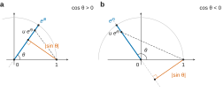
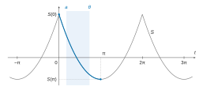
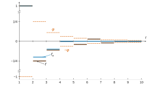
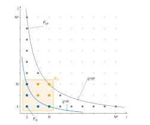

# Mines-Ponts PSI — Maths 2 2026 · Corrigé brut

*Corrigé rédigé par IA, non officiel. Signalez toute erreur.*

Probabilité qu'un entier choisi au hasard et uniformément dans $[\![1;n]\!]$ soit sans facteur à la puissance $k$. Durée 3 heures, calculatrice interdite.

## Partie 1 : Calcul de la somme $\sum_{n=1}^{+\infty}\frac{1}{n^2+x^2}$

### Question 1

Soit $\theta\in\mathbb{R}\setminus2\pi\mathbb{Z}$ et $n\in\mathbb{N}^*$. Pour $t\in[0;1]$, on a $|e^{i\theta}t|=t\le1$.

Si l'on avait $e^{i\theta}t=1$, on aurait $t=|e^{i\theta}t|=1$, puis $e^{i\theta}=1$, soit $\theta\in2\pi\mathbb{Z}$ : c'est exclu.

Donc $1-e^{i\theta}t\ne0$ sur $[0;1]$, et l'intégrande est continue sur $[0;1]$.

La raison $q=e^{i\theta}t$ étant différente de $1$, la somme géométrique finie donne
$$\begin{aligned}
e^{i\theta}\,\frac{1-(e^{i\theta}t)^n}{1-e^{i\theta}t}&=e^{i\theta}\sum_{j=0}^{n-1}(e^{i\theta}t)^j\\
&=\sum_{k=1}^{n}e^{ik\theta}t^{k-1}.
\end{aligned}$$
On intègre sur $[0;1]$ par linéarité de l'intégrale (somme finie), avec $\int_0^1t^{k-1}\,\mathrm{d}t=\frac1k$ :
$$\boxed{\int_0^1e^{i\theta}\,\frac{1-(e^{i\theta}t)^n}{1-e^{i\theta}t}\,\mathrm{d}t=\sum_{k=1}^{n}\frac{e^{ik\theta}}{k}.}$$

### Question 2

**Minoration du dénominateur.** Pour $u\in[0;1]$,
$$\begin{aligned}
|1-e^{i\theta}u|^2&=1-2u\cos\theta+u^2\\
&=(u-\cos\theta)^2+\sin^2\theta.
\end{aligned}$$
Si $\sin\theta\ne0$, on en tire $|1-e^{i\theta}u|\ge|\sin\theta|$.

Si $\sin\theta=0$, comme $\theta\notin2\pi\mathbb{Z}$, on a $\cos\theta=-1$, d'où $|1-e^{i\theta}u|=1+u\ge1$.

En posant $c_\theta=\min(1,|\sin\theta|)>0$, on obtient dans tous les cas
$$(\star)\qquad\forall u\in[0;1],\ |1-e^{i\theta}u|\ge c_\theta.$$

**Convergence.** D'après $(\star)$, la fonction $t\mapsto\frac{e^{i\theta}}{1-e^{i\theta}t}$ est continue sur $[0;1]$ ; notons $I(\theta)$ son intégrale. Par la question 1,
$$\sum_{k=1}^{n}\frac{e^{ik\theta}}{k}-I(\theta)=-\int_0^1\frac{e^{i\theta}(e^{i\theta}t)^n}{1-e^{i\theta}t}\,\mathrm{d}t.$$
On majore le module de l'intégrale par l'intégrale du module (on ne compare que des modules, qui sont réels), puis on utilise $(\star)$ :
$$(\star\star)\qquad\begin{aligned}
\left|\sum_{k=1}^{n}\frac{e^{ik\theta}}{k}-I(\theta)\right|&\le\int_0^1\frac{t^n}{c_\theta}\,\mathrm{d}t\\
&=\frac{1}{c_\theta(n+1)}.
\end{aligned}$$
Ce majorant tend vers $0$ quand $n\to+\infty$. Les sommes partielles convergent : **la série $\sum_{k\ge1}\frac{e^{ik\theta}}{k}$ converge** et
$$\boxed{\sum_{k=1}^{+\infty}\frac{e^{ik\theta}}{k}=\int_0^1\frac{e^{i\theta}}{1-e^{i\theta}t}\,\mathrm{d}t.}$$

### Question 3

Soit $\theta\in\,]0;\pi[$. Les sommes partielles de $\sum e^{ik\theta}/k$ convergent dans $\mathbb{C}$, donc leurs parties imaginaires convergent vers la partie imaginaire de la limite. La série $\sum_{k\ge1}\frac{\sin(k\theta)}{k}$ converge donc.

La partie imaginaire d'une intégrale de fonction complexe étant l'intégrale de la partie imaginaire,
$$\sum_{k=1}^{+\infty}\frac{\sin(k\theta)}{k}=\int_0^1\operatorname{Im}\left(\frac{e^{i\theta}}{1-e^{i\theta}t}\right)\mathrm{d}t.$$
Or, en multipliant par le conjugué du dénominateur,
$$\begin{aligned}
\frac{e^{i\theta}}{1-e^{i\theta}t}&=\frac{e^{i\theta}(1-e^{-i\theta}t)}{|1-e^{i\theta}t|^2}\\
&=\frac{e^{i\theta}-t}{1-2t\cos\theta+t^2},
\end{aligned}$$
donc
$$\operatorname{Im}\left(\frac{e^{i\theta}}{1-e^{i\theta}t}\right)=\frac{\sin\theta}{1-2t\cos\theta+t^2}.$$

**La fonction $u_\theta$ est bien définie.** Pour $t\in[0;1]$, on a $1-t\cos\theta>0$. En effet, si $\cos\theta\le0$, ce nombre vaut au moins $1$ ; sinon, il vaut au moins $1-\cos\theta>0$.

Donc $u_\theta$ est définie et de classe $\mathcal C^1$ sur $[0;1]$.

Posons $f(t)=\frac{t\sin\theta}{1-t\cos\theta}$. Alors
$$\begin{aligned}
f'(t)&=\frac{\sin\theta(1-t\cos\theta)+t\sin\theta\cos\theta}{(1-t\cos\theta)^2}\\
&=\frac{\sin\theta}{(1-t\cos\theta)^2},
\end{aligned}$$
puis
$$\begin{aligned}
u_\theta'(t)&=\frac{f'(t)}{1+f(t)^2}\\
&=\frac{\sin\theta}{(1-t\cos\theta)^2+t^2\sin^2\theta}\\
&=\frac{\sin\theta}{1-2t\cos\theta+t^2}.
\end{aligned}$$
Ainsi
$$\begin{aligned}
\sum_{k=1}^{+\infty}\frac{\sin(k\theta)}{k}&=\int_0^1u_\theta'(t)\,\mathrm{d}t\\
&=u_\theta(1)-u_\theta(0)\\
&=\operatorname{Arctan}\left(\frac{\sin\theta}{1-\cos\theta}\right).
\end{aligned}$$

Avec $\theta/2\in\,]0;\pi/2[$, les formules de l'angle moitié donnent
$$\begin{aligned}
\frac{\sin\theta}{1-\cos\theta}&=\frac{2\sin(\theta/2)\cos(\theta/2)}{2\sin^2(\theta/2)}\\
&=\frac{\cos(\theta/2)}{\sin(\theta/2)}\\
&=\tan\left(\frac{\pi-\theta}{2}\right).
\end{aligned}$$
Comme $\frac{\pi-\theta}{2}\in\,]0;\pi/2[\,\subset\,]-\pi/2;\pi/2[$, intervalle sur lequel $\operatorname{Arctan}(\tan y)=y$, on conclut. Pour tout $\theta\in\,]0;\pi[$ :
$$\boxed{\sum_{k=1}^{+\infty}\frac{\sin(k\theta)}{k}=\frac{\pi-\theta}{2}.}$$

### Question 4

Posons $s_n(t)=\frac{\cos(nt)}{n^2}$ pour $n\ge1$. Chaque $s_n$ est continue sur $\mathbb{R}$.

Pour tout $t\in\mathbb{R}$, $|s_n(t)|\le\frac1{n^2}$, et la série $\sum\frac1{n^2}$ converge (série de Riemann d'exposant $2>1$, résultat du cours).

La série $\sum s_n$ converge donc **normalement sur $\mathbb{R}$**, donc simplement : $S$ est bien définie sur $\mathbb{R}$.

La convergence normale sur $\mathbb{R}$ entraîne la convergence uniforme sur $\mathbb{R}$. Les $s_n$ étant continues, le théorème de continuité de la somme d'une série de fonctions donne : **$S$ est continue sur $\mathbb{R}$**.

### Question 5

Pour $\theta=0$, les deux membres valent $S(0)$. Soit $\theta\in\,]0;\pi[$ et $a\in\,]0;\theta[$.

**Convergence uniforme sur $[a;\theta]$.** La fonction $\sin$, concave sur $[0;\pi]$, atteint son minimum sur $[a;\theta]$ en une borne.

Ainsi, pour $t\in[a;\theta]$, $\sin t\ge m$ avec $m=\min(\sin a,\sin\theta)>0$. En posant $c=\min(1,m)>0$, on a donc $c_t\ge c$.

La majoration $(\star\star)$, l'inégalité $|\operatorname{Im}z|\le|z|$ et la valeur $\operatorname{Im}I(t)=\frac{\pi-t}{2}$ (question 3) donnent, pour tout $t\in[a;\theta]$ et tout $n\ge1$,
$$\left|\sum_{k=1}^{n}\frac{\sin(kt)}{k}-\frac{\pi-t}{2}\right|\le\frac{1}{c(n+1)}.$$
Le majorant ne dépend pas de $t$ et tend vers $0$ : la série de fonctions continues $\sum\frac{\sin(kt)}{k}$ converge uniformément sur le segment $[a;\theta]$ vers $t\mapsto\frac{\pi-t}{2}$.

**Intégration terme à terme sur $[a;\theta]$.** Le théorème d'intégration terme à terme d'une série de fonctions continues uniformément convergente sur un segment donne
$$\sum_{n=1}^{+\infty}\int_a^\theta\frac{\sin(nt)}{n}\,\mathrm{d}t=\int_a^\theta\frac{\pi-t}{2}\,\mathrm{d}t.$$
Or $\int_a^\theta\frac{\sin(nt)}{n}\,\mathrm{d}t=\frac{\cos(na)-\cos(n\theta)}{n^2}$. Les séries $\sum\frac{\cos(na)}{n^2}$ et $\sum\frac{\cos(n\theta)}{n^2}$ convergent (question 4), d'où
$$S(a)-S(\theta)=\left(\frac{\pi\theta}{2}-\frac{\theta^2}{4}\right)-\left(\frac{\pi a}{2}-\frac{a^2}{4}\right).$$

**Limite $a\to0^+$.** $S$ est continue en $0$ (question 4). En faisant tendre $a$ vers $0$, on obtient
$$S(0)-S(\theta)=\frac{\pi\theta}{2}-\frac{\theta^2}{4}.$$
Pour tout $\theta\in[0;\pi[$ :
$$\boxed{S(\theta)=\frac{\theta^2}{4}-\frac{\pi\theta}{2}+S(0).}$$
Les deux membres étant continus sur $\mathbb{R}$, l'égalité **s'étend à $\theta=\pi$** par passage à la limite $\theta\to\pi^-$ ; on l'utilise en question 8.

### Question 6

Fixons $x\in\mathbb{R}$ et posons $u_n(t)=\frac{\cos(nt)}{n^2(n^2+x^2)}$. Chaque $u_n$ est de classe $\mathcal C^2$ sur $\mathbb{R}$, avec
$$\begin{aligned}
u_n'(t)&=-\frac{\sin(nt)}{n(n^2+x^2)},\\
u_n''(t)&=-\frac{\cos(nt)}{n^2+x^2}.
\end{aligned}$$
Comme $n^2+x^2\ge n^2$, on a pour tout $t\in\mathbb{R}$ :
$$\begin{aligned}
|u_n(t)|&\le\frac1{n^4},\\
|u_n'(t)|&\le\frac1{n^3},\\
|u_n''(t)|&\le\frac1{n^2}.
\end{aligned}$$
Les séries $\sum u_n$, $\sum u_n'$ et $\sum u_n''$ convergent donc normalement, donc uniformément et en particulier simplement, sur $\mathbb{R}$.

Le théorème de dérivation terme à terme (classe $\mathcal C^2$) s'applique, car ses trois hypothèses sont satisfaites :

- les $u_n$ sont de classe $\mathcal C^2$ sur $\mathbb{R}$ ;
- les séries $\sum u_n$ et $\sum u_n'$ convergent simplement sur $\mathbb{R}$ ;
- la série $\sum u_n''$ converge uniformément sur $\mathbb{R}$.

Donc **$g_x$ est de classe $\mathcal C^2$ sur $\mathbb{R}$**, et l'on dérive terme à terme :
$$\begin{aligned}
g_x'(t)&=-\sum_{n=1}^{+\infty}\frac{\sin(nt)}{n(n^2+x^2)},\\
g_x''(t)&=-\sum_{n=1}^{+\infty}\frac{\cos(nt)}{n^2+x^2}.
\end{aligned}$$
Par linéarité (séries convergentes),
$$\begin{aligned}
g_x''(t)-x^2g_x(t)&=-\sum_{n=1}^{+\infty}\cos(nt)\,\frac{n^2+x^2}{n^2(n^2+x^2)}\\
&=-\sum_{n=1}^{+\infty}\frac{\cos(nt)}{n^2}.
\end{aligned}$$
Pour tout $t\in\mathbb{R}$ :
$$\boxed{g_x''(t)-x^2g_x(t)=-S(t).}$$

### Question 7

Soit $x\ne0$. Cherchons $P(t)=at^2+bt+c$. Alors
$$P''(t)-x^2P(t)=-ax^2t^2-bx^2t+(2a-cx^2).$$
Il suffit que ces coefficients soient ceux de $-\frac{t^2}{4}+\frac{\pi t}{2}-S(0)$, c'est-à-dire
$$\begin{aligned}
-ax^2&=-\frac14,\\
-bx^2&=\frac\pi2,\\
2a-cx^2&=-S(0).
\end{aligned}$$
Puisque $x\ne0$, on prend $a=\frac1{4x^2}$, $b=-\frac{\pi}{2x^2}$ et $c=\frac{2a+S(0)}{x^2}$, d'où le candidat
$$\boxed{P(t)=\frac{t^2}{4x^2}-\frac{\pi t}{2x^2}+\frac{1}{2x^4}+\frac{S(0)}{x^2}.}$$

**Vérification.** On a, pour tout $t\in\mathbb{R}$,
$$\begin{aligned}
P'(t)&=\frac{t}{2x^2}-\frac{\pi}{2x^2}=\frac{t-\pi}{2x^2},\\
P''(t)&=\frac{1}{2x^2},
\end{aligned}$$
d'où
$$\begin{aligned}
P''(t)-x^2P(t)&=\frac{1}{2x^2}-\left(\frac{t^2}{4}-\frac{\pi t}{2}+\frac{1}{2x^2}+S(0)\right)\\
&=-\frac{t^2}{4}+\frac{\pi t}{2}-S(0).
\end{aligned}$$
Le polynôme $P$, de degré $2$ (coefficient dominant $\frac1{4x^2}\ne0$), est donc bien solution de $(E_x)$ sur $\mathbb{R}$.

### Question 8

**Dérivées premières.** Soit $x\in\mathbb{R}$. Dans l'expression de $g_x'$ obtenue à la question 6, tous les termes sont nuls en $0$ et en $\pi$, car $\sin0=\sin(n\pi)=0$. Donc
$$\boxed{\begin{aligned}
g_x'(0)&=0,\\
g_x'(\pi)&=0.
\end{aligned}}$$

**Résolution sur $[0;\pi]$.** Soit $x\ne0$. Par la question 5, étendue à $\pi$ par continuité, on a pour tout $t\in[0;\pi]$
$$-S(t)=-\frac{t^2}{4}+\frac{\pi t}{2}-S(0).$$
La question 6 montre donc que la restriction de $g_x$ à l'intervalle $[0;\pi]$ est solution de $(E_x)$ sur cet intervalle (et non sur $\mathbb{R}$ : hors de $[0;\pi]$, $-S$ n'est plus ce polynôme).

L'équation homogène $y''-x^2y=0$ est linéaire à coefficients constants. Son équation caractéristique $r^2-x^2=0$ a deux racines réelles **distinctes** $x$ et $-x$, précisément parce que $x\ne0$.

Les solutions de l'équation homogène sur $[0;\pi]$ sont donc les fonctions $t\mapsto Ae^{xt}+Be^{-xt}$, avec $(A,B)\in\mathbb{R}^2$.

Les solutions de $(E_x)$ sur $[0;\pi]$ s'obtiennent en leur ajoutant la solution particulière $P$ de la question 7. Il existe donc $(A,B)\in\mathbb{R}^2$ tel que
$$\forall t\in[0;\pi],\ g_x(t)=P(t)+Ae^{xt}+Be^{-xt}.$$

**Constantes.** Pour $t\in[0;\pi]$,
$$g_x'(t)=\frac{t-\pi}{2x^2}+Axe^{xt}-Bxe^{-xt}.$$
La condition $g_x'(0)=0$ s'écrit $-\frac{\pi}{2x^2}+x(A-B)=0$, et la condition $g_x'(\pi)=0$ s'écrit $x(Ae^{\pi x}-Be^{-\pi x})=0$. Comme $x\ne0$ :
$$\begin{aligned}
A-B&=\frac{\pi}{2x^3},\\
B&=Ae^{2\pi x}.
\end{aligned}$$
Comme $x\ne0$, on a $1-e^{2\pi x}\ne0$, et
$$\begin{aligned}
A&=\frac{\pi}{2x^3(1-e^{2\pi x})},\\
B&=\frac{\pi e^{2\pi x}}{2x^3(1-e^{2\pi x})},\\
A+B&=\frac{\pi(1+e^{2\pi x})}{2x^3(1-e^{2\pi x})}.
\end{aligned}$$

**Calcul de $g_x''(0)$.** On dérive deux fois l'expression de $g_x$ sur $[0;\pi]$ :
$$\begin{aligned}
g_x''(0)&=P''(0)+x^2(A+B)\\
&=\frac{1}{2x^2}+\frac{\pi(1+e^{2\pi x})}{2x(1-e^{2\pi x})}.
\end{aligned}$$
En multipliant numérateur et dénominateur par $e^{-2\pi x}$ :
$$\begin{aligned}
\frac{1+e^{2\pi x}}{1-e^{2\pi x}}&=\frac{e^{-2\pi x}+1}{e^{-2\pi x}-1}\\
&=-\frac{1+e^{-2\pi x}}{1-e^{-2\pi x}},
\end{aligned}$$
d'où
$$\boxed{g_x''(0)=-\frac{\pi}{2x}\times\frac{1+e^{-2\pi x}}{1-e^{-2\pi x}}+\frac{1}{2x^2}.}$$

### Question 9

Soit $x\ne0$. Par la question 6 en $t=0$, $g_x''(0)=-\sum_{n\ge1}\frac{1}{n^2+x^2}$. Avec la question 8, en multipliant par $-2x^2$ :
$$\sum_{n=1}^{+\infty}\frac{2x^2}{n^2+x^2}=\pi x\,\frac{1+e^{-2\pi x}}{1-e^{-2\pi x}}-1.$$
Or, en multipliant haut et bas par $e^{2\pi x}$ (avec $e^{2\pi x}\ne1$) :
$$\begin{aligned}
\frac{1+e^{-2\pi x}}{1-e^{-2\pi x}}&=\frac{e^{2\pi x}+1}{e^{2\pi x}-1}\\
&=1+\frac{2}{e^{2\pi x}-1}.
\end{aligned}$$
Donc
$$\sum_{n=1}^{+\infty}\frac{2x^2}{n^2+x^2}=\pi x+\frac{2\pi x}{e^{2\pi x}-1}-1,$$
c'est-à-dire, pour tout $x\in\mathbb{R}^*$,
$$\boxed{\frac{2\pi x}{e^{2\pi x}-1}=1-\pi x+\sum_{n=1}^{+\infty}\frac{2x^2}{n^2+x^2}.}$$

## Partie 2 : Développement en série entière de $x\mapsto\frac{x}{e^x-1}$ et applications

### Question 10

Soient $x\in\,]-1;1[$, $N\in\mathbb{N}$ et $n\in\mathbb{N}^*$. Posons $q=-\frac{x^2}{n^2}$.

On a $q\le0$, donc $q\ne1$, et $1-q=\frac{n^2+x^2}{n^2}$. La somme géométrique **finie** donne
$$\begin{aligned}
\frac1{n^2}\sum_{k=0}^{N}q^k&=\frac1{n^2}\cdot\frac{1-q^{N+1}}{1-q}\\
&=\frac{1}{x^2+n^2}-\frac{q^{N+1}}{x^2+n^2}.
\end{aligned}$$
Et
$$\frac{q^{N+1}}{x^2+n^2}=(-1)^{N+1}\frac{1}{x^2+n^2}\times\frac{x^{2N+2}}{n^{2N+2}}=R_{N,n}(x).$$
D'où
$$\boxed{\frac{1}{x^2+n^2}=\left(\frac1{n^2}\sum_{k=0}^{N}\left(\frac{-x^2}{n^2}\right)^k\right)+R_{N,n}(x).}$$

Comme $x^2+n^2\ge1$, on a $|R_{N,n}(x)|\le\frac{|x|^{2N+2}}{n^{2N+2}}$. La série $\sum_n n^{-(2N+2)}$ converge (série de Riemann d'exposant $2N+2\ge2$), de somme $\zeta(2N+2)$. Par comparaison de séries à termes positifs, la série $\sum_n|R_{N,n}(x)|$ converge, et
$$\boxed{\sum_{n=1}^{+\infty}|R_{N,n}(x)|\le\zeta(2N+2)\,|x|^{2N+2}.}$$

### Question 11

**Limite de $\zeta$.** Pour $s\ge2$ et $n\ge2$,
$$\frac1{n^s}=\frac1{n^2}\cdot\frac1{n^{s-2}}\le\frac{1}{2^{s-2}}\cdot\frac1{n^2}.$$
En sommant ces inégalités entre termes de séries convergentes,
$$\begin{aligned}
0\le\zeta(s)-1&=\sum_{n=2}^{+\infty}\frac1{n^s}\\
&\le\frac{\zeta(2)-1}{2^{s-2}}.
\end{aligned}$$
Ce majorant tend vers $0$ quand $s\to+\infty$, donc $\lim_{s\to+\infty}\zeta(s)=1$. En particulier, la suite $(\zeta(2N+2))_{N\in\mathbb{N}}$ est bornée.

**Sommation.** Soit $x\in\,]-1;1[$. En multipliant l'identité de la question 10 par $x^2$ et en posant $j=k+1$ :
$$\frac{x^2}{x^2+n^2}=\sum_{j=1}^{N+1}(-1)^{j+1}\frac{x^{2j}}{n^{2j}}+x^2R_{N,n}(x).$$
Chacune des séries $\sum_n n^{-2j}$ converge (somme $\zeta(2j)$), ainsi que $\sum_nR_{N,n}(x)$ (question 10). La somme sur $j$ étant **finie**, on peut sommer sur $n$ par linéarité :
$$\begin{aligned}
\sum_{n=1}^{+\infty}\frac{x^2}{x^2+n^2}&=\sum_{j=1}^{N+1}(-1)^{j+1}\zeta(2j)x^{2j}\\
&\quad+x^2\sum_{n=1}^{+\infty}R_{N,n}(x).
\end{aligned}$$
Par la question 10, le dernier terme est majoré en module par $x^2\zeta(2N+2)|x|^{2N+2}$. Ce majorant tend vers $0$ quand $N\to+\infty$, car $\zeta(2N+2)$ est bornée et $|x|<1$.

Les sommes partielles de la série $\sum_{k\ge1}(-1)^{k+1}\zeta(2k)x^{2k}$ convergent donc. Pour tout $x\in\,]-1;1[$ :
$$\boxed{\begin{aligned}
&\sum_{n=1}^{+\infty}\frac{x^2}{x^2+n^2}\\
&\quad=\sum_{k=1}^{+\infty}(-1)^{k+1}\zeta(2k)\,x^{2k}.
\end{aligned}}$$

### Question 12

Soit $X\in\,]-2\pi;2\pi[$ avec $X\ne0$. Posons $x=\frac{X}{2\pi}$, de sorte que $x\in\,]-1;1[\setminus\{0\}$.

On réserve la lettre $X$ à la variable de $h$ et la lettre $x$ à celle des questions 9 et 11. La question 9 s'écrit
$$h(X)=1-\frac X2+2\sum_{n=1}^{+\infty}\frac{x^2}{n^2+x^2},$$
et la question 11 donne
$$\begin{aligned}
h(X)&=1-\frac X2+2\sum_{k=1}^{+\infty}(-1)^{k+1}\zeta(2k)\frac{X^{2k}}{(2\pi)^{2k}}\\
&=1-\frac X2+\sum_{k=1}^{+\infty}(-1)^{k+1}\frac{\zeta(2k)}{2^{2k-1}\pi^{2k}}X^{2k}.
\end{aligned}$$
En $X=0$, cas exclu de la question 9, les deux membres valent $1$ par définition de $h$. Donc, pour tout $x\in\,]-2\pi;2\pi[$ :
$$\boxed{h(x)=1-\frac12x+\sum_{k=1}^{+\infty}(-1)^{k+1}\frac{\zeta(2k)}{2^{2k-1}\pi^{2k}}x^{2k}.}$$
Cette série entière converge en tout point de $]-2\pi;2\pi[$, donc son rayon est au moins $2\pi$ : **$h$ est développable en série entière** (sur $]-2\pi;2\pi[$).

La somme d'une série entière $\sum a_mx^m$ est de classe $\mathcal C^\infty$ sur l'intervalle ouvert de convergence, avec $a_m=\frac{h^{(m)}(0)}{m!}$. Donc $b_m=m!\,a_m$, et
$$\boxed{\begin{aligned}
b_0&=1,\\
b_1&=-\frac12,\\
b_{2k}&=(-1)^{k+1}\frac{(2k)!\,\zeta(2k)}{2^{2k-1}\pi^{2k}}\ \ (k\ge1),\\
b_{2k+1}&=0\ \ (k\ge1).
\end{aligned}}$$

### Question 13

Sur $]-2\pi;2\pi[$, $h(x)=\sum_{k\ge0}\frac{b_k}{k!}x^k$, série entière de rayon $R_1\ge2\pi$ (question 12).

Pour tout réel $x$, posons $\varphi(x)=\sum_{j\ge0}\frac{x^j}{(j+1)!}$. Cette série entière a un rayon infini, et la série de l'exponentielle donne $\varphi(x)=\frac{e^x-1}{x}$ si $x\ne0$, $\varphi(0)=1$.

Rappelons le théorème sur le produit de Cauchy. Soient $\sum\alpha_kx^k$ et $\sum\beta_jx^j$ deux séries entières de rayons $R_1$ et $R_2$, et $c_n=\sum_{k=0}^{n}\alpha_k\beta_{n-k}$.

Alors la série entière $\sum c_nx^n$ a un rayon au moins $\min(R_1,R_2)$, et pour $|x|<\min(R_1,R_2)$ sa somme est le produit des deux sommes.

Ici $\min(R_1,+\infty)\ge2\pi$, donc pour tout $x\in\,]-2\pi;2\pi[$ :
$$h(x)\varphi(x)=\sum_{n=0}^{+\infty}c_nx^n,$$
avec
$$c_n=\sum_{k=0}^{n}\frac{b_k}{k!}\cdot\frac{1}{(n-k+1)!}.$$
Or $h(x)\varphi(x)=\frac{x}{e^x-1}\times\frac{e^x-1}{x}=1$ si $x\ne0$, et $h(0)\varphi(0)=1$. La fonction $h\varphi$ est donc constante égale à $1$ sur $]-2\pi;2\pi[$.

Par unicité des coefficients d'un développement en série entière sur un voisinage de $0$, on obtient $c_0=1$ et $c_n=0$ pour $n\ge1$. Pour tout $n\in\mathbb{N}^*$ :
$$\boxed{\sum_{k=0}^{n}\frac{b_k}{k!\,(n+1-k)!}=0.}$$

### Question 14

Pour $n=2$ :
$$\begin{aligned}
\frac{b_0}{0!\,3!}+\frac{b_1}{1!\,2!}+\frac{b_2}{2!\,1!}&=\frac16-\frac14+\frac{b_2}{2}\\
&=0,
\end{aligned}$$
d'où $\boxed{b_2=\frac16}$.

Pour $n=4$, avec $b_3=0$ (question 12) :
$$\begin{aligned}
0&=\frac{b_0}{0!\,5!}+\frac{b_1}{1!\,4!}+\frac{b_2}{2!\,3!}+\frac{b_4}{4!\,1!}\\
&=\frac1{120}-\frac1{48}+\frac1{72}+\frac{b_4}{24}\\
&=\frac{6-15+10}{720}+\frac{b_4}{24},
\end{aligned}$$
d'où $b_4=-\frac{24}{720}$, soit $\boxed{b_4=-\frac1{30}}$.

Par la question 12, avec $k=1$ puis $k=2$ :
$$\begin{aligned}
b_2&=\frac{2!\,\zeta(2)}{2\pi^2}=\frac{\zeta(2)}{\pi^2},\\
b_4&=-\frac{4!\,\zeta(4)}{2^3\pi^4}=-\frac{3\zeta(4)}{\pi^4}.
\end{aligned}$$
Donc
$$\boxed{\begin{aligned}
\zeta(2)&=\frac{\pi^2}{6},\\
\zeta(4)&=\frac{\pi^4}{90}.
\end{aligned}}$$

## Partie 3 : Probabilité qu'un entier naturel choisi au hasard et uniformément dans $[\![1;n]\!]$ soit sans facteur à la puissance $k$

### Question 15

Soit $(x_1,\dots,x_r)\in\mathbb{R}^r$. Pour $1\le m\le r$, notons
$$\Sigma_m^{(r)}=\sum_{i_1<\dots<i_m}x_{i_1}\cdots x_{i_m}\qquad(\text{indices dans }[\![1;r]\!]),$$
avec $\Sigma_0^{(r)}=1$ et $\Sigma_m^{(r)}=0$ si $m>r$. Montrons par récurrence sur $r\ge1$ que $\prod_{i=1}^{r}(1+x_i)=\sum_{m=0}^{r}\Sigma_m^{(r)}$.

Pour $r=1$ : $1+x_1=\Sigma_0^{(1)}+\Sigma_1^{(1)}$.

Hérédité. On sépare les $m$-uplets $1\le i_1<\dots<i_m\le r+1$ selon que $i_m=r+1$ ou $i_m\le r$. Pour $1\le m\le r+1$, cela donne
$$\Sigma_m^{(r+1)}=\Sigma_m^{(r)}+x_{r+1}\Sigma_{m-1}^{(r)}.$$
Avec l'hypothèse de récurrence et $\Sigma_{r+1}^{(r)}=0$ :
$$\begin{aligned}
\sum_{m=0}^{r+1}\Sigma_m^{(r+1)}&=1+\sum_{m=1}^{r+1}\Sigma_m^{(r)}+x_{r+1}\sum_{m=1}^{r+1}\Sigma_{m-1}^{(r)}\\
&=\sum_{m=0}^{r}\Sigma_m^{(r)}+x_{r+1}\sum_{m=0}^{r}\Sigma_m^{(r)}\\
&=(1+x_{r+1})\prod_{i=1}^{r}(1+x_i).
\end{aligned}$$
D'où, pour tout $r\in\mathbb{N}^*$ :
$$\boxed{\begin{aligned}
&\prod_{i=1}^{r}(1+x_i)\\
&\quad=1+\sum_{m=1}^{r}\left(\sum_{1\le i_1<\dots<i_m\le r}x_{i_1}x_{i_2}\cdots x_{i_m}\right).
\end{aligned}}$$
(Dans l'énoncé, la condition $1\le i_1<\dots<i_m\le r$ porte sur les $m$-uplets d'indices $(i_1,\dots,i_m)$.)

### Question 16

Les deux égalités sont des égalités de fonctions sur $\Omega$ ; soit $\omega\in\Omega$ une issue.

Si $\omega\in A$, alors $\mathbf 1_{\bar A}(\omega)=0=1-\mathbf 1_A(\omega)$. Si $\omega\notin A$, alors $\mathbf 1_{\bar A}(\omega)=1=1-\mathbf 1_A(\omega)$. Donc $\boxed{\mathbf 1_{\bar A}=1-\mathbf 1_A}$.

Les nombres $\mathbf 1_{A_i}(\omega)$ valent $0$ ou $1$.

Leur produit vaut $1$ si et seulement si tous valent $1$, c'est-à-dire si $\omega\in A_1\cap\dots\cap A_m$ ; il vaut $0$ sinon.

Donc $\boxed{\mathbf 1_{A_1}\mathbf 1_{A_2}\cdots\mathbf 1_{A_m}=\mathbf 1_{A_1\cap A_2\cap\dots\cap A_m}}$.

### Question 17

Par De Morgan, $\overline{A_1\cup\dots\cup A_r}=\bar A_1\cap\dots\cap\bar A_r$. La question 16 donne donc
$$\begin{aligned}
\mathbf 1_{A_1\cup\dots\cup A_r}&=1-\prod_{i=1}^{r}\mathbf 1_{\bar A_i}\\
&=1-\prod_{i=1}^{r}(1-\mathbf 1_{A_i}).
\end{aligned}$$
On applique la question 15 en chaque $\omega$ avec $x_i=-\mathbf 1_{A_i}(\omega)$, puis la question 16 :
$$\begin{aligned}
&\prod_{i=1}^{r}(1-\mathbf 1_{A_i})\\
&\quad=1+\sum_{m=1}^{r}(-1)^m\sum_{1\le i_1<\dots<i_m\le r}\mathbf 1_{A_{i_1}\cap\dots\cap A_{i_m}}.
\end{aligned}$$
D'où
$$\begin{aligned}
&\mathbf 1_{A_1\cup\dots\cup A_r}\\
&\quad=\sum_{m=1}^{r}(-1)^{m+1}\sum_{1\le i_1<\dots<i_m\le r}\mathbf 1_{A_{i_1}\cap\dots\cap A_{i_m}}.
\end{aligned}$$
Ces indicatrices sont des variables aléatoires bornées, donc d'espérance finie. On prend l'espérance, par linéarité (somme finie) et avec $E(\mathbf 1_B)=P(B)$ :
$$\boxed{\begin{aligned}
&P(A_1\cup\dots\cup A_r)\\
&\quad=\sum_{m=1}^{r}(-1)^{m+1}\left(\sum_{1\le i_1<\dots<i_m\le r}P(A_{i_1}\cap\dots\cap A_{i_m})\right).
\end{aligned}}$$

### Question 18

Un entier $m\in[\![1;n]\!]$ n'est pas dans $S_n(k)$ si et seulement s'il existe $j\in[\![1;r]\!]$ tel que $p_j^k\mid m$, c'est-à-dire $m\in A_n(p_j^k)$. Ainsi $[\![1;n]\!]\setminus S_n(k)=\bigcup_{i=1}^{r}A_n(p_i^k)$, et
$$\boxed{q_n(k)=1-P_n\left(\bigcup_{i=1}^{r}A_n(p_i^k)\right).}$$
(Tester $p_1,\dots,p_r$ suffit : si $p$ premier vérifie $p^k\mid m$ avec $m\le n$, alors $p\le m\le n$.

Ainsi $q_n(k)$ est bien la probabilité que l'entier tiré soit sans facteur à la puissance $k$.)

La question 17 donne
$$\begin{aligned}
q_n(k)&=1-\sum_{m=1}^{r}(-1)^{m+1}\sum_{1\le i_1<\dots<i_m\le r}P_n\left(\bigcap_{\ell=1}^{m}A_n(p_{i_\ell}^k)\right)\\
&=1+\sum_{m=1}^{r}\sum_{1\le i_1<\dots<i_m\le r}(-1)^mP_n\left(\bigcap_{\ell=1}^{m}A_n(p_{i_\ell}^k)\right).
\end{aligned}$$
Soit $j\in[\![1;n]\!]$ tel que $p_{i_\ell}^k\mid j$ pour tout $\ell$. Les $p_{i_\ell}$ sont des nombres premiers **deux à deux distincts** : la décomposition en facteurs premiers de $j$ contient chacun d'eux avec un exposant au moins $k$.

Donc $p_{i_1}^k\cdots p_{i_m}^k\mid j$ ; la réciproque est immédiate. Ainsi $\bigcap_\ell A_n(p_{i_\ell}^k)=A_n(p_{i_1}^k\cdots p_{i_m}^k)$, et
$$\boxed{\begin{aligned}
&q_n(k)\\
&\quad=1+\sum_{m=1}^{r}\sum_{1\le i_1<i_2<\dots<i_m\le r}(-1)^m\,P_n\left(A_n\left(p_{i_1}^kp_{i_2}^k\cdots p_{i_m}^k\right)\right).
\end{aligned}}$$

### Question 19

Les multiples de $d$ dans $[\![1;n]\!]$ sont $d,2d,\dots,\lfloor n/d\rfloor d$. La probabilité $P_n$ étant uniforme, $P_n(A_n(d))=\frac1n\left\lfloor\frac nd\right\rfloor$.

Pour $1\le i_1<\dots<i_m\le r$, posons $D=p_{i_1}\cdots p_{i_m}$. Alors $p_{i_1}^k\cdots p_{i_m}^k=D^k$ et $\mu(D)=(-1)^m$.

L'application $\{i_1<\dots<i_m\}\mapsto p_{i_1}\cdots p_{i_m}$ (pour $m\ge1$) est injective, par unicité de la décomposition en facteurs premiers.

Son image est l'ensemble $\mathcal D$ des entiers $D>1$ sans facteur carré dont tous les facteurs premiers sont parmi $p_1,\dots,p_r$. Le terme $1$ s'écrit $\frac1n\mu(1)\lfloor n/1^k\rfloor$. Ainsi
$$q_n(k)=\frac1n\sum_{D\in\{1\}\cup\mathcal D}\mu(D)\left\lfloor\frac{n}{D^k}\right\rfloor.$$
Soit $d\ge1$ hors de $\{1\}\cup\mathcal D$.

- Ou bien $d$ a un facteur carré, et $\mu(d)=0$.
- Ou bien $d$ a un facteur premier $p\notin\{p_1,\dots,p_r\}$, donc $p>n$. Alors $d^k\ge d\ge p>n$, d'où $\lfloor n/d^k\rfloor=0$.

Ces termes sont nuls : la série ci-dessous n'a qu'un nombre fini de termes non nuls (ceux pour lesquels $d^k\le n$), et
$$\boxed{q_n(k)=\frac1n\sum_{d=1}^{+\infty}\mu(d)\left\lfloor\frac{n}{d^k}\right\rfloor.}$$

### Question 20

La série $\ell=\sum_{d\ge1}\frac{\mu(d)}{d^k}$ converge absolument, car $\left|\frac{\mu(d)}{d^k}\right|\le\frac1{d^k}$ et $k\ge2$.

**Intégrales.** $f_n$ est constante sur chaque $[d;d+1[$, donc continue par morceaux. Elle est nulle sur $[n+1;+\infty[$, car $d^k\ge d>n$ pour $d\ge n+1$. Elle est donc intégrable sur $[1;+\infty[$ et, par la question 19,
$$\begin{aligned}
\int_1^{+\infty}f_n(t)\,\mathrm{d}t&=\sum_{d=1}^{n}\frac1n\mu(d)\left\lfloor\frac{n}{d^k}\right\rfloor\\
&=q_n(k).
\end{aligned}$$

**Convergence simple.** Soit $t\ge1$ et $d=\lfloor t\rfloor$. De l'encadrement $\frac{n}{d^k}-1<\left\lfloor\frac{n}{d^k}\right\rfloor\le\frac{n}{d^k}$ vient
$$\frac1{d^k}-\frac1n<\frac1n\left\lfloor\frac{n}{d^k}\right\rfloor\le\frac1{d^k}.$$
Donc $f_n(t)$ tend vers $f(t)=\frac{\mu(\lfloor t\rfloor)}{\lfloor t\rfloor^k}$ quand $n\to+\infty$, et $f$ est continue par morceaux sur $[1;+\infty[$.

**Domination.** Pour $t\ge1$ et $d=\lfloor t\rfloor$, on a $|f_n(t)|\le\frac{1}{d^k}$. On pose $\varphi(t)=\frac{1}{\lfloor t\rfloor^k}$ : cette fonction est positive, continue par morceaux et indépendante de $n$.

Elle est intégrable sur $[1;+\infty[$. En effet, pour $M\in\mathbb{N}^*$,
$$\begin{aligned}
\int_1^{M+1}\varphi&=\sum_{d=1}^{M}\frac1{d^k}\\
&\le\zeta(k),
\end{aligned}$$
et les intégrales sur $[1;X]$ d'une fonction positive sont croissantes en $X$ et majorées. (On peut aussi dominer par $t\mapsto 2^k/t^k$, puisque $t<d+1\le2d$.)

**Conclusion.** Par le théorème de convergence dominée,
$$q_n(k)=\int_1^{+\infty}f_n\xrightarrow[n\to+\infty]{}\int_1^{+\infty}f.$$
Comme $f$ est intégrable,
$$\begin{aligned}
\int_1^{+\infty}f&=\lim_{M\to+\infty}\int_1^{M+1}f\\
&=\lim_{M\to+\infty}\sum_{d=1}^{M}\frac{\mu(d)}{d^k}\\
&=\ell.
\end{aligned}$$
Donc **la suite $(q_n(k))_{n\in\mathbb{N}^*}$ converge** et
$$\boxed{\lim_{n\to+\infty}q_n(k)=\sum_{d=1}^{+\infty}\frac{\mu(d)}{d^k}.}$$

## Partie 4 : Calcul de la somme $\sum_{d=1}^{+\infty}\frac{\mu(d)}{d^k}$

### Question 21

**Inclusions.** $F_N\subset E_N$ par définition. Si $(i,j)\in E_N$, alors $1\le i,j\le N\le N^2$ et $ij\le N^2$, donc $(i,j)\in F_{N^2}$ :
$$\boxed{F_N\subset E_N\subset F_{N^2}.}$$

**Réindexation.** L'application $(m,d)\mapsto(d,m/d)$ est une bijection de $\{(m,d):1\le m\le N,\ d\mid m\}$ sur $F_N$, de réciproque $(i,j)\mapsto(ij,i)$. Donc
$$\begin{aligned}
S_N&=\sum_{m=1}^{N}\sum_{d\mid m}|u_d|\,v_{m/d}\\
&=\sum_{(i,j)\in F_N}|u_i|v_j.
\end{aligned}$$

**Convergence.** Les termes sont positifs et $F_N\subset F_{N+1}$, donc $(S_N)$ est croissante. Posons
$$\begin{aligned}
T_N&=\sum_{(i,j)\in E_N}|u_i|v_j\\
&=\left(\sum_{i=1}^{N}|u_i|\right)\left(\sum_{j=1}^{N}v_j\right).
\end{aligned}$$
Posons aussi $U=\sum_{i\ge1}\frac{|\mu(i)|}{i^s}$ et $V=\sum_{j\ge1}\frac1{j^s}$. Ces séries convergent, car $|u_i|\le v_i=i^{-s}$ et $s>1$.

On a $S_N\le T_N\le UV$. Croissante et majorée, **$(S_N)$ converge**, vers une limite $L$.

**Identité.** Les inclusions et la positivité des termes donnent $S_N\le T_N\le S_{N^2}$. Comme $S_{N^2}\to L$ (suite extraite), on a $T_N\to L$ ; mais $T_N\to UV$. Donc $L=UV$ :
$$\boxed{\begin{aligned}
&\sum_{m=1}^{+\infty}\left(\sum_{d\mid m}|u_d|\,v_{m/d}\right)\\
&\quad=\left(\sum_{i=1}^{+\infty}\frac{|\mu(i)|}{i^s}\right)\left(\sum_{j=1}^{+\infty}\frac1{j^s}\right).
\end{aligned}}$$

### Question 22

La même bijection (sur des sommes finies) donne
$$\sum_{m=1}^{N}\sum_{d\mid m}u_dv_{m/d}=\sum_{(i,j)\in F_N}u_iv_j,$$
et, en développant le produit de deux sommes finies,
$$\begin{aligned}
&\left(\sum_{i=1}^{N}u_i\right)\left(\sum_{j=1}^{N}v_j\right)\\
&\quad=\sum_{(i,j)\in E_N}u_iv_j.
\end{aligned}$$
La différence vaut $\sum_{(i,j)\in E_N\setminus F_N}u_iv_j$. Par l'inégalité triangulaire (avec $v_j>0$) :
$$\boxed{\begin{aligned}
&\left|\left(\sum_{i=1}^{N}u_i\right)\left(\sum_{j=1}^{N}v_j\right)-\sum_{m=1}^{N}\left(\sum_{d\mid m}u_dv_{m/d}\right)\right|\\
&\quad\le\sum_{(i,j)\in E_N}|u_i|v_j-\sum_{(i,j)\in F_N}|u_i|v_j.
\end{aligned}}$$

Le majorant vaut $T_N-S_N$, qui tend vers $UV-UV=0$ (question 21). Les séries $\sum u_i$ et $\sum v_j$ convergent (absolument), donc le produit de leurs sommes partielles tend vers $\left(\sum u_i\right)\left(\sum v_j\right)$. Par suite, $\sum_{m=1}^{N}\sum_{d\mid m}u_dv_{m/d}$ converge vers la même limite.

Enfin, pour $d\mid m$,
$$u_dv_{m/d}=\frac{\mu(d)}{d^s}\cdot\frac{d^s}{m^s}=\frac{\mu(d)}{m^s},$$
d'où
$$\boxed{\begin{aligned}
&\sum_{m=1}^{+\infty}\frac1{m^s}\left(\sum_{d\mid m}\mu(d)\right)\\
&\quad=\left(\sum_{i=1}^{+\infty}\frac{\mu(i)}{i^s}\right)\left(\sum_{j=1}^{+\infty}\frac1{j^s}\right).
\end{aligned}}$$

### Question 23

Si $m=1$, la somme vaut $\mu(1)=1$.

Si $m\ge2$, écrivons $m=\prod_{i=1}^{r}q_i^{\alpha_i}$ avec $r\ge1$, les $q_i$ premiers distincts et $\alpha_i\ge1$.

Un diviseur $d$ de $m$ tel que $\mu(d)\ne0$ est sans facteur carré, et ses facteurs premiers divisent $m$.

Il s'écrit donc $d=\prod_{i\in I}q_i$ pour une unique partie $I\subset[\![1;r]\!]$, et $\mu(d)=(-1)^{\operatorname{Card}I}$.

Réciproquement, chaque tel produit divise $m$. Les autres diviseurs vérifient $\mu(d)=0$. Donc
$$\begin{aligned}
\sum_{d\mid m}\mu(d)&=\sum_{I\subset[\![1;r]\!]}(-1)^{\operatorname{Card}I}\\
&=\sum_{j=0}^{r}\binom rj(-1)^j\\
&=(1-1)^r=0.
\end{aligned}$$
Finalement :
$$\boxed{\sum_{d\mid m}\mu(d)=\begin{cases}1&\text{si }m=1\\0&\text{sinon.}\end{cases}}$$

### Question 24

Soit $s>1$. Par la question 23, le membre de gauche de la question 22 se réduit au terme $m=1$, qui vaut $1$. Donc $\left(\sum_{i\ge1}\frac{\mu(i)}{i^s}\right)\zeta(s)=1$.

Comme $\zeta(s)\ge1>0$ (premier terme $1$, termes positifs), on peut diviser. Pour tout $s>1$ :
$$\boxed{\sum_{i=1}^{+\infty}\frac{\mu(i)}{i^s}=\frac{1}{\zeta(s)}.}$$

### Question 25

Soit $k\ge2$. Par la question 20, $\lim_{n\to+\infty}q_n(k)=\sum_{d\ge1}\frac{\mu(d)}{d^k}$. Par la question 24 avec $s=k>1$, cette somme vaut $\frac1{\zeta(k)}$ :
$$\boxed{\lim_{n\to+\infty}q_n(k)=\frac{1}{\zeta(k)}.}$$
Avec les valeurs de la question 14 :
$$\boxed{\begin{aligned}
\lim_{n\to+\infty}q_n(2)&=\frac{6}{\pi^2}\approx0{,}608,\\
\lim_{n\to+\infty}q_n(4)&=\frac{90}{\pi^4}\approx0{,}924.
\end{aligned}}$$
