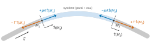
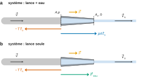
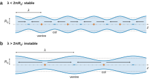
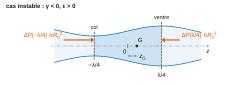
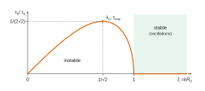

# Mines-Ponts PSI — Physique 1 2026 · Corrigé guidé

*Corrigé rédigé par IA, non officiel. Signalez toute erreur.*

## Présentation du sujet

**Thème.** « Autour de jets d'eau » est un sujet de mécanique des fluides construit autour d'un objet unique, le jet d'eau, regardé sous quatre angles : la force qu'il exerce sur ce qui le produit (lance à incendie), la hauteur qu'il peut atteindre (jet vertical, pertes de charge), puis sa fragmentation spontanée en gouttes (instabilité de Rayleigh-Plateau, tension superficielle).

**Découpage (22 questions, 3 heures, sans calculatrice ni document).** Les quatre parties sont annoncées **totalement indépendantes**.

- **Partie I (Q1–Q2) — bilans sur un système ouvert.** Démonstration de cours : bilan de quantité de mouvement et bilan d'énergie cinétique en régime permanent, par la construction d'un système fermé. Les deux relations obtenues sont données et peuvent être admises.
- **Partie II (Q3–Q8) — lance à incendie.** Conservation du débit, tension d'un tuyau souple parcouru par de l'eau (bilan de quantité de mouvement sur une portion courbe), force que doit fournir le pompier, action de l'eau sur la lance, relation de Bernoulli, deux applications numériques.
- **Partie III (Q9–Q13) — jet d'eau vertical.** Hauteur d'un jet, Bernoulli depuis le réseau de distribution, puis pertes de charge régulières (Darcy-Weisbach) et singulières ; on explique pourquoi pincer la sortie d'un tuyau d'arrosage fait monter le jet.
- **Partie IV (Q14–Q22) — instabilité de Rayleigh-Plateau.** IV.A : unité de la tension superficielle, développements au second ordre (volume, surface latérale) donnant le critère de stabilité $\lambda<2\pi R_0$, même critère lu sur la loi de Laplace, temps capillaire par analyse dimensionnelle, modèle dynamique simplifié, longueur d'onde la plus instable et taille des gouttes. IV.B : application numérique à un filet d'eau de robinet.

**Notions du programme mobilisées.** Bilans macroscopiques de quantité de mouvement et d'énergie sur un système ouvert ; conservation du débit ; relation de Bernoulli ; pertes de charge régulières et singulières, nombre de Reynolds ; loi de Laplace (admise) et énergie de surface ; développements limités et intégrales de fonctions trigonométriques ; analyse dimensionnelle ; équation différentielle linéaire du second ordre et discussion de stabilité.

**Difficulté et longueur.** Sujet long pour 3 heures, mais très guidé : la plupart des résultats sont annoncés dans l'énoncé, ce qui permet de s'autocontrôler. Les parties I à III relèvent du cours bien appliqué ; la partie IV demande de la rigueur dans les développements à l'ordre 2 et dans les signes.

**Ce qu'en dit le rapport 2026.** Les questions de cours du début (Q1 à Q3) n'ont rapporté en moyenne que 60 % des points, et Q4–Q5 moins de 40 %, faute de système clairement défini et de justification vectorielle. Q6 a été encore moins bien traitée. Les questions **discriminantes** sont Q12–Q13 (pertes de charge, peu abordées, taux d'échec élevé), Q15–Q16 (développements limités et intégrales, qui ont bloqué la majorité) et la fin de la partie IV (Q18 à Q21, très peu abordées). Le jury note enfin qu'il n'existe pratiquement aucune corrélation entre le nombre de questions abordées et la note : il n'a attribué aucun point à plus d'un tiers des questions abordées.

**Questions à ne pas laisser passer.** Q3, Q5 (première ligne), Q9, Q10, Q14 et Q18 se traitent en quelques lignes ; Q8, Q13 et Q22 sont des applications numériques directes, faisables même avec des résultats admis. Q21 et Q22 utilisent $\lambda_c$ et $\tau_h$, qu'on peut reprendre de l'énoncé même sans avoir abouti à Q20.

**Gestion du temps.** Environ 20 minutes pour la partie I, 45 minutes pour la II, 40 minutes pour la III, et le reste (au moins 1 h 10) pour la partie IV, la plus longue. L'énoncé demande **un chiffre significatif** pour les valeurs numériques : inutile de pousser les calculs à la main au-delà.

## Partie I — Bilans de quantité de mouvement et d'énergie mécanique

On établit les deux outils de la suite. Tout repose sur un seul geste : remplacer le système ouvert $\Sigma(t)$, auquel les lois de la mécanique ne s'appliquent pas, par un système fermé qui coïncide avec lui à l'instant $t$.

### Question 1

> [!INDICATION]
> Les théorèmes de la mécanique ne s'appliquent qu'à un système fermé. Lequel construire à partir de $\Sigma(t)$ ?

> [!INDICATION]
> Ajoutez à $\Sigma(t)$ la masse qui va entrer pendant $\mathrm dt$ ; à $t+\mathrm dt$, ces mêmes particules occupent $\Sigma$ plus la masse qui vient de sortir. Utilisez ensuite le caractère permanent de l'écoulement.

#### Solution

On note $\delta m_e$ la masse de fluide qui franchit la section d'entrée entre $t$ et $t+\mathrm dt$ et $\delta m_s$ celle qui franchit la section de sortie ; les mêmes symboles désignent les tranches correspondantes. Le système fermé est

$$S_F(t)=\Sigma(t)\cup\delta m_e$$

$$S_F(t+\mathrm dt)=\Sigma(t+\mathrm dt)\cup\delta m_s$$

La masse de $S_F$ est constante. L'écoulement est permanent et la surface de contrôle fixe, donc la masse contenue dans $\Sigma$ ne varie pas. On en déduit $\delta m_e=\delta m_s=\mu Q\,\mathrm dt$.

Les vitesses étant uniformes sur les sections,

$$\mathrm d\vec p=\big[\vec p_\Sigma(t+\mathrm dt)+\mu Q\,\mathrm dt\,\vec v_s\big]-\big[\vec p_\Sigma(t)+\mu Q\,\mathrm dt\,\vec v_e\big].$$

Par permanence, $\vec p_\Sigma(t+\mathrm dt)=\vec p_\Sigma(t)$, donc

$$\boxed{\mathrm d\vec p=\mu Q\,(\vec v_s-\vec v_e)\,\mathrm dt}$$

Le théorème de la résultante cinétique (ou théorème du centre d'inertie), appliqué au système fermé $S_F$ dans le référentiel galiléen du laboratoire, s'écrit $\mathrm d\vec p/\mathrm dt=\vec R_{\rm ext}$. Il donne

$$\boxed{\mu Q\,(\vec v_s-\vec v_e)=\vec R_{\rm ext}}$$

> [!METHODE]
> Pour tout bilan sur un système ouvert : (1) définir le système fermé à $t$ et à $t+\mathrm dt$ ; (2) écrire la grandeur extensive des deux côtés ; (3) simplifier le contenu de $\Sigma$ par la permanence ; (4) appliquer la loi de la mécanique au système fermé.

> [!PIEGE]
> Écrire directement $\mathrm d\vec p/\mathrm dt=\vec R_{\rm ext}$ pour $\Sigma(t)$ : le résultat final est le même, mais la démonstration est fausse, et c'est elle qui est demandée (« que l'on définira soigneusement »).

> [!JURY]
> Le rapport 2026 regroupe Q1 à Q3 : abordées dans la quasi-totalité des copies, elles n'ont reçu en moyenne que 60 % des points. Erreurs relevées : système fermé mal défini, caractère permanent de l'écoulement non invoqué explicitement, et confusion de théorèmes : « le principe fondamental de la dynamique n'est pas le théorème du centre d'inertie ». Le jury prévient qu'une copie « peut très bien ne recevoir aucun point même si la relation en question figure dans la copie » : seule la démonstration est notée.

### Question 2

> [!INDICATION]
> Même système fermé, même découpage : seule la grandeur additive change.

> [!INDICATION]
> Pour un système déformable, le théorème de l'énergie cinétique fait intervenir les actions intérieures en plus des extérieures.

#### Solution

Avec le même système fermé, l'énergie cinétique étant additive et $E_{c,\Sigma}$ indépendante du temps (régime permanent) :

$$\begin{aligned}
\mathrm dE_c&=\tfrac12\mu Q\,\mathrm dt\,v_s^2-\tfrac12\mu Q\,\mathrm dt\,v_e^2\\
&=\tfrac12\mu Q\,(v_s^2-v_e^2)\,\mathrm dt.
\end{aligned}$$

Le théorème de l'énergie cinétique pour le système fermé déformable $S_F$, dans le référentiel galiléen du laboratoire, s'écrit $\mathrm dE_c/\mathrm dt=P_{\rm int}+P_{\rm ext}$. D'où

$$\boxed{\tfrac12\mu Q\,(v_s^2-v_e^2)=P_{\rm int}+P_{\rm ext}}$$

Pour un fluide incompressible, $P_{\rm int}$ se réduit à la puissance (négative) des forces de viscosité ; c'est ce terme qui donnera la puissance dissipée en Q11.

> [!PIEGE]
> Oublier $P_{\rm int}$ : un fluide n'est pas un solide indéformable. Avec un fluide parfait et incompressible, $P_{\rm int}=0$ et l'on retrouve la relation de Bernoulli.

> [!PIEGE]
> Croire qu'un écoulement incompressible est à pression uniforme. Le jury cite cette affirmation parmi les erreurs de Q1 à Q3 : « un écoulement incompressible n'est pas pour autant isobare ». Ce qui est nul, c'est la puissance des forces de pression intérieures, pas la pression elle-même.

## Partie II — Lance à incendie

On applique le bilan de quantité de mouvement à un tuyau souple, puis à une lance. Le fil conducteur : bien recenser toutes les actions extérieures, en particulier les forces de surpression sur les sections et la tension du tuyau.

### Question 3

> [!INDICATION]
> Conservation de la masse pour un fluide incompressible en régime permanent.

#### Solution

On prend comme surface de contrôle la portion de tuyau entre les sections droites passant par deux points quelconques $M$ et $M'$. La paroi est imperméable. En régime permanent, la masse contenue est constante, donc les débits massiques entrant et sortant sont égaux ; $\mu$ étant uniforme, les débits volumiques le sont aussi.

La vitesse étant tangente au tuyau et uniforme sur la section :

$$Q=v(M)\,A=v(M')\,A .$$

$A$ étant constante, **$v(M)=v=Q/A$ est uniforme le long du tuyau**. Seule la norme est constante : le vecteur $v\,\hat t(M)$ tourne avec le tuyau, ce qui fait tout l'intérêt de la question suivante.

> [!JURY]
> Le rapport 2026 classe Q3 comme une application directe du cours, mais range parmi les causes d'échec de Q1 à Q3 les justifications non explicites, « notamment le caractère permanent de l'écoulement ». Il faut donc écrire en toutes lettres pourquoi la masse contenue est constante.

### Question 4

> [!INDICATION]
> Système : la portion de tuyau entre $M_1$ et $M_2$, eau comprise. Recensez quatre forces horizontales : deux tensions et deux forces de surpression.

> [!INDICATION]
> Regroupez les termes portés par $\hat t(M_1)$ d'un côté et par $\hat t(M_2)$ de l'autre, puis exploitez la non-colinéarité.

> [!INDICATION]
> Attention : le texte et la figure 3 ne donnent pas la même convention de signe pour $\vec T$. Choisissez-en une et annoncez-la.

#### Solution

**Convention.** Le texte définit $T\hat t(M)$ comme l'action de l'amont sur l'aval, mais la figure 3 porte $-\vec T_1$ en $M_1$ et $+\vec T_2$ en $M_2$, forces qui tirent la portion vers l'extérieur.

On retient la convention de la figure, celle d'une tension ($T>0$ : tuyau tendu). L'amont exerce $-T\hat t$ sur l'aval et l'aval exerce $+T\hat t$ sur l'amont. Avec la convention littérale du texte, le résultat change seulement de signe.

**Système.** La paroi du tuyau entre $M_1$ et $M_2$ et l'eau qu'elle contient. La paroi est immobile, sa quantité de mouvement est constante ; l'eau est le système ouvert de Q1, en écoulement permanent. La relation de Q1 s'applique donc à l'ensemble.

**Actions extérieures**, dans le plan horizontal :

- tensions : $-T(M_1)\hat t(M_1)$ et $+T(M_2)\hat t(M_2)$ ;
- surpressions sur les sections : $+pA\,\hat t(M_1)$ (l'eau amont pousse) et $-pA\,\hat t(M_2)$ (l'eau aval retient) ;
- sol sans frottement : réaction verticale compensant le poids ; atmosphère : résultante nulle.

Avec $\vec v_e=v\hat t(M_1)$ et $\vec v_s=v\hat t(M_2)$ (Q3), la relation de Q1 donne

$$\mu Qv\big(\hat t(M_2)-\hat t(M_1)\big)=-T(M_1)\hat t(M_1)+T(M_2)\hat t(M_2)+pA\,\hat t(M_1)-pA\,\hat t(M_2),$$

soit

$$\big[T(M_2)-\mu Qv-pA\big]\hat t(M_2)=\big[T(M_1)-\mu Qv-pA\big]\hat t(M_1).$$

$\hat t(M_1)$ et $\hat t(M_2)$ n'étant pas colinéaires, les deux crochets sont nuls :

$$T(M_1)=T(M_2)=T$$

$$\boxed{T=\mu Qv+pA}$$

Le tuyau est tendu, avec la même tension partout, quelle que soit sa forme : toute disposition est une position d'équilibre.

> [!METHODE]
> Une égalité $a\,\vec u=b\,\vec w$ avec $\vec u$, $\vec w$ non colinéaires impose $a=b=0$ : c'est le moyen d'obtenir deux équations scalaires d'un coup sans projeter.

> [!PIEGE]
> Oublier les forces de surpression $\pm pA$ sur les sections : on trouve $T=\mu Qv$, résultat incompatible avec la forme annoncée en Q7.

> [!JURY]
> Pour Q4 et Q5, le rapport 2026 note que toutes les copies ont conclu par le résultat demandé, mais que la justification manquait souvent : « était attendue ici une justification précise, appuyée sur une définition explicite du système étudié (le tuyau ? l'eau qu'il contient ?) », un calcul vectoriel (ou au moins projeté) et l'application d'un résultat établi plus haut. Ces deux questions ont rapporté moins de 40 % des points.

### Question 5

> [!INDICATION]
> La vitesse d'éjection découle de la conservation du débit.

> [!INDICATION]
> Pour $\vec F$, isolez « lance + eau contenue » et faites le bilan de Q1 : tension du tuyau, surpression à l'entrée, surpression nulle en sortie, action du pompier. Réutilisez l'expression de $T$ de Q4.

#### Solution

Conservation du débit, $Q=vA=v_sA_s$ :

$$\boxed{v_s=\frac{A}{A_s}\,v}$$

**Système** : lance et eau contenue. À l'entrée, l'aire vaut $A$, la surpression $p$ et la vitesse $v\hat t_s$. À la sortie, l'aire vaut $A_s$, la surpression est nulle (jet libre) et la vitesse vaut $v_s\hat t_s$.

**Actions extérieures** selon $\hat t_s$ :

- tension du tuyau : $-T\hat t_s$, avec $T=\mu Qv+pA$ ;
- surpression d'entrée : $+pA\,\hat t_s$ ;
- action du pompier : $\vec F$.

Le bilan de Q1 s'écrit

$$\mu Q(v_s-v)\hat t_s=-(\mu Qv+pA)\hat t_s+pA\,\hat t_s+\vec F,$$

d'où

$$\boxed{\vec F=\mu Q\,\vec v_s=\mu Q\,v_s\,\hat t_s}$$

Le coefficient $\mu Qv_s$ est strictement positif : $\vec F$ a le sens de $\hat t_s$, celui du jet. **Le pompier pousse la lance vers l'avant** pour contenir son recul.

> [!PIEGE]
> Oublier la tension du tuyau : on obtient une expression contenant $p$, alors que l'énoncé annonce un résultat en $\mu$, $Q$ et $\vec v_s$ seulement. L'énoncé fournit ainsi un contrôle.

> [!PIEGE]
> Conclure sur le sens de $\vec F$ à partir de $\|\vec F\|\ge0$, ou écrire « $\vec F\ge0$ » : un vecteur n'est ni positif ni négatif. Le sens se lit sur le signe de la composante de $\vec F$ selon $\hat t_s$, ici $\mu Qv_s>0$.

> [!JURY]
> Le rapport 2026 insiste : pour affirmer que le pompier doit pousser, « une étude vectorielle du sens de $\vec F$ est indispensable ; l'affirmation du résultat ne suffit pas ». Il ajoute qu'aucune conclusion valide ne peut être tirée de $\|\vec F\|\geqslant0$, et que le résultat contraire (tirer), faux, a souvent été lu.

### Question 6

> [!INDICATION]
> Changez de système : la lance seule, solide en équilibre. L'action de l'eau devient alors une force extérieure.

#### Solution

La lance seule (masse négligeable, immobile) subit la tension du tuyau $-T\hat t_s$, l'action du pompier $F\hat t_s$ et l'action de l'eau $F_{\rm eau}\hat t_s$ ; l'atmosphère a une résultante nulle. L'équilibre selon $\hat t_s$ s'écrit $-T+F+F_{\rm eau}=0$ :

$$\boxed{F_{\rm eau}=T-F}$$

> [!PIEGE]
> Garder le système « lance + eau » de Q5 : l'action de l'eau sur la lance y est intérieure et disparaît du bilan.

> [!JURY]
> Selon le rapport 2026, Q6 a été encore un peu plus mal traitée que Q5 : « Il fallait ici explicitement changer la définition du système mécanique étudié. » Annoncer en une phrase le nouveau système isolé est donc attendu.

### Question 7

> [!INDICATION]
> Bernoulli entre l'entrée de la lance (surpression $p$, vitesse $v$) et la sortie (surpression nulle, vitesse $v_s$) donne $p$.

> [!INDICATION]
> Reportez $p$ dans $T=\mu Qv+pA$ en écrivant $v=Q/A$ et $v_s=Q/A_s$, puis utilisez $F_{\rm eau}=T-F$. Cherchez une identité remarquable.

#### Solution

L'écoulement est parfait, stationnaire, incompressible, homogène et sans dénivelé. Le long d'une ligne de courant, en surpressions, avec une surpression nulle dans le jet libre de sortie :

$$\boxed{p+\tfrac12\mu v^2=\tfrac12\mu v_s^2}$$

soit

$$p=\tfrac12\mu(v_s^2-v^2).$$

Alors

$$\begin{aligned}
T&=\mu Qv+pA\\
&=\frac{\mu Q^2}{A}+\frac{\mu A}2\left(\frac{Q^2}{A_s^2}-\frac{Q^2}{A^2}\right)\\
&=\frac12\mu Q^2\frac1A\left[1+\left(\frac A{A_s}\right)^2\right],
\end{aligned}$$

$$\boxed{k_1=1+\left(\frac{A}{A_s}\right)^2}$$

La force du pompier se met sous la même forme :

$$\begin{aligned}
F&=\mu Qv_s=\frac{\mu Q^2}{A_s}\\
&=\frac12\mu Q^2\frac1A\cdot2\frac A{A_s}.
\end{aligned}$$

Donc

$$\begin{aligned}
F_{\rm eau}&=T-F\\
&=\frac12\mu Q^2\frac1A\left[1-2\frac A{A_s}+\left(\frac A{A_s}\right)^2\right],
\end{aligned}$$

$$\boxed{k_2=\left(\frac{A}{A_s}-1\right)^2}$$

$k_2\ge0$ : **l'action de l'eau sur la lance est dirigée vers l'avant**, dans le sens de l'écoulement.

De plus $T-F_{\rm eau}=F>0$, donc **$F_{\rm eau}<T$**. Les deux forces sont du même ordre quand $A/A_s\gg1$ ; leur différence est la force du pompier.

> [!METHODE]
> Quand l'énoncé annonce la forme $\tfrac12\mu Q^2\tfrac1A\,k$, factoriser d'emblée ce préfacteur : $k$ doit être sans dimension et ne dépendre que de $A/A_s$, ce qui contrôle le calcul.

> [!JURY]
> Le rapport 2026 constate que Q7, abordée par presque tous, a été traitée de manière très inégale : « Elle n'exigeait pourtant que quelques connaissances du cours et des calculs soignés. » Les hypothèses de Bernoulli doivent être rappelées avant de l'écrire.

### Question 8

> [!INDICATION]
> Convertissez $Q$ en unités SI, calculez une fois le préfacteur $\tfrac12\mu Q^2/A$, puis multipliez.

#### Solution

Conversion :

$$\begin{aligned}
Q&=600\ \mathrm{L\cdot min^{-1}}=\frac{0{,}6}{60}\ \mathrm{m^3\cdot s^{-1}}\\
&=1{,}0\times10^{-2}\ \mathrm{m^3\cdot s^{-1}}.
\end{aligned}$$

Alors $A/A_s=20$, donc $k_2=361$ et $k_1=401$. Le préfacteur vaut

$$\frac12\mu\frac{Q^2}A=\frac12\times10^3\times\frac{10^{-4}}{10^{-2}}=5\ \mathrm N .$$

On en déduit

$$\begin{aligned}
F_{\rm eau}&=5\times361\ \mathrm N\approx1{,}8\times10^3\ \mathrm N,\\
F&=\mu Q\,v_s=10^3\times10^{-2}\times20\ \mathrm N=200\ \mathrm N.
\end{aligned}$$

Avec un chiffre significatif :

$$\boxed{F_{\rm eau}\approx2\times10^3\ \mathrm N}$$

$$\boxed{F\approx2\times10^2\ \mathrm N}$$

**Vraisemblance.** Le pompier retient l'équivalent du poids de $20$ kg, la lance et son raccord supportent dix fois plus. La surpression dans le tuyau, $p\approx2\times10^5$ Pa (2 bar), est elle aussi plausible.

> [!PIEGE]
> Le facteur 60 de la conversion des minutes en secondes, et la consigne d'un seul chiffre significatif : donner $1805$ N n'a pas de sens physique.

> [!JURY]
> Le rapport 2026 relève des forces proposées « sans sourciller » de $10^{-2}$ à $10^{14}$ newtons, et rappelle pour Q8 : « Lorsque l'erreur est manifeste, laisser un résultat visiblement faux dans la copie comme si de rien n'était n'est pas acceptable. » Comparer la force trouvée à un poids familier est le contrôle attendu.

## Partie III — Jet d'eau vertical

On relie la hauteur d'un jet à la surpression du réseau, d'abord sans pertes (Bernoulli), puis avec les pertes de charge, pour expliquer l'effet du rétrécissement de la sortie.

### Question 9

> [!INDICATION]
> Que devient une particule de fluide une fois sortie, si l'on néglige l'air ?

#### Solution

Dans le jet libre (surpression nulle, frottements de l'air négligés), chaque particule de fluide n'est soumise qu'à son poids, dans le référentiel terrestre supposé galiléen.

La conservation de l'énergie mécanique entre la sortie (vitesse verticale $v_s$) et le sommet (vitesse nulle) donne $\tfrac12v_s^2=gh$ :

$$\boxed{h=\frac{v_s^2}{2g}}$$

### Question 10

> [!INDICATION]
> Bernoulli entre le réseau et la sortie : quelles sont la surpression et la vitesse à chaque extrémité ?

> [!INDICATION]
> Pour l'effet du rétrécissement, regardez de quelles grandeurs dépend le résultat.

#### Solution

Réseau : surpression $p_0$, vitesse négligeable. Sortie : surpression nulle, vitesse $v_{s,m}$, même altitude. Bernoulli donne

$$p_0=\tfrac12\mu v_{s,m}^2 ,$$

$$\boxed{v_{s,m}=\sqrt{\frac{2p_0}{\mu}}}$$

$$\boxed{h_m=\frac{p_0}{\mu g}}$$

$h_m$ ne dépend ni de $d$, ni de $D$, ni de $L$ : **sans pertes, rétrécir la sortie ne change pas la hauteur du jet**.

Pour $p_0=3\times10^5$ Pa, $v_{s,m}=\sqrt{600}\ \mathrm{m\cdot s^{-1}}\approx24\ \mathrm{m\cdot s^{-1}}$ et

$$\boxed{h_m=\frac{3\times10^5}{10^3\times10}\ \mathrm m=3\times10^1\ \mathrm m}$$

Contrôle : $1$ bar équilibre environ $10$ m d'eau. C'est bien plus que ce qu'on observe avec un tuyau d'arrosage : les pertes de charge vont expliquer l'écart.

> [!PIEGE]
> Prendre $p_0$ pour une pression absolue, ou garder la pression atmosphérique en sortie : l'énoncé raisonne en surpressions, nulle dans le jet libre.

> [!JURY]
> Pour Q9 et Q10, applications directes du cours, le rapport 2026 note que les erreurs viennent souvent d'une mauvaise prise en compte des données de l'énoncé, et qu'une application numérique simple devait faire réfléchir : il a lu « des hauteurs de jet de 0,3 mm à 30 km ».

### Question 11

> [!INDICATION]
> Un écoulement en conduite se caractérise par son régime (laminaire ou turbulent) et par l'état de surface de la paroi.

> [!INDICATION]
> Pour la puissance dissipée, appliquez la relation de Q2 à la conduite de section constante : que vaut le membre de gauche ?

#### Solution

$f$ dépend du **nombre de Reynolds** $\mathrm{Re}=\mu vD/\eta$ et de la **rugosité relative** $e/D$ de la paroi.

Le réseau de courbes donnant $f$ en fonction de $\mathrm{Re}$ pour différentes valeurs de $e/D$, en échelles logarithmiques, est le **diagramme de Moody**.

En régime laminaire, $f=64/\mathrm{Re}$, indépendant de la rugosité. En régime turbulent, $f$ décroît lentement avec $\mathrm{Re}$, puis ne dépend plus que de $e/D$ pour une paroi rugueuse.

**Puissance dissipée.** Hypothèses : régime permanent, fluide incompressible, conduite horizontale de section constante, vitesse uniforme sur la section. On applique la relation de Q2 au fluide entre les sections de surpressions $p_1$ et $p_2$ :

- section constante, donc $v_e=v_s$ : le membre de gauche est nul ;
- $P_{\rm ext}=p_1Av-p_2Av=(p_1-p_2)Q$, la paroi immobile ne travaillant pas, ni le poids dans une conduite horizontale ;
- $P_{\rm int}=-P_{\rm dis}$ (viscosité).

$$\boxed{P_{\rm dis}=Q\,(p_1-p_2)=\frac12\mu v^2\frac LDf\,Q}$$

> [!PIEGE]
> Un signe perdu entre $P_{\rm int}$ et $P_{\rm dis}$ conduit à une puissance dissipée négative : vérifiez toujours que $P_{\rm dis}\ge0$.

> [!PIEGE]
> Donner « 64 » comme nombre sans dimension dont dépend $f$ : c'est un coefficient numérique de la loi laminaire, pas un paramètre. Et $f$ n'est pas le coefficient de traînée $C_x$ d'un obstacle.

> [!JURY]
> Le rapport 2026 regrette que la notion de nombre sans dimension soit mal maîtrisée (« 64 n'est pas, ici, un tel nombre sans dimension »). Il récompense le candidat qui, sans connaître le nom du diagramme, sait en décrire quelques éléments, « s'il ne confond pas f avec le coefficient de traînée ». Le bilan énergétique exigeait de bien préciser les hypothèses.

### Question 12

> [!INDICATION]
> Écrivez une relation de Bernoulli « généralisée » entre le réseau et la sortie, en retranchant les deux pertes de charge.

> [!INDICATION]
> La perte régulière fait intervenir la vitesse $v$ dans la conduite, la perte singulière la vitesse $v_s$. Reliez-les par la conservation du débit.

> [!INDICATION]
> La perte singulière doit s'entendre comme une perte de charge (de $p+\tfrac12\mu v^2$), sans quoi la vérification demandée échoue.

#### Solution

**Interprétation.** Trois effets interviennent : la perte régulière dans la conduite, la perte singulière au rétrécissement et le changement de section, qui accélère le fluide de $v$ à $v_s$. On lit donc $\tfrac12\mu v_s^2K$ comme une perte de charge :

$$\big(p_D+\tfrac12\mu v^2\big)-\big(p_d+\tfrac12\mu v_s^2\big)=\tfrac12\mu v_s^2K .$$

Prise comme simple chute de pression, la relation ne permettrait pas de retrouver $v_s=v_{s,m}$ sans pertes.

**Bilan** entre le réseau (surpression $p_0$, vitesse nulle) et la sortie (surpression nulle, vitesse $v_s$), à la même altitude :

$$p_0=\frac12\mu v_s^2+\frac12\mu v^2\frac LDf+\frac12\mu v_s^2K .$$

La conservation du débit donne $v=v_s(d/D)^2$. Avec $p_0=\tfrac12\mu v_{s,m}^2$ :

$$\boxed{v_s=\frac{v_{s,m}}{\sqrt{1+K+f\dfrac LD\left(\dfrac dD\right)^4}}}$$

Sans pertes ($f=K=0$), $v_s=v_{s,m}$ : cohérent avec Q10. Puis $h=v_s^2/(2g)$ :

$$\boxed{h=\frac{h_m}{1+K+f\dfrac LD\left(\dfrac dD\right)^4}}$$

Comme $f\ge0$ et $K\ge0$ (pertes dissipatives), le dénominateur est au moins $1$ : **$h\le h_m$, on ne peut pas dépasser $h_m$**.

> [!METHODE]
> En présence de pertes : « charge au départ = charge à l'arrivée + somme des pertes », chaque perte étant écrite avec la vitesse de la portion où elle se produit, puis conservation du débit pour n'avoir qu'une inconnue.

> [!JURY]
> Le rapport 2026 juge Q12 et Q13 difficiles, peu abordées et avec un taux d'échec élevé : « Il fallait ici prendre en compte trois effets (les pertes de charges régulière et singulière et le rétrécissement de section) ». Le résultat n'est pas une formule de cours : il se construit par le bilan.

### Question 13

> [!INDICATION]
> Calculez d'abord $L/D$, $fL/D$ et $(d/D)^4$ ; comparez les termes du dénominateur.

> [!INDICATION]
> Sans rétrécissement, $d=D$ et il n'y a pas de perte singulière.

#### Solution

Rapports utiles : $L/D=10^3$, $fL/D=20$ et

$$\left(\frac dD\right)^4=\left(4\times10^{-2}\right)^4=2{,}56\times10^{-6}.$$

**Avec rétrécissement.** Le dénominateur vaut $1+0{,}5+5\times10^{-5}\simeq1{,}5$. Donc $h=20$ m, et

$$\begin{aligned}
v_s&=\frac{24{,}5}{\sqrt{1{,}5}}\ \mathrm{m\cdot s^{-1}}=20\ \mathrm{m\cdot s^{-1}},\\
v&=v_s\left(\frac dD\right)^2=3{,}2\times10^{-2}\ \mathrm{m\cdot s^{-1}}.
\end{aligned}$$

**Sans rétrécissement** ($d=D$, $K=0$). Le dénominateur vaut $21$. Donc $h=30/21\approx1{,}4$ m, et

$$v_s=v=\frac{24{,}5}{\sqrt{21}}\ \mathrm{m\cdot s^{-1}}\approx5{,}3\ \mathrm{m\cdot s^{-1}}.$$

Garder $K=0{,}5$ ne change rien à un chiffre significatif.

| Configuration | $h$ | $v_s$ | $v$ |
|---|---|---|---|
| Avec rétrécissement ($d=1$ mm) | $2\times10^1$ m | $2\times10^1\ \mathrm{m\cdot s^{-1}}$ | $3\times10^{-2}\ \mathrm{m\cdot s^{-1}}$ |
| Sans rétrécissement ($d=D$) | $1$ m | $5\ \mathrm{m\cdot s^{-1}}$ | $5\ \mathrm{m\cdot s^{-1}}$ |

**Explication.** Rétrécir la sortie réduit fortement le débit, donc la vitesse dans la longue conduite ; la perte régulière, en $v^2$, devient négligeable et presque toute la surpression du réseau devient énergie cinétique du jet.

## Partie IV — Instabilité de Rayleigh-Plateau

### IV.A Modèle

On montre qu'un cylindre de liquide est instable vis-à-vis des perturbations de grande longueur d'onde, d'abord par un argument énergétique (aire de l'interface), puis par un argument de pression (loi de Laplace), enfin par un modèle dynamique qui sélectionne la longueur d'onde la plus rapide. Outils : développements limités, intégrales sur une période, analyse dimensionnelle.

### Question 14

> [!INDICATION]
> Lisez l'unité sur la loi de Laplace.

#### Solution

Dans la loi de Laplace, $P_{\rm int}-P_{\rm ext}$ est une pression et $R_1$, $R_2$ sont des rayons. $\alpha$ est donc une pression multipliée par une longueur :

$$\boxed{[\alpha]=\mathrm{N\cdot m^{-1}}}$$

soit aussi des $\mathrm{J\cdot m^{-2}}$ ou des $\mathrm{kg\cdot s^{-2}}$. C'est une énergie par unité d'aire, ce qui justifie $E_p=\alpha S$.

> [!PIEGE]
> Lire $P$ comme une puissance ou $R$ comme une résistance : dans la loi de Laplace, ce sont une pression et un rayon de courbure.

> [!JURY]
> Le rapport 2026 indique que de nombreux candidats ont bien répondu et que plusieurs formes équivalentes de l'unité ont été acceptées, mais qu'« il fallait bien sûr ici donner une justification ». Il signale aussi ceux qui voient dans $P$ une puissance et dans $R$ une résistance.

### Question 15

> [!INDICATION]
> Le volume d'une tranche de longueur $\lambda$ ne change pas avec la perturbation.

> [!INDICATION]
> Sur une période, $\sin(kz)$ est de moyenne nulle et $\sin^2(kz)$ de moyenne $1/2$.

#### Solution

$$\begin{aligned}
V&=\int_{-\lambda/2}^{\lambda/2}\pi\big(R+\varepsilon\sin kz\big)^2\mathrm dz\\
&=\pi\lambda\left(R^2+\frac{\varepsilon^2}2\right).
\end{aligned}$$

L'eau étant incompressible, ce volume est celui de la tranche non perturbée, $V=\pi R_0^2\lambda$. Donc $R^2=R_0^2-\varepsilon^2/2$ et, au second ordre,

$$\boxed{R=R_0-\frac{\varepsilon^2}{4R_0}}$$

Le rayon moyen diminue à l'ordre 2 : le volume, en $r^2$, gagne plus dans les ventres qu'il ne perd dans les cols.

> [!PIEGE]
> Négliger le terme $\varepsilon^2\sin^2kz$ : c'est lui seul qui donne le résultat.

> [!PIEGE]
> Confondre surface et volume : la conservation porte sur le volume $\int\pi r^2\,\mathrm dz$, pas sur la surface latérale, qui est justement la grandeur qui varie en Q16.

### Question 16

> [!INDICATION]
> Développez la racine au second ordre ; le produit avec $r(z)$ se tronque à l'ordre 2.

> [!INDICATION]
> Après intégration, n'oubliez pas de remplacer $R$ par son expression de Q15 : c'est ce qui fait apparaître un $\gamma$ de signe variable.

> [!INDICATION]
> Stabilité : l'état $\varepsilon=0$ est-il un minimum ou un maximum de $E_p=\alpha S$ ?

#### Solution

On a $\mathrm dr/\mathrm dz=\varepsilon k\cos kz$, du premier ordre en $\varepsilon$, donc

$$r\sqrt{1+\left(\frac{\mathrm dr}{\mathrm dz}\right)^2}=R+\varepsilon\sin kz+\frac12R\varepsilon^2k^2\cos^2kz+O(\varepsilon^3).$$

Après intégration sur une période :

$$S=2\pi R\lambda\left(1+\frac{k^2\varepsilon^2}4\right).$$

Avec $R=R_0\big(1-\varepsilon^2/(4R_0^2)\big)$, à l'ordre 2 :

$$\boxed{S=2\pi R_0\lambda(1+\gamma\varepsilon^2)}$$

$$\boxed{\gamma=\frac14\left(k^2-\frac1{R_0^2}\right)}$$

$E_p=\alpha S$ avec $\alpha>0$.

Si $\gamma>0$, $\varepsilon=0$ est un minimum d'énergie (stable) ; si $\gamma<0$, la perturbation abaisse l'énergie (instable). Stabilité si et seulement si $kR_0>1$ :

$$\boxed{\lambda<\lambda_\ell=2\pi R_0}$$

Un jet réel contient des perturbations de toutes longueurs d'onde : il est donc toujours instable.

> [!PIEGE]
> Garder $R=R_0$ : on trouve $\gamma=k^2/4>0$ et l'on conclut que tout jet est stable, ce qui contredit l'observation de départ de l'énoncé. Un $\gamma$ de signe constant doit alerter.

> [!JURY]
> D'après le rapport 2026, Q15 et Q16 « ont mené à des confusions géométriques (surfaces, volumes et liens entre ceux-ci) », et les calculs demandés (développements limités à l'ordre imposé, intégrales trigonométriques) ont bloqué la majorité de ceux qui les ont abordées. Ce sont des questions discriminantes.

### Question 17

> [!INDICATION]
> Au premier ordre, les crochets $\big[1+(\mathrm dr/\mathrm dz)^2\big]$ valent 1.

> [!INDICATION]
> Pour retrouver le critère, comparez la pression dans les ventres ($\sin kz=1$) et dans les cols ($\sin kz=-1$) : dans quel sens le fluide est-il chassé ?

#### Solution

Au premier ordre, $R=R_0$ et

$$\frac1{R_1}=\frac1{R_0}-\frac{\varepsilon\sin kz}{R_0^2},$$

$$\frac1{R_2}=\frac{\mathrm d^2r}{\mathrm dz^2}=-\varepsilon k^2\sin kz .$$

La loi de Laplace donne

$$\Delta P=\frac\alpha{R_0}+\alpha\varepsilon\left(k^2-\frac1{R_0^2}\right)\sin kz ,$$

$$\boxed{\Delta P=\frac\alpha{R_0}+4\alpha\gamma\,\varepsilon\sin(kz)}$$

L'effet est modérateur si la pression est plus forte dans les ventres que dans les cols : le fluide est alors chassé des ventres vers les cols. Il faut $4\alpha\gamma\varepsilon>0$, soit $\gamma>0$, c'est-à-dire $\lambda<2\pi R_0$, comme en Q16.

Lecture physique : la courbure azimutale ($1/R_1$, terme $-1/R_0^2$) surpressurise les cols, plus étroits, et pousse leur fluide vers les ventres. Elle déstabilise et l'emporte aux grandes longueurs d'onde.

La courbure axiale ($1/R_2$, terme $k^2$) surpressurise les ventres, convexes dans le sens de l'axe. Elle stabilise et l'emporte aux petites longueurs d'onde.

> [!PIEGE]
> Le signe de $\mathrm d^2r/\mathrm dz^2=-\varepsilon k^2\sin kz$ et le signe « $-$ » de la loi de Laplace : une seule erreur inverse le critère.

> [!JURY]
> Le rapport 2026 rappelle à propos de Q17 qu'une question, même simple, exige un minimum de justification : « la simple affirmation du résultat (même s'il est juste) ne rapporte aucun point. » Ici, il faut écrire la comparaison ventres-cols et le sens d'écoulement qui en résulte.

### Question 18

> [!INDICATION]
> Cherchez $\tau_h=\mu^aR_0^b\alpha^c$ et identifiez les exposants de M, L, T.

#### Solution

$[\mu]=\mathrm{M\,L^{-3}}$, $[R_0]=\mathrm L$ et $[\alpha]=\mathrm{M\,T^{-2}}$. L'homogénéité impose

$$\begin{cases}a+c=0\\-3a+b=0\\-2c=1\end{cases}$$

donc $a=\tfrac12$, $b=\tfrac32$ et $c=-\tfrac12$ (solution unique) :

$$\boxed{\tau_h=\sqrt{\frac{\mu R_0^3}{\alpha}}}$$

à un facteur numérique près. C'est le temps capillaire : inertie ($\mu$) contre force motrice capillaire ($\alpha$).

### Question 19

> [!INDICATION]
> $z_G$ est le barycentre des tranches $\mathrm dz$ de masse $\mu\pi r^2\mathrm dz$. Au premier ordre, le dénominateur se prend à l'ordre 0.

> [!INDICATION]
> Utilisez la parité pour éliminer les intégrales nulles, puis une intégration par parties ; notez que $k\lambda/4=\pi/2$.

#### Solution

Sur $[-\lambda/4,\lambda/4]$, avec $r^2=R_0^2+2R_0\varepsilon\sin kz$ au premier ordre,

$$z_G=\frac{\int z\,r^2\,\mathrm dz}{\int r^2\,\mathrm dz}.$$

Le dénominateur vaut $R_0^2\lambda/2$. Le numérateur se réduit, par parité, à $2R_0\varepsilon\int z\sin kz\,\mathrm dz$, et

$$\int_{-\lambda/4}^{\lambda/4}z\sin kz\,\mathrm dz=2\left[-\frac{z\cos kz}k+\frac{\sin kz}{k^2}\right]_0^{\lambda/4}=\frac2{k^2}.$$

Donc, avec $k^2=4\pi^2/\lambda^2$ :

$$\begin{aligned}
z_G&=\frac{4R_0\varepsilon/k^2}{R_0^2\lambda/2}\\
&=\frac{8\varepsilon}{k^2R_0\lambda}\\
&=\frac{2}{\pi^2}\frac{\lambda\varepsilon}{R_0},
\end{aligned}$$

$$\boxed{\sigma=\frac2{\pi^2}\approx0{,}20}$$

Pour $\varepsilon>0$, la matière est plus abondante du côté $z>0$ (ventre en $z=\lambda/4$) : $z_G>0$, signe cohérent.

> [!PIEGE]
> Sur une période entière, $z_G$ serait nul par symétrie : c'est pourquoi l'énoncé prend une demi-période, d'un col à un ventre.

### Question 20

> [!INDICATION]
> Masse de la tranche à l'ordre 0, forces de surpression sur les deux faces extrêmes calculées avec Q17, accélération $\ddot z_G$ reliée à $\ddot\varepsilon$ par Q19.

> [!INDICATION]
> Exprimez $\gamma$ et $\lambda$ en fonction de $\xi=kR_0$ et faites apparaître $\tau_h^2=\mu R_0^3/\alpha$.

> [!INDICATION]
> Pour le minimum de $\tau_k$, posez $u=\xi^2$ : on maximise un trinôme.

#### Solution

**Équation.** La masse de la tranche vaut $m=\mu\pi R_0^2\lambda/2$. Les forces de surpression sur les faces extrêmes sont $+\Delta P(-\lambda/4)\pi R_0^2$ en $z=-\lambda/4$ et $-\Delta P(\lambda/4)\pi R_0^2$ en $z=\lambda/4$. Leur résultante est

$$F_z=\pi R_0^2\big[\Delta P(-\lambda/4)-\Delta P(\lambda/4)\big]=-8\pi R_0^2\alpha\gamma\varepsilon .$$

La relation fondamentale au centre de gravité, $m\ddot z_G=F_z$, avec $z_G=\sigma\lambda\varepsilon/R_0$, s'écrit

$$\mu\pi\frac{R_0^2\lambda}2\,\frac{\sigma\lambda}{R_0}\,\ddot\varepsilon=-8\pi R_0^2\alpha\gamma\varepsilon ,$$

soit

$$\ddot\varepsilon+\frac{16\alpha\gamma R_0}{\mu\sigma\lambda^2}\varepsilon=0 .$$

Avec $\gamma=(\xi^2-1)/(4R_0^2)$ et $\lambda^2=4\pi^2R_0^2/\xi^2$ :

$$\boxed{\ddot\varepsilon+\frac{\xi^2(\xi^2-1)}{\pi^2\sigma\,\tau_h^2}\,\varepsilon=0}$$

soit, avec $\sigma=2/\pi^2$, $\ddot\varepsilon+\dfrac{\xi^2(\xi^2-1)}{2\tau_h^2}\varepsilon=0$.

**Discussion.**

- Si $\xi>1$ ($\lambda<2\pi R_0$) : oscillations harmoniques de pulsation $\xi\sqrt{\xi^2-1}/(\pi\sqrt\sigma\,\tau_h)$, perturbation bornée, **stable**.
- Si $\xi<1$ : $\varepsilon=a\,e^{t/\tau_k}+b\,e^{-t/\tau_k}$, qui diverge comme $\exp(t/\tau_k)$ dès que $a\ne0$, **instable**.

On retrouve le critère de Q16.

**Temps caractéristique.**

$$\boxed{\tau_k=\frac{\pi\sqrt\sigma\,\tau_h}{\xi\sqrt{1-\xi^2}}=\frac{\sqrt2\,\tau_h}{\xi\sqrt{1-\xi^2}}}$$

**Minimum.** $\xi^2(1-\xi^2)=u(1-u)$ est maximal en $u=1/2$, où il vaut $1/4$. Donc $\xi_c=1/\sqrt2$ et

$$\boxed{\tau_{\min}=2\pi\sqrt\sigma\,\tau_h=2\sqrt2\,\tau_h}$$

$$\boxed{\lambda_c=\frac{2\pi R_0}{\xi_c}=2\sqrt2\,\pi R_0}$$

soit $\lambda_c\approx8{,}9\,R_0$.

Les perturbations très longues croissent lentement ($\tau_k\to\infty$ quand $\xi\to0$), celles proches du seuil aussi ($\xi\to1$) : il existe un compromis, qui fixe la taille des gouttes.

> [!METHODE]
> Pour $\ddot x+\Omega x=0$ : $\Omega>0$, oscillations bornées ; $\Omega<0$, une exponentielle croissante, donc instabilité. Le signe du coefficient décide de tout.

> [!PIEGE]
> Inverser le sens des forces sur les faces : on obtiendrait un jet stable aux grandes longueurs d'onde, en contradiction avec Q16. Le recoupement avec le critère énergétique est un contrôle gratuit.

### Question 21

> [!INDICATION]
> Toutes les composantes instables croissent exponentiellement, mais pas au même rythme : laquelle l'emporte au bout de quelques $\tau_{\min}$ ?

> [!INDICATION]
> Un tronçon de longueur $\lambda_c$ donne une goutte : conservation du volume.

> [!INDICATION]
> À volume égal, l'aire latérale d'un cylindre vaut $2V/R_0$ et celle d'une sphère $3V/R_g$.

#### Solution

**Pourquoi $\lambda_c$.** La perturbation réelle est un bruit qui contient toutes les longueurs d'onde ; le modèle étant linéaire, chacune évolue indépendamment.

Le rapport d'amplitude entre la composante $\lambda_c$ et une autre composante instable croît comme $\exp\big[t(1/\tau_{\min}-1/\tau_k)\big]$. Au bout de quelques $\tau_{\min}$, seul le mode $\lambda_c$ subsiste en pratique et le jet se pince à ses cols, espacés de $\lambda_c$.

**Rayon des gouttes.** Par conservation du volume :

$$\tfrac43\pi R_g^3=\pi R_0^2\lambda_c=2\sqrt2\pi^2R_0^3 ,$$

$$\boxed{R_g=\left(\frac{3\pi}{\sqrt2}\right)^{1/3}R_0\approx1{,}9\,R_0}$$

**Surfaces.** Avant, $S_{\rm cyl}=2\pi R_0\lambda_c=4\sqrt2\pi^2R_0^2\approx56\,R_0^2$. Après, $S_{\rm sph}=4\pi R_g^2\approx44\,R_0^2$. Plus directement :

$$\boxed{\frac{S_{\rm sph}}{S_{\rm cyl}}=\frac{3R_0}{2R_g}\approx0{,}8}$$

L'aire de l'interface, donc l'énergie de surface $\alpha S$, diminue d'environ 20 % : la fragmentation est énergétiquement favorable, en accord avec Q16. Cette comparaison entre deux états très déformés sort du cadre linéaire : c'est un argument de plausibilité.

> [!METHODE]
> Sans calculatrice, $R_g^3\approx6{,}7\,R_0^3$ se traite en encadrant : $1{,}9^3\approx6{,}9$, donc $R_g\approx1{,}9\,R_0$ ; et $1{,}5/1{,}9\approx0{,}8$.

> [!JURY]
> Le rapport 2026 indique que Q18 à Q21, « assez difficiles », ont été très peu abordées. Elles distinguent les meilleures copies, et le jury dit avoir valorisé chaque effort significatif sur les questions difficiles, même non abouti.

### IV.B Expérience

### Question 22

> [!INDICATION]
> Distance de brisure : chemin parcouru à vitesse constante pendant le temps de brisure $10\tau_h$.

> [!INDICATION]
> Fréquence : combien de gouttes, espacées de $\lambda_c$, arrivent par seconde à la vitesse $v$ ? Attention, $4$ mm est un diamètre.

#### Solution

Avec $R_0=2$ mm :

$$\tau_h=\sqrt{\frac{10^3\times(2\times10^{-3})^3}{7{,}2\times10^{-2}}}\ \mathrm s=\sqrt{1{,}1\times10^{-4}}\ \mathrm s\approx1\times10^{-2}\ \mathrm s .$$

**Distance de brisure** : $\ell=v\cdot10\tau_h=1\times10\times1{,}05\times10^{-2}$ m,

$$\boxed{\ell\approx1\times10^{-1}\ \mathrm m}$$

une dizaine de centimètres, ordre de grandeur cohérent avec la photographie et l'expérience d'un robinet.

**Fréquence des chocs.** $\lambda_c=2\sqrt2\pi R_0\approx8{,}9\times2\times10^{-3}$ m, soit $1{,}8\times10^{-2}$ m. Les gouttes arrivent toutes les $\lambda_c/v$ :

$$\boxed{f=\frac{v}{\lambda_c}\approx6\times10^1\ \mathrm{Hz}}$$

fréquence audible, dans le grave, comme l'annonce l'énoncé.

> [!PIEGE]
> Prendre $R_0=4$ mm : $\tau_h$ varie en $R_0^{3/2}$, l'erreur est d'un facteur $2{,}8$ sur la distance et de $2$ sur la fréquence.

## Bilan

**Méthodes à retenir.**

- Bilan sur un système ouvert : construction du système fermé, permanence, puis loi de la mécanique (Q1, Q2). Tout le reste du sujet n'en est que des applications.
- Recensement exhaustif des actions extérieures : forces de surpression sur les sections, tensions, réactions (Q4, Q5) ; changer de système pour faire apparaître une force cherchée (Q6).
- Bernoulli « généralisé » avec pertes de charge et conservation du débit (Q12) ; puissance dissipée par un bilan d'énergie (Q11).
- Développements limités au bon ordre et moyennes trigonométriques sur une période (Q15, Q16, Q19) ; stabilité lue sur un extremum d'énergie potentielle ou sur le signe du coefficient d'une équation $\ddot x+\Omega x=0$ (Q16, Q20).
- Analyse dimensionnelle (Q18) et ordres de grandeur sans calculatrice (Q8, Q13, Q22).

**Ce que retient le jury.** Le rapport 2026 rappelle que les questions de cours du début de partie doivent être rédigées de façon soignée et complète, qu'un système doit toujours être défini explicitement, et qu'un résultat donné dans l'énoncé ne rapporte rien sans démonstration. Il demande de contrôler l'homogénéité et la vraisemblance de chaque résultat (signe, sens d'un vecteur, ordre de grandeur d'une force ou d'une hauteur). Les questions discriminantes ont été Q12–Q13, Q15–Q16 et la fin de la partie IV.

**Prérequis à revoir.** Bilans macroscopiques de PSI, relation de Bernoulli et ses hypothèses, pertes de charge, nombre de Reynolds ; tension superficielle et loi de Laplace ; développements limités usuels ; équations différentielles linéaires à coefficients constants.

**Questions classiques transposables.** Force sur un coude ou une lance, recul d'un jet ; tuyau tendu par l'écoulement ; hauteur d'un jet et rôle des pertes de charge ; instabilité de Rayleigh-Plateau (robinet qui goutte, jet d'encre, fibres), avec le résultat à retenir : un cylindre liquide est instable pour $\lambda>2\pi R_0$ et se fragmente en gouttes de rayon voisin de $2R_0$.
