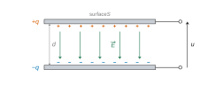
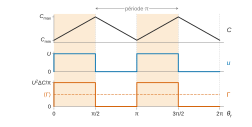
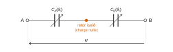
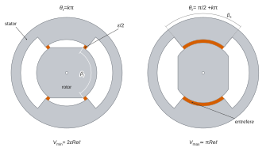
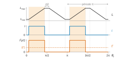
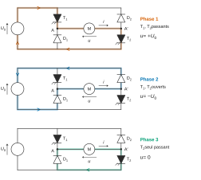

# Mines-Ponts PSI — Physique 2 2026 · Corrigé brut

*Corrigé rédigé par IA, non officiel. Signalez toute erreur.*

Épreuve de 4 h, calculatrice interdite. Applications numériques à un chiffre significatif avec $\varepsilon_0\approx9\times10^{-12}$ F·m⁻¹, $\mu_0\approx10^{-6}$ H·m⁻¹, $c\approx3\times10^{8}$ m·s⁻¹.

## I — Moteur électrostatique à capacité variable

### Question 1

La flèche de $u$ pointe vers l'armature $+q$, de potentiel le plus élevé. Le champ $\vec E$, uniforme, va de l'armature $+q$ vers l'armature $-q$.

Il est nul à l'extérieur : les effets de bord sont négligés car $d\ll\sqrt S$.

### Question 2

**1) Définition de la capacité.** Les deux armatures sont en influence totale. La charge $q$ de l'armature vers laquelle pointe $u$ est proportionnelle à $u$. La capacité est ce coefficient de proportionnalité, positif, qui ne dépend que de la géométrie et du milieu :
$$\boxed{C=\frac{q}{u}}$$

**2) Détermination du champ.** Comme $d\ll\sqrt S$, chaque armature est assimilée à un plan infini uniformément chargé, de densité $\sigma=q/S$ ou $-\sigma$. Pour un plan infini de densité $\sigma$ et de normale $\vec n$ :

- tout plan contenant $\vec n$ est plan de symétrie, donc $\vec E=E\,\vec n$ ;
- l'invariance par translation parallèle au plan donne $E=E(z)$ ;
- le plan chargé est lui-même plan de symétrie, donc $E(-z)=-E(z)$.

Le théorème de Gauss sur un cylindre d'axe $\vec n$, de section $\Sigma$, symétrique par rapport au plan, donne
$$2E\Sigma=\frac{\sigma\Sigma}{\varepsilon_0}$$
Le champ d'un plan a donc pour norme $\sigma/2\varepsilon_0$ ; il s'éloigne du plan si $\sigma>0$.

Superposons les deux plans. À l'extérieur, les deux contributions sont opposées et s'annulent. Entre les armatures, elles sont toutes deux dirigées de $+q$ vers $-q$ et s'ajoutent :
$$\boxed{\vec E=\frac{q}{\varepsilon_0S}\,\vec u_{+\to-}}$$

**3) Lien entre le champ et la tension.** La tension est la circulation du champ de l'armature $+q$ à l'armature $-q$. Le champ étant uniforme sur la distance $d$ :
$$\begin{aligned}
u&=V_+-V_-\\
&=\int_+^-\vec E\cdot\mathrm d\vec\ell\\
&=Ed\\
&=\frac{qd}{\varepsilon_0S}
\end{aligned}$$

**4) Expression de la capacité.** La définition $C=q/u$ donne
$$\boxed{C=\frac{\varepsilon_0S}{d}}$$

### Question 3

Les électrodes rotoriques (1) et (2) sont reliées entre elles par l'axe, les électrodes statoriques (3) et (4) aussi. Les zones en regard forment des condensateurs plans en parallèle : la capacité est proportionnelle à l'aire en regard entre rotor et stator.

- À $\theta_{\mathrm r}=0$, (1) et (2) occupent les quadrants complémentaires de (3) et (4). Aucune surface n'est en regard : $C$ est minimale (valeur résiduelle due aux effets de bord).
- Après une rotation de $\pi/2$, chaque électrode rotorique vient exactement en face d'une électrode statorique : le recouvrement est total.
- La configuration se répète après une rotation de $\pi$.

$$\boxed{\begin{aligned}
&C=C_{\min}\ \text{pour}\ \theta_{\mathrm r}=k\pi\\
&C=C_{\max}\ \text{pour}\ \theta_{\mathrm r}=\frac{\pi}{2}+k\pi
\end{aligned}}$$

À $\theta_{\mathrm r}=\pi/2$, deux quarts de disque de rayon $R$ sont en regard ; la zone de rayon $\delta\ll R$ autour de l'axe est négligée. L'aire d'un disque étant $\pi R^2$ :
$$\begin{aligned}
S_{\max}&=2\times\frac{\pi R^2}{4}\\
&=\frac{\pi R^2}{2}
\end{aligned}$$
Avec $d\ll R$ (effets de bord négligés) et la question 2 :
$$\boxed{C_{\max}=\frac{\pi\varepsilon_0R^2}{2d}}$$

### Question 4

Sur $[0,\pi/2]$, chaque électrode rotorique recouvre une électrode statorique sur un secteur d'angle $\theta_{\mathrm r}$. L'aire d'un secteur d'angle $\alpha$ est $\tfrac12R^2\alpha$, d'où la surface en regard :
$$\begin{aligned}
S(\theta_{\mathrm r})&=2\times\frac12R^2\theta_{\mathrm r}\\
&=R^2\theta_{\mathrm r}
\end{aligned}$$
Elle est affine en $\theta_{\mathrm r}$. Sur $[\pi/2,\pi]$, le recouvrement décroît symétriquement. En raccordant aux valeurs extrêmes $C(0)=C_{\min}$ et $C(\pi/2)=C_{\max}$, on obtient une loi triangulaire :
$$\boxed{C(\theta_{\mathrm r})=\begin{cases}C_{\min}+\dfrac{2}{\pi}(C_{\max}-C_{\min})\,\theta_{\mathrm r}, & 0\le\theta_{\mathrm r}\le\dfrac{\pi}{2}\\[2mm] C_{\min}+\dfrac{2}{\pi}(C_{\max}-C_{\min})\,(\pi-\theta_{\mathrm r}), & \dfrac{\pi}{2}\le\theta_{\mathrm r}\le\pi\end{cases}}$$

Tracé sur $[0,2\pi]$ : une suite de triangles à segments droits (première ligne de la figure 2, question 6). **Période $\pi$.**

| $\theta_{\mathrm r}$ | $0$ | $\pi/2$ | $\pi$ | $3\pi/2$ | $2\pi$ |
|---|---|---|---|---|---|
| $C$ | $C_{\min}$ | $C_{\max}$ | $C_{\min}$ | $C_{\max}$ | $C_{\min}$ |

### Question 5

L'énergie stockée est $\mathcal E_{\text{el}}=\tfrac12C(\theta_{\mathrm r})u^2$. On la dérive par rapport à $\theta_{\mathrm r}$ à $u$ fixé :
$$\boxed{\Gamma=\frac{1}{2}u^2\frac{\mathrm dC}{\mathrm d\theta_{\mathrm r}}}$$

Pour réaliser un moteur, la puissance mécanique moyenne $\langle\Gamma\rangle\Omega$ fournie doit être positive en régime permanent. Il faut donc **$\langle\Gamma\rangle\neq0$, du signe de $\Omega$** (positif pour une rotation dans le sens de $\theta_{\mathrm r}$ croissant).

Sous tension constante $U$, on moyenne sur une période $\pi$ :
$$\begin{aligned}
\langle\Gamma\rangle&=\frac{U^2}{2\pi}\int_0^{\pi}\frac{\mathrm dC}{\mathrm d\theta_{\mathrm r}}\,\mathrm d\theta_{\mathrm r}\\
&=\frac{U^2}{2\pi}\big[C(\pi)-C(0)\big]\\
&=0
\end{aligned}$$
La moyenne sur une période de la dérivée d'une fonction périodique est nulle. **On ne peut pas alimenter le moteur sous tension constante** : le rotor serait ramené vers une position de capacité maximale et s'y bloquerait.

### Question 6

$\Gamma$ a le signe de $\mathrm dC/\mathrm d\theta_{\mathrm r}$.

Pour $\Omega>0$, on applique donc $U$ seulement quand $C$ croît, et l'on impose $u=0$ quand $C$ décroît :
$$\boxed{\begin{aligned}
&u=U\ \text{pour}\ \theta_{\mathrm r}\in\Big]k\pi,\ k\pi+\frac{\pi}{2}\Big[\\
&u=0\ \text{pour}\ \theta_{\mathrm r}\in\Big]k\pi+\frac{\pi}{2},\ (k+1)\pi\Big[
\end{aligned}}$$

On note $\Delta C=C_{\max}-C_{\min}$. Sur les intervalles alimentés, la pente vaut $2\Delta C/\pi$, donc
$$\Gamma=\frac{U^2(C_{\max}-C_{\min})}{\pi}$$
Ailleurs, $\Gamma=0$. La courbe $\Gamma(\theta_{\mathrm r})$ est un créneau de rapport cyclique $1/2$ et de période $\pi$ :

Le couple moyen est la valeur crête multipliée par la fraction de période alimentée :
$$\begin{aligned}
\langle\Gamma\rangle&=\frac{1}{\pi}\cdot\frac{U^2(C_{\max}-C_{\min})}{\pi}\cdot\frac{\pi}{2}\\
&=\boxed{\frac{U^2(C_{\max}-C_{\min})}{2\pi}}
\end{aligned}$$

### Question 7

La tension doit se répéter chaque fois que le rotor retrouve la même configuration, c'est-à-dire après une rotation de $\pi$ (un demi-tour). Avec $\theta_{\mathrm r}=\Omega t$, la période de $u$ est $T=\pi/\Omega$. Son fondamental a la même période :
$$\begin{aligned}
\omega&=\frac{2\pi}{T}\\
&=\boxed{2\Omega}
\end{aligned}$$

### Question 8

D'après la question 7, $f=\Omega/\pi$ (car $\omega=2\pi f$), soit $\Omega=\pi f$. En régime permanent, $\Omega$ est constante, donc la puissance moyenne est $\langle\Gamma\Omega\rangle=\langle\Gamma\rangle\Omega$ :
$$\begin{aligned}
\langle\mathcal P_{\text{m,el}}\rangle&=\frac{U^2(C_{\max}-C_{\min})}{2\pi}\cdot\pi f\\
&=\boxed{\frac{1}{2}fU^2(C_{\max}-C_{\min})}
\end{aligned}$$

### Question 9

**Période de $C$.** Les $2p$ secteurs d'angle $\pi/2p$, espacés de $\pi/2p$, forment un motif qui se reproduit après une rotation de $2\times\pi/2p$ :
$$\boxed{\text{période de }C(\theta_{\mathrm r})\ :\ \frac{\pi}{p}}$$
La surface rotorique totale ne dépend pas de $p$, donc $C_{\max}$ est inchangée :
$$2p\times\frac12R^2\times\frac{\pi}{2p}=\frac{\pi R^2}{2}$$

**Intervalles d'alimentation.** On alimente là où $C$ croît ($u=0$ ailleurs) :
$$\boxed{u=U\ \text{pour}\ \theta_{\mathrm r}\in\Big]\frac{k\pi}{p},\ \frac{k\pi}{p}+\frac{\pi}{2p}\Big[}$$

**Couple moyen.** La pente devient $2p\Delta C/\pi$ et le couple crête $pU^2\Delta C/\pi$, appliqué la moitié du temps. Le couple moyen est multiplié par $p$ :
$$\boxed{\langle\Gamma\rangle=\frac{pU^2(C_{\max}-C_{\min})}{2\pi}}$$

**Pulsation.** La période temporelle devient $\pi/(p\Omega)$ :
$$\boxed{\omega=2p\Omega}$$

**Puissance.** On a maintenant $f=p\Omega/\pi$, soit $\Omega=\pi f/p$ :
$$\begin{aligned}
\langle\mathcal P\rangle&=\langle\Gamma\rangle\Omega\\
&=\frac{pU^2\Delta C}{2\pi}\cdot\frac{\pi f}{p}\\
&=\boxed{\frac12fU^2(C_{\max}-C_{\min})}
\end{aligned}$$
La puissance moyenne est **inchangée à fréquence d'alimentation donnée** : le couple est multiplié par $p$, mais la vitesse est divisée par $p$. À vitesse $\Omega$ donnée, elle serait multipliée par $p$.

### Question 10

**Relation.** L'empilement alterne stator–rotor–stator–…–rotor–stator. Chacune des $N$ plaques rotoriques est encadrée par deux plaques statoriques : il y a $2N$ espaces d'épaisseur $d$. Chacun équivaut au condensateur à une couche (mêmes secteurs, même $R$, même $d$).

Les plaques rotoriques sont toutes reliées à l'axe, les plaques statoriques toutes reliées entre elles. Les $2N$ condensateurs sont donc soumis à la même tension : ils sont en parallèle et leurs capacités s'ajoutent.
$$\boxed{C_N(\theta_{\mathrm r})=2N\,C(\theta_{\mathrm r})}$$

**Puissance.** La formule de la question 8 s'applique avec $C_N$ :
$$\begin{aligned}
\langle\mathcal P\rangle&=\frac12fU^2(C_{N,\max}-C_{N,\min})\\
&=2N\times\frac12fU^2(C_{\max}-C_{\min})
\end{aligned}$$
La puissance moyenne est multipliée par $2N$.

**AN.** Avec $R=10^{-2}$ m et $d=1{,}5\times10^{-4}$ m ($p=3$ ne change pas $C_{\max}$) :
$$\begin{aligned}
C_{\max}&=\frac{\pi\varepsilon_0R^2}{2d}\\
&=\frac{\pi\times9\times10^{-12}\times10^{-4}}{3\times10^{-4}}\ \text{F}\\
&\approx9\times10^{-12}\ \text{F}
\end{aligned}$$
puis
$$\boxed{C_{N,\max}=28\,C_{\max}\approx3\times10^{-10}\ \text{F}}$$
On néglige $C_{N,\min}$. Avec $U=100$ V, $f=1$ kHz et un rapport cyclique de 50 % (celui de la question 6) :
$$\langle\mathcal P\rangle\approx\frac12\times10^{3}\times10^{4}\times2{,}6\times10^{-10}\ \text{W}$$
$$\boxed{\langle\mathcal P\rangle\approx1\ \text{mW}}$$

**Commentaire.** C'est une puissance très faible. Le moteur a 2 cm de diamètre et environ 13 mm de hauteur ($15\times0{,}3+14\times0{,}3+28\times0{,}15$ mm), soit environ 4 cm³. Sa puissance volumique est donc d'environ $3\times10^{2}$ W·m⁻³, alors qu'un petit moteur électromagnétique de ce volume fournit de l'ordre du watt.

La vitesse correspondante, $\Omega=\pi f/p\approx10^{3}$ rad·s⁻¹ (environ $10^{4}$ tr/min), est déjà élevée : on ne peut guère gagner par la fréquence. Le moteur électrostatique macroscopique n'est envisageable que pour de faibles puissances (partie IV).

### Question 11

**Schéma équivalent.** Le rotor, isolé, est un conducteur flottant de charge totale nulle. Il est en influence avec le demi-stator A (capacité $C_A$) et avec le demi-stator B (capacité $C_B$), et n'est relié à rien d'autre. Entre A et B, le moteur équivaut donc à **deux condensateurs variables $C_A(\theta_{\mathrm r})$ et $C_B(\theta_{\mathrm r})$ en série**, le rotor étant le point milieu.

Dans le montage initial, les deux électrodes statoriques étaient reliées, donc $C=C_A+C_B$. La rotation de $\pi$ autour de l'axe laisse le rotor invariant et échange les deux demi-stators : $C_A=C_B=C/2$ pour tout $\theta_{\mathrm r}$. D'où
$$\begin{aligned}
C_{\text{éq}}&=\frac{C_AC_B}{C_A+C_B}\\
&=\boxed{\frac{C(\theta_{\mathrm r})}{4}}
\end{aligned}$$

**Condition.** $C_{\text{éq}}$ a la même forme que $C$ (même période, mêmes intervalles d'alimentation), avec une excursion $(C_{\max}-C_{\min})/4$. La charge du rotor étant fixée, l'énergie s'écrit $\tfrac12C_{\text{éq}}u^2$ et les résultats des questions 5 à 8 s'appliquent :
$$\langle\mathcal P'\rangle=\frac12fU'^2\,\frac{C_{\max}-C_{\min}}{4}$$
L'égalité avec $\tfrac12fU^2(C_{\max}-C_{\min})$ impose
$$\boxed{U'=2U}$$

## II — Moteur électromagnétique monophasé à inductance variable

### Question 12

Dans le fer doux (modèle linéaire), $\vec B=\mu_0\mu_{\mathrm r}\vec H$ avec $\mu_{\mathrm r}\sim10^{3}$ à $10^{4}$. Dans l'air, $\vec B=\mu_0\vec H$.

Les lignes de champ traversent l'entrefer quasi normalement aux faces polaires. Le flux de $\vec B$ est conservatif, donc la composante normale de $\vec B$ est continue à l'interface. Ainsi $\|\vec B\|$ est du même ordre dans le fer et dans l'entrefer, alors que $\|\vec H\|$ est $\mu_{\mathrm r}$ fois plus grand dans l'entrefer que dans le fer.

- Simulation 1 : valeurs faibles (clair) partout, sauf dans la mince bande d'entrefer (foncé). C'est la carte de $\|\vec H\|$.
- Simulation 2 : valeurs élevées (foncé) dans tout le circuit de fer (culasse, pôles, rotor), faibles dans l'air hors entrefer. C'est la carte du flux, donc de $\|\vec B\|$.

$$\boxed{\text{la simulation 2 donne }\|\vec B\|\ (\text{la simulation 1 donne }\|\vec H\|)}$$

On compare chaque grandeur d'une région à l'autre, jamais $B$ à $H$, qui n'ont pas la même unité.

### Question 13

**Observation des simulations.** Sur la figure 5, les lignes de champ restent canalisées dans le fer (culasse, pôles, rotor) et ne passent dans l'air qu'à la traversée des deux entrefers. Hors des entrefers, presque aucune ligne de champ ne parcourt l'air, et la carte de $\|\vec B\|$ (simulation 2) y est claire : le champ y est négligeable.

**Justification physique.** Le fer, de perméabilité très grande, canalise le flux : à $\vec B$ fini, $\vec H=\vec B/\mu$ y est quasi nul. Le théorème d'Ampère impose alors la même circulation $2Ni$ de $\vec H$, concentrée dans l'air, sur tout contour qui enlace les enroulements.

Un contour qui ne traverse l'air que dans les entrefers y parcourt la longueur $2e$. Un contour qui traverse l'air hors des pôles y parcourt une longueur $2D$, avec $D$ de l'ordre de $R$, donc $D\gg e$. La circulation dans le fer étant négligeable :
$$\begin{aligned}
2e\,H_{\text{entrefer}}&\simeq2Ni\\
2D\,H_{\text{air}}&\simeq2Ni
\end{aligned}$$
d'où
$$\boxed{\frac{B_{\text{air, hors entrefer}}}{B_{\text{entrefer}}}\sim\frac{e}{D}\ll1}$$
Le champ dans l'air hors des entrefers est négligeable devant le champ dans les entrefers.

### Question 14

Contour d'Ampère : une ligne de champ qui sort d'un pôle statorique, traverse un entrefer, le rotor, le second entrefer, le second pôle, et revient par la culasse. Elle est orientée dans le sens du champ ; la règle de la main droite fixe alors le signe du courant enlacé.

- Courant enlacé : les deux enroulements de $N$ spires, en série et bobinés pour que leurs ampères-tours s'ajoutent, donnent $2Ni$.
- Fer ($\mu\to\infty$, $B$ fini) : $\vec H=\vec 0$, contribution nulle.
- Entrefers : champ normal aux faces, uniforme car $e\ll R$ ; chacun contribue pour $H_ae$.

$$\begin{aligned}
\oint\vec H\cdot\mathrm d\vec\ell&=2H_ae\\
&=2Ni
\end{aligned}$$
d'où $H_a=Ni/e$. Dans l'air, $B_a=\mu_0H_a$ :
$$\boxed{B_a=\frac{\mu_0Ni}{e}}$$
Ce résultat vaut en tout point des deux entrefers : le même raisonnement s'applique à toute ligne de champ.

### Question 15

**Repérage.** Les pôles statoriques, d'ouverture $\beta_{\mathrm s}=\pi/2-\epsilon$, sont centrés en $\pm\pi/2$.

Les pôles rotoriques, d'ouverture $\beta_{\mathrm r}=\pi/2+2\epsilon$, sont centrés en $\theta_{\mathrm r}$ et $\theta_{\mathrm r}+\pi$. L'entrefer est la zone d'air d'épaisseur $e$ où un pôle rotorique fait face à un pôle statorique.

**Volume d'un secteur d'entrefer.** L'aire d'un secteur circulaire d'angle au sommet $\alpha$ et de rayon $R$ est $\tfrac12\alpha R^2$.

Un secteur d'entrefer d'angle $\alpha$, compris entre les rayons $R$ et $R+e$, de longueur $\ell$, a donc pour volume
$$\begin{aligned}
V&=\frac{\alpha}{2}\big[(R+e)^2-R^2\big]\ell\\
&\simeq\alpha\,Re\ell
\end{aligned}$$
car $e\ll R$. Le volume total est $\alpha Re\ell$, où $\alpha(\theta_{\mathrm r})$ est l'angle total de recouvrement.

**Position $\theta_{\mathrm r}=k\pi$** (rotor horizontal, pôles en quadrature). Le pôle rotorique centré en $0$ s'étend jusqu'à $\pi/4+\epsilon$.

Le pôle statorique supérieur commence en $\pi/2-\beta_{\mathrm s}/2$, soit $\pi/4+\epsilon/2$. Le recouvrement vaut donc $\epsilon/2$.

Allure : seules les « cornes » des pôles se font face, en quatre petits secteurs d'ouverture $\epsilon/2$ (un à chaque extrémité de chaque pôle rotorique). Le volume est minimal :
$$\begin{aligned}
V_{\min}&=4\times\frac{\epsilon}{2}\,Re\ell\\
&=\boxed{2\epsilon\,Re\ell}
\end{aligned}$$

**Position $\theta_{\mathrm r}=(2k+1)\pi/2$** (pôles alignés). Le pôle rotorique, plus large, couvre entièrement le pôle statorique en regard : il y a deux secteurs d'entrefer d'ouverture $\beta_{\mathrm s}$. L'angle total vaut $2\beta_{\mathrm s}=\pi-2\epsilon$, soit environ $\pi$. Le volume est maximal :
$$\boxed{V_{\max}\simeq\pi Re\ell}$$

### Question 16

**Définition énergétique.** Pour le circuit parcouru par $i$, l'inductance $L$ est définie par l'énergie magnétique totale stockée :
$$\boxed{\mathcal E_{\text{ma}}=\frac{1}{2}Li^2}$$

**Calcul.** L'énergie magnétique est l'intégrale de la densité $B^2/2\mu$. Elle est nulle dans le fer ($\mu\to\infty$, $B$ fini) et négligeable dans l'air hors entrefers (question 13). Avec $B_a=\mu_0Ni/e$ uniforme sur le volume $V$ des entrefers :
$$\begin{aligned}
\mathcal E_{\text{ma}}&=\frac{B_a^2}{2\mu_0}V\\
&=\frac{\mu_0N^2i^2}{2e^2}V
\end{aligned}$$
Par identification avec $\tfrac12Li^2$ :
$$L(\theta_{\mathrm r})=\frac{\mu_0N^2}{e^2}V(\theta_{\mathrm r})$$
Avec les volumes de la question 15 :
$$\boxed{\begin{aligned}
L_{\min}&=\frac{2\mu_0N^2\epsilon R\ell}{e}\\
L_{\max}&=\frac{\pi\mu_0N^2R\ell}{e}
\end{aligned}}$$

**Variation.** $L$ est proportionnelle à l'angle de recouvrement $\alpha(\theta_{\mathrm r})$, que l'on suit de $0$ à $\pi/2$ :

- pour $|\theta_{\mathrm r}|\le\epsilon/2$, deux coins gagnent ce que les deux autres perdent : palier à $L_{\min}$ ;
- pour $\epsilon/2\le\theta_{\mathrm r}\le\pi/2-3\epsilon/2$, il ne reste que deux zones de recouvrement, qui croissent chacune comme $\theta_{\mathrm r}$ : $\alpha=2\theta_{\mathrm r}+\epsilon$ est affine ;
- palier à $L_{\max}$ tant que le pôle statorique reste entièrement couvert, soit pour $|\theta_{\mathrm r}-\pi/2|\le3\epsilon/2$ ;
- puis décroissance symétrique.

**$L$ varie de façon affine par morceaux (courbe trapézoïdale) entre $L_{\min}$ et $L_{\max}$, avec une période $\pi$.** La variation n'est pas seulement continue : elle est linéaire sur chaque rampe.

### Question 17

L'énergie $\mathcal E_{\text{ma}}=\tfrac12L(\theta_{\mathrm r})i^2$ est dérivée à $i$ fixé :
$$\boxed{\Gamma=\frac{1}{2}i^2\frac{\mathrm dL}{\mathrm d\theta_{\mathrm r}}}$$
À courant constant $I$, sur une période $\pi$ :
$$\begin{aligned}
\langle\Gamma\rangle&=\frac{I^2}{2\pi}\big[L(\pi)-L(0)\big]\\
&=0
\end{aligned}$$
par périodicité de $L$. **Non**, un courant constant ne permet pas de réaliser un moteur : le rotor se bloque en position d'inductance maximale (pôles alignés).

### Question 18

D'après la figure 6, modulo $\pi$ :

- $L$ croît sur $[\Delta\beta/2,\ \pi/2-\Delta\beta/2]$ ;
- $L$ est constante sur les paliers de largeur $\Delta\beta$ centrés en $k\pi/2$ ;
- $L$ décroît sur $[\pi/2+\Delta\beta/2,\ \pi-\Delta\beta/2]$.

Le couple a le signe de $\mathrm dL/\mathrm d\theta_{\mathrm r}$ : on n'envoie le courant que sur les rampes montantes.
$$\boxed{\begin{aligned}
&i=I\ \text{pour}\ \theta_{\mathrm r}\in\Big[k\pi+\frac{\Delta\beta}{2},\ k\pi+\frac{\pi}{2}-\frac{\Delta\beta}{2}\Big]\\
&i=0\ \text{ailleurs}
\end{aligned}}$$

Diagramme synchrone sur $[0,2\pi]$, avec la pente $\rho$ de la question 23 :
$$\rho=\frac{L_{\max}-L_{\min}}{\pi/2-\Delta\beta}$$

Valeurs sur la première période :

| $\theta_{\mathrm r}$ | $[0,\frac{\Delta\beta}{2}]$ | $[\frac{\Delta\beta}{2},\frac{\pi}{2}-\frac{\Delta\beta}{2}]$ | $[\frac{\pi}{2}-\frac{\Delta\beta}{2},\frac{\pi}{2}+\frac{\Delta\beta}{2}]$ | $[\frac{\pi}{2}+\frac{\Delta\beta}{2},\pi-\frac{\Delta\beta}{2}]$ | $[\pi-\frac{\Delta\beta}{2},\pi]$ |
|---|---|---|---|---|---|
| $L$ | $L_{\min}$ | rampe montante | $L_{\max}$ | rampe descendante | $L_{\min}$ |
| $i$ | $0$ | $I$ | $0$ | $0$ | $0$ |
| $\Gamma$ | $0$ | $\dfrac{I^2(L_{\max}-L_{\min})}{2(\pi/2-\Delta\beta)}$ | $0$ | $0$ | $0$ |

Le motif se répète sur $[\pi,2\pi]$. Couple moyen sur une période $\pi$, les angles étant exprimés en radians :
$$\begin{aligned}
\langle\Gamma\rangle&=\frac{1}{\pi}\int_{\text{rampe}}\frac{I^2}{2}\frac{\mathrm dL}{\mathrm d\theta_{\mathrm r}}\,\mathrm d\theta_{\mathrm r}\\
&=\frac{I^2}{2\pi}\int_{L_{\min}}^{L_{\max}}\mathrm dL\\
&=\boxed{\frac{I^2(L_{\max}-L_{\min})}{2\pi}}
\end{aligned}$$

### Question 19

$L$, donc le créneau de courant, est $\pi$-périodique en $\theta_{\mathrm r}$. Avec $\theta_{\mathrm r}=\Omega t$, la période temporelle est $\pi/\Omega$ (un demi-tour) :
$$\boxed{\omega=2\Omega}$$

### Question 20

D'après la question 19, $f=\Omega/\pi$. La vitesse $\Omega$ étant constante, la puissance moyenne vaut $\langle\Gamma\rangle\Omega$ :
$$\begin{aligned}
\langle\mathcal P_{\text{m,ma}}\rangle&=\frac{I^2(L_{\max}-L_{\min})}{2\pi}\cdot\pi f\\
&=\boxed{\frac{1}{2}fI^2(L_{\max}-L_{\min})}
\end{aligned}$$

## III — Alimentation électrique du moteur monophasé à inductance variable

### Question 21

En convention récepteur, la loi de Faraday avec le flux propre $\Phi=L(\theta_{\mathrm r})i$ donne
$$\begin{aligned}
u&=ri+\frac{\mathrm d\Phi}{\mathrm dt}\\
&=ri+L\frac{\mathrm di}{\mathrm dt}+i\frac{\mathrm dL}{\mathrm d\theta_{\mathrm r}}\frac{\mathrm d\theta_{\mathrm r}}{\mathrm dt}
\end{aligned}$$
On introduit la vitesse angulaire du rotor :
$$\boxed{\Omega=\frac{\mathrm d\theta_{\mathrm r}}{\mathrm dt}}$$
On change ensuite de variable, $\mathrm di/\mathrm dt=\Omega\,\mathrm di/\mathrm d\theta_{\mathrm r}$. Il vient
$$\boxed{\Big[r+\Omega\frac{\mathrm dL}{\mathrm d\theta_{\mathrm r}}\Big]i(\theta_{\mathrm r})+\Omega L(\theta_{\mathrm r})\frac{\mathrm di}{\mathrm d\theta_{\mathrm r}}=u(\theta_{\mathrm r})}$$

### Question 22

Notons K le point commun à T, D et au moteur, et prenons la borne $-$ de la source comme référence des potentiels. T passant (idéal) relie K à la borne $+$ : $V_K=U_0$.

D a son anode à la borne $-$ et sa cathode en K (figure 7). La tension à ses bornes vaut $v_{AK}=-U_0<0$ : **D est bloquée**. Le moteur est alors directement aux bornes de la source :
$$\boxed{u=U_0}$$
Le transistor ne conduit que dans un sens : **$i\ge0$**. Sous $u=U_0>0$, le courant croît à partir de $0$.

**Règles d'interconnexion** : on ne doit pas court-circuiter une source de tension, ni ouvrir le circuit d'une source de courant. Ici, la source de tension $U_0$ est reliée au moteur. Par son inductance $L$, le moteur impose la continuité de son courant : c'est un dipôle de type source de courant.

On connecte donc une source de tension à une source de courant, et D, bloquée, ne court-circuite pas la source : **les règles sont respectées**.

### Question 23

T est commandé pour imposer le courant sur les intervalles de la question 18, c'est-à-dire sur la rampe montante de $L$. Celle-ci va de la fin du palier bas ($\theta_{\mathrm r}=\Delta\beta/2$) au début du palier haut ($\theta_{\mathrm r}=\pi/2-\Delta\beta/2$).

Sur cet intervalle d'amplitude $\pi/2-\Delta\beta$, $L$ varie linéairement de $L_{\min}$ à $L_{\max}$ (figure 6), d'où la pente constante
$$\frac{\mathrm dL}{\mathrm d\theta_{\mathrm r}}=\frac{L_{\max}-L_{\min}}{\pi/2-\Delta\beta}$$
notée $\rho$. Avec $u=U_0$, l'équation de la question 21 devient
$$\boxed{(r+\Omega\rho)\,i+\Omega L(\theta_{\mathrm r})\frac{\mathrm di}{\mathrm d\theta_{\mathrm r}}=U_0}$$
où, sur cette rampe,
$$L(\theta_{\mathrm r})=L_{\min}+\rho\Big(\theta_{\mathrm r}-\frac{\Delta\beta}{2}\Big)$$

### Question 24

À l'ouverture de T ($\theta_{\mathrm r}=\pi/2-\Delta\beta/2$), le courant dans le moteur inductif ne peut pas s'annuler brutalement. Il se referme par D, dans son sens passant (de la borne $-$ vers K). **D est passante** et impose $u=0$, tant que $i>0$.

Sur $\big[\frac{\pi}{2}-\frac{\Delta\beta}{2},\ \pi+\frac{\Delta\beta}{2}\big]$, la dérivée $\mathrm dL/\mathrm d\theta_{\mathrm r}$ prend successivement les valeurs :

- $0$ sur le palier $L_{\max}$ ;
- $-\rho$ sur la rampe descendante ;
- $0$ sur le palier $L_{\min}$.

Équations successives, avec $u=0$ :
$$\boxed{\begin{aligned}
&\theta_{\mathrm r}\in\Big[\tfrac{\pi}{2}-\tfrac{\Delta\beta}{2},\ \tfrac{\pi}{2}+\tfrac{\Delta\beta}{2}\Big] : && r\,i+\Omega L_{\max}\frac{\mathrm di}{\mathrm d\theta_{\mathrm r}}=0\\
&\theta_{\mathrm r}\in\Big[\tfrac{\pi}{2}+\tfrac{\Delta\beta}{2},\ \pi-\tfrac{\Delta\beta}{2}\Big] : && (r-\Omega\rho)\,i+\Omega L(\theta_{\mathrm r})\frac{\mathrm di}{\mathrm d\theta_{\mathrm r}}=0\\
&\theta_{\mathrm r}\in\Big[\pi-\tfrac{\Delta\beta}{2},\ \pi+\tfrac{\Delta\beta}{2}\Big] : && r\,i+\Omega L_{\min}\frac{\mathrm di}{\mathrm d\theta_{\mathrm r}}=0
\end{aligned}}$$
avec, sur la rampe descendante,
$$L(\theta_{\mathrm r})=L_{\max}-\rho\Big(\theta_{\mathrm r}-\frac{\pi}{2}-\frac{\Delta\beta}{2}\Big)$$

### Question 25

On isole la dérivée du courant :
$$\frac{\mathrm di}{\mathrm d\theta_{\mathrm r}}=\frac{u-\big(r+\Omega\,\mathrm dL/\mathrm d\theta_{\mathrm r}\big)i}{\Omega L}$$
Sur chaque phase, l'évolution de $i$ est gouvernée par une constante de relaxation angulaire (la variable est l'angle, pas le temps) :
$$\theta_0=\frac{\Omega L}{r+\Omega\,\mathrm dL/\mathrm d\theta_{\mathrm r}}$$

- **Montée** (T fermé, début de rampe) : $i=0$ et $L=L_{\min}$. La pente $U_0/(\Omega L_{\min})$ est la plus forte du cycle : front très raide.
- **Plateau** : la f.c.é.m. $\Omega\rho\,i$ et la chute $ri$ croissent, et $L$ augmente. Le courant tend vers $U_0/(r+\Omega\rho)$ : il est quasi constant.
- **Palier $L_{\max}$** (T ouvert, $u=0$) : décroissance exponentielle de constante d'angle $\Omega L_{\max}/r$. L'énergie n'est évacuée que par effet Joule dans $r$.
- **Rampe descendante** : le coefficient devient $r-\Omega\rho<r$. Le terme de conversion, devenu générateur, entretient le courant : la décroissance est encore plus lente (le courant croîtrait même si $\Omega\rho>r$).
- **Palier $L_{\min}$** : la constante d'angle $\Omega L_{\min}/r$ est nettement plus petite. Le courant résiduel s'annule plus vite, juste avant l'impulsion suivante.

### Question 26

**Défaut** : le courant n'est pas éteint quand $L$ commence à décroître. Sur la rampe descendante, le couple est négatif :
$$\Gamma=\frac12i^2\frac{\mathrm dL}{\mathrm d\theta_{\mathrm r}}<0$$
C'est un **couple de freinage** (créneau négatif puis retour progressif à zéro sur la figure 8), qui réduit le couple moyen et la puissance.

**Cause** : en roue libre, D impose $u=0$. L'énergie magnétique $\tfrac12L_{\max}i^2$ ne peut être dissipée que dans la faible résistance $r$ : la démagnétisation est lente, et encore ralentie sur la rampe descendante par le fonctionnement en génératrice.

**Le montage ne peut appliquer qu'une tension $u\ge0$ : il ne sait pas imposer une tension négative pour annuler rapidement le courant.**

### Question 27

Notations : H et B sont les bornes $+$ et $-$ de la source.

A est le point commun à $\mathrm T_1$, à $\mathrm D_1$ et au moteur. A' est le point commun au moteur, à $\mathrm D_2$ et à $\mathrm T_2$.

On oriente $u=V_A-V_{A'}$ et $i>0$ de A vers A'. D'après la figure 9, $\mathrm D_1$ a son anode en B et sa cathode en A. $\mathrm D_2$ a son anode en A' et sa cathode en H.

| Phase | Conduction | $u$ | $\mathrm D_1$ | $\mathrm D_2$ |
|---|---|---|---|---|
| 1 : $\mathrm T_1$, $\mathrm T_2$ passants | H → $\mathrm T_1$ → moteur → $\mathrm T_2$ → B | $+U_0$ | bloquée | bloquée |
| 2 : $\mathrm T_1$, $\mathrm T_2$ ouverts | B → $\mathrm D_1$ → moteur → $\mathrm D_2$ → H (courant renvoyé dans la source) | $-U_0$ | passante | passante |
| 3 : $\mathrm T_2$ passant, $\mathrm T_1$ ouvert | moteur → $\mathrm T_2$ → B → $\mathrm D_1$ → moteur (roue libre) | $0$ | passante | bloquée |

En phase 1, chaque diode a la tension $-U_0$ à ses bornes. En phase 3, $\mathrm D_2$ a la tension $V_{A'}-V_H=-U_0$ à ses bornes.

En phases 2 et 3, ces états supposent $i>0$. Une fois le courant annulé, les diodes se bloquent et $u=0$.

### Question 28

**Comparaison.** Les montées sont identiques : $u=U_0$, même équation qu'en question 23. À l'extinction, le montage 1 impose $u=0$ : la décroissance est exponentielle, lente, gouvernée par $r$, et se prolonge sur toute la rampe descendante (figure 8).

Le montage 2 impose $u=-U_0$ : le terme $\Omega L\,\mathrm di/\mathrm d\theta_{\mathrm r}\simeq-U_0$ domine et la décroissance est quasi linéaire et rapide. Sur la figure 10, le courant s'annule vers la fin du palier $L_{\max}$, donc avant que $L$ ne décroisse.

**Performances du montage 2.**

- Il n'y a plus de courant pendant la décroissance de $L$, donc **plus de couple de freinage**. Le couple est un créneau positif ; le couple moyen et la puissance se rapprochent de l'idéal $I^2\Delta L/2\pi$.
- L'énergie magnétique stockée est **restituée à la source** en phase 2 au lieu d'être dissipée dans $r$ : meilleur rendement.
- La phase 3 (roue libre) permet en outre de réguler le courant par découpage.

## IV — Comparaison des deux types de moteurs. Lois d'échelle et « downsizing »

### Question 29

**Électrostatique.** Comme $C_{\min}\ll C_{\max}$ :
$$\langle\mathcal P_{\text{m,el}}\rangle\simeq\frac12fU^2C_{\max}$$
Le champ est uniforme, $E_a=U/d$ (question 2). Avec $V_{a,\max}=S_{\max}d$ :
$$\begin{aligned}
C_{\max}&=\frac{\varepsilon_0S_{\max}}{d}\\
&=\frac{\varepsilon_0V_{a,\max}}{d^2}
\end{aligned}$$
Donc
$$\begin{aligned}
\langle\mathcal P_{\text{m,el}}\rangle&\simeq\frac12f(E_ad)^2\frac{\varepsilon_0V_{a,\max}}{d^2}\\
&=\boxed{\frac{\varepsilon_0}{2}fV_{a,\max}E_a^2}
\end{aligned}$$

**Électromagnétique.** Comme $L_{\min}\ll L_{\max}$ :
$$\langle\mathcal P_{\text{m,ma}}\rangle\simeq\frac12fI^2L_{\max}$$
D'après les questions 14 et 16, le courant et l'inductance maximale s'écrivent
$$\begin{aligned}
I&=\frac{B_ee}{\mu_0N}\\
L_{\max}&=\frac{\mu_0N^2V_{e,\max}}{e^2}
\end{aligned}$$
d'où $I^2L_{\max}=B_e^2V_{e,\max}/\mu_0$ et
$$\boxed{\langle\mathcal P_{\text{m,ma}}\rangle\simeq\frac{1}{2\mu_0}fV_{e,\max}B_e^2}$$

### Question 30

Pour des moteurs de mêmes dimensions ($V_{a,\max}=V_{e,\max}$) et à même fréquence, l'égalité des puissances s'écrit
$$\frac{\varepsilon_0}{2}E_a^2=\frac{B_e^2}{2\mu_0}$$
Avec $\varepsilon_0\mu_0c^2=1$ :
$$\begin{aligned}
E_a&=\frac{B_e}{\sqrt{\varepsilon_0\mu_0}}\\
&=cB_e
\end{aligned}$$
Le champ magnétique est limité par la saturation, $B_e=B_{\text{sat}}\approx1$ T :
$$\boxed{E_a\approx cB_{\text{sat}}\approx3\times10^{8}\ \text{V}\cdot\text{m}^{-1}}$$

### Question 31

**Champ disruptif.** Sur la branche droite de la courbe de Paschen, $V_c$ croît à peu près proportionnellement à $pd$. À pression fixée, $E_d=V_c/d$ dépend donc peu de $d$.

On choisit $p=1$ bar et $d=1$ mm, soit $pd=1$ bar·mm. La figure 11 donne alors $V_c\approx6\times10^{3}$ V :
$$\boxed{E_d\approx\frac{6\times10^{3}\ \text{V}}{10^{-3}\ \text{m}}\approx6\times10^{6}\ \text{V}\cdot\text{m}^{-1}}$$
La courbe n'étant pas exactement de pente 1, on trouve environ $4\times10^{6}$ V·m⁻¹ pour $d=1$ cm : $E_d$ vaut quelques $10^{6}$ V·m⁻¹.

**Rapport.** À volumes et fréquence égaux, avec $E_a=E_d$ et $B_e=B_{\text{sat}}$ :
$$\begin{aligned}
\kappa&=\frac{\varepsilon_0E_d^2/2}{B_{\text{sat}}^2/2\mu_0}\\
&=\Big(\frac{E_d}{cB_{\text{sat}}}\Big)^2\\
&\approx\Big(\frac{6\times10^{6}}{3\times10^{8}}\Big)^2\\
&\approx4\times10^{-4}
\end{aligned}$$
$$\boxed{\kappa\sim10^{-4}}$$

**Conclusion.** À pression atmosphérique, un moteur électrostatique macroscopique fournit environ $10^{4}$ fois moins de puissance qu'un moteur électromagnétique de mêmes dimensions : **il n'est pas compétitif** (cohérent avec le milliwatt de la question 10).

**Pression pour $\kappa\sim1$.** Il faut $E_d\approx cB_{\text{sat}}$, soit $3\times10^{8}$ V·m⁻¹.

Pour $d=1$ mm, cela demande $V_c\approx3\times10^{5}$ V. La figure 11 donne cette tension pour $pd\approx10^{2}$ bar·mm, donc
$$\boxed{p\approx10^{2}\ \text{bar}}$$
On trouve le même ordre de grandeur en raisonnant avec $E_d\propto p$, donc $\kappa\propto p^2$.

### Question 32

$$\boxed{\begin{aligned}
&[\varepsilon_0]=\text{F}\cdot\text{m}^{-1}\\
&[\mu_0]=\text{H}\cdot\text{m}^{-1}
\end{aligned}}$$
Ce sont des constantes fondamentales : elles sont insensibles au changement d'échelle. Une capacité est donc $\varepsilon_0$ multiplié par une longueur caractéristique et par un facteur de forme sans dimension, invariant dans une homothétie (par exemple $C=\varepsilon_0S/d\sim h^2/h$) :
$$\boxed{C\sim h}$$
De même, une inductance est $\mu_0N^2$ fois une longueur, à nombre de spires $N$ fixé (par exemple $L=\mu_0N^2V/e^2\sim h^3/h^2$) :
$$\boxed{L\sim h}$$

### Question 33

Comme à la question 2, chaque armature est modélisée par une distribution **surfacique** de charge : la charge est répartie **en surface**, uniformément sur les faces en regard, avec la densité surfacique $\sigma=\varepsilon_0E_a$ (théorème de Gauss, question 2).

On fait fonctionner la machine au champ limite $E_d$, propriété du gaz indépendante de la taille. La densité surfacique de charge $\sigma$ est donc invariante par changement d'échelle : c'est une grandeur intensive. La charge vaut alors $q=\sigma S\sim h^2$. Avec $C\sim h$ :
$$U=\frac{q}{C}\sim\frac{h^2}{h}$$
$$\boxed{U\sim h}$$
C'est équivalent à $U=E_dd$ avec $d\sim h$.

### Question 34

Moment d'inertie du rotor, à masse volumique inchangée :
$$\begin{aligned}
J&=\iiint\rho_m r_\perp^2\,\mathrm d\tau\\
&\sim h^2\cdot h^3\\
&\sim h^5
\end{aligned}$$
Travail du couple sur une phase motrice, d'excursion angulaire invariante :
$$\begin{aligned}
W&=\int\Gamma\,\mathrm d\theta_{\mathrm r}\\
&=\frac12U^2\Delta C\\
&\sim h^2\cdot h=h^3
\end{aligned}$$
Théorème de l'énergie cinétique pour le rotor en rotation autour d'un axe fixe, depuis le repos :
$$\frac12J\Omega^2=W$$
D'où $\Omega^2\sim h^3/h^5$, soit $\Omega\sim h^{-1}$. Le temps pour balayer un angle donné est $t=\Delta\theta/\Omega$ :
$$\boxed{t\sim h}$$

### Question 35

La fréquence d'alimentation est l'inverse d'un temps : $f\sim1/t\sim h^{-1}$. Avec le résultat de la question 8 :
$$\begin{aligned}
\langle\mathcal P_{\text{m,el}}\rangle&=\frac12fU^2\Delta C\\
&\sim h^{-1}\cdot h^2\cdot h
\end{aligned}$$
$$\boxed{\langle\mathcal P_{\text{m,el}}\rangle\sim h^2}$$
La puissance volumique s'obtient en divisant par $V\sim h^3$ :
$$\boxed{\langle\mathscr P_{\text{m,el}}\rangle=\frac{\langle\mathcal P_{\text{m,el}}\rangle}{V}\sim h^{-1}}$$
**Conclusion** : la puissance diminue quand on miniaturise, mais la puissance volumique **augmente** comme $1/h$. Le moteur électrostatique est d'autant plus performant, à volume donné, qu'il est petit.

### Question 36

Pour un câble de longueur $\ell_c$, de section $s$ et de conductivité $\gamma$ :
$$\boxed{r=\frac{\ell_c}{\gamma s}}$$
$\gamma$ est fixée par le matériau ; $\ell_c\sim h$ et $s\sim h^2$ (nombre de spires inchangé). Donc
$$\boxed{r\sim h^{-1}}$$

### Question 37

En régime permanent, la température est stationnaire : toute la puissance dissipée par effet Joule est évacuée vers l'extérieur.
$$\boxed{\mathcal P_{\text{th}}=\mathcal P_{\text{Joule}}}$$
D'une part, la surface d'échange vérifie $S\sim h^2$, et le coefficient $k$ et les températures ne dépendent pas de l'échelle : $\mathcal P_{\text{th}}\sim h^2$.

D'autre part, $\mathcal P_{\text{Joule}}\propto rI^2$ (le facteur de rapport cyclique est invariant). Donc $rI^2\sim h^2$, et avec $r\sim h^{-1}$ :
$$I^2\sim\frac{h^2}{h^{-1}}=h^3$$
$$\boxed{I\sim h^{3/2}}$$

### Question 38

On reprend la démarche de la question 34, avec $J\sim h^5$. Le travail du couple sur une phase motrice vaut
$$\begin{aligned}
W&=\frac12I^2\Delta L\\
&\sim h^3\cdot h=h^4
\end{aligned}$$
Le théorème de l'énergie cinétique, $\tfrac12J\Omega^2=W$, donne $\Omega^2\sim h^{-1}$. Avec $t=\Delta\theta/\Omega$ :
$$\boxed{t\sim h^{1/2}}$$
Ce temps n'obéit pas à la même loi que celui de la question 34 : la dynamique est ici imposée par la contrainte thermique sur le courant, et non par le champ disruptif.

### Question 39

La fréquence vérifie maintenant $f\sim h^{-1/2}$ :
$$\begin{aligned}
\langle\mathcal P_{\text{m,ma}}\rangle&=\frac12fI^2\Delta L\\
&\sim h^{-1/2}\cdot h^3\cdot h
\end{aligned}$$
$$\boxed{\langle\mathcal P_{\text{m,ma}}\rangle\sim h^{7/2}}$$
En divisant par $V\sim h^3$ :
$$\boxed{\langle\mathscr P_{\text{m,ma}}\rangle\sim h^{1/2}}$$
**Conclusion** : la puissance volumique du moteur électromagnétique **diminue** quand on miniaturise. Cause : la contrainte thermique limite le courant à $I\sim h^{3/2}$, donc $B_e=\mu_0NI/e\sim h^{1/2}$. Le champ dans l'entrefer, et avec lui la densité d'énergie magnétique, s'effondre à petite échelle.

### Question 40

| | électrostatique | électromagnétique |
|---|---|---|
| $\langle\mathcal P\rangle$ | $\sim h^2$ | $\sim h^{7/2}$ |
| $\langle\mathscr P\rangle$ | $\sim h^{-1}$ | $\sim h^{1/2}$ |

$$\boxed{\frac{\langle\mathcal P_{\text{m,el}}\rangle}{\langle\mathcal P_{\text{m,ma}}\rangle}\sim h^{-3/2}}$$
Le rapport croît quand $h$ diminue. À l'échelle centimétrique, $\kappa\sim10^{-4}$ (question 31). L'égalité est atteinte pour $h^{3/2}\sim\kappa$, soit $h\sim\kappa^{2/3}$ :

- avec $\kappa=10^{-4}$, $h\approx2\times10^{-3}$ ;
- avec $\kappa=4\times10^{-4}$, $h\approx5\times10^{-3}$.

Pour un moteur de rayon $R=1$ cm, cela correspond à des dimensions de **quelques dizaines de micromètres**.

**Conclusion** : à l'échelle macroscopique, le moteur électromagnétique l'emporte de plusieurs ordres de grandeur. Aux échelles micrométriques (microsystèmes, MEMS), le moteur électrostatique devient le plus performant.

La raison est physique : la limite du moteur électrostatique (le champ disruptif du diélectrique) ne dépend pas de la taille, alors que celle du moteur électromagnétique (l'échauffement) se dégrade quand on réduit les dimensions.

L'avantage est même renforcé à très petite distance inter-armatures. Pour $pd$ inférieur au minimum de Paschen (vers $10^{-2}$ bar·mm, où $V_c\approx3\times10^{2}$ V), la tension de claquage remonte et le champ admissible dépasse largement $E_d$.
