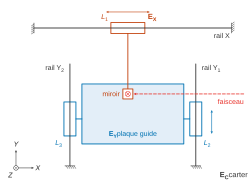
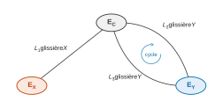
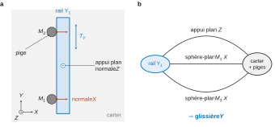
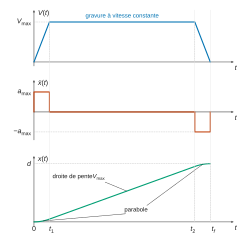
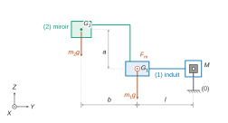
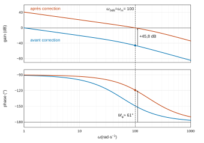

# Mines-Ponts PSI — Sciences industrielles 2026 · Corrigé brut

*Corrigé rédigé par IA, non officiel. Signalez toute erreur.*

Épreuve de 4 h, calculatrice interdite. Le cahier de réponses de 14 pages n'est pas disponible : pour les questions qui s'y appuient (Q1, Q3, Q5, Q10, Q18, Q21, Q34, Q35), la réponse s'appuie sur les données de l'énoncé et des annexes, et le signale.

Notations de la partie 2 (trois classes d'équivalence) :
- $E_C$ = ensemble carter (carter, inducteurs et rails X, Y1, Y2, source laser, périscope) ;
- $E_X$ = ensemble X (induit X et miroir de découpe) ;
- $E_Y$ = ensemble Y (induits Y1 et Y2 et plaque guide).

À partir de la partie 6, on reprend la numérotation de l'Annexe 4 : $(0)$ carter, $(1)$ induit X, $(2)$ miroir.

## 2. Analyse géométrique partielle de la machine et précision des guidages

### Question 1

L'inducteur et l'induit d'un MLS ne sont pas en contact : le moteur ne crée **aucune liaison**, seulement une action mécanique. Chaque induit est guidé en translation par contact direct avec son rail, qui est solidaire du carter. Le schéma cinématique comporte donc :

- entre $E_C$ et $E_X$ : une **liaison glissière de direction $\vec X$** (rail X) ;
- entre $E_C$ et $E_Y$ : **deux liaisons glissières de direction $\vec Y$**, en parallèle (rail Y1 et rail Y2) ;
- **aucune liaison** entre $E_X$ et $E_Y$ : le miroir ne touche pas la plaque, seul le faisceau les relie.

Le rail X est porté en hauteur par la poutre ; le miroir, en porte-à-faux au-dessus de la plaque, renvoie le faisceau vers elle sans la toucher. Sur le schéma, chaque glissière est dessinée avec sa direction réelle : $\vec X$ pour $L_1$, $\vec Y$ pour $L_2$ et $L_3$.

### Question 2

Le graphe des liaisons comporte 3 sommets ($E_C$, $E_X$, $E_Y$) et 3 arêtes :
- $L_1$ : glissière $\vec X$ entre $E_C$ et $E_X$ ;
- $L_2$ : glissière $\vec Y$ entre $E_C$ et $E_Y$ (rail Y1) ;
- $L_3$ : glissière $\vec Y$ entre $E_C$ et $E_Y$ (rail Y2).

Nombre cyclomatique :

$$\begin{aligned}
\gamma &= N_L - N_S + 1\\
&= 3 - 3 + 1\\
&= 1
\end{aligned}$$

Le seul cycle est formé par $L_2$ et $L_3$. L'arête $L_1$ est pendante : elle ne ferme aucune boucle.

**Mobilité.** Les deux mobilités sont la translation de $E_X$ suivant $\vec X$ et la translation de $E_Y$ suivant $\vec Y$. Il n'y a pas de mobilité interne, d'où

$$\boxed{m_c = 2}$$

**Hyperstatisme (approche cinématique).** On a $I_c = 1+1+1 = 3$ inconnues cinématiques et $E_c = 6\gamma = 6$ équations. Le rang est $r_c = I_c - m_c = 1$, d'où :

$$\begin{aligned}
h &= E_c - r_c\\
&= 6 - 1\\
&= 5
\end{aligned}$$

$$\boxed{h = 5}$$

Contrôle par l'approche statique : $I_s = 3\times5 = 15$ inconnues et $E_s = 6\times2 = 12$ équations. Le rang vaut $r_s = E_s - m_c = 10$, et l'on retrouve $h = I_s - r_s = 5$.

**Commentaire (exigence 1.1.1, « assurer une raideur $K'$ »).** Le modèle est **hyperstatique d'ordre 5**. Le guidage de la plaque par deux rails en parallèle est voulu : il double les appuis, augmente la raideur de l'axe Y et supprime le basculement de la plaque. L'exigence 1.1.1 est donc servie par ce choix. En contrepartie, les 5 contraintes géométriques du cycle doivent être respectées pour pouvoir monter le système. Ces conditions sont :
- l'entraxe des rails (translation $\vec X$) ;
- la hauteur relative (translation $\vec Z$) ;
- le parallélisme dans le plan horizontal (rotation $\vec Z$) ;
- le parallélisme dans le plan vertical (rotation $\vec X$) ;
- le dévers (rotation $\vec Y$).

Ces conditions renvoient à l'exigence 1.1.2.

### Question 3

Les deux glissières $\vec Y$ en parallèle ne laissent libre que la translation relative suivant $\vec Y$. Un défaut de position relative entre les rails Y1 et Y2 **rend le montage impossible s'il porte sur l'une des 5 mobilités bloquées**. Ces guidages sont réglés en usine et non modifiables : aucun jeu ne peut absorber le défaut. Défauts à entourer :

- **défaut d'entraxe** (écart suivant $\vec X$) ;
- **défaut de parallélisme dans le plan horizontal** (rotation relative autour de $\vec Z$) ;
- **défaut de hauteur, ou de coplanarité** (écart suivant $\vec Z$) ;
- **défaut de parallélisme dans le plan vertical** (rotation relative autour de $\vec X$) ;
- **défaut de dévers** (rotation relative autour de $\vec Y$).

Un simple **décalage longitudinal suivant $\vec Y$** est sans conséquence, car il porte sur la mobilité conservée. *(Les schémas du cahier de réponses ne sont pas disponibles : on entoure ceux qui correspondent aux cinq défauts ci-dessus.)*

### Question 4

Sans piges ni brides, le rail Y1 repose par sa face inférieure plane sur la face supérieure plane du carter. Il s'agit d'un contact surfacique plan, modélisé par une **liaison appui plan de normale $\vec Z$**, dont le plan de contact est la face d'appui du carter.

Caractéristique géométrique : sa **normale $\vec Z$**. Cette liaison laisse 3 degrés de liberté (translations $\vec X$ et $\vec Y$, rotation $\vec Z$) et a 3 inconnues statiques.

### Question 5

Les piges sont verticales et le flanc du rail vient s'appuyer contre elles, ce qui donne deux contacts sphère-plan :
- au point $M_1$, de **normale $\vec X$** (perpendiculaire au flanc du rail) ;
- au point $M_3$, de **normale $\vec X$** (même normale, contact à l'autre extrémité du rail).

Les caractéristiques d'une sphère-plan sont son point de contact et sa normale. Les points $M_1$ et $M_3$ sont éloignés l'un de l'autre suivant $\vec Y$.

Le graphe comporte trois liaisons en parallèle entre le rail Y1 et l'ensemble {carter + piges} : l'appui plan de normale $\vec Z$ de la question 4 et les deux sphère-plan.

On raisonne sur les mouvements permis :
- l'appui plan laisse $T_X$, $T_Y$ et $R_Z$ ;
- la sphère-plan en $M_1$ supprime $T_X$ ;
- la sphère-plan en $M_3$, décalée suivant $\vec Y$, supprime $R_Z$. En effet, une rotation autour de $\vec Z$ déplacerait $M_3$ suivant $\vec X$.

Il reste seulement $T_Y$ :

$$\boxed{\text{rail Y1}/(\text{carter}+\text{piges}) : \text{liaison glissière de direction } \vec Y}$$

Décompte : $3+1+1 = 5$ inconnues statiques, autant qu'une glissière. L'association est donc **isostatique** ($h=0$).

### Question 6

Les piges sont logées dans des perçages précis du carter et leur diamètre est contrôlé. Elles imposent :
- l'**orientation du rail autour de $\vec Z$** (deux points d'appui alignés suivant $\vec Y$) : le **défaut de parallélisme dans le plan horizontal** est compensé ;
- la **position du rail suivant $\vec X$** : le **défaut d'entraxe** entre les rails Y1 et Y2 est compensé, puisque l'entraxe est fixé par l'entraxe des perçages.

Les défauts suivant $\vec Z$ (hauteur, parallélisme vertical, dévers) **ne sont pas compensés** par les piges. Ils dépendent de la planéité et de la coplanarité des surfaces d'appui du carter, c'est-à-dire de la qualité d'usinage du carter.

### Question 7

D'après l'Annexe 3, chaque bride coiffe la semelle du rail et la plaque contre le carter : elle exerce un effort de serrage suivant $-\vec Z$, avec un jeu latéral. Elle assure le **maintien en position** par adhérence, en fermant l'appui plan, mais **n'impose aucune position nouvelle** : elle n'agit ni suivant $\vec X$ ni en rotation autour de $\vec Z$.

**Il n'y a donc pas d'impact sur la mise en position**, à condition de serrer les brides après avoir plaqué le rail contre ses deux piges. La mise en position (appui plan et piges) et le maintien en position (brides) restent deux fonctions distinctes.

**Conclusion (exigence 1.1.2, « permettre le montage précis de la machine à gravure »).** La mise en position est isostatique et référencée sur des piges précises, et le maintien en position ne la perturbe pas : le montage précis de la machine est assuré. **L'exigence 1.1.2 est satisfaite.** Les défauts restants suivant $\vec Z$ relèvent des tolérances d'usinage du carter.

## 4. Étude de la durée d'un cycle de gravure pour l'axe X (exigence 1.2)

### Question 8

Un échelon de vitesse implique une accélération infinie (impulsion) au démarrage et à l'arrêt. D'après le théorème de la résultante dynamique, il faudrait une force motrice infinie : c'est **irréalisable** (le moteur sature à $F_{m\text{-}max}$). Les fortes accélérations **excitent les modes vibratoires** de la structure, ce que l'énoncé a constaté sur les plaques tests, et dégradent la gravure. Le trapèze **borne l'accélération** à $\pm a_{max}$, donc l'effort moteur, et garantit une **vitesse constante $V_{max}$** dans la zone utile.

Allures sur un cycle $[0, t_f]$ (avec $t_1$ la fin de l'accélération et $t_2$ le début de la décélération) :

| Phase | Accélération $\ddot x$ | Position $x(t)$ |
|---|---|---|
| $[0,t_1]$ | $+a_{max}$ (créneau) | arc de parabole convexe, $\tfrac12 a_{max}t^2$ |
| $[t_1,t_2]$ | $0$ | segment de droite de pente $V_{max}$ |
| $[t_2,t_f]$ | $-a_{max}$ | arc de parabole concave, tangente horizontale en $t_f$, $x(t_f) = d$ |

La position est continue et de tangente continue en $t_1$ et en $t_2$, car la vitesse est continue.

### Question 9

La durée d'accélération vaut $t_1 = V_{max}/a_{max}$. Le trapèze est symétrique : la décélération dure aussi $t_1$. La distance totale est l'aire du trapèze de vitesse :

$$d = V_{max}\,(t_f - t_1)$$

d'où

$$\boxed{t_f = \frac{d}{V_{max}} + \frac{V_{max}}{a_{max}}}$$

Vérification de l'existence du palier :

$$\begin{aligned}
d_1 &= \frac{V_{max}^2}{2a_{max}}\\
&= \frac{1}{40}\ \text{m}\\
&= 25\ \text{mm}
\end{aligned}$$

et $2d_1 = 50$ mm reste inférieur à $d = 520$ mm.

Application numérique :

$$\begin{aligned}
t_f &= \frac{0{,}52}{1} + \frac{1}{20}\\
&= 0{,}52 + 0{,}05\\
&= 0{,}57\ \text{s}
\end{aligned}$$

$$\boxed{t_f = 0{,}57\ \text{s}}$$

Durée d'un cycle de plaque : $N$ lignes horizontales et $N$ lignes verticales, chacune parcourue en $t_f$, transferts négligés :

$$\boxed{T = 2N\,t_f}$$

**Signification de $N$.** C'est le nombre de lignes dans chaque direction, soit la largeur de la zone utile divisée par le pas de transfert. Pour la plaque maximale (exigence 1.2.2 : zone utile $50\times50$ cm²) et un transfert de 1 mm entre lignes (figure 5), $N = 500/1 = 500$. D'où :

$$\begin{aligned}
T &= 2\times500\times0{,}57\ \text{s}\\
&= 570\ \text{s}\\
&= 9{,}5\ \text{min}
\end{aligned}$$

$$\boxed{T = 9{,}5\ \text{min}}$$

**Conclusion.** L'exigence 1.2.1 impose un temps de gravure maximal de 10 minutes. Pour la plaque de dimensions maximales autorisées par 1.2.2, on obtient $T = 9{,}5$ min, inférieur à 10 min : **l'exigence 1.2.1 est satisfaite**. La marge est faible, environ 5 %, et elle est entamée par les temps de transfert négligés. Une plaque plus petite demande moins de lignes et de plus courtes : le résultat vaut pour toute plaque conforme à 1.2.2.

*Remarque (signalée comme incohérence de l'énoncé).* La distance nécessaire pour atteindre $V_{max}$ vaut $d_1 = 25$ mm, ce qui dépasse la marge de 10 mm de la figure 5 : la vitesse n'est pas encore constante en entrée de zone utile. Pour respecter la condition de vitesse constante, il faudrait des marges de 25 mm, soit $d = 55$ cm. On aurait alors $t_f = 0{,}60$ s et $T = 10$ min, juste à la limite de l'exigence. On a conservé $d = 52$ cm, comme l'impose l'énoncé.

## 5. Comparaison entre MLS et (moteur rotatif + système vis-écrou) (exigences 1.3.1 et 1.3.2)

### Question 10

Démarche : on isole l'ensemble en mouvement $(1+2)$ et on écrit son énergie cinétique dans le référentiel du carter. La masse équivalente ramenée à (2) est définie par $E_c(1+2/R) = \tfrac12 m_{eq1} V^2$, où $V$ est la vitesse de translation de (2). On cherche une **masse** (en kg), et non une inertie équivalente.

- (1) est l'ensemble en rotation (rotor, accouplement, vis), d'inertie équivalente $J_{eq}$ autour de l'axe de la vis et de vitesse angulaire $\omega$.
- (2) est l'ensemble en translation (écrou, chariot, miroir), de masse $m_2$.
- La vis de pas $p$ (en mètres par tour) impose $V = \dfrac{p}{2\pi}\,\omega$.

$$\begin{aligned}
E_c &= \tfrac12 J_{eq}\,\omega^2 + \tfrac12 m_2 V^2\\
&= \tfrac12\Big[m_2 + J_{eq}\Big(\frac{2\pi}{p}\Big)^2\Big]V^2
\end{aligned}$$

$$\boxed{m_{eq1} = m_2 + J_{eq}\left(\frac{2\pi}{p}\right)^2}$$

(Si une réduction de rapport $k$ existe entre le moteur et la vis, l'inertie du rotor intervient multipliée par $k^2$ dans $J_{eq}$.)

**Application numérique.** Elle exige les valeurs de $J_{eq}$, $p$ et $m_2$ fournies sur le cahier de réponses, qui n'est pas disponible ici : on ne donne pas de valeur certaine. Le pas, donné en millimètres, doit être converti en mètres avant de calculer $(2\pi/p)^2$.

À titre d'ordre de grandeur seulement, prenons un pas $p = 20$ mm. Pour $V = 1$ m/s, il demande $\omega = 2\pi V/p \approx 314$ rad/s, soit environ 3000 tr/min.

Avec $J_{eq}\approx 10^{-4}$ kg·m², on trouve $(2\pi/p)^2 \approx 10^5$ m⁻². Le terme ramené vaut donc :

$$J_{eq}\Big(\frac{2\pi}{p}\Big)^2 \approx 10\ \text{kg}$$

La masse $m_{eq1}$ est alors de l'ordre de $m_2 + 10$ kg. Avec les mêmes 10 kg en translation, cela fait environ **deux fois $m_{eq2}$**.

### Question 11

L'induit (1) et le miroir (2) sont encastrés l'un sur l'autre : ils sont en translation suivant $\vec X$ à la même vitesse $\dot x$, et aucune pièce ne tourne. Donc $E_c = \tfrac12(m_1+m_2)\dot x^2$, d'où

$$\begin{aligned}
m_{eq2} &= m_1 + m_2\\
&= 4 + 6\\
&= 10\ \text{kg}
\end{aligned}$$

$$\boxed{m_{eq2} = 10\ \text{kg}}$$

### Question 12

On a $m_{eq1} > m_{eq2}$. Dans la solution vis-écrou, l'inertie des pièces en rotation est ramenée à la translation multipliée par $(2\pi/p)^2$, qui est un grand facteur.

- **Exigence 1.3.1** (« masse en translation de 6 kg ») : avec le MLS, la masse à mettre en mouvement se réduit à la charge (le miroir, 6 kg) et à l'induit, soit $m_{eq2} = 10$ kg. La vis-écrou y ajoute l'inertie ramenée des pièces en rotation.
- **Exigence 1.3.2** ($a_{max} = 20$ m·s⁻² et $V_{max} = 1$ m·s⁻¹) : à accélération imposée, la force à fournir $F = m_{eq}\,a_{max}$ est plus grande avec la vis-écrou, donc le moteur et la transmission sont plus gros. La vis devrait de plus tourner vite pour atteindre $V_{max}$.

Le MLS entraîne la charge **en prise directe**. Il n'y a ni jeu, ni usure, ni flexion ou vibration de vis aux vitesses visées. **Le MLS répond mieux aux exigences 1.3.1 et 1.3.2** : le choix du constructeur est justifié.

## 6. Modélisation et dimensionnement d'un MLS (exigence 1.3.2)

### 6.1. Dimensionnement dynamique du MLS

### Question 13

On isole $\Sigma = (1)+(2)$, de masse $m_1+m_2$, en translation rectiligne suivant $\vec X$ par rapport à $R$, qui est galiléen.

Hypothèses : solides indéformables et liaison glissière 0/1 parfaite. Une liaison parfaite ne transmet aucun effort dans la direction de son mouvement, donc $X_{01} = 0$. Les autres composantes de $\{T_{0\to1}\}$ ne sont pas nulles pour autant.

Actions extérieures :
- la pesanteur, $-(m_1+m_2)g\vec Z$ ;
- l'action du guidage $\{T_{0\to1}\}$ ;
- la force motrice $F_m\vec X$.

L'action de (2) sur (1) est intérieure à $\Sigma$.

**Théorème de la résultante dynamique** appliqué à $\Sigma$ dans $R$, projeté sur $\vec X$. La pesanteur et les composantes $Y_{01}$ et $Z_{01}$ n'ont pas de composante suivant cet axe :

$$\boxed{F_m(t) = (m_1+m_2)\,\frac{\mathrm d^2x}{\mathrm dt^2}(t)}$$

### Question 14

La force $F_m$ est proportionnelle à $\ddot x$ : elle est maximale en valeur absolue quand $|\ddot x|$ l'est. Sur le trapèze, $|\ddot x| = a_{max}$ pendant :
- l'accélération, $t\in[0, t_1] = [0;\,0{,}05\ \text{s}]$ ;
- la décélération, $t\in[t_2, t_f] = [0{,}52;\,0{,}57\ \text{s}]$.

Pendant le palier, $\ddot x = 0$ et la force motrice est nulle (guidage parfait).

$$\begin{aligned}
|F_m|_{max} &= (m_1+m_2)\,a_{max}\\
&= 10\times20\\
&= 200\ \text{N}
\end{aligned}$$

$$\boxed{|F_m|_{max} = 200\ \text{N}}$$

Le moteur fournit au maximum $F_{m\text{-}max} = 1000$ N, et $200\ \text{N} < 1000$ N. Le moteur produit sans difficulté l'effort demandé, avec un coefficient de sécurité de 5 : **l'exigence 1.3.2** ($a_{max} = 20$ m·s⁻²) **est satisfaite** du point de vue de l'effort moteur. Le courant correspondant est $i_2 = F_m/A = 4$ A.

### Question 15

La liaison glissière parfaite de direction $\vec X$ ne transmet pas d'effort suivant $\vec X$ :

$$\boxed{\{T_{0\to1}\} = \left\{\begin{matrix} 0\,\vec X + Y_{01}\vec Y + Z_{01}\vec Z \\ L_{01}\vec X + M_{01}\vec Y + N_{01}\vec Z \end{matrix}\right\}_M}$$

### Question 16

On isole $\Sigma = (1)+(2)$ et on applique le **principe fondamental de la dynamique** au point $M$ dans $R$ galiléen. L'étude est dynamique : $\Sigma$ accélère suivant $\vec X$.

**Position des centres d'inertie.**

$$\overrightarrow{MG_1} = -l\vec Y$$

$$\overrightarrow{MG_2} = -(l+b)\vec Y + a\vec Z$$

**Torseur dynamique.** $\Sigma$ est en translation : la résultante dynamique vaut $(m_1+m_2)\ddot x\,\vec X$, et le moment dynamique au centre d'inertie de chaque solide est nul. Les matrices d'inertie sont donc inutiles. Au point $M$, avec $\vec Y\wedge\vec X = -\vec Z$ et $\vec Z\wedge\vec X = \vec Y$ :

$$\begin{aligned}
\vec\delta(M,\Sigma/R) &= \sum_i \overrightarrow{MG_i}\wedge m_i\ddot x\,\vec X\\
&= \ddot x\big[(m_1 l + m_2(l+b))\,\vec Z + m_2 a\,\vec Y\big]
\end{aligned}$$

**Moments en $M$ des actions extérieures.**
- Pesanteur : $\sum_i \overrightarrow{MG_i}\wedge(-m_i g\vec Z) = g\,[m_1 l + m_2(l+b)]\,\vec X$.
- Moteur (en $G_1$) : $(-l\vec Y)\wedge F_m\vec X = l\,F_m\,\vec Z$.
- Guidage : $L_{01}\vec X + M_{01}\vec Y + N_{01}\vec Z$.

**Théorème de la résultante dynamique** sur $\vec Y$ et $\vec Z$ :

$$\begin{aligned}
\vec Y &: Y_{01} = 0\\
\vec Z &: Z_{01} - (m_1+m_2)\,g = 0
\end{aligned}$$

$$\boxed{Y_{01} = 0}$$

$$\boxed{Z_{01} = (m_1+m_2)\,g}$$

**Théorème du moment dynamique** en $M$, avec $F_m = (m_1+m_2)\ddot x$ :

$$\begin{aligned}
\vec X &: L_{01} + g\,[m_1 l + m_2(l+b)] = 0 &\Rightarrow\ &\boxed{L_{01} = -g\,[(m_1+m_2)\,l + m_2\,b]}\\
\vec Y &: M_{01} = m_2\,a\,\ddot x &\Rightarrow\ &\boxed{M_{01} = m_2\,a\,\ddot x(t)}\\
\vec Z &: N_{01} + l\,(m_1+m_2)\ddot x = \ddot x\,[m_1 l + m_2(l+b)] &\Rightarrow\ &\boxed{N_{01} = m_2\,b\,\ddot x(t)}
\end{aligned}$$

Homogénéité : chaque moment est le produit d'une masse, d'une longueur et d'une accélération, en N·m.

### Question 17

Les composantes $Y_{01}$, $Z_{01}$ et $L_{01}$ ne dépendent pas du mouvement. Au contraire, $|M_{01}|$ et $|N_{01}|$ croissent avec $|\ddot x|$.

La phase la plus contraignante est donc l'**accélération** $[0;\,0{,}05\ \text{s}]$, ou la décélération qui donne les mêmes valeurs absolues, avec $|\ddot x| = a_{max} = 20$ m·s⁻². On prend $g\approx 9{,}81$ m·s⁻² ; la valeur $g\approx10$ convient sans calculatrice.

| Composante | Expression | Valeur | Limite | Taux |
|---|---|---|---|---|
| $Y_{01}$ | $0$ | $0$ | 1 kN | 0 % |
| $Z_{01}$ | $(m_1+m_2)g$ | $98$ N | 1 kN | ≈ 10 % |
| $L_{01}$ | $-g[(m_1+m_2)l+m_2 b]$ | $-9{,}81\times1{,}6 \approx -15{,}7$ N·m | 20 N·m | ≈ 78 % |
| $M_{01}$ | $m_2 a\,a_{max}$ | $6\times0{,}07\times20 = 8{,}4$ N·m | 80 N·m | ≈ 11 % |
| $N_{01}$ | $m_2 b\,a_{max}$ | $6\times0{,}1\times20 = 12$ N·m | 80 N·m | 15 % |

**Conclusion (exigence 1.3.2 et limites de l'Annexe 4).** Chaque composante est inférieure à la limite du constructeur, comme le montre la comparaison ligne à ligne du tableau :
- efforts : $98$ N et $0$ N, pour une limite de 1 kN ;
- moment $L_{01}$ : $15{,}7$ N·m en valeur absolue, pour une limite de 20 N·m ;
- moments $M_{01}$ et $N_{01}$ : $8{,}4$ N·m et $12$ N·m, pour une limite de 80 N·m.

**Le guidage intégré supporte ces efforts : l'exigence 1.3.2 est satisfaite.** La composante la plus sollicitée est $L_{01}$, à environ 78 % de sa limite. Elle est due au porte-à-faux statique du poids par rapport au guidage, et non à la dynamique.

### 6.2. Amélioration de la modélisation mécanique du MLS

### Question 18

- Méthode : **méthode des moindres carrés**, appliquée à une **régression linéaire** (modèle affine $y = aV+b$).
- Type d'apprentissage : **apprentissage supervisé**, car chaque entrée $V_i$ est associée à une sortie mesurée $F_{fi}$.
- $J(a,b)$ est la **fonction coût** (erreur quadratique, somme des carrés des résidus).
- Les équations (1) et (2) annulent le **gradient** de $J$ : elles caractérisent le **point critique** de $J$, condition nécessaire pour un minimum. Ce point critique est bien le **minimum** : $J$ est un polynôme du second degré en $(a,b)$ dont la matrice hessienne, constante, $2\begin{pmatrix}\sum V_i^2 & \sum V_i\\ \sum V_i & n\end{pmatrix}$, a une trace et un déterminant strictement positifs dès que les $V_i$ ne sont pas tous égaux (question 20).

$$\boxed{e_i = F_{fi} - (a\,V_i + b)}$$

### Question 19

Les deux dérivées partielles s'annulent :

$$\begin{aligned}
\frac{\partial J}{\partial a} &= -2\sum V_i\,(F_{fi} - aV_i - b) = 0\\
\frac{\partial J}{\partial b} &= -2\sum (F_{fi} - aV_i - b) = 0
\end{aligned}$$

Les sommes portent sur $i$ de 1 à $n$.

Comme la somme de $n$ termes égaux à 1 vaut $n$, on obtient le système demandé, avec :

$$\begin{aligned}
A_{11} &= \sum_{i=1}^n V_i^2\\
A_{12} &= \sum_{i=1}^n V_i\\
C_1 &= \sum_{i=1}^n V_i F_{fi}\\
A_{21} &= \sum_{i=1}^n V_i\\
A_{22} &= n\\
C_2 &= \sum_{i=1}^n F_{fi}
\end{aligned}$$

### Question 20

Le déterminant vaut $\Delta = n\sum V_i^2 - \big(\sum V_i\big)^2$. Il est strictement positif dès que les $V_i$ ne sont pas tous égaux (inégalité de Cauchy-Schwarz), donc la solution est unique. D'après les formules de Cramer :

$$\boxed{a = \frac{n\sum V_iF_{fi} - \sum V_i\sum F_{fi}}{n\sum V_i^2 - \left(\sum V_i\right)^2}}$$

$$\boxed{b = \frac{\sum V_i^2\sum F_{fi} - \sum V_i\sum V_iF_{fi}}{n\sum V_i^2 - \left(\sum V_i\right)^2}}$$

Forme équivalente, plus compacte, avec les moyennes $\bar V$ et $\bar F$ :

$$a = \frac{\sum (V_i - \bar V)(F_{fi} - \bar F)}{\sum (V_i - \bar V)^2}$$

$$b = \bar F - a\bar V$$

### Question 21

Le frottement s'oppose au mouvement dans les deux sens. On retient donc $F_f = aV + b\,\mathrm{sgn}(V)$, somme d'un **frottement visqueux** (pente $a$) et d'un **frottement sec** (seuil $b$).

Le modèle le plus proche de la réalité est celui qui **intègre le frottement visqueux dans la fonction de transfert** et qui **ajoute le frottement sec comme une perturbation** de signe opposé à $V$. Ce terme est non linéaire et ne peut pas figurer dans une fonction de transfert. L'équation de mouvement s'écrit :

$$m_{eq2}\,\dot V = F_m - aV - b\,\mathrm{sgn}(V)$$

d'où

$$\begin{aligned}
H_{méc}(p) &= \frac{V(p)}{F_m(p)}\\
&= \frac{1}{m_{eq2}\,p + a}\\
&= \frac{K_{méc}}{1 + \tau_{méc}\,p}
\end{aligned}$$

avec

$$K_{méc} = \frac1a \approx 0{,}83\ \text{m·s}^{-1}\text{·N}^{-1}$$

$$\tau_{méc} = \frac{m_{eq2}}{a} \approx 8{,}3\ \text{s}$$

et une perturbation d'amplitude $b = 1{,}1$ N. Un modèle purement intégrateur ($1/(m_{eq2}p)$) négligerait $a$, et un modèle sans perturbation négligerait $b$ : aucun des deux n'est compatible avec l'essai. Sur le tracé simplifié du cahier de réponses, la pente se lit en tenant compte de l'échelle du zoom fourni.

## 7. Modélisation du comportement électromécanique d'un MLS et étude du pilotage en couple (exigence 1.3.3)

### 7.1. Génération de la force motrice $F_m$

### Question 22

Avec $L_1 = L_2 = L$, on a $\varphi_1 = Li_1 + \Phi$ et $\varphi_2 = Li_2$. Donc :
- $F_1 = K\varphi_2 i_1 = KL\,i_1 i_2$ ;
- $F_2 = K\varphi_1 i_2 = KL\,i_1 i_2 + K\Phi\,i_2$.

$$\begin{aligned}
F_m &= F_2 - F_1\\
&= K\Phi\,i_2(t)
\end{aligned}$$

$$\boxed{F_m(t) = A\,i_2(t)\ \text{ avec }\ A = K\,\Phi}$$

$A$ est constant, car $\Phi$ est le flux constant des aimants permanents. La documentation donne $A = 50$ N·A⁻¹.

### Question 23

L'effet Joule dissipe dans chaque machine la puissance $R\,i^2$. La somme des deux vaut :

$$P_J = R\,i_1^2 + R\,i_2^2$$

La force à produire impose $i_2 = F_m/A$, tandis que $i_1$ ne contribue pas à la force. Donc :

$$P_J = R\,i_1^2 + R\,\frac{F_m^2}{A^2} \ge R\,\frac{F_m^2}{A^2}$$

avec égalité si et seulement si $i_1 = 0$. **Imposer $i_1 = 0$ minimise les pertes Joule** (et l'échauffement) à force donnée : c'est pertinent.

### 7.2. Pilotage en courant

### Question 24

L'équation électrique de la machine 2 s'écrit $u_2 = Ri_2 + L\,\dfrac{\mathrm di_2}{\mathrm dt} + e_2$. Dans le domaine de Laplace, à conditions initiales nulles :

$$U_2 - E_2 = (R + Lp)\,I_2$$

d'où, sous forme canonique :

$$\boxed{H_{élec}(p) = \frac{I_2(p)}{U_2(p) - E_2(p)} = \frac{1/R}{1 + \frac{L}{R}\,p}}$$

$$\boxed{\tau_e = \frac{L}{R}}$$

### Question 25

$C_I(p) = K_I\left(1 + \dfrac{1}{T_I p}\right)$ est un **correcteur proportionnel intégral (PI)**.

Avec une correction proportionnelle seule, la FTBO de la boucle de courant, $K_I\,H_{élec}(p)$, est de classe 0. L'erreur statique est alors non nulle, aussi bien pour une consigne en échelon que pour une perturbation $E_2$ en échelon.

Le PI ajoute un intégrateur dans la FTBO, qui devient de classe 1. Cette augmentation de classe est nécessaire, mais elle ne suffit pas à elle seule :
- pour la **consigne**, l'erreur statique est nulle pourvu que la boucle fermée soit stable ;
- pour la **perturbation** $E_2$, il faut de plus que l'intégrateur soit placé **en amont du point d'entrée de la perturbation**, ce qui est le cas ici : $C_I$ est avant le comparateur où entre $E_2$.

Le PI annule donc l'erreur statique vis-à-vis de la consigne (critère de précision) et vis-à-vis de la perturbation (critère de robustesse). Ce choix règle l'**exigence 1.3.3.1** (« précision/robustesse axe X : erreur statique nulle »).

### Question 26

Avec $T_I = \tau_e$ (compensation du pôle électrique) :

$$\begin{aligned}
\text{FTBO} &= K_I\,\frac{1+\tau_e p}{\tau_e p}\cdot\frac{1/R}{1+\tau_e p}\\
&= \frac{K_I}{R\tau_e\,p}\\
&= \frac{K_I}{L\,p}
\end{aligned}$$

En boucle fermée, à retour unitaire :

$$\begin{aligned}
H_{BF}(p)\big|_{E_2=0} &= \frac{K_I/(Lp)}{1+K_I/(Lp)}\\
&= \frac{1}{1 + \frac{L}{K_I}\,p}
\end{aligned}$$

C'est un premier ordre, de paramètres :

$$\boxed{K_{BFi} = 1}$$

$$\boxed{\tau_{BFi} = \frac{L}{K_I}}$$

**La rapidité se règle par le gain $K_I$**, puisque $t_{r5\%} = 3\,\tau_{BFi} = 3L/K_I$ : plus $K_I$ est grand, plus la boucle est rapide.

**Conclusion (exigence 1.3.3.2, « temps de réponse à 5 % optimal sans dépassement »).**
- Sans dépassement : la boucle fermée est un premier ordre, dont la réponse indicielle ne dépasse jamais sa valeur finale. Critère respecté.
- Temps de réponse optimal : $t_{r5\%} = 3L/K_I$ décroît avec $K_I$, que l'on peut augmenter jusqu'aux limites physiques (saturation de la tension, bruit de mesure). Critère respecté.
- Le gain statique $K_{BFi} = 1$ confirme l'erreur statique nulle de la question 25.

**L'exigence 1.3.3.2 est satisfaite.**

## 8. Conception de l'asservissement d'un MLS

### 8.1. Étude de la boucle de vitesse (exigence 1.3.4)

### Question 27

Avec $C_v = K_V$, la FTBO de la boucle de vitesse vaut :

$$\text{FTBO}_V = K_V\,A\,\frac{1}{m_{eq2}\,p + a} = \frac{K_VA/a}{1 + \tau_{méc}\,p}$$

Cette FTBO est de **classe 0**. Pour une consigne de vitesse $v_0\,u(t)$, le théorème de la valeur finale (boucle fermée stable, du premier ordre) donne une erreur statique de vitesse :

$$\varepsilon_\infty = \frac{v_0}{1 + K_VA/a} \ne 0$$

À cela s'ajoute la contribution du frottement sec, $b/(a + K_VA)$. L'erreur statique ne peut pas être nulle pour un gain fini. L'exigence 1.3.4 demande une erreur statique nulle pour une consigne en échelon : **la correction proportionnelle ne respecte pas l'exigence de précision**.

### Question 28

Avec le PI, on a :

$$\text{FTBO}_V = K_V\,\frac{1+T_vp}{T_vp}\cdot\frac{A}{m_{eq2}\,p + a}$$

Cette FTBO est de **classe 1**. Pourvu que la boucle fermée soit stable, l'**erreur statique est nulle** pour une consigne en échelon. Avec le réglage de la question 29 ($T_v = \tau_{méc}$), la boucle fermée est un premier ordre, donc stable.

L'intégrateur est de plus placé en amont du point d'entrée de la perturbation de frottement, donc l'erreur due à un frottement constant est aussi nulle. **Le PI est pertinent** vis-à-vis de l'exigence de précision (erreur statique nulle).

### Question 29

Avec $T_v = \tau_{méc} = m_{eq2}/a$, la FTBO s'écrit $\dfrac{K_VA}{m_{eq2}\,p} = \dfrac{c\,K_V}{p}$, avec $c = A/m_{eq2} = 50/10 = 5$ m·s⁻²·A⁻¹, ce qui est cohérent avec la valeur donnée.

$$\begin{aligned}
\frac{V(p)}{V_C(p)} &= \frac{cK_V/p}{1 + cK_V/p}\\
&= \frac{1}{1 + \frac{p}{cK_V}}
\end{aligned}$$

$$\boxed{K_X = 1}$$

$$\boxed{\tau_X = \frac{1}{c\,K_V}}$$

Pour un premier ordre, la bande passante à $-3$ dB vaut $\omega_c = 1/\tau_X = cK_V$. Le critère de rapidité de l'Annexe 6 impose 60 rad·s⁻¹, d'où :

$$\begin{aligned}
K_V &= \frac{60}{c}\\
&= \frac{60}{5}\\
&= 12\ \text{A·s·m}^{-1}
\end{aligned}$$

$$\boxed{K_V = 12\ \text{A·s·m}^{-1}}$$

$$\tau_X = \frac1{60}\ \text{s}\approx 16{,}7\ \text{ms}$$

### Question 30

- **Précision** (erreur statique nulle pour un échelon $v_0\,u(t)$) : la boucle ouverte est de classe 1 et $K_X = 1$, donc l'erreur statique est nulle. La perturbation de frottement est également rejetée. **Critère respecté.**
- **Rapidité** (bande passante à $-3$ dB en boucle fermée égale à 60 rad·s⁻¹) : la bande passante vaut $1/\tau_X = 60$ rad·s⁻¹ avec $K_V = 12$ A·s·m⁻¹. **Critère respecté.**
- La boucle fermée est un premier ordre de pôle $-60$ s⁻¹ : elle est stable et sans dépassement.

**Tous les critères de la boucle de vitesse (exigence 1.3.4) sont respectés**, sur le modèle simplifié. Ce modèle suppose la compensation exacte de $\tau_{méc}$ et une boucle de courant beaucoup plus rapide que la boucle de vitesse.

### 8.2. Étude de la boucle de position (exigences 1.3.5.1 et 1.3.5.2)

### Question 31

$$\text{FTBO}_X = K\,\frac{1+aTp}{1+Tp}\cdot\frac{K_X}{1+\tau_Xp}\cdot\frac1p$$

L'intégrateur $1/p$ du procédé (passage de la vitesse à la position) rend la boucle de **classe 1**. Le correcteur à avance de phase n'apporte **aucun intégrateur** : sa précision ne vient pas de lui. Il a un gain statique $C_X(0) = K$ fini et non nul, donc il conserve cette classe 1. La boucle fermée étant stable (réglage de la question 34), l'**erreur statique est nulle** pour une consigne en échelon (exigence 1.3.5.1).

Pour la consigne en rampe de pente $V_{max}$ (phase de gravure), l'erreur de traînage vaut $V_{max}/(K K_X) = V_{max}/K$. Le retard de traînage correspondant est

$$\boxed{\Delta t = \frac1K < 0{,}01\ \text{s}\iff K > 100\ \text{s}^{-1}}$$

Le gain $K$ du correcteur règle donc ce retard, et l'avance de phase permet d'augmenter $K$ tout en préservant la marge de phase.

### Question 32

En $\omega_m = 1/(T\sqrt a)$, on a $aT\omega_m = \sqrt a$ et $T\omega_m = 1/\sqrt a$. Donc

$$\begin{aligned}
|C_X(j\omega_m)| &= K\,\frac{\sqrt{1+a}}{\sqrt{1+1/a}}\\
&= K\sqrt a
\end{aligned}$$

$$\boxed{G_{dB}(\omega_m) = 20\log K + 10\log a}$$

### Question 33

Étapes du réglage :
1. **Placer l'avance maximale à la pulsation de coupure visée** : $\boxed{\omega_m = \omega_{0dB} = 100\ \text{rad·s}^{-1}}$.
2. **Lire la phase de la FTBO non corrigée** en $\omega_m$ : $\varphi_{nc}(100) = -90° - \arctan(100/60) \approx -149°$.
3. **Calculer l'avance nécessaire** pour une marge de 60°, c'est-à-dire une phase corrigée de $-120°$ : $\varphi_m = -120° - \varphi_{nc} \approx 29°$, d'où $\boxed{\varphi_m \approx 30°}$.
4. **En déduire $a$** par $\sin\varphi_m = \dfrac{a-1}{a+1}$, soit $a = \dfrac{1+\sin\varphi_m}{1-\sin\varphi_m}$, **puis $T$** par $T = \dfrac{1}{\omega_m\sqrt a}$.
5. **Régler $K$** pour que le gain corrigé soit nul en $\omega_m$ : $20\log K + 10\log a + G_{nc,dB}(\omega_m) = 0$.
6. **Vérifier** que $K > 100$ s⁻¹ (critère de traînage), puis vérifier $t_{r5\%}$ sur la réponse temporelle.

### Question 34

FTBO non corrigée ($C_X = 1$ s⁻¹) : $\dfrac{1}{p(1+p/60)}$. En $\omega = 100$ rad·s⁻¹, sur le diagramme du cahier de réponses ou par le calcul :

$$\begin{aligned}
|\text{FTBO}_{nc}(j100)| &= \frac{1}{100\sqrt{1+(5/3)^2}}\\
&= \frac{3}{100\sqrt{34}}\\
&\approx 5{,}1\cdot10^{-3}
\end{aligned}$$

soit $G_{nc} \approx -45{,}8$ dB, et $\varphi_{nc}(100)\approx -149°$.

- $\varphi_m = 30°$ : $\sin\varphi_m = 1/2$ (et non $\cos\varphi_m$), d'où $\boxed{a = 3}$.
- $T = \dfrac{1}{100\sqrt3}$, d'où $\boxed{T \approx 5{,}8\cdot10^{-3}\ \text{s}}$.
- Gain du correcteur en $\omega_m$ :

$$\begin{aligned}
20\log K &= 45{,}8 - 10\log 3\\
&\approx 45{,}8 - 4{,}8\\
&= 41{,}0\ \text{dB}
\end{aligned}$$

d'où $\boxed{K \approx 112\ \text{s}^{-1}}$. On peut le vérifier directement : $K = 1/(\sqrt3\times5{,}14\cdot10^{-3})$.

Vérifications :
- $K > 100$ s⁻¹, et le retard de traînage vaut $1/K\approx 8{,}9$ ms $< 10$ ms.
- Phase en 100 rad·s⁻¹ : $-149° + \arctan\sqrt3 - \arctan(1/\sqrt3) = -149° + 60° - 30° = -119°$. La **marge de phase vaut 61°** à $\omega_{0dB} = 100$ rad·s⁻¹, pour 60° environ exigés : **l'exigence 1.3.5.2 est respectée.**

Tracés à reporter sur le diagramme :
- relever $G_{nc}$ et $\varphi_{nc}$ à 100 rad·s⁻¹ ;
- tracer la courbe corrigée : gain relevé de 45,8 dB à $\omega_m$, phase relevée de 30° ;
- placer la marge de phase à $\omega_{0dB}$.

## 9. Synthèse

### Question 35

**Temps de réponse à 5 %** (réponse à l'échelon unitaire). On trace :
- la valeur finale 1 (l'erreur statique est nulle) ;
- les droites 0,95 et 1,05 ;
- la verticale au dernier instant où la courbe sort de la bande.

On simule le modèle réglé, avec $K = 112$ s⁻¹, $a = 3$, $T = 5{,}8$ ms et $\tau_X = 1/60$ s.

Cette simulation donne $t_{r5\%}\approx 35$ ms, avec un léger dépassement d'environ 8 %. Le cahier des charges exige $t_{r5\%} < 0{,}1$ s, et $35\ \text{ms} < 0{,}1$ s : **critère respecté**. Le cahier des charges de la boucle de position n'impose pas de limite de dépassement.

**Retard de traînage** (réponse au profil de position issu du trapèze). Pendant le palier à $V_{max}$, la réponse est une droite parallèle à la consigne, décalée dans le temps. On mesure l'**écart horizontal** entre les deux droites :

$$\Delta t = \frac1K \approx 8{,}9\ \text{ms}$$

Le cahier des charges exige un retard de traînage inférieur à 0,01 s, et $8{,}9\ \text{ms} < 10$ ms. Cet écart correspond à un écart de position de $V_{max}\Delta t\approx 8{,}9$ mm. **Critère respecté.**

**Conclusion.** Le réglage satisfait l'exigence 1.3.5 : erreur statique nulle, $t_{r5\%} < 0{,}1$ s, retard de traînage $< 0{,}01$ s et marge de phase d'environ 60° à 100 rad·s⁻¹. Le respect du retard de traînage reste juste : $K = 112$ s⁻¹ pour une borne de 100 s⁻¹.
