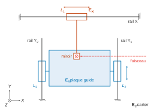
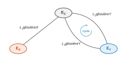
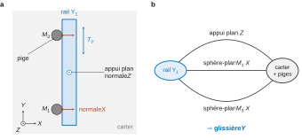
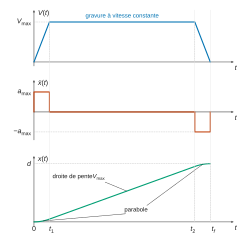
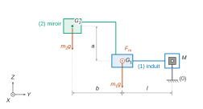
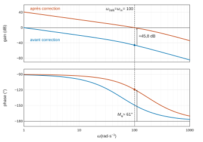

# Mines-Ponts PSI — Sciences industrielles 2026 · Corrigé guidé

*Corrigé rédigé par IA, non officiel. Signalez toute erreur.*

## Présentation du sujet

**Support.** Le sujet porte sur une machine de gravure laser à deux axes (PHLOX), qui micrograve un guide d'onde en PMMA pour fabriquer des rétroéclairages (« backlights »). Le faisceau, fixe, est renvoyé par un miroir porté par l'axe X vers une plaque portée par l'axe Y. Chaque axe est motorisé par des moteurs linéaires synchrones (MLS). La qualité de la gravure dépend de deux choses : la **précision géométrique** des guidages et la **constance de la vitesse** de balayage.

**Format.** L'épreuve dure 4 h, **sans calculatrice**. Elle comporte 35 questions et 7 annexes, et les réponses se font sur un cahier de réponses, qui n'est pas reproduit ici : les questions qui en dépendent sont traitées à partir des données de l'énoncé.

**Découpage.**

| Partie | Questions | Contenu | Outils |
|---|---|---|---|
| 2 | Q1–Q7 | schéma cinématique, hyperstatisme, défauts géométriques, mise et maintien en position des rails Y | graphe des liaisons, $h = E_c - I_c + m_c$, liaisons équivalentes |
| 4 | Q8–Q9 | loi en trapèze de vitesse et durée de gravure | cinématique du point |
| 5 | Q10–Q12 | MLS contre vis-écrou : masses équivalentes | énergie cinétique |
| 6.1 | Q13–Q17 | effort moteur, torseur du guidage | principe fondamental de la dynamique, transport du moment dynamique |
| 6.2 | Q18–Q21 | frottements identifiés aux moindres carrés et modèle retenu | régression linéaire, apprentissage supervisé |
| 7 | Q22–Q26 | MLS vu comme deux machines à courant continu, boucle de courant PI | Laplace, compensation de pôle |
| 8 | Q27–Q34 | boucle de vitesse (P puis PI) et boucle de position (avance de phase) | classe, valeur finale, Bode |
| 9 | Q35 | lecture de $t_{r5\%}$ et du retard de traînage | réponses temporelles |

**Ce qu'en dit le jury.** D'après le rapport 2026, le sujet a été globalement traité jusqu'au bout. Les questions où les copies se sont le plus séparées sont :
- Q2 (hyperstatisme), « moyennement réussie dans l'ensemble » ;
- Q8, dont la justification du trapèze de vitesse « a été peu réussie », et dont le tracé de la position a été laborieux ;
- Q9, où le sens du paramètre $N$ a souvent été mal identifié ;
- Q10, à cause des applications numériques (unité du pas) ;
- Q16, où la partie moment est jugée « beaucoup plus délicate » que la partie résultante ;
- Q21, question « originale », « relativement peu traitée et peu réussie » ;
- Q25 à Q28, dont les justifications sur la classe et le correcteur sont souvent restées insuffisantes ;
- Q29 (valeur de $K_V$) et Q34 (confusion entre $\sin\varphi_m$ et $\cos\varphi_m$).

À l'inverse, Q3, Q6, Q11, Q12, Q15 (« Question très bien réussie »), Q22, Q24 et Q32 ont posé peu de difficultés : il ne faut pas les laisser passer.

**Rédaction : ce que le jury sanctionne.** Le rapport 2026 rappelle que, pour vérifier une exigence, « les candidats ne peuvent se contenter d'indiquer qu'elle est validée sans rappeler l'exigence concernée, donner la valeur déterminée et comparer explicitement les deux. » Il ajoute : « Les réponses brutes n'ont pas été valorisées. » Il demande aussi de limiter les abréviations (TMS, PFD) et de vérifier l'homogénéité, dont l'oubli explique beaucoup de résultats faux.

**Gestion du temps.** Le sujet est long mais très guidé. Les parties 6.2, 7 et 8.1 sont indépendantes et rapides : elles rapportent beaucoup pour peu de temps. Sans calculatrice, il faut savoir mener les calculs à la main : $\arctan(5/3)\approx 59°$, $\sqrt3\approx1{,}73$, $10\log3\approx4{,}8$ dB.

## Partie 2 — Analyse géométrique partielle de la machine et précision des guidages (exigence 1.1)

Cette partie étudie la géométrie du montage des deux axes sur le carter. On calcule d'abord l'hyperstatisme du modèle global, puis on étudie comment la mise en position par piges et le bridage des rails Y rendent ce montage hyperstatique réalisable. Notations : $E_C$ (ensemble carter), $E_X$ (ensemble X), $E_Y$ (ensemble Y). Les numéros (0), (1), (2) sont réservés à la partie 6.

### Question 1

> [!INDICATION]
> Relisez la description : quelles pièces se touchent réellement ? Un moteur dont l'inducteur et l'induit ne se touchent pas crée-t-il une liaison ?

> [!INDICATION]
> Chaque rail guide seul son induit en translation. Comptez les rails entre chaque paire de classes.

#### Solution

Le MLS ne crée **aucune liaison**, seulement une action mécanique à distance. Les liaisons du schéma sont :
- entre $E_C$ et $E_X$ : une **glissière de direction $\vec X$** (rail X) ;
- entre $E_C$ et $E_Y$ : **deux glissières de direction $\vec Y$** en parallèle (rails Y1 et Y2) ;
- entre $E_X$ et $E_Y$ : **aucune liaison**, puisque seul le faisceau laser relie le miroir à la plaque.

Le rail X est porté en hauteur par la poutre ; le miroir, en porte-à-faux au-dessus de la plaque, ne la touche pas. Chaque glissière est dessinée avec sa direction réelle : $\vec X$ pour $L_1$, $\vec Y$ pour $L_2$ et $L_3$.

> [!PIEGE]
> Dessiner une liaison entre inducteur et induit. L'énoncé répète deux fois qu'ils ne sont pas en contact direct : la force motrice est une action, pas une liaison.

> [!JURY]
> Le rapport 2026 relève qu'au-delà des erreurs de choix de liaisons, « la représentation spatiale des liaisons n'est pas toujours correctement maîtrisée ». Le symbole de chaque glissière doit être orienté selon sa direction dans le repère du schéma.

### Question 2

> [!INDICATION]
> Dessinez le graphe des liaisons et comptez ses cycles indépendants : une arête qui ne ferme aucune boucle ne crée pas d'hyperstatisme.

> [!INDICATION]
> Déterminez $m_c$ en listant les mouvements possibles (utiles et internes), puis utilisez $h = E_c - I_c + m_c$. Contrôlez par l'approche statique.

#### Solution

Le graphe comporte 3 sommets et 3 arêtes :
- $L_1$ : glissière $\vec X$ entre $E_C$ et $E_X$ ;
- $L_2$ et $L_3$ : glissières $\vec Y$ entre $E_C$ et $E_Y$.

$$\begin{aligned}
\gamma &= N_L - N_S + 1\\
&= 3 - 3 + 1\\
&= 1
\end{aligned}$$

Le seul cycle est formé par $L_2$ et $L_3$.

Les mouvements possibles sont la translation de $E_X$ suivant $\vec X$ et celle de $E_Y$ suivant $\vec Y$, sans mobilité interne :

$$\boxed{m_c = 2}$$

Chaque glissière a une inconnue cinématique, donc $I_c = 3$ ; le cycle donne $E_c = 6$ équations :

$$\begin{aligned}
h &= E_c - I_c + m_c\\
&= 6 - 3 + 2\\
&= 5
\end{aligned}$$

$$\boxed{h = 5}$$

Contrôle statique : $I_s = 15$ inconnues et $E_s = 12$ équations. Le rang vaut $r_s = 12 - 2 = 10$, d'où $h = 15 - 10 = 5$.

**Commentaire vis-à-vis de 1.1.1 (« assurer une raideur $K'$ »).** Le modèle est **hyperstatique d'ordre 5**. Cet hyperstatisme est **voulu** : deux rails en parallèle rigidifient l'axe Y, ce qui sert l'exigence de raideur 1.1.1. En contrepartie, il faut respecter 5 conditions géométriques entre les rails :
- l'entraxe ;
- la hauteur relative ;
- le parallélisme dans le plan horizontal ;
- le parallélisme dans le plan vertical ;
- le dévers.

Ces conditions sont traitées par la suite (exigence 1.1.2).

> [!METHODE]
> Quand on commente un degré d'hyperstatisme, on traduit chaque inconnue surabondante en une condition géométrique (une translation ou une rotation relative bloquée deux fois). C'est cette traduction qui prépare les questions sur les défauts et le montage.

> [!PIEGE]
> Conclure que le système est « raide », « robuste » ou « solide ». Le degré $h$ caractérise le modèle : on dit qu'il est hyperstatique d'ordre 5, puis on en tire les conséquences (raideur accrue, conditions géométriques de montage).

> [!JURY]
> Le rapport 2026 juge la question « moyennement réussie dans l'ensemble » : les erreurs viennent d'une caractérisation incorrecte des liaisons et d'une mauvaise maîtrise de la formule de $h$. Il note aussi : « Quelques problèmes de vocabulaire ont également été relevés pour conclure sur l'hyperstatisme du système (raide, robuste, solide, etc.). »

### Question 3

> [!INDICATION]
> Deux glissières $\vec Y$ en parallèle : quel seul mouvement relatif laissent-elles libre entre les rails ?

> [!INDICATION]
> Un défaut empêche le montage s'il porte sur une direction bloquée et si rien ne peut l'absorber. Ici, les guidages sont réglés en usine.

#### Solution

Seule la translation relative suivant $\vec Y$ est libre. Les défauts qui **rendent le montage impossible** sont ceux qui portent sur les 5 mobilités bloquées :
- entraxe (écart suivant $\vec X$) ;
- parallélisme dans le plan horizontal (rotation autour de $\vec Z$) ;
- différence de hauteur (écart suivant $\vec Z$) ;
- parallélisme dans le plan vertical (rotation autour de $\vec X$) ;
- dévers (rotation autour de $\vec Y$).

Un décalage longitudinal suivant $\vec Y$ est sans effet. *(Sur le cahier de réponses, on entoure les schémas correspondant à ces défauts.)*

> [!METHODE]
> Les défauts gênants d'un montage hyperstatique sont exactement ceux qui portent sur les mobilités bloquées plusieurs fois : la liste de la question 2 sert directement ici.

### Question 4

> [!INDICATION]
> Quelle est la forme de la surface de contact entre le rail et le carter ? Une liaison se donne toujours avec ses caractéristiques géométriques.

#### Solution

Les deux surfaces en contact sont planes : le contact est modélisé par une **liaison appui plan de normale $\vec Z$**, dont le plan de contact est la face d'appui du carter.

Caractéristique géométrique : la normale $\vec Z$. La liaison laisse 3 degrés de liberté (translations $\vec X$ et $\vec Y$, rotation $\vec Z$) et a 3 inconnues statiques.

> [!PIEGE]
> Répondre « glissière » parce que le rail sert à guider. On modélise ici le contact rail/carter, pas le contact rail/patin.

> [!JURY]
> Le rapport 2026 est net : « Une liaison donnée sans caractéristiques ne saurait constituer une réponse suffisante. » Il demande aussi d'orthographier correctement le nom des liaisons, et signale des confusions entre caractéristiques d'une liaison, mobilités et torseur cinématique.

### Question 5

> [!INDICATION]
> Contre quelle face du rail une pige verticale peut-elle venir en appui ? Déduisez-en la normale du contact.

> [!INDICATION]
> Liaisons en parallèle : intersectez les mouvements permis. Que bloque un deuxième point de contact décalé le long du rail ?

#### Solution

Le flanc du rail s'appuie sur les deux piges. On a deux contacts sphère-plan, caractérisés chacun par un point et une normale :
- au point $M_1$, de **normale $\vec X$** ;
- au point $M_3$, de **normale $\vec X$**.

Les deux points sont éloignés l'un de l'autre suivant $\vec Y$. Ils sont en parallèle avec l'appui plan de normale $\vec Z$ de la question 4.

On intersecte les mouvements permis :
- l'appui plan laisse $\{T_X, T_Y, R_Z\}$ ;
- le contact en $M_1$ supprime $T_X$ ;
- le contact en $M_3$, décalé suivant $\vec Y$, supprime $R_Z$.

$$\boxed{\text{liaison équivalente : glissière de direction }\vec Y}$$

Il y a $3 + 1 + 1 = 5$ inconnues, exactement celles d'une glissière : l'association est **isostatique**.

> [!METHODE]
> Pour des liaisons en parallèle, on intersecte les mobilités. On compte ensuite les inconnues statiques pour savoir si l'association est iso- ou hyperstatique.

> [!PIEGE]
> Changer de modèle entre Q4 et Q5. La liaison rail Y1/carter reste l'appui plan de normale $\vec Z$ trouvé à la question 4 ; les piges s'y ajoutent en parallèle. Le rapport 2026 signale des incohérences de ce type entre les deux questions.

> [!JURY]
> Le rapport 2026 note : « Les caractéristiques de la liaison sphère-plan ne sont pas toujours correctement connues. » Il faut donner le point de contact et la normale de chaque sphère-plan, puis la direction de la glissière équivalente.

### Question 6

> [!INDICATION]
> Dans quelles directions les piges agissent-elles ? Ce qu'elles ne contraignent pas, elles ne le corrigent pas.

#### Solution

Les piges, logées dans des perçages précis, imposent la position du rail suivant $\vec X$ et son orientation autour de $\vec Z$. Elles compensent donc :
- le **défaut d'entraxe** ;
- le **défaut de parallélisme dans le plan horizontal**.

Les défauts suivant $\vec Z$ (hauteur, parallélisme vertical, dévers) ne sont pas compensés : ils dépendent de la planéité et de la coplanarité des faces d'appui du carter.

### Question 7

> [!INDICATION]
> Distinguez mise en position et maintien en position : la bride impose-t-elle une nouvelle position, ou presse-t-elle seulement le rail sur ses appuis ?

> [!INDICATION]
> Regardez sur l'Annexe 3 dans quelle direction la bride serre le rail et s'il existe un jeu latéral.

#### Solution

La bride coiffe la semelle du rail et la plaque sur le carter suivant $-\vec Z$, avec un jeu latéral. Elle assure le **maintien en position** : elle ferme l'appui plan et maintient le rail par adhérence. Elle **n'impose aucune position nouvelle**. Il n'y a donc **pas d'impact sur la mise en position**, à condition de brider après avoir plaqué le rail contre ses piges.

**Conclusion vis-à-vis de 1.1.2 (« permettre le montage précis de la machine à gravure »).** La mise en position est isostatique et référencée sur des piges précises, et le maintien en position ne la perturbe pas : **l'exigence 1.1.2 est satisfaite**.

> [!PIEGE]
> Attribuer aux brides la précision du montage. La précision vient de la mise en position (appui plan et piges) ; les brides ne font que maintenir. Confondre les deux fonctions fausse la conclusion sur 1.1.2.

> [!JURY]
> Le rapport 2026 signale : « De nombreuses confusions entre mise en position et maintien en position ont été relevées lors de la conclusion sur l'exigence 1.1.2. »

## Partie 4 — Étude de la durée d'un cycle de gravure pour l'axe X (exigence 1.2)

On établit la loi de mouvement en trapèze de vitesse, puis on en déduit le temps de gravure d'une plaque, qu'on compare au cahier des charges.

### Question 8

> [!INDICATION]
> Dérivez un échelon de vitesse. Quelle force motrice faudrait-il alors, d'après le théorème de la résultante dynamique ?

> [!INDICATION]
> Pour les tracés : dérivez le trapèze pour obtenir l'accélération, intégrez-le pour obtenir la position. La vitesse est continue : que dire de la tangente à $x(t)$ ?

#### Solution

Un échelon de vitesse demande une accélération infinie, donc une force motrice infinie : c'est **irréalisable**, car le moteur sature à $F_{m\text{-}max}$. De plus, l'énoncé signale que des accélérations trop fortes ont **fait vibrer la machine** et dégradé la gravure. Le trapèze **borne l'accélération** à $\pm a_{max}$, donc l'effort moteur, et assure une **vitesse constante** pendant l'usinage.

| Phase | $\ddot x$ | $x(t)$ |
|---|---|---|
| $[0,t_1]$ | $+a_{max}$ | parabole convexe |
| $[t_1,t_2]$ | $0$ | droite de pente $V_{max}$ |
| $[t_2,t_f]$ | $-a_{max}$ | parabole concave, tangente horizontale en $t_f$ |

La position est continue et de tangente continue en $t_1$ et en $t_2$. Expressions, avec $t_1 = V_{max}/a_{max}$ et $t_2 = t_f - t_1$ :

$$x(t) = \begin{cases} \tfrac12 a_{max}t^2 & 0\le t\le t_1\\ \tfrac12 a_{max}t_1^2 + V_{max}(t - t_1) & t_1\le t\le t_2\\ d - \tfrac12 a_{max}(t_f - t)^2 & t_2\le t\le t_f\end{cases}$$

> [!PIEGE]
> Tracer des raccords anguleux ou oublier la portion rectiligne de $x(t)$. La pente de $x$ vaut $V_{max}$ de part et d'autre de $t_1$ et de $t_2$.
> Elle est nulle au départ et à l'arrivée, en $t_f$.

> [!JURY]
> Selon le rapport 2026, la justification du trapèze « repose souvent sur des considérations trop générales, mathématiques ou hors sujet ». Le tracé de la position a été « beaucoup plus laborieux », avec « de nombreuses discontinuités de tangence ». La justification attendue est physique : force bornée et vibrations limitées.

### Question 9

> [!INDICATION]
> La distance parcourue est l'aire sous $V(t)$. Vérifiez d'abord que le palier existe.

> [!INDICATION]
> Pour $N$, croisez la taille de la zone utile (exigence 1.2.2) et le pas de transfert entre deux lignes, donné sur la figure 5.

#### Solution

On a $t_1 = V_{max}/a_{max} = 0{,}05$ s. La distance d'accélération vaut :

$$d_1 = \frac{V_{max}^2}{2a_{max}} = 25\ \text{mm}$$

Comme $2d_1 < d$, le palier existe. L'aire du trapèze donne $d = V_{max}(t_f - t_1)$, d'où :

$$\boxed{t_f = \frac{d}{V_{max}} + \frac{V_{max}}{a_{max}}}$$

$$\begin{aligned}
t_f &= 0{,}52 + 0{,}05\\
&= 0{,}57\ \text{s}
\end{aligned}$$

Chaque plaque demande $N$ lignes horizontales et $N$ lignes verticales, chacune parcourue en $t_f$ :

$$\boxed{T = 2N\,t_f}$$

$N$ est le nombre de lignes dans une direction : la largeur de la zone utile divisée par le pas de transfert. Avec $N = 500\ \text{mm}/1\ \text{mm} = 500$ lignes :

$$\begin{aligned}
T &= 1000\times0{,}57\ \text{s}\\
&= 570\ \text{s}\\
&= 9{,}5\ \text{min}
\end{aligned}$$

**Conclusion.** L'exigence 1.2.1 fixe un temps de gravure maximal de 10 minutes. Pour la plaque maximale de l'exigence 1.2.2 ($50\times50$ cm²), on trouve 9,5 min, inférieur à 10 min : **l'exigence 1.2.1 est satisfaite**, avec une marge faible (5 %).

*Incohérence à signaler.* La distance d'accélération de 25 mm dépasse la marge de 10 mm de la figure 5 : la vitesse n'est pas encore constante en entrée de zone utile. On poursuit avec $d = 52$ cm.

> [!METHODE]
> Contrôle par cas limite : quand $a_{max}\to\infty$, $t_f\to d/V_{max}$. Le terme $V_{max}/a_{max}$ est le temps perdu dans les deux phases transitoires.

> [!PIEGE]
> Prendre pour $N$ un nombre de plaques ou de cycles, ou oublier que l'on grave dans les deux directions. Ici $N$ compte les lignes d'une direction, d'où le facteur 2.

> [!JURY]
> Le rapport 2026 relève que certains candidats « n'ont manifestement pas correctement identifié la signification du paramètre N », et que la méthode pour passer d'une courbe de vitesse à un déplacement (l'aire) est mal maîtrisée. Il ajoute : « Les conclusions manquent parfois de justification. » On rappelle donc l'exigence (10 min), la valeur trouvée (9,5 min) et on compare.

## Partie 5 — Comparaison entre MLS et (moteur rotatif + système vis-écrou) (exigences 1.3.1 et 1.3.2)

On compare l'inertie « vue » par la charge dans les deux architectures.

### Question 10

> [!INDICATION]
> La masse équivalente se définit par l'égalité des énergies cinétiques, exprimées avec la vitesse de la pièce (2).

> [!INDICATION]
> Écrivez la relation entre la rotation de la vis et la translation de l'écrou, avec le pas $p$, puis éliminez $\omega$.

#### Solution

Démarche.
1. On isole l'ensemble en mouvement (1+2) dans le référentiel du carter, supposé galiléen.
2. On écrit l'énergie cinétique de chaque solide : la rotation autour d'un axe fixe donne $\tfrac12 J\omega^2$ et la translation donne $\tfrac12 mV^2$.
3. On exprime tout en fonction de la vitesse $V$ de (2) grâce à la loi entrée-sortie de la vis.
4. On identifie avec $\tfrac12 m_{eq1}V^2$.

La loi entrée-sortie de la vis, de pas $p$ en mètres par tour, s'écrit :

$$V = \frac{p}{2\pi}\,\omega$$

$$\begin{aligned}
E_c &= \tfrac12 J_{eq}\omega^2 + \tfrac12 m_2V^2\\
&= \tfrac12\Big[m_2 + J_{eq}\Big(\frac{2\pi}{p}\Big)^2\Big]V^2
\end{aligned}$$

$J_{eq}$ est l'inertie de tout ce qui tourne à la vitesse de la vis (rotor, accouplement, vis).

$$\boxed{m_{eq1} = m_2 + J_{eq}\left(\frac{2\pi}{p}\right)^2}$$

**Application numérique.** Elle utilise les valeurs du cahier de réponses, non disponible ici. Le pas, donné en millimètres, doit être converti en mètres.

Ordre de grandeur, purement indicatif : pour $V = 1$ m/s, un pas $p = 20$ mm impose déjà environ 3000 tr/min au moteur. Avec $J_{eq}\approx10^{-4}$ kg·m², le terme ramené vaut environ 10 kg, du même ordre que la masse en translation.

> [!PIEGE]
> Calculer une inertie équivalente (en kg·m²) au lieu de la masse équivalente demandée (en kg). Le contrôle d'homogénéité (kg·m² × m⁻² = kg) détecte aussi l'oubli du carré ou du $2\pi$.

> [!PIEGE]
> Laisser le pas en millimètres : $(2\pi/p)^2$ est alors faux d'un facteur $10^6$. Et sans calculatrice, garder $\pi$ sous forme littérale le plus longtemps possible plutôt que de l'arrondir trop tôt.

> [!JURY]
> Le rapport 2026 constate que la méthode est connue, mais que les applications numériques ont été source de trop nombreuses erreurs, y compris par des approximations de $\pi$. Il écrit : « Il est étonnant qu'un certain nombre de candidats calcule l'inertie équivalente au lieu de la masse équivalente. Attention notamment à l'unité du pas et son impact dans l'application numérique demandée. »

### Question 11

> [!INDICATION]
> Y a-t-il une pièce en rotation dans la solution MLS ?

#### Solution

L'induit et le miroir sont encastrés et en translation à la même vitesse, et aucune pièce ne tourne :

$$\begin{aligned}
m_{eq2} &= m_1 + m_2\\
&= 4 + 6\\
&= 10\ \text{kg}
\end{aligned}$$

$$\boxed{m_{eq2} = 10\ \text{kg}}$$

### Question 12

> [!INDICATION]
> Reliez la masse équivalente à la force nécessaire pour une accélération imposée, puis relisez le texte exact des exigences 1.3.1 et 1.3.2.

#### Solution

On a $m_{eq1} > m_{eq2}$ : l'inertie de rotation ramenée alourdit la solution vis-écrou.
- **Exigence 1.3.1** (« masse en translation de 6 kg ») : avec le MLS, seule la charge (le miroir, 6 kg) et l'induit sont mis en mouvement, soit 10 kg. La vis-écrou y ajoute l'inertie ramenée.
- **Exigence 1.3.2** ($a_{max} = 20$ m·s⁻² et $V_{max} = 1$ m·s⁻¹) : à accélération imposée, la force $m_{eq}a_{max}$, donc le dimensionnement du moteur, est plus grande avec la vis-écrou.

Le MLS travaille en prise directe : sans transmission, il n'y a ni jeu, ni usure, ni vibration de vis. **Le MLS satisfait mieux les exigences 1.3.1 et 1.3.2.**

## Partie 6 — Modélisation et dimensionnement d'un MLS (exigence 1.3.2)

On dimensionne le moteur (effort) et son guidage intégré (torseur transmissible) par le principe fondamental de la dynamique, puis on affine le modèle par une identification des frottements. Numérotation de l'Annexe 4 : (0) carter, (1) induit X, (2) miroir.

### 6.1. Dimensionnement dynamique du MLS

### Question 13

> [!INDICATION]
> Choisissez un ensemble isolé qui fait disparaître l'action d'encastrement entre (1) et (2).

> [!INDICATION]
> Une seule projection du théorème de la résultante dynamique suffit. Que transmet une glissière parfaite suivant sa direction, et seulement suivant sa direction ?

#### Solution

On isole $\Sigma = (1)+(2)$, en translation suivant $\vec X$ dans $R$ galiléen.

Hypothèses : solides indéformables et glissière parfaite. La glissière parfaite ne transmet aucun effort suivant $\vec X$, donc $X_{01} = 0$ ; ses autres composantes ne sont pas nulles.

Actions extérieures : le poids, $\{T_{0\to1}\}$ et $F_m\vec X$.

Le théorème de la résultante dynamique, projeté sur $\vec X$, donne :

$$\boxed{F_m(t) = (m_1+m_2)\,\ddot x(t)}$$

> [!PIEGE]
> Écrire que le torseur d'une liaison parfaite est nul. « Parfaite » signifie seulement sans frottement : seule la composante suivant la direction du mouvement, ici $X_{01}$, est nulle. Le rapport 2026 met explicitement en garde contre cette hypothèse fausse.

> [!JURY]
> Le rapport 2026 rappelle : « Le théorème de la résultante dynamique étant une équation vectorielle, il convient de préciser la projection utilisée pour obtenir une équation scalaire. » Il ajoute que l'usage d'abréviations pour les théorèmes conduit parfois à des approximations ou des erreurs : on écrit le nom du théorème en entier.

### Question 14

> [!INDICATION]
> Où $|\ddot x|$ est-elle maximale sur le trapèze ? Donnez l'intervalle de temps et dites pourquoi.

#### Solution

La force motrice est proportionnelle à l'accélération. Elle est donc maximale en valeur absolue quand $|\ddot x| = a_{max}$, c'est-à-dire :
- pendant l'accélération, $[0;\,0{,}05\ \text{s}]$ ;
- pendant la décélération, $[0{,}52;\,0{,}57\ \text{s}]$.

$$\begin{aligned}
|F_m| &= 10\times20\\
&= 200\ \text{N}
\end{aligned}$$

$$\boxed{|F_m|_{max} = 200\ \text{N}}$$

Le moteur fournit au plus $F_{m\text{-}max} = 1000$ N, et $200\ \text{N} < 1000$ N : le moteur convient, avec un coefficient de sécurité de 5, et **l'exigence 1.3.2 est satisfaite**.

> [!PIEGE]
> Ajouter le poids dans la projection sur $\vec X$ : le mouvement est horizontal et le poids n'intervient que dans le torseur du guidage.

> [!JURY]
> Le rapport 2026 précise : « il était demandé d'identifier la phase mais aussi de le justifier ». La justification tient en une ligne : $F_m$ est proportionnelle à $\ddot x$.

### Question 15

> [!INDICATION]
> Une glissière parfaite de direction $\vec X$ ne transmet aucune composante qui travaillerait dans son mouvement.

#### Solution

$$\boxed{\{T_{0\to1}\} = \left\{\begin{matrix} Y_{01}\vec Y + Z_{01}\vec Z\\ L_{01}\vec X + M_{01}\vec Y + N_{01}\vec Z\end{matrix}\right\}_M}$$

On a 5 inconnues, puisqu'une glissière bloque les trois rotations.

> [!PIEGE]
> Annuler $L_{01}$ en confondant avec un pivot d'axe $\vec X$, ou écrire le torseur cinématique de la glissière au lieu de son torseur d'actions mécaniques.

> [!JURY]
> Question « très bien réussie » selon le rapport 2026. Il insiste pourtant : « il est demandé aux candidats de respecter rigoureusement les notations imposées par le sujet. » On garde donc $X_{01}$, $Y_{01}$, … $N_{01}$ au point $M$.

### Question 16

> [!INDICATION]
> Le système est en translation : que vaut son moment dynamique en son centre d'inertie ? Les matrices d'inertie sont-elles utiles ?

> [!INDICATION]
> Transportez en $M$ : $\vec\delta(M) = \vec\delta(G) + \overrightarrow{MG}\wedge m\vec a(G)$, ou sommez $\overrightarrow{MG_i}\wedge m_i\vec a(G_i)$. Calculez les moments du poids et de $F_m$ (appliquée en $G_1$).

#### Solution

**Démarche.** On isole $\Sigma = (1)+(2)$ et on applique le principe fondamental de la dynamique en $M$ dans $R$ galiléen. L'étude est **dynamique** : $\Sigma$ accélère. Il reste 5 équations (résultante sur $\vec Y$ et $\vec Z$, moment sur les trois axes) pour 5 inconnues.

Positions des centres d'inertie :

$$\overrightarrow{MG_1} = -l\vec Y$$

$$\begin{aligned}
\overrightarrow{MG_2} &= \overrightarrow{MG_1} + \overrightarrow{G_1G_2}\\
&= -(l+b)\vec Y + a\vec Z
\end{aligned}$$

Chaque solide est en translation, donc $\vec\delta(G_i, i/R) = \vec 0$ et $\vec\delta(M, i/R) = \overrightarrow{MG_i}\wedge m_i\ddot x\,\vec X$. Avec $\vec Y\wedge\vec X = -\vec Z$ et $\vec Z\wedge\vec X = \vec Y$ :

$$\begin{aligned}
(-l\vec Y)\wedge m_1\ddot x\,\vec X &= m_1 l\ddot x\,\vec Z\\
\big(-(l+b)\vec Y + a\vec Z\big)\wedge m_2\ddot x\,\vec X &= m_2(l+b)\ddot x\,\vec Z + m_2 a\ddot x\,\vec Y
\end{aligned}$$

Pour le torseur dynamique :

$$\vec\delta(M,\Sigma/R) = \ddot x\big[m_2 a\,\vec Y + (m_1 l + m_2(l+b))\,\vec Z\big]$$

Moments en $M$ des actions extérieures :
- poids : $g\,[m_1 l + m_2(l+b)]\,\vec X$ ;
- moteur : $l\,F_m\,\vec Z$ ;
- guidage : $L_{01}\vec X + M_{01}\vec Y + N_{01}\vec Z$.

Théorème de la résultante dynamique, sur $\vec Y$ puis sur $\vec Z$ :

$$\boxed{Y_{01} = 0}$$

$$\boxed{Z_{01} = (m_1+m_2)g}$$

Théorème du moment dynamique en $M$, avec $F_m = (m_1+m_2)\ddot x$ :

$$\begin{aligned}
\vec X &: L_{01} + g\,[m_1 l + m_2(l+b)] = 0\\
\vec Y &: M_{01} = m_2 a\,\ddot x\\
\vec Z &: N_{01} + l\,(m_1+m_2)\ddot x = \ddot x\,[m_1 l + m_2(l+b)]
\end{aligned}$$

d'où

$$\boxed{L_{01} = -g\,[(m_1+m_2)l + m_2 b]}$$

$$\boxed{M_{01} = m_2\,a\,\ddot x}$$

$$\boxed{N_{01} = m_2\,b\,\ddot x}$$

Interprétation :
- $L_{01}$ est statique : il vient du porte-à-faux du poids.
- $M_{01}$ et $N_{01}$ sont dynamiques : ils viennent de l'excentration $(a, b)$ du miroir.
- Homogénéité : masse × longueur × accélération, soit des N·m.
- Contrôle par cas particulier : si $a = b = 0$ (miroir centré sur $G_1$), on trouve $M_{01} = N_{01} = 0$. La force motrice, appliquée en $G_1$, passe alors par le centre d'inertie de l'ensemble et ne crée pas de moment dynamique.

> [!METHODE]
> Pour un solide en translation, $\vec\delta(G) = \vec 0$ : le moment dynamique en un point $M$ vaut simplement $\overrightarrow{MG}\wedge m\vec a$. Les matrices d'inertie ne servent à rien, et il faut le dire.

> [!PIEGE]
> Mener l'étude en statique, ou écrire $\vec\delta(M) = \vec 0$ « parce que c'est une translation » : ce n'est vrai qu'au centre d'inertie. On perd alors $M_{01}$ et $N_{01}$, qui sont les seuls termes dynamiques.

> [!JURY]
> Pour le rapport 2026, « La partie résultante a globalement été réussie contrairement à la partie moment, beaucoup plus délicate. » Il signale des bilans d'actions extérieures incomplets, un mauvais choix de système isolé, et le fait que « beaucoup d'études ont été menées en statique alors qu'une étude dynamique était nécessaire. » Une vérification d'homogénéité aurait évité plusieurs erreurs.

### Question 17

> [!INDICATION]
> Quelles composantes dépendent de l'accélération ? Choisissez la phase en conséquence, puis convertissez $l$, $a$ et $b$ en mètres.

#### Solution

Seuls $M_{01}$ et $N_{01}$ dépendent de l'accélération. La phase la plus contraignante est donc l'accélération (ou la décélération), avec $|\ddot x| = 20$ m·s⁻².

| Composante | Valeur | Limite |
|---|---|---|
| $Y_{01}$ | 0 | 1 kN |
| $Z_{01}$ | $10\times9{,}81\approx 98$ N | 1 kN |
| $L_{01}$ | $-9{,}81\times(10\times0{,}1 + 6\times0{,}1)\approx -15{,}7$ N·m | 20 N·m |
| $M_{01}$ | $6\times0{,}07\times20 = 8{,}4$ N·m | 80 N·m |
| $N_{01}$ | $6\times0{,}1\times20 = 12$ N·m | 80 N·m |

**Conclusion.** Chaque valeur est comparée à la limite du constructeur (Annexe 4) dans le tableau, et chacune lui est inférieure : **l'exigence 1.3.2 est satisfaite** pour le guidage. Le facteur dimensionnant est $L_{01}$ (environ 78 % de sa limite), dû au porte-à-faux statique.

Pour gagner de la marge, il faudrait rapprocher le centre d'inertie de l'axe du guidage, c'est-à-dire réduire $l$ et $b$, plutôt que de chercher un moteur plus puissant. Sans calculatrice, $g\approx10$ m·s⁻² donne $L_{01}\approx-16$ N·m, et la conclusion est la même.

> [!METHODE]
> Exprimez chaque effort en pourcentage de sa limite : c'est ce qui révèle la grandeur qui dimensionne réellement le composant.

> [!JURY]
> Le rapport 2026 note que les unités sont parfois absentes ou incorrectes, et que « Les conclusions sont souvent insuffisamment justifiées faute de comparaison explicite avec les données du cahier des charges. » Le tableau valeur/limite répond exactement à cette attente.

### 6.2. Amélioration de la modélisation mécanique du MLS

On identifie une loi de frottement à partir de mesures, puis on choisit le modèle de simulation qui la représente.

### Question 18

> [!INDICATION]
> On minimise une somme de carrés d'écarts entre mesures et modèle : quel est le nom de la méthode ? Les données sont-elles étiquetées ?

#### Solution

- Méthode : **méthode des moindres carrés** (régression linéaire).
- Type d'apprentissage : **apprentissage supervisé**, car les données $(V_i, F_{fi})$ sont étiquetées.
- $J$ est la **fonction coût** (erreur quadratique).
- Les équations (1) et (2) annulent le gradient de $J$ : elles caractérisent son **point critique**, qui est son **minimum**, car la matrice hessienne de $J$, constante, a une trace et un déterminant strictement positifs dès que les $V_i$ ne sont pas tous égaux (voir Q19 et Q20).

$$\boxed{e_i = F_{fi} - (aV_i + b)}$$

> [!JURY]
> Le rapport 2026 prévient : « Deux méthodes conduisant à des résultats différents ne peuvent être simultanément acceptées. » Mieux vaut nommer une seule méthode, la bonne, que d'en proposer plusieurs en espérant que l'une soit retenue.

### Question 19

> [!INDICATION]
> Dérivez $\sum (F_{fi} - aV_i - b)^2$ par rapport à $a$, puis à $b$. Attention aux facteurs $-V_i$ et $-1$.

#### Solution

Après division par $-2$, les deux équations s'écrivent :

$$a\sum V_i^2 + b\sum V_i = \sum V_iF_{fi}$$

$$a\sum V_i + b\,n = \sum F_{fi}$$

$$\begin{aligned}
A_{11} &= \sum V_i^2\\
A_{12} = A_{21} &= \sum V_i\\
A_{22} &= n\\
C_1 &= \sum V_iF_{fi}\\
C_2 &= \sum F_{fi}
\end{aligned}$$

> [!METHODE]
> Contrôle : la matrice est symétrique ($A_{12} = A_{21}$), car c'est, à un facteur 2 près, la hessienne de $J$.

> [!PIEGE]
> Laisser $A_{22}$ sous la forme d'une somme de 1. La somme de $n$ termes égaux à 1 vaut $n$. Selon le rapport 2026, c'est le seul point de la question qui a mis des candidats en difficulté.

### Question 20

> [!INDICATION]
> Système $2\times2$ : utilisez les formules de Cramer, après avoir justifié que le déterminant est non nul.

#### Solution

Le déterminant vaut $\Delta = n\sum V_i^2 - (\sum V_i)^2$. Il est strictement positif dès que les vitesses mesurées ne sont pas toutes égales (Cauchy-Schwarz).

$$\boxed{a = \frac{n\sum V_iF_{fi} - \sum V_i\sum F_{fi}}{n\sum V_i^2 - (\sum V_i)^2}}$$

$$\boxed{b = \frac{\sum V_i^2\sum F_{fi} - \sum V_i\sum V_iF_{fi}}{n\sum V_i^2 - (\sum V_i)^2}}$$

> [!JURY]
> Le rapport 2026 demande des réponses « compactes et simplifiées », écrites après un passage au brouillon pour limiter les ratures. Un dénominateur commun, écrit une fois et reconnu comme le déterminant, répond à cette attente.

### Question 21

> [!INDICATION]
> Interprétez séparément le terme $aV$ et le terme constant $b$. Lequel est linéaire ?

> [!INDICATION]
> Que devient le frottement quand la vitesse change de signe ? Un terme non linéaire peut-il figurer dans une fonction de transfert ?

#### Solution

$F_f = aV + b\,\mathrm{sgn}(V)$ combine un frottement visqueux et un frottement sec. On retient le modèle où le frottement visqueux est **dans la fonction de transfert** et où le frottement sec $b$ est une **perturbation** opposée au mouvement :

$$\begin{aligned}
H_{méc}(p) &= \frac{1}{m_{eq2}\,p + a}\\
&= \frac{1/a}{1 + \frac{m_{eq2}}{a}\,p}
\end{aligned}$$

Les paramètres sont :

$$K_{méc} = \frac1a\approx0{,}83\ \text{m·s}^{-1}\text{·N}^{-1}$$

$$\tau_{méc} = \frac{m_{eq2}}{a}\approx 8{,}3\ \text{s}$$

$$b = 1{,}1\ \text{N}$$

Pourquoi ce modèle et pas un autre :
- un modèle purement inertiel $1/(m_{eq2}p)$ ignore la pente $a$, qui n'est pas nulle ;
- un modèle sans perturbation ignore l'ordonnée à l'origine $b$, qui n'est pas nulle, et sous-estime l'erreur de l'asservissement ;
- un frottement sec placé dans la fonction de transfert n'aurait pas de sens, car il n'est pas linéaire.

La constante de temps $\tau_{méc}$ est très grande devant le temps de cycle (0,57 s) : en boucle ouverte, l'axe se comporte presque comme un intégrateur. C'est cohérent avec le schéma simplifié $cK_V/p$ de la question 29, où l'on retrouvera $c = A/m_{eq2}$.

> [!PIEGE]
> Mettre le frottement sec dans la fonction de transfert. Un terme constant par morceaux, qui change de signe avec $V$, n'est pas linéaire : on le modélise comme une entrée de perturbation.

> [!PIEGE]
> Lire la pente du tracé simplifié sans tenir compte de l'échelle du zoom fourni sur le cahier de réponses : le coefficient directeur est alors faux.

> [!JURY]
> Le rapport 2026 qualifie la question d'« originale » : elle « a été relativement peu traitée et peu réussie ». Il précise : « Quelques erreurs dans le calcul du coefficient directeur du tracé simplifié proviennent de la non prise en compte du zoom fourni. »

## Partie 7 — Modélisation du comportement électromécanique d'un MLS et étude du pilotage en couple (exigence 1.3.3)

Après la transformation de Park (admise), le MLS équivaut à deux machines à courant continu. On montre que la force ne dépend que de $i_2$, puis on règle la boucle de courant.

### 7.1. Génération de la force motrice $F_m$

### Question 22

> [!INDICATION]
> Reportez les flux dans les expressions de $F_1$ et $F_2$, puis formez $F_2 - F_1$.

#### Solution

Avec $L_1 = L_2 = L$, les flux valent $\varphi_1 = Li_1 + \Phi$ et $\varphi_2 = Li_2$. Les forces s'écrivent donc :

$$F_1 = K\varphi_2 i_1 = KL\,i_1i_2$$

$$F_2 = K\varphi_1 i_2 = KL\,i_1i_2 + K\Phi\,i_2$$

$$\begin{aligned}
F_m &= F_2 - F_1\\
&= K(Li_1 + \Phi)\,i_2 - KLi_2\,i_1\\
&= K\Phi\,i_2
\end{aligned}$$

$$\boxed{F_m = A\,i_2\ \text{ avec }\ A = K\Phi}$$

$A$ est constant, car le flux $\Phi$ des aimants est constant. Le terme $K(L_1 - L_2)\,i_1i_2$ s'annule grâce à l'hypothèse de pôles lisses.

### Question 23

> [!INDICATION]
> Écrivez $P_J$ en fonction des deux courants, à force motrice imposée. Quel courant est fixé par la force ?

#### Solution

Chaque machine dissipe par effet Joule la puissance $R\,i^2$ dans sa résistance. À force imposée, $i_2 = F_m/A$ est fixé :

$$\begin{aligned}
P_J &= R\,(i_1^2 + i_2^2)\\
&= R\,i_1^2 + R\,\frac{F_m^2}{A^2}
\end{aligned}$$

Donc $P_J \ge RF_m^2/A^2$, avec égalité si et seulement si $i_1 = 0$. **Annuler $i_1$ minimise les pertes Joule** sans changer la force.

> [!PIEGE]
> Minimiser $P_J$ sans contrainte : on annulerait aussi $i_2$, donc la force. C'est une minimisation à force donnée.

> [!JURY]
> Le rapport 2026 note que « Certains candidats semblent ne pas connaître précisément la définition de l'effet Joule et des puissances dissipées associées. » La puissance Joule est $R\,i^2$ par machine, et il faut sommer les deux machines.

### 7.2. Pilotage en courant

### Question 24

> [!INDICATION]
> Avec $\varphi_2 = Li_2$, passez l'équation électrique de la machine 2 dans le domaine de Laplace, en respectant le comparateur du schéma-blocs.

#### Solution

On a $u_2 = Ri_2 + L\,\dfrac{\mathrm di_2}{\mathrm dt} + e_2$. Dans le domaine de Laplace, à conditions initiales nulles :

$$U_2(p) - E_2(p) = (R + Lp)\,I_2(p)$$

Le comparateur du schéma-blocs fait bien entrer $E_2$ avec le signe moins. Sous forme canonique :

$$\boxed{H_{élec}(p) = \frac{I_2}{U_2 - E_2} = \frac{1/R}{1 + \frac LR\,p}}$$

$$\boxed{\tau_e = \frac LR}$$

C'est un premier ordre de gain statique $1/R$ (en A·V⁻¹). Homogénéité : H/Ω = s.

> [!JURY]
> Question « globalement bien réussie » selon le rapport 2026, qui précise : « Les quelques erreurs relevées proviennent principalement d'une écriture non canonique de la fonction de transfert. » S'arrêter à $1/(R + Lp)$ ne suffit donc pas : on met le gain statique en facteur et un 1 au dénominateur.

### Question 25

> [!INDICATION]
> Identifiez la structure du correcteur. De quelle fonction de transfert l'intégrateur augmente-t-il la classe ?

> [!INDICATION]
> Pour le rejet de $E_2$, la classe ne suffit pas : où l'intégrateur se trouve-t-il par rapport au point d'entrée de la perturbation ?

#### Solution

Le correcteur est un **proportionnel intégral (PI)**.

Avec un correcteur proportionnel seul, la FTBO de la boucle de courant, $K_I\,H_{élec}$, serait de classe 0 : l'erreur statique serait non nulle, pour la consigne comme pour la perturbation. Le PI ajoute un intégrateur dans la **FTBO**, qui devient de classe 1.

Cette augmentation de classe est une condition **nécessaire mais pas suffisante** :
- pour la consigne en échelon, l'erreur statique est nulle si la boucle fermée est stable (précision) ;
- pour la perturbation $E_2$ en échelon, il faut en plus que l'intégrateur soit **en amont du point d'entrée de $E_2$**, ce qui est le cas ici (robustesse).

Ce choix règle l'**exigence 1.3.3.1** (« précision/robustesse axe X : erreur statique nulle »).

> [!METHODE]
> Le rejet d'une perturbation en échelon exige un intégrateur placé en amont du point d'entrée de cette perturbation, dans une boucle stable.

> [!PIEGE]
> Confondre « intégrateur » et « classe », ou dire « le correcteur augmente la classe » sans préciser de quoi. C'est la classe de la FTBO qui augmente, et un intégrateur placé après la perturbation ne la rejetterait pas.

> [!JURY]
> Le rapport 2026 reproche aux candidats d'oublier de préciser à quoi est liée l'augmentation de la classe (système, FTBF, FTBO, correcteur), ainsi que le fait « qu'une augmentation de classe constitue une condition nécessaire mais non suffisante pour assurer une erreur statique nulle en présence d'une perturbation ». Il ajoute : « Quelques confusions entre les notions d'intégrateur et de classe ont également été relevées. »

### Question 26

> [!INDICATION]
> Factorisez le correcteur sous la forme $K_I\dfrac{1+T_Ip}{T_Ip}$ et choisissez $T_I$ pour compenser le pôle électrique.

> [!INDICATION]
> Quelle est la boucle fermée d'un intégrateur pur à retour unitaire ? Un premier ordre peut-il présenter un dépassement ?

#### Solution

Avec $T_I = \tau_e$, le zéro du correcteur compense le pôle du procédé :

$$\begin{aligned}
\text{FTBO} &= K_I\frac{1+\tau_ep}{\tau_ep}\cdot\frac{1/R}{1+\tau_ep}\\
&= \frac{K_I}{R\tau_e\,p}\\
&= \frac{K_I}{Lp}
\end{aligned}$$

puisque $R\tau_e = L$. On en déduit la boucle fermée, du premier ordre :

$$H_{BF}(p) = \frac{1}{1 + \frac{L}{K_I}p}$$

$$\boxed{K_{BFi} = 1}$$

$$\boxed{\tau_{BFi} = \frac{L}{K_I}}$$

La rapidité se règle par $K_I$, puisque $t_{r5\%} = 3\tau_{BFi} = 3L/K_I$.

**Conclusion vis-à-vis de 1.3.3.2 (« temps de réponse à 5 % optimal sans dépassement »).**
- Sans dépassement : un premier ordre n'en présente jamais. Critère respecté.
- Temps de réponse optimal : $t_{r5\%}$ diminue quand $K_I$ augmente, jusqu'aux limites physiques (saturation de la tension, bruit). Critère respecté.

**L'exigence 1.3.3.2 est satisfaite.**

> [!JURY]
> D'après le rapport 2026, il y a eu « Peu d'erreurs sur la fonction de transfert. En revanche, les justifications restent souvent insuffisantes pour valider pleinement la question. » La conclusion doit reprendre les deux termes de l'exigence : absence de dépassement et temps de réponse.

## Partie 8 — Conception de l'asservissement d'un MLS

On règle une cascade vitesse/position. Pour la boucle de vitesse, on passe d'un correcteur P à un PI, réglé par compensation de pôle. Pour la boucle de position, on synthétise un correcteur à avance de phase sur le diagramme de Bode.

### 8.1. Étude de la boucle de vitesse (exigence 1.3.4)

### Question 27

> [!INDICATION]
> Quelle est la classe de la boucle ouverte avec un correcteur proportionnel ? Appliquez le théorème de la valeur finale.

#### Solution

On a $\text{FTBO}_V = \dfrac{K_VA/a}{1+\tau_{méc}p}$, de **classe 0**. La boucle fermée est un premier ordre, stable. Pour une consigne de vitesse en échelon $v_0\,u(t)$ :

$$\varepsilon_\infty = \frac{v_0}{1 + K_VA/a}\neq 0$$

Avec le frottement sec (une force $-b$ pour $V > 0$), le régime permanent vérifie :

$$(a + K_VA)\,V_\infty = K_VA\,v_0 - b$$

d'où

$$\begin{aligned}
\varepsilon_\infty &= v_0 - V_\infty\\
&= \frac{a\,v_0 + b}{a + K_VA}
\end{aligned}$$

Les deux contributions s'ajoutent : l'axe reste en dessous de sa consigne. L'exigence 1.3.4 demande une erreur statique nulle pour un échelon de vitesse : **avec la correction proportionnelle, l'erreur ne peut pas être nulle pour un gain fini, et l'exigence de précision n'est pas respectée.**

> [!PIEGE]
> Confondre la boucle de vitesse et l'« erreur en vitesse » (réponse à une rampe). Ici, l'entrée de la boucle est une vitesse en échelon : on calcule une erreur statique, en m·s⁻¹.

> [!JURY]
> Le rapport 2026 écrit : « Nommer un correcteur ne constitue pas une justification suffisante. » Il attend que l'on précise l'état initial, ici une FTBO de classe 0, et pourquoi il nécessite une correction. Il signale aussi : « Quelques confusions entre boucle de vitesse et erreur en vitesse ont également été observées. »

### Question 28

> [!INDICATION]
> Que change le terme intégral sur la classe de la FTBO ? Et sur la perturbation de frottement, qui entre après le bloc $A$ ?

#### Solution

L'intégrateur du PI rend la **FTBO de la boucle de vitesse** de classe 1. Pourvu que la boucle fermée soit stable, l'**erreur statique est nulle** pour un échelon de consigne. C'est le cas avec le réglage de la question 29, qui donne une boucle fermée du premier ordre.

L'intégrateur est en amont du point d'entrée de la perturbation de frottement : l'erreur due à un frottement constant est aussi nulle. **Le PI est pertinent** vis-à-vis de l'exigence de précision (erreur statique nulle).

> [!JURY]
> Le rapport 2026 renvoie, pour cette question, aux remarques de la question 27 : il faut dire de quoi la classe augmente (la FTBO) et pourquoi cela suffit ici.

### Question 29

> [!INDICATION]
> Trouvez le choix de $T_v$ qui ramène la FTBO à $cK_V/p$. Vérifiez la valeur de $c$ avec vos résultats précédents.

> [!INDICATION]
> Pour un premier ordre, à quoi correspond la bande passante à $-3$ dB ?

#### Solution

Avec $T_v = \tau_{méc} = m_{eq2}/a\approx 8{,}3$ s, la FTBO vaut $\dfrac{cK_V}{p}$ avec $c = A/m_{eq2} = 5$ m·s⁻²·A⁻¹.

$$\frac{V}{V_C} = \frac{1}{1 + \frac{p}{cK_V}}$$

$$\boxed{K_X = 1}$$

$$\boxed{\tau_X = \frac{1}{cK_V}}$$

Pour un premier ordre, la bande passante à $-3$ dB est la pulsation de coupure $1/\tau_X = cK_V$. Le critère de rapidité de l'Annexe 6 la fixe à 60 rad·s⁻¹ :

$$\begin{aligned}
K_V &= \frac{60}{c}\\
&= \frac{60}{5}\\
&= 12\ \text{A·s·m}^{-1}
\end{aligned}$$

$$\boxed{K_V = 12\ \text{A·s·m}^{-1}}$$

On en déduit $\tau_X = 1/60$ s.

> [!PIEGE]
> Régler $K_V$ sur un temps de réponse ($t_{r5\%} = 3\tau_X$) alors que le critère porte sur la bande passante à $-3$ dB. Et ne pas oublier l'unité de $K_V$, qui convertit une erreur de vitesse en courant : A·s·m⁻¹.

> [!JURY]
> Le rapport 2026 indique que $K_X$ et $\tau_X$ ont généralement été bien déterminés, mais que la troisième grandeur, $K_V$, « a été source d'erreurs en raison d'une mauvaise prise en compte du critère de rapidité du cahier des charges. »

### Question 30

> [!INDICATION]
> Reprenez chaque critère de l'Annexe 6 un par un : énoncé, valeur obtenue, comparaison.

#### Solution

- **Précision** (erreur statique nulle pour un échelon $v_0\,u(t)$) : classe 1 et $K_X = 1$, donc erreur statique nulle, frottement rejeté. Critère respecté.
- **Rapidité** (bande passante à $-3$ dB égale à 60 rad·s⁻¹) : $1/\tau_X = 60$ rad·s⁻¹ avec $K_V = 12$ A·s·m⁻¹. Critère respecté.
- **Stabilité** : pôle unique $-60$ s⁻¹, sans dépassement.

**Tous les critères de la boucle de vitesse sont respectés** (exigence 1.3.4), dans les limites du modèle : compensation exacte de $\tau_{méc}$ et boucle de courant beaucoup plus rapide.

> [!JURY]
> Le rapport 2026 est explicite : une réponse se limitant à « le cahier des charges est respecté » sans justification n'a pas été retenue.

### 8.2. Étude de la boucle de position (exigences 1.3.5.1 et 1.3.5.2)

### Question 31

> [!INDICATION]
> La chaîne directe contient déjà un intégrateur. Le correcteur à avance de phase en apporte-t-il un ? Le supprime-t-il ?

> [!INDICATION]
> Le cahier des charges parle aussi de retard de traînage : quelle est l'erreur en réponse à une rampe pour une boucle de classe 1, et quel paramètre la fixe ?

#### Solution

L'intégrateur $1/p$ du procédé (de la vitesse à la position) rend la boucle de **classe 1**. Le correcteur à avance de phase **n'apporte pas d'intégrateur** : il ne crée pas la précision, il la préserve. Son gain statique $C_X(0) = K$ est fini et non nul, donc la classe 1 est conservée. La boucle étant stable, l'**erreur statique est nulle** en réponse à un échelon.

En réponse à une rampe de pente $V_{max}$, l'erreur vaut $V_{max}/K$, ce qui donne :

$$\boxed{\Delta t = \frac1K < 0{,}01\ \text{s}\iff K > 100\ \text{s}^{-1}}$$

Le gain $K$ règle donc le traînage, et l'avance de phase permet de l'augmenter sans perdre la stabilité.

> [!PIEGE]
> Attribuer la précision au correcteur à avance de phase, ou croire qu'il faut un intégrateur dans le correcteur. L'intégrateur est déjà dans le procédé ; le rôle de l'avance de phase est la stabilité (marge de phase) à gain élevé.

> [!JURY]
> Le rapport 2026 relève que « Certains candidats manquent toutefois de recul sur le rôle réel du correcteur proposé en concluant de manière inappropriée sur la précision du système. »

### Question 32

> [!INDICATION]
> Calculez $aT\omega_m$ et $T\omega_m$ avec $\omega_m = 1/(T\sqrt a)$.

#### Solution

En $\omega_m$, on a $aT\omega_m = \sqrt a$ et $T\omega_m = 1/\sqrt a$, donc :

$$\begin{aligned}
|C_X(j\omega_m)| &= K\frac{\sqrt{1+a}}{\sqrt{1+1/a}}\\
&= K\sqrt a
\end{aligned}$$

$$\boxed{G_{dB}(\omega_m) = 20\log K + 10\log a}$$

> [!METHODE]
> Contrôle graphique : $\omega_m$ est la moyenne géométrique de $1/(aT)$ et $1/T$, et le gain y vaut la moyenne en dB de $20\log K$ et $20\log(aK)$.

> [!JURY]
> Question bien réussie selon le rapport 2026, qui demande toutefois de simplifier autant que possible les expressions obtenues : la forme $20\log K + 10\log a$ est attendue plutôt qu'un quotient de racines.

### Question 33

> [!INDICATION]
> Où faut-il placer l'avance maximale pour qu'elle serve à la marge de phase ?

> [!INDICATION]
> Ordre des étapes : d'abord $\omega_m$ et la phase non corrigée, puis $\varphi_m$. On en tire $a$ et $T$. On règle enfin $K$ pour un gain nul en $\omega_m$, puis on vérifie.

#### Solution

1. $\boxed{\omega_m = \omega_{0dB} = 100\ \text{rad·s}^{-1}}$.
2. Lire $\varphi_{nc}(100) = -90° - \arctan(5/3)\approx -149°$.
3. Viser une phase corrigée de $-120°$ : $\varphi_m = -120° - \varphi_{nc}\approx 29°$, d'où $\boxed{\varphi_m\approx 30°}$.
4. Calculer $a = \dfrac{1+\sin\varphi_m}{1-\sin\varphi_m}$, puis $T = \dfrac{1}{\omega_m\sqrt a}$.
5. Choisir $K$ tel que $20\log K + 10\log a + G_{nc,dB}(\omega_m) = 0$.
6. Vérifier $K > 100$ s⁻¹ (traînage), puis le temps de réponse.

> [!PIEGE]
> Appliquer la méthode d'un correcteur proportionnel (régler seulement le gain pour la marge de phase). Avec une avance de phase, on place d'abord $\omega_m$ et $\varphi_m$, et le correcteur relève aussi le gain de $10\log a$ en $\omega_m$ : sans l'étape 5, la coupure n'a pas lieu à la bonne pulsation.

> [!JURY]
> Le rapport 2026 signale « Quelques confusions avec les méthodes de réglage d'un correcteur proportionnel », et des copies qui ne proposent aucune méthode ici alors qu'elles traitent correctement la question suivante : la démarche est notée pour elle-même.

### Question 34

> [!INDICATION]
> Relevez le gain et la phase de la FTBO non corrigée à 100 rad·s⁻¹ ; la FTBO non corrigée vaut $1/(p(1+p/60))$.

> [!INDICATION]
> Avec $\varphi_m = 30°$, $\sin\varphi_m$ est une valeur remarquable, et $a$ tombe juste.

#### Solution

À 100 rad·s⁻¹ :

$$\begin{aligned}
|\text{FTBO}_{nc}| &= \frac{3}{100\sqrt{34}}\\
&\approx 5{,}1\cdot10^{-3}
\end{aligned}$$

soit environ $-45{,}8$ dB, et $\varphi_{nc}\approx-149°$.

On en déduit :
- $\sin 30° = 1/2$, d'où $\boxed{a = 3}$ ;
- $\boxed{T = \dfrac{1}{100\sqrt3}\approx 5{,}8\ \text{ms}}$ ;
- le gain de $K$ en décibels :

$$\begin{aligned}
20\log K &= 45{,}8 - 4{,}8\\
&= 41{,}0\ \text{dB}
\end{aligned}$$

$$\boxed{K\approx112\ \text{s}^{-1}}$$

Vérifications :
- $K > 100$ s⁻¹, et le retard de traînage vaut environ 8,9 ms.
- Phase corrigée à 100 rad·s⁻¹ : $-149° + 60° - 30° = -119°$, soit une **marge de phase de 61°**, pour environ 60° exigés. **L'exigence 1.3.5.2 est respectée.**

Tracés à reporter :
- les relevés à 100 rad·s⁻¹ ;
- la courbe de gain relevée de 45,8 dB ;
- la phase relevée de 30° ;
- la marge de phase.

> [!METHODE]
> Sans calculatrice : $\arctan\sqrt3 = 60°$ et $\arctan(1/\sqrt3) = 30°$. Avec $a = 3$, l'avance maximale du correcteur vaut exactement $60° - 30° = 30°$.

> [!PIEGE]
> Prendre $\cos 30° \approx 0{,}87$ au lieu de $\sin 30° = 0{,}5$ dans la relation de l'Annexe 7 : on trouverait $a\approx 14$, soit une avance maximale de 60° au lieu de 30°, et tout le réglage serait faux.

> [!JURY]
> Le rapport 2026 le dit sans détour : « Beaucoup d'erreurs sur la valeur de $\sin(\varphi_m)$, confondue avec celle de $\cos(\varphi_m)$. »

## Partie 9 — Synthèse

### Question 35

> [!INDICATION]
> Pour $t_{r5\%}$ : tracez la bande $[0{,}95;\,1{,}05]$ et cherchez le dernier instant où la réponse en sort.

> [!INDICATION]
> Pour le traînage : en régime de vitesse constante, la réponse est la consigne décalée. Mesurez l'écart dans l'unité du critère, c'est-à-dire en temps.

#### Solution

Le cahier de réponses fournit les courbes réelles. Les valeurs ci-dessous sont celles du modèle réglé :

$$\text{FTBO} = K\frac{1+aTp}{1+Tp}\cdot\frac{1}{p(1+\tau_Xp)}$$

avec $K = 112$ s⁻¹, $a = 3$, $T = 5{,}8$ ms et $\tau_X = 1/60$ s.

Un ordre de grandeur s'obtient sans simulation. Une marge de 60° correspond à un second ordre dominant d'amortissement voisin de 0,6 et de pulsation propre de l'ordre de 140 rad·s⁻¹. On en tire $t_{r5\%}\approx 3/(\xi\omega_0)\approx 36$ ms.

**Temps de réponse.** On trace la valeur finale 1, la bande à $\pm5\,\%$, et on relève la sortie définitive de la bande. Le modèle réglé, simulé, donne $t_{r5\%}\approx35$ ms et un dépassement d'environ 8 %. Le cahier des charges exige $t_{r5\%} < 0{,}1$ s, et 35 ms est inférieur à 0,1 s : **critère respecté**.

**Retard de traînage.** Sur le palier à $V_{max}$, on mesure l'écart horizontal entre consigne et réponse : $\Delta t = 1/K\approx 8{,}9$ ms. Le cahier des charges exige moins de 0,01 s, et 8,9 ms est inférieur à 10 ms : **critère respecté**. Cela correspond à un écart de position d'environ 8,9 mm.

**Conclusion.** L'exigence 1.3.5 est satisfaite : erreur statique nulle, $t_{r5\%}$ et traînage conformes, marge de phase d'environ 60° à 100 rad·s⁻¹. Le traînage est respecté de justesse.

> [!PIEGE]
> Prendre pour $t_{r5\%}$ le premier instant d'entrée dans la bande alors qu'il y a dépassement. Ou mesurer le traînage verticalement en mètres alors que le critère est en secondes.

> [!JURY]
> Question « globalement bien réussie » pour qui l'a traitée jusqu'au bout, selon le rapport 2026, mais « Les mêmes difficultés de rédaction apparaissent toutefois lorsqu'il s'agit de conclure à partir des données du cahier des charges. » Pour chaque critère : la valeur exigée, la valeur lue sur le tracé, la comparaison.

## Bilan

**Méthodes à retenir.**
- Hyperstatisme : graphe des liaisons, $\gamma$, $m_c$ justifié, $h = E_c - I_c + m_c$. On traduit ensuite chaque inconnue surabondante en condition géométrique (défauts de montage).
- Liaisons en parallèle : on intersecte les mobilités, puis on compte les inconnues statiques. La mise en position isostatique se fait par appui plan et deux points ; le maintien en position ne doit rien imposer de plus.
- Loi en trapèze de vitesse : $t_f = d/V_{max} + V_{max}/a_{max}$, après avoir vérifié l'existence du palier.
- Masse équivalente par l'énergie cinétique : les inerties ramenées sont multipliées par le carré du rapport de transmission, exprimé en unités SI.
- Solide en translation : $\vec\delta(G) = \vec 0$, puis transport en $M$ par $\overrightarrow{MG}\wedge m\vec a$.
- Moindres carrés : fonction coût, gradient nul, équations normales, formules de Cramer.
- Précision d'un asservissement : la classe de la FTBO est nécessaire, mais pas suffisante ; le rejet d'une perturbation demande un intégrateur en amont de celle-ci, dans une boucle stable.
- Compensation de pôle par un PI.
- Réglage d'une avance de phase : $\omega_m = \omega_{0dB}$, puis $\varphi_m$, puis $a$ et $T$, enfin $K$. Le retard de traînage vaut $1/K$.

**Questions discriminantes (rapport 2026).** Q2, Q8, Q9, Q16 (partie moment), Q21, Q25 à Q29 et Q34. Ce sont des questions de justification et de méthode plus que de calcul : c'est là que la rédaction fait la différence.

**Rédaction, d'après le rapport 2026.**
- Vérifier une exigence, c'est la rappeler, donner la valeur obtenue et comparer les deux.
- Écrire les théorèmes en toutes lettres et préciser la projection utilisée.
- Respecter les notations du sujet ; donner les unités ; vérifier l'homogénéité.
- Donner toute liaison avec ses caractéristiques géométriques.

**Prérequis à revoir.**
- Torseurs des liaisons usuelles.
- Produits vectoriels dans une base orthonormée directe.
- Théorème de la valeur finale.
- Diagrammes de Bode d'un intégrateur et d'un premier ordre.
- Valeurs remarquables de $\sin$, $\arctan$ et $\log$, indispensables sans calculatrice.

**Questions transposables.**
- Hyperstatisme d'un guidage par deux rails et montage par piges : classique sur les tables à deux axes.
- Comparaison entre entraînement direct et vis-écrou par la masse équivalente.
- Torseur transmis par un guidage linéaire avec charge en porte-à-faux.
- Boucle de courant d'une machine synchrone à $i_d = 0$.
- Cascade vitesse/position avec avance de phase.
