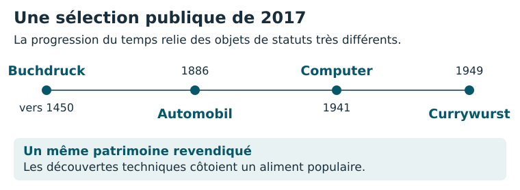
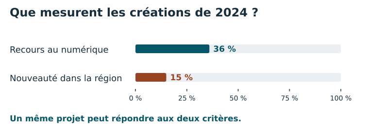
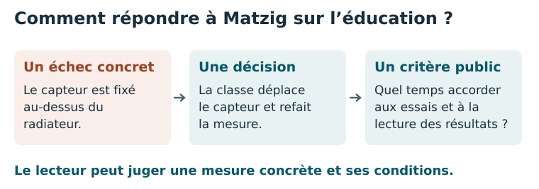

# X-ENS MP-MPI-PC-PSI — Allemand 2026 · Corrigé guidé

*Corrigé rédigé par IA, non officiel.*

**Rédaction** · modèle exact non renseigné (famille GPT-6) · effort non renseigné · vitesse non renseignée

**Révision** · GPT-6.2 Astra Ultra · vitesse non renseignée

**Révision** · GPT-6.2 Astra Ultra · vitesse non renseignée

**Révision (tour 3)** · GPT-6.2 Astra Ultra · vitesse non renseignée

Le 15 avril 2026, les quatre filières disposaient de quatre heures pour rédiger les deux compositions en allemand, sans dictionnaire ni traducteur. La première met en relation trois articles et une infographie. La seconde répond à un cinquième document. Les plans et les exemples ci-dessous proposent une manière de traiter chaque exercice.

## Partie A · Synthèse de documents

La consigne demande une synthèse en allemand de 600 à 675 mots et un titre. On peut commencer au brouillon par deux questions précises. Qui a déjà une idée qui fonctionne ? À quel moment devient-elle utilisable par d’autres ? Elles permettent de rapprocher des documents qui parlent pourtant de choses très différentes.

| Pièce | Ce qu’on prélève | Ce qu’on en fait dans la synthèse |
|---|---|---|
| Frank Wittig, SWR, avril 2025 | Cinquième rang pour les dépôts de brevets. Recherche numérique de haut niveau. Difficulté à transformer une idée en produit. Les robots-taxis remettent en cause la vente d’une voiture à chaque ménage. | Interroger ce que mesure un dépôt et ce qu’il laisse de côté, notamment l’évolution du modèle économique. |
| Doris Schneyink, *Stern*, juin 2024 | Dans « Jugend forscht », une question sur le rangement de livres mène à un algorithme de tri que son auteur partage. Un projet de cosmétique à base de fromage blanc permet aussi d’apprendre la méthode scientifique. | Donner deux exemples courts de passage de la curiosité à une réalisation. Le concours fournit du temps et des interlocuteurs compétents. |
| Bo Hyun Kin, rédaction financière de l’ARD, juillet 2025 | Reprise des créations d’entreprise en 2024, délais encore longs. Le projet Futury associe plusieurs établissements et entreprises. Le financement privé d’Integral rend possible une application de l’IA. | Mettre les moyens de franchir le seuil de la commercialisation en regard des obstacles. Distinguer ancrage numérique et nouveauté pour un marché. |
| Gouvernement fédéral, infographie de 2017 | Un ruban blanc serpente sur trois étages bleus. La première rangée va de gauche à droite, la deuxième revient en sens inverse. En bas, l’ordinateur de Zuse de 1941 précède la Currywurst attribuée à Herta Heuwer en 1949. | Identifier un choix de communication publique. Les pictogrammes mettent sur le même plan des objets de prestige et de la vie quotidienne. La date du dernier exemple ouvre la question des innovations actuelles. |

**Faire travailler l’image.** Ramener la frise à une liste d’inventeurs ferait perdre son point de vue. L’étiquette « Unsere Lieblinge » annonce une sélection affective. L’humour de la dernière vignette permet de revenir à la diversité des réalisations du concours de jeunes chercheurs. La frise est une sélection et ne fournit aucune série statistique sur la fréquence des inventions après 1949.

**Comparer sans changer le dénominateur.** Le cinquième rang porte sur les dépôts de brevets. Le douzième rang cité par Wittig provient de l’*Innovationsindikator*. La onzième place dans le *Global Innovation Index* apparaît dans l’éditorial de la partie B. On peut l’utiliser en B. En A, on peut se dispenser d’aligner plusieurs palmarès et expliquer la portée d’un seul.

**Bâtir les paragraphes.** Partir des réussites visibles de la frise, puis introduire le problème de leur fabrication. Aller de l’industrie à l’école, puis de l’école aux financeurs. Ainsi, l’algorithme publié permet de nuancer le diagnostic de Wittig et l’entreprise Integral montre ce que rend possible un investissement. Pour rendre la voix du journaliste distincte de la sienne, on peut écrire *Wittig zufolge* ou *wie die Tagesschau berichtet*. Dans la proposition qui suit, les quatre pièces ont une fonction et l’éditorial est réservé à la seconde partie.

### Proposition de synthèse

**Was aus deutschen Ideen wird**

In einer 2017 veröffentlichten Grafik stellt die Bundesregierung Erfindungen zusammen, auf die Deutschland stolz sei. Vom Buchdruck führt ein gefaltetes Band über das erste Automobil bis zu Konrad Zuses Computer und zur Currywurst. Auf jeder Windung stehen Dinge, die ihren Weg in den Alltag gefunden haben. Ausgerechnet die jüngste Erfindung dieser Auswahl stammt allerdings von 1949. Wie steht es heute um die Fähigkeit, einen Einfall so weit zu entwickeln, dass andere ihn tatsächlich nutzen können? Drei Beiträge aus deutschen Medien gehen der Frage anhand der Industrie, eines Schülerwettbewerbs und der Gründerszene nach.

Ein Blick auf die Patentanmeldungen scheint das Bild vom Erfinderland zunächst zu bestätigen. Wie Frank Wittig im SWR berichtet, belegt Deutschland weltweit den fünften Platz. Doch selbst dieser Rang verdeckt einen erheblichen Abstand. Den rund 133.000 deutschen Anmeldungen stehen etwa 500.000 chinesische gegenüber. Der breiter angelegte Innovationsindikator, den Wittig ebenfalls anführt, sieht Deutschland hingegen auf Platz zwölf. Gerade der Motorenbau, lange ein Aushängeschild der deutschen Industrie, hat seinen Vorsprung in einem Geschäft erworben, dessen Voraussetzungen sich ändern. Der von Wittig befragte Innovationsökonom Andreas Pyka verweist auf selbstfahrende Taxis in San Francisco. Wo mehrere Fahrgäste nacheinander dasselbe Fahrzeug nutzen, kann ein Mobilitätsanbieter Erfolg haben, obwohl insgesamt weniger Autos verkauft werden.

Entscheidend ist demnach, was zwischen einer Entdeckung und ihrer Anwendung geschieht. Til Huber vom Deutschen Patent- und Markenamt zufolge hält die deutsche Digitalforschung international durchaus mit. Ihre Ergebnisse führen jedoch zu selten zu neuen Produkten. Im *Stern* beschreibt Doris Schneyink dieselbe Lücke aus der Sicht von Forschenden. Ein erfolgreicher Laborversuch genügt noch lange nicht für die Serienfertigung. Auch die von der *Tagesschau* angeführten Gründungszahlen lassen sich vor diesem Hintergrund lesen. Rund 36 Prozent der 2024 neu gegründeten Unternehmen setzten auf digitale Technologien. Ein für die eigene Region neuartiges Angebot brachten jedoch nur 15 Prozent der Gründenden auf den Markt. Ein bestehendes Geschäft zu digitalisieren und einen neuen Markt zu erschließen sind verschiedene Leistungen.

Dass sich der Übergang von der Idee zur Anwendung schon in der Schule erproben lässt, zeigt Schneyinks Bericht über „Jugend forscht“. Ein Schüler aus Essen wollte seine Bücher nach Farben ordnen. Aus dieser Frage entstand ein Sortierverfahren, dessen Code er veröffentlicht hat. Für diese Arbeit zeichnete ihn die Konrad-Zuse-Gesellschaft aus. Der Name des Computerpioniers aus der Grafik kehrt hier als Name einer Institution wieder, die Nachwuchsforschung fördert. Die Jugendlichen können ihre Ansätze über längere Zeit verfolgen und erhalten von Fachleuten Rückmeldungen, wie sie sonst eher ausgebildeten Forschenden vorbehalten sind. Auch bei einem unscheinbaren Vorhaben wie der Herstellung von Kosmetik aus Quark zählen das methodische Vorgehen und das Durchhalten. In dieser Hinsicht ähnelt der Wettbewerb der historischen Bildauswahl. Neben dem Computer hat dort auch der Kaffeefilter seinen Platz.

An der Schwelle zur eigenen Firma gewinnen Kapital und institutionelle Unterstützung an Gewicht. Trotz eines durchschnittlich fast acht Monate dauernden Gründungsprozesses zählte die KfW 2024 nach Angaben der *Tagesschau* über 580.000 Gründungen, rund 17.000 mehr als im Vorjahr. 2004 waren es fast 1,4 Millionen. Die Zahl erfasst Existenzgründungen insgesamt. Wagniskapital, an dem es laut Wittigs Gesprächspartnern mangelt, floss im ersten Halbjahr 2025 wieder reichlicher. Fast 4,6 Milliarden Euro nahmen junge Unternehmen in diesen sechs Monaten auf. Integral etwa erhielt 6,3 Millionen Euro, um Buchhaltung und Steuerberatung mithilfe künstlicher Intelligenz zu automatisieren. Auch öffentliche Programme setzen am Übergang zwischen Forschung und Wirtschaft an. Im Rhein-Main-Gebiet bringt Futury Hochschulen, Firmen und Stiftungen zusammen, um Gründende von der ersten Idee bis zum Wachstum ihres Unternehmens zu begleiten.

Die Beiträge zeichnen damit ein unterschiedliches Bild, je nachdem, welcher Schritt betrachtet wird. Die Begeisterung der Schülerinnen und Schüler und die rege Forschungstätigkeit sprechen für ein beträchtliches Reservoir an Ideen. Wie viel davon in die Wirtschaft gelangt, hängt auch davon ab, ob Unternehmen ihre Geschäftsmodelle überprüfen und ob jemand das Risiko der Umsetzung mitträgt. Während die Grafik fertige Gegenstände vor Augen führt und ihnen einzelne Namen zuordnet, machen die jüngeren Berichte sichtbar, wie viele Beteiligte zwischen dem ersten Einfall und einem solchen Ergebnis stehen.

*649 mots hors titre, 654 avec le titre.*

Le prix décerné au jeune informaticien et le nom du concepteur de l’ordinateur dans la frise offrent un rapprochement précis entre les documents 2 et 4. Le premier explique qui a récompensé le travail, le second comment le gouvernement commémore l’invention.

Les 580 000 créations de 2024 et le chiffre de 2004 concernent les créations d’activité comptées par la KfW. Les 6,3 millions d’euros sont le financement de départ d’Integral. Le montant de près de 4,6 milliards d’euros concerne le capital-risque recueilli par les jeunes entreprises au premier semestre 2025. Ces trois séries ont des unités et des calendriers distincts.

## Partie B · Texte d’opinion

En 500 à 600 mots, il faut prendre position sur l’éditorial de Gerhard Matzig publié par la *Süddeutsche Zeitung* le 18 septembre 2025. Le titre est facultatif pour cette partie. Le « je » et les exemples construits ont ici leur place. Le jury dit avoir apprécié des prises de position polémiques lorsqu’elles développent un raisonnement.

**Trouver une prise.** Chez Matzig, les discours de l’IAA, le recul dans le classement et la reconstruction de l’hôtel Adlon illustrent un pays tourné vers sa propre réputation. L’appel au sursaut rappelle celui de Roman Herzog en 1997. On peut partager l’impatience de l’éditorialiste et discuter le critère qu’il choisit pour juger le progrès. L’accès à un chauffage moins gourmand améliore la vie quotidienne d’une famille, même si le classement international du pays reste identique.

**Donner de la résistance à son exemple.** Dire que l’école doit innover répéterait le propos général de l’auteur. Le thermomètre placé au-dessus du radiateur fournit un cas plus précis. Il faut du temps pour analyser une mesure biaisée et la recommencer. L’objection est immédiate, car le second essai d’une classe ne modernise pas les infrastructures. Le raisonnement devient plus fort si l’on montre comment la même exigence de temps et de responsabilité peut s’appliquer à une commande publique.

**Relire l’allemand.** *Ein Patent anmelden* décrit le dépôt, *eine Idee umsetzen* sa réalisation, *ein Produkt auf den Markt bringen* sa commercialisation. *Gründung* désigne l’acte de créer l’entreprise, *Erfindung* l’invention. Dans une hypothèse concrète, *die Stadt könnte … erproben* montre qu’il s’agit d’une proposition de l’auteur de la copie. L’expression *Matzig zufolge* permet ensuite de revenir à la thèse discutée.

### Proposition de texte d’opinion

Wer auf einer Automesse immer wieder dieselben Versprechen hört, darf irgendwann fragen, wann endlich etwas passiert. Gerhard Matzig hat recht, wenn er daran erinnert, wie lange Deutschland schon vom Aufbruch redet. Zwischen Roman Herzogs Rede von 1997 und dem von Matzig beschriebenen Branchentreffen ist genug Zeit vergangen, um eine ganze Generation von Ingenieuren auszubilden. Trotzdem überzeugt mich sein Bild eines Landes im Rückwärtsgang nur teilweise. Gerade eine solche Diagnose kann dazu verleiten, auf das falsche Ereignis zu warten, auf einen einzigen großen Augenblick, in dem eine ganze Nation ihre Haltung ändert.

Matzig nimmt Deutschlands Abrutschen auf den elften Platz im internationalen Innovationsindex zum Anlass für seine Kritik. Wer dadurch aus einer Spitzengruppe herausfällt, sollte wissen wollen, welche Bedingungen sich verschlechtert haben. Der Rang allein beantwortet die Frage allerdings nicht. Er kann auch sinken, wenn sich andere Länder schneller verbessern. Matzigs Hinweis auf schwächere Schulleistungen gegenüber dem Jahr 2000 hat eine andere Aussagekraft. Hier wird ein Land mit sich selbst verglichen. Trotzdem sagt auch dieser Durchschnitt noch wenig darüber, welche Unterstützung eine bestimmte Klasse benötigt. Ebenso kann ein Patent jahrelang in einer Schublade liegen. Wie viel eine Erfindung wert ist, erfahre ich beispielsweise daran, ob eine sparsame Heizung auch in der Mietwohnung einer Familie ankommt, die sich keinen teuren Umbau leisten kann. Dazu braucht es womöglich weniger eine weitere Erfindung als jemanden, der Einbau, Finanzierung und Wartung zusammendenkt. Ein solcher Fortschritt wäre spürbar, selbst wenn er Deutschland keinen höheren Listenplatz einbrächte.

Ernst nehme ich vor allem Matzigs Hinweis auf die Bildung. Wer einen schriftlichen Arbeitsauftrag kaum versteht, kann seine technische Begabung in der Werkstatt nur schwer zeigen. Doch auch hier hilft die Rede vom nationalen Versagen dem einzelnen Kind wenig. Ich stelle mir eine Schulklasse vor, die messen will, wie viel Wärme ihr Unterrichtsraum nachts verliert. Beim ersten Versuch hängt der Temperaturfühler direkt über der Heizung. Jetzt entscheidet sich, ob aus der Panne etwas wird. Darf die Klasse den Aufbau verändern und die Messung wiederholen? Hat eine Lehrkraft Zeit, mit ihr über den Unterschied zwischen einem Messwert und einer Erklärung zu sprechen? Ein Nachmittag für einen zweiten Versuch wäre mir mehr wert als ein weiterer Festakt zum Erfindergeist.

Gegen diesen Vorschlag lässt sich einwenden, dass ein Schulversuch weder eine marode Infrastruktur repariert noch aus einem Betrieb ein erfolgreiches Technologieunternehmen macht. Das stimmt. Nur setzt sich dasselbe Problem später unter anderen Bedingungen fort. Eine Stadtverwaltung könnte für ein öffentliches Gebäude zunächst zwei Heizsysteme in wenigen Räumen erproben, die Ergebnisse offenlegen und erst dann einen größeren Auftrag vergeben. Wenn die sparsamere Technik scheitert, etwa weil ihre Bedienung zu kompliziert ist, hätten die Verantwortlichen immer noch etwas gelernt, bevor sie alle Räume damit ausstatten. Ein Betrieb könnte Beschäftigte, die einen Fehler frühzeitig melden, an dessen Behebung beteiligen. Beide müssten Zeit und Geld für einen ungewissen Ausgang reservieren. Genau daran ließe sich politischer Mut besser erkennen als an der Lautstärke einer Messerede.

Matzig sieht im nachgebauten Berliner Hotel Adlon ein Sinnbild für ein Land, das lieber eine verschwundene Größe bewundert, als sich etwas Neues zuzutrauen. Mich stört an diesem Bild vor allem die Vorstellung, die Alternative zur Nostalgie müsse wieder Größe heißen. Was, wenn wir uns für die nächste öffentliche Anschaffung ein bescheideneres Ziel setzten und hinterher gemeinsam prüften, ob es erreicht wurde? Dann hätte der Aufbruch einen Ort, eine Frist und Menschen, denen man Fragen stellen kann. Auf einen Ruck bräuchte niemand zu warten.

*560 mots.*

## Sources

Le sujet reproduit les documents originaux. Le rapport rappelle notamment la place du document iconographique et la nécessité de consacrer du temps aux deux rédactions. [Sujet officiel](https://www.polytechnique.edu/admission-cycle-ingenieur/sites/admission/files/content/LVE%20Allemand.pdf) · [Rapport du jury](https://www.polytechnique.edu/admission-cycle-ingenieur/sites/admission/files/content/All%20Fili%C3%A8res_Allemand%20OK.pdf)
