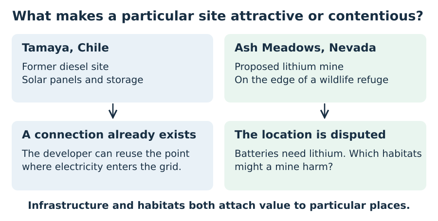

# X-ENS MP-MPI-PC-PSI — Anglais 2026 · Corrigé brut

*Corrigé rédigé par IA, non officiel. Signalez toute erreur.*

**Rédaction** · modèle exact non renseigné (famille GPT-6) · effort non renseigné · vitesse non renseignée

**Révision** · modèle exact non renseigné (famille GPT-6) · effort non renseigné · vitesse non renseignée

**Révision** · GPT-6.2 Astra Ultra · vitesse non renseignée

**Révision** · GPT-6.2 Astra Ultra · vitesse non renseignée

**Révision (tour 4)** · GPT-6.2 Astra Ultra · vitesse non renseignée

## A — Synthesis of documents 1 to 4

### The Changing Geography of Clean Power

At a former diesel power station in Chile, solar panels now feed electricity into a grid built for another fuel. In Nevada, the prospect of a mine to supply batteries has alarmed two advocates of renewable energy. These cases, reported by *The Economist* and Meg Bernhard of *The New York Times*, illustrate how differently a shift away from fossil fuels can look from the site where it takes place. An international investigation by the *Times* and a Pew Research Center survey of Americans put those local stakes in perspective. How do national interests, industrial sites and public expectations shape the terms of the transition?

For both China and the United States, energy policy offers a way to limit dependence on other countries while securing customers abroad. The *Times* reports that abundant domestic oil and gas give Washington an incentive to keep foreign buyers using familiar fuels. The Trump administration has pressed Japan and South Korea to invest in shipping American gas to Asia. China, vulnerable to disruption of its oil imports, has built an industry that supplies solar panels, turbines and batteries to much of the world. Its coal consumption remains enormous. Yet the low cost of Chinese equipment has helped countries including India install cleaner technologies. An investment that serves one country's security can thus alter the economic choices open to another.

Those choices also depend on what earlier generations built. At Tamaya in Chile, the solar installation includes storage and inherits a connection to the grid. The IEA estimated that renewables projects totalling about 3,000 gigawatts worldwide awaited connections. Existing wells might likewise make geothermal heat accessible without the expense of drilling from scratch. Conversion has physical limits, however. A site designed for a compact fossil fuel plant may be too small to match its former output with solar panels. Nor is every conversion free of carbon emissions. According to the database cited by the magazine, around 35 percent of projects use at least one technology that still emits carbon, including bioenergy. Policy can compound the constraint on land. While one Canadian developer secured a permit more quickly for reusing industrial land, American developers can find it cheaper to obtain permission to build on untouched ground.

Bernhard's reporting from Nevada shows what can be at stake when development reaches a new site. Batteries for electricity storage and electric vehicles use lithium. Depending on the extraction process, mining can damage habitats or contaminate groundwater. A mining company and two local conservationists dispute the significance of the proposed site's proximity to the Ash Meadows wildlife refuge. The conservationists want federal authorities to identify sensitive places before developers stake claims. Mark Jacobson, an engineering professor interviewed by Bernhard, argues that additional wind and solar power can displace more polluting fossil fuels. The parties differ over the geographical scale at which to assess harm and over how much the choice of a particular site matters.

The June 2024 Pew bar chart gives that question of location a different dimension. Asked about hypothetical developments near their communities, 45 percent of American adults thought a wind farm would make the landscape less attractive. The same share expected that effect from a solar farm. Yet 44 percent thought nearby solar generation would lower the price they paid for electricity, against 37 percent who disagreed. On land use, 45 percent anticipated excessive space requirements for wind and 40 percent for solar. Roughly a third were unsure about local tax gains. These are separate expectations, without a majority on any single response or evidence of actual changes in bills.

Across the dossier, the attractions of cleaner power vary with who supplies the equipment, which infrastructure a developer can reuse and what residents expect to gain or lose. A country may acquire affordable solar technology through trade even as the land and minerals needed for wider deployment become contentious locally. The benefits and burdens of an energy choice can therefore fall in different places, even when those concerned agree on the need to reduce emissions.

*667 words, excluding the title.*

## B — Opinion piece in response to document 5

A tenant who has to choose between cooling a bedroom and paying for groceries has every reason to be impatient with California's climate policy. Joel Kotkin is right to put that household at the centre of his argument. Where I part company with him is over what the household is owed. Keeping fossil fuels available offers little protection against the next increase in their price. California should guarantee affordable access to essential energy while investing in ways for people to need less of it.

Start with what a price can tell us. A high price per kilowatt-hour matters, especially during a heatwave. But it takes a meter reading as well as a tariff to determine a bill. For families facing hardship, income is a third essential measure. A bill of the same size will make a larger claim on a household whose earnings are lower. That distinction matters when deciding whom a subsidy should reach. Insulating a poorly built flat can cut the electricity needed to keep it safe at precisely the times when cooling is most expensive. A tenant has little power to order that work, and a landlord who does not pay the electricity bill has little incentive to undertake it. An income-tested bill discount, such as the one California already offers through its CARE programme, buys a family relief now. Funding insulation in rented homes would give that relief a chance to outlast the next round of price rises.

Kotkin's comparison with Germany raises a different problem. The German economy's exposure to expensive energy is real, but any account of its recent difficulties must reckon with the disruption of Russian gas supplies after the invasion of Ukraine. Gas dependence carries a price risk of its own. California motorists know how quickly the figure on a filling station sign can change. Keeping a refinery open may ease a short-term shortage. It does little for a worker who has to buy fuel for a long commute every day. A dependable bus that runs early enough for the first shift would give that worker a choice at the pump.

Reliability deserves the same care. California sunshine may be plentiful, but a solar panel produces nothing after sunset, when a family arriving home still needs power. Keeping the Diablo Canyon nuclear plant available while storage and transmission are built can make sense, provided its safety and costs withstand scrutiny. Nuclear power supplies electricity without burning gas and without depending on daylight. That argument for retaining an existing plant gives us no reason to assume that every additional gas facility offers equally good value. Each one needs a case based on when its power is needed, what it will cost and how else that demand could be met.

Kotkin asks what climate action costs the poor. I would also ask what a succession of hot summers costs a renter in an upstairs flat, or a worker who loses wages during a wildfire evacuation. Those losses rarely appear on a utility bill, yet they belong in the comparison. California should judge its policies by whether low-income households can keep cool, reach work and count on the lights staying on. Publishing those results alongside electricity prices would give voters a better test of progress. If people with the least room in their budgets can afford the change, the state has a stronger case for asking everyone to make it.

*565 words.*
