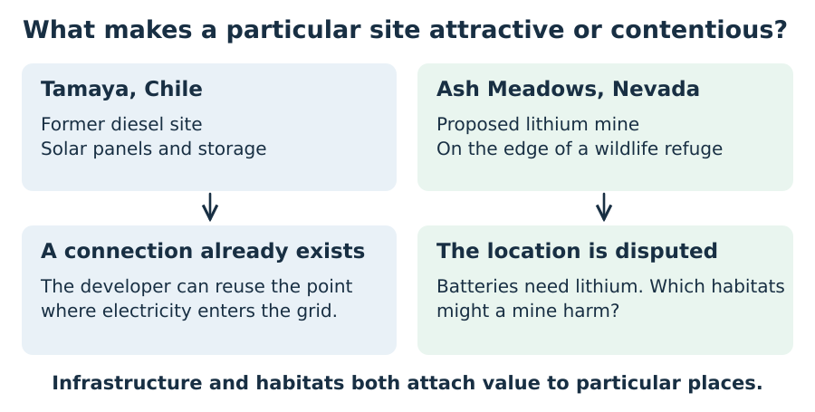
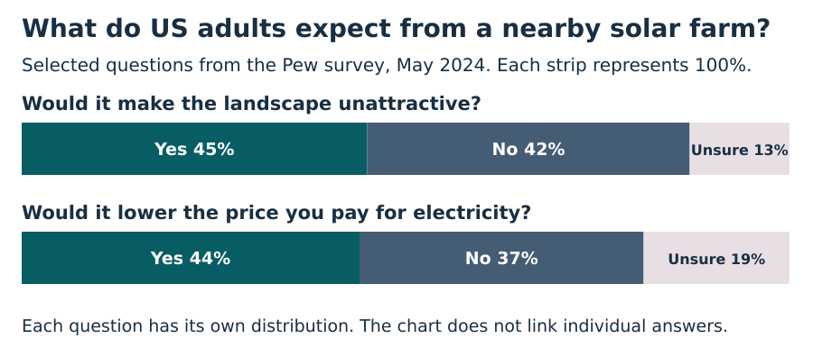
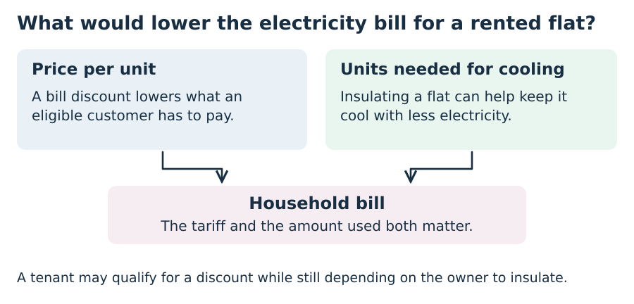

# X-ENS MP-MPI-PC-PSI — Anglais 2026 · Corrigé guidé

*Corrigé rédigé par IA, non officiel. Signalez toute erreur.*

**Rédaction** · modèle exact non renseigné (famille GPT-6) · effort non renseigné · vitesse non renseignée

**Révision** · modèle exact non renseigné (famille GPT-6) · effort non renseigné · vitesse non renseignée

**Révision** · GPT-6.2 Astra Ultra · vitesse non renseignée

**Révision** · GPT-6.2 Astra Ultra · vitesse non renseignée

**Révision (tour 4)** · GPT-6.2 Astra Ultra · vitesse non renseignée

## Présentation du sujet

Le 15 avril 2026, les candidats de MP, MPI, PC et PSI disposaient de quatre heures pour rédiger deux textes en anglais, sans dictionnaire ni traducteur. La synthèse porte sur les documents 1 à 4 et compte entre 600 et 675 mots, avec un titre obligatoire. Le second exercice demande un texte d’opinion de 500 à 600 mots en réponse au document 5. Le jury précise que chacune des deux parties compte pour la moitié de la note. Un partage possible consiste à réserver deux heures à chaque partie, décompte et relecture compris. [Sujet officiel](https://www.polytechnique.edu/admission-cycle-ingenieur/sites/admission/files/content/LVE%20Anglais.pdf) · [Rapport du jury 2026](https://www.polytechnique.edu/admission-cycle-ingenieur/sites/admission/files/content/All%20filieres_Anglais%20OK.pdf)

*Around 35 percent* in the first article refers to projects that use an emitting technology for part or all of their activity. The database includes projects at different stages. The figure measures neither the share of electricity produced nor the percentage of sites emitting as much as before.

## A — Synthesis of documents 1 to 4

### Reading across the dossier

> [!INDICATION]
> Compare the nouns that follow *clean* or *green* in the articles. Who is selling equipment, who is developing a site and who lives with the consequences? Which of these questions can a survey answer?

| Evidence | Use in a synthesis |
|---|---|
| *The Economist*, August 2025. A diesel station has become a solar and storage facility in Chile. | Link the existing grid connection to the value of using previously developed land. The same article shows why a conversion may run up against limits of space or planning rules. |
| *The New York Times*, June 2025. The US seeks overseas markets for domestic fuels. China sells technologies that enable other countries to use less fossil energy. | Both powers seek security and influence. Their industries and the choices these open up for importing countries differ. China's use of coal matters to the comparison. |
| Meg Bernhard, *The New York Times*, January 2025. A proposed Nevada lithium mine lies on the edge of a wildlife refuge. | Lithium links the battery industry to decisions about land and water. The conservationists support renewable energy and question where mining should take place. |
| Pew Research Center, June 2024. US adults were surveyed in May about wind and solar farms near their communities. | Ask what they expect to happen to the landscape, prices and local revenue. The survey offers separate responses for each effect. |

### From the bar chart to a paragraph

> [!INDICATION]
> On the solar question about lower electricity prices, how many respondents said yes, how many said no and how many were unsure? Could you use those answers to predict the amount on a future bill?

For the solar question, 44 percent anticipated a lower price, 37 percent did not and 19 percent were unsure. So a sentence can say that more respondents expected a fall than ruled one out. Calling the 44 percent a majority would change the finding. On the separate landscape question, 45 percent expected an adverse effect. We do not know how many of these were among the 44 percent who expected a financial benefit. Linking the survey to Nevada draws attention to location, while preserving the difference between a national poll and a report about particular campaigners.

> [!JURY]
> Le jury souligne que le graphique représente les opinions recueillies à un moment précis. Il valorise les synthèses qui relient enjeux locaux et mondiaux, restituent la singularité de chaque document et déclarent honnêtement leur nombre de mots. [Rapport 2026, section « A. La synthèse »](https://www.polytechnique.edu/admission-cycle-ingenieur/sites/admission/files/content/All%20filieres_Anglais%20OK.pdf)

### Organising the argument

Begin with the puzzle that a reused site in one place looks like an opportunity while a proposed new site elsewhere is disputed. Step back to the incentives of governments, then follow a technology to the land on which it depends. Finally, use Pew to distinguish the views of US respondents from the interests of any single developer or campaigner. The conclusion can now answer the question of scale. A country can gain a source of affordable equipment even where local decisions about land or water remain contested.

### Model synthesis

### The Changing Geography of Clean Power

At a former diesel power station in Chile, solar panels now feed electricity into a grid built for another fuel. In Nevada, the prospect of a mine to supply batteries has alarmed two advocates of renewable energy. These cases, reported by *The Economist* and Meg Bernhard of *The New York Times*, illustrate how differently a shift away from fossil fuels can look from the site where it takes place. An international investigation by the *Times* and a Pew Research Center survey of Americans put those local stakes in perspective. How do national interests, industrial sites and public expectations shape the terms of the transition?

For both China and the United States, energy policy offers a way to limit dependence on other countries while securing customers abroad. The *Times* reports that abundant domestic oil and gas give Washington an incentive to keep foreign buyers using familiar fuels. The Trump administration has pressed Japan and South Korea to invest in shipping American gas to Asia. China, vulnerable to disruption of its oil imports, has built an industry that supplies solar panels, turbines and batteries to much of the world. Its coal consumption remains enormous. Yet the low cost of Chinese equipment has helped countries including India install cleaner technologies. An investment that serves one country's security can thus alter the economic choices open to another.

Those choices also depend on what earlier generations built. At Tamaya in Chile, the solar installation includes storage and inherits a connection to the grid. The IEA estimated that renewables projects totalling about 3,000 gigawatts worldwide awaited connections. Existing wells might likewise make geothermal heat accessible without the expense of drilling from scratch. Conversion has physical limits, however. A site designed for a compact fossil fuel plant may be too small to match its former output with solar panels. Nor is every conversion free of carbon emissions. According to the database cited by the magazine, around 35 percent of projects use at least one technology that still emits carbon, including bioenergy. Policy can compound the constraint on land. While one Canadian developer secured a permit more quickly for reusing industrial land, American developers can find it cheaper to obtain permission to build on untouched ground.

Bernhard's reporting from Nevada shows what can be at stake when development reaches a new site. Batteries for electricity storage and electric vehicles use lithium. Depending on the extraction process, mining can damage habitats or contaminate groundwater. A mining company and two local conservationists dispute the significance of the proposed site's proximity to the Ash Meadows wildlife refuge. The conservationists want federal authorities to identify sensitive places before developers stake claims. Mark Jacobson, an engineering professor interviewed by Bernhard, argues that additional wind and solar power can displace more polluting fossil fuels. The parties differ over the geographical scale at which to assess harm and over how much the choice of a particular site matters.

The June 2024 Pew bar chart gives that question of location a different dimension. Asked about hypothetical developments near their communities, 45 percent of American adults thought a wind farm would make the landscape less attractive. The same share expected that effect from a solar farm. Yet 44 percent thought nearby solar generation would lower the price they paid for electricity, against 37 percent who disagreed. On land use, 45 percent anticipated excessive space requirements for wind and 40 percent for solar. Roughly a third were unsure about local tax gains. These are separate expectations, without a majority on any single response or evidence of actual changes in bills.

Across the dossier, the attractions of cleaner power vary with who supplies the equipment, which infrastructure a developer can reuse and what residents expect to gain or lose. A country may acquire affordable solar technology through trade even as the land and minerals needed for wider deployment become contentious locally. The benefits and burdens of an energy choice can therefore fall in different places, even when those concerned agree on the need to reduce emissions.

*667 words, excluding the title.*

Read the horizontal bars against each question separately. On excessive use of space, 45 percent said yes for wind and 40 percent for solar. On lower bills the solar response of 44 percent is the largest of three groups. It remains below half. A broadly favourable balance among those expressing a view cannot establish a majority of all US adults. The survey was conducted on May 13–19 and the chart published in June 2024.

## B — Opinion piece in response to document 5

### Identifying the claim to answer

> [!INDICATION]
> Kotkin makes an observation about current prices, a claim about their causes and an argument about who loses out. Which of the three would you grant? What evidence would the other two require?

Joel Kotkin's *Los Angeles Times* editorial of May 2025 compares prices in California with a US average and argues that state climate policy imposes a disproportionate burden on poorer households. The comparison with the national pump price is an observation. Attributing the whole gap to climate policy requires accounting for other influences, including the road taxes Kotkin mentions. Similarly, the additional 47 cents per gallon discussed in the editorial is a projection. Treating it as an increase already measured in May would make the case against the policy appear stronger than the evidence allows.

### Turning a challenge into a position

The response below accepts Kotkin's concern about energy poverty and asks which remedies reach the people he has in mind. Three concrete questions keep the argument in California. Can a tenant alter the amount of energy needed for cooling? Can a worker reach the first shift without driving? Can households count on power after sunset? The first question introduces California Alternate Rates for Energy (CARE), an existing discount for eligible households, and gives a reason to pair immediate relief with longer-term investment in housing. [California Public Utilities Commission, CARE](https://www.cpuc.ca.gov/industries-and-topics/electrical-energy/electric-costs/care-fera-program)

> [!JURY]
> Le jury attend une prise de position argumentée et illustrée par des exemples précis. Il signale que l’Allemagne demande une comparaison raisonnée et valorise les copies qui examinent la situation des Californiens les plus vulnérables. Il déconseille la lettre fictive adressée au journal. [Rapport 2026, section « B. Texte d’opinion »](https://www.polytechnique.edu/admission-cycle-ingenieur/sites/admission/files/content/All%20filieres_Anglais%20OK.pdf)

### Model opinion piece

A tenant who has to choose between cooling a bedroom and paying for groceries has every reason to be impatient with California's climate policy. Joel Kotkin is right to put that household at the centre of his argument. Where I part company with him is over what the household is owed. Keeping fossil fuels available offers little protection against the next increase in their price. California should guarantee affordable access to essential energy while investing in ways for people to need less of it.

Start with what a price can tell us. A high price per kilowatt-hour matters, especially during a heatwave. But it takes a meter reading as well as a tariff to determine a bill. For families facing hardship, income is a third essential measure. A bill of the same size will make a larger claim on a household whose earnings are lower. That distinction matters when deciding whom a subsidy should reach. Insulating a poorly built flat can cut the electricity needed to keep it safe at precisely the times when cooling is most expensive. A tenant has little power to order that work, and a landlord who does not pay the electricity bill has little incentive to undertake it. An income-tested bill discount, such as the one California already offers through its CARE programme, buys a family relief now. Funding insulation in rented homes would give that relief a chance to outlast the next round of price rises.

Kotkin's comparison with Germany raises a different problem. The German economy's exposure to expensive energy is real, but any account of its recent difficulties must reckon with the disruption of Russian gas supplies after the invasion of Ukraine. Gas dependence carries a price risk of its own. California motorists know how quickly the figure on a filling station sign can change. Keeping a refinery open may ease a short-term shortage. It does little for a worker who has to buy fuel for a long commute every day. A dependable bus that runs early enough for the first shift would give that worker a choice at the pump.

Reliability deserves the same care. California sunshine may be plentiful, but a solar panel produces nothing after sunset, when a family arriving home still needs power. Keeping the Diablo Canyon nuclear plant available while storage and transmission are built can make sense, provided its safety and costs withstand scrutiny. Nuclear power supplies electricity without burning gas and without depending on daylight. That argument for retaining an existing plant gives us no reason to assume that every additional gas facility offers equally good value. Each one needs a case based on when its power is needed, what it will cost and how else that demand could be met.

Kotkin asks what climate action costs the poor. I would also ask what a succession of hot summers costs a renter in an upstairs flat, or a worker who loses wages during a wildfire evacuation. Those losses rarely appear on a utility bill, yet they belong in the comparison. California should judge its policies by whether low-income households can keep cool, reach work and count on the lights staying on. Publishing those results alongside electricity prices would give voters a better test of progress. If people with the least room in their budgets can afford the change, the state has a stronger case for asking everyone to make it.

*565 words.*

## Bilan

A useful last check is to read the verbs attached to each claim. In A, *expected* reports a survey response, *could* marks a possible effect of mining, and *pressed* describes a government action. In B, *should* commits the writer to a policy judgment. The test of that judgment is whether the proposed remedy would help the person whose situation opened the piece. In these word counts, a hyphenated compound counts as one word and the title of A is excluded. Counting the six words of the title would also leave the synthesis within the prescribed range.
