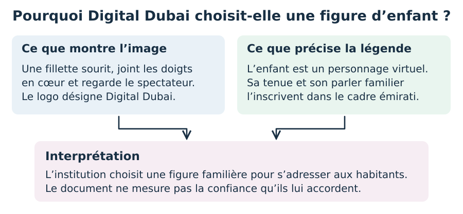

# X-ENS MP-MPI-PC-PSI — Arabe 2026 · Corrigé brut

*Corrigé rédigé par IA, non officiel. Signalez toute erreur.*

**Rédaction** · modèle exact non renseigné (famille GPT-6) · effort non renseigné · vitesse non renseignée

**Révision** · modèle exact non renseigné (famille GPT-6) · effort non renseigné · vitesse non renseignée

**Révision** · GPT-6.2 Astra Ultra · vitesse non renseignée

**Révision** · GPT-6.2 Astra Ultra · vitesse non renseignée

**Révision (tour 4)** · GPT-6.2 Astra Ultra · vitesse non renseignée

## A — Synthèse des documents 1 à 4

**الذكاء الاصطناعي في البلدان العربية بين تطوير الخدمات والقدرة على صنع التقنية**

في الصورة التي نشرتها صحيفة «النهار» تبتسم طفلة وتصنع بيديها شكل قلب. وقد يراها القارئ فيحسبها طفلة التقطت لها صورة في حديقة، لولا أن التعليق يعرّفها بوصفها شخصية من أسرة إماراتية افتراضية. تختصر هذه المسافة بين المظهر المألوف والتقنية التي أنتجته سؤالا تطرحه المواد الأربع على أنحاء مختلفة. كيف تستطيع البلدان العربية أن تسخّر الذكاء الاصطناعي لحاجات أهلها، وما الذي يحول بين قدرتها على استعماله وقدرتها على التحكم في شروط هذا الاستعمال؟

ينطلق أحمد يحيى في مدونة «وي غرو» من أن استيراد تطبيق جاهز يختلف اقتصاديا عن تطويره وتصديره. ويصل مروان جنيد في صحيفة «البلاد» بين هذا الطموح والبحث عن موارد تتجاوز عائدات النفط. ففي السعودية والإمارات تتخذ الاستثمارات شكل مشروعات مدن تصلح لاختبار تقنيات جديدة، بينما يضع يحيى اهتمام مصر بالتحول الرقمي في سياق السعي إلى تنويع الاقتصاد. وتتضح فائدة التطوير المحلي حين تختلف المسألة المطلوب حلها من مكان إلى آخر. يذكر يحيى حاجة المزارع إلى ترشيد الري في مناطق تشح فيها المياه، ويورد جنيد مثالا من الأردن على تسخير التقنية لمساعدة الأطباء في التشخيص. ففي الحالتين تتحدد قيمة التطبيق بمقدار ما يستجيب لندرة مورد أو لنقص في الكوادر.

ولا يقتصر دور الدولة في هذا التحول على تمويل المشروعات. تنقل إيمان الوراقي في «جسور بوست» عن الخبير رشاد عبده أن الإمارات أطلقت استراتيجيتها سنة ٢٠١٧، وأقامت مكتبا يتعاون فيه القطاع العام والخاص والمؤسسات الأكاديمية. وبذلك يظهر وجه آخر للمسألة التي يطرحها يحيى عند حديثه عن الشركات الناشئة. فدعم الابتكار يحتاج إلى صلة بين الباحث ومن يمول تطبيقه ومن يتيحه للمواطن.

وللغة نصيب من هذه المسألة الاقتصادية والاجتماعية. فكثرة الناطقين بالعربية تتيح، في تقدير يحيى، مجالا واسعا لخدمات الترجمة بين اللهجات والمساعدة الصوتية. ويعرض جنيد مبادرة مصرية لتطوير نماذج لغوية عربية. وتبيّن صورة «النهار» كيف تخرج القضية من المختبر إلى علاقة مؤسسة بجمهورها. فالشخصية التي اختارتها «دبي الرقمية» ترتدي زيا محليا، ويذكر التعليق أنها تخاطب الناس بلهجة يعرفونها. إنها طريقة لتقديم مشروع عام بوجه يألفه المواطن. وتعرض الصورة الاختيار الذي اتخذته المؤسسة في مخاطبة الجمهور، أما شعار المؤسسة الظاهر أعلى الصورة فيبيّن مصدر الرسالة ولا يقيس مدى تجاوب الجمهور معها.

غير أن ما يصلح لجذب الانتباه إلى خدمة حكومية لا يكفي لضمان عدالة القرار الذي تصدره إدارة. تشرح الوراقي أن المعاملات المتكررة تستهلك وقت الموظف والمراجع معا، وأن معالجتها آليا قد تختصر خطوات زائدة. وتشير إلى مساعدين يجيبون عن استفسارات المواطنين في الإمارات. لكنها تعرض أيضا دراسة تناولت فحص الطلبات في الصين، حيث يصعب أحيانا تتبع الطريق الذي أفضى إلى قرار بعينه. ويميز الباحثان بين خدمة تضبطها قواعد محددة وأخرى يتطلب تقديمها إعمال التقدير البشري. ومن الحلول التي يطرحانها أن تتولى الآلة التحقق الأولي من الملف وأن يبقى الحسم للموظف. ويتقاطع هذا التحفظ مع ما يورده جنيد عن مخاطر المراقبة والتعرف على الوجوه وضرورة حماية البيانات الشخصية.

وتتفاوت نقطة الانطلاق بين البلدان وداخل سوق العمل نفسها. ففي حين تتقدم بعض دول الخليج في الاستثمار والبنية التحتية، يذكر جنيد ما يعانيه اليمن والسودان من ضعف التجهيزات. وينقل جنيد تحذيرا عن منظمة العمل العربية مفاده أن الأتمتة قد تؤدي إلى فقدان ما يصل إلى ٢٨ في المئة من الوظائف الحالية في المنطقة، وخاصة في الأعمال الروتينية والإدارية. فالرقم تقدير للخطر، في حين أن فرص العمل الجديدة تظل بدورها رهنا بالتدريب والاستثمار. ويعدّ يحيى كثرة الشباب فرصة، لكنه يسجل نقصا في عدد المتخصصين القادرين على بناء النماذج. كذلك لا تضمن كثرة المتكلمين بالعربية توافر النصوص والبيانات اللازمة لتدريب نظام يفهم اختلاف لهجاتهم. فبعض المؤسسات لا تتبادل ما تجمعه من معلومات، وبعض اللهجات أقل تمثيلا في الموارد المتاحة للباحثين.

لهذا يربط الكاتبان بين تكوين العاملين وتنظيم البحث. يقترح يحيى مراجعة المناهج وإتاحة بيانات مشتركة بعد حماية هوية أصحابها، ويدعو جنيد إلى مراكز بحث عربية تجمع قدرات متفرقة. وتضيف تجربة الخدمات الحكومية التي تنقلها الوراقي شرطا يتعلق بطبيعة العمل نفسه، إذ يختلف الرد على استفسار عام عن البت في طلب فردي تترتب عليه حقوق. وبذلك تتوقف قدرة المنطقة على الانتقال من الاستهلاك إلى الإنتاج على اجتماع عناصر لا يغني أحدها عن الآخر. فمعرفة اللغة والحاجات المحلية توجه الابتكار، والموارد والتدريب يجعلان تطويره ممكنا، وإمكان مراجعة القرار يحدد مقدار ما يستطيع المواطن أن يأتمن عليه هذه الأنظمة.

عدد الكلمات من دون العنوان ٦٥١.

## B — Réponse au document 5

تستوقفني في مقال ظافر عبد الحق حيرة ليان أمام محرك البحث. أرادت جوابا بنعم أو لا، فأحالها على صفحات عليها أن تقرأها. أظن أن المدرسة تخطئ مرتين إذا لامت الطفلة على استعجالها ثم كافأتها في الامتحان على تسليم الجواب الصحيح وحده. ما يستحق أن يتعلمه الشاب في عصر المساعدات الذكية هو أن يعرف متى تكفيه إجابة سريعة، ومتى يلزمه أن يبطئ حتى يستطيع الدفاع عما يقوله أمام شخص آخر.

أجد في تجربة دانة بدوي سببا وجيها لإتاحة هذه الأدوات للطلاب. فمن خجل مرة من رفع يده في درس الجبر يدرك قيمة أن يسأل عن خطوة بسيطة مرتين من دون أن يضحك منه أحد. وتقول دانة، وهي في السادسة عشرة، إنها نالت سبعا وتسعين درجة من مئة في الجبر. أفهم ثقتها بطريقة ساعدتها على متابعة خطوات كانت تعجز عن فهمها في الصف. وشهادتها تصف تجربة طالبة واحدة، أما تعميم نجاح الطريقة فيحتاج إلى مقارنة ما يتعلمه طلاب آخرون في ظروف مماثلة. لكن العلامة التي حصلت عليها لا تختبر كل شرح سيعرضه عليها التطبيق غدا. ودانة تقر بأنها لا تتحقق من مصادر أجوبته. هنا تحديدا يمكن للمعلم أن يبني على ما أحبته في أداتها. يعطيها مسألة جديدة ويطلب منها أن تفسر لزميلة الخطوة التي استعصت عليها بالأمس.

لنفترض أن متجرا يعلن تخفيضين متتاليين قيمة كل منهما عشرون في المئة. قد يطلب طالب من البرنامج أن يعطيه السعر النهائي، ثم ينسخه ويمضي. ويمكن أن يطلب منه تلميحا واحدا، ويختار بنفسه سلعة ثمنها مئة دينار. بعد التخفيض الأول بقي ثمانون دينارا. والتخفيض الثاني يقتطع ستة عشر دينارا، لأن أساس الحساب تغير. إذا استطاع الطالب تفسير الفرق بين أربعة وستين وستين دينارا، ثم أعاد الحل على ثمن مختلف من غير شاشة، عرف هو ومعلمه ما تعلمه فعلا. وفي الحالتين أمضى وقتا مع الأداة نفسها، غير أن السؤال الذي حمله إليها لم يكن واحدا.

ويتضح الفرق أكثر عند محمد أديب. أوافقه على أن صياغة الطلب مهارة، فمن يسأل عن افتراضات حجة ما يستخرج مادة أغنى ممن يطلب جوابا نهائيا. لكنه يطمئن أيضا إلى جواب بدا له صادقا عما إذا كان كارل ماركس سيتوصل إلى آرائه نفسها لو أتيحت له هذه التقنية. لا مصدر يستطيع أن يثبت وقوع تاريخ بديل. يمكن للطالب أن يجعل الجواب بداية تمرين مثمر إذا عاد إلى نص لماركس، واستخرج منه حجة، ثم بيّن أين تنتهي الشهادة التاريخية وأين يبدأ تخيله الشخصي. وتلك بالضبط مهارات القراءة والكتابة التي يحتاج إليها كي يحسن مخاطبة الآلة والحكم على كلامها.

أتفهم لذلك قلق عمر دباس من اعتياد الإجابة الفورية. ومع ذلك لا أرى أن إعادة الأطفال إلى بحث طويل في كل مرة كفيلة بتنمية الحس النقدي. فقد يتصفح المرء عشر صفحات وينقل أول معلومة تريحه. أقترح أن يطلب المعلم، عند تصحيح واجب استعين فيه بمساعد ذكي، إرفاق مثال على اقتراح عدله الطالب، وذكر السبب الذي حمله على ذلك. ويستطيع من لا يملك اشتراكا أو اتصالا مستقرا أن يفحص في الصف جوابا مطبوعا يعطى للجميع. ويمكن للمعلم نفسه أن يختار جوابا صحيحا في بعض المرات، حتى لا يعتاد الطلاب أن المطلوب اصطياد خطأ رتبه لهم سلفا. عليهم حينئذ أن يبينوا لماذا وثقوا بالجواب، ومن أين جاءهم الدليل. بهذه الطريقة لا تصبح جودة الهاتف جزءا من تقدير جودة التفكير.

عندما تسأل ليان عن موعد إغلاق متجر، يكفيها جواب قصير. أما سؤالها الفعلي عما إذا كان منتج ما مشمولا بالمقاطعة فيحتاج إلى مصدر يمكن التحقق منه. من الذي دعا إلى المقاطعة، ومتى حدّث قائمته؟ من حقها أن تعرف كيف تصل إلى هذا المصدر، وأن تستطيع القول إن الدليل لم يكف بعد. تلك في رأيي مهارة أجدر بالاحتفاء من سرعة تلقي الأجوبة.

عدد الكلمات ٥٦٢.
