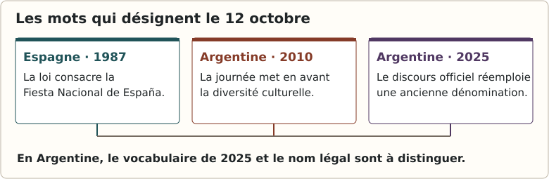

# X-ENS MP-MPI-PC-PSI — Espagnol 2026 · Corrigé guidé

*Corrigé rédigé par IA, non officiel. Signalez toute erreur.*

**Rédaction** · modèle exact non renseigné (famille GPT-6) · effort non renseigné · vitesse non renseignée

**Révision** · modèle exact non renseigné (famille GPT-6) · effort non renseigné · vitesse non renseignée

**Révision** · GPT-6.2 Astra Ultra · vitesse non renseignée

**Révision** · GPT-6.2 Astra Ultra · vitesse non renseignée

**Révision (tour 4)** · GPT-6.2 Astra Ultra · vitesse non renseignée

## Présentation du sujet

L’écrit commun du 15 avril 2026 dure quatre heures. La synthèse se rédige en espagnol, avec un titre, en 600 à 675 mots. Elle croise les documents 1 à 4, dont le dernier comprend **deux images**. Le texte d’opinion répond en espagnol à la chronique de Nuria Labari, en 500 à 600 mots. [Sujet officiel](https://www.polytechnique.edu/admission-cycle-ingenieur/sites/admission/files/content/LVE%20Espagnol.pdf)

La couverture d’*El Jueves* date d’octobre 2024, la photographie madrilène d’octobre 2025. Un rapprochement avec la vidéo de 2025 peut éclairer le contraste de points de vue. Présenter la couverture comme une réponse du dessinateur à cette vidéo inverserait la chronologie.

## Construire la synthèse

> [!INDICATION]
> Dans quels pays une institution donne-t-elle un nom au 12 octobre ? Qui conteste le sens de cette date dans chacun d’eux ?

Roque envisage une communauté culturelle capable de regarder sa propre histoire. *La Arena* rapporte les propos du gouvernement argentin et resitue la vidéo dans une histoire politique plus longue. Il faut distinguer le discours de la Maison-Rose, son traitement dans le journal et la dénomination légale argentine. Lucía Franco fait entendre des collectifs madrilènes qui interrogent les effets présents du vocabulaire colonial. Ces voix traversent les frontières nationales. Une copie organisée en « Espagne pour, Amérique contre » perdrait cette pluralité.

> [!INDICATION]
> Dans le document 4, qui occupe le centre de la photographie ? Qui se trouve au pied de l’édifice dans le dessin ? Comment ces places font-elles entendre des arguments différents ?

Diego Radamés photographie Isabel Díaz Ayuso au centre de participants en tenue traditionnelle. Ayuso préside la Communauté autonome de Madrid. La couverture d’*El Jueves* place les personnages qui prétendent apporter la civilisation en bas d’un édifice monumental déjà construit. L’échelle et la position démentent visuellement leur prétention. La photo peut dialoguer avec la contre-programmation relatée par Franco, et le dessin avec la rhétorique héroïque étudiée par *La Arena*. Un document iconographique participe ainsi à la démonstration en deux endroits distincts.

La copie ci-dessous suit trois déplacements. Elle étudie d’abord ce que les institutions décident de commémorer. Elle compare ensuite la mise en scène des autorités aux réponses des artistes. Elle rapproche enfin les interprétations du métissage avec l’expérience sociale des personnes concernées. En espagnol, *según el diario*, *a juicio de los entrevistados* ou *el vídeo presenta* attribuent les thèses à ceux qui les défendent.

## Argumenter à partir de la chronique

> [!INDICATION]
> De quoi la popularité d’une fête apporte-t-elle une preuve directe ? Quelles données faudrait-il recueillir pour expliquer les préférences électorales de son public ?

Labari rapproche les discours sur l’immigration et les gestes d’accueil de la présidente régionale. L’ironie du dernier mot, qui mêle le nom d’Ayuso à celui de la fête, dénonce cette personnalisation. On peut approuver la critique d’un accueil sélectif et contester à la chroniqueuse la possibilité de déduire les valeurs d’un électorat du succès d’un concert. Ce désaccord ciblé donne une thèse à la partie B sans transformer l’exercice en commentaire de texte.

> [!JURY]
> Le jury insiste sur la lecture des deux images, la distinction entre voix journalistiques et discours rapportés, ainsi que l’effet de l’humour dans la couverture et l’éditorial. Conserver le statut de chaque affirmation évite de présenter les stéréotypes du discours politique comme des faits. [Rapport de la session](https://www.polytechnique.edu/admission-cycle-ingenieur/sites/admission/files/content/All%20filieres_Espagnol%20OK.pdf)

## Exemple de copie

## Partie A — Synthèse

### Las dos orillas de una misma fecha

¿Cómo puede el Día de la Hispanidad, celebrado el 12 de octubre, dividir a los vecinos de una misma ciudad cuando aspira a reunir a los hablantes de una misma lengua? Tres artículos publicados en octubre de 2025 y dos imágenes reunidas en un cuarto documento sitúan esa pregunta entre España y América Latina. La llegada de Colón a Guanahaní proporciona una referencia común. La distancia entre las distintas formas de recordarla revela quién tiene autoridad para contar la historia y quién queda fuera del relato.

Según Adrián Roque, Alfonso XIII declaró fiesta nacional el Día de la Raza en 1918. La ley de 1987 mantuvo la fecha bajo el nombre de Fiesta Nacional de España. Así, una celebración de alcance hispanoamericano coincide con la fiesta de un solo Estado. La historia argentina que reconstruye La Arena permite apreciar el alcance de estos cambios de vocabulario. Allí, la decisión de 2010 de dedicar la jornada al respeto a la diversidad cultural hizo visibles a los pueblos originarios y a la población afrodescendiente como parte de la nación. Desde esa perspectiva, la llegada de los europeos pierde su condición de origen absoluto. Para Roque, reconocer el coste de la colonización resulta compatible con apreciar la lengua y las creaciones culturales compartidas por ambas orillas.

Sin embargo, cambiar el calendario oficial tampoco resuelve quién encarna esa comunidad. Según La Arena, la Casa Rosada ha vuelto a emplear la antigua denominación sin que se haya anunciado una modificación legal. En el vídeo difundido por la Casa Rosada, la voz en off atribuye a Colón las primeras instituciones basadas en el derecho y la fe cristiana. Al describir como barbarie las prácticas de los pueblos americanos, ese discurso les niega toda capacidad de organizar una sociedad antes de la expedición. Ya en 2024, El Jueves representaba esa jerarquía mediante una orden de bajar dirigida desde el pie de una escalinata. Quienes se atribuyen la tarea de civilizar aparecen diminutos al pie de una monumental construcción americana. La imagen permite medir la distancia entre lo que proclaman los personajes y lo que ya tienen delante de los ojos.

En Madrid, la fotografía de Diego Radamés sitúa a Isabel Díaz Ayuso, presidenta de la Comunidad, en el centro de un grupo con trajes tradicionales y banderas. A la izquierda, una participante sostiene un marco alrededor de su propio rostro. A pocas paradas de metro de los actos institucionales, los colectivos entrevistados por Lucía Franco en El País organizan su propia programación. En una exposición de La Parcería, las fotografías, los recortes y hasta los insultos reapropiados por artistas documentan cómo se ha mirado a quienes llegaron de América Latina. La foto reúne a participantes en un acto público. El archivo, en cambio, deja a sus promotores elegir cómo contar su propia experiencia de la ciudad.

El desacuerdo alcanza así a la vida cotidiana. Para los responsables de la exposición, celebrar la variedad de acentos resulta insuficiente cuando quienes los hablan encuentran obstáculos en el trabajo o en el ejercicio de sus derechos. Esta objeción introduce un matiz en el planteamiento conciliador de Roque. Allí donde el periodista ve en el mestizaje una base para seguir conversando, los entrevistados de Franco advierten que invocar la mezcla también puede ocultar las relaciones de poder que la hicieron posible. El vídeo argentino y la sátira española ilustran hasta qué punto la misma palabra, civilización, cambia de sentido según quién tenga la palabra y desde qué lugar se escuche.

La pluralidad de memorias atraviesa, por tanto, cada una de las dos orillas. En Argentina se enfrentan dos maneras de definir la nación y en la propia capital española conviven el escenario del homenaje y el espacio de la protesta. La posibilidad de un legado común depende, según las voces reunidas en el dossier, del lugar que cada relato concede a quienes han recibido sus beneficios y a quienes todavía reconocen en él la huella de una exclusión.

*657 mots hors titre, 664 avec le titre.*

Le 12 octobre est la date de la fête nationale espagnole évoquée dans le dossier. Le document 1 la présente aussi comme journée de l’espagnol de l’ONU. Le calendrier de l’Organisation fixe cette dernière au 23 avril. Dans la synthèse, on peut restituer l’idée de langue partagée chez Roque sans reprendre cette erreur ni ajouter à la copie une digression extérieure. [Calendrier officiel des Nations unies](https://www.un.org/es/observances/multilingualism)

## Partie B — Texte d’opinion

A la salida de un concierto nadie pide al público que enseñe su papeleta electoral. Esta obviedad me parece un buen punto de partida para discutir la paradoja que plantea Nuria Labari. La columnista acierta al preguntarse cómo puede una dirigente celebrar por todo lo alto la presencia latinoamericana en Madrid y defender al mismo tiempo restricciones que afectan a los migrantes. Me convence menos el salto que da de la eficacia de un festival a la descripción moral de una parte de su público.

La ironía de Labari tiene un blanco preciso. Basta alternar, como hace ella, las declaraciones de Isabel Díaz Ayuso sobre los menores que llegan solos y su reivindicación de argentinos o venezolanos como miembros naturales de la comunidad madrileña. El lector oye cómo una misma voz reparte el reconocimiento en función de quién llega. Una afinidad cultural puede hacer más fácil la acogida entre vecinos. Convertida en criterio público, deja pendiente una pregunta elemental. ¿Qué pasa con el vecino que necesita la misma protección y habla otra lengua? Los derechos de un menor no pueden depender de que su acento resulte familiar a quien lo recibe.

Ahora bien, de ahí no se desprende que los asistentes a un concierto de Gloria Estefan compartan los criterios de quien lo financia. Una persona puede bailar por gusto, llevar a sus hijos para que conozcan una canción de sus abuelos o agradecer que en la plaza se escuche la música de su infancia. También puede apoyar a Ayuso, desde luego. Para saberlo haría falta escucharla y conocer su trayectoria. Ni siquiera conocemos qué parte del público puede votar en las elecciones de la Comunidad. El número de residentes latinoamericanos que cita Labari y el de electores son datos distintos. Cuando la columna presenta el clasismo o el machismo como señas de un electorado latinoamericano, corre el riesgo de repetir el gesto que denuncia. Vuelve a describir desde fuera a personas a las que apenas hemos oído hablar.

Tampoco me parece desdeñable el placer de una fiesta. Si un proyecto político respetuoso con los migrantes solo los convoca cuando sufren una injusticia, habrá reconocido su condición de titulares de derechos y pasado por alto una parte importante de sus vidas. El problema aparece cuando quienes ponen el escenario eligen también qué aspectos de la experiencia migratoria merecen llegar al micrófono. Una forma de comprobar el alcance de la celebración sería preguntar qué poder de decisión tienen las asociaciones participantes sobre el programa y qué oportunidades conservan cuando se desmonta el escenario. Esas dos preguntas permiten juzgar una política cultural incluso cuando desconocemos el voto de cada espectador.

Comparto, pues, la desconfianza de Labari ante una bienvenida que se proclama universal y se concede de forma selectiva. Su sátira resulta más certera cuando enfrenta las palabras de la dirigente con sus propias decisiones. Pierde precisión cuando le basta una pista de baile para atribuir valores a toda una comunidad. El mérito de una fiesta pública se podría medir por algo menos vistoso que el tamaño de la multitud. ¿Pueden las mismas personas que el domingo aparecen en primera fila decidir el lunes cómo se cuenta su historia y reclamar sus derechos, también cuando su reclamación incomoda a quien pagó el concierto?

*541 mots.*

## Bilan

Relisez la synthèse en contrôlant, paragraphe par paragraphe, l’attribution des idées et l’usage de chaque image. Dans l’opinion, soulignez le passage où la copie répond directement à Labari et celui où elle apporte son propre critère.
