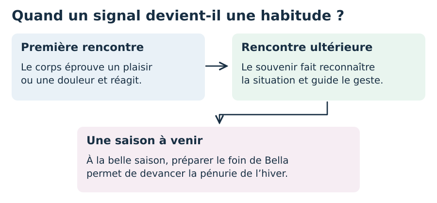
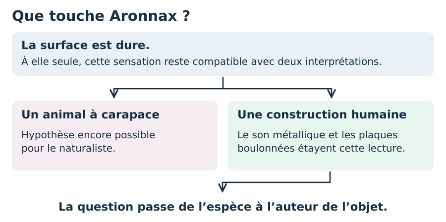
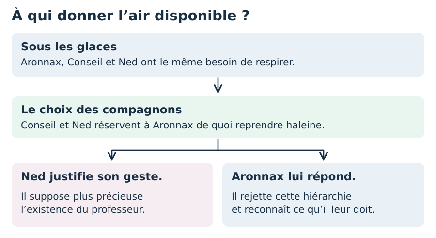

# X-ENS MP-MPI-PC-PSI — Français 2026 · Corrigé guidé

*Corrigé rédigé par IA, non officiel. Signalez toute erreur.*

**Rédaction** · modèle exact non renseigné (famille GPT-6) · effort non renseigné · vitesse non renseignée

**Révision** · modèle exact non renseigné (famille GPT-6) · effort non renseigné · vitesse non renseignée

**Lecture du rapport du jury** · GPT-6.2 Astra Ultra · vitesse non renseignée

**Révision** · GPT-6.2 Astra Ultra · vitesse non renseignée

**Révision (tour 3)** · GPT-6.2 Astra Ultra · vitesse non renseignée

**Révision (tour 4)** · GPT-6.2 Astra Ultra · vitesse non renseignée

## Présentation du sujet

L’épreuve commune du 13 avril 2026 dure quatre heures. Elle demande une dissertation discutant un extrait du *Traité des sensations* de Condillac à partir des trois œuvres du programme « Expériences de la nature ». Chez Canguilhem, il s’agit de l’introduction, de la partie I et des chapitres II à V de la partie III de *La Connaissance de la vie*. Les deux romans sont *Vingt mille lieues sous les mers* et *Le Mur invisible*. On peut réserver 45 minutes à l’analyse et au plan, trois heures à la rédaction et quinze minutes à la relecture. [Sujet officiel](https://www.polytechnique.edu/admission-cycle-ingenieur/sites/admission/files/content/Fran%C3%A7ais.pdf) · [Programme 2025–2026](https://www.education.gouv.fr/bo/2025/Hebdo23/MENS2514209A)

## Analyse du sujet

> [!INDICATION]
> Écartez un instant le mot « nature ». Que fait le sujet grammatical de la première phrase ? Que lui fait cesser de faire la seconde ?

> [!INDICATION]
> Quelqu’un peut éprouver une douleur sans savoir comment l’éviter la prochaine fois. Quelle opération manque entre les deux moments ?

#### Solution

Condillac prête à la nature des verbes d’action. Elle donne des organes et avertit. L’avertissement oriente immédiatement la conduite, à travers les valeurs opposées du plaisir et de la douleur. Il ne fournit pourtant ni une explication du danger ni une règle disponible en son absence. L’expérience permet de garder la trace de la rencontre, d’en reconnaître le retour et finalement de devancer le signal. « Contracter » une habitude suppose une durée. L’« ouvrage » à achever peut alors s’entendre en deux sens. On peut apprendre à accomplir une tâche déjà fixée ou devenir capable de se proposer d’autres fins.

## Problématique

> [!INDICATION]
> Demandez quel critère permettrait de dire qu’un apprentissage est achevé. Suffirait-il d’éprouver davantage de plaisir ou de se protéger plus sûrement ?

#### Solution

Si le plaisir et la douleur orientent nos premiers gestes, qu’ajoute l’expérience à ces avertissements naturels, et jusqu’où peut-elle changer les fins qui nous font agir ? Cette question relie les deux phrases de Condillac. Une autre entrée possible consisterait à demander qui juge de l’usage à faire d’un signal, en particulier lorsque le besoin d’autrui entre en conflit avec le nôtre.

## Plan détaillé

La progression part d’un contraste sensible dont le corps saisit immédiatement l’importance. Elle examine ensuite les opérations qui rendent l’expérience instructive et finit sur les choix que l’apprentissage rend possibles.

### Partie I — Ce que signale le corps

> [!INDICATION]
> Choisissez un plaisir qui apprend quelque chose sur la situation du personnage. Expliquez pourquoi il surgit à un moment plutôt qu’à un autre.

#### Solution

- Sous les glaces, la sortie d’Aronnax est éprouvante mais lui offre un air plus respirable que celui du bord. Le contraste a une valeur vitale avant toute analyse scientifique.
- La tique décrite par Canguilhem ne retient qu’une petite partie des signaux accessibles à un observateur. Ce qu’un organisme peut percevoir délimite un milieu qui importe pour lui.
- En faisant du foin pour l’hiver, la narratrice de Haushofer agit avant que la pénurie se fasse sentir. La conservation d’une trace et l’anticipation d’un besoin constituent le passage à l’expérience.

### Partie II — L’habitude à l’épreuve de la surprise

> [!INDICATION]
> Que devient une interprétation familière quand deux indices nouveaux ne la confirment plus ? Tirez-en une objection précise à l’idée d’un progrès continu par répétition.

#### Solution

- Dans la première partie du roman de Verne, chapitre VII, la dureté du prétendu monstre reste d’abord compatible avec une carapace. Le son et les plaques boulonnées conduisent Aronnax à changer de question.
- Chez Haushofer, le balisage du mur par des branches modifie les conditions des perceptions futures. Le sujet de l’expérience peut rendre lui-même un indice visible.
- Avec Canguilhem, distinguez la conduite efficace dans des circonstances répétées et la capacité à instituer de nouvelles normes lorsque les circonstances changent.

### Partie III — Former des fins, en répondre

> [!INDICATION]
> Dans la scène des glaces, reprenez la même sensation en changeant de point de vue. Quelle valeur Conseil et Ned attribuent-ils à un besoin qu’ils éprouvent eux aussi ?

#### Solution

- Aronnax doit la possibilité de respirer à ses compagnons. Le contraste entre le calcul avancé par Ned et le refus d’Aronnax de se dire supérieur fait de l’épisode une discussion morale.
- Bella rend des services à la narratrice du *Mur invisible*. Le rythme exigeant des soins, puis le coût affectif des pertes, permettent d’examiner ce qui dépasse cet intérêt matériel.
- La technique du *Nautilus* agrandit à la fois les moyens de connaître de Nemo et ceux de poursuivre sa vengeance. La réussite technique laisse ouverte la question de l’usage juste.

Identifier le signal commun aux trois hommes et préciser à qui profite le geste de Conseil et de Ned. Ce déplacement du bénéficiaire est ce que l’analyse doit expliquer au-delà de la sensation de manque.

## Références et exemples

| Passage | Détail à travailler | Question qu’il permet de résoudre |
|---|---|---|
| Verne, première partie, chapitre VII | Carapace supposée, son métallique, plaques boulonnées | Quand les sens conduisent-ils à rectifier un classement ? |
| Verne, seconde partie, chapitres XVI–XVII | Travail sous la glace, ration d’air et conversation après la délivrance | Comment passe-t-on du besoin de vivre à la reconnaissance d’une dette ? |
| Haushofer, découverte du mur et installation au chalet | Résistance éprouvée au toucher, branches plantées comme repères | Comment un vivant transforme-t-il ce que le milieu lui donne à percevoir ? |
| Haushofer, soins de Bella | Foin préparé durant l’été pour une autre saison | L’expérience me rend-elle sensible au seul besoin présent ? |
| Canguilhem, « Le vivant et son milieu » et « Le normal et le pathologique » | Sélection des signaux et capacité à vivre dans de nouvelles conditions | À quelle condition une habitude accroît-elle la liberté d’agir ? |

## Dissertation rédigée

#### Solution

**Problématique** — Si le plaisir et la douleur orientent nos premiers gestes, qu’ajoute l’expérience à ces avertissements naturels, et jusqu’où peut-elle changer les fins qui nous font agir ?

Dans *Le Mur invisible*, un chemin que la narratrice pouvait jusque-là emprunter s’interrompt en un lieu où ses yeux ne discernent aucun obstacle. Le chien Lynx s’y heurte. La douleur signale immédiatement un danger, mais personne n’est capable de dire ce qui vient d’arriver. Cette scène donne sa force à l’analyse de Condillac. Dans le « Dessein de cet ouvrage », Condillac introduit une statue dont les sens s’ouvrent successivement. Le philosophe sépare en pensée ce que notre expérience adulte nous présente déjà uni. La fiction invite à demander quelle conduite devient possible à chaque étape. Dans le *Traité des sensations*, la nature dote l’être humain d’organes qui l’orientent vers ce qui lui fait plaisir et l’éloignent de ce qui lui fait mal. Elle lui épargne ainsi d’avoir à apprendre de toutes pièces ce qui importe à sa vie. Elle lui laisse pourtant beaucoup à faire. Entre éprouver une douleur et savoir comment se conduire quand elle revient, il faut que le temps ait passé, que le souvenir se soit formé et qu’une manière d’agir soit devenue disponible. Mais que signifie alors « achever » ce que la nature a commencé ? S’agit-il de trouver, par l’habitude, les meilleurs moyens de poursuivre des fins déjà données ? L’épreuve du monde peut aussi nous amener à désirer une chose dont rien, dans le plaisir ou la peine éprouvés d’abord, ne nous indiquait la valeur. Nous partirons de ce que la sensation rend possible. Nous chercherons ensuite ce que les habitudes lui ajoutent et dans quels cas l’expérience nous engage à les réviser pour des fins que nous pouvons reconnaître comme nôtres.

* * *

Il suffit de manquer d’air pour comprendre que nos sens donnent à certaines différences du monde un intérêt vital. Dans *Vingt mille lieues sous les mers*, quand le *Nautilus* est prisonnier des glaces, Aronnax éprouve un contraste singulier. À bord, l’air se vicie. Lorsqu’il sort travailler, l’appareil respiratoire lui fournit de l’air pur. Le travail, qui devrait accroître sa fatigue, lui procure donc un soulagement que le repos dans le navire lui refuse. Le plaisir dont il est ici question a un contenu précis. Il distingue deux milieux, en fonction du besoin présent du corps. Le lecteur n’a pas à connaître la composition de l’atmosphère pour comprendre, avec Aronnax, de quel côté se trouve la possibilité de vivre.

Canguilhem aide à démêler ce qui se joue dans cet avertissement. Dans « Le vivant et son milieu », il reprend à Uexküll le cas de la tique. Dans cet environnement où l’observateur humain distingue quantité de formes et de couleurs, seuls quelques signaux, dont l’odeur d’un mammifère, importent à l’animal. Que le monde comporte ainsi des différences qui comptent pour un vivant permet de comprendre le privilège que Condillac accorde aux organes. Une connaissance théorique des choses serait impuissante à expliquer pourquoi l’une mérite que cet être s’en approche, l’autre qu’il s’en éloigne. Il serait cependant imprudent d’attribuer à la tique nos sentiments ou de lui prêter une délibération. L’exemple établit qu’une organisation vivante opère une sélection. Il laisse ouverte la question proprement humaine de ce que nous faisons de nos sensations.

Dans le roman de Haushofer, le froid et la faim ne sont pas des découvertes inédites pour la narratrice. Ce qui est nouveau, c’est le délai qui sépare le besoin de sa satisfaction. Là où l’on pouvait hier acheter de la nourriture, il faut désormais prévoir une saison entière. Faire du foin en été pour Bella, c’est agir au moment où l’herbe est abondante en fonction d’une pénurie dont ni la femme ni la vache ne souffrent encore. Un avertissement reçu en hiver arriverait trop tard. L’expérience commence dans cet écart. Retenir les effets d’une saison donne une prise sur les circonstances à venir. L’habitude permet d’agir aujourd’hui au bénéfice d’un vivant qui aura besoin de nous demain. À ce premier titre, elle continue bien l’ouvrage de la nature.

* * *

L’avertissement et la conduite apprise n’occupent pas le même temps. Une douleur interrompt le geste au moment où l’obstacle est déjà rencontré. La narratrice qui prépare son prochain trajet peut, elle, s’arrêter avant le choc, alors même que ses yeux continuent de lui montrer le passage libre. En ce sens précis, « achever » ne consiste pas à ressentir plus vivement la même douleur. Il s’agit de rendre possible une conduite à laquelle l’épreuve pénible n’aura justement plus à donner le signal.

Reste à comprendre la formule selon laquelle la nature « s’arrête là ». Prise à la lettre, elle donnerait l’impression qu’une fois le signal reçu on pourrait se contenter de le répéter. Or une même sensation admet plusieurs interprétations. Chez Verne, Aronnax a cru reconnaître dans les signalements du prétendu monstre une espèce de narval. Quand il se retrouve sur le dos de la chose, le contact d’une paroi dure ne suffit pas à lui faire changer d’avis. Il envisage encore une enveloppe osseuse. Il faut rapprocher la dureté du son métallique, puis de la disposition régulière des plaques, pour identifier une construction humaine. Le naturaliste modifie alors la question qu’il posait à l’objet. Au lieu de chercher à quelle espèce il appartient, il se demande qui a pu le construire. Une expérience marquante peut ainsi défaire une manière de classer que de nombreuses expériences avaient solidement établie.

La narratrice de Haushofer subit une révision plus rude encore. Le mur laisse voir le paysage familier de l’autre côté. Son corps rencontre une résistance là où son regard continue de lui promettre un passage. Fuir la douleur ne suffirait pas pour savoir où elle peut aller. Elle explore les limites de l’obstacle et matérialise par des branches une frontière que ses yeux pourront désormais repérer. Elle a ainsi changé les conditions dans lesquelles ses sens l’avertiront la prochaine fois. L’intelligence du geste consiste à laisser dans le monde une indication que la première rencontre n’y donnait pas. La nature continue de parler à des yeux et à des mains, mais le signal qui les guidera est maintenant, pour une part, l’œuvre de celle qui le reçoit.

L’habitude n’est donc pas toujours l’aboutissement heureux promis par le mot « achever ». Dans « Le normal et le pathologique », Canguilhem fait voir l’écart entre vivre selon une certaine norme et pouvoir en instituer d’autres lorsque le milieu change. On peut conserver une activité viable dans des conditions étroites et se trouver démuni dès qu’elles varient. Cette distinction aide à juger la réussite d’un apprentissage. La narratrice qui sait rapporter chaque bruit à une cause familière gagne en assurance, mais si elle ne pouvait plus rien éprouver comme inattendu, son assurance la rendrait vulnérable. Une habitude prolonge l’orientation du vivant lorsqu’elle élargit sa marge d’action. Elle peut aussi la réduire. Rien, dans le simple fait que le geste a été répété, ne tranche entre ces deux issues.

* * *

L’achèvement peut toutefois avoir un sens plus fort que l’acquisition d’une conduite efficace. Reprenons deux moments que Verne distribue de part et d’autre d’une coupure de chapitre. Dans la deuxième partie, le secours matériel appartient au chapitre XVI, « Faute d’air ». Au début du XVII, une fois sauvés, les personnages peuvent enfin dire la signification qu’ils donnent à ce secours. Ned Land et Conseil ont, aussi impérieusement qu’Aronnax, besoin d’air. Pourtant ils lui réservent de quoi respirer alors qu’il défaille. Au chapitre suivant, Ned veut rendre compte de cette préférence par une sorte de calcul, comme si la vie du professeur valait davantage que la sienne. Aronnax refuse cette hiérarchie et se reconnaît redevable envers ses compagnons. La différence des voix fait surgir une question que le seul récit d’un sauvetage aurait pu masquer. Tous trois savent combien il est bon de respirer. Cette communauté de besoins leur permet de comprendre ce que l’autre éprouve, mais elle ne fixe ni la part de chacun ni le sens qu’ils donneront au don. L’épreuve les a liés par une obligation qu’aucun de leurs organes ne prescrivait à lui seul.

Faire du foin chez Haushofer peut se relire sous cette lumière. Bella fournit du lait à la narratrice, mais prendre soin d’un animal oblige à organiser ses journées autour du rythme d’un autre vivant. Cette charge demeure même lorsque le travail est douloureux, que les réserves sont faibles ou que le bénéfice est lointain. Le rapport écrit après coup garde la trace du prix de ces attachements. Il ne présente pas l’expérience comme un stock de recettes qui rendrait chaque jour plus facile que le précédent. La disparition d’un animal aimé peut au contraire rendre la solitude plus douloureuse qu’elle ne l’était auparavant. L’expérience a agrandi la capacité de souffrir en même temps que la capacité de tenir à quelque chose. Juger cette transformation par le seul bilan du plaisir et de la peine ferait perdre ce qui la motive.

Rien n’assure pour autant qu’une fin ainsi poursuivie soit bonne. Chez Verne, le *Nautilus* libère Nemo de bien des contraintes de la vie terrestre et lui permet une connaissance extraordinaire de la mer. À la fin du récit, le même navire sert sa vengeance. La scène est racontée par Aronnax, dont l’admiration pour l’ingéniosité du capitaine n’abolit pas le jugement sur cet usage. La technique qui donne à Nemo la possibilité de réaliser un désir ne lui enseigne pas à l’approuver. De même, chez Canguilhem, comprendre l’activité par laquelle un vivant organise son milieu explique qu’il produise du nouveau. Cela ne fournit pas à sa place une règle morale pour décider de ce qu’il convient de faire aux autres. Que la nature nous laisse achever son ouvrage ouvre une responsabilité. Celui qui s’est formé un pouvoir d’action doit encore se demander à quelle fin il l’emploiera.

* * *

Condillac saisit donc quelque chose de décisif en distinguant le don des organes du travail de l’expérience. La douleur nous touche avant que nous sachions rendre raison de ce qui arrive. Le plaisir peut nous orienter avant que nous possédions une méthode. C’est au fil des rencontres que nous apprenons à prévoir un hiver, à rouvrir un jugement ou à transformer le milieu pour le rendre habitable. Mais une existence qui s’accomplit n’est pas simplement une succession d’habitudes toujours plus efficaces. Son apprentissage reste vivant tant qu’une surprise peut l’infléchir et qu’un autre être peut faire valoir un besoin différent du nôtre. Lorsque Conseil et Ned partagent l’air, l’expérience leur donne de faire plus que survivre. Elle leur donne l’occasion de décider pour qui ils veulent agir.

## Pièges à éviter

> [!PIEGE]
> Distinguez l’expérience vécue, dont la narratrice de Haushofer tire des habitudes, et l’expérimentation visant à éprouver une hypothèse. Le second sens n’épuise pas le premier.

> [!PIEGE]
> La cause du mur reste incertaine pour la narratrice. Son effet observable sur les gestes et les repères peut soutenir un argument sans qu’on transforme une hypothèse sur son origine en fait établi.

> [!JURY]
> Dans son rapport, le jury demande de traiter ensemble la nature et l’expérience et de travailler avec précision les scènes des romans. Il remarque que l’épreuve du mur et la diversité des fins poursuivies par Nemo offraient des objections à l’idée d’un accomplissement toujours bénéfique. [Rapport 2026, p. 3–8](https://www.polytechnique.edu/admission-cycle-ingenieur/sites/admission/files/content/All%20Filieres_Fran%C3%A7ais%20OK.pdf)

## Bilan

Pour reprendre la méthode, gardez une même scène à deux endroits du raisonnement. Le travail d’Aronnax sous les glaces établit d’abord la valeur sensible de l’air. Le don de ses compagnons fait ensuite apparaître une décision que cette valeur physiologique ne suffit pas à expliquer. Le dialogue de Verne donne une forme à cette discussion. Ned avance une justification presque arithmétique du don, puis Aronnax lui répond directement et refuse de fixer un prix supérieur à sa propre vie. Le lecteur entend ainsi deux jugements sur le même geste.

[Programme officiel](https://www.education.gouv.fr/bo/2025/Hebdo23/MENS2514209A) · [Condillac, Dessein de cet ouvrage](https://fr.wikisource.org/wiki/Trait%C3%A9_des_sensations/Dessein_de_cet_ouvrage) · [Verne, deuxième partie, chapitre XVI](https://fr.wikisource.org/wiki/Vingt_mille_lieues_sous_les_mers/Partie_2/Chapitre_16) · [Verne, deuxième partie, chapitre XVII](https://fr.wikisource.org/wiki/Vingt_mille_lieues_sous_les_mers/Partie_2/Chapitre_17)
