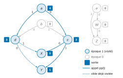
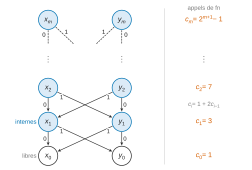
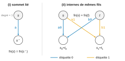

# X-ENS MP-PC-PSI — Informatique B 2026 · Corrigé brut

*Corrigé rédigé par IA, non officiel. Signalez toute erreur.*

Sujet : « Cycles et unification ». Durée 2 h, calculatrice interdite. Notations : $s\rightsquigarrow t$ signifie qu'il existe un chemin (éventuellement vide) de $s$ à $t$ ; on note `époque`, `sortie`, `présent`, `compteur` les variables globales de l'énoncé.

Rappel du graphe de la figure 1 (listes d'adjacence, l'étiquette d'un arc est son indice) :

```text
a : [c, d]    b : [d, c]    c : [X, Y]    d : [Y, X]
e : [W, Z]    W : [Z]       X : []        Y : []        Z : []
```

## Partie I. Détection de cycles

### Question 1

Avec `présent = 1` et `compteur = 0`, l'appel `pp('a')` se déroule ainsi :

- visite de `a`, puis de `c` ;
- visite de `X` (sortie 0), puis de `Y` (sortie 1), fin de `c` (sortie 2) ;
- visite de `d`, dont les deux cibles `Y` et `X` portent déjà l'époque 1, fin de `d` (sortie 3) ;
- fin de `a` (sortie 4).

Les sommets `b`, `e`, `W`, `Z` ne sont pas visités et gardent leurs valeurs initiales.



| | a | b | c | d | e | W | X | Y | Z |
|---|---|---|---|---|---|---|---|---|---|
| `époque` | 1 | 0 | 1 | 1 | 0 | 0 | 1 | 1 | 0 |
| `sortie` | 4 | 0 | 2 | 3 | 0 | 0 | 0 | 1 | 0 |

### Question 2

Les dictionnaires et `présent` sont quelconques, sous la seule hypothèse que les invariants sont vrais. Soit $p$ la valeur de `présent` avant l'incrémentation. On est hors de `pp`, donc A2 est vrai : $\texttt{époque}[t]\le p$ pour tout sommet $t$.

Après l'incrémentation, `présent` vaut $p+1$, et `époque` n'a pas changé. Donc

$$\texttt{époque}[t]\le p<p+1=\texttt{présent},$$

d'où **$\texttt{époque}[t]\neq\texttt{présent}$ pour tout sommet $t$**.

### Question 3

Pendant `pp(s)`, `présent` n'est pas modifié. Une époque n'est modifiée qu'à la ligne 16. Elle reçoit alors la valeur `présent`, sur un sommet visité, c'est-à-dire un sommet sur lequel `pp` est appelée. On montre que **les sommets visités sont exactement les sommets accessibles depuis $s$**.

*Sens indirect.* On suppose $\texttt{époque}[t]=\texttt{présent}$ après l'appel. D'après Q2, cette égalité était fausse avant l'appel, donc $t$ a été visité. Or `pp` n'est appelée récursivement que sur un successeur d'un sommet visité, en partant de $s$. Par récurrence sur l'ordre des appels, tout sommet visité est accessible depuis $s$. Donc $s\rightsquigarrow t$.

*Sens direct.* Soit $x$ un sommet visité et $x\to y$ un arc. Dans `pp(x)`, la boucle examine $y$. Soit $y$ porte déjà l'époque `présent`, et il a déjà été visité pendant l'appel (Q2). Soit `pp(y)` est appelée. Dans les deux cas, $y$ est visité.

Soit alors un chemin $s=x_0\to x_1\to\dots\to x_k=t$. Le sommet $x_0$ est visité, puis chaque $x_{i+1}$ l'est, par récurrence sur $i$. Donc $t$ est visité. Il reçoit l'époque `présent`, qui n'est ensuite plus modifiée.

$$\boxed{\ s\rightsquigarrow t\iff \texttt{époque}[t]=\texttt{présent}\ \text{après l'exécution}\ }$$

### Question 4

On se place, comme en Q3 et dans `accessible`, juste après `présent += 1`. D'après Q2, au début de `pp(s)` aucun sommet ne porte l'époque courante. Comme $s\rightsquigarrow u$, le sommet $u$ est visité (Q3), donc `pp(u)` s'exécute une fois.

La valeur de `compteur` croît strictement à chaque affectation de `sortie`. Considérons l'instant où la boucle de `pp(u)` examine $t=v$.

- Si $\texttt{époque}[v]\neq\texttt{présent}$, alors `pp(v)` est appelée depuis `pp(u)`. Elle se termine, en affectant `sortie[v]`, avant que `pp(u)` n'affecte `sortie[u]` après sa boucle. Donc $\texttt{sortie}[v]<\texttt{sortie}[u]$.
- Si $\texttt{époque}[v]=\texttt{présent}$, alors `pp(v)` a déjà commencé pendant cet appel, peut-être hors de `pp(u)`, par un chemin de $s$ à $v$ qui ne passe pas par $u$. Supposons que `pp(v)` ne soit pas terminée. Alors `pp(u)` a été appelée, directement ou non, depuis `pp(v)`. La pile d'appels fournit un chemin $v\rightsquigarrow u$, qui forme un cycle avec l'arc $u\to v$, ce qu'exclut A1. Donc `pp(v)` est terminée. Sa sortie a reçu une valeur de `compteur` strictement inférieure à celle que recevra `sortie[u]`.

Dans les deux cas, $\boxed{\texttt{sortie}[u]>\texttt{sortie}[v]}$, donc a fortiori $\texttt{sortie}[u]\ge\texttt{sortie}[v]$.

### Question 5

**Le test des lignes 5–6 n'élimine jamais à tort.** On suppose $s\rightsquigarrow t$, par un chemin $s=x_0\to\dots\to x_k=t$ avec $k\ge 0$. A3, appliqué à chaque arc du chemin, rend croissante la suite des époques des $x_i$. Donc

$$\texttt{époque}[s]\le\texttt{époque}[t].$$

Si de plus les époques de $s$ et de $t$ sont égales, la suite croissante des époques a des extrémités égales : elle est constante. A4 s'applique alors à chaque arc du chemin et rend décroissante la suite des sorties des $x_i$. Donc

$$\texttt{sortie}[s]\ge\texttt{sortie}[t].$$

La condition des lignes 5–6 est donc fausse. Pour $t=s$, cela couvre le chemin vide.

**Conclusion.**

- Si $s\rightsquigarrow t$, on exécute `présent += 1` puis `pp(s)`. Pour $t\neq s$, Q3 donne $\texttt{époque}[t]=\texttt{présent}$. Pour $t=s$, la ligne 16 l'impose. La fonction renvoie `True`.
- Si $s\not\rightsquigarrow t$, alors $t\neq s$. Soit le test renvoie `False`, soit `pp(s)` s'exécute. Dans ce second cas, Q3 donne $\texttt{époque}[t]\neq\texttt{présent}$, et la fonction renvoie `False`.

**`accessible(s, t)` renvoie `True` si et seulement si $s\rightsquigarrow t$.**

### Question 6

On suppose A2–A4 vrais à l'appel. Si la fonction sort ligne 7, rien n'est modifié. Sinon, soit $p$ la valeur de `présent` avant la ligne 9, et $V$ l'ensemble des sommets visités par `pp(s)`.

- D'après Q3, $V=\{x : s\rightsquigarrow x\}$, et ce sont exactement les sommets d'époque $p+1$.
- Les sommets hors de $V$ gardent leurs `époque` et `sortie`. Leur époque reste au plus $p$ (A2 avant l'appel).
- $V$ est stable par les arcs : si $x\in V$ et $x\to y$, alors $y\in V$.

On vérifie alors chaque invariant.

- **A2.** Si $x\in V$, son époque vaut $p+1$, c'est-à-dire `présent`. Sinon, elle est au plus $p$, donc strictement inférieure à `présent`.
- **A3.** Soit un arc $x\to y$.
  - Si $x\in V$, alors $y\in V$, et les deux époques valent $p+1$.
  - Si $x\notin V$ et $y\in V$, l'époque de $x$ est au plus $p$, celle de $y$ vaut $p+1$.
  - Si $x\notin V$ et $y\notin V$, rien n'a changé, et A3 valait avant.
- **A4.** Soit un arc $x\to y$ dont les deux extrémités ont la même époque. Les époques valent $p+1$ dans $V$, et au plus $p$ ailleurs.

  Les deux extrémités sont donc toutes deux dans $V$, ou toutes deux hors de $V$.
  - Si elles sont dans $V$, on a $s\rightsquigarrow x$, et Q4 donne $\texttt{sortie}[x]\ge\texttt{sortie}[y]$.
  - Sinon, rien n'a changé, et A4 valait avant.

`accessible` n'ajoute aucun arc. **A2, A3 et A4 sont préservés.**

### Question 7

`lier(u, s)` appelle `accessible(s, u)`. Cet appel modifie `présent`, `époque` et `sortie` (par `pp`), mais il préserve A2–A4 (Q6) et ne modifie pas le graphe. Si son résultat est `True`, rien d'autre n'est fait. Sinon, $s\not\rightsquigarrow u$ (Q5), et l'on ajoute l'arc $u\to s$ ligne 20. Il reste à étudier ce cas.

- **A1.** Le graphe était acyclique. Un cycle du nouveau graphe emprunterait donc l'arc $u\to s$. Il se refermerait par un chemin $s\rightsquigarrow u$ de l'ancien graphe, ce qui est impossible. En particulier $u\neq s$, car `accessible(s, s)` renvoie `True`.
- **A2.** Il est vrai après `accessible` (Q6), et la ligne 20 ne modifie ni `époque` ni `présent`.
- **A3, A4.** Les arcs anciens les vérifient après `accessible` (Q6), et la ligne 20 ne modifie ni `époque` ni `sortie`. Il faut encore vérifier le nouvel arc $u\to s$, selon la ligne d'`accessible` qui a renvoyé `False` :
  - sortie ligne 7, avec $\texttt{époque}[s]>\texttt{époque}[u]$ : A3 est strict pour $u\to s$, et A4 ne s'applique pas ;
  - sortie ligne 7, avec des époques égales et $\texttt{sortie}[s]<\texttt{sortie}[u]$ : A3 tient (égalité), et A4 tient puisque $\texttt{sortie}[u]>\texttt{sortie}[s]$ ;
  - sortie ligne 12 : `pp(s)` a posé $\texttt{époque}[s]=\texttt{présent}$, et $\texttt{époque}[u]\neq\texttt{présent}$. Comme l'époque de $u$ est au plus `présent` (A2), elle est strictement inférieure à celle de $s$ : A3 est strict, et A4 ne s'applique pas.

**`lier(u, s)` préserve A1, A2, A3 et A4.**

## Partie II. Unification

### Question 8

D'après les longueurs des listes :

- **sommets internes** (degré 2) : $a,b,c,d,e$ ;
- **sommet lié** (degré 1) : $W$ ;
- **sommets libres** (degré 0) : $X,Y,Z$.

### Question 9

On pose $N(s)$ = longueur, en nombre d'arcs, du plus long chemin issu de $s$. Elle est bien définie : $G$ est fini et acyclique (A1), donc un chemin ne repasse jamais par un sommet et a au plus $|S|-1$ arcs.

Pour tout arc $s\to t$, on prolonge un plus long chemin issu de $t$ par l'arc $s\to t$. On obtient un chemin issu de $s$, car il ne repasse pas par $s$ (A1). D'où

$$N(s)\ge 1+N(t)>N(t).$$

Les appels récursifs de `fn(s)` portent sur $s^*$, $s_0$ ou $s_1$, qui sont des cibles d'arcs issus de $s$. Donc $N$, entier naturel, décroît strictement à chaque appel récursif, et **`fn` termine**.

### Question 10

On note $C(s)$ le nombre d'appels à `fn` déclenchés par `fn(s)`, cet appel compris :

$$C(s)=\begin{cases}1 & \text{si } s \text{ est libre,}\\ 1+C(s^*) & \text{si } s \text{ est lié,}\\ 1+C(s_0)+C(s_1) & \text{si } s \text{ est interne.}\end{cases}$$

Pour $m\ge 0$, on considère le graphe à $n=2(m+1)$ sommets $x_0,y_0,\dots,x_m,y_m$. Les sommets $x_0$ et $y_0$ sont libres et, pour $1\le i\le m$ :

```text
x_i : [x_{i-1}, y_{i-1}]      y_i : [y_{i-1}, x_{i-1}]
```



Ce graphe est acyclique, car les arcs vont de l'étage $i$ à l'étage $i-1$. Son degré sortant est au plus 2, et il n'a pas d'arc multiple. Ce n'est pas un arbre : chaque sommet de l'étage $i-1$ est la cible de deux arcs, ce qui fait doubler le nombre d'appels à chaque étage. Par symétrie, $C(x_i)=C(y_i)$, que l'on note $c_i$. On a

$$\begin{aligned}
c_0&=1,\\
c_i&=1+2c_{i-1}\ \text{ pour } 1\le i\le m,\\
c_i+1&=2(c_{i-1}+1),\\
c_m&=2^{m+1}-1.
\end{aligned}$$

Comme $m+1=n/2$ :

$$\boxed{C(x_m)=2^{n/2}-1}$$

Chaque appel coûte au moins une opération élémentaire. **La complexité dans le pire cas de `fn` est donc au moins exponentielle en le nombre de sommets.**

Variante plus simple, si l'on accepte deux arcs vers le même sommet (la représentation par listes le permet) : une chaîne $s_0,\dots,s_{n-1}$ où `G[s_i] = [s_{i+1}, s_{i+1}]` pour $i<n-1$, et $s_{n-1}$ libre. Elle donne $2^n-1$ appels pour $n$ sommets.

### Question 11

On mémoïse le résultat par sommet dans un dictionnaire. La présence est testée au début de `aux`, et le cas de base est mémoïsé comme les autres :

```python
def fn_efficace(s):
    memo = {}

    def aux(x):
        if x not in memo:
            if len(G[x]) == 0:          # libre
                memo[x] = x
            elif len(G[x]) == 1:        # lié
                memo[x] = aux(G[x][0])
            else:                       # interne
                memo[x] = (aux(G[x][0]), aux(G[x][1]))
        return memo[x]

    return aux(s)
```

*Correction.* `aux` suit exactement la définition de $\mathrm{fn}$. La valeur mémorisée pour $x$ est $\mathrm{fn}(x)$, et `aux` termine par Q9.

*Complexité.* Le calcul et l'affectation de `memo[x]` s'exécutent au plus une fois par sommet. Hors appels récursifs, ils coûtent $O(1)$ : tests, accès au dictionnaire, construction d'un couple.

Un couple ne contient que deux références vers des valeurs déjà construites : les sous-termes sont **partagés** et ne sont pas recopiés. Chaque calcul de `memo[x]` lance au plus deux appels, donc le nombre total d'appels à `aux` est au plus $1+2|S|$. **La complexité est $O(|S|)$.**

### Question 12

Si $s$ est libre, $T(s)=1$, car le seul chemin est le chemin vide. Sinon, un chemin issu de $s$ qui aboutit à un sommet libre commence par l'un des arcs sortants de $s$. Cela donne une partition des chemins comptés, d'où

$$T(s)=\sum_{s\to t}T(t).$$

La récursion termine par Q9. Le sujet n'exige pas d'efficacité, et la récursion directe suffirait. On mémoïse quand même, pour un coût linéaire :

```python
def taille(s):
    memo = {}

    def aux(x):
        if x not in memo:
            if len(G[x]) == 0:
                memo[x] = 1
            else:
                total = 0
                for y in G[x]:
                    total = total + aux(y)
                memo[x] = total
        return memo[x]

    return aux(s)
```

Vérification sur la figure 1 : $T(a)=T(c)+T(d)=2+2=4$, et $T(W)=T(Z)=1$. **Complexité $O(|S|)$** grâce à la mémoïsation. Sans elle, le coût serait exponentiel sur l'exemple de Q10.

### Question 13

Soit $H$ une extension de $G$. Une extension n'ajoute d'arcs qu'aux sommets libres. Donc $c$ reste interne dans $H$, avec $c_0=X$ et $c_1=Y$ :

$$\mathrm{fn}_H(c)=\big(\mathrm{fn}_H(X),\ \mathrm{fn}_H(Y)\big).$$

$H$ vérifie A1 et A5, donc Q9 s'applique à $H$ : les formes normales dans $H$ sont des termes finis. On définit leur taille par $|v|=1$ pour un sommet et $|(\alpha,\beta)|=1+|\alpha|+|\beta|$ pour un couple. On a donc

$$|\mathrm{fn}_H(c)|=1+|\mathrm{fn}_H(X)|+|\mathrm{fn}_H(Y)|>|\mathrm{fn}_H(X)|.$$

Ainsi $\mathrm{fn}_H(c)\neq\mathrm{fn}_H(X)$, quelle que soit l'extension $H$, que $X$ y reste libre ou y devienne lié. **Le problème $\{(c,X)\}$ n'a pas de solution.**

### Question 14

Ligne 17, on complète par :

```python
        elif len(G[s]) == 0:
            if s != t and not lier(s, t):
                return False
```

*Justification.* Cette branche n'est atteinte que si $s$ est libre et $t$ n'est pas lié, c'est-à-dire $t$ libre ou interne.

En effet, les cas « $t$ lié » et « $s,t$ internes » sont traités avant. La branche `else` ramène le cas « $s$ interne, $t$ libre » à celui-ci par T1.

`unif` ne modifie $G$ que par `lier`, qui préserve A1–A4 (Q7). Les invariants sont donc vrais à chaque appel de `lier`, et Q5 s'applique : `lier(s, t)` ajoute l'arc $s\to t$ si et seulement si $t\not\rightsquigarrow s$.

- Si $s=t$, la paire est satisfaite par toute extension. On la retire simplement de $P$. Le test `s != t` est indispensable : `lier(s, s)` renverrait `False`, puisque $s\rightsquigarrow s$.
- Si $s\neq t$, on est dans les hypothèses de T4 : $P$ a une solution si et seulement si $P'$ en a une qui contient l'arc $s\to t$.
  - Si $t\rightsquigarrow s$, aucune extension ne contient $s\to t$, car elle contient $G$ et elle est acyclique. `lier(s, t)` renvoie `False` : $P$ n'a pas de solution.
  - Sinon, `lier` ajoute l'arc $s\to t$, étiqueté 0 puisque $s$ était libre. Les extensions du nouveau $G$ sont exactement les extensions de l'ancien qui contiennent $s\to t$. On poursuit la boucle avec $P'$, déjà privé de $(s,t)$ par `P.pop()`.

On ne renvoie pas le résultat de `lier` quand il vaut `True` : la boucle doit continuer à traiter les autres paires de $P$. Par exemple, sur la figure 1, `unif([('c', 'X'), ('Y', 'Z')])` lie `Y` à `Z`, puis doit encore découvrir que $(c,X)$ n'a pas de solution (Q13) et renvoyer `False`.

### Question 15

On renvoie les arcs qui violent A3 ou A4. Les deux invariants sont vérifiés si et seulement si le résultat est vide.

```sql
SELECT a.source, a.cible
FROM arcs AS a
JOIN sommets AS s ON s.id = a.source
JOIN sommets AS t ON t.id = a.cible
WHERE s.époque > t.époque
   OR (s.époque = t.époque AND s.sortie < t.sortie);
```

La violation de A3 s'écrit $\texttt{époque}[s]>\texttt{époque}[t]$. La négation de l'implication A4 s'écrit : époques égales **et** $\texttt{sortie}[s]<\texttt{sortie}[t]$. On peut aussi remplacer la première ligne par `SELECT COUNT(*)`, qui doit valoir 0.

### Question 16

**Lemme.** Il existe deux sommets $s\neq t$ tels que $\mathrm{fn}(s)=\mathrm{fn}(t)$ si et seulement si l'une des conditions suivantes est remplie :

- (i) $G$ a un sommet lié ;
- (ii) deux sommets internes distincts $s,t$ ont les mêmes fils : $s_0=t_0$ et $s_1=t_1$.

*Preuve.* Si $s$ est lié, alors $\mathrm{fn}(s)=\mathrm{fn}(s^*)$, et $s\neq s^*$ par acyclicité. Si $s,t$ sont internes et ont les mêmes fils, alors

$$\mathrm{fn}(s)=\big(\mathrm{fn}(s_0),\mathrm{fn}(s_1)\big)=\mathrm{fn}(t).$$

Réciproquement, on suppose qu'aucun sommet n'est lié et qu'il existe des paires $s\neq t$ avec $\mathrm{fn}(s)=\mathrm{fn}(t)$. On en choisit une qui minimise $N(s)$ (Q9). La forme normale d'un sommet libre est un sommet, celle d'un sommet interne est un couple.

- Si $s$ ou $t$ est libre, les deux le sont, et $s=\mathrm{fn}(s)=\mathrm{fn}(t)=t$, ce qui est exclu.
- Les deux sommets sont donc internes, avec $\mathrm{fn}(s_0)=\mathrm{fn}(t_0)$ et $\mathrm{fn}(s_1)=\mathrm{fn}(t_1)$.
- Si $s_0\neq t_0$, la paire $(s_0,t_0)$ conviendrait avec $N(s_0)<N(s)$, ce qui contredit la minimalité. Donc $s_0=t_0$, et de même $s_1=t_1$ : on est dans le cas (ii). $\square$



Il suffit donc de chercher ces deux motifs, sans calculer de forme normale. La requête suivante renvoie une telle paire, ou un résultat vide s'il n'en existe pas :

```sql
SELECT a.source, a.cible                      -- (i) un sommet lié et sa cible
FROM arcs AS a
JOIN sommets AS s ON s.id = a.source
WHERE s.degré = 1
UNION
SELECT a0.source, b0.source                   -- (ii) deux internes de mêmes fils
FROM arcs AS a0
JOIN arcs AS b0 ON b0.cible = a0.cible AND b0.étiquette = 0
JOIN arcs AS a1 ON a1.source = a0.source AND a1.étiquette = 1
JOIN arcs AS b1 ON b1.source = b0.source AND b1.étiquette = 1
                AND b1.cible = a1.cible
WHERE a0.étiquette = 0 AND a0.source < b0.source
LIMIT 1;
```

La présence d'un arc d'étiquette 1 garantit que les sommets de la seconde partie sont internes. La condition `a0.source < b0.source` impose $s\neq t$. Dans la première partie, $s\neq s^*$ par acyclicité.

**Toute ligne renvoyée vérifie $s\neq t$ et $\mathrm{fn}(s)=\mathrm{fn}(t)$, et le lemme garantit qu'une ligne est renvoyée dès qu'une telle paire existe.** Sur la figure 1, la requête renvoie $(W,Z)$.
