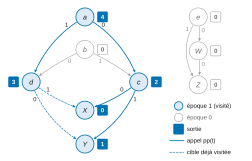
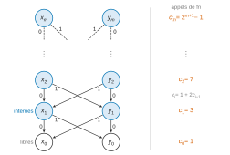
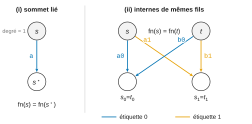

# X-ENS MP-PC-PSI — Informatique B 2026 · Corrigé guidé

*Corrigé rédigé par IA, non officiel. Signalez toute erreur.*

## Présentation du sujet

**Thème.** Le sujet s'intitule « Cycles et unification ». On manipule un graphe orienté acyclique $G$, codé en Python par un dictionnaire de listes d'adjacence : l'étiquette d'un arc est son indice dans la liste. Le fil conducteur est simple : on veut ajouter des arcs à $G$ sans jamais créer de cycle. On se sert ensuite de cette opération pour résoudre des problèmes d'**unification**, c'est-à-dire rendre égales les « formes normales » de plusieurs paires de sommets.

**Format.** 2 heures, sans calculatrice, 16 questions, 8 pages. L'épreuve est commune aux filières MP, PC et PSI. Elle relève du tronc commun d'informatique : Python, parcours de graphes, terminaison, complexité, SQL.

**Découpage.**

| Partie | Questions | Contenu | Outils |
|---|---|---|---|
| I. Détection de cycles | Q1–Q7 | parcours en profondeur `pp` avec époques et numéros de sortie ; preuve de `accessible` et `lier` par invariants | DFS, invariants, récurrence le long d'un chemin |
| II. Unification | Q8–Q14 | forme normale `fn`, terminaison, explosion exponentielle, mémoïsation, comptage de chemins, algorithme `unif` | variant de terminaison, récurrences, mémoïsation |
| III. Représentation relationnelle | Q15–Q16 | vérification des invariants en SQL, recherche de deux sommets de même forme normale | jointures, `UNION`, `LIMIT` |

La partie II peut se traiter sans la partie I, à l'exception de Q14, qui utilise `lier`. La partie III ne demande que les définitions des deux premières parties.

**Notions mobilisées.** Parcours en profondeur et ordre de fin de traitement (post-ordre), invariants de structure, variant de terminaison, complexité d'une fonction récursive, mémoïsation par dictionnaire, requêtes SQL avec jointures et auto-jointures.

**Difficulté.** Le sujet demande peu de code : trois questions de Python (Q11, Q12, Q14) et deux de SQL (Q15, Q16). Le cœur est l'analyse d'algorithmes de graphes. Les preuves de la partie I sont courtes, mais elles demandent de la rigueur : il faut dire quels invariants sont vrais à quel moment, et à quelle étape sert A1. Le rapport 2026 prévient : « Il est très facile d'avoir des intuitions fausses (par exemple, s'il existe un chemin s--->u->v alors tout chemin de s à v passe par u), d'où l'importance de raisonner très rigoureusement. » Il ajoute que « La grande majorité des questions se résolvent par des réponses très courtes. »

**Questions discriminantes.** D'après les statistiques du rapport 2026 (moyenne sur 1 point, parmi les copies qui ont traité la question) :

| Question | Copies l'ayant traitée | Moyenne |
|---|---|---|
| Q10 (minoration exponentielle) | 89 % | 0,45 |
| Q13 (problème sans solution) | 78 % | 0,45 |
| Q14 (compléter `unif`) | 60 % | 0,51 |
| Q15 (SQL, invariants) | 54 % | 0,46 |
| Q16 (SQL, formes normales) | 18 % | 0,24 |

À l'opposé, Q8 (0,98), Q3 (0,91) et Q5 (0,85) sont très bien réussies. La Q16 est la plus sélective : il faut d'abord trouver une caractérisation locale, car le SQL au programme ne permet pas de calculer `fn`.

**À ne pas laisser passer.** Q1, Q2, Q3, Q5 et Q8 sont rapides et sûres. Q11 (mémoïsation), Q12 et Q15 (une double jointure) rapportent beaucoup pour peu d'effort. Près de la moitié des copies n'ont pas abordé Q15 : c'est un signe de temps mal géré plus que de difficulté.

**Gestion du temps.** Prévoir environ 50 minutes pour la partie I, 45 minutes pour la partie II et 20 minutes pour la partie III, en gardant 5 minutes pour relire le code. Ne pas laisser la partie III pour les toutes dernières minutes.

## Partie I — Détection de cycles

Avant d'ajouter un arc $u\to s$, on veut vérifier que $s\not\rightsquigarrow u$. La fonction `pp` attribue l'époque courante à tous les sommets qu'elle visite et numérote les sommets par ordre de fin de traitement. Les invariants A2–A4 servent à répondre `False` sans parcours dans certains cas. Toute la partie consiste à prouver que ce raccourci est juste, puis que les invariants survivent aux appels.

### Question 1

> [!INDICATION]
> Simulez l'appel pas à pas. `sortie[s]` n'est affecté qu'**après** la boucle sur les successeurs : c'est un numéro de fin de traitement.

> [!INDICATION]
> Lorsque `pp('d')` s'exécute, regardez l'époque de ses deux cibles à cet instant.

#### Solution

Avec `présent = 1` et `compteur = 0`, `pp('a')` procède ainsi :

- elle visite `a`, puis `c` ;
- elle visite `X` (sortie 0), puis `Y` (sortie 1), et termine `c` (sortie 2) ;
- elle visite `d`, dont les cibles `Y` et `X` ont déjà l'époque 1, et termine `d` (sortie 3) ;
- elle termine `a` (sortie 4).

Les sommets `b`, `e`, `W`, `Z` ne sont pas atteints.



| | a | b | c | d | e | W | X | Y | Z |
|---|---|---|---|---|---|---|---|---|---|
| `époque` | 1 | 0 | 1 | 1 | 0 | 0 | 1 | 1 | 0 |
| `sortie` | 4 | 0 | 2 | 3 | 0 | 0 | 0 | 1 | 0 |

On retrouve bien `sortie['a'] = 4` et `sortie['X'] = 0`, comme l'indique l'énoncé.

> [!PIEGE]
> Le rapport 2026 relève que « Plusieurs copies ne donnent pas les bonnes valeurs pour le tableau sortie. » Le numéro est attribué en **fin** de visite, pas à l'entrée. Et `d` ne revisite ni `Y` ni `X`, qui portent déjà l'époque courante. Les sommets non visités gardent leurs valeurs initiales, 0 pour les deux dictionnaires.

### Question 2

> [!INDICATION]
> Quel invariant borne les époques par `présent` ? Est-il valide au moment de l'incrémentation ?

#### Solution

On raisonne sur des dictionnaires quelconques qui vérifient les invariants. Soit $p$ la valeur de `présent` avant l'incrémentation. L'instruction s'exécute hors de `pp`, donc A2 est vrai : $\texttt{époque}[t]\le p$ pour tout sommet $t$.

L'incrémentation ne modifie pas `époque`, et `présent` vaut ensuite $p+1$. Donc

$$\texttt{époque}[t]\le p<p+1=\texttt{présent},$$

d'où **$\texttt{époque}[t]\neq\texttt{présent}$ pour tout sommet $t$**.

> [!JURY]
> Le rapport 2026 est explicite : « Le raisonnement doit partir du cas général où les tableaux présent et époque sont quelconques et satisfont l'invariant A2. » Il note que « Certaines copies se restreignent aux tableaux obtenus en question 1. » Un exemple ne prouve rien ici.

> [!METHODE]
> Une époque fraîche, strictement supérieure à toutes celles déjà distribuées, permet de marquer « visité pendant ce parcours » sans réinitialiser tout le dictionnaire. C'est l'intérêt du compteur `présent`.

### Question 3

> [!INDICATION]
> Deux sens à démontrer. Pour l'un, il faut savoir qui peut recevoir l'époque `présent` ; pour l'autre, il faut suivre un chemin de $s$ à $t$.

> [!INDICATION]
> Le résultat de Q2 dit qu'avant l'appel, aucun sommet ne porte l'époque `présent`. Pour le sens direct, montrez que tout successeur d'un sommet visité est visité, puis raisonnez par récurrence le long du chemin.

#### Solution

Pendant `pp(s)`, `présent` est constant. Une époque n'est modifiée qu'à la ligne 16, et elle reçoit alors la valeur `présent`, sur le sommet visité. On montre que **les sommets visités sont exactement les sommets accessibles depuis $s$**.

*Sens indirect.* On suppose $\texttt{époque}[t]=\texttt{présent}$ après l'appel. D'après Q2, cette égalité était fausse avant l'appel, donc $t$ a été visité. Or `pp` n'est appelée récursivement que sur un successeur d'un sommet en cours de visite, en partant de $s$. Par récurrence sur l'ordre des appels, tout sommet visité est accessible depuis $s$. Donc $s\rightsquigarrow t$.

*Sens direct.* Soit $x$ visité et $x\to y$ un arc. Quand la boucle de `pp(x)` examine $y$, deux cas sont possibles :

- soit $y$ porte déjà l'époque `présent`, et il a donc été visité pendant cet appel (Q2) ;
- soit `pp(y)` est appelée.

Dans les deux cas, $y$ est visité. Pour un chemin $s=x_0\to\dots\to x_k=t$, une récurrence sur $i$ montre que chaque $x_i$ est visité. Donc $t$ reçoit l'époque `présent`, qui n'est plus modifiée par la suite.

$$\boxed{\ s\rightsquigarrow t\iff \texttt{époque}[t]=\texttt{présent}\ }$$

> [!JURY]
> Selon le rapport 2026, « La réponse doit exprimer explicitement que le parcours en profondeur pp(s) visite exactement les sommets accessibles depuis s, et doit réutiliser la question 2. » La phrase en gras de la solution répond à la première exigence ; le sens indirect répond à la seconde.

> [!PIEGE]
> Sans Q2, le sens indirect tombe : un sommet pourrait porter l'époque `présent` héritée d'un parcours antérieur sans être accessible depuis $s$.

### Question 4

> [!INDICATION]
> Placez-vous à l'instant où la boucle de `pp(u)` examine $v$. Distinguez selon que $v$ porte déjà l'époque courante ou non.

> [!INDICATION]
> Si $v$ a déjà été atteint, sa visite peut être terminée ou encore en cours. Que signifierait « encore en cours » pour le graphe ?

#### Solution

On se place dans le contexte de Q3 et d'`accessible` : l'appel `pp(s)` suit `présent += 1`, donc aucun sommet ne porte l'époque courante au départ (Q2). Comme $s\rightsquigarrow u$, `pp(u)` s'exécute (Q3). Le compteur croît strictement à chaque affectation de `sortie`. Considérons l'instant où la boucle de `pp(u)` examine $t=v$.

- **$v$ n'a pas l'époque courante.** Alors `pp(v)` est appelée depuis `pp(u)` et se termine, en affectant `sortie[v]`, avant que `pp(u)` n'affecte `sortie[u]`. Donc $\texttt{sortie}[v]<\texttt{sortie}[u]$.
- **$v$ a l'époque courante.** Alors `pp(v)` a commencé pendant cet appel, peut-être hors de `pp(u)`. Supposons qu'elle ne soit pas terminée. Alors `pp(u)` a été déclenchée, directement ou non, par `pp(v)`, et la pile d'appels fournit un chemin $v\rightsquigarrow u$. Avec l'arc $u\to v$, cela forme un cycle, ce qu'exclut A1. Donc `pp(v)` est terminée, et `sortie[v]` est strictement inférieur à la valeur que recevra `sortie[u]`.

Dans les deux cas, $\texttt{sortie}[u]>\texttt{sortie}[v]$, donc **$\texttt{sortie}[u]\ge\texttt{sortie}[v]$**.

> [!METHODE]
> C'est la propriété classique de l'ordre de fin dans un parcours en profondeur d'un graphe sans cycle : un sommet finit après tous ses successeurs. L'acyclicité sert à exclure exactement un cas, l'arc vers un sommet dont la visite est encore en cours (un « arc arrière »).

> [!PIEGE]
> Le rapport 2026 signale que « Plusieurs copies affirment que sortie[v] sera affectée à l'intérieur de pp(u), ce qui n'est pas nécessairement le cas s'il existe des chemins de s à v ne passant pas par u. » Dans la figure 1, après `pp('a')`, l'arc $d\to X$ en est un exemple : `X` a été visité depuis `c`, avant `pp('d')`. C'est tout l'objet du second cas.

### Question 5

> [!INDICATION]
> Montrez d'abord que les lignes 5–6 ne renvoient jamais `False` à tort, c'est-à-dire que si $s\rightsquigarrow t$, leur condition est fausse. Concluez ensuite avec Q3.

> [!INDICATION]
> Le long d'un chemin, A3 rend les époques croissantes. Si les époques des extrémités sont égales, que dire des époques intermédiaires ? Quel invariant s'applique alors à chaque arc ?

> [!INDICATION]
> N'oubliez pas le cas $t=s$, qui correspond au chemin vide.

#### Solution

On suppose $s\rightsquigarrow t$ par un chemin $s=x_0\to\dots\to x_k=t$, éventuellement vide. A3 rend croissante la suite des époques des $x_i$, donc

$$\texttt{époque}[s]\le\texttt{époque}[t].$$

Si de plus les époques de $s$ et de $t$ sont égales, la suite des époques est constante. A4 s'applique alors à chaque arc et rend décroissante la suite des sorties, donc

$$\texttt{sortie}[s]\ge\texttt{sortie}[t].$$

La condition des lignes 5–6 est donc fausse.

- Si $s\rightsquigarrow t$, la fonction exécute `présent += 1` puis `pp(s)`. Pour $t\neq s$, Q3 donne $\texttt{époque}[t]=\texttt{présent}$. Pour $t=s$, la ligne 16 l'impose. Le résultat est `True`.
- Si $s\not\rightsquigarrow t$, alors $t\neq s$. Soit le test renvoie `False`, soit `pp(s)` s'exécute et Q3 donne $\texttt{époque}[t]\neq\texttt{présent}$ : le résultat est `False`.

**`accessible(s, t)` renvoie `True` si et seulement si $s\rightsquigarrow t$.**

> [!JURY]
> La question est bien réussie (moyenne 0,85), mais le rapport 2026 insiste : « Attention à bien argumenter que les lignes 5 à 7 sont une garde qui est nécessairement satisfaite s'il existe un chemin de s à t (par extension de A3 et A4). » Autrement dit, il faut étendre A3 et A4 d'un arc à un chemin, comme ci-dessus, et pas seulement invoquer Q3.

> [!METHODE]
> Pour prouver un test « raccourci », on montre qu'il ne répond jamais faux. La justesse de la réponse donnée sans raccourci vient ensuite d'un résultat déjà établi.

### Question 6

> [!INDICATION]
> Notez $V$ l'ensemble des sommets visités. Que valent les époques dans $V$ et hors de $V$ ? Qu'est-ce qui a changé hors de $V$ ?

> [!INDICATION]
> Propriété clé : si $x\in V$ et $x\to y$, alors $y\in V$.
>
> Pour A4, montrez que l'égalité des époques force les deux extrémités de l'arc à être du même côté de $V$, puis utilisez Q4.

#### Solution

Si la fonction sort ligne 7, rien n'est modifié. Sinon, soit $p$ la valeur de `présent` avant la ligne 9, et $V=\{x : s\rightsquigarrow x\}$ l'ensemble des sommets visités.

- D'après Q3, ce sont exactement les sommets d'époque $p+1$.
- Hors de $V$, `époque` et `sortie` sont inchangés, et les époques y restent au plus $p$ par A2.
- $V$ est stable par les arcs.

On vérifie chaque invariant.

- **A2.** Dans $V$, l'époque vaut $p+1$, c'est-à-dire `présent`. Hors de $V$, elle est au plus $p$, donc inférieure à `présent`.
- **A3.** Soit un arc $x\to y$.
  - Si $x\in V$, alors $y\in V$, et les deux époques sont égales.
  - Si $x\notin V$ et $y\in V$, l'époque de $x$ est au plus $p$, celle de $y$ vaut $p+1$.
  - Si $x\notin V$ et $y\notin V$, A3 valait déjà avant l'appel.
- **A4.** Soit un arc $x\to y$ dont les extrémités ont la même époque. Les époques valent $p+1$ dans $V$, et au plus $p$ ailleurs.

  Les deux sommets sont donc tous deux dans $V$, ou tous deux hors de $V$.
  - Dans $V$, Q4 s'applique ($s\rightsquigarrow x$) et donne $\texttt{sortie}[x]\ge\texttt{sortie}[y]$.
  - Hors de $V$, A4 valait déjà avant l'appel.

`accessible` ne modifie pas le graphe. **A2, A3 et A4 sont préservés.**

> [!JURY]
> D'après le rapport 2026, « Il était possible de résoudre simplement cette question en admettant que la fonction pp préserve les invariants A2-A4. Toutefois, les copies qui l'ont démontré ont été valorisées. » La preuve ci-dessus est celle qui rapporte le plus.

> [!PIEGE]
> Le cas « $x$ non visité, $y$ visité » existe bel et bien : par exemple $b\to c$ après `pp('a')` en Q1. A3 y est strict, donc A4 ne s'y applique pas.

### Question 7

> [!INDICATION]
> Commencez par A1 : tout cycle créé emprunterait le nouvel arc. Pour A2–A4, utilisez Q6 sur les arcs anciens. Il ne reste alors qu'à étudier l'arc ajouté.

> [!INDICATION]
> L'arc $u\to s$ n'est ajouté que si `accessible(s, u)` a renvoyé `False`. Distinguez les lignes qui ont pu produire ce `False` : chacune donne une information sur les époques et les sorties de $u$ et $s$.

#### Solution

`accessible(s, u)` modifie `présent`, `époque` et `sortie` (par `pp`), mais elle préserve A2–A4 (Q6) et ne modifie pas le graphe. Si son résultat est `True`, rien n'est ajouté. Sinon, $s\not\rightsquigarrow u$ (Q5) et l'on ajoute l'arc $u\to s$ ligne 20.

- **A1.** Un cycle du nouveau graphe emprunterait l'arc $u\to s$ et se refermerait par un chemin $s\rightsquigarrow u$ de l'ancien graphe, ce qui est impossible. Notamment $u\neq s$, car `accessible(s, s)` renvoie `True`.
- **A2.** Il est vrai après `accessible` (Q6), et la ligne 20 ne touche ni à `époque` ni à `présent`.
- **A3, A4.** Les arcs anciens les vérifient après `accessible` (Q6). Pour le nouvel arc $u\to s$ :
  - sortie ligne 7 avec $\texttt{époque}[s]>\texttt{époque}[u]$ : A3 est strict, et A4 ne s'applique pas ;
  - sortie ligne 7 avec des époques égales et $\texttt{sortie}[s]<\texttt{sortie}[u]$ : A3 et A4 sont vrais ;
  - sortie ligne 12 : l'époque de $s$ vaut `présent`, celle de $u$ en diffère et lui est au plus égale (A2). A3 est donc strict, et A4 ne s'applique pas.

**`lier(u, s)` préserve A1, A2, A3 et A4.**

> [!JURY]
> Le rapport 2026 note que de nombreuses copies se contentent de renvoyer à Q6 pour A2–A4. « Il faut toutefois s'assurer que l'arc u->s ajouté ligne 20 satisfait également A3 et A4. » C'est l'objet de la discussion selon la ligne de sortie d'`accessible`.

> [!PIEGE]
> Ne pas écrire que `lier` laisse `époque` inchangé. Le rapport 2026 relève que « Certaines copies indiquent que lier ne modifierait pas époque, ce qui n'est pas le cas puisque la fonction fait appel à pp indirectement. » Seule la ligne 20 laisse les dictionnaires intacts.

## Partie II — Unification

On suppose maintenant que les sommets ont au plus deux arcs sortants. Chaque sommet représente alors un terme binaire, sa forme normale, avec des sommets libres aux feuilles. Unifier, c'est lier certains sommets libres pour rendre égales des formes normales, comme on unifie des termes avec variables. Les outils sont un variant de terminaison, une récurrence de complexité, la mémoïsation et l'exploitation des équivalences T1–T4.

### Question 8

> [!INDICATION]
> Lisez la longueur de chaque liste dans la représentation Python.

#### Solution

- **Internes** (degré 2) : $a,b,c,d,e$.
- **Lié** (degré 1) : $W$.
- **Libres** (degré 0) : $X,Y,Z$.

### Question 9

> [!INDICATION]
> Cherchez une quantité entière, attachée à chaque sommet, qui diminue quand on suit un arc. Pourquoi est-elle bien définie dans ce graphe ?

#### Solution

On pose $N(s)$ = longueur du plus long chemin issu de $s$. Cette quantité est finie, car $G$ est fini et acyclique : un chemin ne repasse par aucun sommet et a donc au plus $|S|-1$ arcs.

Pour tout arc $s\to t$, on prolonge un plus long chemin issu de $t$ par cet arc. Le résultat est un chemin issu de $s$, car il ne repasse pas par $s$ (A1). D'où

$$N(s)\ge 1+N(t)>N(t).$$

Les appels récursifs de `fn(s)` portent sur $s^*$, $s_0$ ou $s_1$, qui sont des cibles d'arcs issus de $s$. L'entier naturel $N$ décroît donc strictement à chaque appel : **`fn` termine**.

> [!JURY]
> Le rapport 2026 accepte plusieurs choix de $N(s)$ : le nombre de sommets accessibles depuis $s$, ou la longueur du plus long chemin depuis $s$. Dans tous les cas, « Il faut invoquer l'acyclicité pour justifier la décroissance stricte. »

> [!PIEGE]
> Ne pas confondre « $t$ accessible depuis $s$ » et « $t$ successeur de $s$ ». Le rapport 2026 relève des copies qui supposent qu'un chemin entre deux sommets fait apparaître le second dans la liste du premier, ce qui est faux.

### Question 10

> [!INDICATION]
> Il faut une **minoration** : construire une famille de graphes, et pas seulement observer un cas. Comptez le nombre d'appels $C(s)$ et écrivez sa relation de récurrence.

> [!INDICATION]
> Cherchez des étages de sommets internes dont les deux fils sont à l'étage inférieur, de sorte que chaque étage double le nombre d'appels. Un même sommet doit donc être atteint par plusieurs arcs.

#### Solution

On note $C(s)$ le nombre d'appels déclenchés par `fn(s)`, cet appel compris :

$$C(s)=\begin{cases}1 & \text{si } s \text{ est libre,}\\ 1+C(s^*) & \text{si } s \text{ est lié,}\\ 1+C(s_0)+C(s_1) & \text{si } s \text{ est interne.}\end{cases}$$

Pour $m\ge 0$, on prend $n=2(m+1)$ sommets $x_0,y_0,\dots,x_m,y_m$. Les sommets $x_0$ et $y_0$ sont libres et, pour $1\le i\le m$ :

```text
x_i : [x_{i-1}, y_{i-1}]      y_i : [y_{i-1}, x_{i-1}]
```



Les arcs descendent d'un étage, donc le graphe est acyclique. Le degré sortant est au plus 2, et il n'y a pas d'arc multiple. Par symétrie, $C(x_i)=C(y_i)$, que l'on note $c_i$. On a

$$\begin{aligned}
c_0&=1,\\
c_i&=1+2c_{i-1}\ \text{ pour } 1\le i\le m,\\
c_i+1&=2(c_{i-1}+1),\\
c_m&=2^{m+1}-1.
\end{aligned}$$

Comme $m+1=n/2$ :

$$\boxed{C(x_m)=2^{n/2}-1}$$

Chaque appel coûte au moins une opération. **La complexité dans le pire cas de `fn` est donc au moins exponentielle en le nombre de sommets.**

Variante plus simple, si l'on accepte deux arcs vers le même sommet : une chaîne $s_0,\dots,s_{n-1}$ avec `G[s_i] = [s_{i+1}, s_{i+1}]` et $s_{n-1}$ libre. Elle donne $2^n-1$ appels pour $n$ sommets.

> [!JURY]
> Le rapport 2026 juge que « Cette question est rarement bien traitée. » Beaucoup de copies prouvent que la complexité est *au plus* exponentielle, alors que la question porte sur la borne inférieure. L'exemple le plus simple, selon le rapport, est justement la chaîne de la variante : chaque sommet interne a ses deux arcs vers le suivant, jusqu'à un sommet libre. Les arcs doublés sont donc admis.

> [!PIEGE]
> Un arbre ne convient pas. Le rapport 2026 l'explique : « De très nombreuses réponses proposent un graphe arborescent. Mais la complexité dans ce cas sera exponentielle en la hauteur de l'arbre, et non en la taille du graphe. » Dans un arbre, `fn` fait un appel par sommet : il faut du **partage**, des sommets atteints par plusieurs chemins.

> [!METHODE]
> Pour minorer une complexité, on exhibe une famille d'entrées et on résout la récurrence du nombre d'appels. Ici, $u_i=1+2u_{i-1}$ se résout en posant $u_i+1$.

### Question 11

> [!INDICATION]
> La lenteur de `fn` vient de ce qu'elle recalcule la même valeur pour un même sommet. Comment ne la calculer qu'une fois ?

> [!INDICATION]
> Utilisez un dictionnaire de résultats. Pour la complexité, comptez combien de fois le corps « utile » s'exécute, et vérifiez que construire un couple coûte $O(1)$.

#### Solution

```python
def fn_efficace(s):
    memo = {}

    def aux(x):
        if x not in memo:
            if len(G[x]) == 0:          # libre
                memo[x] = x
            elif len(G[x]) == 1:        # lié
                memo[x] = aux(G[x][0])
            else:                       # interne
                memo[x] = (aux(G[x][0]), aux(G[x][1]))
        return memo[x]

    return aux(s)
```

*Correction.* `aux` suit la définition de $\mathrm{fn}$, et la valeur mémorisée pour $x$ est $\mathrm{fn}(x)$. La terminaison découle de Q9.

*Complexité.* Le calcul de `memo[x]` s'exécute au plus une fois par sommet, en $O(1)$ hors appels récursifs. La construction d'un couple se contente de référencer deux valeurs déjà construites, sans les recopier. Chaque exécution de ce calcul lance au plus deux appels, donc il y a au plus $1+2|S|$ appels en tout. **Complexité $O(|S|)$.**

> [!JURY]
> Le rapport 2026 s'étonne qu'une part notable des copies ne pense pas à la mémoïsation ou l'implémente mal : dictionnaire jamais rempli, présence non testée, ou test fait avant chaque appel, ce qui alourdit le code. « Il est beaucoup plus naturel de vérifier la présence dans le dictionnaire au début de la fonction. » Il juge aussi surprenant de ne pas mémoïser le cas de base, même si la complexité reste linéaire.

> [!PIEGE]
> La forme normale peut avoir une taille exponentielle si on la « déplie » en arbre. Elle n'est pourtant jamais recopiée : les sous-termes sont **partagés** par référence. Une version qui convertirait le résultat en chaîne de caractères perdrait la linéarité.

### Question 12

> [!INDICATION]
> Écrivez une relation de récurrence sur $T$ en fonction du premier arc d'un chemin. Que vaut $T$ sur un sommet libre ?

> [!INDICATION]
> Le chemin vide compte. La même astuce qu'en Q11 évite une explosion du temps de calcul, mais elle n'est pas exigée.

#### Solution

Si $s$ est libre, $T(s)=1$ : le seul chemin est le chemin vide. Sinon, les chemins voulus se répartissent selon leur premier arc, d'où

$$T(s)=\sum_{s\to t}T(t).$$

La récursion termine par Q9.

```python
def taille(s):
    memo = {}

    def aux(x):
        if x not in memo:
            if len(G[x]) == 0:
                memo[x] = 1
            else:
                total = 0
                for y in G[x]:
                    total = total + aux(y)
                memo[x] = total
        return memo[x]

    return aux(s)
```

Vérification sur la figure 1 : $T(a)=T(c)+T(d)=2+2=4$, et $T(W)=T(Z)=1$. **Complexité $O(|S|)$.**

> [!JURY]
> Le rapport 2026 attend « Un code très simple » et précise qu'« il n'est pas demandé que la fonction soit efficace » : la récursion directe, sans `memo`, est acceptée. Passer par le résultat de `fn(s)` est possible, mais pas facile ; il ne faut pas alors appliquer `len` à ce résultat, qui n'est pas toujours un couple.

> [!PIEGE]
> Le cas de base est indispensable. Le rapport 2026 relève des copies qui écrivent seulement la somme des `taille(t)` pour `t` dans `G[s]`. Cette somme est vide pour un sommet libre, ce qui donne 0 au lieu de 1, puis 0 partout.

> [!METHODE]
> $T(s)$ est exactement le nombre de feuilles de l'arbre $\mathrm{fn}(s)$ déplié. Elle mesure donc la taille de la forme normale « à plat », qui peut être exponentielle (Q10), alors que son calcul est linéaire.

### Question 13

> [!INDICATION]
> Une extension ne modifie que les sommets libres. Que devient alors $c$, et quelle forme a nécessairement $\mathrm{fn}(c)$ ?

> [!INDICATION]
> Un terme fini peut-il être égal à l'un de ses sous-termes stricts ? Définissez une taille pour le démontrer.

#### Solution

Soit $H$ une extension. Le sommet $c$ reste interne, avec $c_0=X$ et $c_1=Y$, donc

$$\mathrm{fn}_H(c)=\big(\mathrm{fn}_H(X),\ \mathrm{fn}_H(Y)\big).$$

$H$ vérifie A1 et A5, donc Q9 s'applique à $H$ : les formes normales y sont des termes finis. On définit leur taille par $|v|=1$ pour un sommet et $|(\alpha,\beta)|=1+|\alpha|+|\beta|$ pour un couple. Alors

$$|\mathrm{fn}_H(c)|=1+|\mathrm{fn}_H(X)|+|\mathrm{fn}_H(Y)|>|\mathrm{fn}_H(X)|.$$

Donc $\mathrm{fn}_H(c)\neq\mathrm{fn}_H(X)$ pour toute extension $H$. **Le problème $\{(c,X)\}$ n'a pas de solution.**

> [!JURY]
> Le rapport 2026 est net : « Pour cette question, la qualité de la justification est déterminante. Peu de copies apportent des arguments satisfaisants. » Il faut un argument qui vaille pour **toutes** les extensions, comme la taille ci-dessus, et pas une simple constatation sur la figure.

> [!PIEGE]
> Montrer seulement que $\mathrm{fn}(c)\neq\mathrm{fn}(X)$ dans $G$ ne suffit pas : il faut considérer toutes les extensions, y compris celles où $X$ devient lié. C'est l'analogue du test d'occurrence en unification : $x$ ne s'unifie pas avec un terme qui contient strictement $x$.

### Question 14

> [!INDICATION]
> Quand cette branche est atteinte, que sait-on de $s$, et de $t$ compte tenu des branches précédentes ? Quelle équivalence parmi T1–T4 s'applique alors ?

> [!INDICATION]
> T4 a une hypothèse $s\neq t$. Que se passe-t-il si $s=t$ ? Et que renverrait `lier(s, s)` ?

> [!INDICATION]
> Si l'arc voulu crée un cycle, peut-il appartenir à une extension ? Et s'il est ajouté, reste-t-il du travail dans $P$ ?

#### Solution

```python
        elif len(G[s]) == 0:
            if s != t and not lier(s, t):
                return False
```

Dans cette branche, $s$ est libre et $t$ n'est pas lié. En effet, les cas « $t$ lié » et « deux internes » ont été traités avant. La branche `else` ramène « $s$ interne, $t$ libre » à ce cas, grâce à T1.

`unif` ne modifie $G$ que par `lier`, qui préserve A1–A4 (Q7). Q5 s'applique donc à chaque appel : `lier(s, t)` ajoute $s\to t$ si et seulement si $t\not\rightsquigarrow s$.

- Si $s=t$, la paire est satisfaite par toute extension, et on la retire simplement. Sans le test `s != t`, `lier(s, s)` renverrait `False` puisque $s\rightsquigarrow s$, et `unif` répondrait à tort « pas de solution ».
- Si $s\neq t$, T4 s'applique : $P$ a une solution si et seulement si $P'$ en a une qui contient $s\to t$.
  - Si $t\rightsquigarrow s$, aucune extension ne contient $s\to t$, car elle contient $G$ et elle est acyclique : `lier(s, t)` renvoie `False`, et la fonction aussi.
  - Sinon, `lier` ajoute $s\to t$, étiqueté 0 puisque $s$ était libre. Les extensions du nouveau $G$ sont celles de l'ancien qui contiennent $s\to t$. On continue avec $P'$, puisque `P.pop()` a déjà retiré la paire.

> [!JURY]
> Le rapport 2026 constate une mauvaise compréhension fréquente de `unif` : « il n'est pas nécessaire d'utiliser return unif(P) à l'intérieur puisque la boucle while itère déjà le comportement de la fonction. » Le rapport propose ensuite deux lignes, `if s != t:` suivi de `return lier(s,t)`. Prise à la lettre, cette seconde ligne est fausse (voir le piège ci-dessous) : on ne doit sortir de la boucle que sur un échec.

> [!PIEGE]
> Ne pas renvoyer le résultat de `lier` quand il vaut `True`. Un `return lier(s, t)` quitte la boucle dès la première liaison réussie, avant d'avoir traité le reste de $P$. Sur la figure 1, `unif([('c', 'X'), ('Y', 'Z')])` lierait alors `Y` à `Z` et renverrait `True`, alors que $(c,X)$ n'a pas de solution (Q13).

> [!PIEGE]
> Écrire `lier(t, s)` est faux quand $t$ est interne : le sommet qui reçoit un arc sortant doit être libre, sinon on viole la définition d'une extension et A5.

## Partie III — Représentation relationnelle

Le graphe est maintenant stocké dans deux tables, `sommets` et `arcs`. La Q15 est une vérification de routine par double jointure. La Q16 paraît demander de calculer `fn`, ce qui serait récursif. Il faut d'abord un raisonnement de graphe pour la ramener à une propriété locale.

### Question 15

> [!INDICATION]
> Pour vérifier un invariant en SQL, on cherche ses contre-exemples : la requête doit renvoyer un résultat vide si l'invariant est vrai.

> [!INDICATION]
> Pour chaque arc, il faut les colonnes de sa source et de sa cible : joignez deux fois la table `sommets`.

#### Solution

```sql
SELECT a.source, a.cible
FROM arcs AS a
JOIN sommets AS s ON s.id = a.source
JOIN sommets AS t ON t.id = a.cible
WHERE s.époque > t.époque
   OR (s.époque = t.époque AND s.sortie < t.sortie);
```

**A3 et A4 sont vérifiés si et seulement si cette requête ne renvoie aucune ligne.** Les lignes renvoyées, s'il y en a, sont les arcs fautifs. On peut aussi remplacer la première ligne par `SELECT COUNT(*)` et tester que le résultat vaut 0.

> [!PIEGE]
> La négation de « $P\Rightarrow Q$ » est « $P$ et non $Q$ ». Il faut donc écrire une égalité des époques **et** l'inégalité stricte `s.sortie < t.sortie`.

### Question 16

> [!INDICATION]
> Le SQL au programme ne permet pas de calculer `fn` récursivement. Relisez l'énoncé : on demande **une** paire, s'il en existe. Cherchez une propriété **locale** qui en garantit l'existence.

> [!INDICATION]
> Commencez par les cas évidents : un sommet lié et sa cible ont-ils la même forme normale ? Deux sommets internes qui ont exactement les mêmes fils ?

> [!INDICATION]
> En l'absence de sommet lié, prenez une paire solution qui minimise $N(s)$ (Q9), et regardez les fils.

#### Solution

**Lemme.** Il existe deux sommets $s\neq t$ tels que $\mathrm{fn}(s)=\mathrm{fn}(t)$ si et seulement si l'une des conditions suivantes est remplie :

- (i) $G$ a un sommet lié ;
- (ii) deux sommets internes distincts ont les mêmes fils 0 et 1.

*Preuve.* Si $s$ est lié, $\mathrm{fn}(s)=\mathrm{fn}(s^*)$, et $s\neq s^*$ par acyclicité. Si deux internes ont les mêmes fils, leurs formes normales coïncident.

Réciproquement, on suppose qu'aucun sommet n'est lié et qu'il existe des paires solutions. On en choisit une, $(s,t)$, qui minimise $N(s)$. Un libre a pour forme normale un sommet, un interne un couple.

- Si l'un des deux est libre, les deux le sont, et alors $s=\mathrm{fn}(s)=\mathrm{fn}(t)=t$, ce qui est exclu.
- Les deux sont donc internes, avec $\mathrm{fn}(s_0)=\mathrm{fn}(t_0)$ et $\mathrm{fn}(s_1)=\mathrm{fn}(t_1)$.
- Si $s_0\neq t_0$, la paire $(s_0,t_0)$ contredirait la minimalité, puisque $N(s_0)<N(s)$. Donc $s_0=t_0$, et de même $s_1=t_1$. $\square$



```sql
SELECT a.source, a.cible                      -- (i) un sommet lié et sa cible
FROM arcs AS a
JOIN sommets AS s ON s.id = a.source
WHERE s.degré = 1
UNION
SELECT a0.source, b0.source                   -- (ii) deux internes de mêmes fils
FROM arcs AS a0
JOIN arcs AS b0 ON b0.cible = a0.cible AND b0.étiquette = 0
JOIN arcs AS a1 ON a1.source = a0.source AND a1.étiquette = 1
JOIN arcs AS b1 ON b1.source = b0.source AND b1.étiquette = 1
                AND b1.cible = a1.cible
WHERE a0.étiquette = 0 AND a0.source < b0.source
LIMIT 1;
```

L'existence d'un arc d'étiquette 1 garantit que les sommets de la seconde partie sont internes. La condition `a0.source < b0.source` impose $s\neq t$ et évite les doublons.

**Toute ligne renvoyée est une paire valide, et le lemme garantit qu'une ligne est renvoyée dès qu'une paire existe.** Sur la figure 1, la requête renvoie $(W,Z)$.

> [!JURY]
> Seules 18 % des copies ont abordé cette question, avec une moyenne de 0,24. Le rapport 2026 la juge « assez subtile » : « Il ne faut pas chercher à écrire une requête SQL qui retournerait toutes les paires (s, t), mais remarquer que la question demande simplement d'en retourner une s'il en existe. » Il suffit d'énumérer des cas de base qui couvrent toutes les possibilités. L'exemple du rapport, deux sommets distincts liés au même sommet, est un cas particulier du motif (i) : un seul sommet lié et sa cible suffisent déjà.

> [!PIEGE]
> Si l'on ne traite que les sommets internes de mêmes fils, on oublie les sommets liés. Sur la figure 1, la requête ne renverrait alors rien, alors que $\mathrm{fn}(W)=\mathrm{fn}(Z)$.

> [!METHODE]
> Quand une propriété globale semble exiger une récursion, on cherche un **contre-exemple minimal** : un argument de minimalité montre souvent qu'il existe un témoin local, détectable par une jointure de profondeur fixe.

## Bilan

**Méthodes à retenir.**

- Prouver un algorithme de graphe par **invariants**, en disant quand chacun est valide : ici, A2–A4 sont vrais hors de `pp`. Le rapport 2026 le rappelle : « Les invariants sont l'outil éprouvé pour ce type de raisonnement. »
- L'ordre de **fin de traitement** d'un parcours en profondeur dans un graphe acyclique : un sommet finit après ses successeurs. L'acyclicité exclut les arcs vers un sommet dont la visite est en cours.
- Prouver la terminaison par un **variant entier** : la longueur du plus long chemin dans un graphe acyclique, ou le nombre de sommets accessibles.
- Minorer une complexité par une famille d'exemples et une **récurrence** du type $u_i=1+2u_{i-1}$. Le partage de sommets, et non la hauteur d'un arbre, produit l'exponentielle en la taille.
- La **mémoïsation** par dictionnaire, testée au début de la fonction, avec le partage des sous-structures, fait passer d'un coût exponentiel à un coût linéaire.
- En SQL, vérifier un invariant revient à chercher ses **contre-exemples** ; on remplace une récursion par un argument de **témoin minimal**.

**Questions discriminantes.** Q10, Q13, Q14 et Q16, où les moyennes tombent autour de 0,5 ou moins. Ce sont les questions où il faut une construction (Q10), un argument valable pour toutes les extensions (Q13), une bonne compréhension de la boucle de `unif` (Q14) ou une caractérisation locale (Q16).

**Prérequis à revoir.** Le parcours en profondeur récursif en Python, les variables globales (`global`), la complexité des opérations sur les dictionnaires, les jointures multiples et les auto-jointures, ainsi que `UNION` et `LIMIT`.

**Questions classiques transposables.** Le test d'accessibilité incrémental dans un graphe acyclique se retrouve dans l'ordonnancement et les dépendances de compilation. Le test d'occurrence en unification (Q13) se retrouve en typage et en programmation logique. La forme normale mémoïsée (Q11) se retrouve dans le partage de sous-expressions et les diagrammes de décision binaires. Le comptage de chemins dans un graphe acyclique (Q12) est un exercice classique de programmation dynamique.
