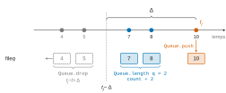
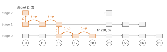
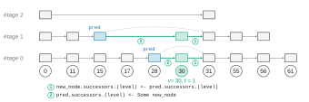
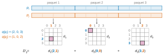

# X-ENS MP — Informatique A 2026 · Corrigé brut

*Corrigé rédigé par IA, non officiel. Signalez toute erreur.*

*Bases de données de vecteurs.* Durée 4 h, calculatrice interdite, langage OCaml. On note $[n]=\{0,\dots,n-1\}$ et $\log$ le logarithme en base 2.

---

## Partie I. Reconnaissance automatique d'extraits musicaux

### Question I.1

Le spectrogramme se lit comme un mot : chaque instant $t$ est une « lettre », la colonne de hauteur $F$, prise dans l'alphabet $\{\texttt{' '},\texttt{'x'}\}^F$.

Chercher si une musique de durée $D$ est exactement un extrait d'une musique de durée $T$, c'est chercher une occurrence d'un motif (l'extrait) dans un texte (la musique). C'est le problème de **recherche de motif dans un texte** (*pattern matching*).

Recherche naïve : pour chaque position de départ $t\in\{0,\dots,T-D\}$, il y en a $T-D+1$, on compare l'extrait à la fenêtre des colonnes $t,\dots,t+D-1$, colonne par colonne et case par case, en s'arrêtant au premier désaccord. Une comparaison examine au plus $F\cdot D$ cases. Ce maximum est atteint à chaque position, par exemple si toutes les colonnes du texte et de l'extrait sont identiques sauf la dernière colonne de l'extrait. Le pire cas coûte donc

$$\boxed{O\big(F\cdot D\cdot(T-D+1)\big)},$$

c'est-à-dire $O(D\,T\,F)$, puisque $T-D+1\le T$.

### Question I.2

```ocaml
let to_sparse (s : spectrogram) : sparse =
  let res = ref [] in
  for f = Array.length s - 1 downto 0 do
    for t = Array.length s.(f) - 1 downto 0 do
      if s.(f).(t) = 'x' then res := (f, t) :: !res
    done
  done;
  !res
```

On parcourt les cases de la dernière à la première et on ajoute en tête. La liste obtenue contient exactement les $(f,t)$ tels que `s.(f).(t) = 'x'`, triés dans l'ordre lexicographique croissant. Le coût est $O(F\,T)$.

### Question I.3

```ocaml
let convert (l : int list) : int =
  List.fold_left (fun acc i -> acc lor (1 lsl i)) 0 l
```

`1 lsl i` est l'entier dont seul le bit $i$ vaut 1, et le « ou » bit à bit accumule ces bits. Comme la liste est sans doublons, on peut aussi écrire `acc + (1 lsl i)` : les bits ajoutés sont distincts, donc il n'y a jamais de retenue. Coût : $O(|l|)$.

### Question I.4

```ocaml
let inter (a : int) (b : int) : int = a land b
```

Le bit $i$ de `a land b` vaut 1 si et seulement si le bit $i$ de `a` et celui de `b` valent tous deux 1, c'est-à-dire si $i$ appartient aux deux sous-ensembles. Coût $O(1)$.

### Question I.5

**(a)**

```ocaml
let size (n : int) : int =
  let count = ref 0 in
  let b = ref n in
  while !b <> 0 do
    b := !b - (!b land (- !b));
    count := !count + 1
  done;
  !count
```

D'après l'indication, `!b land (- !b)` vaut $2^j$, où $j$ est l'indice du bit à 1 de poids le plus faible de `!b`. Ce bit valant 1, la soustraction le met à 0 sans retenue et laisse les autres bits inchangés. Chaque tour de boucle éteint donc exactement un bit.

Soit $s$ le cardinal de l'ensemble codé par $n$. On fait exactement $s$ tours, chacun de coût $O(1)$. La complexité est donc $\boxed{O(s)}$, linéaire en la taille de l'ensemble.

**(b)** Pour un entier $x\geq 0$, on note $\mathrm{pc}(x)$ le nombre de bits à 1 de $x$. On pose $s=\mathrm{pc}(n)$.

Comme $n$ code une partie de $[62]$, on a $n\geq0$.

*Invariant* (vrai à chaque test de la boucle) : $\texttt{!b}\geq 0$ et $\texttt{!count}+\mathrm{pc}(\texttt{!b})=s$.

- *Initialisation* : $\texttt{!count}=0$ et $\texttt{!b}=n$, donc $0+\mathrm{pc}(n)=s$.
- *Conservation* : si $\texttt{!b}\neq0$, le tour éteint exactement un bit. Alors $\mathrm{pc}(\texttt{!b})$ diminue de 1, `!count` augmente de 1, et `!b` reste positif.
- *Terminaison* : `!b` est un entier positif qui décroît strictement à chaque tour, c'est un variant. La boucle s'arrête donc, et elle s'arrête avec $\texttt{!b}=0$.
- *Conclusion* : à la sortie, $\mathrm{pc}(0)=0$, donc $\texttt{!count}=s$. La fonction renvoie bien le cardinal.

### Question I.6

**(a)**

```ocaml
let rec sparse_inter (a : 'a list) (b : 'a list) : int =
  match a, b with
  | [], _ | _, [] -> 0
  | x :: a', y :: b' ->
      if x = y then 1 + sparse_inter a' b'
      else if x < y then sparse_inter a' b
      else sparse_inter a b'
```

Les comparaisons `=` et `<` sont polymorphes : la fonction convient aux entiers comme aux $d$-uplets. Elle est correcte grâce au tri strictement croissant.

Si $x<y$, alors $x$ est plus petit que tous les éléments de $b$, donc $x\notin b$ et on peut l'écarter. Le cas $x>y$ est symétrique. Si $x=y$, c'est un élément commun, et il n'apparaît plus ensuite puisque les listes sont sans répétition.

**(b)** Chaque appel récursif retire au moins une tête, une ou deux. Le nombre d'appels est donc au plus $|a|+|b|+1$, et chaque appel fait un nombre borné de comparaisons en $O(1)$. La complexité est $\boxed{O(|a|+|b|)}$.

### Question I.7

**(a)**

```ocaml
let tosignature (sp : sparse) (delta : int) : signature =
  let a = Array.of_list sp in
  let n = Array.length a in
  let res = ref [] in
  for i = 0 to n - 1 do
    let (f1, t1) = a.(i) in
    for j = 0 to n - 1 do
      let (f2, t2) = a.(j) in
      let d = t2 - t1 in
      if 0 < d && d <= delta then res := (f1, f2, d) :: !res
    done
  done;
  !res
```

Un triplet $(f_1,f_2,\delta)$ est ajouté si et seulement s'il existe deux occurrences $(f_1,t)$ et $(f_2,t+\delta)$ dont l'écart vérifie

$$0<\delta\le\Delta.$$

C'est exactement la définition (1). Si le même triplet est réalisé à plusieurs instants $t$, il figure plusieurs fois dans la liste. Le supprimer en double ferait perdre la borne $O(n^2)$, et la question I.8 compte précisément les couples d'occurrences.

**(b)** `Array.of_list` coûte $O(n)$. Les deux boucles imbriquées font $n^2$ tours, chacun en $O(1)$ : accès au tableau, test, ajout en tête. Le total est $\boxed{O(n^2)}$.

### Question I.8

**(a)**

```ocaml
let signature_size (sp : sparse) (delta : int) : int =
  let q = Queue.create () in
  let count = ref 0 in
  List.iter (fun (_, t) ->
      while Queue.length q > 0 && t - Queue.peek q > delta do
        Queue.drop q
      done;
      count := !count + Queue.length q;
      Queue.push t q)
    sp;
  !count
```

Sur les exemples : avec `[(1,1); (5,5)]` et $\Delta=3$, on obtient 0. Avec les cinq couples et $\Delta=10$, on obtient $0+1+2+3+4=10$.

**(b)** *Correction.* La liste `sp` est triée par temps croissant, et les temps sont distincts. Pour $i<j$, on a donc $t_j-t_i>0$. Le couple d'occurrences $(i,j)$ fournit alors un triplet si et seulement si $t_j-t_i\le\Delta$.

Invariant : juste avant le traitement de $t_j$, la file contient, dans l'ordre croissant, les $t_i$ ($i<j$) tels que $t_{j-1}-t_i\le\Delta$.

- À l'arrivée de $t_j$, la boucle `while` retire de la tête les temps $t_i$ tels que $t_j-t_i>\Delta$. La file est croissante, donc ces temps forment un préfixe. Si $t_j-t_i>\Delta$, alors $t_{j'}-t_i>\Delta$ pour tout $j'>j$ : un temps retiré ne pourra plus jamais servir.
- La file contient alors exactement les partenaires valides de $t_j$. On ajoute leur nombre au compteur, puis on enfile $t_j$, ce qui rétablit l'invariant.



En sommant sur $j$, on obtient le nombre de triplets, c'est-à-dire $|S_\Delta(M)|$.

*Complexité.* La liste est parcourue une seule fois. Chaque temps est enfilé une fois et défilé au plus une fois : la boucle `while` fait donc au plus $n$ tours **au total** sur tout le parcours, et non $n$ tours par élément.

Toutes les opérations de file, `Queue.length` comprise, sont en $O(1)$ d'après l'énoncé. La complexité est amortie linéaire : $\boxed{O(n)}$.

### Question I.9

**C'est la musique $A$.** Les deux musiques partagent chacune trois triplets avec $M$ : l'indice de Jaccard ne les départage pas, il faut regarder les temps.

Pour $A$, l'histogramme des écarts $t'^{(A)}_i-t_i$ est concentré sur une seule valeur : les trois écarts valent environ 1. Les triplets communs apparaissent donc dans $A$ avec un **même décalage temporel**, ce qui veut dire que $M$ est un morceau de $A$ translaté dans le temps.

Ce qui compte est cette concentration, et non la petitesse de l'écart : un décalage commun de 100 serait tout aussi probant, l'extrait commençant alors plus loin dans le morceau.

Pour $B$, les écarts sont dispersés, vers 3, 8 et 11 environ. Aucun décalage commun n'explique les correspondances, qui sont donc fortuites, par exemple dues à du bruit.

### Question I.10

**(a)** Soient $A,B\subset E$ non vides. La numérotation $h$ est une permutation, donc ses valeurs sont distinctes. Soit $x^\star$ l'unique élément de $A\cup B$ qui minimise $h$. Montrons que
$$\mathsf{minHash}(h)(A)=\mathsf{minHash}(h)(B)\iff x^\star\in A\cap B.$$

- Si $x^\star\in A\cap B$ : $x^\star$ minimise $h$ sur $A\cup B$ et appartient aux deux ensembles, donc

  $$\min_A h=h(x^\star)=\min_B h.$$

- Si $x^\star\notin A\cap B$, par exemple $x^\star\in A\setminus B$, alors $\min_A h=h(x^\star)$.

  Le minimum de $h$ sur $B$ est atteint en un élément $b\neq x^\star$, puisque $x^\star\notin B$.
  Comme $h$ est injective et $b\in A\cup B$, on a $h(b)>h(x^\star)$ : les deux minima diffèrent.

La permutation $h$ est uniforme : chaque élément de $A\cup B$ a la même probabilité de porter le plus petit numéro. Ainsi $x^\star$ suit la loi uniforme sur $A\cup B$, d'où

$$\boxed{\begin{aligned}
\Pr\big(\mathsf{minHash}(h)(A)=\mathsf{minHash}(h)(B)\big)&=\Pr(x^\star\in A\cap B)\\
&=\frac{|A\cap B|}{|A\cup B|}\\
&=J(A,B).
\end{aligned}}$$

**(b)** Méthode.

1. *Prétraitement de la base.* Pour chaque musique $X$, on calcule sa représentation concise (I.2), puis sa signature $S_\Delta(X)$ (I.7). On tire $r$ fonctions de hachage indépendantes $h_1,\dots,h_r$, et on stocke seulement le vecteur $\sigma(X)=\big(\mathsf{minHash}(h_1)(S_\Delta(X)),\dots,\mathsf{minHash}(h_r)(S_\Delta(X))\big)\in[N]^r$. Sa taille est fixe, quelle que soit la taille de $S_\Delta(X)$, ce qui fait gagner de la mémoire.
2. *Requête.* On calcule de même $\sigma(M)$ pour l'extrait $M$. Pour chaque musique $X$, on mesure la proportion de coordonnées où $\sigma(M)$ et $\sigma(X)$ coïncident.
   D'après (a), c'est une moyenne de $r$ variables de Bernoulli indépendantes, de paramètre $J(S_\Delta(M),S_\Delta(X))$. C'est donc un estimateur sans biais de l'indice de Jaccard, de variance au plus $1/(4r)$.
3. On renvoie les musiques qui ont la plus grande similarité estimée. On peut ensuite départager les meilleures candidates par le critère de cohérence temporelle de I.9 : on garde celle dont les écarts $t'-t$ des triplets communs sont concentrés sur une seule valeur.

Pour éviter de comparer l'extrait à toute la base, on peut ranger les musiques dans des tables indexées par des blocs de coordonnées de $\sigma$. On ne compare alors l'extrait qu'aux musiques qui partagent au moins un bloc avec lui.

---

## Partie II. Listes à sauts et graphes hiérarchiques navigables

### Question II.1

```ocaml
let skip_length (skl : skip_list) : int =
  let rec aux node acc =
    match node.successors.(0) with
    | None -> acc
    | Some next -> aux next (acc + 1)
  in
  aux skl.init_node 0
```

L'étage 0 est la liste chaînée triée de toutes les valeurs. On part du nœud factice, que l'on ne compte pas, et chaque successeur rencontré compte pour une valeur. Coût : $O(n)$.

### Question II.2

Une valeur $v$ insérée est présente aux étages $0,\dots,\ell_v$, où $\ell_v$ est le niveau renvoyé par `random_level`.

Les étages n'étant pas bornés, on a $\ell_v\geq\ell$ si et seulement si les $\ell$ premiers tirages `Random.float 1. < p` réussissent. Ces tirages sont indépendants et chacun réussit avec probabilité $p$, donc

$$\Pr(\ell_v\geq\ell)=p^\ell.$$

On note $X_v$ l'indicatrice de l'événement « $v$ est présente à l'étage $\ell$ ». Par linéarité de l'espérance, le nombre moyen de valeurs présentes à l'étage $\ell$ est

$$\boxed{\mathbb E\Big[\sum_v X_v\Big]=n\,p^{\ell}.}$$

### Question II.3

**(a)**

```ocaml
let search (skl : skip_list) (v : int) : skip_node option =
  let rec descend node level =
    match node.successors.(level) with
    | Some nx when nx.value = v -> Some nx
    | Some nx when nx.value < v -> descend nx level
    | _ -> if level = 0 then None else descend node (level - 1)
  in
  descend skl.init_node skl.init_level
```

**(b)** *Invariant* de chaque appel `descend node level` : `node.value` $<v$ (le nœud factice vaut $0<v$), et `node` est présent à l'étage `level`. Le premier point vient de ce qu'on n'avance que vers des valeurs $<v$.

*Terminaison.* Le couple (`level`, nombre de nœuds de l'étage 0 situés après `node`) décroît strictement pour l'ordre lexicographique à chaque appel. Quand on avance, le niveau reste le même et le nœud recule d'au moins un rang. Quand on descend, le niveau diminue.

*Correction.* Si la fonction renvoie `Some nx`, alors `nx.value` $=v$. Si elle renvoie `None`, c'est qu'on est à l'étage 0 et que le successeur de `node` est absent ou porte une valeur $>v$. L'étage 0 est la liste triée de toutes les valeurs et `node.value` $<v$, donc aucune valeur égale à $v$ n'existe : $v$ est absente.

**(c)** Le nœud courant ne recule jamais dans l'ordre de l'étage 0. Il y a donc au plus $n$ avancées, et au plus $\texttt{init\_level}+1\le L$ descentes. La complexité dans le pire cas est $\boxed{O(n+L)}$.

Elle est atteinte, par exemple, quand la plus petite valeur est présente jusqu'à l'étage $L-1$ et que toutes les autres sont restées à l'étage 0. Pour chercher la plus grande valeur, on avance jusqu'à la plus petite, on descend les $L-1$ étages, puis on parcourt les $n-1$ autres valeurs à l'étage 0.

### Question II.4

On parcourt le chemin à l'envers. Soit $(x,i)$ une position du chemin inversé qui n'est pas encore à l'étage visé. Dans le sens direct, on est arrivé en $(x,i)$ de l'une des deux façons suivantes :

- en **descendant** depuis $(x,i+1)$, si $x$ est présent à l'étage $i+1$. À l'envers, on monte d'un étage ;
- **horizontalement** depuis le prédécesseur de $x$ à l'étage $i$, sinon. À l'envers, on reste à l'étage $i$.

En effet, si $x$ est présent à l'étage $i+1$, la recherche directe l'y a atteint, puis elle a dû y descendre, car son successeur à cet étage est absent ou de valeur $\geq v$.

Sachant que $x$ est présent à l'étage $i$, il l'est aussi à l'étage supérieur avec probabilité $p$ : `random_level` fait un tirage indépendant de plus. Ce tirage est indépendant de la partie du chemin déjà remontée.



On note $C_\ell$ le nombre moyen de pas pour monter de $\ell$ étages. Un pas coûte 1. Avec probabilité $p$, il reste $\ell-1$ étages à monter ; avec probabilité $1-p$, il en reste toujours $\ell$. D'où

$$C_0=0$$

et, pour $\ell\geq1$,

$$\begin{aligned}
C_\ell&=1+p\,C_{\ell-1}+(1-p)\,C_\ell\\
p\,C_\ell&=1+p\,C_{\ell-1}\\
C_\ell&=C_{\ell-1}+\frac1p.
\end{aligned}$$

Par récurrence immédiate,

$$\boxed{C_\ell=\frac{\ell}{p}.}$$

### Question II.5

On pose $\ell^\star=\lceil\log_{1/p}n\rceil$, de sorte que $n\,p^{\ell^\star}\le1$. On note $N_\ell$ le nombre de valeurs présentes à l'étage $\ell$. On découpe le chemin de recherche en deux morceaux.

- **Morceau entre l'étage 0 et l'étage $\ell^\star$.** À l'envers, c'est une montée de $\ell^\star$ étages. D'après II.4, elle prend en moyenne au plus $C_{\ell^\star}=\ell^\star/p=O(\log n)$ pas.
- **Morceau au-dessus de l'étage $\ell^\star$.**
  - À l'étage $\ell$, les pas horizontaux passent par des nœuds distincts de cet étage : il y en a au plus $N_\ell$.
  - Les descentes se font entre étages non vides. Chaque étage non vide de rang $\geq\ell^\star$ contient au moins un nœud, donc il y a au plus $\sum_{\ell\geq\ell^\star}N_\ell$ descentes.
  - Au total, ce morceau compte au plus $2\sum_{\ell\geq\ell^\star}N_\ell$ pas. D'après II.2, cette quantité a pour espérance
$$\begin{aligned}
2\sum_{\ell\geq\ell^\star}n\,p^\ell&=\frac{2\,n\,p^{\ell^\star}}{1-p}\\
&\le\frac{2}{1-p},
\end{aligned}$$
  qui est un $O(1)$ à $p$ fixé.

Le nombre moyen d'étapes d'une recherche est donc au plus $\dfrac{\lceil\log_{1/p}n\rceil}{p}+\dfrac{2}{1-p}$, c'est-à-dire $\boxed{O(\log n)}$ à $p$ fixé.

### Question II.6

**(a)** La nouvelle valeur doit être présente exactement aux étages $0,\dots,\ell$, où $\ell$ est le niveau tiré. À chacun de ces étages, il faut rediriger un seul pointeur existant, celui de son prédécesseur à cet étage. On modifie donc au plus **$\ell+1\le L$ successeurs** de nœuds existants.

S'ajoutent les $\ell+1$ cases du tableau de successeurs du nouveau nœud, qu'il faut remplir. En les comptant, on écrit au plus $2L$ successeurs en tout.

**(b)** On suppose le paramètre `p` défini globalement, comme le fait l'appel à `random_level`. Il y a deux différences avec `search`. D'abord, on avance tant que le successeur est $<v$ et on retient, à chaque étage, le dernier nœud atteint, qui est le prédécesseur de $v$. Ensuite, on descend depuis l'étage $\max(\ell,\texttt{init\_level})$, et non depuis `init_level` seulement. Sans cela, les étages entre `init_level` et $\ell$ seraient raccordés derrière le nœud factice sans tenir compte des nœuds qui s'y trouvent déjà : comme `init_level` n'est pas mis à jour, d'anciennes insertions ont pu y monter.

```ocaml
let insert (skl : skip_list) (v : int) : unit =
  let lvl = random_level p skl.max_level in
  let new_node = create_node skl.max_level v in
  let rec advance node level =        (* comme dans search *)
    match node.successors.(level) with
    | Some nx when nx.value < v -> advance nx level
    | _ -> node
  in
  let rec descend node level =
    let pred = advance node level in
    if level <= lvl then begin        (* raccordement à cet étage *)
      new_node.successors.(level) <- pred.successors.(level);
      pred.successors.(level) <- Some new_node
    end;
    if level > 0 then descend pred (level - 1)
  in
  descend skl.init_node (max lvl skl.init_level)
```

À chaque étage $\le\ell$, `pred` est le dernier nœud de valeur $<v$ et son successeur est de valeur $>v$, puisque $v$ est absente. On insère `new_node` entre les deux, ce qui préserve le tri et l'inclusion des étages. Le nouveau nœud a un seul prédécesseur par étage.



### Question II.7

**(a)** On suppose que le nœud 0 est présent à l'étage $L-1$. Sinon, on part de l'étage le plus haut où il est présent.

```ocaml
let closest (query : vector) (g : hgraph) : int =
  let current = ref 0 in
  let level = ref (Array.length g.(0) - 1) in
  let dcur = ref (dist query db.(0)) in
  let fini = ref false in
  while not !fini do
    let best = ref !current and dbest = ref !dcur in
    List.iter (fun j ->
        let dj = dist query db.(j) in
        if dj < !dbest then begin best := j; dbest := dj end)
      g.(!current).(!level);
    if !best <> !current then begin current := !best; dcur := !dbest end
    else if !level = 0 then fini := true
    else level := !level - 1
  done;
  !current
```

À chaque tour, on passe au voisin le plus proche de `query` s'il réduit strictement la distance. Sinon, on descend d'un étage. À l'étage 0, on renvoie le nœud atteint, qui est un minimum local.

**(b)** On note $\delta=\texttt{dist query db.(current)}$. Cette quantité décroît strictement à chaque déplacement et ne change pas lors d'une descente. Les nœuds successivement visités sont donc deux à deux distincts, ce qui fait au plus $n-1$ déplacements. Il y a au plus $L-1$ descentes. Un même couple (nœud, étage) n'est donc examiné qu'une fois. La liste d'adjacence parcourue au tour courant est celle de ce couple, et l'ensemble des listes parcourues a une longueur totale au plus $\sum_\ell 2|E_\ell|=2|E|$. Chaque voisin coûte un calcul de distance en $O(d)$. Complexité :

$$\boxed{O\big(d\,(|E|+1)+n+L\big)},$$

dominée en pratique par $O(d\,|E|)$.

**(c)** **Non.** La distance $\delta$ est un variant. Elle décroît strictement à chaque déplacement, donc on ne revient jamais sur un nœud déjà visité. Les déplacements sont en nombre fini, au plus $n-1$, et les descentes aussi, au plus $L-1$. L'algorithme termine sans marquage. C'est l'inégalité *stricte* qui garantit cela : avec $\le$, on pourrait osciller entre deux nœuds équidistants.

---

## Partie III. Quantification de produit

### Question III.1

```ocaml
let compute_all_dist2 (db : matrix) : square =
  let n = Array.length db in
  Array.init_matrix n n (fun i j -> dist2 db.(i) db.(j))
```

Coût : $n^2$ appels de coût $O(d)$, soit $O(n^2 d)$. Par symétrie, on pourrait n'en faire que la moitié.

### Question III.2

Il faut calculer `dist2 query db.(i)` pour les $n$ vecteurs, chacun en $O(d)$, puis prendre le minimum en $O(n)$. La complexité est $\boxed{O(n\,d)}$.

### Question III.3

```ocaml
let pick (db : matrix) (centroids : matrix) (centroid_of : int array) : unit =
  let k = Array.length centroids in
  for i = 0 to Array.length db - 1 do
    let best = ref 0 and dbest = ref (dist2 db.(i) centroids.(0)) in
    for j = 1 to k - 1 do
      let dj = dist2 db.(i) centroids.(j) in
      if dj < !dbest then begin best := j; dbest := dj end
    done;
    centroid_of.(i) <- !best
  done
```

On suppose $k\geq1$. La distance euclidienne et son carré ont le même minimiseur. Coût : $O(n\,k\,d)$.

### Question III.4

```ocaml
let update (k : int) (db : matrix) (centroid_of : int array)
    (centroids : matrix) : unit =
  let d = Array.length db.(0) in
  let sums = Array.init k (fun _ -> Array.make d 0.) in
  let counts = Array.make k 0 in
  for i = 0 to Array.length db - 1 do
    let j = centroid_of.(i) in
    sums.(j) <- vector_sum sums.(j) db.(i);
    counts.(j) <- counts.(j) + 1
  done;
  for j = 0 to k - 1 do
    if counts.(j) > 0 then
      centroids.(j) <- vector_div sums.(j) (float_of_int counts.(j))
  done
```

Le nouveau centroïde $j$ est la moyenne des vecteurs qui lui sont affectés. Un centroïde dont le groupe est vide est laissé inchangé, ce qui évite une division par 0. Coût : $O(n\,d+k\,d)$.

### Question III.5

**Oui.** Le centroïde $j$ n'est pas mis à jour lorsqu'aucun vecteur ne lui est affecté, c'est-à-dire lorsque `counts.(j) = 0`. Exemple : $db=(0,0,1)$ en dimension 1 et $k=2$. L'initialisation sur les deux premiers vecteurs donne deux centroïdes égaux à $0$. `pick` affecte alors les trois vecteurs au centroïde 0, à cause de l'inégalité stricte (le 1 est à égale distance des deux centroïdes). Le centroïde 1 n'est le plus proche d'aucun vecteur, et un seul centroïde est mis à jour. Plus généralement, un groupe peut se vider au cours des itérations, lorsqu'un centroïde est partout « battu » par d'autres.

Si l'on entend « mis à jour » au sens de « modifié », la réponse reste oui : un centroïde dont le groupe ne change pas d'une itération à l'autre est recalculé à l'identique, ce qui arrive dès que l'algorithme a convergé.

### Question III.6

```ocaml
let kmeans (db : matrix) (k : int) (n_iter : int) : int array * matrix =
  let centroids = Array.init k (fun j -> Array.copy db.(j)) in
  let centroid_of = Array.make (Array.length db) 0 in
  for _ = 1 to n_iter do
    pick db centroids centroid_of;
    update k db centroid_of centroids
  done;
  pick db centroids centroid_of;   (* affectation cohérente avec les centroïdes renvoyés *)
  (centroid_of, centroids)
```

Une itération consiste en une affectation (`pick`) suivie d'un recalcul des centroïdes (`update`). Le `pick` final garantit que `centroid_of` désigne bien, pour chaque vecteur, le plus proche des centroïdes renvoyés. `Array.copy` évite que les centroïdes partagent la mémoire des vecteurs de `db`. Coût : $O\big((n_{\text{iter}}+1)\,n\,k\,d\big)$.

### Question III.7

```ocaml
(* table des d_l(a, b) pour les centroïdes d'un paquet *)
let table (centroids : matrix) : square =
  let k = Array.length centroids in
  Array.init_matrix k k (fun a b -> dist2 centroids.(a) centroids.(b))

let approx_dist (db : matrix) (k : int) (n_iter : int) (m : int) : square =
  let n = Array.length db in
  let quant =                        (* un couple (codes c_l, table d_l) par paquet *)
    List.map (fun pack -> let (c, cent) = kmeans pack k n_iter in (c, table cent))
      (submatrix db m)
  in
  Array.init_matrix n n (fun i j ->
      List.fold_left (fun acc (c, t) -> acc +. t.(c.(i)).(c.(j))) 0. quant)
```

Pour le paquet $\ell$, `c.(i)` $=c_\ell(p_i)$ et `t.(a).(b)` $=d_\ell(a,b)$. Le `fold_left` calcule donc $D'_{ij}=\sum_{\ell=1}^m d_\ell\big(c_\ell(p_i),c_\ell(p_j)\big)$.



Coût :
- les $m$ appels aux $k$-moyennes sur des vecteurs de dimension $d/m$ : $O(n_{\text{iter}}\,n\,k\,d)$ ;
- les tables : $O(k^2 d)$ ;
- le remplissage de la matrice : $O(n^2 m)$.

### Question III.8

**(a)** Le dictionnaire contient une valeur par triplet $(\ell,a,b)$, soit $m\,k^2$ valeurs. Chacune est le carré d'une distance entre deux centroïdes de dimension $d/m$, calculé en $O(d/m)$. Coût total : $m\,k^2\cdot\frac dm$, soit $\boxed{O(k^2 d)}$.

**(b)** $D'_{ij}$ ne dépend de $(i,j)$ que par le couple de codes

$$\big(q(p_i),q(p_j)\big)\in[k]^m\times[k]^m.$$

Les $D'_{ij}$ prennent donc au plus $\boxed{k^{2m}}$ valeurs distinctes.

On peut affiner. On a $D'_{ij}=\sum_\ell d_\ell(a_\ell,b_\ell)$, avec $a_\ell=c_\ell(p_i)$ et $b_\ell=c_\ell(p_j)$.

Comme $d_\ell(a,b)=d_\ell(b,a)$, la valeur ne dépend que des $m$ paires non ordonnées $\{a_\ell,b_\ell\}$. Il y en a $\frac{k(k+1)}2$ par paquet, d'où au plus $\left(\frac{k(k+1)}{2}\right)^m$ valeurs.

Bien sûr, il y a aussi au plus $n^2$ valeurs.

**(c)** Les codes de `db.(i)` et de chaque `db.(j)` sont stockés. Chaque $D'_{ij}$ s'obtient par $m$ lectures dans le dictionnaire et $m$ additions, soit $O(m)$.

Pour les $n$ vecteurs, avec la recherche du minimum, le coût est $\boxed{O(n\,m)}$. Si l'on veut les voisins triés par distance, il faut ajouter un tri en $O(n\log n)$.

**(d)** Il faut d'abord coder le nouveau vecteur $p$.

Pour chaque paquet $\ell$, on compare la partie correspondante du vecteur aux $k$ centroïdes du paquet. Chaque comparaison coûte $O(d/m)$, donc ce paquet coûte $O(k\,d/m)$. Sur les $m$ paquets, le codage coûte $O(k\,d)$.

On procède ensuite comme en (c), en $O(n\,m)$. Total : $\boxed{O(k\,d+n\,m)}$.

C'est à comparer au $O(n\,d)$ de la recherche exacte (III.2) : le gain est important quand $n\gg k$ et $m\ll d$.
