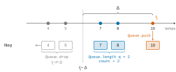
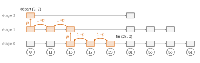
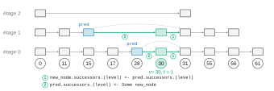
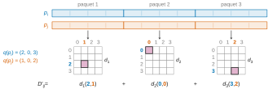

# X-ENS MP — Informatique A 2026 · Corrigé guidé

*Corrigé rédigé par IA, non officiel. Signalez toute erreur.*

## Présentation du sujet

**Thème.** Le sujet s'intitule *Bases de données de vecteurs*. Il porte sur un problème central des moteurs de recherche modernes, de la reconnaissance musicale aux bases vectorielles de l'IA : trouver rapidement les plus proches voisins d'un vecteur requête. On en étudie trois implémentations, dans trois parties **indépendantes**.

- **Partie I, Reconnaissance d'extraits musicaux (I.1 à I.10).** On passe du spectrogramme (matrice de caractères) à une représentation creuse, puis aux ensembles codés par des vecteurs de bits (`lsl`, `land`, comptage de bits). Viennent ensuite l'intersection de listes triées par fusion, les « signatures » d'une musique (triplets de fréquences et d'écart temporel), un comptage en un seul passage avec une file, et pour finir l'indice de Jaccard et le *MinHash*, avec une preuve probabiliste.
- **Partie II, Listes à sauts et graphes hiérarchiques (II.1 à II.7).** On écrit les fonctions de base d'une *skip list* (longueur, recherche, insertion). On analyse en probabilités le coût moyen d'une recherche (récurrence $C_\ell=\ell/p$, puis $O(\log n)$). On généralise enfin à un graphe hiérarchique, sur lequel on fait une recherche gloutonne du plus proche voisin.
- **Partie III, Quantification de produit (III.1 à III.8).** On implémente les $k$-moyennes (`pick`, `update`, `kmeans`). On les applique paquet par paquet pour approcher les distances, et on termine par une analyse de complexité du pré-calcul.

**Notions mobilisées.** OCaml impératif et fonctionnel (références, boucles, tableaux, listes, files, filtrage) ; complexité dans le pire cas et complexité amortie ; invariants de boucle et preuves par récurrence ; probabilités discrètes (espérance, linéarité, loi géométrique, analyse au premier pas) ; graphes.

**Difficulté et longueur.** Le sujet compte 25 questions, dont beaucoup sont découpées en sous-questions (a), (b), (c). Il est long mais régulier : l'énoncé précise qu'aucune question de code ne demande plus d'une douzaine de lignes. Les questions les plus délicates sont I.8 (un seul passage avec une file), I.10(a), II.4 et II.5 (analyse probabiliste), II.6(b) (insertion qui respecte tous les invariants) et II.7(b) (complexité fine).

**À ne pas laisser passer.** I.2, I.4, I.6, II.2, III.1 à III.4 et III.8(a)(c) sont des points presque gratuits, à condition d'être rédigés proprement. I.3 et II.1 semblent l'être aussi, mais le rapport 2026 montre qu'elles ont coûté cher : il faut les soigner.

**Ce qu'en dit le jury (rapport 2026).** Le jury juge que « C’est finalement la compréhension du concept même de liste à saut qui a été discriminante dès les premières questions de la partie (II.1 et II.3) ». Il signale aussi des difficultés sur la représentation binaire des entiers (I.3 à I.5).

Les questions les moins réussies, en score moyen des candidats qui les ont traitées, sont II.4 et II.5 (22 % et 12 % en MP), II.7 (20 % en MP), III.7 et surtout III.8 (8 % en MP, 19 % en MPI). D'après le rapport, les MPI ont plus traité et mieux traité que les MP chaque question du sujet. Le rapport note enfin que III.4 et III.6, applications directes du cours, auraient pu être mieux traitées.

**Gestion du temps.** Comptez environ 1 h 30 pour la partie I, 1 h 30 pour la partie II et 1 h pour la partie III. Les parties étant indépendantes, ne restez pas bloqué sur II.4 et II.5 : la partie III est plus mécanique et rapporte vite.

---

## Partie I — Reconnaissance automatique d'extraits musicaux

On manipule des ensembles de deux façons : en listes triées, et en entiers vus comme des vecteurs de bits. Puis on construit une mesure de similarité robuste au bruit. La partie se termine par une preuve probabiliste sur le *MinHash*.

### Question I.1

> [!INDICATION]
> Voyez chaque colonne du spectrogramme comme une seule « lettre ». Que devient alors la musique ?

> [!INDICATION]
> Comptez le nombre de positions de départ possibles pour l'extrait, puis le coût maximal d'une comparaison à une position donnée.

#### Solution

Chaque instant $t$ donne une colonne de hauteur $F$, que l'on voit comme une lettre de l'alphabet $\{\texttt{' '},\texttt{'x'}\}^F$. Une musique devient alors un mot.

Savoir si une musique de durée $D$ est exactement un extrait d'une musique de durée $T$, c'est chercher un **motif** de longueur $D$ dans un **texte** de longueur $T$ : c'est le problème de la **recherche de motif** (*pattern matching*).

Recherche naïve : on essaie les $T-D+1$ positions de départ $t\in\{0,\dots,T-D\}$. À chaque position, on compare les $D$ colonnes, chacune de hauteur $F$, en s'arrêtant au premier désaccord. Une position coûte au plus $F\,D$ comparaisons de caractères. Ce maximum est atteint à toutes les positions si, par exemple, le texte et l'extrait sont formés de colonnes identiques, sauf la dernière colonne de l'extrait. Le pire cas coûte donc

$$\boxed{O\big(F\,D\,(T-D+1)\big)},$$

c'est-à-dire $O(D\,T\,F)$, puisque $T-D+1\le T$.

> [!PIEGE]
> Ne pas oublier le facteur $F$ : comparer deux colonnes n'est pas une opération élémentaire, cela coûte jusqu'à $F$ comparaisons.

> [!JURY]
> Le rapport 2026 donne la complexité attendue, $O(DTF)$. I.1 est l'une des questions où l'écart entre filières est le plus net : 60 % des points en moyenne pour les MP qui l'ont traitée, contre 75 % pour les MPI.

### Question I.2

> [!INDICATION]
> Deux boucles imbriquées suffisent, sur les fréquences et sur les temps. Accumulez les couples dans une référence de liste.

> [!INDICATION]
> L'ajout en tête renverse l'ordre de parcours. Pour obtenir une liste triée, parcourez la matrice de la fin vers le début.

#### Solution

```ocaml
let to_sparse (s : spectrogram) : sparse =
  let res = ref [] in
  for f = Array.length s - 1 downto 0 do
    for t = Array.length s.(f) - 1 downto 0 do
      if s.(f).(t) = 'x' then res := (f, t) :: !res
    done
  done;
  !res
```

La liste contient exactement les couples $(f,t)$ tels que `s.(f).(t) = 'x'`, rangés dans l'ordre lexicographique croissant. Le coût est $O(F\,T)$.

> [!PIEGE]
> On compare à un caractère, `'x'`, et non à une chaîne, `"x"`. L'ordre des composantes est $(f,t)$ : la ligne, puis la colonne. Prenez aussi la longueur de la ligne effectivement parcourue, `s.(f)`, et non celle d'une autre ligne.

### Question I.3

> [!INDICATION]
> Quel entier a pour seul bit à 1 le bit $i$ ?

> [!INDICATION]
> Combinez ces entiers en parcourant la liste avec `List.fold_left`. Pourquoi l'absence de doublons simplifie-t-elle le choix de l'opération ?

#### Solution

```ocaml
let convert (l : int list) : int =
  List.fold_left (fun acc i -> acc lor (1 lsl i)) 0 l
```

`1 lsl i` a pour seul bit à 1 le bit $i$, et le « ou » bit à bit `lor` réunit ces bits. Comme la liste est sans doublons, on peut aussi écrire `acc + (1 lsl i)` : on ajoute des puissances de 2 distinctes, donc sans retenue. Le coût est $O(|l|)$.

> [!JURY]
> Le rapport 2026 relève que, pour la question I.3, « au lieu d’utiliser l’instruction lsl rappelée dans le sujet, beaucoup ont réécrit une fonction puissance ». Quand l'énoncé rappelle une opération, c'est qu'il attend qu'on s'en serve : `1 lsl i` calcule $2^i$ en temps constant.

### Question I.4

> [!INDICATION]
> L'intersection d'ensembles correspond, bit par bit, à un connecteur logique.

#### Solution

```ocaml
let inter (a : int) (b : int) : int = a land b
```

Le bit $i$ de `a land b` vaut 1 si et seulement si $i\in a$ et $i\in b$. Le coût est $O(1)$.

### Question I.5

> [!INDICATION]
> L'indication donne une opération qui isole un seul bit. Que se passe-t-il si on retire ce bit de `b` ?

> [!INDICATION]
> Pour (b), cherchez une quantité qui reste constante d'un tour de boucle à l'autre et qui relie le compteur à ce qu'il reste dans `b`.

#### Solution

**(a)**

```ocaml
let size (n : int) : int =
  let count = ref 0 in
  let b = ref n in
  while !b <> 0 do
    b := !b - (!b land (- !b));
    count := !count + 1
  done;
  !count
```

`!b land (- !b)` vaut $2^j$, où $j$ est le bit à 1 de poids le plus faible de `!b`. Comme ce bit vaut 1, le soustraire l'éteint sans retenue : chaque tour éteint exactement un bit. Si $s$ est le cardinal de l'ensemble, on fait $s$ tours en $O(1)$ chacun, d'où une complexité $\boxed{O(s)}$.

**(b)** On note $\mathrm{pc}(x)$ le nombre de bits à 1 de $x\geq0$, et $s=\mathrm{pc}(n)$. Invariant : $\texttt{!b}\geq0$ et $\texttt{!count}+\mathrm{pc}(\texttt{!b})=s$.

- *Initialisation* : $0+\mathrm{pc}(n)=s$.
- *Conservation* : un tour éteint un bit et ajoute 1 au compteur, donc la somme ne change pas.
- *Terminaison* : `!b` est un entier positif qui décroît strictement, c'est un variant.
- *Sortie* : on sort avec $\texttt{!b}=0$, donc $\texttt{!count}=s$.

> [!METHODE]
> Une preuve de boucle se rédige toujours en quatre temps : invariant, initialisation, conservation, puis conclusion à la sortie, sans oublier le variant qui assure la terminaison. Ici, la bonne idée est de relier ce qui a déjà été compté à ce qu'il reste à compter.

> [!JURY]
> D'après le rapport 2026, « Certains élèves ont eu des difficultés avec la représentation en binaire des entiers (I.3 à I.5) ». I.5 est la moins réussie des trois : 50 % des points en moyenne pour les MP qui l'ont traitée, 63 % pour les MPI.

### Question I.6

> [!INDICATION]
> Les deux listes sont triées : pensez à la fusion du tri fusion.

> [!INDICATION]
> Comparez les deux têtes. Dans chacun des trois cas ($<$, $=$, $>$), laquelle des deux peut-on écarter sans rien perdre ?

#### Solution

**(a)**

```ocaml
let rec sparse_inter (a : 'a list) (b : 'a list) : int =
  match a, b with
  | [], _ | _, [] -> 0
  | x :: a', y :: b' ->
      if x = y then 1 + sparse_inter a' b'
      else if x < y then sparse_inter a' b
      else sparse_inter a b'
```

La fonction est polymorphe, car `=` et `<` le sont : elle s'applique aux entiers comme aux $d$-uplets.

Si $x<y$, alors $x$ est plus petit que tous les éléments de $b$ (tri strictement croissant), donc $x\notin b$. Le cas $x>y$ est symétrique. Si $x=y$, on a un élément commun, que l'on compte.

**(b)** Chaque appel retire au moins une tête. Il y a donc au plus $|a|+|b|+1$ appels, chacun en $O(1)$, d'où $\boxed{O(|a|+|b|)}$.

> [!PIEGE]
> Chercher chaque élément de $a$ dans $b$ coûte $O(|a|\cdot|b|)$ : c'est quadratique, donc refusé. La linéarité repose entièrement sur l'hypothèse de tri.

### Question I.7

> [!INDICATION]
> Après `Array.of_list`, on peut accéder à la $i$-ème occurrence en temps constant. Le coût $O(n^2)$ demandé invite à examiner tous les couples d'occurrences.

> [!INDICATION]
> Pour un couple $\big((f_1,t_1),(f_2,t_2)\big)$, à quelle condition sur $t_2-t_1$ obtient-on un triplet de la signature ?

#### Solution

**(a)**

```ocaml
let tosignature (sp : sparse) (delta : int) : signature =
  let a = Array.of_list sp in
  let n = Array.length a in
  let res = ref [] in
  for i = 0 to n - 1 do
    let (f1, t1) = a.(i) in
    for j = 0 to n - 1 do
      let (f2, t2) = a.(j) in
      let d = t2 - t1 in
      if 0 < d && d <= delta then res := (f1, f2, d) :: !res
    done
  done;
  !res
```

On ajoute $(f_1,f_2,\delta)$ exactement lorsqu'il existe deux occurrences $(f_1,t)$ et $(f_2,t+\delta)$ avec $0<\delta\le\Delta$ : c'est la définition (1). Un même triplet réalisé à plusieurs instants figure plusieurs fois dans la liste. Supprimer les doublons demanderait un tri, ce qui ferait perdre la borne $O(n^2)$. C'est d'ailleurs le nombre de couples que la question I.8 compte.

**(b)** `Array.of_list` coûte $O(n)$, et les deux boucles font $n^2$ tours en $O(1)$. Le total est $\boxed{O(n^2)}$.

> [!PIEGE]
> L'écart doit être strictement positif : $\delta=0$ est exclu par la définition. Testez donc `0 < d` et non `0 <= d`.

### Question I.8

> [!INDICATION]
> Le temps étant croissant le long de la liste, quels instants passés peuvent encore former un triplet avec l'instant courant ?

> [!INDICATION]
> Gardez dans une file les instants récents « encore utiles ». À l'arrivée d'un nouvel instant, que faut-il retirer de la tête, et que vous donne ensuite la longueur de la file ?

> [!INDICATION]
> Pour la complexité, ne comptez pas les tours de la boucle intérieure instant par instant : comptez combien de fois, au total, chaque élément peut quitter la file.

#### Solution

**(a)**

```ocaml
let signature_size (sp : sparse) (delta : int) : int =
  let q = Queue.create () in
  let count = ref 0 in
  List.iter (fun (_, t) ->
      while Queue.length q > 0 && t - Queue.peek q > delta do
        Queue.drop q
      done;
      count := !count + Queue.length q;
      Queue.push t q)
    sp;
  !count
```

Exemples de l'énoncé : avec `[(1,1); (5,5)]` et $\Delta=3$, on obtient 0. Avec les cinq couples et $\Delta=10$, on obtient $0+1+2+3+4=10$.

**(b)** *Correction.* Les temps sont distincts et croissants. Pour $i<j$, on a donc $t_j-t_i>0$, et le couple $(i,j)$ donne un triplet si et seulement si $t_j-t_i\le\Delta$.

Invariant : avant le traitement de $t_j$, la file contient, dans l'ordre croissant, les $t_i$ ($i<j$) tels que $t_{j-1}-t_i\le\Delta$.

- La boucle `while` retire de la tête les $t_i$ trop anciens, ceux tels que $t_j-t_i>\Delta$. Ils forment un préfixe de la file, et ils ne serviront plus jamais, car les temps suivants sont encore plus grands.
- Il reste exactement les partenaires valides de $t_j$. On ajoute leur nombre au compteur, puis on enfile $t_j$.



En sommant sur $j$, on obtient $|S_\Delta(M)|$.

*Complexité.* La liste est parcourue une seule fois. Chaque instant est enfilé une fois et défilé au plus une fois : la boucle `while` fait donc au plus $n$ tours **au total** sur tout le parcours. Toutes les opérations de file, `Queue.length` comprise, sont en $O(1)$ d'après l'énoncé. La complexité est amortie linéaire : $\boxed{O(n)}$.

> [!METHODE]
> C'est la technique de la **fenêtre glissante** sur une suite triée. Une boucle intérieure dont le nombre total de tours est borné par le nombre d'éléments (chacun entre et sort une fois) donne un coût **amorti** linéaire.

> [!PIEGE]
> `Queue.length` est en temps constant : l'énoncé le rappelle. Le rapport 2026 note pourtant que « Certains candidats croient toutefois que Queue.length est en temps $O(n)$ alors qu’on rappelle dans le sujet que cette fonction s’exécute en temps $O(1)$ ». Avec cette erreur, on conclut à tort à un coût quadratique.

> [!JURY]
> Pour la complexité, le rapport 2026 donne l'argument attendu : « chaque élément a été inséré une fois et défilé une fois donc la complexité est amortie linéaire ». La question est jugée « plus difficile » : 64 % des MP l'ont traitée, avec 41 % des points en moyenne.

> [!PIEGE]
> L'énoncé ne rappelle pas `Queue.is_empty`. On teste donc `Queue.length q > 0` avant `Queue.peek`, qui lève `Queue.Empty` sur une file vide. L'ordre du `&&`, évalué de gauche à droite, protège cet appel.

### Question I.9

> [!INDICATION]
> Le nombre de triplets communs est le même pour $A$ et pour $B$ : il faut un autre critère. Que signifie un écart $t'_i-t_i$ identique pour tous les triplets ?

#### Solution

**C'est $A$.** Les deux musiques partagent trois triplets avec $M$ : l'indice de Jaccard ne les départage pas.

Pour $A$, l'histogramme des écarts $t'^{(A)}_i-t_i$ est concentré sur une seule valeur, environ 1. Les triplets communs se retrouvent dans $A$ avec le même décalage temporel, ce qui veut dire que $M$ est un morceau de $A$ translaté dans le temps.

Pour $B$, les écarts sont dispersés, vers 3, 8 et 11 environ. Aucun décalage commun n'explique les correspondances, qui sont donc fortuites.

> [!METHODE]
> Pour aligner un extrait sur un morceau, on ne compte pas seulement les correspondances : on vérifie leur **cohérence géométrique**, ici un décalage constant. C'est le principe des empreintes acoustiques.

> [!PIEGE]
> Ne pas justifier le choix de $A$ par la petitesse de l'écart. Un décalage commun de 100 serait tout aussi probant : l'extrait commencerait simplement plus loin dans le morceau.

> [!JURY]
> Le rapport 2026 est explicite : « ce qui était important n’était pas que l’écart soit petit, mais que l’histogramme soit concentré autour d’une seule valeur, indiquant la cohérence temporelle des correspondances ».

### Question I.10

> [!INDICATION]
> Pour (a), regardez l'élément de $A\cup B$ qui a le plus petit numéro. Où doit-il se trouver pour que les deux minimums coïncident ?

> [!INDICATION]
> Montrez l'équivalence entre « minHash de $A$ = minHash de $B$ » et « cet élément est dans $A\cap B$ ». Utilisez ensuite le fait que la permutation est uniforme pour trouver la loi de cet élément.

> [!INDICATION]
> Pour (b), une seule fonction de hachage donne un événement de probabilité $J$. Comment estimer une probabilité avec plusieurs tirages indépendants ?

#### Solution

**(a)** Soient $A,B$ non vides. La permutation $h$ a des valeurs distinctes. Soit $x^\star$ l'unique élément de $A\cup B$ qui minimise $h$.

- Si $x^\star\in A\cap B$, alors $\min_A h=h(x^\star)=\min_B h$.
- Si, par exemple, $x^\star\in A\setminus B$, alors $\min_A h=h(x^\star)$. Mais $\min_B h=h(b)$ avec $b\in B$, $b\neq x^\star$, donc $h(b)>h(x^\star)$, et les deux minima diffèrent.

Ainsi, $\mathsf{minHash}(h)(A)=\mathsf{minHash}(h)(B)\iff x^\star\in A\cap B$. La permutation $h$ est uniforme : tous les éléments de $A\cup B$ ont la même chance de porter le plus petit numéro, donc $x^\star$ suit la loi uniforme sur $A\cup B$. D'où

$$\boxed{\begin{aligned}
\Pr\big(\mathsf{minHash}(h)(A)=\mathsf{minHash}(h)(B)\big)&=\frac{|A\cap B|}{|A\cup B|}\\
&=J(A,B).
\end{aligned}}$$

**(b)**

1. *Prétraitement.* Pour chaque musique $X$ de la base, on calcule $S_\Delta(X)$ à partir de sa représentation concise (I.2 et I.7). On tire $r$ fonctions de hachage indépendantes, et on ne stocke que $\sigma(X)=\big(\mathsf{minHash}(h_1)(S_\Delta(X)),\dots,\mathsf{minHash}(h_r)(S_\Delta(X))\big)$. Ce vecteur a une taille fixe $r$, ce qui économise beaucoup de mémoire.
2. *Requête.* On calcule $\sigma(M)$ pour l'extrait. La fraction des coordonnées où $\sigma(M)$ et $\sigma(X)$ coïncident est une moyenne de $r$ variables de Bernoulli indépendantes de paramètre $J(S_\Delta(M),S_\Delta(X))$. C'est donc un estimateur sans biais de l'indice de Jaccard, de variance au plus $1/(4r)$.
3. On renvoie les musiques les mieux classées. On départage les meilleures par la cohérence temporelle des triplets communs, avec le critère de I.9.

Pour ne pas parcourir toute la base, on peut indexer les musiques par des blocs de coordonnées de $\sigma$. On ne compare alors l'extrait qu'aux musiques qui partagent un bloc avec lui.

> [!PIEGE]
> Pour l'implication réciproque, il faut l'argument du **minimum strict** : les valeurs de $h$ sont distinctes. Sans lui, deux minima pourraient coïncider par hasard sur deux éléments différents.

> [!JURY]
> Le rapport 2026 ne commente pas I.10, mais ses statistiques la classent parmi les questions difficiles de la partie I : moins de 40 % des points en moyenne pour ceux qui l'ont traitée, en MP comme en MPI. Le rapport 2025 de cette épreuve demandait, pour une question de probabilités, de faire le calcul et aussi d'en donner une explication informelle. Il notait que cette explication avait souvent manqué. Ici, une phrase du type « l'élément de plus petit numéro est uniforme sur $A\cup B$ » est exactement ce qui est attendu.

---

## Partie II — Listes à sauts et graphes hiérarchiques navigables

On écrit les fonctions de base d'une *skip list*, on montre qu'une recherche coûte en moyenne $O(\log n)$, puis on transpose l'idée des étages à un graphe de voisinage pour une recherche gloutonne.

### Question II.1

> [!INDICATION]
> Quel étage contient toutes les valeurs ? Suivez-le à partir du nœud factice.

#### Solution

```ocaml
let skip_length (skl : skip_list) : int =
  let rec aux node acc =
    match node.successors.(0) with
    | None -> acc
    | Some next -> aux next (acc + 1)
  in
  aux skl.init_node 0
```

On parcourt la liste triée de l'étage 0 en comptant les successeurs rencontrés. Le nœud factice n'est pas compté. Le coût est $O(n)$.

> [!PIEGE]
> Partir de `init_level` ne compte que les valeurs des étages supérieurs. Le rapport 2026 le relève : « certaines copies commencent la recherche à init_level alors que pour cette question il faut commencer à 0 ».

> [!JURY]
> Le rapport 2026 classe II.1 parmi les deux questions qui ont été discriminantes dans la partie II, avec II.3 : elles testent la compréhension même de la structure de liste à sauts.

### Question II.2

> [!INDICATION]
> Une valeur est présente à l'étage $\ell$ si et seulement si son niveau tiré est au moins $\ell$. Combien de tirages doivent réussir pour cela ?

> [!INDICATION]
> Introduisez des indicatrices et utilisez la linéarité de l'espérance.

#### Solution

Si les étages ne sont pas bornés, le niveau $\ell_v$ d'une valeur vérifie $\ell_v\geq\ell$ si et seulement si les $\ell$ premiers tirages, indépendants, réussissent. Donc $\Pr(\ell_v\geq\ell)=p^\ell$. Par linéarité de l'espérance appliquée aux indicatrices de présence, le nombre moyen de valeurs à l'étage $\ell$ est

$$\boxed{n\,p^\ell.}$$

> [!PIEGE]
> « Présente à l'étage $\ell$ » veut dire « niveau $\geq\ell$ », de probabilité $p^\ell$. Ne confondez pas avec « niveau exactement $\ell$ », de probabilité $p^\ell(1-p)$.

> [!JURY]
> Selon le rapport 2026, « les copies ont proposé toutes sortes de valeurs exotiques mais la bonne était $np^\ell$ ». Le calcul par indicatrices et linéarité de l'espérance tient en deux lignes et évite ces dérives.

### Question II.3

> [!INDICATION]
> À l'étage courant, avancez tant que le successeur porte une valeur plus petite que $v$. Que faire quand ce n'est plus le cas ?

> [!INDICATION]
> Pour la correction, gardez un invariant sur la valeur du nœud courant par rapport à $v$. Pour la complexité dans le pire cas, demandez-vous si le nœud courant peut reculer.

#### Solution

**(a)**

```ocaml
let search (skl : skip_list) (v : int) : skip_node option =
  let rec descend node level =
    match node.successors.(level) with
    | Some nx when nx.value = v -> Some nx
    | Some nx when nx.value < v -> descend nx level
    | _ -> if level = 0 then None else descend node (level - 1)
  in
  descend skl.init_node skl.init_level
```

**(b)** *Invariant* : `node.value` $<v$, et `node` est présent à l'étage `level`. Ce point est vrai au départ, puisque le nœud factice vaut $0<v$, et on n'avance que vers des valeurs $<v$.

*Terminaison* : le couple (`level`, nombre de nœuds après `node` à l'étage 0) décroît strictement pour l'ordre lexicographique.

*Correction* :
- Si la fonction renvoie `Some nx`, alors `nx.value` $=v$.
- Si elle renvoie `None`, on est à l'étage 0, le successeur de `node` est absent ou supérieur à $v$, et `node.value` $<v$. L'étage 0 contient toutes les valeurs, triées, donc $v$ est absente.

**(c)** Le nœud courant ne recule jamais. Il y a au plus $n$ avancées et au plus $L$ descentes. La complexité dans le pire cas est $\boxed{O(n+L)}$.

Elle est atteinte, par exemple, si la plus petite valeur monte jusqu'à l'étage $L-1$ et que toutes les autres restent à l'étage 0. En cherchant la plus grande valeur, on descend alors les $L-1$ étages, puis on parcourt toute la liste de l'étage 0.

> [!PIEGE]
> Ne confondez pas le pire cas, $O(n+L)$ et linéaire, avec le cas moyen, $O(\log n)$, qui fait l'objet de II.5.

> [!PIEGE]
> Le rapport 2026 signale deux erreurs : « Trop de copies recommençaient la recherche tout à gauche à chaque étage ou bien confondaient init_level avec max_level ». Après une descente, on repart du nœud atteint, pas du nœud factice. Et la recherche commence à `init_level`, l'étage le plus haut occupé, non à `max_level`.

> [!JURY]
> Le rapport 2026 résume l'idée attendue : « aller vers la droite ou le bas permet d’obtenir une complexité $O(n + L)$ ». C'est l'une des deux questions discriminantes de la partie, avec II.1 : 37 % des points en moyenne pour les MP qui l'ont traitée.

### Question II.4

> [!INDICATION]
> Placez-vous en un point $(x,i)$ du chemin inversé. Par quels deux types de pas la recherche directe a-t-elle pu y arriver ?

> [!INDICATION]
> L'un des deux cas se produit exactement quand $x$ est aussi présent à l'étage $i+1$. Sachant que $x$ est présent à l'étage $i$, quelle est la probabilité de cet événement, d'après `random_level` ?

> [!INDICATION]
> Écrivez $C_\ell$ en fonction de $C_\ell$ lui-même et de $C_{\ell-1}$ selon le premier pas (analyse au premier pas), puis résolvez.

#### Solution

En un point $(x,i)$ du chemin inversé, la recherche directe est arrivée de l'une des deux façons suivantes :

- **par une descente** depuis $(x,i+1)$, si $x$ est présent à l'étage $i+1$ : la recherche y a atteint $x$, puis elle est descendue. À l'envers, on **monte** ;
- **horizontalement** depuis le prédécesseur de $x$ à l'étage $i$, sinon. À l'envers, on reste au même étage.



Sachant que $x$ est présent à l'étage $i$, il l'est aussi à l'étage supérieur avec probabilité $p$ : c'est un tirage indépendant de plus dans `random_level`.

Chaque pas coûte 1. Avec probabilité $p$, il reste $\ell-1$ étages à monter ; avec probabilité $1-p$, il en reste toujours $\ell$. On a $C_0=0$ et, pour $\ell\geq1$,

$$\begin{aligned}
C_\ell&=1+p\,C_{\ell-1}+(1-p)\,C_\ell\\
p\,C_\ell&=1+p\,C_{\ell-1}\\
C_\ell&=C_{\ell-1}+\frac1p.
\end{aligned}$$

Par récurrence,

$$\boxed{C_\ell=\frac{\ell}{p}.}$$

> [!METHODE]
> **Analyse au premier pas** : on conditionne sur le premier pas, et l'espérance cherchée apparaît des deux côtés de l'équation. C'est la même technique que pour l'espérance d'une loi géométrique, qui vaut $1/p$. On retrouve d'ailleurs $1/p$ pas en moyenne par étage monté.

> [!PIEGE]
> La probabilité $p$ est **conditionnelle** à la présence de $x$ à l'étage $i$. Il faut le dire, et souligner que le tirage supplémentaire est indépendant de ce qui précède.

### Question II.5

> [!INDICATION]
> Coupez le chemin à un étage seuil $\ell^\star$ où l'on n'attend plus qu'environ une valeur.

> [!INDICATION]
> En dessous du seuil, utilisez II.4. Au-dessus, majorez le nombre de pas, horizontaux **et** verticaux, par le nombre de nœuds présents dans ces étages, puis utilisez II.2.

#### Solution

On pose $\ell^\star=\lceil\log_{1/p}n\rceil$, de sorte que $n\,p^{\ell^\star}\le1$. On note $N_\ell$ le nombre de valeurs présentes à l'étage $\ell$.

- **Morceau de l'étage 0 à l'étage $\ell^\star$.** À l'envers, c'est une montée de $\ell^\star$ étages, qui prend en moyenne au plus $C_{\ell^\star}=\ell^\star/p=O(\log n)$ pas.
- **Morceau au-dessus de $\ell^\star$.**
  - À l'étage $\ell$, les pas horizontaux passent par des nœuds distincts de cet étage : il y en a au plus $N_\ell$.
  - Il y a une descente par étage non vide. Chacun de ces étages contient au moins un nœud, donc le nombre de descentes est au plus $\sum_{\ell\geq\ell^\star}N_\ell$.
  - Ce morceau compte donc au plus $2\sum_{\ell\geq\ell^\star}N_\ell$ pas. Par II.2, l'espérance est
$$\begin{aligned}
2\sum_{\ell\geq\ell^\star}n\,p^\ell&=\frac{2\,n\,p^{\ell^\star}}{1-p}\\
&\le\frac2{1-p},
\end{aligned}$$
  qui est un $O(1)$ à $p$ fixé.

Le nombre moyen d'étapes est donc au plus $\dfrac{\lceil\log_{1/p}n\rceil}{p}+\dfrac{2}{1-p}$, soit $\boxed{O(\log n)}$.

> [!PIEGE]
> Majorer par le seul nombre de nœuds au-dessus du seuil ne compte que les pas horizontaux. Il faut aussi compter les descentes. Pensez également à prendre la partie entière supérieure de $\log_{1/p}n$, qui n'est pas entier en général.

> [!JURY]
> Pour II.4 et II.5, le rapport 2026 écrit : « Bien que difficiles, ces questions ont été parfois bien traitées dans de rares copies. » Elles comptent parmi les moins réussies du sujet : en MP, 22 % et 12 % des points en moyenne pour ceux qui les ont traitées. Une récurrence propre en II.4, même sans II.5, rapporte déjà.

### Question II.6

> [!INDICATION]
> Pour (a), à combien d'étages le nouveau nœud apparaît-il ? Combien de pointeurs déjà existants faut-il rediriger à chacun de ces étages ?

> [!INDICATION]
> Pour (b), refaites la descente de `search`, en notant à chaque étage le dernier nœud de valeur $<v$. C'est le prédécesseur auquel raccorder le nouveau nœud.

> [!INDICATION]
> `init_level` n'est pas mis à jour. À partir de quel étage faut-il commencer la descente pour que, même aux étages supérieurs à `init_level`, le prédécesseur soit le bon ?

#### Solution

**(a)** Le nouveau nœud est présent aux étages $0,\dots,\ell$, où $\ell$ est le niveau tiré. À chacun de ces étages, on redirige un seul pointeur existant, celui de son prédécesseur. On modifie donc au plus **$\ell+1\le L$ successeurs** existants. S'ajoutent les $\ell+1$ cases du nouveau nœud, à remplir, soit au plus $2L$ écritures en tout.

**(b)** On suppose `p` défini globalement. Il y a deux différences avec `search` :

- on avance tant que le successeur est $<v$, et on raccorde le nouveau nœud derrière le nœud atteint, à chaque étage $\le\ell$ ;
- la descente part de l'étage $\max(\ell,\texttt{init\_level})$.

```ocaml
let insert (skl : skip_list) (v : int) : unit =
  let lvl = random_level p skl.max_level in
  let new_node = create_node skl.max_level v in
  let rec advance node level =        (* comme dans search *)
    match node.successors.(level) with
    | Some nx when nx.value < v -> advance nx level
    | _ -> node
  in
  let rec descend node level =
    let pred = advance node level in
    if level <= lvl then begin        (* raccordement à cet étage *)
      new_node.successors.(level) <- pred.successors.(level);
      pred.successors.(level) <- Some new_node
    end;
    if level > 0 then descend pred (level - 1)
  in
  descend skl.init_node (max lvl skl.init_level)
```

À chaque étage $\le\ell$, `pred` est le dernier nœud $<v$ et son successeur est $>v$, puisque $v$ est absente. On insère entre les deux, ce qui préserve le tri, l'inclusion des étages et l'unicité du prédécesseur.



> [!PIEGE]
> L'erreur la plus naturelle est de ne descendre qu'à partir de `init_level`, puis de raccorder les étages supérieurs directement derrière le nœud factice, en pensant qu'ils sont vides. Ce n'est vrai que si `init_level` est tenu à jour, ce que l'énoncé ne demande pas. Contre-exemple : insérer 50 puis 70, tirés tous deux au niveau 3. À l'étage 3, on obtient la chaîne $0\to70\to50$, qui n'est plus triée.

> [!PIEGE]
> L'ordre des deux affectations compte. Il faut d'abord copier `pred.successors.(level)` dans le nouveau nœud, et seulement ensuite faire pointer `pred` vers lui. Dans l'autre ordre, on perd la suite de la liste.

> [!JURY]
> Pour II.6(a), le rapport 2026 indique : « nous avons accepté les réponses L et 2L ». Les deux décomptes sont donc admis, à condition de dire ce que l'on compte. Il juge l'insertion difficile mais relativement bien comprise par la plupart des candidats.
>
> Le rapport 2025 rappelait déjà qu'une fonction doit toujours rendre une valeur qui satisfait les invariants énoncés pour son type. Ici, ce sont le tri à chaque étage, l'inclusion des étages et l'unicité du prédécesseur.

### Question II.7

> [!INDICATION]
> Gardez un nœud courant et un étage courant. À chaque tour, examinez la liste des voisins du nœud courant à cet étage.

> [!INDICATION]
> Pour (b) et (c), suivez la distance du nœud courant à la requête. Comment évolue-t-elle lors d'un déplacement, et lors d'une descente ? Qu'en déduire sur les nœuds visités ?

#### Solution

**(a)** On part du nœud 0, supposé présent à l'étage $L-1$.

```ocaml
let closest (query : vector) (g : hgraph) : int =
  let current = ref 0 in
  let level = ref (Array.length g.(0) - 1) in
  let dcur = ref (dist query db.(0)) in
  let fini = ref false in
  while not !fini do
    let best = ref !current and dbest = ref !dcur in
    List.iter (fun j ->
        let dj = dist query db.(j) in
        if dj < !dbest then begin best := j; dbest := dj end)
      g.(!current).(!level);
    if !best <> !current then begin current := !best; dcur := !dbest end
    else if !level = 0 then fini := true
    else level := !level - 1
  done;
  !current
```

À chaque tour, on se déplace vers le voisin le plus proche de `query` s'il réduit strictement la distance. Sinon, on descend d'un étage, ou on s'arrête si l'on est à l'étage 0.

**(b)** La distance du nœud courant à `query` décroît strictement à chaque déplacement et ne change pas lors d'une descente. Les nœuds visités sont donc tous distincts : il y a au plus $n-1$ déplacements, et au plus $L-1$ descentes. Chaque couple (nœud, étage) est examiné au plus une fois, et les listes d'adjacence parcourues ont une longueur totale au plus $\sum_\ell2|E_\ell|=2|E|$. Chaque voisin demande un calcul de distance en $O(d)$. Complexité :

$$\boxed{O\big(d\,(|E|+1)+n+L\big)}.$$

**(c)** **Non.** La distance à `query` est un variant strictement décroissant lors des déplacements, donc on ne repasse jamais par un nœud déjà visité. Il y a au plus $n-1$ déplacements et $L-1$ descentes : l'algorithme termine sans marquage.

> [!METHODE]
> Pour prouver la terminaison d'un algorithme glouton, on cherche une **quantité qui décroît strictement** et qui ne prend qu'un nombre fini de valeurs. Elle remplace le marquage des sommets, qui est indispensable dans un parcours en largeur ou en profondeur.

> [!PIEGE]
> Avec une comparaison large (`<=`), on pourrait osciller entre deux nœuds à égale distance de la requête, et la terminaison ne serait plus assurée. L'inégalité stricte est essentielle.

> [!JURY]
> Le rapport 2026 admet deux lectures de l'énoncé : parcourir une seule arête par étage, ou « faire un parcours glouton à chaque étage jusqu’à tomber dans un minimum local (la solution attendue) ». C'est la seconde que suit le code ci-dessus. Pour (c), il note : « Beaucoup ont remarqué que la distance décroissait strictement, ainsi il n’était pas nécessaire de marquer les nœuds. »

---

## Partie III — Quantification de produit

On implémente les $k$-moyennes avec des tableaux. On les applique sur des paquets de coordonnées pour approcher les distances, puis on chiffre ce que rapporte le pré-calcul.

### Question III.1

> [!INDICATION]
> `Array.init_matrix n n f` remplit la case $(i,j)$ avec `f i j`. Quelle fonction faut-il lui passer ?

#### Solution

```ocaml
let compute_all_dist2 (db : matrix) : square =
  let n = Array.length db in
  Array.init_matrix n n (fun i j -> dist2 db.(i) db.(j))
```

Le coût est $O(n^2 d)$.

### Question III.2

> [!INDICATION]
> Combien de distances faut-il calculer, et combien coûte chacune ?

#### Solution

On calcule $n$ distances en $O(d)$ chacune, puis on prend le minimum en $O(n)$. La complexité est $\boxed{O(n\,d)}$.

### Question III.3

> [!INDICATION]
> Pour chaque vecteur, cherchez l'indice qui minimise la distance aux centroïdes. Initialisez avec le centroïde 0, et non avec une constante arbitraire.

#### Solution

```ocaml
let pick (db : matrix) (centroids : matrix) (centroid_of : int array) : unit =
  let k = Array.length centroids in
  for i = 0 to Array.length db - 1 do
    let best = ref 0 and dbest = ref (dist2 db.(i) centroids.(0)) in
    for j = 1 to k - 1 do
      let dj = dist2 db.(i) centroids.(j) in
      if dj < !dbest then begin best := j; dbest := dj end
    done;
    centroid_of.(i) <- !best
  done
```

Minimiser la distance ou son carré revient au même. Le coût est $O(n\,k\,d)$, avec $k\geq1$.

### Question III.4

> [!INDICATION]
> Le nouveau centroïde d'un groupe est la moyenne des vecteurs qui lui sont affectés. Accumulez, groupe par groupe, une somme de vecteurs et un effectif.

> [!INDICATION]
> Que faire d'un groupe dont l'effectif est nul ?

#### Solution

```ocaml
let update (k : int) (db : matrix) (centroid_of : int array)
    (centroids : matrix) : unit =
  let d = Array.length db.(0) in
  let sums = Array.init k (fun _ -> Array.make d 0.) in
  let counts = Array.make k 0 in
  for i = 0 to Array.length db - 1 do
    let j = centroid_of.(i) in
    sums.(j) <- vector_sum sums.(j) db.(i);
    counts.(j) <- counts.(j) + 1
  done;
  for j = 0 to k - 1 do
    if counts.(j) > 0 then
      centroids.(j) <- vector_div sums.(j) (float_of_int counts.(j))
  done
```

Un groupe vide garde son ancien centroïde. Le coût est $O((n+k)\,d)$.

> [!PIEGE]
> `Array.make k (Array.make d 0.)` crée $k$ fois **le même** tableau : c'est du partage de mémoire (*aliasing*). Ici, c'est sans danger, parce que `vector_sum` renvoie un nouveau vecteur, mais toute mutation en place serait faussée. `Array.init` crée des tableaux distincts. Pensez aussi à `float_of_int` : OCaml ne convertit jamais implicitement un entier en flottant.

> [!JURY]
> Le rapport 2026 estime que les questions III.1 à III.6, sauf éventuellement III.3 et III.5, « sont une application directe du cours, donc III.4 et III.6 auraient pu être mieux traitées ». En MP, III.4 n'a été traitée que par la moitié des candidats, avec 40 % des points en moyenne.

### Question III.5

> [!INDICATION]
> Dans votre code, à quelle condition un centroïde n'est-il pas recalculé ? Cette situation peut-elle se produire ?

> [!INDICATION]
> Cherchez un tout petit exemple en dimension 1, en jouant sur l'initialisation aux premiers vecteurs et sur l'inégalité stricte de `pick`.

#### Solution

**Oui.** Un centroïde $j$ n'est pas mis à jour si aucun vecteur ne lui est affecté (`counts.(j) = 0`). Exemple : $db=(0,0,1)$ en dimension 1 avec $k=2$. Les deux centroïdes initiaux valent $0$. À cause de l'inégalité stricte, `pick` affecte les trois vecteurs au centroïde 0, et le centroïde 1 n'est pas mis à jour. Plus généralement, un groupe peut se vider au fil des itérations.

Si l'on entend « mis à jour » au sens de « modifié », la réponse reste oui : un centroïde dont le groupe ne change pas est recalculé à l'identique, ce qui arrive dès que l'algorithme a convergé.

> [!JURY]
> Le rapport 2026 précise : « nous souhaitions faire référence au cas où un centroïde n’est affecté à aucun point, mais nous avons compté juste pour les copies ayant interprété différemment la question ». La réponse attendue est donc celle du groupe vide ; l'autre lecture a été acceptée.

### Question III.6

> [!INDICATION]
> Initialisez les centroïdes avec des copies des $k$ premiers vecteurs, puis alternez `pick` et `update`.

> [!INDICATION]
> Que contient `centroid_of` à la fin, par rapport aux centroïdes que vous renvoyez ?

#### Solution

```ocaml
let kmeans (db : matrix) (k : int) (n_iter : int) : int array * matrix =
  let centroids = Array.init k (fun j -> Array.copy db.(j)) in
  let centroid_of = Array.make (Array.length db) 0 in
  for _ = 1 to n_iter do
    pick db centroids centroid_of;
    update k db centroid_of centroids
  done;
  pick db centroids centroid_of;
  (centroid_of, centroids)
```

Le `pick` final rend l'affectation cohérente avec les centroïdes renvoyés. Version sans ce `pick` final, aussi acceptable : on fait `n_iter` fois `pick` puis `update`, et `centroid_of` correspond alors à l'avant-dernière position des centroïdes. Le coût est $O((n_{\text{iter}}+1)\,n\,k\,d)$.

> [!PIEGE]
> Sans `Array.copy`, `centroids.(j)` et `db.(j)` désignent le même tableau. Toute modification en place d'un centroïde altérerait alors la base.

### Question III.7

> [!INDICATION]
> Décomposez le travail : `submatrix` découpe la base en paquets, `kmeans` donne pour chaque paquet les codes et les centroïdes, et une petite fonction auxiliaire calcule la table des $d_\ell(a,b)$.

> [!INDICATION]
> $D'_{ij}$ est une somme sur les paquets : un `List.fold_left` sur la liste des résultats par paquet s'en charge.

#### Solution

```ocaml
(* table des d_l(a, b) pour les centroïdes d'un paquet *)
let table (centroids : matrix) : square =
  let k = Array.length centroids in
  Array.init_matrix k k (fun a b -> dist2 centroids.(a) centroids.(b))

let approx_dist (db : matrix) (k : int) (n_iter : int) (m : int) : square =
  let n = Array.length db in
  let quant =
    List.map (fun pack -> let (c, cent) = kmeans pack k n_iter in (c, table cent))
      (submatrix db m)
  in
  Array.init_matrix n n (fun i j ->
      List.fold_left (fun acc (c, t) -> acc +. t.(c.(i)).(c.(j))) 0. quant)
```

Pour le paquet $\ell$, `c.(i)` $=c_\ell(p_i)$ et `t.(a).(b)` $=d_\ell(a,b)$. Le `fold_left` donne donc $D'_{ij}=\sum_{\ell}d_\ell(c_\ell(p_i),c_\ell(p_j))$.



Coût :
- les $k$-moyennes : $O(n_{\text{iter}}\,n\,k\,d)$ ;
- les tables : $O(k^2 d)$ ;
- le remplissage de la matrice : $O(n^2 m)$.

> [!METHODE]
> Calculer la table des $d_\ell(a,b)$ une seule fois, puis la consulter, ramène le remplissage de $O(n^2 d)$ à $O(n^2 m)$. C'est exactement le pré-calcul étudié en III.8. Vérification rapide : avec $k=n$, chaque vecteur est son propre centroïde, et l'on retrouve les distances exactes de III.1.

> [!JURY]
> Le rapport 2026 note que « Quelques copies ont proposé des codes élégants tirant parti de la programmation fonctionnelle OCaml pour implémenter la quantification de produit (III.7) ». Découper en petites fonctions, comme `table` ici, et composer `List.map` et `List.fold_left` est exactement ce que suggère l'énoncé.

### Question III.8

> [!INDICATION]
> Pour (a), comptez les entrées du dictionnaire, puis le coût d'une entrée. Attention à la dimension d'un paquet.

> [!INDICATION]
> Pour (b), de quoi $D'_{ij}$ dépend-il réellement ? Pour (c) et (d), que coûte un $D'_{ij}$ une fois le dictionnaire disponible, et que manque-t-il pour un vecteur qui n'est pas dans la base ?

#### Solution

**(a)** Il y a $m\,k^2$ entrées, chacune calculée en $O(d/m)$, car un paquet est de dimension $d/m$. Le total est $\boxed{O(k^2 d)}$.

**(b)** $D'_{ij}$ ne dépend que du couple de codes $(q(p_i),q(p_j))\in[k]^m\times[k]^m$. Il prend donc au plus $\boxed{k^{2m}}$ valeurs distinctes. Par symétrie de $d_\ell$, la valeur ne dépend que des paires non ordonnées $\{c_\ell(p_i),c_\ell(p_j)\}$. On obtient la borne plus fine $\left(\frac{k(k+1)}2\right)^m$.

**(c)** Chaque $D'_{ij}$ coûte $m$ lectures dans le dictionnaire et $m$ additions. Pour les $n$ candidats, avec la recherche du minimum, le coût est $\boxed{O(n\,m)}$. Il faut ajouter $O(n\log n)$ si l'on veut les voisins triés.

**(d)** Il faut d'abord **coder** $p$ : pour chaque paquet, on cherche le plus proche des $k$ centroïdes en dimension $d/m$, soit $O(k\,d)$ au total. Ensuite, on procède comme en (c). Le coût est $\boxed{O(k\,d+n\,m)}$, à comparer au $O(n\,d)$ de la recherche exacte.

> [!PIEGE]
> En (d), le vecteur n'est pas dans la base : son code n'est pas pré-calculé. Oublier le terme $O(k\,d)$ du codage est l'erreur typique.

> [!JURY]
> Selon le rapport 2026, III.7 et III.8 « permettaient de comprendre l’intérêt de cette dernière partie ». III.8 est pourtant la question la moins réussie du sujet : 8 % des points en moyenne pour les MP qui l'ont traitée, 19 % pour les MPI. Ses quatre sous-questions sont courtes : en fin d'épreuve, elles valent la peine d'être tentées.

---

## Bilan

**Méthodes à retenir.**
- *Bits et ensembles* : `1 lsl i` pour un singleton, `land` pour l'intersection, `b land (-b)` pour isoler le bit de poids faible. Le comptage de bits par extinction successive est linéaire en le cardinal.
- *Listes triées* : la fusion donne l'intersection en temps linéaire. Une file en fenêtre glissante permet de compter des couples proches en un seul passage, avec un coût amorti linéaire.
- *Probabilités pour l'algorithmique* : les indicatrices et la linéarité de l'espérance (II.2), l'analyse au premier pas (II.4), et le découpage à un seuil où l'on attend une seule valeur (II.5). Le *MinHash* se ramène à « le plus petit élément d'une permutation uniforme est uniforme ».
- *Preuves de programmes* : invariant et variant (I.5, II.3, I.8), et variant strictement décroissant pour la terminaison d'un glouton sans marquage (II.7).
- *$k$-moyennes et quantification* : alterner affectation et recalcul, gérer les groupes vides, et pré-calculer des tables pour passer de $O(d)$ à $O(m)$ par distance.

**Ce que retient le rapport 2026.** Les questions discriminantes sont II.1 et II.3, qui testent la compréhension des listes à sauts. Les difficultés portent aussi sur I.3 à I.5 (représentation binaire des entiers) et sur I.8, jugée plus difficile, où l'argument amorti est attendu. Les moins réussies sont II.4, II.5, II.7, III.7 et III.8.

**Prérequis à revoir.** Les opérations bit à bit en OCaml ; le module `Queue` ; le partage de mémoire entre tableaux (`Array.make` et `Array.init`, `Array.copy`) ; les enregistrements à champs mutables ; l'espérance d'une loi géométrique.

**Questions classiques transposables.** La recherche naïve de motif et sa complexité (I.1) ; l'intersection de listes triées (I.6) ; la recherche et l'insertion dans une liste chaînée triée, généralisées aux *skip lists* (II.3, II.6) ; l'analyse moyenne de Pugh (II.4, II.5) ; l'algorithme de Lloyd pour les $k$-moyennes (III.3 à III.6) ; les compromis entre pré-calcul et requête (III.8).
