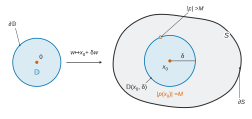
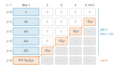

# X-ENS MP — Mathématiques A 2026 · Corrigé brut

*Corrigé rédigé par IA, non officiel. Signalez toute erreur.*

Épreuve de 4 heures, calculatrice interdite. Notations du sujet :

- $\langle x|y\rangle=\sum_i x_i\overline{y_i}$, linéaire à gauche et semi-linéaire à droite, et $\|x\|=\sqrt{\langle x|x\rangle}$ ;
- $\vert\!\vert\!\vert A\vert\!\vert\!\vert =\sup_{\|x\|=1}\|Ax\|$ et $\|p\|_S=\sup_{\alpha\in S}|p(\alpha)|$ ;
- $\mathbb D=\mathbb D(0,1)$ est le disque **fermé**, $\partial\mathbb D$ le cercle unité.

On note $\mathbb S=\{x\in\mathbb C^n:\|x\|=1\}$ la sphère unité et $(e_1,\dots,e_n)$ la base canonique.

## Préliminaires

### Question 1

L'application $f:x\mapsto\|Ax\|$ est continue sur $\mathbb C^n$. C'est la composée de l'application linéaire $x\mapsto Ax$, continue car $\mathbb C^n$ est de dimension finie, et de la norme.

La sphère $\mathbb S$ est fermée et bornée dans $\mathbb C^n$, de dimension finie : elle est compacte. Elle est non vide, car $e_1\in\mathbb S$.

Par le théorème des bornes atteintes, $f$ est bornée sur $\mathbb S$ et y atteint sa borne supérieure. Donc $\vert\!\vert\!\vert A\vert\!\vert\!\vert$ existe (c'est un réel fini), et c'est un maximum.

*Passage aux vecteurs non nuls.* Pour $x\neq0$, posons $\hat x=x/\|x\|$, qui est dans $\mathbb S$. Par homogénéité de la norme,

$$\frac{\|Ax\|}{\|x\|}=\|A\hat x\|.$$

Réciproquement, tout $y\in\mathbb S$ est non nul et vérifie $\|Ay\|/\|y\|=\|Ay\|$. Les deux ensembles de réels

$$\Big\{\frac{\|Ax\|}{\|x\|}:x\neq0\Big\}\quad\text{et}\quad\big\{\|Ay\|:y\in\mathbb S\big\}$$

sont donc égaux. Le second a un plus grand élément, atteint en un point de $\mathbb S$. Le premier a donc le même plus grand élément, atteint en ce même vecteur non nul :

$$\boxed{\begin{aligned}\vert\!\vert\!\vert A\vert\!\vert\!\vert &=\max_{\|x\|=1}\|Ax\|\\ &=\max_{x\neq0}\frac{\|Ax\|}{\|x\|}\end{aligned}}$$

Conséquence utilisée constamment : $\|Ax\|\le\vert\!\vert\!\vert A\vert\!\vert\!\vert \,\|x\|$ pour tout $x\in\mathbb C^n$ (trivial pour $x=0$).

### Question 2

Soit $D=\mathrm{diag}(\lambda_1,\dots,\lambda_n)$ et $M=\max_i|\lambda_i|$. Pour $x\in\mathbb C^n$,

$$\begin{aligned}\|Dx\|^2&=\sum_{i=1}^n|\lambda_i|^2|x_i|^2\\ &\le M^2\sum_{i=1}^n|x_i|^2\\ &=M^2\|x\|^2,\end{aligned}$$

donc $\vert\!\vert\!\vert D\vert\!\vert\!\vert \le M$.

Soit $i_0$ un indice qui réalise le maximum. Alors $\|e_{i_0}\|=1$ et $\|De_{i_0}\|=|\lambda_{i_0}|=M$, d'où $\vert\!\vert\!\vert D\vert\!\vert\!\vert \ge M$. Ainsi

$$\boxed{\vert\!\vert\!\vert \mathrm{diag}(\lambda_1,\dots,\lambda_n)\vert\!\vert\!\vert =\max_{i\in\{1,\dots,n\}}|\lambda_i|}$$

### Question 3

Soit $x\in\mathbb C^n$. On applique deux fois la conséquence de la question 1, ce qui ne demande aucune division (le cas $Bx=0$ y est compris) :

$$\begin{aligned}\|ABx\|&\le\vert\!\vert\!\vert A\vert\!\vert\!\vert \,\|Bx\|\\ &\le\vert\!\vert\!\vert A\vert\!\vert\!\vert \,\vert\!\vert\!\vert B\vert\!\vert\!\vert \,\|x\|.\end{aligned}$$

En passant à la borne supérieure sur $\|x\|=1$ :

$$\boxed{\vert\!\vert\!\vert AB\vert\!\vert\!\vert \le\vert\!\vert\!\vert A\vert\!\vert\!\vert \cdot\vert\!\vert\!\vert B\vert\!\vert\!\vert }$$

### Question 4

Si $U$ est unitaire, $\|Ux\|=\|x\|$ pour tout $x$ (fait admis). Donc $\vert\!\vert\!\vert U\vert\!\vert\!\vert =\sup_{\|x\|=1}1=1$.

Soit $A\in\mathcal M_n(\mathbb C)$. Pour $\|x\|=1$, $\|UAx\|=\|Ax\|$, donc $\vert\!\vert\!\vert UA\vert\!\vert\!\vert =\vert\!\vert\!\vert A\vert\!\vert\!\vert$.

Ensuite, $x\mapsto Ux$ envoie $\mathbb S$ dans $\mathbb S$ (conservation de la norme).

C'est une bijection de $\mathbb S$ sur $\mathbb S$, de réciproque $y\mapsto U^{-1}y=U^*y$.

En effet $U^*$ est elle aussi unitaire : $UU^*=I_n$ découle de $U^*U=I_n$ en dimension finie. Donc

$$\begin{aligned}\vert\!\vert\!\vert AU\vert\!\vert\!\vert &=\sup_{x\in\mathbb S}\|A(Ux)\|\\ &=\sup_{y\in\mathbb S}\|Ay\|\\ &=\vert\!\vert\!\vert A\vert\!\vert\!\vert .\end{aligned}$$

$$\boxed{\begin{aligned}&\vert\!\vert\!\vert U\vert\!\vert\!\vert =1\\ &\vert\!\vert\!\vert AU\vert\!\vert\!\vert =\vert\!\vert\!\vert UA\vert\!\vert\!\vert =\vert\!\vert\!\vert A\vert\!\vert\!\vert \end{aligned}}$$

### Question 5

Écrivons $D=\mathrm{diag}(\lambda_1,\dots,\lambda_n)$. Pour tout $k$, $A^k=PD^kP^{-1}$. Par linéarité,

$$\begin{aligned}p(A)&=P\,p(D)\,P^{-1},\\ p(D)&=\mathrm{diag}\big(p(\lambda_1),\dots,p(\lambda_n)\big).\end{aligned}$$

De plus $\sigma(A)=\{\lambda_1,\dots,\lambda_n\}$, car $A$ et $D$ sont semblables. Par la question 2 :

$$\vert\!\vert\!\vert p(D)\vert\!\vert\!\vert =\max_i|p(\lambda_i)|=\|p\|_{\sigma(A)}.$$

*Majoration.* Par la question 3,

$$\begin{aligned}\vert\!\vert\!\vert p(A)\vert\!\vert\!\vert &\le\vert\!\vert\!\vert P\vert\!\vert\!\vert \,\vert\!\vert\!\vert p(D)\vert\!\vert\!\vert \,\vert\!\vert\!\vert P^{-1}\vert\!\vert\!\vert \\ &=\mathrm{cond}(P)\,\|p\|_{\sigma(A)}.\end{aligned}$$

*Minoration.* Soit $i\in\{1,\dots,n\}$ et $v=Pe_i/\|Pe_i\|$. C'est un vecteur propre unitaire de $A$ pour $\lambda_i$. Alors $p(A)v=p(\lambda_i)v$, donc

$$\vert\!\vert\!\vert p(A)\vert\!\vert\!\vert \ge\|p(A)v\|=|p(\lambda_i)|.$$

En prenant le maximum sur $i$, on obtient $\vert\!\vert\!\vert p(A)\vert\!\vert\!\vert \ge\|p\|_{\sigma(A)}$.

$$\boxed{\|p\|_{\sigma(A)}\le\vert\!\vert\!\vert p(A)\vert\!\vert\!\vert \le\mathrm{cond}(P)\,\|p\|_{\sigma(A)}}$$

## Partie A — Principe du maximum pour les polynômes

Dans cette partie, $n\ge2$ et $z\in\mathbb D$. Le nombre $s=\sqrt{1-|z|^2}\in[0,1]$ est **réel**. Enfin $p=\sum_{k=0}^{n-1}p_kX^k$ est de degré $n-1$.

### Question 6

Lisons les colonnes $C_1,\dots,C_n$ de $U$ (la ligne $i\in\{2,\dots,n-1\}$ porte un $1$ en colonne $i+1$) :

$$\begin{aligned}C_1&=z\,e_1+s\,e_n,\\ C_2&=s\,e_1-\bar z\,e_n,\\ C_j&=e_{j-1}\qquad(3\le j\le n).\end{aligned}$$

- Normes : $\|C_1\|^2=|z|^2+s^2=1$ et $\|C_2\|^2=s^2+|z|^2=1$. Pour $j\ge3$, $\|C_j\|=\|e_{j-1}\|=1$.
- Le seul produit scalaire non trivial est, puisque $s$ est réel,

$$\begin{aligned}\langle C_1|C_2\rangle&=z\,\overline{s}+s\,\overline{(-\bar z)}\\ &=zs-sz\\ &=0.\end{aligned}$$

- Les colonnes $C_j=e_{j-1}$, pour $3\le j\le n$, sont deux à deux orthogonales. Elles sont aussi orthogonales à $C_1$ et $C_2$, qui sont nulles hors de la première et de la dernière coordonnée.

Les colonnes de $U$ forment une base orthonormale, donc **$U$ est unitaire** (critère admis). Pour $n=2$, seules $C_1$ et $C_2$ interviennent et le calcul est le même.

### Question 7

Pour $v\in\mathbb C^n$, $e_1^*v={}^t\overline{e_1}\,v=v_1$ est la première coordonnée de $v$. Par lecture des colonnes :

$$\begin{aligned}Ue_1&=z\,e_1+s\,e_n,\\ Ue_2&=s\,e_1-\bar z\,e_n,\\ Ue_j&=e_{j-1}\qquad(3\le j\le n).\end{aligned}$$

Montrons par récurrence sur $k\in\{0,\dots,n-1\}$ la formule portant sur toute la colonne $U^ke_1$ :

$$U^ke_1=z^ke_1+s\sum_{j=0}^{k-1}z^{k-1-j}e_{n-j}.$$

Pour $k=0$, c'est $e_1$ (somme vide).

Supposons la formule vraie au rang $k\le n-2$. Les indices $n-j$ qui apparaissent vérifient $j\le k-1\le n-3$. Donc $n-j\ge3$ et $Ue_{n-j}=e_{n-j-1}$. Ainsi

$$\begin{aligned}U^{k+1}e_1&=z^k(ze_1+se_n)+s\sum_{j=0}^{k-1}z^{k-1-j}e_{n-j-1}\\ &=z^{k+1}e_1+s\sum_{j=0}^{k}z^{k-j}e_{n-j},\end{aligned}$$

ce qui est la formule au rang $k+1$.

Pour $k\le n-1$, les vecteurs $e_{n-j}$ de la somme ont un indice $n-j\ge n-k+1\ge2$. La première coordonnée de $U^ke_1$ est donc $z^k$. Par linéarité,

$$\begin{aligned}e_1^*p(U)e_1&=\sum_{k=0}^{n-1}p_k\,e_1^*U^ke_1\\ &=\sum_{k=0}^{n-1}p_kz^k,\end{aligned}$$

soit

$$\boxed{p(z)=e_1^*\,p(U)\,e_1}$$

Le calcul vaut pour tout polynôme de degré $\le n-1$.

### Question 8

Par la question 7, $p(z)=e_1^*\,(p(U)e_1)=\langle p(U)e_1|e_1\rangle$. Par Cauchy-Schwarz, appliqué aux vecteurs $p(U)e_1$ et $e_1$, puis par la question 1 :

$$\begin{aligned}|p(z)|&\le\|p(U)e_1\|\,\|e_1\|\\ &=\|p(U)e_1\|\\ &\le\vert\!\vert\!\vert p(U)\vert\!\vert\!\vert .\end{aligned}$$

Par le théorème de réduction du préambule, $U$ unitaire s'écrit

$$U=W\,\mathrm{diag}(\mu_1,\dots,\mu_n)\,W^{-1},$$

avec $W$ unitaire et $|\mu_i|=1$. Comme $W^{-1}=W^*$ est unitaire, la question 4 donne $\mathrm{cond}(W)=\vert\!\vert\!\vert W\vert\!\vert\!\vert \,\vert\!\vert\!\vert W^{-1}\vert\!\vert\!\vert =1$.

La question 5 donne alors $\vert\!\vert\!\vert p(U)\vert\!\vert\!\vert \le\|p\|_{\sigma(U)}$. Comme $\sigma(U)=\{\mu_i\}\subset\partial\mathbb D$, on a $\|p\|_{\sigma(U)}\le\|p\|_{\partial\mathbb D}$. Finalement

$$\boxed{|p(z)|\le\vert\!\vert\!\vert p(U)\vert\!\vert\!\vert \le\|p\|_{\partial\mathbb D}}$$

### Question 9

Supposons $|z|<1$, donc $s>0$. D'après le calcul de la question 7,

$$p(U)e_1=p(z)\,e_1+s\,w,$$

où

$$\begin{aligned}w&=\sum_{k=1}^{n-1}p_k\sum_{j=0}^{k-1}z^{k-1-j}e_{n-j}\\ &\in\mathrm{Vect}(e_2,\dots,e_n).\end{aligned}$$

La coordonnée de $w$ sur $e_2$ correspond à $n-j=2$, soit $j=n-2$.

Cela impose $k-1\ge n-2$, donc $k=n-1$. Elle vaut $p_{n-1}z^0=p_{n-1}$, non nul car $\deg p=n-1$. Donc $w\neq0$.

Comme $w\perp e_1$, le théorème de Pythagore donne

$$\|p(U)e_1\|^2=|p(z)|^2+s^2\|w\|^2>|p(z)|^2.$$

Avec la chaîne d'inégalités de la question 8 :

$$\begin{aligned}|p(z)|&<\|p(U)e_1\|\\ &\le\vert\!\vert\!\vert p(U)\vert\!\vert\!\vert \\ &\le\|p\|_{\partial\mathbb D}.\end{aligned}$$

$$\boxed{|p(z)|<\|p\|_{\partial\mathbb D}\quad\text{pour }|z|<1}$$

Le résultat serait faux pour $p$ constant : c'est l'hypothèse $\deg p=n-1\ge1$ qui sert.

### Question 10

Comme $\partial S\subset S$, on a $\|p\|_{\partial S}\le\|p\|_S$.

$S$ est un fermé borné non vide de $\mathbb C$, donc un compact, et $|p|$ est continue. Elle atteint donc sur $S$ son maximum $M=\|p\|_S$ en un point $x_0$.

*$\partial S$ est non vide.* La fonction $|\cdot|$ atteint son maximum sur $S$ en un point $x_1$.

*Si $x_1\neq0$*, soit $\delta>0$. Le disque $\mathbb D(x_1,\delta)$ contient $x_1\big(1+\delta/|x_1|\big)$, de module $|x_1|+\delta>|x_1|$.

Ce disque n'est donc pas inclus dans $S$, et $x_1\in\partial S$.

*Si $x_1=0$*, alors $S=\{0\}$. Aucun disque de rayon $\delta>0$ n'est inclus dans $S$, donc $0\in\partial S$.

*Cas $p$ constant égal à $c$.* Alors $\|p\|_S=|c|=\|p\|_{\partial S}$, puisque $\partial S\neq\emptyset$.

*Cas $d=\deg p\ge1$.* Supposons par l'absurde $x_0\notin\partial S$ : il existe $\delta>0$ tel que $\mathbb D(x_0,\delta)\subset S$.

Le polynôme $\tilde p(w)=p(x_0+\delta w)$ a pour coefficient dominant $p_d\delta^d\neq0$. Il est donc de degré $d=m-1$, avec $m=d+1\ge2$.

La question 9, appliquée dans $\mathbb C^m$ à $\tilde p$ et au point $0$ (de module $<1$), donne

$$\begin{aligned}M=|p(x_0)|&=|\tilde p(0)|\\ &<\|\tilde p\|_{\partial\mathbb D}\\ &=\sup_{|x-x_0|=\delta}|p(x)|\\ &\le\|p\|_S=M.\end{aligned}$$

La dernière inégalité vient de $\partial\mathbb D(x_0,\delta)\subset\mathbb D(x_0,\delta)\subset S$. C'est absurde. Donc $x_0\in\partial S$, et $\|p\|_{\partial S}\ge|p(x_0)|=M$.

$$\boxed{\|p\|_S=\|p\|_{\partial S}}$$

## Partie B — Inégalité de Von Neumann

On suppose $\vert\!\vert\!\vert A\vert\!\vert\!\vert \le1$.

### Question 11

Si $A$ est unitaire, le théorème du préambule donne

$$A=V\,\mathrm{diag}(\lambda_1,\dots,\lambda_n)\,V^{-1},$$

avec $V$ unitaire et $|\lambda_i|=1$. Comme à la question 8, $\mathrm{cond}(V)=1$ (question 4). La question 5 donne alors

$$\vert\!\vert\!\vert p(A)\vert\!\vert\!\vert \le\|p\|_{\sigma(A)}\le\|p\|_{\mathbb D},$$

car $\sigma(A)\subset\partial\mathbb D\subset\mathbb D$. Donc

$$\boxed{\vert\!\vert\!\vert p(A)\vert\!\vert\!\vert \le\|p\|_{\mathbb D}\quad\text{pour }A\text{ unitaire}}$$

### Question 12

*Caractère hermitien.* Posons $M=I-A^*A$ et $M'=I-AA^*$. Comme $(A^*)^*=A$ et $(XY)^*=Y^*X^*$,

$$\begin{aligned}M^*&=I-A^*(A^*)^*=I-A^*A=M,\\ M'^*&=I-(A^*)^*A^*=I-AA^*=M'.\end{aligned}$$

Les deux matrices sont hermitiennes.

*Positivité pour $M$.* Si $Mx=\mu x$ avec $\|x\|=1$, alors

$$\begin{aligned}\mu=\langle Mx|x\rangle&=\|x\|^2-\langle Ax|Ax\rangle\\ &=1-\|Ax\|^2\\ &\ge1-\vert\!\vert\!\vert A\vert\!\vert\!\vert ^2\ \ge\ 0.\end{aligned}$$

*Positivité pour $M'$.* Si $M'x'=\mu'x'$ avec $\|x'\|=1$, le même calcul donne $\mu'=1-\|A^*x'\|^2$. Or, pour tout $y$, par Cauchy-Schwarz puis la question 1,

$$\begin{aligned}\|A^*y\|^2=\langle AA^*y|y\rangle&\le\|A(A^*y)\|\,\|y\|\\ &\le\vert\!\vert\!\vert A\vert\!\vert\!\vert \,\|A^*y\|\,\|y\|.\end{aligned}$$

Si $A^*y\neq0$, on divise par $\|A^*y\|>0$ ; si $A^*y=0$, il n'y a rien à montrer. Dans les deux cas $\|A^*y\|\le\vert\!\vert\!\vert A\vert\!\vert\!\vert \,\|y\|\le\|y\|$. Donc $\mu'\ge0$.

*Racine carrée.* Par le théorème du préambule,

$$M=V\,\mathrm{diag}(\mu_1,\dots,\mu_n)\,V^{-1},$$

avec $V$ unitaire et $\mu_i\ge0$. Posons

$$D_A=V\,\mathrm{diag}\big(\sqrt{\mu_1},\dots,\sqrt{\mu_n}\big)\,V^{-1}.$$

Comme $V^{-1}=V^*$ et que les $\sqrt{\mu_i}$ sont réels, $D_A^*=V\,\mathrm{diag}(\sqrt{\mu_i})\,V^*=D_A$. Ainsi $D_A$ est hermitienne, de valeurs propres $\sqrt{\mu_i}\ge0$, et

$$D_A^2=V\,\mathrm{diag}(\mu_i)\,V^{-1}=I-A^*A.$$

On construit $D_{A^*}$ de même à partir de $M'$, dont les valeurs propres sont aussi positives.

$$\boxed{\begin{aligned}&D_A,\ D_{A^*}\ \text{hermitiennes à valeurs propres}\ \ge0,\\ &D_A^2=I-A^*A,\\ &D_{A^*}^2=I-AA^*\end{aligned}}$$

### Question 13

*Lemme (unicité de la racine carrée positive).* Si $H$ et $K$ sont hermitiennes à valeurs propres $\ge0$ et si $H^2=K^2$, alors $H=K$.

*Preuve.* $H$ est diagonalisable (théorème du préambule), de valeurs propres distinctes $\nu_1,\dots,\nu_r\ge0$. Donc $\mathbb C^n=\bigoplus_i\ker(H-\nu_iI)$.

Pour $\mu\ge0$, montrons $\ker(H-\mu I)=\ker(H^2-\mu^2I)$. L'inclusion $\subset$ est claire. Si $H^2x=\mu^2x$, décomposons $x=\sum_ix_i$ avec $x_i\in\ker(H-\nu_iI)$. Alors

$$\sum_i(\nu_i^2-\mu^2)\,x_i=0.$$

La somme étant directe, $x_i=0$ dès que $\nu_i^2\neq\mu^2$, c'est-à-dire, par positivité, dès que $\nu_i\neq\mu$. Ainsi $x\in\ker(H-\mu I)$. Le même énoncé vaut pour $K$. Pour tout $\mu\ge0$ :

$$\begin{aligned}\ker(H-\mu I)&=\ker(H^2-\mu^2I)\\ &=\ker(K^2-\mu^2I)\\ &=\ker(K-\mu I).\end{aligned}$$

Sur chaque $\ker(H-\nu_iI)$, $H$ et $K$ agissent donc par $\nu_i\,\mathrm{id}$. Ces sous-espaces étant supplémentaires, $H=K$. $\square$

*Construction de $q$.* Les valeurs propres de $A^*A$ sont de la forme $\|Ax\|^2\in[0,1]$, et celles de $AA^*$ de la forme $\|A^*x\|^2\in[0,1]$ (question 12). Posons

$$\Lambda=\sigma(A^*A)\cup\sigma(AA^*)=\{\lambda_1,\dots,\lambda_m\}\subset[0,1],$$

les $\lambda_j$ étant distincts. Par interpolation de Lagrange, il existe $q\in\mathbb R[X]\subset\mathbb C[X]$ tel que $q(\lambda_j)=\sqrt{1-\lambda_j}$ pour $1\le j\le m$. Ce **même** $q$ sert pour les deux matrices, parce que ses nœuds contiennent les deux spectres.

Écrivons $A^*A=W\,\mathrm{diag}(\beta_1,\dots,\beta_n)\,W^*$, avec $W$ unitaire et $\beta_i\in\Lambda$ (théorème du préambule). Alors

$$q(A^*A)=W\,\mathrm{diag}\big(\sqrt{1-\beta_i}\big)\,W^*$$

est hermitienne, à valeurs propres $\ge0$, et

$$\begin{aligned}q(A^*A)^2&=W\,\mathrm{diag}(1-\beta_i)\,W^*\\ &=I-A^*A=D_A^2.\end{aligned}$$

Le lemme donne $q(A^*A)=D_A$. Le même raisonnement avec $AA^*$, dont les valeurs propres sont aussi dans $\Lambda$, donne $q(AA^*)=D_{A^*}$.

$$\boxed{\exists\,q\in\mathbb C[X]\ :\ D_A=q(A^*A)\ \text{ et }\ D_{A^*}=q(AA^*)}$$

### Question 14

Montrons par récurrence que $A(A^*A)^k=(AA^*)^kA$ pour tout $k\in\mathbb N$. C'est vrai pour $k=0$. Si c'est vrai au rang $k$,

$$\begin{aligned}A(A^*A)^{k+1}&=(AA^*)^kA\,A^*A\\ &=(AA^*)^{k+1}A.\end{aligned}$$

Par linéarité, $A\,q(A^*A)=q(AA^*)\,A$, soit, avec la question 13, $A\,D_A=D_{A^*}A$.

De même, $A^*(AA^*)^k=(A^*A)^kA^*$ par la même récurrence, en échangeant les rôles de $A$ et $A^*$. D'où $A^*q(AA^*)=q(A^*A)A^*$, soit $A^*D_{A^*}=D_AA^*$.

$$\boxed{A^*D_{A^*}=D_AA^*\ \text{ et }\ AD_A=D_{A^*}A}$$

### Question 15

$D_A$ et $D_{A^*}$ étant hermitiennes,

$$U^*=\begin{pmatrix}A^*&-D_A\\ D_{A^*}&A\end{pmatrix}.$$

Par produit par blocs :

$$U^*U=\begin{pmatrix}A^*A+D_A^2 & A^*D_{A^*}-D_AA^*\\ D_{A^*}A-AD_A & D_{A^*}^2+AA^*\end{pmatrix}.$$

Par la question 12, $A^*A+D_A^2=I_n$ et $D_{A^*}^2+AA^*=I_n$. Par la question 14, les deux blocs hors diagonale sont nuls. Donc $U^*U=I_{2n}$ : **$U$ est unitaire**.

### Question 16

$U_k$ est de taille $(k+2)n$. Écrivons un vecteur $V=(V_1,\dots,V_{k+2})$ par blocs de taille $n$. La définition de $U_k$ s'écrit

$$\begin{aligned}(U_kV)_1&=AV_1+D_{A^*}V_2,\\ (U_kV)_i&=V_{i+1}\qquad(2\le i\le k+1),\\ (U_kV)_{k+2}&=-D_AV_1+A^*V_2.\end{aligned}$$

Pour $k=0$, $U_0$ est la matrice $U$ de la question 15.

*$U_k$ est unitaire.* Ses colonnes-blocs sont :

- $\mathcal C_1=(A,0,\dots,0,-D_A)$ et $\mathcal C_2=(D_{A^*},0,\dots,0,A^*)$ ;
- pour $3\le j\le k+2$, $\mathcal C_j$, qui porte $I_n$ sur la ligne-bloc $j-1\in\{2,\dots,k+1\}$ et $0_n$ ailleurs.

Le bloc $(i,j)$ de $U_k^*U_k$ vaut $\mathcal C_i^*\mathcal C_j$. Par les questions 12 et 14 :

$$\begin{aligned}\mathcal C_1^*\mathcal C_1&=A^*A+D_A^2=I_n,\\ \mathcal C_2^*\mathcal C_2&=AA^*+D_{A^*}^2=I_n,\\ \mathcal C_1^*\mathcal C_2&=A^*D_{A^*}-D_AA^*=0,\\ \mathcal C_2^*\mathcal C_1&=(\mathcal C_1^*\mathcal C_2)^*=0.\end{aligned}$$

Pour $i,j\ge3$, $\mathcal C_i^*\mathcal C_j=\delta_{ij}I_n$.

Pour $i\in\{1,2\}$ et $j\ge3$, $\mathcal C_i^*\mathcal C_j=0$, car $\mathcal C_1$ et $\mathcal C_2$ sont nulles sur les lignes-blocs $2,\dots,k+1$.

Donc $U_k^*U_k=I_{(k+2)n}$ : $U_k$ est unitaire.

*Bloc en haut à gauche des puissances de $U_k$.* Soit $x\in\mathbb C^n$, $E_1x=(x,0,\dots,0)$ et $W^{(j)}=U_k^jE_1x$. Montrons par récurrence sur $j\in\{0,\dots,k+1\}$ la propriété

$$\begin{aligned}&W^{(j)}_1=A^jx,\\ &W^{(j)}_i=0\qquad\text{pour }2\le i\le k+2-j.\end{aligned}$$

- $j=0$ : $W^{(0)}=(x,0,\dots,0)$.
- Supposons la propriété vraie au rang $j\le k$. Alors $k+2-j\ge2$, donc $W^{(j)}_2=0$, et

$$\begin{aligned}W^{(j+1)}_1&=AW^{(j)}_1+D_{A^*}W^{(j)}_2\\ &=A^{j+1}x.\end{aligned}$$

Pour $2\le i\le k+1-j$, on a $3\le i+1\le k+2-j$, donc $W^{(j+1)}_i=W^{(j)}_{i+1}=0$. C'est la propriété au rang $j+1$.

En particulier $W^{(j)}_1=A^jx$ pour $0\le j\le k+1$ et tout $x$. Autrement dit, **le bloc en haut à gauche de $U_k^j$ est $A^j$** pour $0\le j\le k+1$.

*Bloc en haut à gauche de $p(U_k)$.* Si $\deg p\le k+1$, écrivons $p=\sum_{j=0}^{k+1}a_jX^j$. Le bloc en haut à gauche dépend linéairement de la matrice, donc celui de $p(U_k)=\sum_ja_jU_k^j$ est $\sum_ja_jA^j=p(A)$.

Ainsi $\big(p(U_k)E_1x\big)_1=p(A)x$ pour tout $x$ : **le premier bloc diagonal de $p(U_k)$ est $p(A)$**.

*Conclusion.* Soit $p\in\mathbb C[X]$ et $k=\max(0,\deg p-1)$, avec $k=0$ si $p=0$, de sorte que $\deg p\le k+1$.

Pour $\|x\|=1$, on a $\|E_1x\|=1$. Le vecteur $p(A)x$ est le premier bloc de $p(U_k)E_1x$, donc sa norme est majorée par celle de ce vecteur :

$$\begin{aligned}\|p(A)x\|&\le\|p(U_k)E_1x\|\\ &\le\vert\!\vert\!\vert p(U_k)\vert\!\vert\!\vert \\ &\le\|p\|_{\mathbb D}.\end{aligned}$$

La dernière inégalité est la question 11, appliquée à la matrice unitaire $U_k$. En passant au sup sur $x$ :

$$\boxed{\vert\!\vert\!\vert p(A)\vert\!\vert\!\vert \le\|p\|_{\mathbb D}\quad\text{pour toute contraction }A\text{ et tout }p\in\mathbb C[X]}$$

### Question 17

Si $A=0$, $p(A)=p(0)I_n$ et $\vert\!\vert\!\vert p(A)\vert\!\vert\!\vert =|p(0)|=\|p\|_{\mathbb D(0,0)}$.

Sinon, soit $\rho=\vert\!\vert\!\vert A\vert\!\vert\!\vert >0$ et $B=A/\rho$. Elle vérifie $\vert\!\vert\!\vert B\vert\!\vert\!\vert =1$ : c'est une contraction. Posons $\tilde p(X)=p(\rho X)$, de sorte que $\tilde p(B)=p(A)$. Par la question 16,

$$\begin{aligned}\vert\!\vert\!\vert p(A)\vert\!\vert\!\vert =\vert\!\vert\!\vert \tilde p(B)\vert\!\vert\!\vert &\le\|\tilde p\|_{\mathbb D}\\ &=\sup_{|w|\le1}|p(\rho w)|\\ &=\sup_{|u|\le\rho}|p(u)|\\ &=\|p\|_{\mathbb D(0,\rho)}.\end{aligned}$$

$$\boxed{\vert\!\vert\!\vert p(A)\vert\!\vert\!\vert \le\|p\|_{\mathbb D(0,\vert\!\vert\!\vert A\vert\!\vert\!\vert )}}$$

## Partie C — Hausdorffien et rayon numérique

### Question 18

Soit $\lambda\in\sigma(A)$ et $x$ un vecteur propre associé, normalisé : $\|x\|=1$ et $Ax=\lambda x$. Par linéarité à gauche, $\langle Ax|x\rangle=\lambda\langle x|x\rangle=\lambda$. Donc $\lambda\in\mathcal H(A)$ :

$$\boxed{\sigma(A)\subset\mathcal H(A)}$$

### Question 19

Soit $D=\mathrm{diag}(\lambda_1,\dots,\lambda_n)$ et

$$\Gamma=\Big\{\sum_i\alpha_i\lambda_i:\ \alpha_i\ge0,\ \sum_i\alpha_i=1\Big\}.$$

$\subset$ : pour $\|x\|=1$,

$$\langle Dx|x\rangle=\sum_i\lambda_ix_i\overline{x_i}=\sum_i|x_i|^2\lambda_i.$$

Avec $\alpha_i=|x_i|^2\ge0$, on a $\sum_i\alpha_i=\|x\|^2=1$, donc $\langle Dx|x\rangle\in\Gamma$.

$\supset$ : si $\alpha_i\ge0$ et $\sum_i\alpha_i=1$, le vecteur $x=(\sqrt{\alpha_1},\dots,\sqrt{\alpha_n})$ est unitaire et $\langle Dx|x\rangle=\sum_i\alpha_i\lambda_i$.

$$\boxed{\begin{aligned}\mathcal H(\mathrm{diag}(\lambda_1,\dots,\lambda_n))&=\Big\{\sum_{i=1}^n\alpha_i\lambda_i:\ \alpha_i\in\mathbb R_+,\ \sum_{i=1}^n\alpha_i=1\Big\}\\ &=\mathrm{conv}\{\lambda_1,\dots,\lambda_n\}\end{aligned}}$$

### Question 20

*Invariance unitaire.* Supposons $A=VDV^{-1}$ avec $V$ unitaire. Pour $x\in\mathbb S$, posons $y=V^*x$, de sorte que $x=Vy$. Alors

$$\begin{aligned}\langle Ax|x\rangle&=\langle VDy|Vy\rangle\\ &=\langle Dy|V^*Vy\rangle\\ &=\langle Dy|y\rangle.\end{aligned}$$

Comme $x\mapsto V^*x$ est une bijection de $\mathbb S$ sur $\mathbb S$ (question 4), on obtient $\mathcal H(A)=\mathcal H(D)$.

Si $A$ est unitaire (resp. hermitienne), le théorème du préambule fournit une telle écriture avec $D=\mathrm{diag}(\lambda_i)$, les $\lambda_i$ étant les valeurs propres de $A$. Par la question 19 :

$$\boxed{\mathcal H(A)=\mathrm{conv}\big(\sigma(A)\big)}$$

- $A$ unitaire : $\mathcal H(A)$ est le polygone convexe de sommets les valeurs propres, inscrit dans le cercle unité (éventuellement réduit à un point ou à un segment).
- $A$ hermitienne : les valeurs propres sont réelles et $\mathcal H(A)=[\lambda_{\min},\lambda_{\max}]\subset\mathbb R$.

### Question 21

Soit $A=\begin{pmatrix}0&1\\0&0\end{pmatrix}$. Pour $x=(x_1,x_2)$, $Ax=(x_2,0)$, donc $\langle Ax|x\rangle=x_2\overline{x_1}$.

*Calcul de l'indication.* Pour $a,b\in\mathbb R_+$ et $\theta\in\mathbb R$, le vecteur $y=(a,be^{i\theta})$ vérifie $\langle Ay|y\rangle=be^{i\theta}\,a=ab\,e^{i\theta}$.

*Inclusion $\mathcal H(A)\subset\mathbb D(0,\frac12)$.* Soit $x\in\mathbb S$.

On écrit $x_1=ae^{i\varphi}$ et $x_2=be^{i(\varphi+\theta)}$, avec $a=|x_1|$, $b=|x_2|$ et $\varphi,\theta\in\mathbb R$.

Alors $a^2+b^2=1$ et $x=e^{i\varphi}y$, avec $y$ comme ci-dessus. Comme $\langle A(e^{i\varphi}y)|e^{i\varphi}y\rangle=|e^{i\varphi}|^2\langle Ay|y\rangle$,

$$\langle Ax|x\rangle=ab\,e^{i\theta}.$$

Or $0\le ab\le\frac12(a^2+b^2)=\frac12$, donc $|\langle Ax|x\rangle|\le\frac12$.

*Inclusion $\mathbb D(0,\frac12)\subset\mathcal H(A)$.* Soit $w=\rho e^{i\theta}$ avec $0\le\rho\le\frac12$ et $\theta\in\mathbb R$.

La fonction $t\mapsto\cos t\sin t=\frac12\sin(2t)$ est continue sur $[0,\frac\pi4]$ et vaut $0$ en $0$, $\frac12$ en $\frac\pi4$.

Par le théorème des valeurs intermédiaires, il existe $t\in[0,\frac\pi4]$ tel que $\cos t\sin t=\rho$.

Le vecteur $y=(\cos t,\ \sin t\,e^{i\theta})$ est unitaire et $\langle Ay|y\rangle=\rho e^{i\theta}=w$. Donc $w\in\mathcal H(A)$.

$$\boxed{\mathcal H\begin{pmatrix}0&1\\0&0\end{pmatrix}=\mathbb D\big(0,\tfrac12\big)}$$

### Question 22

L'application $f:x\mapsto\langle Ax|x\rangle=\sum_i(Ax)_i\overline{x_i}$ est continue sur $\mathbb C^n$ : elle est polynomiale en les parties réelles et imaginaires des coordonnées de $x$.

$\mathbb S$ est compacte (question 1), donc $\mathcal H(A)=f(\mathbb S)$ est compact : **$\mathcal H(A)$ est un fermé borné de $\mathbb C$**, non vide. En particulier, $r(A)=\max_{z\in\mathcal H(A)}|z|$ est bien défini (borne atteinte).

### Question 23

*Majoration.* Pour $\|x\|=1$, Cauchy-Schwarz donne

$$|\langle Ax|x\rangle|\le\|Ax\|\,\|x\|\le\vert\!\vert\!\vert A\vert\!\vert\!\vert ,$$

donc $r(A)\le\vert\!\vert\!\vert A\vert\!\vert\!\vert$.

*Minoration.* Remarquons d'abord que, pour tout $u\in\mathbb C^n$,

$$|\langle Au|u\rangle|\le r(A)\,\|u\|^2.$$

C'est clair si $u=0$. Sinon, $\langle Au|u\rangle=\|u\|^2\langle A\hat u|\hat u\rangle$ avec $\hat u=u/\|u\|\in\mathbb S$.

Si $A=0$, il n'y a rien à montrer. Sinon, soit $x\in\mathbb S$ tel que $\|Ax\|=\vert\!\vert\!\vert A\vert\!\vert\!\vert >0$ (question 1), et $y=Ax/\|Ax\|\in\mathbb S$. Alors

$$\langle Ax|y\rangle=\frac{\|Ax\|^2}{\|Ax\|}=\vert\!\vert\!\vert A\vert\!\vert\!\vert .$$

L'identité de polarisation, l'inégalité triangulaire et la remarque donnent

$$\begin{aligned}4\vert\!\vert\!\vert A\vert\!\vert\!\vert &=|4\langle Ax|y\rangle|\\ &\le r(A)\big(\|x+y\|^2+\|x-y\|^2+\|x+iy\|^2+\|x-iy\|^2\big).\end{aligned}$$

En développant (identité du parallélogramme), et comme $\|x\|=\|y\|=\|iy\|=1$,

$$\begin{aligned}\|x+y\|^2+\|x-y\|^2&=2\|x\|^2+2\|y\|^2=4,\\ \|x+iy\|^2+\|x-iy\|^2&=2\|x\|^2+2\|iy\|^2=4.\end{aligned}$$

Donc $4\vert\!\vert\!\vert A\vert\!\vert\!\vert \le8\,r(A)$.

$$\boxed{\tfrac12\vert\!\vert\!\vert A\vert\!\vert\!\vert \le r(A)\le\vert\!\vert\!\vert A\vert\!\vert\!\vert }$$

### Question 24

$r$ est à valeurs dans $\mathbb R_+$ (question 22).

- *Séparation* : si $r(A)=0$, la question 23 donne $\vert\!\vert\!\vert A\vert\!\vert\!\vert \le2r(A)=0$, donc $A=0$.
- *Homogénéité* : $\mathcal H(\lambda A)=\{\lambda\langle Ax|x\rangle:x\in\mathbb S\}=\lambda\mathcal H(A)$, donc $r(\lambda A)=|\lambda|\,r(A)$.
- *Inégalité triangulaire* : pour $\|x\|=1$,

$$\begin{aligned}|\langle(A+B)x|x\rangle|&\le|\langle Ax|x\rangle|+|\langle Bx|x\rangle|\\ &\le r(A)+r(B).\end{aligned}$$

En passant au max, $r(A+B)\le r(A)+r(B)$.

**$r$ est une norme sur $\mathcal M_n(\mathbb C)$.**

### Question 25

Soit $A=\begin{pmatrix}0&1\\0&0\end{pmatrix}$ et $B=A^*=\begin{pmatrix}0&0\\1&0\end{pmatrix}$. Par la question 21, $r(A)=\frac12$.

Pour tout $x$, $\langle A^*x|x\rangle=\langle x|Ax\rangle=\overline{\langle Ax|x\rangle}$. Donc $\mathcal H(B)$ est le conjugué de $\mathcal H(A)=\mathbb D(0,\frac12)$, c'est-à-dire $\mathbb D(0,\frac12)$, et $r(B)=\frac12=r(A)$.

Or $AB=\begin{pmatrix}1&0\\0&0\end{pmatrix}=\mathrm{diag}(1,0)$. Par la question 19, $\mathcal H(AB)=[0,1]$, donc $r(AB)=1$. Ainsi

$$r(AB)=1>\tfrac14=r(A)\,r(B).$$

**L'inégalité $r(AB)\le r(A)r(B)$ est fausse en général.**

### Question 26-a

*Première identité.* Soit $t\in\mathbb C^*$. On évalue l'identité $X^k-1=\prod_{\ell=1}^k(X-\omega_k^\ell)$ en $1/t$ :

$$\begin{aligned}\prod_{\ell=1}^k(1-\omega_k^\ell t)&=t^k\prod_{\ell=1}^k\Big(\frac1t-\omega_k^\ell\Big)\\ &=t^k\Big(\frac1{t^k}-1\Big)\\ &=1-t^k.\end{aligned}$$

Les polynômes $\prod_\ell(1-\omega_k^\ell X)$ et $1-X^k$ coïncident sur l'ensemble infini $\mathbb C^*$ : ils sont égaux.

$$\boxed{1-X^k=\prod_{\ell=1}^k(1-\omega_k^\ell X)}$$

*Seconde identité.* Posons $Q_j=\prod_{\ell\neq j}(1-\omega_k^\ell X)$ et $S=\sum_{j=1}^kQ_j$, de degré $\le k-1$. Soit $j_0\in\{1,\dots,k\}$.

Pour $j\neq j_0$, $Q_j$ contient le facteur $1-\omega_k^{j_0}X$, nul en $\omega_k^{-j_0}$. Donc

$$\begin{aligned}S(\omega_k^{-j_0})&=Q_{j_0}(\omega_k^{-j_0})\\ &=\prod_{\ell\neq j_0}\big(1-\omega_k^{\ell-j_0}\big)\\ &=\prod_{m=1}^{k-1}(1-\omega_k^m),\end{aligned}$$

car $\ell-j_0$ parcourt modulo $k$ les classes non nulles. Or

$$\begin{aligned}\prod_{m=1}^{k-1}(X-\omega_k^m)&=\frac{X^k-1}{X-1}\\ &=1+X+\dots+X^{k-1},\end{aligned}$$

qui vaut $k$ en $X=1$.

Donc $S-k$, de degré $\le k-1$, s'annule aux $k$ points distincts $\omega_k^{-1},\dots,\omega_k^{-k}$. Ainsi $S-k=0$ :

$$\boxed{1=\frac1k\sum_{j=1}^k\prod_{\substack{\ell=1\\ \ell\neq j}}^k(1-\omega_k^\ell X)}$$

Pour $k=1$, le produit vide vaut $1$ et l'identité est triviale.

### Question 26-b

Avec les notations précédentes, $x_j=Q_j(A)x$. Comme

$$\begin{aligned}(1-\omega_k^jX)\,Q_j&=\prod_{\ell=1}^k(1-\omega_k^\ell X)\\ &=1-X^k,\end{aligned}$$

le morphisme d'algèbres $P\mapsto P(A)$ donne, pour $1\le j\le k$,

$$(I-\omega_k^jA)\,x_j=(I-A^k)\,x.$$

Par linéarité à gauche,

$$\begin{aligned}\|x_j\|^2-\langle\omega_k^jAx_j|x_j\rangle&=\langle(I-\omega_k^jA)x_j|x_j\rangle\\ &=\langle(I-A^k)x|x_j\rangle.\end{aligned}$$

On somme. L'additivité à droite et le fait que $\frac1k$ soit réel donnent

$$\begin{aligned}\frac1k\sum_{j=1}^k\Big[\|x_j\|^2-\langle\omega_k^jAx_j|x_j\rangle\Big]&=\Big\langle(I-A^k)x\ \Big|\ \frac1k\sum_{j=1}^kx_j\Big\rangle\\ &=\langle(I-A^k)x|x\rangle,\end{aligned}$$

car $\frac1k\sum_jx_j=\big(\frac1k\sum_jQ_j\big)(A)\,x=x$ par la seconde identité de 26-a. Enfin $\langle(I-A^k)x|x\rangle=\|x\|^2-\langle A^kx|x\rangle=1-\langle A^kx|x\rangle$.

$$\boxed{\frac1k\sum_{j=1}^k\Big[\|x_j\|^2-\langle\omega_k^jAx_j|x_j\rangle\Big]=1-\langle A^kx|x\rangle}$$

### Question 26-c

Soit $\theta\in\mathbb R$, $x\in\mathbb S$ et $B=e^{i\theta}A$. Par la question 24, $r(B)=r(A)\le1$, et $B^k=e^{ik\theta}A^k$.

Posons $y_j=\prod_{\ell\neq j}(I-\omega_k^\ell B)x$. La formule de 26-b pour $B$ s'écrit

$$\frac1k\sum_{j=1}^k\Big[\|y_j\|^2-\omega_k^j\langle By_j|y_j\rangle\Big]=1-e^{ik\theta}\langle A^kx|x\rangle.$$

Pour chaque $j$, la remarque de la question 23 donne

$$\begin{aligned}|\omega_k^j\langle By_j|y_j\rangle|&=|\langle By_j|y_j\rangle|\\ &\le r(B)\|y_j\|^2\\ &\le\|y_j\|^2,\end{aligned}$$

donc

$$\begin{aligned}\mathrm{Re}\Big(\|y_j\|^2-\omega_k^j\langle By_j|y_j\rangle\Big)&\ge\|y_j\|^2-|\langle By_j|y_j\rangle|\\ &\ge0.\end{aligned}$$

En prenant la partie réelle de l'égalité, pour tout $\theta\in\mathbb R$ et tout $x\in\mathbb S$ :

$$\boxed{\mathrm{Re}\big(1-e^{ik\theta}\langle A^kx|x\rangle\big)\ge0}$$

Soit $w=\langle A^kx|x\rangle$. Si $w\neq0$, écrivons $w=|w|e^{i\psi}$ et choisissons $\theta=-\psi/k$, ce qui est possible car $k\ge1$.

Alors $e^{ik\theta}w=|w|$, donc $1-|w|\ge0$. Si $w=0$, on a aussi $|w|\le1$.

Ainsi $|\langle A^kx|x\rangle|\le1$ pour tout $x\in\mathbb S$ :

$$\boxed{r(A)\le1\ \Longrightarrow\ r(A^k)\le1\qquad(k\ge1)}$$

### Question 26-d

- $k=0$ : $A^0=I_n$ et $\langle x|x\rangle=1$ sur $\mathbb S$, donc $r(I_n)=1=r(A)^0$.
- $k\ge1$ et $r(A)=0$ : $A=0$ (question 24), donc $A^k=0$ et $r(A^k)=0=r(A)^k$.
- $k\ge1$ et $r(A)>0$ : $B=A/r(A)$ vérifie $r(B)=1$ par homogénéité. La question 26-c donne $r(B^k)\le1$, et $r(B^k)=r(A^k)/r(A)^k$.

$$\boxed{r(A^k)\le r(A)^k\quad\text{pour tout }k\in\mathbb N\text{ et tout }A\in\mathcal M_n(\mathbb C)}$$

## Partie D — Conjecture de Crouzeix

### Question 27

Soit $A=\begin{pmatrix}0&1\\0&0\end{pmatrix}$ et $p=X$. Pour tout $x$, $\|Ax\|=|x_2|\le\|x\|$, avec égalité pour $x=e_2$. Donc $\vert\!\vert\!\vert p(A)\vert\!\vert\!\vert =\vert\!\vert\!\vert A\vert\!\vert\!\vert =1$.

Par la question 21, $\|p\|_{\mathcal H(A)}=\sup_{|z|\le1/2}|z|=\frac12$. Ainsi

$$\vert\!\vert\!\vert p(A)\vert\!\vert\!\vert =1=2\,\|p\|_{\mathcal H(A)}.$$

Supposons qu'une constante $c$ vérifie $\vert\!\vert\!\vert p(A)\vert\!\vert\!\vert \le c\,\|p\|_{\mathcal H(A)}$ pour toute matrice et tout polynôme. Ce couple donne $1\le c/2$, soit $c\ge2$. **La constante $2$ ne peut pas être améliorée.**

### Question 28

Pour $p=X^k$, $\|p\|_{\mathcal H(A)}=\max_{z\in\mathcal H(A)}|z|^k=r(A)^k$ (pour $k=0$, les deux membres valent $1$). Par la question 23 appliquée à $A^k$, puis par la question 26-d :

$$\begin{aligned}\vert\!\vert\!\vert A^k\vert\!\vert\!\vert &\le2\,r(A^k)\\ &\le2\,r(A)^k\\ &=2\,\|X^k\|_{\mathcal H(A)}.\end{aligned}$$

**La formule (1) est vraie pour tous les monômes $X^k$, $k\in\mathbb N$.**

### Question 29

Par l'inégalité triangulaire pour $\vert\!\vert\!\vert \cdot\vert\!\vert\!\vert$ et la question 28,

$$\begin{aligned}\vert\!\vert\!\vert p(A)\vert\!\vert\!\vert &\le\sum_{k=0}^r|c_k|\,\vert\!\vert\!\vert A^k\vert\!\vert\!\vert \\ &\le2\sum_{k=0}^r|c_k|\,r(A)^k.\end{aligned}$$

Par ailleurs, avec $z=r(A)e^{i\theta}$ et $c_k=|c_k|e^{i(\varphi-k\theta)}$,

$$\begin{aligned}p(z)&=\sum_{k=0}^r|c_k|e^{i(\varphi-k\theta)}r(A)^ke^{ik\theta}\\ &=e^{i\varphi}\sum_{k=0}^r|c_k|\,r(A)^k,\end{aligned}$$

donc $|p(z)|=\sum_k|c_k|r(A)^k$. Comme $z\in\mathcal H(A)$, $|p(z)|\le\|p\|_{\mathcal H(A)}$. D'où

$$\boxed{\vert\!\vert\!\vert p(A)\vert\!\vert\!\vert \le2\,|p(z)|\le2\,\|p\|_{\mathcal H(A)}}$$

et (1) est vérifiée pour ce couple $(A,p)$.

### Question 30-a

Si $r(A)=0$, alors $A=0$ (question 24) et

$$\begin{aligned}\vert\!\vert\!\vert p(A)\vert\!\vert\!\vert &=|p(0)|\\ &\le2|p(0)|=2\|p\|_{\mathbb D(0,0)}.\end{aligned}$$

Sinon, soit $B=A/r(A)$, de sorte que $r(B)=1$. Par Okubo-Ando, il existe $X$ inversible avec $\mathrm{cond}(X)\le2$ et $C=X^{-1}BX$ contraction.

Pour tout polynôme $q$, $q(B)=X\,q(C)\,X^{-1}$, puisque $B^k=XC^kX^{-1}$. Par la question 3, puis l'inégalité de Von Neumann (question 16) appliquée à $C$ :

$$\begin{aligned}\vert\!\vert\!\vert q(B)\vert\!\vert\!\vert &\le\vert\!\vert\!\vert X\vert\!\vert\!\vert \,\vert\!\vert\!\vert q(C)\vert\!\vert\!\vert \,\vert\!\vert\!\vert X^{-1}\vert\!\vert\!\vert \\ &=\mathrm{cond}(X)\,\vert\!\vert\!\vert q(C)\vert\!\vert\!\vert \\ &\le2\,\|q\|_{\mathbb D}.\end{aligned}$$

Prenons $q(Y)=p(r(A)\,Y)$. Alors $q(B)=p(A)$ et

$$\|q\|_{\mathbb D}=\sup_{|w|\le1}|p(r(A)w)|=\|p\|_{\mathbb D(0,r(A))}.$$

$$\boxed{\vert\!\vert\!\vert p(A)\vert\!\vert\!\vert \le2\,\|p\|_{\mathbb D(0,r(A))}}$$

### Question 30-b

Soit $\mathbb D(c,\delta)$ un disque fermé contenant $\mathcal H(A)$, de bord $\mathcal C=\partial\mathbb D(c,\delta)$.

*Translation.* Soit $B=A-cI_n$. Pour $x\in\mathbb S$, $\langle Bx|x\rangle=\langle Ax|x\rangle-c$. Donc $\mathcal H(B)=\mathcal H(A)-c\subset\mathbb D(0,\delta)$ et $r(B)\le\delta$.

Avec $\tilde p(Y)=p(Y+c)$, on a $\tilde p(B)=p(A)$, et la question 30-a donne

$$\begin{aligned}\vert\!\vert\!\vert p(A)\vert\!\vert\!\vert &\le2\,\|\tilde p\|_{\mathbb D(0,r(B))}\\ &=2\,\|p\|_{\mathbb D(c,r(B))}\\ &\le2\,\|p\|_{\mathbb D(c,\delta)}.\end{aligned}$$

*Principe du maximum.* Pour $S=\mathbb D(c,\delta)$, on a $\partial S=\mathcal C$ au sens de la question 10.

*Point intérieur.* Si $|x-c|<\delta$, on a $\mathbb D(x,\delta-|x-c|)\subset S$ par l'inégalité triangulaire, donc $x\notin\partial S$.

*Point du cercle.* Si $|x-c|=\delta$, soit $\varepsilon>0$.

Le point $x+\varepsilon\frac{x-c}{\delta}$ (ou $c+\varepsilon$ si $\delta=0$) appartient à $\mathbb D(x,\varepsilon)$.

Il est à distance $\delta+\varepsilon>\delta$ de $c$, donc hors de $S$ : $x\in\partial S$.

La question 10 donne alors $\|p\|_{\mathbb D(c,\delta)}=\|p\|_{\mathcal C}$, d'où

$$\boxed{\vert\!\vert\!\vert p(A)\vert\!\vert\!\vert \le2\,\|p\|_{\mathcal C}\quad\text{pour tout disque de bord }\mathcal C\text{ contenant }\mathcal H(A)}$$
