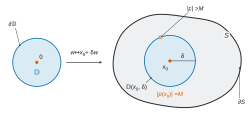
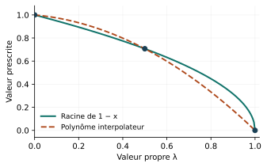
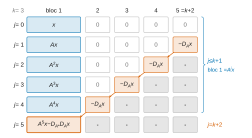
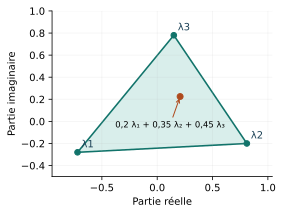
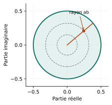
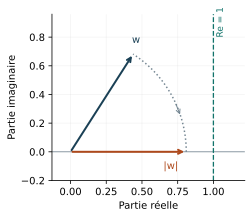
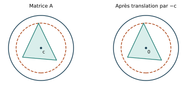

# X-ENS MP-MPI — Mathématiques A 2026 · Corrigé guidé

*Corrigé rédigé par IA, non officiel. Signalez toute erreur.*

**Rédaction** · Claude Opus 5.5 · effort non renseigné · vitesse non renseignée

**Révision (tour 1)** · Claude Opus 5.5 · effort non renseigné · vitesse non renseignée

**Révision (tour 2)** · modèle exact non renseigné (famille GPT-6) · effort non renseigné · vitesse non renseignée

**Révision (tour 3)** · GPT-6.2 Astra Ultra · vitesse non renseignée

**Révision (tour 4)** · GPT-6.2 Astra Ultra · vitesse non renseignée · 26 novembre 2026

**Révision (tour 5)** · modèle exact non renseigné (famille Claude) · effort non renseigné · vitesse non renseignée · 28 novembre 2026

## Présentation du sujet

**Thème.** Le sujet compare la norme subordonnée $\vert\!\vert\!\vert p(A)\vert\!\vert\!\vert $ d'un polynôme de matrice au maximum de $|p|$ sur un compact du plan lié à $A$ : le spectre, un disque, puis le *Hausdorffien* (ou image numérique) $\mathcal H(A)$. Il culmine sur la **conjecture de Crouzeix** $\vert\!\vert\!\vert p(A)\vert\!\vert\!\vert \le2\|p\|_{\mathcal H(A)}$, dont on démontre ici l'optimalité de la constante et plusieurs cas particuliers, ainsi qu'une version affaiblie (disque contenant $\mathcal H(A)$) admettant le théorème d'Okubo-Ando.

**Format.** 4 heures, calculatrice interdite, 30 questions numérotées, soit 34 questions en comptant les sous-questions 26-a à 26-d et 30-a, 30-b. Le préambule donne les outils autorisés : produit scalaire hermitien, Cauchy-Schwarz, caractérisation des matrices unitaires, et un **théorème de réduction** (matrices unitaires et hermitiennes diagonalisables en base orthonormale) que l'énoncé demande expressément d'utiliser.

**Découpage.**

| Partie | Questions | Contenu | Outils |
|---|---|---|---|
| Préliminaires | Q1–Q5 | existence de $\vert\!\vert\!\vert A\vert\!\vert\!\vert $, cas diagonal, sous-multiplicativité, invariance unitaire, encadrement par $\mathrm{cond}(P)$ | compacité, bornes atteintes |
| A. Principe du maximum | Q6–Q10 | une matrice unitaire « compagnon » $U$ réalise $p(z)=e_1^*p(U)e_1$ ; pour $p$ non constant et $\lvert z\rvert<1$, on en tire $\lvert p(z)\rvert<\lVert p\rVert_{\partial\mathbb D}$, puis le principe du maximum sur un compact | calcul matriciel, récurrence, Pythagore |
| B. Inégalité de Von Neumann | Q11–Q17 | dilatation unitaire d'une contraction : $D_A$, $D_{A^*}$, matrice $U_k$ | réduction hermitienne, interpolation de Lagrange, calcul par blocs |
| C. Hausdorffien et rayon numérique | Q18–Q26 | $\mathcal H(A)$, $r(A)$, équivalence $\frac12\vert\!\vert\!\vert \cdot\vert\!\vert\!\vert \le r\le\vert\!\vert\!\vert \cdot\vert\!\vert\!\vert $, inégalité $r(A^k)\le r(A)^k$ | convexité, polarisation, racines de l'unité |
| D. Conjecture de Crouzeix | Q27–Q30 | optimalité de 2, monômes, polynômes « alignés », version disque | assemblage des parties B et C |

Les parties ne sont pas indépendantes : B utilise les préliminaires (Q1, Q4, Q5) ; C est presque autonome (seules Q1 et Q4 servent) ; D utilise Q3, Q10, Q16, Q21, Q23, Q24 et Q26. On peut cependant aborder C sans avoir fini B.

**Notions mobilisées.** Normes subordonnées, compacité en dimension finie, matrices unitaires et hermitiennes, polynômes de matrices, interpolation de Lagrange, racines $k$-ièmes de l'unité, calcul par blocs, identité de polarisation.

**Difficulté.** Sujet long mais régulier. Les préliminaires et le début de C (Q18–Q22, Q24, Q25) sont des questions de cours. Les points délicats sont Q7 et Q16 (suivre précisément l'action d'une matrice de décalage), Q9–Q10 (inégalité stricte et raisonnement par l'absurde), Q13 (un **même** polynôme pour $A^*A$ et $AA^*$, et l'unicité de la racine carrée), Q23 (minoration par polarisation) et Q26 (identité à démontrer en trois temps).

**À ne pas laisser passer.** Q1–Q4, Q6, Q11, Q14, Q15, Q18–Q22, Q24, Q25, Q27, Q28 : courtes et sûres, à rédiger avec soin.

**Lecture du rapport du jury.** La normalisation de Q1 et la récurrence par blocs de Q16 ont laissé de nombreuses réponses incomplètes. Les dernières questions sur le rayon numérique et la conjecture ont été peu traitées. Le jury valorise la justification complète des questions intermédiaires abordées.

**Gestion du temps.** Environ 30 minutes pour les préliminaires, 45 minutes pour A, 60 minutes pour B, 70 minutes pour C, 35 minutes pour D.

**Notations et conventions.** Épreuve de 4 heures, calculatrice interdite. Notations du sujet :

- $\langle x|y\rangle=\sum_i x_i\overline{y_i}$, linéaire à gauche et semi-linéaire à droite, et $\|x\|=\sqrt{\langle x|x\rangle}$ ;
- $\vert\!\vert\!\vert A\vert\!\vert\!\vert =\sup_{\|x\|=1}\|Ax\|$ et $\|p\|_S=\sup_{\alpha\in S}|p(\alpha)|$ ;
- $\mathbb D=\mathbb D(0,1)$ est le disque **fermé**, $\partial\mathbb D$ le cercle unité.

On note $\mathbb S=\{x\in\mathbb C^n:\|x\|=1\}$ la sphère unité et $(e_1,\dots,e_n)$ la base canonique.

La matrice $A^*$ est la transposée conjuguée de $A$, et $\sigma(A)$ désigne le spectre de $A$. Pour $P$ inversible, son conditionnement est $\mathrm{cond}(P)=\vert\!\vert\!\vert P\vert\!\vert\!\vert\,\vert\!\vert\!\vert P^{-1}\vert\!\vert\!\vert$.

## Préliminaires

On établit les propriétés de base de la norme subordonnée, qui serviront partout. Le résultat clé est Q5 : pour une matrice diagonalisable, $\vert\!\vert\!\vert p(A)\vert\!\vert\!\vert $ est comparable à $\|p\|_{\sigma(A)}$, avec égalité des deux bornes quand la matrice de passage est unitaire.

### Question 1

> [!INDICATION]
> Une borne supérieure d'une fonction continue sur quel type d'ensemble est atteinte ?

> [!INDICATION]
> Pour l'égalité avec le maximum des quotients, normalisez $x$ et utilisez l'homogénéité de la norme.

#### Solution

L'application $f:x\mapsto\|Ax\|$ est continue sur $\mathbb C^n$. C'est la composée de l'application linéaire $x\mapsto Ax$, continue car $\mathbb C^n$ est de dimension finie, et de la norme.

La sphère $\mathbb S$ est fermée et bornée dans $\mathbb C^n$, de dimension finie : elle est compacte. Elle est non vide, car $e_1\in\mathbb S$.

Par le théorème des bornes atteintes, $f$ est bornée sur $\mathbb S$ et y atteint sa borne supérieure. Donc $\vert\!\vert\!\vert A\vert\!\vert\!\vert$ existe (c'est un réel fini), et c'est un maximum.

*Passage aux vecteurs non nuls.* Pour $x\neq0$, posons $\hat x=x/\|x\|$, qui est dans $\mathbb S$. Par homogénéité de la norme,

$$\frac{\|Ax\|}{\|x\|}=\|A\hat x\|.$$

Réciproquement, tout $y\in\mathbb S$ est non nul et vérifie $\|Ay\|/\|y\|=\|Ay\|$. Les deux ensembles de réels

$$\Big\{\frac{\|Ax\|}{\|x\|}:x\neq0\Big\}\quad\text{et}\quad\big\{\|Ay\|:y\in\mathbb S\big\}$$

sont donc égaux. Le second a un plus grand élément, atteint en un point de $\mathbb S$. Le premier a donc le même plus grand élément, atteint en ce même vecteur non nul :

$$\boxed{\begin{aligned}\vert\!\vert\!\vert A\vert\!\vert\!\vert &=\max_{\|x\|=1}\|Ax\|\\ &=\max_{x\neq0}\frac{\|Ax\|}{\|x\|}\end{aligned}}$$

Conséquence utilisée constamment : $\|Ax\|\le\vert\!\vert\!\vert A\vert\!\vert\!\vert \,\|x\|$ pour tout $x\in\mathbb C^n$ (trivial pour $x=0$).

> [!METHODE]
> En dimension finie, « fermé borné » donne « compact », et une fonction continue y atteint ses bornes. C'est l'argument de toutes les questions d'existence de ce sujet (Q1, Q10, Q22).

> [!PIEGE]
> Ne pas oublier que la sphère est non vide ($n\ge1$) et dire explicitement que le sup est un **max**, puisque l'énoncé le demande.

> [!JURY]
> Le jury distingue les deux passages de la question. La compacité de la sphère donne un maximum. La normalisation montre ensuite que le même maximum est atteint parmi les vecteurs non nuls.

### Question 2

> [!INDICATION]
> Calculez $\|Dx\|^2$ coordonnée par coordonnée.

> [!INDICATION]
> Une majoration ne suffit pas : trouvez un vecteur unitaire qui réalise l'égalité.

#### Solution

Soit $D=\mathrm{diag}(\lambda_1,\dots,\lambda_n)$ et $M=\max_i|\lambda_i|$. Pour $x\in\mathbb C^n$,

$$\begin{aligned}\|Dx\|^2&=\sum_{i=1}^n|\lambda_i|^2|x_i|^2\\ &\le M^2\sum_{i=1}^n|x_i|^2\\ &=M^2\|x\|^2,\end{aligned}$$

donc $\vert\!\vert\!\vert D\vert\!\vert\!\vert \le M$.

Soit $i_0$ un indice qui réalise le maximum. Alors $\|e_{i_0}\|=1$ et $\|De_{i_0}\|=|\lambda_{i_0}|=M$, d'où $\vert\!\vert\!\vert D\vert\!\vert\!\vert \ge M$. Ainsi

$$\boxed{\vert\!\vert\!\vert \mathrm{diag}(\lambda_1,\dots,\lambda_n)\vert\!\vert\!\vert =\max_{i\in\{1,\dots,n\}}|\lambda_i|}$$

### Question 3

> [!INDICATION]
> Utilisez deux fois l'inégalité $\|Mx\|\le\vert\!\vert\!\vert M\vert\!\vert\!\vert \,\|x\|$ tirée de Q1.

#### Solution

Soit $x\in\mathbb C^n$. On applique deux fois la conséquence de la question 1, ce qui ne demande aucune division (le cas $Bx=0$ y est compris) :

$$\begin{aligned}\|ABx\|&\le\vert\!\vert\!\vert A\vert\!\vert\!\vert \,\|Bx\|\\ &\le\vert\!\vert\!\vert A\vert\!\vert\!\vert \,\vert\!\vert\!\vert B\vert\!\vert\!\vert \,\|x\|.\end{aligned}$$

En passant à la borne supérieure sur $\|x\|=1$ :

$$\boxed{\vert\!\vert\!\vert AB\vert\!\vert\!\vert \le\vert\!\vert\!\vert A\vert\!\vert\!\vert \cdot\vert\!\vert\!\vert B\vert\!\vert\!\vert }$$

> [!PIEGE]
> Écrire $\frac{\|ABx\|}{\|x\|}=\frac{\|ABx\|}{\|Bx\|}\cdot\frac{\|Bx\|}{\|x\|}$ suppose $Bx\neq0$. Le rapport relève cette division par une quantité éventuellement nulle. On peut aussi isoler le cas $Bx=0$. La majoration directe ci-dessus évite toute division.

### Question 4

> [!INDICATION]
> Le préambule autorise à utiliser $\|Ux\|=\|x\|$.

> [!INDICATION]
> Pour $\vert\!\vert\!\vert AU\vert\!\vert\!\vert $, faites un changement de variable sur la sphère : il faut que $x\mapsto Ux$ soit **surjective** sur la sphère.

#### Solution

Si $U$ est unitaire, $\|Ux\|=\|x\|$ pour tout $x$ (fait admis). Donc $\vert\!\vert\!\vert U\vert\!\vert\!\vert =\sup_{\|x\|=1}1=1$.

Soit $A\in\mathcal M_n(\mathbb C)$. Pour $\|x\|=1$, $\|UAx\|=\|Ax\|$, donc $\vert\!\vert\!\vert UA\vert\!\vert\!\vert =\vert\!\vert\!\vert A\vert\!\vert\!\vert$.

Ensuite, $x\mapsto Ux$ envoie $\mathbb S$ dans $\mathbb S$ (conservation de la norme).

C'est une bijection de $\mathbb S$ sur $\mathbb S$, de réciproque $y\mapsto U^{-1}y=U^*y$.

En effet $U^*$ est elle aussi unitaire : $UU^*=I_n$ découle de $U^*U=I_n$ en dimension finie. Donc

$$\begin{aligned}\vert\!\vert\!\vert AU\vert\!\vert\!\vert &=\sup_{x\in\mathbb S}\|A(Ux)\|\\ &=\sup_{y\in\mathbb S}\|Ay\|\\ &=\vert\!\vert\!\vert A\vert\!\vert\!\vert .\end{aligned}$$

$$\boxed{\begin{aligned}&\vert\!\vert\!\vert U\vert\!\vert\!\vert =1\\ &\vert\!\vert\!\vert AU\vert\!\vert\!\vert =\vert\!\vert\!\vert UA\vert\!\vert\!\vert =\vert\!\vert\!\vert A\vert\!\vert\!\vert \end{aligned}}$$

> [!PIEGE]
> Pour $\vert\!\vert\!\vert AU\vert\!\vert\!\vert $, écrire seulement $\|AUx\|\le\vert\!\vert\!\vert A\vert\!\vert\!\vert \|Ux\|=\vert\!\vert\!\vert A\vert\!\vert\!\vert $ ne donne qu'une inégalité. Pour l'égalité, il faut la bijection de la sphère, ou appliquer l'inégalité à $A=(AU)U^*$.

### Question 5

> [!INDICATION]
> Exprimez $p(A)$ à l'aide de $P$, $p(D)$ et $P^{-1}$, puis utilisez Q2 et Q3 pour la majoration.

> [!INDICATION]
> Pour la minoration, la sous-multiplicativité ne marche pas : pensez à un vecteur propre de $A$.

#### Solution

Écrivons $D=\mathrm{diag}(\lambda_1,\dots,\lambda_n)$. Pour tout $k$, $A^k=PD^kP^{-1}$. Par linéarité,

$$\begin{aligned}p(A)&=P\,p(D)\,P^{-1},\\ p(D)&=\mathrm{diag}\big(p(\lambda_1),\dots,p(\lambda_n)\big).\end{aligned}$$

De plus $\sigma(A)=\{\lambda_1,\dots,\lambda_n\}$, car $A$ et $D$ sont semblables. Par la question 2 :

$$\vert\!\vert\!\vert p(D)\vert\!\vert\!\vert =\max_i|p(\lambda_i)|=\|p\|_{\sigma(A)}.$$

*Majoration.* Par la question 3,

$$\begin{aligned}\vert\!\vert\!\vert p(A)\vert\!\vert\!\vert &\le\vert\!\vert\!\vert P\vert\!\vert\!\vert \,\vert\!\vert\!\vert p(D)\vert\!\vert\!\vert \,\vert\!\vert\!\vert P^{-1}\vert\!\vert\!\vert \\ &=\mathrm{cond}(P)\,\|p\|_{\sigma(A)}.\end{aligned}$$

*Minoration.* Soit $i\in\{1,\dots,n\}$ et $v=Pe_i/\|Pe_i\|$. C'est un vecteur propre unitaire de $A$ pour $\lambda_i$. Alors $p(A)v=p(\lambda_i)v$, donc

$$\vert\!\vert\!\vert p(A)\vert\!\vert\!\vert \ge\|p(A)v\|=|p(\lambda_i)|.$$

En prenant le maximum sur $i$, on obtient $\vert\!\vert\!\vert p(A)\vert\!\vert\!\vert \ge\|p\|_{\sigma(A)}$.

$$\boxed{\|p\|_{\sigma(A)}\le\vert\!\vert\!\vert p(A)\vert\!\vert\!\vert \le\mathrm{cond}(P)\,\|p\|_{\sigma(A)}}$$

> [!METHODE]
> Une norme subordonnée majore le module de toute valeur propre : si $Mv=\mu v$ avec $\|v\|=1$, alors $\vert\!\vert\!\vert M\vert\!\vert\!\vert \ge\|Mv\|=|\mu|$.

> [!JURY]
> Le rapport attend une justification pour les deux côtés de l’encadrement. Tester un vecteur propre unitaire donne le premier. Pour le second, expliciter la conjugaison du polynôme de matrice avant d’utiliser la sous-multiplicativité.

## Partie A — Principe du maximum pour les polynômes

Pour $z$ dans le disque, on fabrique une matrice **unitaire** $U$ dont le coefficient $(1,1)$ de $p(U)$ vaut $p(z)$. Le spectre de $U$ étant sur le cercle, on obtient le principe du maximum pour les polynômes sans aucune analyse complexe.

Dans cette partie, $n\ge2$ et $z\in\mathbb D$. Le nombre $s=\sqrt{1-|z|^2}\in[0,1]$ est **réel**. Enfin $p=\sum_{k=0}^{n-1}p_kX^k$ est de degré $n-1$.

### Question 6

> [!INDICATION]
> Le préambule fournit un critère d'unitarité portant sur les colonnes.

> [!INDICATION]
> Écrivez chaque colonne dans la base canonique : seules les deux premières ont des coordonnées sur $e_1$ et $e_n$. Le fait que $s$ soit réel sert dans un produit scalaire.

#### Solution

Lisons les colonnes $C_1,\dots,C_n$ de $U$ (la ligne $i\in\{2,\dots,n-1\}$ porte un $1$ en colonne $i+1$) :

$$\begin{aligned}C_1&=z\,e_1+s\,e_n,\\ C_2&=s\,e_1-\bar z\,e_n,\\ C_j&=e_{j-1}\qquad(3\le j\le n).\end{aligned}$$

- Normes : $\|C_1\|^2=|z|^2+s^2=1$ et $\|C_2\|^2=s^2+|z|^2=1$. Pour $j\ge3$, $\|C_j\|=\|e_{j-1}\|=1$.
- Le seul produit scalaire non trivial est, puisque $s$ est réel,

$$\begin{aligned}\langle C_1|C_2\rangle&=z\,\overline{s}+s\,\overline{(-\bar z)}\\ &=zs-sz\\ &=0.\end{aligned}$$

- Les colonnes $C_j=e_{j-1}$, pour $3\le j\le n$, sont deux à deux orthogonales. Elles sont aussi orthogonales à $C_1$ et $C_2$, qui sont nulles hors de la première et de la dernière coordonnée.

Les colonnes de $U$ forment une base orthonormale, donc **$U$ est unitaire** (critère admis). Pour $n=2$, seules $C_1$ et $C_2$ interviennent et le calcul est le même.

> [!PIEGE]
> Le produit scalaire est semi-linéaire à droite : $\langle C_1|C_2\rangle=z\bar s+s\,\overline{(-\bar z)}$. Il ne s'annule que parce que $\bar s=s$.

> [!JURY]
> Le jury demande d’expliciter le calcul non trivial dans la vérification de l’unitarité. Avec la preuve par colonnes, c’est le produit scalaire de $C_1$ et $C_2$.

### Question 7

> [!INDICATION]
> Le coefficient $e_1^*Me_1$ est la première coordonnée de $Me_1$. Il suffit donc de connaître la première coordonnée de $U^ke_1$ pour $k\le n-1$.

> [!INDICATION]
> Calculez $Ue_1$, $U^2e_1$, $U^3e_1$ et conjecturez une formule. Les colonnes $3$ à $n$ décalent la base vers le haut : à quel moment le vecteur $e_2$ apparaît-il ?

> [!INDICATION]
> Démontrez la formule par récurrence pour $k\le n-1$, en vérifiant que la colonne $C_2$ n'est jamais utilisée.

#### Solution

Pour $v\in\mathbb C^n$, $e_1^*v={}^t\overline{e_1}\,v=v_1$ est la première coordonnée de $v$. Par lecture des colonnes :

$$\begin{aligned}Ue_1&=z\,e_1+s\,e_n,\\ Ue_2&=s\,e_1-\bar z\,e_n,\\ Ue_j&=e_{j-1}\qquad(3\le j\le n).\end{aligned}$$

Montrons par récurrence sur $k\in\{0,\dots,n-1\}$ la formule portant sur toute la colonne $U^ke_1$ :

$$U^ke_1=z^ke_1+s\sum_{j=0}^{k-1}z^{k-1-j}e_{n-j}.$$

Pour $k=0$, c'est $e_1$ (somme vide).

Supposons la formule vraie au rang $k\le n-2$. Les indices $n-j$ qui apparaissent vérifient $j\le k-1\le n-3$. Donc $n-j\ge3$ et $Ue_{n-j}=e_{n-j-1}$. Ainsi

$$\begin{aligned}U^{k+1}e_1&=z^k(ze_1+se_n)+s\sum_{j=0}^{k-1}z^{k-1-j}e_{n-j-1}\\ &=z^{k+1}e_1+s\sum_{j=0}^{k}z^{k-j}e_{n-j},\end{aligned}$$

ce qui est la formule au rang $k+1$.

Pour $k\le n-1$, les vecteurs $e_{n-j}$ de la somme ont un indice $n-j\ge n-k+1\ge2$. La première coordonnée de $U^ke_1$ est donc $z^k$. Par linéarité,

$$\begin{aligned}e_1^*p(U)e_1&=\sum_{k=0}^{n-1}p_k\,e_1^*U^ke_1\\ &=\sum_{k=0}^{n-1}p_kz^k,\end{aligned}$$

soit

$$\boxed{p(z)=e_1^*\,p(U)\,e_1}$$

Le calcul vaut pour tout polynôme de degré $\le n-1$.

> [!METHODE]
> Pour calculer $p(M)v$, on calcule les itérés $M^kv$ en suivant l'action de $M$ sur la base canonique, ce qui est plus sûr que de calculer les puissances de $M$.

> [!PIEGE]
> $e_1^*v$ est un scalaire (la première coordonnée de $v$), alors que $e_1e_1^*$ est une matrice, le projecteur sur $\mathbb Ce_1$. Le rapport 2026 relève des égalités incorrectes faisant intervenir $e_1e_1^*$.

> [!JURY]
> Le rapport insiste sur le choix de l’hypothèse de récurrence. La prochaine première coordonnée dépend d’autres composantes. Suivre toute la colonne fournit une hypothèse que l’on peut transmettre.

### Question 8

> [!INDICATION]
> Écrivez $p(z)$ comme un produit scalaire et appliquez Cauchy-Schwarz.

> [!INDICATION]
> Pour la seconde inégalité, appliquez Q5 à $U$ avec la matrice de passage fournie par le théorème du préambule. Que vaut son conditionnement ?

#### Solution

Par la question 7, $p(z)=e_1^*\,(p(U)e_1)=\langle p(U)e_1|e_1\rangle$. Par Cauchy-Schwarz, appliqué aux vecteurs $p(U)e_1$ et $e_1$, puis par la question 1 :

$$\begin{aligned}|p(z)|&\le\|p(U)e_1\|\,\|e_1\|\\ &=\|p(U)e_1\|\\ &\le\vert\!\vert\!\vert p(U)\vert\!\vert\!\vert .\end{aligned}$$

Par le théorème de réduction du préambule, $U$ unitaire s'écrit

$$U=W\,\mathrm{diag}(\mu_1,\dots,\mu_n)\,W^{-1},$$

avec $W$ unitaire et $|\mu_i|=1$. Comme $W^{-1}=W^*$ est unitaire, la question 4 donne $\mathrm{cond}(W)=\vert\!\vert\!\vert W\vert\!\vert\!\vert \,\vert\!\vert\!\vert W^{-1}\vert\!\vert\!\vert =1$.

La question 5 donne alors $\vert\!\vert\!\vert p(U)\vert\!\vert\!\vert \le\|p\|_{\sigma(U)}$. Comme $\sigma(U)=\{\mu_i\}\subset\partial\mathbb D$, on a $\|p\|_{\sigma(U)}\le\|p\|_{\partial\mathbb D}$. Finalement

$$\boxed{|p(z)|\le\vert\!\vert\!\vert p(U)\vert\!\vert\!\vert \le\|p\|_{\partial\mathbb D}}$$

> [!JURY]
> Le jury rappelle la justification de la borne inférieure. Dans Cauchy–Schwarz, les deux vecteurs à comparer sont $p(U)e_1$ et $e_1$.

### Question 9

> [!INDICATION]
> Reprenez le calcul de Q7 pour obtenir $p(U)e_1$ en entier : sa composante sur $e_1$ est $p(z)$. Que dire du reste ?

> [!INDICATION]
> Comparez $\|p(U)e_1\|$ et $|p(z)|$ par le théorème de Pythagore. Où sert l'hypothèse $\deg p=n-1$, et où sert $|z|<1$ ?

#### Solution

Supposons $|z|<1$, donc $s>0$. D'après le calcul de la question 7,

$$p(U)e_1=p(z)\,e_1+s\,w,$$

où

$$\begin{aligned}w&=\sum_{k=1}^{n-1}p_k\sum_{j=0}^{k-1}z^{k-1-j}e_{n-j}\\ &\in\mathrm{Vect}(e_2,\dots,e_n).\end{aligned}$$

La coordonnée de $w$ sur $e_2$ correspond à $n-j=2$, soit $j=n-2$.

Cela impose $k-1\ge n-2$, donc $k=n-1$. Elle vaut $p_{n-1}z^0=p_{n-1}$, non nul car $\deg p=n-1$. Donc $w\neq0$.

Comme $w\perp e_1$, le théorème de Pythagore donne

$$\|p(U)e_1\|^2=|p(z)|^2+s^2\|w\|^2>|p(z)|^2.$$

Avec la chaîne d'inégalités de la question 8 :

$$\begin{aligned}|p(z)|&<\|p(U)e_1\|\\ &\le\vert\!\vert\!\vert p(U)\vert\!\vert\!\vert \\ &\le\|p\|_{\partial\mathbb D}.\end{aligned}$$

$$\boxed{|p(z)|<\|p\|_{\partial\mathbb D}\quad\text{pour }|z|<1}$$

Le résultat serait faux pour $p$ constant : c'est l'hypothèse $\deg p=n-1\ge1$ qui sert.

> [!METHODE]
> Pour obtenir une inégalité stricte à partir d'une chaîne d'inégalités larges, il suffit qu'**une seule** soit stricte. On cherche donc le maillon où l'on peut identifier ce qui est perdu, ici le terme $s^2\|w\|^2$.

> [!PIEGE]
> Invoquer le cas d'égalité de Cauchy-Schwarz pour le produit scalaire hermitien est possible, mais le préambule ne le donne pas : il faudrait le démontrer. Le calcul de Pythagore est plus court et entièrement justifié.

> [!JURY]
> Le jury attend ici l’exploitation de la question 8. La composante orthogonale non nulle de $p(U)e_1$ rend stricte la première comparaison de normes.

### Question 10

> [!INDICATION]
> $|p|$ atteint son maximum sur $S$ en un point $x_0$. Raisonnez par l'absurde en supposant $x_0$ « intérieur » au sens de l'énoncé.

> [!INDICATION]
> Ramenez-vous au disque unité par le changement de variable $w\mapsto x_0+\delta w$ et appliquez Q9 avec la bonne dimension $n$.

> [!INDICATION]
> Le cas des polynômes constants est à part : il faut alors seulement vérifier que $\partial S$ n'est pas vide.

#### Solution

Comme $\partial S\subset S$, on a $\|p\|_{\partial S}\le\|p\|_S$.

$S$ est un fermé borné non vide de $\mathbb C$, donc un compact, et $|p|$ est continue. Elle atteint donc sur $S$ son maximum $M=\|p\|_S$ en un point $x_0$.

*$\partial S$ est non vide.* La fonction $|\cdot|$ atteint son maximum sur $S$ en un point $x_1$.

*Si $x_1\neq0$*, soit $\delta>0$. Le disque $\mathbb D(x_1,\delta)$ contient $x_1\big(1+\delta/|x_1|\big)$, de module $|x_1|+\delta>|x_1|$.

Ce disque n'est donc pas inclus dans $S$, et $x_1\in\partial S$.

*Si $x_1=0$*, alors $S=\{0\}$. Aucun disque de rayon $\delta>0$ n'est inclus dans $S$, donc $0\in\partial S$.

*Cas $p$ constant égal à $c$.* Alors $\|p\|_S=|c|=\|p\|_{\partial S}$, puisque $\partial S\neq\emptyset$.

*Cas $d=\deg p\ge1$.* Supposons par l'absurde $x_0\notin\partial S$ : il existe $\delta>0$ tel que $\mathbb D(x_0,\delta)\subset S$.

Le polynôme $\tilde p(w)=p(x_0+\delta w)$ a pour coefficient dominant $p_d\delta^d\neq0$. Il est donc de degré $d=m-1$, avec $m=d+1\ge2$.

La question 9, appliquée dans $\mathbb C^m$ à $\tilde p$ et au point $0$ (de module $<1$), donne

$$\begin{aligned}M=|p(x_0)|&=|\tilde p(0)|\\ &<\|\tilde p\|_{\partial\mathbb D}\\ &=\sup_{|x-x_0|=\delta}|p(x)|\\ &\le\|p\|_S=M.\end{aligned}$$

La dernière inégalité vient de $\partial\mathbb D(x_0,\delta)\subset\mathbb D(x_0,\delta)\subset S$. C'est absurde. Donc $x_0\in\partial S$, et $\|p\|_{\partial S}\ge|p(x_0)|=M$.

$$\boxed{\|p\|_S=\|p\|_{\partial S}}$$

> [!PIEGE]
> Q9 suppose $\deg p=n-1$ avec $n\ge2$ : on l'applique en dimension $m=\deg p+1$. Si $p$ est constant, Q9 ne s'applique pas, et il faut montrer $\partial S\neq\emptyset$ (un point de $S$ de module maximal convient).

> [!JURY]
> Le rapport demande de relier le maximum atteint sur $S$ au résultat du disque. Le disque inclus en un maximum intérieur permet précisément ce passage.

## Partie B — Inégalité de Von Neumann

On « dilate » une contraction $A$ en une matrice unitaire plus grande dont un bloc reproduit les puissances de $A$. Les outils : réduction des matrices hermitiennes, racine carrée positive, interpolation de Lagrange et calcul par blocs.

On suppose $\vert\!\vert\!\vert A\vert\!\vert\!\vert \le1$.

### Question 11

> [!INDICATION]
> Appliquez Q5 avec une matrice de passage unitaire, comme en Q8.

#### Solution

Si $A$ est unitaire, le théorème du préambule donne

$$A=V\,\mathrm{diag}(\lambda_1,\dots,\lambda_n)\,V^{-1},$$

avec $V$ unitaire et $|\lambda_i|=1$. Comme à la question 8, $\mathrm{cond}(V)=1$ (question 4). La question 5 donne alors

$$\vert\!\vert\!\vert p(A)\vert\!\vert\!\vert \le\|p\|_{\sigma(A)}\le\|p\|_{\mathbb D},$$

car $\sigma(A)\subset\partial\mathbb D\subset\mathbb D$. Donc

$$\boxed{\vert\!\vert\!\vert p(A)\vert\!\vert\!\vert \le\|p\|_{\mathbb D}\quad\text{pour }A\text{ unitaire}}$$

### Question 12

> [!INDICATION]
> $I-A^*A$ est hermitienne : le théorème du préambule la diagonalise en base orthonormale. Il reste à voir que ses valeurs propres sont positives.

> [!INDICATION]
> Si $x$ est un vecteur propre unitaire, exprimez la valeur propre comme $\langle Mx|x\rangle$. Pour $I-AA^*$, il faut savoir que $\vert\!\vert\!\vert A^*\vert\!\vert\!\vert \le1$.

#### Solution

*Caractère hermitien.* Posons $M=I-A^*A$ et $M'=I-AA^*$. Comme $(A^*)^*=A$ et $(XY)^*=Y^*X^*$,

$$\begin{aligned}M^*&=I-A^*(A^*)^*=I-A^*A=M,\\ M'^*&=I-(A^*)^*A^*=I-AA^*=M'.\end{aligned}$$

Les deux matrices sont hermitiennes.

*Positivité pour $M$.* Si $Mx=\mu x$ avec $\|x\|=1$, alors

$$\begin{aligned}\mu=\langle Mx|x\rangle&=\|x\|^2-\langle Ax|Ax\rangle\\ &=1-\|Ax\|^2\\ &\ge1-\vert\!\vert\!\vert A\vert\!\vert\!\vert ^2\ \ge\ 0.\end{aligned}$$

*Positivité pour $M'$.* Si $M'x'=\mu'x'$ avec $\|x'\|=1$, le même calcul donne $\mu'=1-\|A^*x'\|^2$. Or, pour tout $y$, par Cauchy-Schwarz puis la question 1,

$$\begin{aligned}\|A^*y\|^2=\langle AA^*y|y\rangle&\le\|A(A^*y)\|\,\|y\|\\ &\le\vert\!\vert\!\vert A\vert\!\vert\!\vert \,\|A^*y\|\,\|y\|.\end{aligned}$$

Si $A^*y\neq0$, on divise par $\|A^*y\|>0$ ; si $A^*y=0$, il n'y a rien à montrer. Dans les deux cas $\|A^*y\|\le\vert\!\vert\!\vert A\vert\!\vert\!\vert \,\|y\|\le\|y\|$. Donc $\mu'\ge0$.

*Racine carrée.* Par le théorème du préambule,

$$M=V\,\mathrm{diag}(\mu_1,\dots,\mu_n)\,V^{-1},$$

avec $V$ unitaire et $\mu_i\ge0$. Posons

$$D_A=V\,\mathrm{diag}\big(\sqrt{\mu_1},\dots,\sqrt{\mu_n}\big)\,V^{-1}.$$

Comme $V^{-1}=V^*$ et que les $\sqrt{\mu_i}$ sont réels, $D_A^*=V\,\mathrm{diag}(\sqrt{\mu_i})\,V^*=D_A$. Ainsi $D_A$ est hermitienne, de valeurs propres $\sqrt{\mu_i}\ge0$, et

$$D_A^2=V\,\mathrm{diag}(\mu_i)\,V^{-1}=I-A^*A.$$

On construit $D_{A^*}$ de même à partir de $M'$, dont les valeurs propres sont aussi positives.

$$\boxed{\begin{aligned}&D_A,\ D_{A^*}\ \text{hermitiennes à valeurs propres}\ \ge0,\\ &D_A^2=I-A^*A,\\ &D_{A^*}^2=I-AA^*\end{aligned}}$$

> [!METHODE]
> Pour une matrice hermitienne $M$, la valeur propre associée à un vecteur propre unitaire $x$ vaut $\langle Mx|x\rangle$. C'est le moyen le plus rapide de montrer que les valeurs propres sont positives.

> [!PIEGE]
> La positivité de $I-AA^*$ n'est pas une conséquence directe de celle de $I-A^*A$. Il faut montrer que $\vert\!\vert\!\vert A^*\vert\!\vert\!\vert \le\vert\!\vert\!\vert A\vert\!\vert\!\vert $, par exemple par Cauchy-Schwarz, ou que $A^*A$ et $AA^*$ ont les mêmes valeurs propres.

> [!JURY]
> Le jury relève trois vérifications souvent écourtées. Vérifier le caractère hermitien des deux matrices, puis justifier séparément leur positivité, y compris pour $I-AA^*$.

### Question 13

> [!INDICATION]
> Un polynôme agit sur une matrice diagonalisable en base orthonormale par ses valeurs aux valeurs propres. Quelles valeurs doit prendre $q$ ?

> [!INDICATION]
> Interpolation de Lagrange : choisissez les nœuds pour que le **même** $q$ convienne à $A^*A$ et à $AA^*$.

> [!INDICATION]
> $q(A^*A)$ est une racine carrée hermitienne positive de $I-A^*A$, mais rien ne dit encore que c'est $D_A$. Démontrez l'unicité de cette racine.

#### Solution

*Lemme (unicité de la racine carrée positive).* Si $H$ et $K$ sont hermitiennes à valeurs propres $\ge0$ et si $H^2=K^2$, alors $H=K$.

*Preuve.* $H$ est diagonalisable (théorème du préambule), de valeurs propres distinctes $\nu_1,\dots,\nu_r\ge0$. Donc $\mathbb C^n=\bigoplus_i\ker(H-\nu_iI)$.

Pour $\mu\ge0$, montrons $\ker(H-\mu I)=\ker(H^2-\mu^2I)$. L'inclusion $\subset$ est claire. Si $H^2x=\mu^2x$, décomposons $x=\sum_ix_i$ avec $x_i\in\ker(H-\nu_iI)$. Alors

$$\sum_i(\nu_i^2-\mu^2)\,x_i=0.$$

La somme étant directe, $x_i=0$ dès que $\nu_i^2\neq\mu^2$, c'est-à-dire, par positivité, dès que $\nu_i\neq\mu$. Ainsi $x\in\ker(H-\mu I)$. Le même énoncé vaut pour $K$. Pour tout $\mu\ge0$ :

$$\begin{aligned}\ker(H-\mu I)&=\ker(H^2-\mu^2I)\\ &=\ker(K^2-\mu^2I)\\ &=\ker(K-\mu I).\end{aligned}$$

Sur chaque $\ker(H-\nu_iI)$, $H$ et $K$ agissent donc par $\nu_i\,\mathrm{id}$. Ces sous-espaces étant supplémentaires, $H=K$. $\square$

*Construction de $q$.* Les valeurs propres de $A^*A$ sont de la forme $\|Ax\|^2\in[0,1]$, et celles de $AA^*$ de la forme $\|A^*x\|^2\in[0,1]$ (question 12). Posons

$$\Lambda=\sigma(A^*A)\cup\sigma(AA^*)=\{\lambda_1,\dots,\lambda_m\}\subset[0,1],$$

les $\lambda_j$ étant distincts. Par interpolation de Lagrange, il existe $q\in\mathbb R[X]\subset\mathbb C[X]$ tel que $q(\lambda_j)=\sqrt{1-\lambda_j}$ pour $1\le j\le m$. Ce **même** $q$ sert pour les deux matrices, parce que ses nœuds contiennent les deux spectres.

Écrivons $A^*A=W\,\mathrm{diag}(\beta_1,\dots,\beta_n)\,W^*$, avec $W$ unitaire et $\beta_i\in\Lambda$ (théorème du préambule). Alors

$$q(A^*A)=W\,\mathrm{diag}\big(\sqrt{1-\beta_i}\big)\,W^*$$

est hermitienne, à valeurs propres $\ge0$, et

$$\begin{aligned}q(A^*A)^2&=W\,\mathrm{diag}(1-\beta_i)\,W^*\\ &=I-A^*A=D_A^2.\end{aligned}$$

Le lemme donne $q(A^*A)=D_A$. Le même raisonnement avec $AA^*$, dont les valeurs propres sont aussi dans $\Lambda$, donne $q(AA^*)=D_{A^*}$.

$$\boxed{\exists\,q\in\mathbb C[X]\ :\ D_A=q(A^*A)\ \text{ et }\ D_{A^*}=q(AA^*)}$$

> [!METHODE]
> Pour une matrice diagonalisable $M$ de spectre fini, toute fonction $f$ définie sur $\sigma(M)$ peut être réalisée par un polynôme : le polynôme d'interpolation de Lagrange $q$ vérifie $q(M)=P\,\mathrm{diag}(f(\lambda_i))\,P^{-1}$.

> [!PIEGE]
> L'unicité de la racine carrée hermitienne positive n'est pas au programme : il faut la démontrer pour s'en servir. Sans elle, on prouve seulement que $q(A^*A)$ est *une* racine carrée de $I-A^*A$.

> [!JURY]
> Rapport 2026 : l'interpolation de Lagrange a souvent été trouvée, mais « il fallait cependant expliquer pourquoi un même polynôme permettait d'obtenir les deux matrices demandées, en tenant compte des valeurs propres correspondantes ». Prendre pour nœuds la réunion des deux spectres répond à cette exigence.

### Question 14

> [!INDICATION]
> Montrez d'abord la relation pour les puissances, $A(A^*A)^k=(AA^*)^kA$, puis passez aux polynômes par linéarité.

#### Solution

Montrons par récurrence que $A(A^*A)^k=(AA^*)^kA$ pour tout $k\in\mathbb N$. C'est vrai pour $k=0$. Si c'est vrai au rang $k$,

$$\begin{aligned}A(A^*A)^{k+1}&=(AA^*)^kA\,A^*A\\ &=(AA^*)^{k+1}A.\end{aligned}$$

Par linéarité, $A\,q(A^*A)=q(AA^*)\,A$, soit, avec la question 13, $A\,D_A=D_{A^*}A$.

De même, $A^*(AA^*)^k=(A^*A)^kA^*$ par la même récurrence, en échangeant les rôles de $A$ et $A^*$. D'où $A^*q(AA^*)=q(A^*A)A^*$, soit $A^*D_{A^*}=D_AA^*$.

$$\boxed{A^*D_{A^*}=D_AA^*\ \text{ et }\ AD_A=D_{A^*}A}$$

> [!METHODE]
> Si $AM=NA$, alors $Aq(M)=q(N)A$ pour tout polynôme $q$. Ce passage des puissances aux polynômes revient très souvent.

### Question 15

> [!INDICATION]
> Calculez $U^*$ par blocs (attention à l'ordre des blocs et aux adjoints), puis $U^*U$.

> [!INDICATION]
> Les blocs diagonaux se simplifient avec Q12, les blocs hors diagonale avec Q14.

#### Solution

Pour $U=\begin{pmatrix}A&D_{A^*}\\-D_A&A^*\end{pmatrix}$, puisque $D_A$ et $D_{A^*}$ sont hermitiennes,

$$U^*=\begin{pmatrix}A^*&-D_A\\ D_{A^*}&A\end{pmatrix}.$$

Par produit par blocs :

$$U^*U=\begin{pmatrix}A^*A+D_A^2 & A^*D_{A^*}-D_AA^*\\ D_{A^*}A-AD_A & D_{A^*}^2+AA^*\end{pmatrix}.$$

Par la question 12, $A^*A+D_A^2=I_n$ et $D_{A^*}^2+AA^*=I_n$. Par la question 14, les deux blocs hors diagonale sont nuls. Donc $U^*U=I_{2n}$ : **$U$ est unitaire**.

### Question 16

> [!INDICATION]
> Deux choses à prouver : $U_k$ est unitaire, et le bloc $(1,1)$ de $p(U_k)$ vaut $p(A)$ lorsque $\deg p\le k+1$. Ensuite Q11 conclut.

> [!INDICATION]
> Pour l'unitarité, les colonnes-blocs 1 et 2 reproduisent le calcul de Q15 ; les autres sont des blocs $I_n$ isolés.

> [!INDICATION]
> Pour le bloc $(1,1)$, suivez $U_k^j(x,0,\dots,0)$ comme en Q7 : le terme $-D_Ax$ part du dernier bloc et remonte d'un cran par étape. Combien d'étapes lui faut-il pour atteindre le bloc 2 ?

#### Solution

$U_k$ est de taille $(k+2)n$. Écrivons un vecteur $V=(V_1,\dots,V_{k+2})$ par blocs de taille $n$. La définition de $U_k$ s'écrit

$$\begin{aligned}(U_kV)_1&=AV_1+D_{A^*}V_2,\\ (U_kV)_i&=V_{i+1}\qquad(2\le i\le k+1),\\ (U_kV)_{k+2}&=-D_AV_1+A^*V_2.\end{aligned}$$

Pour $k=0$, $U_0$ est la matrice $U$ de la question 15.

*$U_k$ est unitaire.* Ses colonnes-blocs sont :

- $\mathcal C_1=(A,0,\dots,0,-D_A)$ et $\mathcal C_2=(D_{A^*},0,\dots,0,A^*)$ ;
- pour $3\le j\le k+2$, $\mathcal C_j$, qui porte $I_n$ sur la ligne-bloc $j-1\in\{2,\dots,k+1\}$ et $0_n$ ailleurs.

Le bloc $(i,j)$ de $U_k^*U_k$ vaut $\mathcal C_i^*\mathcal C_j$. Par les questions 12 et 14 :

$$\begin{aligned}\mathcal C_1^*\mathcal C_1&=A^*A+D_A^2=I_n,\\ \mathcal C_2^*\mathcal C_2&=AA^*+D_{A^*}^2=I_n,\\ \mathcal C_1^*\mathcal C_2&=A^*D_{A^*}-D_AA^*=0,\\ \mathcal C_2^*\mathcal C_1&=(\mathcal C_1^*\mathcal C_2)^*=0.\end{aligned}$$

Pour $i,j\ge3$, $\mathcal C_i^*\mathcal C_j=\delta_{ij}I_n$.

Pour $i\in\{1,2\}$ et $j\ge3$, $\mathcal C_i^*\mathcal C_j=0$, car $\mathcal C_1$ et $\mathcal C_2$ sont nulles sur les lignes-blocs $2,\dots,k+1$.

Donc $U_k^*U_k=I_{(k+2)n}$ : $U_k$ est unitaire.

*Bloc en haut à gauche des puissances de $U_k$.* Soit $x\in\mathbb C^n$, $E_1x=(x,0,\dots,0)$ et $W^{(j)}=U_k^jE_1x$. Montrons par récurrence sur $j\in\{0,\dots,k+1\}$ la propriété

$$\begin{aligned}&W^{(j)}_1=A^jx,\\ &W^{(j)}_i=0\qquad\text{pour }2\le i\le k+2-j.\end{aligned}$$

- $j=0$ : $W^{(0)}=(x,0,\dots,0)$.
- Supposons la propriété vraie au rang $j\le k$. Alors $k+2-j\ge2$, donc $W^{(j)}_2=0$, et

$$\begin{aligned}W^{(j+1)}_1&=AW^{(j)}_1+D_{A^*}W^{(j)}_2\\ &=A^{j+1}x.\end{aligned}$$

Pour $2\le i\le k+1-j$, on a $3\le i+1\le k+2-j$, donc $W^{(j+1)}_i=W^{(j)}_{i+1}=0$. C'est la propriété au rang $j+1$.

Au rang $1$, le dernier bloc vaut $-D_Ax$. Après $k$ décalages, le deuxième bloc de $W^{(k+1)}$ vaut donc $-D_Ax$. Au rang $k+2$, le premier bloc vaut $A^{k+2}x-D_{A^*}D_Ax$. Le terme correctif peut être nul, par exemple si $A$ est unitaire.

En particulier $W^{(j)}_1=A^jx$ pour $0\le j\le k+1$ et tout $x$. Autrement dit, **le bloc en haut à gauche de $U_k^j$ est $A^j$** pour $0\le j\le k+1$.

*Bloc en haut à gauche de $p(U_k)$.* Si $\deg p\le k+1$, écrivons $p=\sum_{j=0}^{k+1}a_jX^j$. Le bloc en haut à gauche dépend linéairement de la matrice, donc celui de $p(U_k)=\sum_ja_jU_k^j$ est $\sum_ja_jA^j=p(A)$.

Ainsi $\big(p(U_k)E_1x\big)_1=p(A)x$ pour tout $x$ : **le premier bloc diagonal de $p(U_k)$ est $p(A)$**.

*Conclusion.* Soit $p\in\mathbb C[X]$ et $k=\max(0,\deg p-1)$, avec $k=0$ si $p=0$, de sorte que $\deg p\le k+1$.

Pour $\|x\|=1$, on a $\|E_1x\|=1$. Le vecteur $p(A)x$ est le premier bloc de $p(U_k)E_1x$, donc sa norme est majorée par celle de ce vecteur :

$$\begin{aligned}\|p(A)x\|&\le\|p(U_k)E_1x\|\\ &\le\vert\!\vert\!\vert p(U_k)\vert\!\vert\!\vert \\ &\le\|p\|_{\mathbb D}.\end{aligned}$$

La dernière inégalité est la question 11, appliquée à la matrice unitaire $U_k$. En passant au sup sur $x$ :

$$\boxed{\vert\!\vert\!\vert p(A)\vert\!\vert\!\vert \le\|p\|_{\mathbb D}\quad\text{pour toute contraction }A\text{ et tout }p\in\mathbb C[X]}$$

> [!METHODE]
> Dilatation unitaire : une contraction est le « coin » d'une matrice unitaire plus grande. Pour transférer une inégalité vraie pour les unitaires, on vérifie que le coin de $p(U_k)$ est $p(A)$, puis on utilise $\|p(A)x\|\le\|p(U_k)E_1x\|$.

> [!PIEGE]
> La première étape où le bloc 2 peut être non nul est $j=k+1$. Sa contribution au bloc 1 se calcule à l’étape suivante. La compression est donc garantie pour tous les monômes jusqu’au degré $k+1$ inclus.

> [!JURY]
> D’après le rapport, la difficulté tenait à la récurrence sur les puissances de $U_k$. Il faut établir le bloc supérieur gauche attendu pour chaque puissance, passer au polynôme par linéarité, puis appliquer la borne du cas unitaire.

### Question 17

> [!INDICATION]
> Renormalisez $A$ pour obtenir une contraction et modifiez le polynôme en conséquence.

#### Solution

Si $A=0$, $p(A)=p(0)I_n$ et $\vert\!\vert\!\vert p(A)\vert\!\vert\!\vert =|p(0)|=\|p\|_{\mathbb D(0,0)}$.

Sinon, soit $\rho=\vert\!\vert\!\vert A\vert\!\vert\!\vert >0$ et $B=A/\rho$. Elle vérifie $\vert\!\vert\!\vert B\vert\!\vert\!\vert =1$ : c'est une contraction. Posons $\tilde p(X)=p(\rho X)$, de sorte que $\tilde p(B)=p(A)$. Par la question 16,

$$\begin{aligned}\vert\!\vert\!\vert p(A)\vert\!\vert\!\vert =\vert\!\vert\!\vert \tilde p(B)\vert\!\vert\!\vert &\le\|\tilde p\|_{\mathbb D}\\ &=\sup_{|w|\le1}|p(\rho w)|\\ &=\sup_{|u|\le\rho}|p(u)|\\ &=\|p\|_{\mathbb D(0,\rho)}.\end{aligned}$$

$$\boxed{\vert\!\vert\!\vert p(A)\vert\!\vert\!\vert \le\|p\|_{\mathbb D(0,\vert\!\vert\!\vert A\vert\!\vert\!\vert )}}$$

> [!PIEGE]
> La division par $\vert\!\vert\!\vert A\vert\!\vert\!\vert $ impose de traiter $A=0$ à part.

> [!JURY]
> Le rapport 2026 constate que beaucoup de candidats ont eu l'idée de diviser $A$ par sa norme, mais n'ont pas rédigé avec précision la normalisation du polynôme ni le passage au disque de rayon $\vert\!\vert\!\vert A\vert\!\vert\!\vert$. Il faut écrire $\tilde p(X)=p(\rho X)$ et le changement de variable $u=\rho w$.

## Partie C — Hausdorffien et rayon numérique

Le Hausdorffien est l’ensemble $\mathcal H(A)=\{\langle Ax|x\rangle : x\in\mathbb S\}$. Le rayon numérique est $r(A)=\max\{|z|:z\in\mathcal H(A)\}$. L’existence de ce maximum sera justifiée à la question 22.

On étudie l'image numérique $\mathcal H(A)$ et le rayon numérique $r(A)$. On montre que $r$ est une norme équivalente à $\vert\!\vert\!\vert \cdot\vert\!\vert\!\vert $, qu'elle n'est pas sous-multiplicative, mais qu'elle vérifie l'inégalité des puissances $r(A^k)\le r(A)^k$.

### Question 18

> [!INDICATION]
> Prenez un vecteur propre et normalisez-le.

#### Solution

Soit $\lambda\in\sigma(A)$ et $x$ un vecteur propre associé, normalisé : $\|x\|=1$ et $Ax=\lambda x$. Par linéarité à gauche, $\langle Ax|x\rangle=\lambda\langle x|x\rangle=\lambda$. Donc $\lambda\in\mathcal H(A)$ :

$$\boxed{\sigma(A)\subset\mathcal H(A)}$$

### Question 19

> [!INDICATION]
> Calculez $\langle Dx|x\rangle$ : quels coefficients apparaissent devant les $\lambda_i$ ?

> [!INDICATION]
> Pour l'inclusion réciproque, construisez $x$ à partir des $\alpha_i$.

#### Solution

Soit $D=\mathrm{diag}(\lambda_1,\dots,\lambda_n)$ et

$$\Gamma=\Big\{\sum_i\alpha_i\lambda_i:\ \alpha_i\ge0,\ \sum_i\alpha_i=1\Big\}.$$

$\subset$ : pour $\|x\|=1$,

$$\langle Dx|x\rangle=\sum_i\lambda_ix_i\overline{x_i}=\sum_i|x_i|^2\lambda_i.$$

Avec $\alpha_i=|x_i|^2\ge0$, on a $\sum_i\alpha_i=\|x\|^2=1$, donc $\langle Dx|x\rangle\in\Gamma$.

$\supset$ : si $\alpha_i\ge0$ et $\sum_i\alpha_i=1$, le vecteur $x=(\sqrt{\alpha_1},\dots,\sqrt{\alpha_n})$ est unitaire et $\langle Dx|x\rangle=\sum_i\alpha_i\lambda_i$.

$$\boxed{\begin{aligned}\mathcal H(\mathrm{diag}(\lambda_1,\dots,\lambda_n))&=\Big\{\sum_{i=1}^n\alpha_i\lambda_i:\ \alpha_i\in\mathbb R_+,\ \sum_{i=1}^n\alpha_i=1\Big\}\\ &=\mathrm{conv}\{\lambda_1,\dots,\lambda_n\}\end{aligned}}$$

> [!PIEGE]
> Une égalité d'ensembles demande deux inclusions. Ici la seconde, qui consiste à atteindre toute combinaison convexe, est aussi simple que la première, mais il faut l'écrire.

### Question 20

> [!INDICATION]
> Montrez que $\mathcal H(VDV^{-1})=\mathcal H(D)$ lorsque $V$ est unitaire, puis utilisez le théorème du préambule et Q19.

#### Solution

*Invariance unitaire.* Supposons $A=VDV^{-1}$ avec $V$ unitaire. Pour $x\in\mathbb S$, posons $y=V^*x$, de sorte que $x=Vy$. Alors

$$\begin{aligned}\langle Ax|x\rangle&=\langle VDy|Vy\rangle\\ &=\langle Dy|V^*Vy\rangle\\ &=\langle Dy|y\rangle.\end{aligned}$$

Comme $x\mapsto V^*x$ est une bijection de $\mathbb S$ sur $\mathbb S$ (question 4), on obtient $\mathcal H(A)=\mathcal H(D)$.

Si $A$ est unitaire (resp. hermitienne), le théorème du préambule fournit une telle écriture avec $D=\mathrm{diag}(\lambda_i)$, les $\lambda_i$ étant les valeurs propres de $A$. Par la question 19 :

$$\boxed{\mathcal H(A)=\mathrm{conv}\big(\sigma(A)\big)}$$

- $A$ unitaire : $\mathcal H(A)$ est le polygone convexe de sommets les valeurs propres, inscrit dans le cercle unité (éventuellement réduit à un point ou à un segment).
- $A$ hermitienne : les valeurs propres sont réelles et $\mathcal H(A)=[\lambda_{\min},\lambda_{\max}]\subset\mathbb R$.

> [!METHODE]
> L'image numérique est invariante par similitude **unitaire**, mais pas par similitude quelconque. C'est pourquoi le théorème de réduction en base orthonormale est indispensable ici.

> [!JURY]
> Le rapport demande de justifier le changement de vecteur test. Une matrice unitaire préserve les produits scalaires et réalise une bijection de la sphère sur elle-même.

### Question 21

> [!INDICATION]
> Suivez l'indication : pourquoi peut-on se ramener à des vecteurs de la forme $(a,be^{i\theta})$ avec $a,b\ge0$ ?

> [!INDICATION]
> Le module de $\langle Ax|x\rangle$ vaut $ab$, son argument est libre. Quelles valeurs prend $ab$ sur le quart de cercle $a^2+b^2=1$ ?

#### Solution

Soit $A=\begin{pmatrix}0&1\\0&0\end{pmatrix}$. Pour $x=(x_1,x_2)$, $Ax=(x_2,0)$, donc $\langle Ax|x\rangle=x_2\overline{x_1}$.

*Calcul de l'indication.* Pour $a,b\in\mathbb R_+$ et $\theta\in\mathbb R$, le vecteur $y=(a,be^{i\theta})$ vérifie $\langle Ay|y\rangle=be^{i\theta}\,a=ab\,e^{i\theta}$.

*Inclusion $\mathcal H(A)\subset\mathbb D(0,\frac12)$.* Soit $x\in\mathbb S$.

On écrit $x_1=ae^{i\varphi}$ et $x_2=be^{i(\varphi+\theta)}$, avec $a=|x_1|$, $b=|x_2|$ et $\varphi,\theta\in\mathbb R$.

Alors $a^2+b^2=1$ et $x=e^{i\varphi}y$, avec $y$ comme ci-dessus. Comme $\langle A(e^{i\varphi}y)|e^{i\varphi}y\rangle=|e^{i\varphi}|^2\langle Ay|y\rangle$,

$$\langle Ax|x\rangle=ab\,e^{i\theta}.$$

Or $0\le ab\le\frac12(a^2+b^2)=\frac12$, donc $|\langle Ax|x\rangle|\le\frac12$.

*Inclusion $\mathbb D(0,\frac12)\subset\mathcal H(A)$.* Soit $w=\rho e^{i\theta}$ avec $0\le\rho\le\frac12$ et $\theta\in\mathbb R$.

La fonction $t\mapsto\cos t\sin t=\frac12\sin(2t)$ est continue sur $[0,\frac\pi4]$ et vaut $0$ en $0$, $\frac12$ en $\frac\pi4$.

Par le théorème des valeurs intermédiaires, il existe $t\in[0,\frac\pi4]$ tel que $\cos t\sin t=\rho$.

Le vecteur $y=(\cos t,\ \sin t\,e^{i\theta})$ est unitaire et $\langle Ay|y\rangle=\rho e^{i\theta}=w$. Donc $w\in\mathcal H(A)$.

$$\boxed{\mathcal H\begin{pmatrix}0&1\\0&0\end{pmatrix}=\mathbb D\big(0,\tfrac12\big)}$$

> [!PIEGE]
> Montrer $ab\le\frac12$ ne prouve que l'inclusion $\mathcal H(A)\subset\mathbb D(0,\frac12)$. Il faut aussi justifier que toute valeur de $[0,\frac12]$ est atteinte, par exemple avec $a=\cos t$ et $b=\sin t$.

> [!JURY]
> Le jury attend les deux inclusions. Après la majoration du module par $1/2$, il reste à produire un vecteur unitaire pour chaque point du disque.

### Question 22

> [!INDICATION]
> Écrivez $\mathcal H(A)$ comme l'image d'un compact par une application continue.

#### Solution

L'application $f:x\mapsto\langle Ax|x\rangle=\sum_i(Ax)_i\overline{x_i}$ est continue sur $\mathbb C^n$ : elle est polynomiale en les parties réelles et imaginaires des coordonnées de $x$.

$\mathbb S$ est compacte (question 1), donc $\mathcal H(A)=f(\mathbb S)$ est compact : **$\mathcal H(A)$ est un fermé borné de $\mathbb C$**, non vide. En particulier, $r(A)=\max_{z\in\mathcal H(A)}|z|$ est bien défini (borne atteinte).

> [!JURY]
> Le rapport 2026 juge cette question immédiate par continuité sur la sphère unité compacte, et regrette des démonstrations beaucoup plus longues, parfois correctes, mais inutilement compliquées.

### Question 23

> [!INDICATION]
> La majoration découle de Cauchy-Schwarz.

> [!INDICATION]
> Pour la minoration, choisissez $x$ réalisant $\vert\!\vert\!\vert A\vert\!\vert\!\vert $ et un $y$ unitaire tel que $\langle Ax|y\rangle$ soit réel et égal à $\vert\!\vert\!\vert A\vert\!\vert\!\vert $.

> [!INDICATION]
> Majorez chacun des quatre termes de la polarisation par $r(A)$ fois une norme au carré, puis utilisez l'identité du parallélogramme.

#### Solution

*Majoration.* Pour $\|x\|=1$, Cauchy-Schwarz donne

$$|\langle Ax|x\rangle|\le\|Ax\|\,\|x\|\le\vert\!\vert\!\vert A\vert\!\vert\!\vert ,$$

donc $r(A)\le\vert\!\vert\!\vert A\vert\!\vert\!\vert$.

*Minoration.* Remarquons d'abord que, pour tout $u\in\mathbb C^n$,

$$|\langle Au|u\rangle|\le r(A)\,\|u\|^2.$$

C'est clair si $u=0$. Sinon, $\langle Au|u\rangle=\|u\|^2\langle A\hat u|\hat u\rangle$ avec $\hat u=u/\|u\|\in\mathbb S$.

Si $A=0$, il n'y a rien à montrer. Sinon, soit $x\in\mathbb S$ tel que $\|Ax\|=\vert\!\vert\!\vert A\vert\!\vert\!\vert >0$ (question 1), et $y=Ax/\|Ax\|\in\mathbb S$. Alors

$$\langle Ax|y\rangle=\frac{\|Ax\|^2}{\|Ax\|}=\vert\!\vert\!\vert A\vert\!\vert\!\vert .$$

Pour $Q(u)=\langle Au|u\rangle$, la convention de linéarité à gauche donne la polarisation admise dans le sujet,
$$4\langle Ax|y\rangle=Q(x+y)-Q(x-y)+iQ(x+iy)-iQ(x-iy).$$
L'inégalité triangulaire et la majoration de $|Q(u)|$ donnent

$$\begin{aligned}4\vert\!\vert\!\vert A\vert\!\vert\!\vert &=|4\langle Ax|y\rangle|\\ &\le r(A)\big(\|x+y\|^2+\|x-y\|^2+\|x+iy\|^2+\|x-iy\|^2\big).\end{aligned}$$

En développant (identité du parallélogramme), et comme $\|x\|=\|y\|=\|iy\|=1$,

$$\begin{aligned}\|x+y\|^2+\|x-y\|^2&=2\|x\|^2+2\|y\|^2=4,\\ \|x+iy\|^2+\|x-iy\|^2&=2\|x\|^2+2\|iy\|^2=4.\end{aligned}$$

Donc $4\vert\!\vert\!\vert A\vert\!\vert\!\vert \le8\,r(A)$.

$$\boxed{\tfrac12\vert\!\vert\!\vert A\vert\!\vert\!\vert \le r(A)\le\vert\!\vert\!\vert A\vert\!\vert\!\vert }$$

Les deux inégalités peuvent être des égalités. Pour $n=2$ et la matrice $N$ de la question 21, $N(x_1,x_2)=(x_2,0)$ donne $\vert\!\vert\!\vert N\vert\!\vert\!\vert =1$ (prendre $x=e_2$), tandis que $r(N)=\frac12$ : c'est l'égalité à gauche. Pour $A=I_n$, chaque vecteur unitaire donne $\langle Ax|x\rangle=1$, donc $r(A)=\vert\!\vert\!\vert A\vert\!\vert\!\vert =1$ : c'est l'égalité à droite.

> [!METHODE]
> L'identité de polarisation permet de reconstruire la forme sesquilinéaire $\langle Ax|y\rangle$ à partir de la forme quadratique $\langle Au|u\rangle$. C'est l'outil standard pour comparer une quantité « diagonale » ($r$) à une quantité « bilinéaire » ($\vert\!\vert\!\vert \cdot\vert\!\vert\!\vert $).

> [!JURY]
> Le jury signale que peu de copies ont établi la minoration. C’est le sens qui demande la polarisation, suivie des deux identités du parallélogramme.

### Question 24

> [!INDICATION]
> Vérifiez les trois axiomes. Seule la séparation n'est pas immédiate : utilisez Q23.

#### Solution

$r$ est à valeurs dans $\mathbb R_+$ (question 22).

- *Séparation* : si $r(A)=0$, la question 23 donne $\vert\!\vert\!\vert A\vert\!\vert\!\vert \le2r(A)=0$, donc $A=0$.
- *Homogénéité* : $\mathcal H(\lambda A)=\{\lambda\langle Ax|x\rangle:x\in\mathbb S\}=\lambda\mathcal H(A)$, donc $r(\lambda A)=|\lambda|\,r(A)$.
- *Inégalité triangulaire* : pour $\|x\|=1$,

$$\begin{aligned}|\langle(A+B)x|x\rangle|&\le|\langle Ax|x\rangle|+|\langle Bx|x\rangle|\\ &\le r(A)+r(B).\end{aligned}$$

En passant au max, $r(A+B)\le r(A)+r(B)$.

**$r$ est une norme sur $\mathcal M_n(\mathbb C)$.**

> [!PIEGE]
> $r(A)=0$ signifie $\langle Ax|x\rangle=0$ pour tout $x$, ce qui n'entraîne pas immédiatement $A=0$. Le rapport 2026 rappelle qu'il fallait utiliser la question précédente : $\vert\!\vert\!\vert A\vert\!\vert\!\vert\le2r(A)$.

### Question 25

> [!INDICATION]
> Comparez $\mathcal H(A^*)$ et $\mathcal H(A)$, puis calculez $AB$.

#### Solution

Soit $A=\begin{pmatrix}0&1\\0&0\end{pmatrix}$ et $B=A^*=\begin{pmatrix}0&0\\1&0\end{pmatrix}$. Par la question 21, $r(A)=\frac12$.

Pour tout $x$, $\langle A^*x|x\rangle=\langle x|Ax\rangle=\overline{\langle Ax|x\rangle}$. Donc $\mathcal H(B)$ est le conjugué de $\mathcal H(A)=\mathbb D(0,\frac12)$, c'est-à-dire $\mathbb D(0,\frac12)$, et $r(B)=\frac12=r(A)$.

Or $AB=\begin{pmatrix}1&0\\0&0\end{pmatrix}=\mathrm{diag}(1,0)$. Par la question 19, $\mathcal H(AB)=[0,1]$, donc $r(AB)=1$. Ainsi

$$r(AB)=1>\tfrac14=r(A)\,r(B).$$

**L'inégalité $r(AB)\le r(A)r(B)$ est fausse en général.**

> [!JURY]
> Le rapport attend une justification de $r(A^*)=r(A)$. Conjuguer chaque valeur numérique fournit directement cette égalité.

### Question 26-a

> [!INDICATION]
> Pour la première identité, évaluez l'égalité usuelle en $1/t$ pour $t\neq0$.

> [!INDICATION]
> Pour écrire $Q_j$ sous forme développée, multiplier la somme géométrique de raison $\omega_k^jX$ par $1-\omega_k^jX$.

> [!INDICATION]
> Regrouper ensuite les termes d’un même degré $m$. Pour quels $m$ la raison $\omega_k^m$ vaut-elle $1$ ?

#### Solution

Pour $k\geq1$, on note $\omega_k=e^{2i\pi/k}$. *Première identité.* Soit $t\in\mathbb C^*$. On évalue l'identité $X^k-1=\prod_{\ell=1}^k(X-\omega_k^\ell)$ en $1/t$ :

$$\begin{aligned}\prod_{\ell=1}^k(1-\omega_k^\ell t)&=t^k\prod_{\ell=1}^k\Big(\frac1t-\omega_k^\ell\Big)\\ &=t^k\Big(\frac1{t^k}-1\Big)\\ &=1-t^k.\end{aligned}$$

Les polynômes $\prod_\ell(1-\omega_k^\ell X)$ et $1-X^k$ coïncident sur l'ensemble infini $\mathbb C^*$ : ils sont égaux.

$$\boxed{1-X^k=\prod_{\ell=1}^k(1-\omega_k^\ell X)}$$

*Seconde identité.* Posons $Q_j=\prod_{\ell\ne j}(1-\omega_k^\ell X)$. D'une part $(1-\omega_k^jX)\,Q_j=1-X^k$ par la première identité. D'autre part, par télescopage et puisque $\omega_k^{jk}=1$,
$$(1-\omega_k^jX)\sum_{m=0}^{k-1}\omega_k^{jm}X^m=1-\omega_k^{jk}X^k=1-X^k.$$
L'anneau $\mathbb C[X]$ est intègre et $1-\omega_k^jX\neq0$ : on simplifie, d'où $Q_j=\sum_{m=0}^{k-1}\omega_k^{jm}X^m$. En faisant la moyenne sur $j$,
$$
\frac1k\sum_{j=1}^k Q_j
=\sum_{m=0}^{k-1}\left(\frac1k\sum_{j=1}^k\omega_k^{jm}\right)X^m.
$$
Pour $m=0$, le coefficient vaut $1$. Pour $1\le m<k$, le rapport $\omega_k^m$ est différent de $1$ et sa puissance $k$-ième vaut $1$. La somme géométrique des $k$ termes vaut donc zéro. D’où
$$\boxed{\frac1k\sum_{j=1}^k\prod_{\ell\ne j}(1-\omega_k^\ell X)=1.}$$

Pour $k=1$, le produit vide vaut $1$ et l'identité est triviale.

> [!METHODE]
> La moyenne sur les $k$ racines de l’unité conserve le terme constant et annule les monômes de degrés $1$ à $k-1$. La question 26-b utilisera cette égalité après substitution de $A$ à $X$.

> [!METHODE]
> Le rapport 2026 indique une autre voie pour la seconde identité : la dériver de la première. En dérivant $1-X^k=\prod_\ell(1-\omega_k^\ell X)$, on obtient $\sum_j\omega_k^jQ_j=kX^{k-1}$.
>
> Puis on écrit $Q_j=(1-\omega_k^jX)Q_j+\omega_k^jXQ_j=(1-X^k)+\omega_k^jXQ_j$.
>
> En sommant sur $j$ : $\sum_jQ_j=k(1-X^k)+kX^k=k$.

### Question 26-b

> [!INDICATION]
> Multipliez $x_j$ par le facteur manquant $(I-\omega_k^jA)$ : que devient le produit, et dépend-il de $j$ ?

> [!INDICATION]
> Écrivez chaque crochet comme un produit scalaire $\langle\,\cdot\,|x_j\rangle$, sommez, puis utilisez la seconde identité de 26-a.

#### Solution

Fixons $x\in\mathbb S$. Avec les notations précédentes, $x_j=Q_j(A)x$. Comme

$$\begin{aligned}(1-\omega_k^jX)\,Q_j&=\prod_{\ell=1}^k(1-\omega_k^\ell X)\\ &=1-X^k,\end{aligned}$$

le morphisme d'algèbres $P\mapsto P(A)$ donne, pour $1\le j\le k$,

$$(I-\omega_k^jA)\,x_j=(I-A^k)\,x.$$

Par linéarité à gauche,

$$\begin{aligned}\|x_j\|^2-\langle\omega_k^jAx_j|x_j\rangle&=\langle(I-\omega_k^jA)x_j|x_j\rangle\\ &=\langle(I-A^k)x|x_j\rangle.\end{aligned}$$

On somme. L'additivité à droite et le fait que $\frac1k$ soit réel donnent

$$\begin{aligned}\frac1k\sum_{j=1}^k\Big[\|x_j\|^2-\langle\omega_k^jAx_j|x_j\rangle\Big]&=\Big\langle(I-A^k)x\ \Big|\ \frac1k\sum_{j=1}^kx_j\Big\rangle\\ &=\langle(I-A^k)x|x\rangle,\end{aligned}$$

car $\frac1k\sum_jx_j=\big(\frac1k\sum_jQ_j\big)(A)\,x=x$ par la seconde identité de 26-a. Enfin $\langle(I-A^k)x|x\rangle=\|x\|^2-\langle A^kx|x\rangle=1-\langle A^kx|x\rangle$.

$$\boxed{\frac1k\sum_{j=1}^k\Big[\|x_j\|^2-\langle\omega_k^jAx_j|x_j\rangle\Big]=1-\langle A^kx|x\rangle}$$

> [!PIEGE]
> Le produit scalaire est semi-linéaire à droite. Sortir $\frac1k$ de la seconde place est permis parce que $\frac1k$ est réel ; un coefficient complexe serait conjugué.

> [!JURY]
> Le jury relève le rôle de la seconde identité de 26-a. Elle donne la moyenne exacte des $x_j$, ce qui permet de regrouper les produits scalaires.

### Question 26-c

> [!INDICATION]
> Appliquez 26-b à $e^{i\theta}A$, qui a le même rayon numérique que $A$.

> [!INDICATION]
> Chaque crochet du membre de gauche a une partie réelle positive : majorez $|\langle By|y\rangle|$ par $r(B)\|y\|^2$.

> [!INDICATION]
> Pour conclure, choisissez $\theta$ pour que $e^{ik\theta}\langle A^kx|x\rangle$ soit un réel positif.

#### Solution

Soit $\theta\in\mathbb R$, $x\in\mathbb S$ et $B=e^{i\theta}A$. Par la question 24, $r(B)=r(A)\le1$, et $B^k=e^{ik\theta}A^k$.

Posons $y_j=\prod_{\ell\neq j}(I-\omega_k^\ell B)x$. La formule de 26-b pour $B$ s'écrit

$$\frac1k\sum_{j=1}^k\Big[\|y_j\|^2-\omega_k^j\langle By_j|y_j\rangle\Big]=1-e^{ik\theta}\langle A^kx|x\rangle.$$

Pour chaque $j$, la remarque de la question 23 donne

$$\begin{aligned}|\omega_k^j\langle By_j|y_j\rangle|&=|\langle By_j|y_j\rangle|\\ &\le r(B)\|y_j\|^2\\ &\le\|y_j\|^2,\end{aligned}$$

donc

$$\begin{aligned}\mathrm{Re}\Big(\|y_j\|^2-\omega_k^j\langle By_j|y_j\rangle\Big)&\ge\|y_j\|^2-|\langle By_j|y_j\rangle|\\ &\ge0.\end{aligned}$$

En prenant la partie réelle de l'égalité, pour tout $\theta\in\mathbb R$ et tout $x\in\mathbb S$ :

$$\boxed{\mathrm{Re}\big(1-e^{ik\theta}\langle A^kx|x\rangle\big)\ge0}$$

Soit $w=\langle A^kx|x\rangle$. Si $w\neq0$, écrivons $w=|w|e^{i\psi}$ et choisissons $\theta=-\psi/k$, ce qui est possible car $k\ge1$.

Alors $e^{ik\theta}w=|w|$, donc $1-|w|\ge0$. Si $w=0$, on a aussi $|w|\le1$.

Ainsi $|\langle A^kx|x\rangle|\le1$ pour tout $x\in\mathbb S$ :

$$\boxed{r(A)\le1\ \Longrightarrow\ r(A^k)\le1\qquad(k\ge1)}$$

> [!METHODE]
> Si $\mathrm{Re}(e^{i\alpha}w)\le1$ pour tout $\alpha$, alors $|w|\le1$. On utilise cette rotation chaque fois qu'on dispose d'une inégalité sur une partie réelle avec une phase libre.

> [!JURY]
> Le jury attend les deux opérations successives. Remplacer la matrice par $e^{i\theta}A$, puis choisir la phase qui rend la valeur numérique réelle positive.

### Question 26-d

> [!INDICATION]
> Renormalisez $A$ par $r(A)$ et utilisez l'homogénéité de $r$.

> [!INDICATION]
> N'oubliez pas les cas $k=0$ et $r(A)=0$.

#### Solution

- $k=0$ : $A^0=I_n$ et $\langle x|x\rangle=1$ sur $\mathbb S$, donc $r(I_n)=1=r(A)^0$.
- $k\ge1$ et $r(A)=0$ : $A=0$ (question 24), donc $A^k=0$ et $r(A^k)=0=r(A)^k$.
- $k\ge1$ et $r(A)>0$ : $B=A/r(A)$ vérifie $r(B)=1$ par homogénéité. La question 26-c donne $r(B^k)\le1$, et $r(B^k)=r(A^k)/r(A)^k$.

$$\boxed{r(A^k)\le r(A)^k\quad\text{pour tout }k\in\mathbb N\text{ et tout }A\in\mathcal M_n(\mathbb C)}$$

## Partie D — Conjecture de Crouzeix

On examine pour différentes matrices $A$ et différents polynômes $p$ l’inégalité conjecturée (1), $\vert\!\vert\!\vert p(A)\vert\!\vert\!\vert\leq 2\|p\|_{\mathcal H(A)}$.

On assemble B et C pour obtenir des cas particuliers de la conjecture de Crouzeix, puis une version « disque » en admettant le théorème d'Okubo-Ando.

### Question 27

> [!INDICATION]
> Utilisez Q21 et choisissez le polynôme le plus simple possible.

> [!INDICATION]
> Montrer que la constante est optimale revient à exhiber un cas d'égalité.

#### Solution

Soit $A=\begin{pmatrix}0&1\\0&0\end{pmatrix}$ et $p=X$. Pour tout $x$, $\|Ax\|=|x_2|\le\|x\|$, avec égalité pour $x=e_2$. Donc $\vert\!\vert\!\vert p(A)\vert\!\vert\!\vert =\vert\!\vert\!\vert A\vert\!\vert\!\vert =1$.

Par la question 21, $\|p\|_{\mathcal H(A)}=\sup_{|z|\le1/2}|z|=\frac12$. Ainsi

$$\vert\!\vert\!\vert p(A)\vert\!\vert\!\vert =1=2\,\|p\|_{\mathcal H(A)}.$$

Supposons qu'une constante $c$ vérifie $\vert\!\vert\!\vert p(A)\vert\!\vert\!\vert \le c\,\|p\|_{\mathcal H(A)}$ pour toute matrice et tout polynôme. Ce couple donne $1\le c/2$, soit $c\ge2$. **La constante $2$ ne peut pas être améliorée.**

> [!JURY]
> Le rapport demande de vérifier l’exemple par le calcul des deux membres. Pour $p=X$, leur rapport vaut exactement $2$.

### Question 28

> [!INDICATION]
> Calculez $\|X^k\|_{\mathcal H(A)}$ en fonction de $r(A)$, puis enchaînez Q23 (pour $A^k$) et Q26.

#### Solution

Pour $p=X^k$, $\|p\|_{\mathcal H(A)}=\max_{z\in\mathcal H(A)}|z|^k=r(A)^k$ (pour $k=0$, les deux membres valent $1$). Par la question 23 appliquée à $A^k$, puis par la question 26-d :

$$\begin{aligned}\vert\!\vert\!\vert A^k\vert\!\vert\!\vert &\le2\,r(A^k)\\ &\le2\,r(A)^k\\ &=2\,\|X^k\|_{\mathcal H(A)}.\end{aligned}$$

**La formule (1) est vraie pour tous les monômes $X^k$, $k\in\mathbb N$.**

### Question 29

> [!INDICATION]
> Majorez $\vert\!\vert\!\vert p(A)\vert\!\vert\!\vert $ monôme par monôme grâce à Q28.

> [!INDICATION]
> Calculez $p(z)$ : l'hypothèse sur les arguments des $c_k$ aligne tous les termes.

#### Solution

Par l'inégalité triangulaire pour $\vert\!\vert\!\vert \cdot\vert\!\vert\!\vert$ et la question 28,

$$\begin{aligned}\vert\!\vert\!\vert p(A)\vert\!\vert\!\vert &\le\sum_{k=0}^r|c_k|\,\vert\!\vert\!\vert A^k\vert\!\vert\!\vert \\ &\le2\sum_{k=0}^r|c_k|\,r(A)^k.\end{aligned}$$

Par ailleurs, avec $z=r(A)e^{i\theta}$ et $c_k=|c_k|e^{i(\varphi-k\theta)}$,

$$\begin{aligned}p(z)&=\sum_{k=0}^r|c_k|e^{i(\varphi-k\theta)}r(A)^ke^{ik\theta}\\ &=e^{i\varphi}\sum_{k=0}^r|c_k|\,r(A)^k,\end{aligned}$$

donc $|p(z)|=\sum_k|c_k|r(A)^k$. Comme $z\in\mathcal H(A)$, $|p(z)|\le\|p\|_{\mathcal H(A)}$. D'où

$$\boxed{\vert\!\vert\!\vert p(A)\vert\!\vert\!\vert \le2\,|p(z)|\le2\,\|p\|_{\mathcal H(A)}}$$

et (1) est vérifiée pour ce couple $(A,p)$.

> [!METHODE]
> L'inégalité triangulaire $|\sum a_k|\le\sum|a_k|$ est une égalité lorsque tous les $a_k$ ont le même argument. L'hypothèse de Q29 sert à se placer dans ce cas.

> [!JURY]
> Le jury souligne le choix du point test. Lorsque $z=r(A)e^{i\theta}$, l’argument de $c_k$ compense celui de $z^k$ pour chaque terme non nul.

### Question 30-a

> [!INDICATION]
> Renormalisez $A$ par $r(A)$, puis appliquez Okubo-Ando.

> [!INDICATION]
> Un polynôme de $X^{-1}BX$ se transporte par similitude ; le conditionnement apparaît par Q3, l'inégalité de Von Neumann (Q16) s'applique à $C$.

#### Solution

Si $r(A)=0$, alors $A=0$ (question 24) et

$$\begin{aligned}\vert\!\vert\!\vert p(A)\vert\!\vert\!\vert &=|p(0)|\\ &\le2|p(0)|=2\|p\|_{\mathbb D(0,0)}.\end{aligned}$$

Sinon, soit $B=A/r(A)$, de sorte que $r(B)=1$. Par Okubo-Ando, il existe $X$ inversible avec $\mathrm{cond}(X)\le2$ et $C=X^{-1}BX$ contraction.

Pour tout polynôme $q$, $q(B)=X\,q(C)\,X^{-1}$, puisque $B^k=XC^kX^{-1}$. Par la question 3, puis l'inégalité de Von Neumann (question 16) appliquée à $C$ :

$$\begin{aligned}\vert\!\vert\!\vert q(B)\vert\!\vert\!\vert &\le\vert\!\vert\!\vert X\vert\!\vert\!\vert \,\vert\!\vert\!\vert q(C)\vert\!\vert\!\vert \,\vert\!\vert\!\vert X^{-1}\vert\!\vert\!\vert \\ &=\mathrm{cond}(X)\,\vert\!\vert\!\vert q(C)\vert\!\vert\!\vert \\ &\le2\,\|q\|_{\mathbb D}.\end{aligned}$$

Prenons $q(Y)=p(r(A)\,Y)$. Alors $q(B)=p(A)$ et

$$\|q\|_{\mathbb D}=\sup_{|w|\le1}|p(r(A)w)|=\|p\|_{\mathbb D(0,r(A))}.$$

$$\boxed{\vert\!\vert\!\vert p(A)\vert\!\vert\!\vert \le2\,\|p\|_{\mathbb D(0,r(A))}}$$

> [!JURY]
> Le jury indique d’appliquer Okubo–Ando après normalisation par le rayon numérique. La question 16 s’applique ensuite à la contraction obtenue par similitude.

### Question 30-b

> [!INDICATION]
> Translatez $A$ pour centrer le disque à l'origine et appliquez 30-a.

> [!INDICATION]
> Pour passer du disque plein à son bord, utilisez Q10 ; il faut vérifier que le « bord » au sens de Q10 d'un disque fermé est bien le cercle.

#### Solution

Soit un disque de centre $c$ et de rayon $\delta$ contenant $\mathcal H(A)$, de bord le cercle $\mathcal C=\partial\mathbb D(c,\delta)$. Qu'il soit ouvert ou fermé, il est inclus dans le disque fermé $\mathbb D(c,\delta)$, qui contient donc $\mathcal H(A)$ et a le même bord. On raisonne avec ce disque fermé.

*Translation.* Soit $B=A-cI_n$. Pour $x\in\mathbb S$, $\langle Bx|x\rangle=\langle Ax|x\rangle-c$. Donc $\mathcal H(B)=\mathcal H(A)-c\subset\mathbb D(0,\delta)$ et $r(B)\le\delta$.

Avec $\tilde p(Y)=p(Y+c)$, on a $\tilde p(B)=p(A)$, et la question 30-a donne

$$\begin{aligned}\vert\!\vert\!\vert p(A)\vert\!\vert\!\vert &\le2\,\|\tilde p\|_{\mathbb D(0,r(B))}\\ &=2\,\|p\|_{\mathbb D(c,r(B))}\\ &\le2\,\|p\|_{\mathbb D(c,\delta)}.\end{aligned}$$

*Principe du maximum.* Pour $S=\mathbb D(c,\delta)$, on a $\partial S=\mathcal C$ au sens de la question 10.

*Point intérieur.* Si $|x-c|<\delta$, on a $\mathbb D(x,\delta-|x-c|)\subset S$ par l'inégalité triangulaire, donc $x\notin\partial S$.

*Point du cercle.* Si $|x-c|=\delta$, soit $\varepsilon>0$.

Le point $x+\varepsilon\frac{x-c}{\delta}$ (ou $c+\varepsilon$ si $\delta=0$) appartient à $\mathbb D(x,\varepsilon)$.

Il est à distance $\delta+\varepsilon>\delta$ de $c$, donc hors de $S$ : $x\in\partial S$.

La question 10 donne alors $\|p\|_{\mathbb D(c,\delta)}=\|p\|_{\mathcal C}$, d'où

$$\boxed{\vert\!\vert\!\vert p(A)\vert\!\vert\!\vert \le2\,\|p\|_{\mathcal C}\quad\text{pour tout disque de bord }\mathcal C\text{ contenant }\mathcal H(A)}$$

> [!PIEGE]
> Q10 utilise une définition particulière de $\partial S$. Pour l'appliquer au disque $\mathbb D(c,\delta)$, il faut vérifier que les points de $\partial S$ sont exactement ceux du cercle $\mathcal C$ : c'est rapide, mais on ne peut pas l'omettre.

> [!JURY]
> Le rapport distingue deux étapes. La translation de la matrice recentre le disque, puis le principe du maximum de Q10 permet de prendre la borne sur le cercle.

## Bilan

**Méthodes à retenir.**
- Compacité de la sphère unité en dimension finie : existence et caractère atteint de $\vert\!\vert\!\vert A\vert\!\vert\!\vert $, de $\max|p|$ sur un compact, de $r(A)$.
- Encadrement $\|p\|_{\sigma(A)}\le\vert\!\vert\!\vert p(A)\vert\!\vert\!\vert \le\mathrm{cond}(P)\|p\|_{\sigma(A)}$ : avec une matrice de passage unitaire, $\vert\!\vert\!\vert p(A)\vert\!\vert\!\vert =\|p\|_{\sigma(A)}$ (matrices normales).
- Suivre l'action d'une matrice de décalage sur la base canonique, par récurrence (Q7, Q16).
- Racine carrée hermitienne positive : existence par le théorème spectral, réalisation par un polynôme d'interpolation, unicité par les sous-espaces propres.
- Dilatation unitaire : une inégalité vraie pour les unitaires passe aux contractions dès que la contraction est un « coin » de l'unitaire.
- Identité de polarisation et identité du parallélogramme pour comparer $r$ et $\vert\!\vert\!\vert \cdot\vert\!\vert\!\vert $.
- Racines de l'unité : une identité polynomiale se prouve par coïncidence sur un ensemble infini, et la moyenne $\frac1k\sum_{j=1}^k\omega_k^{jm}$ vaut $1$ si $k$ divise $m$, $0$ sinon.
- Rotation de phase : $\mathrm{Re}(e^{i\alpha}w)\le1$ pour tout $\alpha$ implique $|w|\le1$.

**Rédaction attendue (rapport 2026).** Le jury refuse les phrases du type « par analogie avec la question précédente » ou « d'après ce qui précède » quand il faut établir une identité précise. Une double inclusion, une vérification du caractère hermitien, la positivité de valeurs propres ou la justification d'une récurrence doivent être écrites. Il signale aussi les divisions par des quantités susceptibles d'être nulles et les théorèmes appliqués sans vérifier leurs hypothèses.

**Prérequis à revoir.** Produit scalaire hermitien (semi-linéarité, Cauchy-Schwarz, Pythagore), réduction des matrices hermitiennes et unitaires, polynômes de matrices et morphisme $P\mapsto P(A)$, interpolation de Lagrange, normes subordonnées.

**Questions classiques transposables.** Q1–Q4 (normes d'opérateur), Q12–Q13 (racine carrée d'une matrice hermitienne positive), Q19–Q20 (image numérique d'une matrice normale), Q21 (image numérique d'un bloc de Jordan nilpotent de taille 2), Q23 ($r$ équivalente à la norme d'opérateur), Q25 (non-sous-multiplicativité), Q26 (inégalité de Berger $r(A^k)\le r(A)^k$, ici par la preuve de Pearcy).
