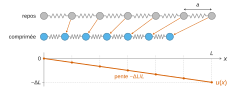
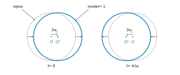
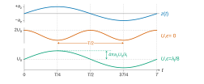
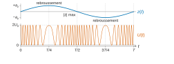
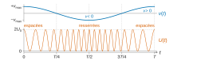
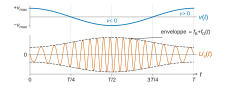

# X-ENS MP — Physique 2026 · Corrigé brut

*Corrigé rédigé par IA, non officiel. Signalez toute erreur.*

Épreuve n° 5, durée 4 h, calculatrice interdite. Sujet : *Étude des ondes mécaniques dans une plaque élastique*.

## I. Préambule : onde de compression unidimensionnelle

### Question 1

Un ressort de raideur $\kappa$ dont l'allongement algébrique (longueur moins longueur à vide) vaut $\delta_n$ emmagasine

$$\boxed{E_{p,n}=\tfrac12\,\kappa\,\delta_n^{2}}$$

### Question 2

Le $n$-ième ressort relie les molécules $n$ et $n+1$, de positions au repos $na$ et $(n+1)a$. Son allongement est la différence des déplacements de ses deux extrémités :

$$\delta_n=u\big((n+1)a,t\big)-u(na,t)$$

On somme sur les ressorts dont l'extrémité gauche est au repos dans $[0,\lambda[$, soit $\lambda/a$ ressorts :

$$\boxed{\begin{aligned}E_p^{\lambda}&=\sum_{n=1}^{\lambda/a}\tfrac12\,\kappa\,\delta_n^{2}\\&=\sum_{n=1}^{\lambda/a}\tfrac12\,\kappa\,\big[u((n+1)a,t)-u(na,t)\big]^2\end{aligned}}$$

### Question 3

Un déplacement uniforme ($u$ indépendant de $x$) ne modifie la longueur d'aucun ressort : c'est la variation spatiale de $u$, et non $u$ lui-même, qui mesure la déformation. Comme $a\ll\lambda$, on a au premier ordre

$$\delta_n\simeq a\,\frac{\partial u}{\partial x}(x_n,t),$$

et chaque ressort emmagasine $\tfrac12\kappa a^2\left(\partial u/\partial x\right)^2$.

Les ressorts sont espacés de $a$ : la somme est une somme de Riemann de pas $a$, et chaque ressort « occupe » la longueur $\mathrm{d}x=a$. On remplace donc $\sum_n$ par $\dfrac1a\displaystyle\int\mathrm{d}x$ :

$$\begin{aligned}E_p^{\lambda}&\simeq\frac1a\int_0^{\lambda}\tfrac12\kappa a^2\Big(\frac{\partial u}{\partial x}\Big)^2\mathrm{d}x\\&=\tfrac12\,\kappa a\int_0^{\lambda}\Big(\frac{\partial u}{\partial x}\Big)^2\mathrm{d}x\end{aligned}$$

C'est le résultat demandé. Contrôle : $\kappa a$ est une force, $(\partial u/\partial x)^2$ est sans dimension et $\mathrm{d}x$ est une longueur, d'où une énergie.

### Question 4

Chaque molécule, de masse $m$, a la vitesse $\partial u/\partial t$. Il y a une molécule par longueur $a$, d'où une masse linéique $m/a$ :

$$\boxed{\begin{aligned}E_c^{\lambda}&=\sum_n\tfrac12 m\Big(\frac{\partial u}{\partial t}\Big)^2\\&\simeq\frac{m}{2a}\int_0^{\lambda}\Big(\frac{\partial u}{\partial t}\Big)^2\mathrm{d}x\end{aligned}}$$

### Question 5

Avec $u=U\sin(kx-\omega t)$, on a :

$$\begin{aligned}\frac{\partial u}{\partial x}&=Uk\cos(kx-\omega t)\\\frac{\partial u}{\partial t}&=-U\omega\cos(kx-\omega t)\\\int_0^\lambda\cos^2(kx-\omega t)\,\mathrm{d}x&=\frac{\lambda}{2}\end{aligned}$$

Donc

$$\begin{aligned}E_p^{\lambda}&=\frac{\kappa a U^2k^2\lambda}{4}\\E_c^{\lambda}&=\frac{mU^2\omega^2\lambda}{4a}\end{aligned}$$

L'égalité $E_c^\lambda=E_p^\lambda$ donne $\dfrac{m}{a}\omega^2=\kappa a k^2$, soit

$$\boxed{\omega^2=k^2c^2}$$

$$\boxed{c=a\sqrt{\frac{\kappa}{m}}}$$

$c$ est homogène à une vitesse ($\mathrm{m}\cdot\sqrt{\mathrm{N\,m^{-1}\,kg^{-1}}}=\mathrm{m\,s^{-1}}$). C'est la célérité des ondes de compression (vitesse du son) dans la chaîne, et aussi la vitesse de phase $\omega/k$ de l'OPPH.

### Question 6

Pour une OPPH, chaque dérivée seconde fait apparaître un facteur simple :

$$\begin{aligned}\frac{\partial^2u}{\partial t^2}&=-\omega^2u\\\frac{\partial^2u}{\partial x^2}&=-k^2u\end{aligned}$$

En remplaçant $\omega^2$ par $-\partial^2/\partial t^2$ et $k^2$ par $-\partial^2/\partial x^2$, la relation $\omega^2=c^2k^2$ devient

$$\boxed{\frac{\partial^2u}{\partial t^2}=c^2\,\frac{\partial^2u}{\partial x^2}}$$

C'est l'équation de d'Alembert. Elle est linéaire, ce qui autorise la superposition. Elle est invariante par $t\to-t$ : la propagation est réversible et sans atténuation. Elle est non dispersive : $v_\varphi=v_g=c$ pour toutes les fréquences, et un paquet d'ondes se propage sans se déformer.

## II. Énergie élastique pour une plaque en compression homogène

### Question 7

Tous les ressorts selon $(Ox)$ se raccourcissent de $\delta$, donc $\partial u/\partial x=-\delta/a$ est uniforme et $u(x)$ est **affine**.

En prenant l'extrémité $x=0$ comme référence :

$$u(x)=-\frac{\Delta L}{L}\,x$$

C'est une droite de pente $-\Delta L/L$, qui passe de $0$ en $x=0$ à $-\Delta L$ en $x=L$. Si la compression est symétrique, la droite passe par $0$ au milieu de la plaque ; la pente reste la même.

### Question 8

Une section droite $e\times l$ contient $\dfrac{e}{a}\cdot\dfrac{l}{a}$ chaînes parallèles à $(Ox)$, et chaque chaîne compte $L/a$ ressorts. Le nombre de ressorts comprimés est le nombre de chaînes multiplié par le nombre de ressorts par chaîne :

$$\boxed{N=\frac{e\,l\,L}{a^3}}$$

Les corrections de bord, par exemple compter $e/a+1$ plans de molécules au lieu de $e/a$, sont d'un ordre relatif $a/e$ (ou $a/l$, $a/L$). Elles sont négligeables, car les dimensions de la plaque sont très grandes devant la maille.

Le nombre de ressorts est extensif : il est proportionnel au volume $elL$.

### Question 9

Chaque chaîne de $L/a$ ressorts se raccourcit de $\Delta L$. La compression étant homogène, chaque ressort se raccourcit de

$$\delta=\frac{a\,\Delta L}{L}$$

Alors

$$\begin{aligned}E_p^L&=N\cdot\tfrac12\kappa\delta^2\\&=\frac{elL}{a^3}\cdot\frac12\kappa\frac{a^2\Delta L^2}{L^2}\\&=\tfrac12\,\frac{\kappa}{a}\,\frac{el}{L}\,\Delta L^2\end{aligned}$$

$$\boxed{E_p^L=\tfrac12\,K\,\frac{el}{L}\,\Delta L^2}$$

avec $K=\kappa/a$.

$K$ s'exprime en $\mathrm{N\,m^{-2}}=\mathrm{Pa}$ : c'est un module d'élasticité (module d'Young du modèle).

## III. Flexion

### Question 10

$R_C$ est le **rayon de courbure** de la fibre neutre : la fibre neutre est un arc de cercle de centre $C$, et $R_C$ est son rayon. Sa longueur reste $L$ et elle intercepte l'angle $\theta$ :

$$\boxed{L=R_C\,\theta}$$

### Question 11

La fibre située à la distance algébrique $r$ de la fibre neutre est un arc de rayon $R_C+r$ et d'angle $\theta$. Sa longueur vaut $(R_C+r)\theta$ et son élongation

$$\begin{aligned}\Delta L(r)&=(R_C+r)\theta-R_C\theta\\&=r\theta\end{aligned}$$

$$\boxed{\Delta L(r)=\frac{r\,L}{R_C}}$$

Elle est positive pour $r>0$ (extension) et négative pour $r<0$ (compression).

### Question 12

L'élément compris entre $r$ et $r+\mathrm{d}r$ est une plaque d'épaisseur $\mathrm{d}r$, de même largeur $l$ et de même longueur $L$ que la tranche.

Il est allongé de façon homogène de $\Delta L(r)$. La question 9 s'applique avec $e\to\mathrm{d}r$ :

$$\begin{aligned}\mathrm{d}E_p&=\frac12K\frac{l\,\mathrm{d}r}{L}\Big(\frac{rL}{R_C}\Big)^2\\&=\frac12\,K\,\frac{lL}{R_C^2}\,r^2\,\mathrm{d}r\end{aligned}$$

$$\boxed{\mathrm{d}E_p=\frac12\,K\,\frac{lL}{R_C^2}\,r^2\,\mathrm{d}r}$$

L'énergie élémentaire est proportionnelle à l'épaisseur $\mathrm{d}r$ de la couche. Elle est nulle pour la fibre neutre ($r=0$), qui ne se déforme pas, et ne dépend pas du signe de $r$ : extension et compression coûtent la même énergie.

### Question 13

On intègre sur l'épaisseur, $r\in[-e/2,e/2]$, avec

$$\int_{-e/2}^{e/2}r^2\,\mathrm{d}r=\frac{e^3}{12}$$

D'où

$$\begin{aligned}E_p^L&=\frac12K\frac{lL}{R_C^2}\cdot\frac{e^3}{12}\\&=\frac1{24}\,K\,\frac{Lle^3}{R_C^2}\end{aligned}$$

$$\boxed{E_p^L=\frac1{24}\,K\,\frac{Lle^3}{R_C^2}}$$

$$\boxed{A=\frac1{24}}$$

## IV. Relation de dispersion des ondes de flexion

### Question 14

La pente de la fibre neutre est $\tan\alpha=\partial Z/\partial x$. En faibles déformations, $\tan\alpha\simeq\alpha$ :

$$\boxed{\alpha(x,t)=\frac{\partial Z}{\partial x}(x,t)}$$

### Question 15

Localement, un élément de longueur $\mathrm{d}s\simeq\mathrm{d}x$ est un arc de rayon $R_c$. La question 13, avec $L\to\mathrm{d}x$, donne

$$\begin{aligned}\mathrm{d}E_p&=AKle^3\,\frac{\mathrm{d}x}{R_c^2}\\&=AKle^3\Big(\frac{\partial^2Z}{\partial x^2}\Big)^2\mathrm{d}x\end{aligned}$$

L'énergie dépend de la dérivée **seconde** de $Z$ (la courbure), et non de la pente. Avec $\partial_x^2Z=-a_Zk^2\sin(kx-\omega t)$ et $\int_0^\lambda\sin^2(kx-\omega t)\,\mathrm{d}x=\lambda/2$ :

$$\begin{aligned}E_p^{\lambda}&=AKle^3a_Z^2k^4\,\frac{\lambda}{2}\\&=\frac{K\,l\,e^3\,a_Z^2\,k^4\,\lambda}{48}\end{aligned}$$

$$\boxed{E_p^{\lambda}=\frac{K\,l\,e^3\,a_Z^2\,k^4\,\lambda}{48}}$$

### Question 16

Chaque tranche $\mathrm{d}x$, de masse $\rho\,e\,l\,\mathrm{d}x$, se déplace transversalement à la vitesse

$$\frac{\partial Z}{\partial t}=-a_Z\omega\cos(kx-\omega t)$$

D'où

$$\begin{aligned}E_c^{\lambda}&=\int_0^\lambda\frac12\rho e l\Big(\frac{\partial Z}{\partial t}\Big)^2\mathrm{d}x\\&=\frac{\rho\,e\,l\,a_Z^2\,\omega^2\,\lambda}{4}\end{aligned}$$

$$\boxed{E_c^{\lambda}=\frac{\rho\,e\,l\,a_Z^2\,\omega^2\,\lambda}{4}}$$

### Question 17

Ici $E_p^\lambda$ et $E_c^\lambda$ ne dépendent pas du temps : ils sont égaux à leurs moyennes temporelles. L'égalité donne

$$\begin{aligned}\frac{Kle^3a_Z^2k^4\lambda}{48}&=\frac{\rho e l a_Z^2\omega^2\lambda}{4}\\12\,\rho\,\omega^2&=K e^2k^4\end{aligned}$$

En posant $c^2=K/\rho$ :

$$\boxed{12\,\omega^2=e^2c^2k^4}$$

Contrôle dimensionnel : $K/\rho$ est en $\mathrm{Pa\,m^3\,kg^{-1}}=\mathrm{m^2\,s^{-2}}$, et $e^2c^2k^4$ est bien en $\mathrm{s^{-2}}$.

### Question 18

$$\boxed{c=\sqrt{\frac{K}{\rho}}}$$

$$\begin{aligned}c&=\sqrt{\frac{70\times10^{9}}{2500}}\\&=\sqrt{2{,}8\times10^{7}}\\&\approx5{,}3\times10^{3}\ \mathrm{m\,s^{-1}}\end{aligned}$$

Cette célérité est celle des ondes de **compression** du matériau. Avec $\rho=m/a^3$ et $K=\kappa/a$, on retrouve exactement le $c=a\sqrt{\kappa/m}$ de la question 5. Sa valeur, environ 5 km/s, est typique de la vitesse du son dans un solide et vaut environ 15 fois celle dans l'air. Ce n'est pas la vitesse des ondes de flexion : celles-ci dépendent de $k$ et sont bien plus lentes tant que $ke\ll1$.

### Question 19

La relation de dispersion s'écrit $\omega=\dfrac{ec}{\sqrt{12}}k^2$, d'où

$$\begin{aligned}v_\varphi&=\frac{\omega}{k}=\frac{ec}{\sqrt{12}}\,k\\v_g&=\frac{\mathrm{d}\omega}{\mathrm{d}k}=\frac{2ec}{\sqrt{12}}\,k\end{aligned}$$

$$\boxed{v_g=2\,v_\varphi}$$

Comme $k=\left(\sqrt{12}\,\omega/(ec)\right)^{1/2}$, on a

$$v_\varphi=\left(\frac{ec\,\omega}{\sqrt{12}}\right)^{1/2}\propto\sqrt f$$

et de même $v_g\propto\sqrt f$ : **les deux vitesses croissent comme la racine carrée de la fréquence**. Le milieu est dispersif.

Un paquet d'ondes se déforme et s'étale au cours de la propagation : ses composantes de haute fréquence prennent de l'avance sur les basses. L'énergie du paquet avance à $v_g$, deux fois plus vite que les crêtes.

### Question 20

Pour une OPPH, $\omega^2Z=-\partial_t^2Z$ et $k^4Z=\partial_x^4Z$. On remplace donc $\omega^2$ par $-\partial^2/\partial t^2$ et $k^4$ par $\partial^4/\partial x^4$.

La relation $12\omega^2=e^2c^2k^4$ correspond ainsi à l'équation linéaire

$$\boxed{\frac{\partial^2Z}{\partial t^2}+\frac{e^2c^2}{12}\,\frac{\partial^4Z}{\partial x^4}=0}$$

Vérification : avec $Z=a_Z\sin(kx-\omega t)$, on obtient $(-\omega^2+e^2c^2k^4/12)Z=0$.

Commentaire des termes :
- le terme $\partial_t^2Z$ est le terme d'inertie (accélération transverse, associée à la masse linéique $\rho el$) ;
- le terme en $\partial_x^4Z$ est la force de rappel due à la rigidité de flexion. Il fait intervenir la dérivée seconde de la courbure, et son coefficient $e^2c^2/12=Ke^2/(12\rho)$ croît avec l'épaisseur ;
- l'ordre 4 en espace contre l'ordre 2 en temps rend la propagation dispersive. L'équation reste linéaire et réversible, sans terme de dissipation. C'est l'équation des poutres d'Euler–Bernoulli.

## V. Applications

### Modes propres d'un anneau (flûte à champagne)

### Question 21

Une condition aux limites périodique quantifie aussi le nombre d'onde dans le **modèle de Bohr** de l'atome d'hydrogène : l'onde de de Broglie de l'électron sur son orbite circulaire doit se refermer sur elle-même, soit $2\pi r=n\lambda$. Cela quantifie le moment cinétique et l'énergie. On peut citer aussi un électron confiné sur un anneau (molécule cyclique) ou les conditions de Born–von Kármán dans un cristal.

### Question 22

La somme des deux ondes est une onde stationnaire :

$$Z(s,t)=2a_Z\sin(ks)\cos(\omega t)$$

Elle doit vérifier $Z(s+2\pi R_0,t)=Z(s,t)$ pour tout $s$, donc $2\pi R_0k\in2\pi\mathbb{Z}$ :

$$\boxed{k_n=\frac{n}{R_0},\quad n\in\mathbb{N}^*}$$

Autrement dit, le périmètre contient un nombre entier de longueurs d'onde.

### Question 23

La figure 5 du sujet (deux bosses et deux creux, $Z\propto\cos 2\varphi$, avec $\varphi$ l'angle polaire) est le mode $n=2$ : deux longueurs d'onde sur le périmètre $2\pi R_0$.

Le premier mode est $n=1$ : $k=1/R_0$, une seule longueur d'onde sur le tour. Le déplacement radial vaut, à l'origine des angles près,

$$Z=2a_Z\cos\varphi\cos\omega t$$

Un côté s'écarte de $2a_Z$ pendant que le côté opposé se rapproche de $2a_Z$.

Au premier ordre en $a_Z$, un déplacement radial $2a_Z\cos\varphi$ décrit le même cercle translaté de $2a_Z$ selon la direction $\varphi=0$ (figure 2). Le verre oscille donc **en bloc**, d'un côté puis de l'autre, sans se déformer. Pour un anneau réel, ce mouvement ne met en jeu aucune élasticité. Il n'émet pas le son de flexion et il est bloqué par le pied du verre. C'est pourquoi le premier mode de vibration réelle est le mode $n=2$ de la figure 5 du sujet.

### Question 24

Mode $n=2$ : $k_2=2/R_0$. La question 17 donne $\omega=\dfrac{ec}{\sqrt{12}}k^2$, d'où

$$\begin{aligned}\omega_2&=\frac{ec}{\sqrt{12}}\cdot\frac{4}{R_0^2}\\&=\frac{2ec}{\sqrt3\,R_0^2}\end{aligned}$$

La fréquence temporelle est $f_2=\omega_2/(2\pi)$ :

$$\boxed{f_2=\frac{e}{\pi\sqrt3\,R_0^2}\sqrt{\frac{K}{\rho}}}$$

### Question 25

Avec $e=5\times10^{-4}$ m, $R_0=2\times10^{-2}$ m et $c\approx5{,}3\times10^3\ \mathrm{m\,s^{-1}}$ :

$$\begin{aligned}f_2&=\frac{5\times10^{-4}\times5{,}3\times10^{3}}{\pi\sqrt3\times4\times10^{-4}}\\&\approx\frac{2{,}65}{5{,}4\times4\times10^{-4}}\\&\approx1{,}2\times10^{3}\ \mathrm{Hz}\end{aligned}$$

Discussion :
- $f_2\approx1$ kHz est une fréquence audible et aiguë, compatible avec le « chant » d'un verre, qui sonne entre quelques centaines de hertz et le kilohertz ;
- le modèle ne fait pas intervenir la hauteur $h$, puisque la déformation est supposée uniforme verticalement. Il ignore aussi l'encastrement au pied et la forme conique réelle ;
- il traite l'anneau comme une plaque plane : la courbure de l'anneau abaisse la fréquence d'un facteur de l'ordre de l'unité ;
- $f_2\propto e/R_0^2$ : un verre plus fin ou plus large chante plus grave, et un liquide ajouté (masse en plus) abaisse aussi la fréquence.

L'ordre de grandeur est le bon.

### Séismes

### Question 26

La célérité des ondes de compression de la croûte (questions 5 et 18) vaut

$$\begin{aligned}c&=\sqrt{\frac{K}{\rho}}=\sqrt{\frac{10^{11}}{2{,}8\times10^{3}}}\\&=\sqrt{3{,}6\times10^{7}}\\&\approx6{,}0\times10^{3}\ \mathrm{m\,s^{-1}}\end{aligned}$$

La vitesse des ondes P (6 km/s) est **cohérente** avec ce résultat. Les ondes P sont des ondes de compression longitudinales : le modèle des parties I et II les décrit par une équation de d'Alembert, donc sans dispersion. Leur vitesse ne dépend alors ni de la fréquence ni de l'épaisseur $e$ de la croûte, seulement du matériau ($K$, $\rho$), ce qui donne un sens à « une » vitesse des ondes P.

L'accord à quelques pour cent près ne doit pas être surinterprété : $K$ et $\rho$ ne sont donnés qu'à un chiffre et varient avec la profondeur, et le modèle de ressorts selon un seul axe ignore le couplage avec les directions transverses. On retient l'accord en ordre de grandeur, ce qui valide l'usage de ce modèle simple pour la croûte.

### Question 27

Les ondes de flexion sont dispersives : $v_\varphi$ et $v_g$ dépendent toutes deux de la fréquence, et $v_g=2v_\varphi$. Une vitesse sismique se mesure par le **temps d'arrivée** d'un train d'ondes entre la source et des stations éloignées. C'est donc la vitesse de propagation de l'énergie (de l'enveloppe du paquet) qui est mesurée, pas celle des crêtes, qui n'est pas accessible par un chronométrage. L'affirmation n'a de sens que pour la **vitesse de groupe**, prise à la fréquence dominante du train d'ondes.

### Question 28

D'après la question 19, $v_g=\dfrac{2ec}{\sqrt{12}}k=\dfrac{ec}{\sqrt3}k$, donc

$$\begin{aligned}k&=\frac{\sqrt3\,v_g}{ec}\\\lambda&=\frac{2\pi}{k}=\frac{2\pi ec}{\sqrt3\,v_g}\end{aligned}$$

Avec $e=3\times10^4$ m, $c\approx6{,}0\times10^{3}\ \mathrm{m\,s^{-1}}$ et $v_g=4\times10^{3}\ \mathrm{m\,s^{-1}}$ :

$$k=\frac{1{,}73\times4\times10^{3}}{3\times10^{4}\times6\times10^{3}}\approx3{,}9\times10^{-5}\ \mathrm{m^{-1}}$$

$$\boxed{\lambda\approx1{,}6\times10^{5}\ \mathrm{m}\approx1{,}6\times10^{2}\ \mathrm{km}}$$

Si l'on interprétait 4 km/s comme une vitesse de phase, on obtiendrait $\lambda=2\pi ec/(\sqrt{12}\,v_\varphi)\approx8\times10^{1}$ km.

Dans les deux cas $\lambda$ n'est que quelques fois $e$ : l'hypothèse de plaque mince ($\lambda\gg e$) est à peine vérifiée. La période correspondante, de l'ordre de la minute, est bien plus longue que celle des ondes S usuelles. Cela confirme que l'assimilation est « abusive ».

### Lac gelé

### Question 29

Description de la figure 6 :
- on voit deux signaux de même allure, un par impact, séparés d'environ 1,1 s (le premier commence vers 0,5 s, le second vers 1,7 s). Leurs durées sont voisines, donc les deux impacts sont à des distances voisines du micro ;
- dans chaque signal, les hautes fréquences (environ 2 kHz) arrivent les premières, puis la fréquence reçue décroît vers quelques dizaines de hertz en environ 0,5 s : c'est un balayage descendant (« chirp ») ;
- la puissance la plus forte est reçue aux basses fréquences, en fin de signal (traînée claire au voisinage de $f\approx0$).

Interprétation : l'impact excite toutes les fréquences au même instant, mais elles ne se propagent pas à la même vitesse. Comme $v_g\propto\sqrt f$ (question 19), les hautes fréquences arrivent avant les basses : c'est la signature directe de la dispersion des ondes de flexion, et l'origine du son « de pistolet laser » des lacs gelés.

La figure seule ne permet pas d'identifier une loi $f(t)$ précise. C'est le modèle qui la prédit : la fréquence $f$ arrive à $t=t_0+x/v_g(f)$, d'où $f\propto(t-t_0)^{-2}$. On pourrait le tester en relevant des points sur la figure (question 30). De même, la variation de la puissance au cours du signal ne prouve pas une dissipation : elle traduit surtout la façon dont l'énergie de l'impact se répartit entre les fréquences et dans le temps.

### Question 30

D'après la question 19, la vitesse de groupe s'écrit

$$\begin{aligned}v_g(f)&=2\left(\frac{\pi e c f}{\sqrt3}\right)^{1/2}=\beta\sqrt f\\\beta&=2\sqrt{\frac{\pi ec}{\sqrt3}}\end{aligned}$$

La composante de fréquence $f$, émise à l'instant $t_0$ de l'impact situé à la distance $x$, arrive à

$$t(f)=t_0+\frac{x}{\beta\sqrt f}.$$

L'origine des temps étant arbitraire, $t_0$ est inconnu. On relève sur la figure 6 plusieurs couples $(t,f)$ le long d'une branche et on trace $t$ en fonction de $1/\sqrt f$. On obtient une droite de pente $x/\beta$.

On peut aussi utiliser une différence de temps, qui élimine $t_0$ :

$$t(f_1)-t(f_2)=\frac{x}{\beta}\left(f_1^{-1/2}-f_2^{-1/2}\right)$$

Connaissant la distance $x$ de l'impact au micro et la célérité $c=\sqrt{K/\rho}$ de la glace, on obtient $\beta$, puis

$$\boxed{e=\frac{\sqrt3\,\beta^2}{4\pi c}}$$

### Question 31

L'écart d'arrivée entre deux fréquences est **proportionnel à la distance** :

$$\Delta t=x\left(\frac1{v_g(f_2)}-\frac1{v_g(f_1)}\right)$$

À 50 m, toutes les fréquences arrivent presque ensemble et l'on entend un claquement bref. À 500 m, le balayage dure environ dix fois plus longtemps et l'on entend un sifflement descendant nettement étalé.

Le son lointain est aussi plus faible, sans qu'il faille invoquer une dissipation : le modèle est dispersif mais non dissipatif. L'énergie de l'impact se répartit sur un front de plus en plus grand (onde à deux dimensions sur la glace) et sur une durée de plus en plus longue (étalement dû à la dispersion). Une atténuation réelle (frottements internes, rayonnement dans l'air), plus forte en général aux hautes fréquences, peut s'y ajouter, mais elle sort du modèle. Le timbre et la durée du son diffèrent donc selon la distance.

## VI. Détection des ondes de flexion : vibrométrie laser

### Mesure de l'amplitude des vibrations

### Question 32

Une séparatrice idéale transmet ou réfléchit la moitié de l'énergie, donc multiplie l'amplitude par $1/\sqrt2$. Les miroirs ont un facteur 1.
- Référence $OS_0S_1M_1S_1S_3P$ : réflexion sur $S_0$, transmission par $S_1$, réflexion sur $M_1$, puis réflexion sur $S_1$ et transmission par $S_3$. Cela fait quatre passages par une séparatrice.
- Sonde $OS_0S_2M_2S_2S_3P$ : transmission par $S_0$ et par $S_2$, réflexion sur $M_2$, puis réflexion sur $S_2$ et sur $S_3$. Cela fait aussi quatre passages par une séparatrice.

Chaque amplitude est donc multipliée par $(1/\sqrt2)^4=1/4$ :

$$\boxed{a_1=a_2=\frac{a_0}{4}}$$

Un miroir à 45° placé en $S_1$ enverrait directement le faisceau de référence vers $S_3$. On aurait alors $a_1=a_0/2$ et $a_2=a_0/4$, et le contraste tomberait à

$$\frac{2a_1a_2}{a_1^2+a_2^2}=0{,}8$$

La séparatrice impose **$a_1=a_2$, donc un contraste maximal égal à 1**. Elle permet aussi d'insérer le bras $S_1M_1$, dont le miroir monté sur vis micrométrique sert à régler finement le chemin optique de référence ($\epsilon$) et à équilibrer les deux bras.

### Question 33

Longueurs des trajets :
- référence : $OS_0+S_0S_1+2S_1M_1+S_1S_3+S_3P=6d+2\epsilon$ ;
- sonde : $OS_0+S_0S_2+2S_2M_2+S_2S_3+S_3P=4d+2D+2z(t)$.

Les phases s'écrivent donc

$$\boxed{\varphi_1=2\pi f_lt-\frac{2\pi}{\lambda_l}(6d+2\epsilon)}$$

$$\boxed{\varphi_2=2\pi f_lt-\frac{2\pi}{\lambda_l}\big(4d+2D+2z(t)\big)}$$

Le retard de propagation dans $z$ (de l'ordre de 0,1 ns) est négligeable devant la période de vibration.

### Question 34

Les deux ondes viennent de la même source. Elles n'interfèrent que si la différence de marche $\delta=2(D-d)+2z-2\epsilon$ reste inférieure à la longueur de cohérence temporelle du laser, $\ell_c=c_0/\Delta f_l$. Comme $z$ et $\epsilon$ sont microscopiques :

$$\boxed{2\,|D-d|\lesssim\ell_c}$$

Ordres de grandeur : environ 1 mm à 1 cm pour une diode laser multimode, environ 10 cm à 1 m pour un laser à gaz usuel, et jusqu'à des centaines de mètres pour un laser monomode stabilisé ($\Delta f_l\sim1$ MHz). Avec un laser de vibrométrie, la distance $D$ peut aller de quelques centimètres au mètre autour de $d$. Le réglage $D=d$ annule la différence de marche géométrique.

### Question 35

L'intensité reçue est $I\propto\langle(s_1+s_2)^2\rangle$, moyennée sur le temps de réponse de la photodiode $\tau_d=5$ ns. Cette durée est très grande devant la période optique ($\sim10^{-15}$ s) et très petite devant la période de vibration (1 ms). Avec $a_1=a_2=a$ et la formule rappelée :

$$(s_1+s_2)^2=a^2\left[\cos^2\varphi_1+\cos^2\varphi_2+\cos(\varphi_1+\varphi_2)+\cos(\varphi_1-\varphi_2)\right].$$

On a $\langle\cos^2\varphi_i\rangle=1/2$, et $\langle\cos(\varphi_1+\varphi_2)\rangle=0$ car ce terme oscille à $2f_l$. Le terme $\cos(\varphi_1-\varphi_2)$ ne dépend que de $z(t)$, lent, et survit. Avec $D=d$ :

$$\begin{aligned}\varphi_2-\varphi_1&=\frac{2\pi}{\lambda_l}\big(2\epsilon+2d-2D-2z\big)\\&=-\frac{4\pi}{\lambda_l}\big(z(t)-\epsilon\big)\end{aligned}$$

d'où $I\propto a^2\left[1+\cos\left(4\pi\dfrac{z-\epsilon}{\lambda_l}\right)\right]$. La tension étant proportionnelle à l'intensité :

$$\boxed{U(t)=U_0\left(1+\cos\left(4\pi\,\frac{z(t)-\epsilon}{\lambda_l}\right)\right)}$$

Au maximum, $U=2U_0$ : les amplitudes s'ajoutent ($2a$), et l'intensité vaut quatre fois celle d'une seule onde d'amplitude $a$, ce qui n'a rien de paradoxal (l'énergie manque aux franges sombres).

### Question 36

Avec $\epsilon=0$, $z=a_z\sin\omega t$ et $4\pi a_z/\lambda_l\ll1$, on développe $\cos X\simeq1-X^2/2$ :

$$\begin{aligned}U(t)&\simeq2U_0-\frac{8\pi^2a_z^2}{\lambda_l^2}U_0\sin^2\omega t\\&=2U_0-\frac{4\pi^2a_z^2}{\lambda_l^2}U_0\big(1-\cos2\omega t\big)\end{aligned}$$

La tension reste presque constante, égale à $2U_0$ (frange brillante), avec de minuscules creux, du second ordre en $a_z/\lambda_l$, à la fréquence double $2f$.

Au contact optique on est sur un extremum de frange, où $\mathrm{d}U/\mathrm{d}z=0$. La sensibilité est nulle au premier ordre, le signal est quadratique, et le signe de $z$ est perdu puisque $z$ et $-z$ donnent le même signal. Ce réglage est mauvais.

### Question 37

Il faut se placer sur le **flanc d'une frange** (quadrature), là où la pente

$$\left|\frac{\mathrm{d}U}{\mathrm{d}z}\right|=U_0\frac{4\pi}{\lambda_l}\left|\sin\frac{4\pi(z-\epsilon)}{\lambda_l}\right|$$

est maximale en $z=0$. La condition est $\dfrac{4\pi\epsilon}{\lambda_l}=\dfrac{\pi}{2}+p\pi$, soit

$$\boxed{\epsilon=\frac{\lambda_l}{8}+p\,\frac{\lambda_l}{4},\ p\in\mathbb{Z}}$$

Par exemple $\epsilon=\lambda_l/8\approx39$ nm.

On tourne la vis micrométrique pour déplacer $M_1$ d'un huitième de longueur d'onde à partir du contact optique. Le réglage doit être fait à une petite fraction de $\lambda_l/8$ près, soit à quelques nanomètres. Un écart $\delta\epsilon$ réduit la pente d'un facteur $\cos(4\pi\delta\epsilon/\lambda_l)$ et fait réapparaître un terme quadratique. Le réglage doit aussi rester stable, à mieux que quelques nanomètres, vis-à-vis des dilatations thermiques et des vibrations parasites.

### Question 38

Avec $\epsilon=\lambda_l/8$ :

$$\begin{aligned}U&=U_0\left(1+\cos\left(\frac{4\pi z}{\lambda_l}-\frac{\pi}{2}\right)\right)\\&=U_0\left(1+\sin\frac{4\pi z}{\lambda_l}\right)\\&\simeq U_0\left(1+\frac{4\pi a_z}{\lambda_l}\sin\omega t\right)\end{aligned}$$

Voir la figure 3, courbe du bas.

C'est une sinusoïde de fréquence $f$ (celle de la vibration) centrée sur $U_0$, d'amplitude $4\pi a_zU_0/\lambda_l$ proportionnelle à $a_z$. La réponse est linéaire et de sensibilité maximale.

### Question 39

Le signal s'écrit

$$U(t)=U_0\left(1+\cos\left(\frac{4\pi a_z}{\lambda_l}\sin\omega t-\frac{4\pi\epsilon}{\lambda_l}\right)\right)$$

avec $4\pi a_z/\lambda_l\gg1$. La phase balaie un grand nombre de franges. $U$ oscille entre $0$ et $2U_0$ avec la fréquence instantanée

$$f_{\text{fr}}(t)=\frac{2|\dot z|}{\lambda_l}=\frac{2a_z\omega|\cos\omega t|}{\lambda_l}$$

Les oscillations sont très serrées aux passages par $z=0$ (instants $0$, $T/2$ et $T$), où la vitesse est maximale.

Elles s'espacent jusqu'à s'arrêter aux points de rebroussement $z=\pm a_z$ (instants $T/4$ et $3T/4$), et le motif est symétrique par rapport à ces instants.

Sur une période on compte $8a_z/\lambda_l$ franges, soit environ 2 500 pour $a_z=100\ \mu$m. La fréquence maximale des franges, environ 4 MHz, reste compatible avec les 5 ns de la photodiode.

### Question 40

Entre deux rebroussements, $z$ passe de $-a_z$ à $+a_z$ pendant une demi-période, et la phase $4\pi z/\lambda_l$ varie de $8\pi a_z/\lambda_l$.

On compte donc $\mathcal N=4a_z/\lambda_l$ franges, une par déplacement de $\lambda_l/2$ (aller-retour). À l'oscilloscope, on compte le nombre $\mathcal N$ de maxima de $U$ entre deux instants où les franges s'arrêtent :

$$\boxed{a_z=\frac{\mathcal N\,\lambda_l}{4}}$$

La résolution est d'environ $\lambda_l/4\approx80$ nm. On peut aussi mesurer la fréquence maximale des franges, $f_{\max}=2a_z\omega/\lambda_l$, ce qui donne $a_z=\lambda_lf_{\max}/(2\omega)$.

### Mesure de la vitesse des vibrations

### Question 41

À $t=0$, un front atteint le miroir. Le front suivant est à la distance $c_0T$ en arrière et rattrape le miroir, qui fuit à la vitesse $v$, avec la vitesse relative $c_0-v$. Il l'atteint à l'instant $T'$ tel que $c_0T'=c_0T+vT'$ :

$$\boxed{T'=\frac{T}{1-v/c_0}\simeq T\left(1+\frac{v}{c_0}\right)}$$

On a bien $T'>T$ pour $v>0$.

### Question 42

Le front réémis à $t=0$ par le miroir se trouve à $t=T'$ à la distance $c_0T'$ de la position initiale du miroir, du côté de $S_2$. Le miroir, qui s'est éloigné de $vT'$, réémet alors le front suivant. Leur distance est la nouvelle longueur d'onde :

$$\boxed{\lambda''=(c_0+v)\,T'}$$

$$\boxed{T''=\frac{\lambda''}{c_0}=T'\left(1+\frac{v}{c_0}\right)}$$

### Question 43

En combinant les questions 41 et 42, au premier ordre en $v/c_0$ :

$$\begin{aligned}T''&=T\,\frac{1+v/c_0}{1-v/c_0}\simeq T\left(1+\frac{2v}{c_0}\right)\\f''&=\frac1{T''}\simeq f_l\left(1-\frac{2v}{c_0}\right)\end{aligned}$$

$$\boxed{f_D=f''-f_l=-2f_l\,\frac{v}{c_0}}$$

### Question 44

$$f_l=\frac{c_0}{\lambda_l}=\frac{3\times10^{8}}{3{,}15\times10^{-7}}\approx9{,}5\times10^{14}\ \mathrm{Hz}$$

La vitesse de la plaque est $v=\dot z=a_z\omega\cos\omega t$, avec $\omega=2\pi f$ et $f=1$ kHz. Son amplitude vaut

$$v_{\max}=2\pi fa_z=2\pi\times10^3\times10^{-4}\approx0{,}63\ \mathrm{m\,s^{-1}}$$

Le décalage Doppler $f_D=-2v/\lambda_l$ oscille donc entre $\pm|f_D|_{\max}$ :

$$\boxed{|f_D|_{\max}=\frac{2v_{\max}}{\lambda_l}=\frac{2\times0{,}63}{3{,}15\times10^{-7}}\approx4\times10^{6}\ \mathrm{Hz}}$$

C'est environ $4\times10^{-9}$ fois $f_l$ (rapport $2v_{\max}/c_0$).

### Question 45

Avec $\epsilon=0$ et $D=d$, l'onde de référence parcourt $6d$ à la fréquence $f_l$.

L'onde sonde parcourt $3d$ (trajet $OS_0S_2M_2$) à la fréquence $f_l$, puis $3d$ (trajet $M_2S_2S_3P$) à $f_l+f_D$ après réflexion.

La phase Doppler, acquise à la réflexion sur $M_2$ avec $z(0)=0$, est retardée de $3d/c_0$ :

$$\boxed{\varphi_1=2\pi f_l\Big(t-\frac{6d}{c_0}\Big)}$$

$$\boxed{\varphi_2=2\pi f_l\Big(t-\frac{6d}{c_0}\Big)+2\pi f_D\Big(t-\frac{3d}{c_0}\Big)}$$

Intensité instantanée, avec $a_1=a_2=a$, développée puis linéarisée à l'aide de $\cos^2X=\tfrac12(1+\cos2X)$ et de la formule rappelée :

$$\boxed{I(t)\propto a^2\left[1+\tfrac12\cos2\varphi_1+\tfrac12\cos2\varphi_2+\cos(\varphi_1+\varphi_2)+\cos(\varphi_1-\varphi_2)\right]}$$

Les trois termes $\cos2\varphi_1$, $\cos2\varphi_2$ et $\cos(\varphi_1+\varphi_2)$ oscillent à environ $2f_l\approx2\times10^{15}$ Hz. Le terme $\cos(\varphi_1-\varphi_2)$ oscille à $f_D$, quelques mégahertz.

### Question 46

La formule de Fresnel s'obtient en moyennant sur une durée $\tau_{\text{int}}$ très grande devant la période optique, mais petite devant les temps d'évolution du signal utile :

$$\frac1{f_l}\ \ll\ \tau_{\text{int}}\ \ll\ \frac1{|f_D|}$$

avec $1/f_l\sim10^{-15}$ s et $1/|f_D|\gtrsim2{,}5\times10^{-7}$ s.

En pratique $\tau_{\text{int}}$ est le temps de réponse de la photodiode, 5 ns, qui convient. Les termes à $2f_l$ se moyennent à zéro. Le terme de battement à $f_D$, $10^7$ à $10^8$ fois plus lent, n'est pas moyenné. Les deux rayons, de fréquences voisines et issus de la même source (donc cohérents entre eux), produisent un **battement** : l'intensité moyenne varie à la fréquence $|f_D|$.

### Question 47

Après moyenne, $I\propto a^2\left[1+\cos(\varphi_2-\varphi_1)\right]$ avec $\varphi_2-\varphi_1=2\pi f_D(t-3d/c_0)$. La tension étant proportionnelle à l'intensité moyenne :

$$\boxed{U(t)=U_0\Big(1+\cos\big[2\pi f_D(t)\,(t-\tau)\big]\Big)}$$

$$\boxed{\tau=\frac{D+2d}{c_0}=\frac{3d}{c_0}}$$

$\tau$ est le temps de vol de la lumière entre la plaque $M_2$, où elle acquiert le décalage Doppler, et la photodiode.

### Question 48

$$\begin{aligned}\tau&=\frac{3\times10^{-2}}{3\times10^{8}}\\&=1\times10^{-10}\ \mathrm{s}=0{,}1\ \mathrm{ns}\end{aligned}$$

$\tau$ est négligeable devant le temps de réponse de la photodiode (5 ns), devant la période minimale du battement (250 ns) et devant la période de vibration (1 ms). Le déphasage $2\pi f_D\tau\lesssim2{,}5\times10^{-3}$ rad est négligeable, donc $U(t)\simeq U_0\left(1+\cos(2\pi f_Dt)\right)$ : la mesure est quasi instantanée.

### Question 49

$U$ ne dépend de $v$ qu'à travers $\cos(2\pi f_D(t-\tau))$, et le cosinus est pair.

Changer $f_D$ en $-f_D$, c'est-à-dire $v$ en $-v$, donne donc le même signal.

On mesure $|f_D|$, c'est-à-dire $|v|$, mais **pas le signe de la vitesse** : on ne sait pas si la plaque s'approche ou s'éloigne.

### Question 50

La sonde arrive sur $M_2$ à la fréquence $f_l+f_B$. Elle repart à la fréquence $f_l+f_B+f_D'$, avec

$$f_D'=-2(f_l+f_B)\frac{v}{c_0}\simeq f_D\quad\text{car } f_B\ll f_l.$$

La référence reste à $f_l$. Le battement se fait donc à $f_B+f_D$ :

$$\boxed{U(t)=U_0\Big(1+\cos\big[2\pi\big(f_B+f_D(t)\big)t+\psi_0\big]\Big)}$$

où $\psi_0$ est une phase constante due aux chemins optiques.

Comme $f_B=40$ MHz dépasse $|f_D|_{\max}\approx4$ MHz, la fréquence du battement $f_B+f_D$ reste toujours positive, entre 36 et 44 MHz.

Elle est supérieure à $f_B$ si $v<0$ (la plaque s'approche) et inférieure à $f_B$ si $v>0$ (elle s'éloigne). Changer le signe de $v$ change le signal, donc l'indétermination est levée.

### Question 51

Le signal est une porteuse de fréquence $f_B=40$ MHz dont la **fréquence instantanée** varie au rythme de la vitesse de la plaque :

$$f_B+f_D(t)=f_B-\frac{2v(t)}{\lambda_l}$$

L'information (le signal modulant $v(t)$, à 1 kHz) est codée dans la fréquence, et l'amplitude $U_0$ reste constante. C'est la définition d'une modulation de fréquence, d'excursion $\pm4$ MHz autour de la porteuse.

### Question 52

La sinusoïde reste comprise entre $0$ et $2U_0$, avec une amplitude constante : ce n'est pas une modulation d'amplitude.

Ses oscillations se resserrent quand $v<0$ et s'espacent quand $v>0$, avec la période $1/f=1$ ms de la vibration. En réalité, chaque milliseconde contient environ $4\times10^4$ oscillations et la fréquence ne varie que de $\pm10\,\%$.

### Question 53

Le circuit est supposé à vide (aucun courant prélevé en sortie). Le courant $i$ traverse $C$ puis $R$. Avec la loi des mailles $u_C=U-U_s$ :

$$\begin{aligned}U_s&=Ri\\i&=C\frac{\mathrm{d}u_C}{\mathrm{d}t}=C\left(\frac{\mathrm{d}U}{\mathrm{d}t}-\frac{\mathrm{d}U_s}{\mathrm{d}t}\right)\end{aligned}$$

En divisant par $C$ après avoir remplacé $i$ par $U_s/R$ :

$$\boxed{\frac{\mathrm{d}U}{\mathrm{d}t}=\frac{U_s}{RC}+\frac{\mathrm{d}U_s}{\mathrm{d}t}}$$

### Question 54

On a $U_s\simeq RC\,\dfrac{\mathrm{d}U}{\mathrm{d}t}$ si $\left|\dfrac{\mathrm{d}U_s}{\mathrm{d}t}\right|\ll\dfrac{|U_s|}{RC}$. En régime sinusoïdal à la pulsation $\Omega$, cela s'écrit $RC\,\Omega\ll1$. La fonction de transfert $\underline H=\dfrac{jRC\Omega}{1+jRC\Omega}$ se réduit alors à $jRC\Omega$.

Le signal contient des fréquences jusqu'à $f_B+|f_D|_{\max}=44$ MHz, il faut donc

$$RC\ll\frac1{2\pi\times44\times10^{6}}\approx3{,}6\ \mathrm{ns}.$$

Par exemple :

$$\boxed{R=10\ \Omega}$$

$$\boxed{C=10\ \mathrm{pF}}$$

soit $RC=0{,}1$ ns. Cela donne $RC\Omega\le0{,}03$ et une erreur relative inférieure à $10^{-3}$ sur la pente. On ne peut pas descendre beaucoup plus bas, car l'amplitude de sortie, $\sim2\pi fRCU_0\approx0{,}03\,U_0$, diminue avec $RC$, et les capacités parasites sont de l'ordre du picofarad.

### Question 55

$U=U_0(1+\cos\Phi)$ avec $\Phi'(t)=2\pi(f_B+f_D(t))$, donc

$$\begin{aligned}U_s&\simeq RC\frac{\mathrm{d}U}{\mathrm{d}t}\\&=-2\pi RC\,U_0\big(f_B+f_D(t)\big)\sin\Phi(t)\end{aligned}$$

On obtient une porteuse à environ 40 MHz, centrée sur zéro (la composante continue $U_0$ est éliminée), dont l'**amplitude** est proportionnelle à la fréquence instantanée.

L'enveloppe varie entre $2\pi RCU_0(f_B-|f_D|_{\max})$ et $2\pi RCU_0(f_B+|f_D|_{\max})$, soit $\pm10\,\%$ autour de sa valeur moyenne, au rythme de $v(t)$. Le dérivateur a converti la modulation de fréquence en modulation d'amplitude.

### Question 56

On extrait l'enveloppe $E(t)=2\pi RCU_0\left(f_B+f_D(t)\right)$ par détection de crête : diode suivie d'un filtre RC de constante de temps comprise entre $1/f_B$ et $1/f$. Le rapport à sa valeur moyenne donne

$$\begin{aligned}\frac{E(t)-\langle E\rangle}{\langle E\rangle}&=\frac{f_D(t)}{f_B}\\&=-\frac{2v(t)}{\lambda_lf_B}\end{aligned}$$

ce qui ne demande de connaître ni $U_0$ ni $RC$.

On en déduit $v(t)=-\dfrac{\lambda_l}{2}f_D(t)$, une fonction sinusoïdale de pulsation $\omega$ et d'amplitude $v_{\max}=a_z\omega$. Si $m$ est la profondeur de modulation relative mesurée de l'enveloppe, $|f_D|_{\max}=mf_B$ et

$$\begin{aligned}a_z&=\frac{v_{\max}}{\omega}=\frac{\lambda_l\,|f_D|_{\max}}{2\omega}\\&=\frac{\lambda_l\,m\,f_B}{4\pi f}\end{aligned}$$

$$\boxed{a_z=\frac{\lambda_l\,m\,f_B}{4\pi f}}$$

Contrôle : $m=0{,}1$ donne $a_z=\dfrac{3{,}15\times10^{-7}\times4\times10^{6}}{4\pi\times10^{3}}\approx1{,}0\times10^{-4}$ m, ce qui redonne bien $100\ \mu$m.

On peut aussi intégrer numériquement $v(t)$ pour reconstruire $z(t)$, à une constante près (le signe de $v$ est connu grâce au décalage $f_B$). Cette méthode fonctionne quelle que soit l'amplitude, sans le réglage critique de $\epsilon$ ni le comptage de franges.
