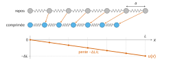
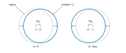
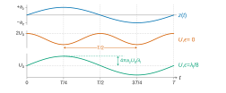
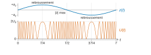
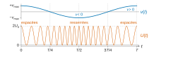
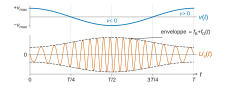

# X-ENS MP — Physique 2026 · Corrigé guidé

*Corrigé rédigé par IA, non officiel. Signalez toute erreur.*

## Présentation du sujet

**Thème.** Le sujet s'intitule *Étude des ondes mécaniques dans une plaque élastique*. Il construit, par une démarche **entièrement énergétique**, la physique des ondes de flexion d'une plaque mince, puis l'applique à des situations concrètes (verre qui chante, séismes, lac gelé). Il se termine par une méthode optique de mesure de ces vibrations, la vibrométrie laser. L'épreuve dure 4 heures, la calculatrice est **interdite**, et le sujet compte **56 questions** en six parties, dont certaines sont indépendantes.

- **Partie I, onde de compression unidimensionnelle (Q1–6).** On étudie une chaîne de masses et de ressorts. On passe de la somme discrète des énergies à une intégrale (limite continue), puis on obtient la relation de dispersion par égalité des énergies cinétique et potentielle. On retrouve enfin l'équation de d'Alembert. C'est la « recette » énergie → dispersion → équation d'onde qui sera réutilisée en IV.
- **Partie II, plaque en compression homogène (Q7–9).** Le solide est modélisé par un réseau cubique de ressorts. On compte les ressorts et on obtient l'énergie élastique $\frac12K\frac{el}{L}\Delta L^2$, avec $K=\kappa/a$ en pascals.
- **Partie III, flexion (Q10–13).** Pour une tranche courbée en arc de cercle, on calcule l'élongation d'une fibre à la distance $r$ de la fibre neutre et on intègre sur l'épaisseur. L'énergie de flexion est en $e^3/R_C^2$.
- **Partie IV, dispersion des ondes de flexion (Q14–20).** Les énergies de l'onde $Z=a_Z\sin(kx-\omega t)$ donnent $12\omega^2=e^2c^2k^4$, puis $v_g=2v_\varphi$, et l'équation d'onde d'ordre 4 en espace (Euler–Bernoulli).
- **Partie V, applications (Q21–31).** On étudie la quantification sur un anneau et la fréquence du mode $n=2$ d'une flûte à champagne. On confronte le modèle aux ondes sismiques. Le spectrogramme du son d'une pierre sur un lac gelé fournit enfin une signature de la dispersion.
- **Partie VI, vibrométrie laser (Q32–56).** C'est un interféromètre à deux bras : amplitudes, phases, cohérence, puis signal $U_0\left(1+\cos(4\pi(z-\epsilon)/\lambda_l)\right)$, réglage en quadrature et comptage de franges. On passe ensuite à l'effet Doppler sur un miroir mobile, au battement, à la cellule de Bragg (modulation de fréquence) et à la démodulation par un circuit CR dérivateur.

**Notions mobilisées.** Énergie d'un ressort et passage du discret au continu, OPPH, relation de dispersion, vitesses de phase et de groupe, paquets d'ondes, modes propres et quantification, interférences à deux ondes (cohérence temporelle, formule de Fresnel, contraste), effet Doppler, battements, filtrage du premier ordre. Tout est au programme de MP. Le seul « hors-piste » est le vocabulaire de la modulation de fréquence, que l'énoncé introduit lui-même.

**Difficulté et longueur.** Le sujet est long (56 questions) mais très progressif, et beaucoup de questions sont des applications directes. Les parties I à IV sont guidées : les résultats à démontrer sont donnés, ce qui permet de continuer même en cas de blocage. La partie V demande de **commenter**, avec des discussions qualitatives qui rapportent si elles sont précises. La partie VI est la plus technique : il faut suivre deux chemins optiques sans erreur et bien séparer les échelles de temps.

**Ce qu'en dit le jury.** Le rapport 2026 confirme : « Le sujet était long, mais construit de manière très progressive. » (p. 2). L'épreuve « pénalisait en revanche fortement les calculs formels non contrôlés, les changements de notation, les réponses obtenues par ajustement au résultat attendu et les commentaires physiques vagues » (p. 2). Le rapport ne donne pas de statistiques par question, mais il signale les passages qui ont fait la différence :
- l'intégration sur l'épaisseur (Q12–13), « l'un des passages les plus discriminants » (p. 4) ;
- le dénombrement des ressorts (Q8), qui « a posé difficulté » (p. 3), et l'ajustement de ce dénombrement au résultat de Q9, pénalisé ;
- la conversion entre pulsation et fréquence (Q24–25), source d'erreurs « nombreuses » (p. 4) ;
- la lecture du diagramme temps-fréquence (Q29–31), que beaucoup de candidats ont eu du mal à interpréter ;
- la distinction entre modulation de fréquence et modulation d'amplitude (Q51–52).

**Questions à ne pas laisser passer.** Q1, Q4, Q8–11, Q14, Q18, Q22, Q26, Q33, Q41–44, Q49 et Q53 sont rapides et sûres. Les applications numériques sans calculatrice (Q18, Q25, Q26, Q28, Q44, Q48) demandent de l'aisance avec les puissances de 10.

**Gestion du temps.** On peut viser environ 1 h 30 pour I–IV, 45 min pour V et 1 h 30 pour VI, en gardant 15 min de relecture. La partie VI est longue mais indépendante de I–V : si la flexion bloque, on peut y passer tôt.

## Partie I — Préambule : onde de compression unidimensionnelle

On construit l'énergie d'une onde longitudinale dans une chaîne d'oscillateurs, on passe à la limite continue, et l'on déduit la relation de dispersion par un argument énergétique. Outils : énergie d'un ressort, sommes de Riemann, moyennes de $\cos^2$.

### Question 1

> [!INDICATION]
> Résultat de cours de mécanique : énergie potentielle élastique d'un ressort.

#### Solution

L'allongement algébrique du ressort vaut $\delta_n$, d'où

$$\boxed{E_{p,n}=\tfrac12\,\kappa\,\delta_n^{2}}$$

L'énergie est la même en extension et en compression.

### Question 2

> [!INDICATION]
> L'allongement d'un ressort est la différence des déplacements de ses deux extrémités.

> [!INDICATION]
> Combien de ressorts tiennent sur une longueur d'onde quand ils sont espacés de $a$ ?

#### Solution

Le ressort $n$ relie les molécules de positions au repos $na$ et $(n+1)a$, donc

$$\delta_n=u((n+1)a,t)-u(na,t)$$

On somme sur les ressorts dont l'extrémité gauche est au repos dans $[0,\lambda[$, soit $\lambda/a$ ressorts :

$$\boxed{E_p^{\lambda}=\sum_{n=1}^{\lambda/a}\tfrac12\,\kappa\,\big[u((n+1)a,t)-u(na,t)\big]^2}$$

> [!PIEGE]
> Ne pas écrire $\frac12\kappa u_n^2$ : un déplacement d'ensemble de la chaîne ne tend aucun ressort. C'est exactement ce que dit l'énoncé en Q3.

> [!JURY]
> Le rapport 2026 note que « l'expression de l'énergie sur une longueur d'onde a souvent été écrite sans préciser clairement quels ressorts étaient sommés » (p. 3). Il faut dire quels ressorts on somme et combien il y en a.

### Question 3

> [!INDICATION]
> Remplacer $\delta$ par son expression en $\partial u/\partial x$, puis transformer la somme en intégrale.

> [!INDICATION]
> Une somme dont les termes sont espacés de $a$ s'approche par une intégrale divisée par le pas (somme de Riemann).

#### Solution

Un déplacement uniforme ne comprime aucun ressort : seule la variation spatiale de $u$ compte. Pour $a\ll\lambda$, on a donc

$$\delta_n\simeq a\,\frac{\partial u}{\partial x}(x_n,t),$$

et chaque terme vaut $\frac12\kappa a^2(\partial_xu)^2$.

Les points $x_n$ étant espacés de $a$, chaque ressort occupe la longueur $\mathrm{d}x=a$, et $\sum_nf(x_n)\simeq\frac1a\int f\,\mathrm{d}x$. Ainsi

$$\begin{aligned}E_p^{\lambda}&\simeq\frac1a\int_0^\lambda\tfrac12\kappa a^2\Big(\frac{\partial u}{\partial x}\Big)^2\mathrm{d}x\\&=\tfrac12\,\kappa a\int_0^{\lambda}\Big(\frac{\partial u}{\partial x}\Big)^2\mathrm{d}x\end{aligned}$$

> [!METHODE]
> Passage du discret au continu : $\sum_n f(x_n)\to\frac{1}{\text{pas}}\int f\,\mathrm{d}x$. On vérifie le résultat par l'homogénéité : $\kappa a$ est une force, $(\partial_xu)^2$ est sans dimension, et l'intégrale apporte une longueur. On obtient bien une énergie.

> [!JURY]
> Le rapport 2026 insiste sur l'idée que « c'est la variation spatiale du déplacement, et non le déplacement lui-même, qui mesure la déformation », insuffisamment explicitée dans un nombre significatif de copies (p. 3). Sur le passage à l'intégrale : « Cet arsenal mathématique n'était pas nécessaire, mais une attention particulière était indispensable pour bien introduire l'élément différentiel. » (p. 3)

### Question 4

> [!INDICATION]
> Même démarche qu'en Q3, avec l'énergie cinétique de chaque molécule.

#### Solution

Chaque molécule a la vitesse $\partial_tu$, et il y en a une par longueur $a$ (masse linéique $m/a$) :

$$\boxed{E_c^{\lambda}=\frac{m}{2a}\int_0^{\lambda}\Big(\frac{\partial u}{\partial t}\Big)^2\mathrm{d}x}$$

> [!PIEGE]
> Confondre la masse $m$ d'une molécule, la masse linéique $m/a$ et une masse volumique. Le rapport 2026 prévient : « Les candidats qui confondaient masse d'une molécule, masse linéique et masse volumique obtenaient ensuite une célérité c mal dimensionnée. » (p. 3)

### Question 5

> [!INDICATION]
> Calculer les deux intégrales pour l'OPPH donnée. Les dérivées font apparaître le même $\cos^2$.

> [!INDICATION]
> La valeur moyenne de $\cos^2$ sur une longueur d'onde est connue : l'intégrale vaut la moitié de la longueur d'intégration.

#### Solution

On a :

$$\begin{aligned}\partial_xu&=Uk\cos(kx-\omega t)\\\partial_tu&=-U\omega\cos(kx-\omega t)\\\int_0^\lambda\cos^2(kx-\omega t)\,\mathrm{d}x&=\lambda/2\end{aligned}$$

D'où

$$\begin{aligned}E_p^\lambda&=\frac{\kappa aU^2k^2\lambda}{4}\\E_c^\lambda&=\frac{mU^2\omega^2\lambda}{4a}\end{aligned}$$

L'égalité des deux énergies donne $\frac{m}{a}\omega^2=\kappa ak^2$ :

$$\boxed{\omega^2=k^2c^2}$$

$$\boxed{c=a\sqrt{\frac{\kappa}{m}}}$$

$c$ est une vitesse. C'est la célérité des ondes de compression (vitesse du son) dans la chaîne, égale à la vitesse de phase $\omega/k$, la même pour toutes les fréquences.

> [!METHODE]
> Pour une onde progressive non dispersive, les énergies cinétique et potentielle sont égales **à chaque instant et en chaque point**, pas seulement en moyenne. Égaler les deux énergies est une façon rapide d'obtenir une relation de dispersion.

### Question 6

> [!INDICATION]
> Pour une OPPH, chaque dérivation par rapport au temps ou à l'espace multiplie par un facteur simple : lequel, pour une dérivée seconde ?

> [!INDICATION]
> Pour commenter l'équation, penser à la linéarité, à la réversibilité et à la dispersion.

#### Solution

Pour l'OPPH :

$$\begin{aligned}\partial_t^2u&=-\omega^2u\\\partial_x^2u&=-k^2u\end{aligned}$$

On remplace $\omega^2$ par $-\partial_t^2$ et $k^2$ par $-\partial_x^2$ : la relation $\omega^2=c^2k^2$ correspond à

$$\boxed{\frac{\partial^2u}{\partial t^2}=c^2\,\frac{\partial^2u}{\partial x^2}}$$

C'est l'équation de d'Alembert. Elle est **linéaire** (on peut superposer les solutions), **réversible** (invariante par $t\to-t$, sans dissipation) et **non dispersive** ($v_\varphi=v_g=c$) : un signal quelconque se propage sans se déformer.

> [!METHODE]
> Dictionnaire OPPH ↔ opérateurs : en notation $e^{j(\omega t-kx)}$, on a $\partial_t\leftrightarrow j\omega$ et $\partial_x\leftrightarrow-jk$. Il ne faut retenir que les puissances paires pour obtenir une équation réelle et réversible. Ce dictionnaire sert de nouveau en Q20.

> [!JURY]
> Le rapport 2026 : « Les meilleurs raisonnements remplaçaient proprement ω² et k² par les opérateurs temporel et spatial correspondants. » (p. 3)

## Partie II — Énergie élastique pour une plaque en compression homogène

On passe en trois dimensions. Seuls les ressorts orientés selon $(Ox)$ travaillent, et le problème se réduit à un dénombrement.

### Question 7

> [!INDICATION]
> Si chaque ressort se raccourcit de la même quantité, comment varie le déplacement cumulé le long de la chaîne ?

#### Solution

$\partial_xu=-\delta/a$ est uniforme, donc $u$ est **affine** en $x$. En prenant l'extrémité $x=0$ comme référence :

$$u(x)=-\frac{\Delta L}{L}x$$

C'est une droite de pente $-\Delta L/L$, de $u(0)=0$ à $u(L)=-\Delta L$. Si la compression est symétrique, la droite s'annule au milieu ; la pente est inchangée.

> [!PIEGE]
> Tracer $u(x)$ et non l'élongation, qui est constante. La courbe est une **droite** : le rapport 2026 dit avoir « pourtant rencontré des courbes présentant une courbure ou des déplacements inutilement compliqués » (p. 3). La pente doit être négative : c'est une contraction.

### Question 8

> [!INDICATION]
> Compter d'abord les chaînes parallèles à $(Ox)$ dans une section droite, puis les ressorts par chaîne.

#### Solution

La section $e\times l$ contient $(e/a)(l/a)$ chaînes de $L/a$ ressorts chacune :

$$\boxed{N=\frac{elL}{a^3}}$$

Les corrections de bord (un plan de molécules de plus, par exemple) sont d'un ordre relatif $a/e$, négligeable puisque les dimensions de la plaque sont très grandes devant la maille.

> [!JURY]
> Le rapport 2026 précise qu'« il fallait retenir le nombre de chaînes suivant x multiplié par le nombre de ressorts par chaîne, ce qui conduit à une dépendance extensive en elL/a³ » et que « Les termes de bord n'étaient pas pertinents au niveau d'approximation demandé. » (p. 3)

### Question 9

> [!INDICATION]
> Répartir la contraction totale $\Delta L$ d'une chaîne sur ses ressorts, puis appliquer Q1 à chacun.

#### Solution

Chaque ressort est raccourci de $\delta=a\Delta L/L$, d'où

$$\begin{aligned}E_p^L&=\frac{elL}{a^3}\cdot\frac12\kappa\frac{a^2\Delta L^2}{L^2}\\&=\tfrac12\,\frac{\kappa}{a}\,\frac{el}{L}\,\Delta L^2\end{aligned}$$

$$\boxed{E_p^L=\tfrac12\,K\,\frac{el}{L}\,\Delta L^2}$$

avec $K=\kappa/a$, en pascals : c'est le module d'Young du modèle.

> [!METHODE]
> On retrouve la loi de Hooke macroscopique : $E_p=\frac12k_{\text{eff}}\Delta L^2$ avec $k_{\text{eff}}=K\,S/L$. La raideur est proportionnelle à la section et inversement proportionnelle à la longueur, comme pour des ressorts en parallèle et en série.

> [!PIEGE]
> Retoucher $N$ pour retrouver le résultat annoncé. Le rapport 2026 note que certains candidats ont manifestement ajusté $N$ à la question 8 pour cela, et rappelle qu'« un résultat fourni par l'énoncé doit servir de guide, non de justification a posteriori d'un dénombrement incorrect » (p. 4). Si le calcul ne tombe pas juste, on le dit.

## Partie III — Flexion

On courbe une tranche en arc de cercle. Les fibres extérieures s'allongent, les fibres intérieures se raccourcissent, et l'on somme les énergies de compression de chaque couche.

### Question 10

> [!INDICATION]
> Arc de cercle : relation entre longueur, rayon et angle.

#### Solution

$R_C$ est le **rayon de courbure** de la fibre neutre : c'est le rayon de l'arc de cercle qu'elle forme. Sa longueur $L$ étant inchangée :

$$\boxed{L=R_C\,\theta}$$

> [!JURY]
> Le rapport 2026 précise que $R_C$ n'était « ni une distance critique, ni un bras de levier, ni une distance caractéristique de torsion » : c'est le rayon de la fibre neutre assimilée localement à un arc de cercle (p. 4).

### Question 11

> [!INDICATION]
> La fibre à la distance $r$ est aussi un arc de même angle $\theta$ : quel est son rayon ?

#### Solution

Sa longueur vaut $(R_C+r)\theta$, d'où l'élongation

$$\begin{aligned}\Delta L(r)&=(R_C+r)\theta-R_C\theta\\&=r\theta\end{aligned}$$

$$\boxed{\Delta L(r)=\frac{rL}{R_C}}$$

Elle est positive pour $r>0$ (extension) et négative pour $r<0$ (compression).

> [!JURY]
> Le rapport 2026 : « Le signe de r avait un sens physique : extension d'un côté, compression de l'autre. » (p. 4)

### Question 12

> [!INDICATION]
> La couche $[r,r+\mathrm{d}r]$ est une plaque comprimée ou étirée de façon homogène : quelle dimension de la formule de Q9 doit être remplacée ?

#### Solution

On applique Q9 avec $e\to\mathrm{d}r$ et $\Delta L\to rL/R_C$ :

$$\begin{aligned}\mathrm{d}E_p&=\frac12K\frac{l\,\mathrm{d}r}{L}\Big(\frac{rL}{R_C}\Big)^2\\&=\frac12\,K\,\frac{lL}{R_C^2}\,r^2\,\mathrm{d}r\end{aligned}$$

$$\boxed{\mathrm{d}E_p=\frac12\,K\,\frac{lL}{R_C^2}\,r^2\,\mathrm{d}r}$$

Contrôle : l'énergie élémentaire est proportionnelle à $\mathrm{d}r$, et elle est nulle pour la fibre neutre ($r=0$), qui ne se déforme pas.

> [!PIEGE]
> C'est l'épaisseur (selon $Oz$) qui devient $\mathrm{d}r$. La largeur $l$ et la longueur $L$ ne changent pas. Le rapport 2026 refuse explicitement « Des intégrales contenant dr² ou dr³, ou un élément différentiel absent » (p. 4) : l'élément différentiel apparaît une seule fois, à la puissance 1.

> [!JURY]
> Pour le rapport 2026, « L'intégration sur l'épaisseur a été l'un des passages les plus discriminants. » (p. 4). Il suggère un test simple : l'énergie élémentaire doit s'annuler pour la fibre neutre, en $r=0$.

### Question 13

> [!INDICATION]
> Intégrer sur toute l'épaisseur, en faisant attention aux bornes.

> [!INDICATION]
> L'intervalle d'intégration est symétrique autour de la fibre neutre.

#### Solution

On intègre de $-e/2$ à $e/2$ :

$$\int_{-e/2}^{e/2}r^2\,\mathrm{d}r=\frac{2}{3}\left(\frac e2\right)^3=\frac{e^3}{12}$$

Donc

$$\begin{aligned}E_p^L&=\frac12K\frac{lL}{R_C^2}\cdot\frac{e^3}{12}\\&=\frac1{24}K\frac{Lle^3}{R_C^2}\end{aligned}$$

$$\boxed{E_p^L=\frac1{24}K\frac{Lle^3}{R_C^2}}$$

$$\boxed{A=\frac1{24}}$$

> [!PIEGE]
> Intégrer de $0$ à $e$ donne $e^3/3$, une erreur d'un facteur 4. La fibre neutre est au **milieu**.

> [!METHODE]
> La rigidité de flexion varie en $e^3$, alors que la rigidité de compression (Q9) varie en $e$. C'est pourquoi une plaque mince se plie facilement mais se comprime difficilement, et c'est l'origine de la faible vitesse des ondes de flexion.

## Partie IV — Relation de dispersion des ondes de flexion

On applique localement le résultat de III à une onde sinusoïdale transverse, avec la même démarche énergétique qu'en I. Le résultat est une loi $\omega\propto k^2$, donc un milieu dispersif.

### Question 14

> [!INDICATION]
> Relier l'angle d'inclinaison à la pente de la courbe $Z(x)$, puis utiliser les faibles déformations.

#### Solution

$\tan\alpha=\partial_xZ$, et en petites déformations $\tan\alpha\simeq\alpha$ :

$$\boxed{\alpha(x,t)=\frac{\partial Z}{\partial x}}$$

### Question 15

> [!INDICATION]
> Appliquer Q13 à un petit élément de longueur $\mathrm{d}x$ assimilé à un arc de cercle, puis intégrer sur $\lambda$.

> [!INDICATION]
> Exprimer $1/R_c^2$ à l'aide de la formule donnée, puis utiliser la valeur moyenne de $\sin^2$.

#### Solution

Q13 appliquée à un élément de longueur $\mathrm{d}x$ donne

$$\begin{aligned}\mathrm{d}E_p&=AKle^3\frac{\mathrm{d}x}{R_c^2}\\&=AKle^3\Big(\frac{\partial^2Z}{\partial x^2}\Big)^2\mathrm{d}x\end{aligned}$$

Avec $\partial_x^2Z=-a_Zk^2\sin(kx-\omega t)$ et $\int_0^\lambda\sin^2=\lambda/2$ :

$$\begin{aligned}E_p^\lambda&=AKle^3a_Z^2k^4\frac{\lambda}{2}\\&=\frac{Kle^3a_Z^2k^4\lambda}{48}\end{aligned}$$

$$\boxed{E_p^\lambda=\frac{Kle^3a_Z^2k^4\lambda}{48}}$$

> [!JURY]
> Le rapport 2026 souligne la dépendance en $(\partial^2Z/\partial x^2)^2$ : « Cette dépendance en dérivée seconde était essentielle : elle distingue l'onde de flexion de l'onde de compression. » (p. 4). En compression, c'est la pente $\partial u/\partial x$ qui compte ; en flexion, c'est la courbure.

### Question 16

> [!INDICATION]
> Une tranche $\mathrm{d}x$ de la plaque se déplace d'un bloc à la vitesse transverse $\partial_tZ$. Quelle est sa masse ?

#### Solution

La masse de la tranche est $\rho el\,\mathrm{d}x$, d'où

$$\begin{aligned}E_c^\lambda&=\int_0^\lambda\frac12\rho el\,a_Z^2\omega^2\cos^2(kx-\omega t)\,\mathrm{d}x\\&=\frac{\rho el\,a_Z^2\omega^2\lambda}{4}\end{aligned}$$

$$\boxed{E_c^\lambda=\frac{\rho el\,a_Z^2\omega^2\lambda}{4}}$$

> [!PIEGE]
> La masse linéique est $\rho$ multipliée par la **section** $el$, et non $\rho e$. Une erreur ici fait apparaître un $l$ parasite à la question suivante.

### Question 17

> [!INDICATION]
> Les deux énergies calculées dépendent-elles du temps ? Égaler, simplifier, puis identifier $c$.

#### Solution

Les deux énergies sont indépendantes du temps, donc égales à leurs moyennes. On obtient

$$\begin{aligned}\frac{Kle^3a_Z^2k^4\lambda}{48}&=\frac{\rho ela_Z^2\omega^2\lambda}{4}\\12\rho\omega^2&=Ke^2k^4\end{aligned}$$

En posant $c^2=K/\rho$ :

$$\boxed{12\,\omega^2=e^2c^2k^4}$$

Contrôle : $K/\rho$ est en $\mathrm{m^2\,s^{-2}}$, donc $e^2c^2k^4$ est bien en $\mathrm{s^{-2}}$.

> [!PIEGE]
> Mélanger $\kappa$ (raideur d'un ressort, en N/m), $k$ (nombre d'onde, en m⁻¹) et $K=\kappa/a$ (en Pa). Le rapport 2026 relève que « Les notations κ, k et K ont été fréquemment confondues. » (p. 2), avec des expressions dimensionnellement fausses à la clé.

> [!JURY]
> Le rapport 2026 : « Plusieurs erreurs auraient pu être détectées par une vérification dimensionnelle immédiate, notamment dans les expressions d'énergie, de fréquence et de relation de dispersion. » (p. 2). Le facteur 12 n'apparaît que si $A=1/24$ et le facteur $1/2$ des moyennes de $\sin^2$ et de $\cos^2$ sont tous deux corrects.

### Question 18

> [!INDICATION]
> Identifier $c$ par simple lecture, puis faire l'application numérique en arrangeant les puissances de 10 pour obtenir une racine simple.

> [!INDICATION]
> Pour commenter, comparer à la vitesse $c$ de la partie I et à des vitesses connues.

#### Solution

$$\boxed{c=\sqrt{\frac K\rho}}$$

$$\begin{aligned}c&=\sqrt{\frac{7\times10^{10}}{2{,}5\times10^{3}}}\\&=\sqrt{28\times10^{6}}\\&\approx5{,}3\times10^{3}\ \mathrm{m\,s^{-1}}\end{aligned}$$

Avec $\rho=m/a^3$ et $K=\kappa/a$, on retrouve exactement le $c=a\sqrt{\kappa/m}$ de Q5 : $c$ est la célérité des ondes de **compression** dans le verre. La valeur est typique d'un solide, environ 15 fois la vitesse du son dans l'air. Ce n'est pas la vitesse des ondes de flexion, qui dépend de $k$.

> [!JURY]
> Le rapport 2025 demande de donner une application numérique sous la forme d'un facteur multiplié par une puissance **entière** de 10, avec une unité. On écrit donc $5{,}3\times10^{3}\ \mathrm{m\,s^{-1}}$, et non $\sqrt{2{,}8}\times10^{3{,}5}$.

### Question 19

> [!INDICATION]
> Écrire $\omega$ en fonction de $k$, puis dériver pour obtenir $v_g$.

> [!INDICATION]
> Pour la dépendance en fréquence, exprimer $k$ en fonction de $\omega$ et reporter.

#### Solution

On a $\omega=\dfrac{ec}{\sqrt{12}}k^2$, donc

$$\begin{aligned}v_\varphi&=\frac{\omega}{k}=\frac{ec}{\sqrt{12}}k\\v_g&=\frac{\mathrm{d}\omega}{\mathrm{d}k}=\frac{2ec}{\sqrt{12}}k\end{aligned}$$

$$\boxed{v_g=2v_\varphi}$$

Avec $k\propto\sqrt\omega$, on a $v_\varphi=\left(ec\,\omega/\sqrt{12}\right)^{1/2}\propto\sqrt f$, et de même $v_g\propto\sqrt f$ : **les deux vitesses croissent comme $\sqrt f$**. Le milieu est dispersif.

Un paquet d'ondes se déforme et s'étale au cours de la propagation : ses hautes fréquences prennent de l'avance, et l'énergie (l'enveloppe) avance deux fois plus vite que les crêtes.

> [!METHODE]
> Pour une loi de puissance $\omega\propto k^n$, on a $v_g=n\,v_\varphi$. Le milieu est non dispersif seulement si $n=1$.

> [!JURY]
> Le rapport 2026 : « Les commentaires attendus portaient sur la dépendance de la vitesse de phase et de la vitesse de groupe avec la fréquence, ainsi que sur la déformation d'un paquet d'ondes au cours de la propagation. » (p. 4). Les trois sous-questions appellent donc trois réponses distinctes.

### Question 20

> [!INDICATION]
> Même dictionnaire qu'en Q6 : quelle dérivée spatiale correspond à $k^4$ ?

> [!INDICATION]
> Vérifier le signe relatif des deux termes en reportant une OPPH.

#### Solution

Pour l'OPPH, $\omega^2Z=-\partial_t^2Z$ et $k^4Z=+\partial_x^4Z$, donc

$$\boxed{\frac{\partial^2Z}{\partial t^2}+\frac{e^2c^2}{12}\frac{\partial^4Z}{\partial x^4}=0}$$

Le premier terme est l'inertie de la plaque (masse linéique $\rho el$). Le second est la force de rappel de flexion, proportionnelle à la dérivée seconde de la courbure ; son coefficient $Ke^2/(12\rho)$ croît vite avec l'épaisseur.

L'ordre 4 en espace contre l'ordre 2 en temps rend la propagation dispersive. L'équation est linéaire et réversible, sans dissipation. C'est l'équation d'Euler–Bernoulli.

> [!PIEGE]
> Écrire $\partial_t^2Z=+\frac{e^2c^2}{12}\partial_x^4Z$ par analogie avec d'Alembert. Cette équation donnerait $\omega^2=-e^2c^2k^4/12<0$, donc des solutions qui divergent exponentiellement. Il faut toujours vérifier le signe en reportant une OPPH.

> [!PIEGE]
> Écrire une équation non linéaire, avec un terme en $(\partial^2Z/\partial x^2)^2$ venu de l'énergie. Le rapport 2026 a relevé cette erreur dans plusieurs copies et rappelle : « Or la relation de dispersion impose une équation linéaire d'ordre quatre en espace. » (p. 4)

## Partie V — Applications

On exploite $\omega=\frac{ec}{\sqrt{12}}k^2$ dans trois situations : un anneau aux conditions périodiques (la flûte à champagne), la croûte terrestre et un lac gelé. Ce sont surtout des questions de commentaire et d'ordre de grandeur.

### Question 21

> [!INDICATION]
> Chercher en physique quantique un système où une onde doit « se refermer sur elle-même ».

#### Solution

Le **modèle de Bohr** de l'atome d'hydrogène : l'onde de de Broglie de l'électron sur une orbite circulaire doit vérifier $2\pi r=n\lambda$, ce qui quantifie le moment cinétique et l'énergie. Autres exemples acceptables : un électron sur un anneau (molécule cyclique), ou les conditions de Born–von Kármán dans un cristal.

### Question 22

> [!INDICATION]
> Écrire la périodicité de $Z(s,t)$ quand on fait un tour complet de l'anneau.

#### Solution

La somme des deux ondes est une onde stationnaire :

$$Z=2a_Z\sin(ks)\cos(\omega t)$$

Elle doit vérifier $Z(s+2\pi R_0)=Z(s)$ pour tout $s$, donc $2\pi R_0k\in2\pi\mathbb{Z}$ :

$$\boxed{k_n=\frac{n}{R_0},\ n\in\mathbb{N}^*}$$

Le périmètre contient $n$ longueurs d'onde.

> [!JURY]
> Le rapport 2026 résume l'attendu : « la condition périodique sur l'anneau imposait une quantification du nombre d'onde » (p. 4).

### Question 23

> [!INDICATION]
> Combien de longueurs d'onde la figure 5 du sujet compte-t-elle sur le tour ? En déduire le $n$ du premier mode.

> [!INDICATION]
> Pour $n=1$, comparer le cercle déformé par $2a_Z\cos\varphi$ au cercle de départ translaté de $2a_Z$.

#### Solution

La figure 5 du sujet montre deux bosses et deux creux ($Z\propto\cos2\varphi$) : deux longueurs d'onde sur le périmètre, c'est $n=2$.

Le premier mode est $n=1$ ($k=1/R_0$), avec un déplacement radial $2a_Z\cos\varphi\cos\omega t$ (à l'origine des angles près) : un côté s'écarte de $2a_Z$ pendant que le côté opposé se rapproche de $2a_Z$.

Au premier ordre, ce n'est pas une déformation mais une **translation d'ensemble** du cercle. Le verre oscille en bloc, d'un côté puis de l'autre, sans se déformer. Pour un anneau réel, ce mouvement ne met pas l'élasticité en jeu. Il n'émet pas le son de flexion, et le pied du verre le bloque. Le premier mode de vibration réelle est donc $n=2$.

> [!PIEGE]
> Dessiner pour $n=1$ deux flèches opposées (vers l'extérieur des deux côtés) : ce serait un mode $n=2$ mal dessiné. En translation, les deux flèches vont dans le **même** sens.

> [!JURY]
> Le rapport 2026 : « Le second mode représenté dans l'énoncé devait être correctement relié à la géométrie du cylindre. » (p. 4). On justifie $n=2$ en comptant les longueurs d'onde sur le périmètre $2\pi R_0$.

### Question 24

> [!INDICATION]
> Reporter le nombre d'onde du mode $n=2$ dans la relation de dispersion établie en Q17.

#### Solution

On a $k_2=2/R_0$, d'où

$$\begin{aligned}\omega_2&=\frac{ec}{\sqrt{12}}\cdot\frac{4}{R_0^2}\\&=\frac{2ec}{\sqrt3R_0^2}\end{aligned}$$

La fréquence temporelle demandée est $f_2=\omega_2/(2\pi)$ :

$$\boxed{f_2=\frac{e}{\pi\sqrt3\,R_0^2}\sqrt{\frac K\rho}}$$

> [!PIEGE]
> Donner $\omega_2$ comme réponse, ou diviser deux fois par $2\pi$. Le rapport 2026 signale que « Les erreurs de conversion entre pulsation et fréquence temporelle ont été nombreuses » et que « la relation f = ω/(2π) devait être utilisée sans ambiguïté » (p. 4).

### Question 25

> [!INDICATION]
> Calculer sans calculatrice en arrondissant $\pi\sqrt3\approx5{,}4$.

> [!INDICATION]
> Pour discuter, regarder la valeur obtenue (est-elle audible ?), les paramètres qui manquent dans la formule et les hypothèses du modèle.

#### Solution

$$\begin{aligned}f_2&=\frac{5\times10^{-4}\times5{,}3\times10^{3}}{5{,}4\times4\times10^{-4}}\\&\approx1{,}2\times10^{3}\ \mathrm{Hz}\end{aligned}$$

- La fréquence est audible et aiguë, de l'ordre du kilohertz, ce qui est compatible avec le chant d'un verre.
- La hauteur $h$ n'intervient pas (déformation supposée uniforme verticalement). Le modèle ignore aussi le pied et la forme réelle.
- On a traité l'anneau comme une plaque plane, ce qui surestime la fréquence d'un facteur de l'ordre de l'unité.
- $f_2\propto e/R_0^2$ : un verre plus fin ou plus large chante plus grave. Un liquide, qui ajoute de la masse, abaisse aussi la fréquence.

L'ordre de grandeur est correct.

> [!JURY]
> Le rapport 2025 regrette que des valeurs numériques absurdes ne semblent pas préoccuper leurs auteurs. Ici, confronter 1 kHz à l'expérience (le son entendu) fait partie de la réponse.

### Question 26

> [!INDICATION]
> Calculer la célérité des ondes de compression de la croûte et comparer à 6 km/s.

> [!INDICATION]
> Pour la discussion : de quoi dépend la vitesse des ondes de compression dans le modèle ? Que vaut la précision des données ?

#### Solution

$$\begin{aligned}c&=\sqrt{\frac{10^{11}}{2{,}8\times10^3}}\\&=\sqrt{36\times10^{6}}\\&\approx6{,}0\times10^{3}\ \mathrm{m\,s^{-1}}\end{aligned}$$

Le résultat **concorde** avec la vitesse des ondes P. Ce sont des ondes de compression longitudinales, décrites par les parties I et II : elles obéissent à une équation de d'Alembert, donc ne sont pas dispersives. Leur vitesse ne dépend ni de la fréquence ni de l'épaisseur $e$, seulement du matériau, ce qui donne un sens à « une » vitesse des ondes P.

L'accord à quelques pour cent est un accord d'ordre de grandeur : les données sont à un chiffre et varient avec la profondeur, et le modèle de ressorts est très simplifié.

> [!JURY]
> Pour les séismes, le rapport 2026 précise que « le jury attendait un raisonnement d'ordre de grandeur et une discussion physique, non une application numérique isolée » (p. 4). Écrire seulement que 6 km/s est cohérent, sans commentaire, ne suffit pas.

### Question 27

> [!INDICATION]
> Pour des ondes dispersives, comment mesure-t-on concrètement la « vitesse » d'une onde sismique ?

> [!INDICATION]
> Un sismographe enregistre l'arrivée d'un train d'ondes : à quelle vitesse se propage ce train ?

#### Solution

Les ondes de flexion sont dispersives : $v_\varphi$ et $v_g$ dépendent de la fréquence. Une vitesse sismique est obtenue à partir des **temps d'arrivée** d'un train d'ondes à des stations éloignées.

On mesure donc la vitesse de propagation de l'énergie, c'est-à-dire de l'enveloppe, et non celle des crêtes, qu'un chronométrage ne permet pas de mesurer. L'affirmation n'a de sens que pour la **vitesse de groupe**, à la fréquence dominante du train.

> [!JURY]
> Le rapport 2026 : « La distinction entre vitesse de phase et vitesse de groupe était indispensable pour donner un sens à une vitesse de propagation d'un signal ou d'un paquet d'ondes. » (p. 4)

### Question 28

> [!INDICATION]
> Partir de l'expression de $v_g$ en fonction de $k$ (Q19), en déduire $k$ puis $\lambda$.

#### Solution

On a $v_g=\dfrac{ec}{\sqrt3}k$, donc

$$\lambda=\frac{2\pi}{k}=\frac{2\pi ec}{\sqrt3\,v_g}$$

Avec $e=3\times10^4$ m, $c=6\times10^3\ \mathrm{m\,s^{-1}}$ et $v_g=4\times10^3\ \mathrm{m\,s^{-1}}$ :

$$k\approx\frac{1{,}73\times4\times10^3}{1{,}8\times10^8}\approx3{,}9\times10^{-5}\ \mathrm{m^{-1}}$$

$$\boxed{\lambda\approx1{,}6\times10^{2}\ \mathrm{km}}$$

Avec une vitesse de phase, on trouverait $\lambda\approx80$ km. Dans les deux cas $\lambda$ n'est que quelques fois $e$ : l'hypothèse de plaque mince est à la limite. La période associée, de l'ordre de la minute, est bien plus longue que celle des ondes S usuelles. L'assimilation est bien « abusive ».

> [!METHODE]
> Une fois un résultat obtenu, tester les hypothèses du modèle ($\lambda\gg e$ pour une plaque mince). C'est la discussion attendue quand l'énoncé parle lui-même d'assimilation « abusive ».

### Question 29

> [!INDICATION]
> Décrire d'abord ce qu'on voit : nombre de signaux, écart entre eux, évolution de la fréquence au cours de chaque signal, répartition de l'intensité.

> [!INDICATION]
> Interpréter ensuite avec la Q19 : quelles fréquences arrivent en premier ?

#### Solution

- On voit **deux** signaux de même forme, un par impact, séparés d'environ 1,1 s (vers 0,5 s puis vers 1,7 s). Leurs durées sont voisines, donc les distances d'impact aussi.
- Dans chaque signal, les hautes fréquences (environ 2 kHz) arrivent les premières, puis la fréquence reçue décroît jusqu'à quelques dizaines de hertz environ 0,5 s plus tard : c'est un **balayage descendant**.
- La puissance reçue est la plus forte aux basses fréquences, en fin de signal.

Interprétation : l'impact émet toutes les fréquences au même instant, mais elles ne voyagent pas à la même vitesse. Comme $v_g\propto\sqrt f$, les hautes fréquences arrivent les premières. C'est une signature directe de la dispersion des ondes de flexion : le son « de pistolet laser » des lacs gelés.

Le modèle prédit en plus une loi d'arrivée $t=t_0+x/v_g(f)$, soit $f\propto(t-t_0)^{-2}$. C'est une prédiction, à tester par des relevés (Q30), et non une lecture de la forme de la courbe.

> [!PIEGE]
> Conclure, sur la seule allure « en hyperbole » de la courbe, à une décroissance exponentielle ou à une loi de puissance. Le rapport 2026 le refuse sans justification et rappelle qu'« Une décroissance apparente ne suffit pas à conclure à une loi exponentielle ou à une loi de puissance. » (p. 3)

> [!JURY]
> Le rapport 2026 indique que beaucoup de candidats ont eu du mal à interpréter ce diagramme : « Il fallait voir que les hautes fréquences et les basses fréquences n'arrivent pas de la même manière, conséquence directe de la dispersion. » (p. 5). Il faut citer des valeurs lues (temps, fréquences), pas seulement une forme.

### Question 30

> [!INDICATION]
> Écrire le temps d'arrivée d'une fréquence $f$ à la distance $x$, sans oublier que l'origine des temps est arbitraire.

> [!INDICATION]
> Quelle représentation graphique des points $(t,f)$ donne une droite ? Que faut-il connaître en plus pour isoler $e$ ?

#### Solution

D'après Q19, la vitesse de groupe s'écrit

$$\begin{aligned}v_g&=\beta\sqrt f\\\beta&=2\sqrt{\frac{\pi ec}{\sqrt3}}\end{aligned}$$

Une fréquence $f$ émise à l'instant $t_0$ par un impact situé à la distance $x$ arrive à

$$t(f)=t_0+\frac{x}{\beta\sqrt f}.$$

$t_0$ est inconnu, car l'origine des temps est arbitraire. On relève des points $(t,f)$ sur une branche et on trace $t$ en fonction de $1/\sqrt f$ : on obtient une droite de pente $x/\beta$.

On peut aussi utiliser des différences $t(f_1)-t(f_2)$. Connaissant $x$ et la célérité $c$ de la glace, on obtient $\beta$, puis

$$\boxed{e=\frac{\sqrt3\,\beta^2}{4\pi c}}$$

> [!PIEGE]
> Écrire $t=x/v_g$ en oubliant $t_0$ : l'énoncé précise que l'origine des temps est arbitraire. Il faut donc des **différences** de temps.

### Question 31

> [!INDICATION]
> Comment l'écart entre les temps d'arrivée de deux fréquences dépend-il de la distance ?

> [!INDICATION]
> Le son lointain est plus faible : faut-il pour autant invoquer une dissipation ?

#### Solution

L'écart d'arrivée entre deux fréquences est proportionnel à la distance :

$$\Delta t=x\left(\frac{1}{v_g(f_2)}-\frac{1}{v_g(f_1)}\right)$$

À 50 m, les fréquences arrivent presque ensemble et l'on entend un claquement bref. À 500 m, le balayage dure dix fois plus longtemps et l'on entend un sifflement descendant étalé.

Le son lointain est aussi plus faible, même sans dissipation : l'énergie de l'impact se répartit sur un front de plus en plus grand et sur une durée de plus en plus longue. Une atténuation réelle, plus forte en général aux hautes fréquences, peut s'y ajouter, mais elle sort du modèle.

> [!JURY]
> Le rapport 2026 : « On rappelle qu'un milieu peut être dispersif sans être dissipatif. Une diminution de l'intensité n'est pas nécessairement liée à une dissipation, mais à la répartition du signal dans un volume de plus en plus grand. » (p. 5)

## Partie VI — Détection des ondes de flexion : vibrométrie laser

Il s'agit d'un interféromètre à deux bras dont l'un se réfléchit sur la plaque vibrante. On mesure d'abord le déplacement (franges), puis la vitesse (effet Doppler, battement, cellule de Bragg, démodulation). Il faut suivre précisément les chemins optiques et hiérarchiser les échelles de temps : période optique ($10^{-15}$ s), réponse de la photodiode (5 ns), battement ($\ge25$ ns) et vibration (1 ms).

### Mesure de l'amplitude des vibrations

### Question 32

> [!INDICATION]
> Pour une séparatrice idéale, la moitié de l'**énergie** est transmise : quel facteur cela donne-t-il sur l'**amplitude** ?

> [!INDICATION]
> Compter les passages par une séparatrice sur chaque trajet. Pour la deuxième sous-question, imaginer le montage avec un miroir à 45° en $S_1$ et comparer les amplitudes qui arrivent sur la photodiode.

#### Solution

Chaque séparatrice multiplie l'amplitude par $1/\sqrt2$, et les miroirs par 1.
- Référence : réflexion sur $S_0$, transmission par $S_1$, réflexion sur $M_1$, réflexion sur $S_1$, transmission par $S_3$, soit quatre séparatrices.
- Sonde : transmission par $S_0$ et par $S_2$, réflexion sur $M_2$, puis sur $S_2$ et sur $S_3$, soit quatre séparatrices.

$$\boxed{a_1=a_2=\frac{a_0}{4}}$$

Un miroir à 45° en $S_1$ renverrait directement la référence vers $S_3$. On aurait alors $a_1=a_0/2\neq a_2$, et le contraste $2a_1a_2/(a_1^2+a_2^2)$ tomberait à 0,8.

La séparatrice **équilibre les amplitudes**, ce qui donne un contraste égal à 1 et des franges allant de $0$ à $2U_0$. Elle permet aussi d'utiliser le bras $S_1M_1$, dont le miroir réglable par la vis fixe le chemin de référence.

> [!PIEGE]
> Croire qu'un miroir en $S_1$ « bloquerait » le faisceau : un miroir bien orienté renvoie simplement le faisceau vers $S_3$. L'argument porte sur le contraste.

> [!METHODE]
> Le contraste d'un interféromètre à deux ondes vaut $\mathcal C=\dfrac{2a_1a_2}{a_1^2+a_2^2}$. Il est maximal quand les deux amplitudes sont égales.

> [!JURY]
> Le rapport 2026 demande de suivre soigneusement trajets et séparatrices : « Les amplitudes ne devaient pas être traitées comme si chaque réflexion conservait l'amplitude initiale. » (p. 5)

### Question 33

> [!INDICATION]
> Additionner les longueurs de chaque trajet, en comptant deux fois les allers-retours vers les miroirs.

#### Solution

Les longueurs sont $6d+2\epsilon$ pour la référence et $4d+2D+2z(t)$ pour la sonde, d'où

$$\boxed{\varphi_1=2\pi f_lt-\frac{2\pi}{\lambda_l}(6d+2\epsilon)}$$

$$\boxed{\varphi_2=2\pi f_lt-\frac{2\pi}{\lambda_l}\big(4d+2D+2z(t)\big)}$$

### Question 34

> [!INDICATION]
> Deux ondes issues d'une même source n'interfèrent que si leur différence de marche est inférieure à une longueur caractéristique du laser : laquelle ?

> [!INDICATION]
> La condition porte sur $D$ comparé à $d$, pas sur $D$ seul.

#### Solution

La différence de marche vaut $\delta=2(D-d)+2z-2\epsilon$. Il faut qu'elle reste inférieure à la longueur de cohérence $\ell_c=c_0/\Delta f_l$ :

$$\boxed{2|D-d|\lesssim\ell_c}$$

$\ell_c$ va d'environ 1 cm (diode multimode) à environ 1 m (laser à gaz usuel), et jusqu'à des centaines de mètres pour un laser monomode stabilisé. Pour un vibromètre, $D$ peut donc aller de quelques centimètres au mètre autour de $d$.

### Question 35

> [!INDICATION]
> La photodiode mesure une intensité, moyenne de $(s_1+s_2)^2$ sur son temps de réponse. Linéariser le produit croisé avec la formule rappelée.

> [!INDICATION]
> Classer les termes selon leur fréquence : lesquels varient à l'échelle de la période optique ?

#### Solution

Avec $a_1=a_2=a$ :

$$(s_1+s_2)^2=a^2\left[\cos^2\varphi_1+\cos^2\varphi_2+\cos(\varphi_1+\varphi_2)+\cos(\varphi_1-\varphi_2)\right].$$

On moyenne sur les 5 ns de la photodiode, durée très grande devant la période optique et très petite devant 1 ms. On a $\langle\cos^2\rangle=\frac12$, et $\langle\cos(\varphi_1+\varphi_2)\rangle=0$ car ce terme oscille à $2f_l$.

Le terme $\cos(\varphi_1-\varphi_2)$, qui ne dépend que de $z(t)$, survit. Avec $D=d$, $\varphi_2-\varphi_1=-\frac{4\pi}{\lambda_l}(z-\epsilon)$, d'où

$$\boxed{U(t)=U_0\left(1+\cos\left(4\pi\frac{z(t)-\epsilon}{\lambda_l}\right)\right)}$$

> [!METHODE]
> Il faut toujours dire **sur quelle durée** on moyenne et pourquoi : le temps de réponse du détecteur doit être grand devant la période optique et petit devant le temps d'évolution du signal utile.

> [!JURY]
> Le maximum $U=2U_0$ vaut quatre fois l'intensité d'une seule onde, ce qui a surpris plusieurs copies. Le rapport 2026 rappelle que « l'interférence constructive peut doubler l'amplitude du champ lorsque les amplitudes sont égales, ce qui quadruple l'intensité par rapport à une seule onde de même amplitude » (p. 5). Il faut distinguer amplitude du champ et intensité.

### Question 36

> [!INDICATION]
> Développer le cosinus pour un petit argument : à quel ordre apparaît $z$ ?

> [!INDICATION]
> Que devient $\sin^2\omega t$ une fois linéarisé ? Quelle fréquence apparaît ?

#### Solution

$$\begin{aligned}U&\simeq2U_0-\frac{8\pi^2a_z^2}{\lambda_l^2}U_0\sin^2\omega t\\&=2U_0-\frac{4\pi^2a_z^2}{\lambda_l^2}U_0(1-\cos2\omega t)\end{aligned}$$

La tension est presque constante, égale à $2U_0$, avec de minuscules creux à la **fréquence double**. On est au sommet d'une frange, où $\mathrm{d}U/\mathrm{d}z=0$ : la sensibilité est nulle au premier ordre, et $z$ et $-z$ donnent le même signal. C'est le plus mauvais réglage.

> [!JURY]
> Le rapport 2026 rappelle que « La numérotation des questions, la taille de l'écriture et la clarté des schémas font partie de la communication scientifique. » (p. 6). Pour cette question et les suivantes, on indique sur le tracé les niveaux ($2U_0$, $U_0$) et les instants ($T/4$, $T/2$…).

### Question 37

> [!INDICATION]
> La sensibilité est la pente $\mathrm{d}U/\mathrm{d}z$ : où est-elle maximale sur une frange ?

> [!INDICATION]
> Traduire « flanc de frange » en condition sur la phase $4\pi\epsilon/\lambda_l$.

#### Solution

On se place en **quadrature**, sur le flanc d'une frange : $\dfrac{4\pi\epsilon}{\lambda_l}=\dfrac\pi2+p\pi$, soit

$$\boxed{\epsilon=\frac{\lambda_l}{8}+p\frac{\lambda_l}{4},\ p\in\mathbb{Z}}$$

Par exemple $\epsilon=\lambda_l/8\approx39$ nm.

Le réglage doit être fait à une petite fraction de $\lambda_l/8$ près, soit **quelques nanomètres**, et rester stable à ce niveau malgré les dérives thermiques. Un écart $\delta\epsilon$ réduit la pente d'un facteur $\cos(4\pi\delta\epsilon/\lambda_l)$.

> [!JURY]
> Le rapport 2026 accepte une réponse qualitative bien orientée : « Les réponses qualitatives étaient recevables lorsqu'elles identifiaient correctement le réglage maximisant la pente de la réponse en phase. » (p. 5)

### Question 38

> [!INDICATION]
> Reporter la valeur de $\epsilon$ trouvée : en quoi se transforme le cosinus ?

#### Solution

$$\begin{aligned}U&=U_0\left(1+\sin\frac{4\pi z}{\lambda_l}\right)\\&\simeq U_0\left(1+\frac{4\pi a_z}{\lambda_l}\sin\omega t\right)\end{aligned}$$

Voir la figure 3, courbe du bas.

On obtient une sinusoïde à la fréquence $f$ de la vibration, centrée sur $U_0$, d'amplitude $4\pi a_zU_0/\lambda_l$. Le signal est linéaire en $a_z$ et la sensibilité est maximale.

### Question 39

> [!INDICATION]
> L'argument du cosinus balaie maintenant de nombreuses fois $2\pi$ : à quel rythme ?

> [!INDICATION]
> La fréquence instantanée des franges est liée à la dérivée de la phase, donc à la vitesse de la plaque.

#### Solution

$U=U_0\left(1+\cos\left(\frac{4\pi a_z}{\lambda_l}\sin\omega t\right)\right)$ oscille entre 0 et $2U_0$ avec la fréquence instantanée $2|\dot z|/\lambda_l$.

Les franges sont serrées aux passages par $z=0$ (vitesse maximale) et s'espacent jusqu'à s'arrêter aux rebroussements $z=\pm a_z$. Il y a $8a_z/\lambda_l\approx2\,500$ franges par période. Leur fréquence maximale, environ 4 MHz, reste compatible avec les 5 ns de la photodiode.

### Question 40

> [!INDICATION]
> De combien la plaque doit-elle se déplacer pour faire défiler une frange ?

#### Solution

Une frange défile pour chaque déplacement de $\lambda_l/2$. Entre deux rebroussements, la plaque parcourt $2a_z$ et l'on compte $\mathcal N=4a_z/\lambda_l$ franges :

$$\boxed{a_z=\frac{\mathcal N\lambda_l}{4}}$$

La résolution est d'environ 80 nm. On peut aussi utiliser la fréquence maximale des franges : $a_z=\lambda_lf_{\max}/(2\omega)$.

> [!PIEGE]
> Oublier le facteur 2 de l'aller-retour : la différence de marche vaut $2z$, donc une frange correspond à $\lambda_l/2$ et non à $\lambda_l$.

### Mesure de la vitesse des vibrations

### Question 41

> [!INDICATION]
> Le front suivant part à la distance $c_0T$ derrière le miroir. Écrire qu'il le rejoint à l'instant $T'$.

#### Solution

$c_0T'=c_0T+vT'$, donc

$$\boxed{T'=\frac{T}{1-v/c_0}\simeq T\left(1+\frac v{c_0}\right)}$$

### Question 42

> [!INDICATION]
> Pendant $T'$, où se trouvent le front déjà réémis et le miroir ? Leur distance est la nouvelle longueur d'onde.

#### Solution

Le front est à $c_0T'$ de la position initiale, du côté de $S_2$. Le miroir s'est éloigné de $vT'$ de l'autre côté. Donc

$$\boxed{\lambda''=(c_0+v)T'}$$

$$\boxed{T''=T'\left(1+\frac v{c_0}\right)}$$

### Question 43

> [!INDICATION]
> Combiner les deux étapes et développer au premier ordre en $v/c_0$.

#### Solution

$$\begin{aligned}T''&=T\frac{1+v/c_0}{1-v/c_0}\simeq T\left(1+\frac{2v}{c_0}\right)\\f''&\simeq f_l\left(1-\frac{2v}{c_0}\right)\end{aligned}$$

$$\boxed{f_D=-2f_l\frac v{c_0}}$$

> [!METHODE]
> Pour la réflexion sur un miroir mobile, l'effet Doppler joue deux fois : le miroir est d'abord récepteur mobile, puis source mobile. D'où le facteur 2.

### Question 44

> [!INDICATION]
> La vitesse de la plaque est la dérivée de $z(t)$ : quelle est son amplitude ?

#### Solution

$$f_l=\frac{c_0}{\lambda_l}=\frac{3\times10^8}{3{,}15\times10^{-7}}\approx9{,}5\times10^{14}\ \mathrm{Hz}$$

La plaque vibre à $f=1$ kHz, donc $\omega=2\pi f$ et

$$v_{\max}=a_z\omega=10^{-4}\times2\pi\times10^3\approx0{,}63\ \mathrm{m\,s^{-1}}$$

D'où

$$\boxed{|f_D|_{\max}=\frac{2v_{\max}}{\lambda_l}\approx4\times10^{6}\ \mathrm{Hz}}$$

C'est environ $4\times10^{-9}$ fois $f_l$.

> [!PIEGE]
> Prendre $v_{\max}=a_zf$ au lieu de $a_z\omega$ : la vitesse fait intervenir la pulsation. Le rapport 2026 range la « confusion entre pulsation et fréquence » parmi les erreurs élémentaires qui ont coûté des points dans de nombreuses copies (p. 2).

### Question 45

> [!INDICATION]
> Sur quelle partie du trajet sonde l'onde a-t-elle la fréquence $f_l$, et sur quelle partie la fréquence $f_l+f_D$ ?

> [!INDICATION]
> Développer $(s_1+s_2)^2$ comme en Q35, mais sans moyenner, puis linéariser les carrés.

#### Solution

Avec $\epsilon=0$ et $D=d$, la référence parcourt $6d$ à la fréquence $f_l$.

La sonde parcourt $3d$ à $f_l$ jusqu'à $M_2$, puis $3d$ à $f_l+f_D$ jusqu'à $P$.

La phase Doppler, acquise à la réflexion, est donc retardée de $3d/c_0$ :

$$\boxed{\varphi_1=2\pi f_l\Big(t-\frac{6d}{c_0}\Big)}$$

$$\boxed{\varphi_2=2\pi f_l\Big(t-\frac{6d}{c_0}\Big)+2\pi f_D\Big(t-\frac{3d}{c_0}\Big)}$$

$$\boxed{I(t)\propto a^2\left[1+\tfrac12\cos2\varphi_1+\tfrac12\cos2\varphi_2+\cos(\varphi_1+\varphi_2)+\cos(\varphi_1-\varphi_2)\right]}$$

Trois termes oscillent à environ $2f_l$. Le terme $\cos(\varphi_1-\varphi_2)$ oscille à $f_D$, quelques mégahertz.

> [!PIEGE]
> Attribuer la fréquence $f_l+f_D$ à tout le trajet sonde : l'onde n'est décalée qu'**après** la réflexion sur la plaque. Cette erreur fausse la constante $\tau$ de la Q47.

### Question 46

> [!INDICATION]
> Encadrer la durée d'intégration entre deux périodes caractéristiques.

> [!INDICATION]
> Quel terme de Q45 varie assez lentement pour ne pas être moyenné ? Quel phénomène classique reconnaît-on ?

#### Solution

$$\frac1{f_l}\ \ll\ \tau_{\text{int}}\ \ll\ \frac1{|f_D|}$$

avec $1/f_l\sim10^{-15}$ s et $1/|f_D|\gtrsim2{,}5\times10^{-7}$ s.

Les 5 ns de la photodiode conviennent. Les termes à $2f_l$ se moyennent à zéro, mais le terme à $f_D$ survit. Les deux ondes, cohérentes car issues de la même source et de fréquences voisines, produisent un **battement** : l'intensité moyenne varie à la fréquence $|f_D|$.

### Question 47

> [!INDICATION]
> Partir de la différence des phases de Q45 et l'écrire sous la forme demandée.

#### Solution

$\varphi_2-\varphi_1=2\pi f_D(t-3d/c_0)$, donc

$$\boxed{U(t)=U_0\Big(1+\cos\big[2\pi f_D(t)(t-\tau)\big]\Big)}$$

$$\boxed{\tau=\frac{D+2d}{c_0}=\frac{3d}{c_0}}$$

$\tau$ est le temps de vol de la lumière entre la plaque, où elle acquiert le décalage, et la photodiode.

### Question 48

> [!INDICATION]
> Comparer $\tau$ aux autres temps caractéristiques du problème.

#### Solution

$$\begin{aligned}\tau&=\frac{3\times10^{-2}}{3\times10^8}\\&=1\times10^{-10}\ \mathrm{s}=0{,}1\ \mathrm{ns}\end{aligned}$$

$\tau$ est négligeable devant 5 ns, devant 250 ns et devant 1 ms. Le déphasage $2\pi f_D\tau\lesssim2{,}5\times10^{-3}$ rad est négligeable, donc $U\simeq U_0(1+\cos2\pi f_Dt)$ : la mesure est quasi instantanée.

### Question 49

> [!INDICATION]
> Que se passe-t-il pour $U$ si l'on change $v$ en $-v$ ?

#### Solution

$U$ ne dépend de $v$ qu'à travers $\cos(2\pi f_D(t-\tau))$, qui est pair en $f_D$.

Les vitesses $v$ et $-v$ donnent donc le même signal : on mesure $|v|$, pas le **sens** du mouvement.

### Question 50

> [!INDICATION]
> Refaire le bilan des fréquences des deux ondes qui arrivent sur la photodiode : quelle est maintenant la fréquence du battement ?

> [!INDICATION]
> Comparer $f_B$ à $|f_D|_{\max}$ : la fréquence du battement peut-elle changer de signe ?

#### Solution

La sonde revient à $f_l+f_B+f_D$ (car $f_B\ll f_l$, le décalage Doppler est inchangé). La référence reste à $f_l$. Donc

$$\boxed{U(t)=U_0\Big(1+\cos\big[2\pi(f_B+f_D(t))t+\psi_0\big]\Big)}$$

Comme $f_B=40$ MHz dépasse $|f_D|_{\max}\approx4$ MHz, la fréquence $f_B+f_D$ reste positive, entre 36 et 44 MHz.

Elle est supérieure à $f_B$ quand la plaque s'approche ($v<0$) et inférieure quand elle s'éloigne. Le signe de $v$ est donc lisible.

### Question 51

> [!INDICATION]
> Quelle caractéristique du signal porte l'information sur $v(t)$ : son amplitude ou sa fréquence ?

#### Solution

L'amplitude reste $U_0$. C'est la **fréquence instantanée** $f_B-2v(t)/\lambda_l$ de la porteuse $f_B$ qui suit le signal modulant $v(t)$, à 1 kHz, avec une excursion de $\pm4$ MHz. C'est une modulation de fréquence.

> [!JURY]
> Le rapport 2026 insiste : « il ne s'agissait pas d'une modulation d'amplitude » (p. 5). Il faut dire quelle grandeur du signal porte l'information.

### Question 52

> [!INDICATION]
> Représenter une sinusoïde d'amplitude constante dont les oscillations se resserrent et s'espacent périodiquement. Indiquer dans quel cas elles se resserrent.

#### Solution

Le signal reste entre $0$ et $2U_0$, avec une enveloppe constante.

Ses oscillations se resserrent quand $v<0$ et s'espacent quand $v>0$, avec la période de la vibration (1 ms). En réalité il y a environ $4\times10^4$ oscillations par milliseconde, avec une variation de fréquence de $\pm10\,\%$.

> [!PIEGE]
> Dessiner une enveloppe qui varie : ce serait une modulation d'amplitude. Selon le rapport 2026, « La confusion entre ces deux notions a été fréquente, notamment dans les schémas demandés vers la question 52. » (p. 5)

### Question 53

> [!INDICATION]
> Loi des mailles et relation courant-tension de chaque dipôle, en supposant la sortie à vide.

#### Solution

$$\begin{aligned}U_s&=Ri\\i&=C\frac{\mathrm{d}}{\mathrm{d}t}(U-U_s)\end{aligned}$$

d'où

$$\boxed{\frac{\mathrm{d}U}{\mathrm{d}t}=\frac{U_s}{RC}+\frac{\mathrm{d}U_s}{\mathrm{d}t}}$$

### Question 54

> [!INDICATION]
> Quel terme de l'équation précédente faut-il négliger pour obtenir un dérivateur ? Traduire cette condition en régime sinusoïdal.

> [!INDICATION]
> Quelle est la plus haute fréquence présente dans $U(t)$ ?

#### Solution

On néglige $\mathrm{d}U_s/\mathrm{d}t$ devant $U_s/(RC)$, ce qui revient à $RC\,\Omega\ll1$ pour toutes les pulsations du signal. Les fréquences vont jusqu'à $f_B+|f_D|_{\max}=44$ MHz, il faut donc

$$RC\ll\frac1{2\pi\times44\times10^6}\approx3{,}6\ \mathrm{ns}.$$

Par exemple :

$$\boxed{R=10\ \Omega}$$

$$\boxed{C=10\ \mathrm{pF}}$$

soit $RC=0{,}1$ ns et $RC\Omega\le0{,}03$. Il faut un compromis, car la sortie $\sim2\pi fRCU_0\approx0{,}03\,U_0$ diminue avec $RC$, et les capacités parasites sont de l'ordre du picofarad.

> [!PIEGE]
> Prendre $RC$ seulement quelques fois plus petit que la période, par exemple $RC=1$ ns : à 44 MHz, $RC\Omega\approx0{,}28$ n'est pas « très petit devant 1 ». La sortie n'est alors plus proportionnelle à la fréquence instantanée, et l'erreur sur la vitesse atteint quelques pour cent.

> [!METHODE]
> Un filtre CR passe-haut se comporte en dérivateur loin **sous** sa fréquence de coupure. On vérifie la condition pour la composante de **plus haute** fréquence du signal.

> [!JURY]
> Le rapport 2026 : « Les valeurs proposées pour R et C devaient être cohérentes avec les fréquences en jeu, et non choisies arbitrairement. » (p. 5). On justifie donc le choix par la fréquence de 44 MHz, pas par la vibration à 1 kHz.

### Question 55

> [!INDICATION]
> Dériver $U_0(1+\cos\Phi(t))$ : quel facteur apparaît devant le sinus ?

#### Solution

$$\begin{aligned}U_s&\simeq RC\dot U\\&=-2\pi RCU_0\big(f_B+f_D(t)\big)\sin\Phi(t)\end{aligned}$$

On obtient une porteuse à environ 40 MHz, sans composante continue, dont l'**enveloppe** est proportionnelle à $f_B+f_D(t)$. Elle varie de $\pm10\,\%$ au rythme de $v(t)$. La dérivation a converti la modulation de fréquence en modulation d'amplitude.

### Question 56

> [!INDICATION]
> Extraire l'enveloppe du signal de sortie : que représente sa partie variable ?

> [!INDICATION]
> Passer de la vitesse à l'amplitude pour un mouvement sinusoïdal de fréquence connue. Chercher une mesure qui ne demande de connaître ni $U_0$ ni $RC$.

#### Solution

Un détecteur de crête (diode suivie d'un filtre RC de constante de temps comprise entre $1/f_B$ et $1/f$) donne l'enveloppe $E(t)=2\pi RCU_0(f_B+f_D(t))$. Sa variation relative vaut

$$\begin{aligned}\frac{E-\langle E\rangle}{\langle E\rangle}&=\frac{f_D(t)}{f_B}\\&=-\frac{2v(t)}{\lambda_lf_B}\end{aligned}$$

Elle ne dépend ni de $U_0$ ni de $RC$.

Avec $m$ la profondeur de modulation mesurée, on a $|f_D|_{\max}=mf_B$. Comme $v_{\max}=\lambda_l|f_D|_{\max}/2$ et $v_{\max}=a_z\omega$ :

$$\begin{aligned}a_z&=\frac{\lambda_l|f_D|_{\max}}{2\omega}\\&=\frac{\lambda_l\,m\,f_B}{4\pi f}\end{aligned}$$

$$\boxed{a_z=\frac{\lambda_l\,m\,f_B}{4\pi f}}$$

Contrôle : $m=0{,}1$ donne $a_z\approx\dfrac{3{,}15\times10^{-7}\times4\times10^6}{1{,}26\times10^4}\approx1\times10^{-4}$ m, ce qui redonne bien $100\ \mu$m.

On peut aussi intégrer $v(t)$ pour reconstruire $z(t)$, à une constante près. La méthode fonctionne quelle que soit l'amplitude, sans réglage nanométrique ni comptage de franges.

> [!METHODE]
> Pour une mesure robuste, chercher un **rapport** de deux grandeurs mesurées sur le même signal (ici la profondeur de modulation). Les constantes mal connues de l'appareil, comme $U_0$ ou $RC$, disparaissent alors.

## Bilan

**Méthodes à retenir.**
- La chaîne énergie → relation de dispersion → équation d'onde : on calcule $E_c$ et $E_p$ sur une longueur d'onde, on les égale, puis on traduit $\omega^2\leftrightarrow-\partial_t^2$ et $k^2\leftrightarrow-\partial_x^2$ (donc $k^4\leftrightarrow\partial_x^4$). On vérifie toujours le signe en reportant une OPPH.
- Le passage du discret au continu : $\sum_n\to\frac1a\int\mathrm{d}x$, et une raideur microscopique devient un module d'Young $K=\kappa/a$.
- La flexion : élongation $rL/R_C$ d'une fibre, intégrale symétrique sur l'épaisseur, rigidité en $e^3$, $1/R_c=\partial_x^2Z$.
- Les milieux dispersifs : $\omega\propto k^n$ donne $v_g=nv_\varphi$. Un chronométrage mesure $v_g$. Un spectrogramme en balayage de fréquence est une signature de la dispersion.
- L'interféromètre à deux ondes : amplitudes ($1/\sqrt2$ par séparatrice), contraste maximal si $a_1=a_2$, différence de marche $2z$ en réflexion, frange tous les $\lambda/2$, réglage en quadrature pour un signal linéaire.
- L'effet Doppler sur un miroir mobile ($f_D=-2v/\lambda$), le battement entre deux fréquences voisines, la hiérarchie des temps de moyennage, la levée d'ambiguïté de signe par une fréquence porteuse, et la démodulation de fréquence par dérivation suivie d'une détection d'enveloppe.

**Ce que retient le jury.** Les conseils du rapport 2026 (p. 5–6) se lisent comme une liste de contrôle pour ce sujet :
- lire les notations avant de calculer : $\kappa$, $k$ et $K$ sont trois grandeurs différentes ;
- contrôler les dimensions des énergies, des fréquences et des relations de dispersion ;
- ne pas ajuster un calcul au résultat attendu : « Modifier un facteur ou un dénombrement pour tomber sur la formule annoncée est immédiatement repéré. » (p. 6) ;
- distinguer déplacement, déformation et courbure : « Le déplacement u ou Z n'est pas la déformation. » (p. 6) ;
- distinguer pulsation, fréquence, nombre d'onde, vitesse de phase et vitesse de groupe ;
- commenter les graphes avec prudence : on ne déduit pas une loi précise d'une simple allure.

Les passages qui ont départagé les candidats sont l'intégration sur l'épaisseur (Q12–13), le dénombrement de Q8, les conversions pulsation–fréquence (Q24–25), la lecture du spectrogramme (Q29–31) et la modulation de fréquence (Q51–52).

**Prérequis à revoir.** Dérivées partielles et OPPH, valeurs moyennes de $\cos^2$, vitesses de phase et de groupe, cohérence temporelle et formule de Fresnel, filtres du premier ordre (domaine de validité d'un dérivateur), calcul de puissances de 10 sans calculatrice.

**Questions classiques transposables.** La corde vibrante, la chaîne d'atomes (limite continue), la poutre d'Euler–Bernoulli, les modes d'un anneau ou d'une cavité périodique, l'interféromètre de Michelson (comptage de franges et quadrature), le radar ou le sonar Doppler, la détection hétérodyne. Toutes reposent sur les mêmes outils que ce sujet.
