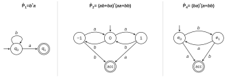
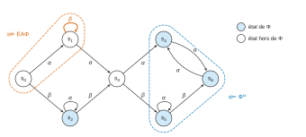
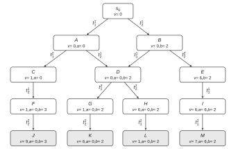
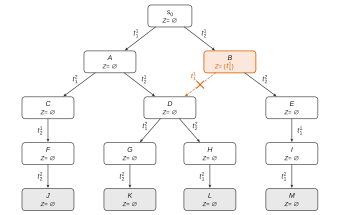

# X-ENS MPI — Informatique C 2026 · Corrigé guidé

*Corrigé rédigé par IA, non officiel. Signalez toute erreur.*

## Présentation du sujet

**Thème.** Le sujet s'intitule *Vérification de systèmes concurrents*. Il porte sur le *model checking* : on vérifie algorithmiquement des propriétés des exécutions infinies d'un système de transitions (sorte d'automate sans état initial ni acceptation), puis on applique ces outils à des programmes multi-threads et on réduit l'explosion combinatoire due aux entrelacements. Épreuve de 4 h, sans calculatrice, 24 questions sur 17 pages. Langages : OCaml (parties I et II) et C avec `pthread` (partie III).

- **Partie I, Systèmes de transitions (Q1 à Q6).** Invariants, propriétés de sûreté, préfixes interdits et régularité. On termine par une construction produit qui ramène la satisfaction d'une propriété de sûreté à de l'accessibilité.
- **Partie II, Ultime invariance (Q7 à Q12).** Propriété « à partir d'un moment, toujours dans $\Phi$ ». On prouve l'algorithme des parcours en profondeur imbriqués (*nested DFS*). Partie indépendante du reste.
- **Partie III, Programmation multi-threads en C (Q13, Q14).** Course sur une variable partagée, verrou, création et attente de threads.
- **Partie IV, Systèmes de transitions concurrents (Q15 à Q24).** Indépendance d'actions, ensembles persistants, équivalence par permutation (traces de Mazurkiewicz), ordres induits, mise en veille (*sleep sets*) et minima lexicographiques.

**Notions mobilisées.** Langages réguliers et lemme de l'étoile ; automates déterministes et construction produit ; parcours en profondeur, ordre postfixe, détection de cycles ; preuves de programmes (invariants, pré- et postconditions) ; programmation concurrente en C (threads, verrous, sections critiques) ; récurrences sur la longueur des mots et des exécutions ; ordres partiels.

**Difficulté et longueur.** Le sujet est long et très théorique. Les questions de code sont courtes (Q5, Q10, Q14) et ont été nettement mieux réussies que les preuves techniques.

**Ce qu'en dit le jury (rapport 2026).** Le rapport donne, pour chaque question, le pourcentage de copies qui l'ont traitée et celui des copies qui ont eu tous les points.

- Les questions 9 et 11 ont été « les principaux obstacles de la partie II » : 1 % et 0 % de réussite complète.
- Q3 (8 %), Q4 (9 %), Q6 (4 %), Q16 (12 %), Q18 (3 %) et Q19 (3 %) sont peu souvent réussies entièrement, en général faute de justification.
- La fin de la partie IV « n'a été atteinte que par un très petit nombre de candidats » : Q21 est traitée par 10 % des copies, Q23 et Q24 par 1 %.
- Le début de chaque partie a permis de reprendre pied : le nombre de copies qui traitent une question remonte nettement au début de chaque nouvelle partie.

Le jury insiste sur trois points. Les preuves de programmes doivent dire « ce que l'on suppose avant l'appel, ce qui est garanti après l'appel, quelles exceptions peuvent être levées ». Le code doit être écrit dans le langage imposé (Q5, Q10, Q14) ; une description de haut niveau n'est recevable que là où l'énoncé l'autorise, comme en Q13. Enfin, en concurrence, « Deux actions ne sont pas indépendantes simplement parce qu'elles appartiennent à deux threads différents » : il faut examiner ce qu'elles lisent et écrivent.

**À ne pas laisser passer.** Q1, Q2, Q5, Q7, Q8, Q10, Q13, Q14, Q15 et Q17 sont abordables. Elles sont traitées par la plupart des copies, mais beaucoup y perdent des points faute de justification : Q1 n'est entièrement réussie que par 46 % des copies, Q5 par 22 %, Q7 par 37 %, Q15 par 19 %. Rédigez-les complètement.

**Gestion du temps.** Comptez environ 1 h pour la partie I, 1 h pour la partie II, 30 min pour la partie III et 1 h 30 pour la partie IV. La partie II est indépendante et la partie III ne demande aucun prérequis : si vous bloquez sur Q9, passez à la partie III puis revenez-y.

---

## Partie I — Systèmes de transitions

On installe le vocabulaire : invariants, propriétés de sûreté et préfixes interdits, régularité. Puis on ramène la satisfaction d'une propriété de sûreté régulière à un problème d'accessibilité. Outils : définitions, langages réguliers, lemme de l'étoile, parcours de graphe en OCaml.

### Question 1

> [!INDICATION]
> Deux implications. Pour (a) ⇒ (b), suivez une exécution infinie pas à pas.

> [!INDICATION]
> Pour (b) ⇒ (a), il faut fabriquer une exécution infinie qui commence par une transition donnée : où sert l'hypothèse « aucun état terminal » ?

#### Solution

On suppose que $T$ n'a aucun état terminal et l'on pose $P=I^\omega$.

**(a) ⇒ (b).** Soit $I$ un invariant, $s\in I$ et $\pi:s_0\xrightarrow{\alpha_0}s_1\xrightarrow{\alpha_1}\cdots$ une exécution infinie avec $s_0=s$.

Montrons par récurrence sur $i$ que $s_i\in I$. On a $s_0=s\in I$. Si $s_i\in I$, comme $\alpha_i\in\mathcal D(s_i)$, la définition d'invariant donne $s_{i+1}=\delta(s_i,\alpha_i)\in I$.

Donc $\mathrm{trace}(\pi)\in I^\omega$ pour toute exécution infinie $\pi$ issue de $s$, c'est-à-dire $s\models P$.

**(b) ⇒ (a).** Soit $s\in I$, $\alpha\in\mathcal D(s)$ et $s'=\delta(s,\alpha)$. Il faut montrer $s'\in I$.

*Prolongement.* Comme aucun état n'est terminal, on construit par récurrence une suite $x_0=s'$, $x_1$, $x_2$… : on choisit une action $\beta_k\in\mathcal D(x_k)$, ensemble non vide, et l'on pose $x_{k+1}=\delta(x_k,\beta_k)$.

On obtient une exécution infinie $s\xrightarrow{\alpha}s'\xrightarrow{\beta_0}x_1\xrightarrow{\beta_1}\cdots$ issue de $s$.

Comme $s\models P$, sa trace $s\,s'\,x_1\cdots$ est dans $I^\omega$ ; sa deuxième lettre donne $s'\in I$. Ainsi $I$ est un invariant.

**Les conditions (a) et (b) sont équivalentes.** L'absence d'état terminal ne sert que dans le sens (b) ⇒ (a), pour prolonger la transition $s\xrightarrow{\alpha}s'$ en une exécution infinie.

> [!PIEGE]
> Sans l'hypothèse d'absence d'état terminal, (b) ⇒ (a) est faux : si $s'=\delta(s,\alpha)$ est terminal et hors de $I$, aucune exécution infinie ne passe par $s'$, et $s\models I^\omega$ peut rester vrai. Dites explicitement où l'hypothèse intervient.

> [!JURY]
> Rapport 2026 : Q1 est traitée par 99 % des copies, entièrement réussie par 46 %. Le sens direct demande une vraie récurrence sur les états de l'exécution, et non une idée « formulée de manière trop informelle ». Pour la réciproque, « Les raisonnements par l'absurde ou par contraposée étaient possibles, à condition de faire apparaître explicitement ce prolongement. »

### Question 2

> [!INDICATION]
> Revenez à la définition : pour un mot hors de $P$, cherchez un préfixe qu'aucun prolongement ne peut « réparer ».

> [!INDICATION]
> Les propriétés qui parlent de « infiniment souvent » ou de « un nombre fini de fois » ne se décident jamais sur un préfixe fini.

#### Solution

Soit $a\neq b$ deux états de $S$.

- **$P_1$ est une propriété de sûreté.** Soit $w\notin P_1$ : tout état apparaît dans $w$. Pour chaque $s\in S$, on fixe une position $i_s$ telle que $w_{i_s}=s$.

  On prend pour $\hat w$ le préfixe de longueur $1+\max_s i_s$, fini car $S$ est fini. Pour tout $w'$, chaque état apparaît dans $\hat w w'$, donc $\hat w w'\notin P_1$.
- **$P_2$ n'est pas une propriété de sûreté.** Le mot $w=a^\omega$ n'est pas dans $P_2$, car $|w|_b=0$.

  Soit $e$ un mot fini qui contient chaque état de $S$. Pour tout préfixe $\hat w$ de $w$, on a $\hat w\,e^\omega\in P_2$. Aucun préfixe de $w$ ne convient.
- **$P_3$ n'est pas une propriété de sûreté.** Le mot $w=e^\omega$ contient chaque état infiniment souvent, donc $w\notin P_3$.

  Pour tout préfixe $\hat w$ de $w$, le mot $\hat w\,a^\omega$ ne contient $b$ qu'un nombre fini de fois : $\hat w\,a^\omega\in P_3$.

$$\boxed{\text{Seule } P_1 \text{ est une propriété de sûreté.}}$$

> [!METHODE]
> Pour montrer qu'une propriété **n'est pas** de sûreté, exhibez un mot $w\notin P$ et, pour **chaque** préfixe $\hat w$, un prolongement $\hat ww'\in P$. Les prolongements périodiques ($e^\omega$, $a^\omega$) sont les témoins naturels.

> [!PIEGE]
> Les erreurs les plus fréquentes, selon le rapport 2026, portent sur les quantificateurs : distinguer « il existe un état apparaissant une infinité de fois » et « tous les états apparaissent une infinité de fois ». Ici, le complémentaire de $P_3$ est « tous les états apparaissent une infinité de fois ».

> [!JURY]
> « Une réponse réduite à une liste, sans justification, était insuffisante » (rapport 2026) : pour chaque propriété, exhibez un préfixe interdit ou montrez qu'aucun préfixe ne convient.

### Question 3

> [!INDICATION]
> Toutes ces propriétés sont de la forme « tout préfixe vérifie $C$ ». Caractérisez les préfixes interdits minimaux : le premier instant où $C$ est violée.

> [!INDICATION]
> Suivez le déséquilibre $d(u)=|u|_a-|u|_b$. S'il reste borné le long des préfixes autorisés, un automate fini suffit ; sinon, pensez au lemme de l'étoile sur un mot de la forme $b^pa^{q}$.

#### Solution

Ici $S=\{a,b\}$ sert d'alphabet. Les quatre propriétés sont de la forme « tout préfixe $u$ vérifie $C(u)$ ».

Un mot fini $u$ est alors un préfixe interdit si et seulement si l'un de ses préfixes viole $C$ : dans ce cas, aucun prolongement ne peut être dans $P$. Il est minimal si et seulement si $u$ viole $C$ alors que tous ses préfixes stricts la vérifient.

Pour $P_2$ à $P_4$, on note $d(u)=|u|_a-|u|_b$.

1. **$P_1$ est régulière.** Le mot $u$ viole $C$ si et seulement si $u$ contient un $a$.

   Les minimaux sont les mots dont seule la dernière lettre est un $a$ : $\hat P_1=b^*a$.

   Automate : figure 1, à gauche ($q_0$ initial, $q_1$ acceptant).
2. **$P_2$ est régulière.** La contrainte est $|d(u)|\le1$. Le long d'un préfixe autorisé, $d$ reste dans $\{-1,0,1\}$ ; le premier préfixe interdit est celui où $d$ atteint $\pm2$.

   Donc $\hat P_2=(ab+ba)^*(aa+bb)$. Automate déterministe (figure 1, au centre) : l'état est le déséquilibre $d\in\{-1,0,1\}$, initial $0$ ; on entre dans l'état acceptant $\mathrm{acc}$ quand $|d|$ atteint $2$.
3. **$P_3$ n'est pas régulière.** La contrainte est $d(u)\le0$. Les préfixes interdits minimaux sont les mots $u$ tels que $d(u)=1$ et $d(v)\le0$ pour tout préfixe strict $v$.

   En particulier, pour $n\ge0$, on a $b^na^m\in\hat P_3$ si et seulement si $m=n+1$.

   Supposons $\hat P_3$ régulier et soit $p$ la constante du lemme de l'étoile. Le mot $z=b^pa^{p+1}$ est dans $\hat P_3$.

   Toute décomposition $z=xyz'$ avec $|xy|\le p$ et $|y|=k\ge1$ a $y=b^k$. Le lemme de l'étoile affirme alors $xy^2z'=b^{p+k}a^{p+1}\in\hat P_3$.

   Or le déséquilibre de ce mot vaut :

   $$\begin{aligned}d(b^{p+k}a^{p+1})&=(p+1)-(p+k)\\&=1-k.\end{aligned}$$

   Comme $k\ge1$, on a $1-k\le0$. Tous les préfixes de ce mot vérifient aussi $d\le0$ : il n'est même pas interdit. Contradiction : **$\hat P_3$ n'est pas régulier.**
4. **$P_4$ est régulière.** La contrainte est $-d(u)=|u|_b-|u|_a\in\{0,1\}$. Depuis $d=0$ on doit lire $b$, depuis $d=-1$ on doit lire $a$.

   Donc $P_4=\{(ba)^\omega\}$ et $\hat P_4=(ba)^*(a+bb)$. Automate déterministe (figure 1, à droite) : $e_0$ et $e_1$ codent $d=0$ et $d=-1$.



$$\boxed{P_1,\ P_2,\ P_4 \text{ sont régulières ; } P_3 \text{ ne l'est pas.}}$$

> [!PIEGE]
> Dans le lemme de l'étoile, concluez sur le **bon** fait : le mot pompé $b^{p+k}a^{p+1}$ n'est pas dans $\hat P_3$ parce que son déséquilibre final vaut $1-k\le 0$ (il n'est même pas interdit). Et n'oubliez pas de donner un automate pour **chaque** $\hat P_i$ régulier, comme le demande l'énoncé.

> [!METHODE]
> Vérifier une expression rationnelle sur les petits mots (longueur 0 à 4) à la main évite les oublis : ici $(ab+ba)^*(aa+bb)$ contient bien $aa$, $abbb$, $baaa$, et pas $ab$.

> [!PIEGE]
> Pour $P_3$, montrer qu'un langage non régulier est inclus dans $\hat P_3$ ne prouve rien : le rapport 2026 rappelle qu'« exhiber un langage non régulier strictement inclus dans l'ensemble étudié ne suffit pas à conclure ». Une intersection avec un langage régulier doit se faire dans le bon sens : si $\hat P_3$ était régulier, $\hat P_3\cap b^*a^*$ le serait aussi.

> [!JURY]
> Rapport 2026 : 96 % des copies traitent Q3, mais 8 % seulement ont tous les points. Les propriétés régulières doivent être accompagnées « d'un automate ou, au minimum, d'une description suffisamment précise d'un automate reconnaissant les préfixes interdits minimaux ». Le lemme de l'étoile, un argument de tiroirs sur les états d'un automate ou le théorème de Myhill-Nerode conviennent pour $P_3$.

### Question 4

> [!INDICATION]
> Comparez les deux ensembles : comment passer des préfixes interdits minimaux à tous les préfixes interdits, et inversement ?

> [!INDICATION]
> Un prolongement d'un préfixe interdit est encore interdit. Écrivez chaque ensemble à partir de l'autre avec des opérations rationnelles (concaténation, différence).

#### Solution

Soit $F$ l'ensemble des préfixes interdits et $\hat P$ celui des préfixes interdits minimaux.

- **$F$ est clos par prolongement.** Soit $u\in F$ et $x\in S^*$. Pour tout $v\in S^\omega$, on a $(ux)v=u(xv)\notin P$, donc $ux\in F$.
- **$F=\hat P\,S^*$.** Si $u\in F$, son plus court préfixe appartenant à $F$ est minimal, donc $u\in\hat P S^*$. Réciproquement, $\hat P\subseteq F$ et $F$ est clos par prolongement.
- **$\hat P=F\setminus F\,S^+$.** Un mot $u\in F$ n'est pas minimal si et seulement s'il a un préfixe strict dans $F$, c'est-à-dire si et seulement si $u\in F S^+$.

*Sens direct.* Si $\hat P$ est régulier, $F=\hat PS^*$ l'est, comme concaténation de deux langages réguliers.

*Sens réciproque.* Supposons $F$ régulier. Alors $FS^+$ est régulier (concaténation), et $\hat P=F\setminus FS^+$ aussi (clôture par complémentaire et intersection).

Construction explicite : soit $\mathcal B$ un automate déterministe complet reconnaissant $F$. On ajoute un état puits non acceptant et l'on redirige vers ce puits toutes les transitions qui partent d'un état acceptant.

Un mot est accepté par le nouvel automate si et seulement si sa lecture par $\mathcal B$ atteint un état acceptant à la fin, et à la fin seulement. Cela signifie que le mot est dans $F$ et qu'aucun de ses préfixes stricts n'y est : c'est exactement $\hat P$.

**L'ensemble des préfixes interdits minimaux est régulier si et seulement si celui des préfixes interdits l'est.**

> [!METHODE]
> « Minimal pour les préfixes » se traduit par $L\setminus LS^+$ : c'est un réflexe à connaître pour passer d'un langage à ses éléments sans préfixe strict dans $L$.

> [!JURY]
> Rapport 2026 (79 % des copies, 9 % de réussite complète) : « Plusieurs copies ont donné une formule ensembliste correcte ou presque correcte, mais sans justification suffisante. » Le jury attendait, pour la réciproque, un automate déterministe de $F$ modifié pour n'accepter que les mots « qui deviennent interdits pour la première fois » : c'est la construction par état puits donnée ci-dessus.

### Question 5

> [!INDICATION]
> Un parcours de graphe classique suffit : lequel, et avec quelle structure pour garantir la terminaison ?

> [!INDICATION]
> Pour la correction, montrez que l'ensemble des états marqués est clos par successeur quand la recherche échoue.

#### Solution

Parcours en profondeur avec un tableau de marquage.

```ocaml
let reachable (t:trans_sys) (s0:state) (target:state->bool) : bool =
  let vu = Array.make t.size false in   (* états déjà visités *)
  let trouve = ref false in
  let rec visite s =
    if not !trouve && not vu.(s) then begin
      vu.(s) <- true;
      if target s then trouve := true
      else List.iter (fun (_, s') -> visite s') (t.next s)
    end
  in
  visite s0;
  !trouve
```

**Correction.** Tout état passé à `visite` est accessible depuis `s0` : c'est vrai pour `s0`, et un état visité depuis `s` en est un successeur. Si `!trouve` vaut `true`, un état accessible vérifie donc `target`.

Réciproquement, supposons qu'aucun état visité ne vérifie `target`. Alors `trouve` reste faux, et tout état marqué a eu tous ses successeurs visités, donc marqués.

L'ensemble des états marqués contient `s0` et il est clos par successeur : il contient tous les états accessibles. Aucun état accessible ne vérifie `target`, et `false` est la bonne réponse.

**Terminaison.** Chaque appel qui ne s'arrête pas aussitôt marque un nouvel état ; il y a au plus `t.size` tels appels.

**Complexité.** Soit $n=|S|$ le nombre d'états. Le nombre de transitions (arêtes du graphe) est $m=\sum_s|\mathcal D(s)|$.

Comme une liste `t.next s` ne répète aucune action, $|\mathcal D(s)|\le|A|$ et donc $m\le n\,|A|$. Il ne faut pas confondre $|A|$, nombre d'actions, avec $m$, nombre d'arêtes.

`Array.make` coûte $O(n)$. Chaque état est développé au plus une fois, pour un coût $O(1+|\mathcal D(s)|)$ (appel `t.next s` en temps constant, puis parcours de la liste). Chaque arête provoque au plus un appel. Au total :

$$\boxed{O(n+m)=O(n\,|A|)}$$

> [!PIEGE]
> « L'oubli du tableau de marquage conduisait à des boucles infinies sur les systèmes contenant des cycles » (rapport 2026). Oublier de tester `target s0` exclut l'exécution de longueur nulle.

> [!JURY]
> Rapport 2026 : 94 % des copies traitent Q5, 22 % ont tous les points. La complexité doit être exprimée « en fonction du nombre d'états et du coût du parcours des listes de transitions ». Et « Il fallait éviter l'ambiguïté entre $|A|$, nombre d'actions, et le nombre d'arêtes du graphe de transitions » : d'où les deux écritures $O(n+m)$ et $O(n|A|)$, avec $m\le n|A|$ justifié.

### Question 6

> [!INDICATION]
> Faites lire la trace de l'exécution par l'automate, en parallèle de $T$ : c'est une construction produit.

> [!INDICATION]
> Choisissez avec soin quel état l'automate lit à chaque transition pour que, après $k$ pas, il ait lu exactement les $k$ premières lettres de la trace, préfixe vide compris.

> [!INDICATION]
> Les états cibles sont ceux dont la composante automate est acceptante. Pour le sens « $C$ accessible ⇒ $s\not\models P$ », il faut prolonger une exécution finie : quelle hypothèse le permet ?

#### Solution

Soit $\mathcal A=(Q,S,q_0,F,\delta_{\mathcal A})$ un automate déterministe complet, d'alphabet $S$, reconnaissant $\hat P$. On définit :

$$\begin{aligned}
S'&=S\times Q,\\
\mathcal D'((s,q))&=\mathcal D(s),\\
\delta'((s,q),\alpha)&=\big(\delta(s,\alpha),\ \delta_{\mathcal A}(q,s)\big)\quad\text{pour }\alpha\in\mathcal D(s),\\
\iota(s)&=(s,q_0),\\
C&=S\times F.
\end{aligned}$$

Les actions sont celles de $T$. L'automate lit l'état *quitté* à chaque transition.

**Lien entre les exécutions.** Comme $\mathcal D'((s,q))=\mathcal D(s)$, toute exécution $s_0\xrightarrow{\alpha_0}\cdots\xrightarrow{\alpha_{k-1}}s_k$ de $T$ se relève, de manière unique, en une exécution de $T_{\mathcal A}$ depuis $\iota(s_0)$.

Inversement, toute exécution de $T_{\mathcal A}$ depuis $\iota(s_0)$ se projette sur une exécution de $T$.

Par récurrence sur $k$, l'état atteint après $k$ pas est

$$\big(s_k,\ \delta_{\mathcal A}^*(q_0,\,s_0s_1\cdots s_{k-1})\big).$$

Il est dans $C$ si et seulement si le préfixe $s_0\cdots s_{k-1}$ de la trace, de longueur $k$, est dans $\hat P$ (cas $k=0$ compris).

**Équivalence.** On utilise le résultat admis : $w\notin P$ si et seulement si un préfixe de $w$ est dans $\hat P$.

- *Si $s\not\models P$.* Une exécution infinie $\pi$ depuis $s$ a une trace hors de $P$. Un préfixe $s_0\cdots s_{k-1}$ de cette trace est dans $\hat P$.

  Les $k$ premiers pas de $\pi$, relevés dans $T_{\mathcal A}$, mènent de $\iota(s)$ dans $C$.
- *Si $C$ est accessible depuis $\iota(s)$ en $k$ pas.* La projection est une exécution finie $s=s_0\to\cdots\to s_k$ avec $s_0\cdots s_{k-1}\in\hat P$.

  Comme $T$ n'a pas d'état terminal, on la prolonge en une exécution infinie (comme en Q1). Sa trace a un préfixe dans $\hat P$, donc n'est pas dans $P$ : $s\not\models P$.

$$\boxed{\ s\not\models P\iff C \text{ est accessible depuis } \iota(s) \text{ dans } T_{\mathcal A}\ }$$

Il suffit alors d'appeler `reachable` (Q5) sur $T_{\mathcal A}$, qui a $|S|\cdot|Q|$ états.

> [!PIEGE]
> Si l'automate lit l'état d'arrivée, avec $\iota(s)=(s,\delta_{\mathcal A}(q_0,s))$, le préfixe vide n'est jamais testé et le cas $\epsilon\in\hat P$ (c'est-à-dire $P=\varnothing$) doit être traité à part. Faire lire l'état quitté donne une construction uniforme.

> [!JURY]
> Q6 n'est traitée que par 36 % des copies, et réussie entièrement par 4 % (rapport 2026). La réponse doit définir les états, les actions disponibles, la transition, l'application $\iota$ et l'ensemble cible, puis prouver les deux implications. « Certaines réponses ont décrit l'idée générale sans définir précisément le système construit, ce qui ne suffisait pas. »

---

## Partie II — Ultime invariance

On caractérise $\mathsf{EA}\Phi$ par l'existence d'un « mauvais » cycle accessible. On prouve ensuite l'algorithme des parcours imbriqués, dont la correction repose sur une propriété fine de l'ordre postfixe d'un parcours en profondeur (Q9).

Système de la figure 2, lu sur le dessin (successeur de chaque état par chaque action) :

| État | par $\alpha$ | par $\beta$ |
|---|---|---|
| $s_0$ | $s_1$ | $s_2$ |
| $s_1$ | $s_3$ | $s_1$ |
| $s_2$ | $s_2$ | $s_3$ |
| $s_3$ | $s_4$ | $s_5$ |
| $s_4$ | $s_6$ | — |
| $s_5$ | $s_5$ | $s_6$ |
| $s_6$ | $s_4$ | — |

Aucun état n'est terminal.

### Question 7

> [!INDICATION]
> Reconstituez d'abord soigneusement les transitions de la figure 2 et listez les états hors de $\Phi$.

> [!INDICATION]
> Pour $\Phi^\omega$, utilisez Q1 : il faut que tout ce qui est accessible reste dans $\Phi$. Pour $\mathsf{EA}\Phi$, appliquez la caractérisation de Q8 (on peut l'utiliser par anticipation).

#### Solution

On a $\Phi=\{s_2,s_4,s_5,s_6\}$.



**$\Phi^\omega$.** D'après Q1 (sans état terminal), $s\models\Phi^\omega$ si et seulement si tous les états accessibles depuis $s$, $s$ compris, sont dans $\Phi$.

- Depuis $s_4$, $s_5$ ou $s_6$, on n'atteint que $\{s_4,s_5,s_6\}\subseteq\Phi$ : ces trois états conviennent.
- Depuis $s_2$, on atteint $s_3\notin\Phi$ par $s_2\xrightarrow{\beta}s_3$ : $s_2$ ne convient pas.
- Les états $s_0$, $s_1$, $s_3$ ne sont pas dans $\Phi$.

$$\boxed{s\models\Phi^\omega\iff s\in\{s_4,s_5,s_6\}}$$

**$\mathsf{EA}\Phi$.** D'après Q8, $s\not\models\mathsf{EA}\Phi$ si et seulement si un état hors de $\Phi$ et situé sur un cycle est accessible depuis $s$.

Les états hors de $\Phi$ sont $s_0$, $s_1$ et $s_3$. Seul $s_1$ est sur un cycle (boucle $\beta$).

En effet, $s_0$ n'a pas de prédécesseur, et depuis $s_3$ on ne revient jamais à $s_3$. Or $s_1$ n'est accessible que depuis $s_0$ et $s_1$.

En particulier, $s_2$ satisfait $\mathsf{EA}\Phi$ : une exécution depuis $s_2$ reste en $s_2$ ou passe une seule fois par $s_3$, puis reste dans $\{s_4,s_5,s_6\}\subseteq\Phi$.

$$\boxed{s\models\mathsf{EA}\Phi\iff s\in\{s_2,s_3,s_4,s_5,s_6\}}$$

> [!METHODE]
> Vérifiez la cohérence : $\Phi^\omega\subseteq\mathsf{EA}\Phi$, donc l'ensemble des états qui satisfont $\Phi^\omega$ doit être inclus dans celui des états qui satisfont $\mathsf{EA}\Phi$.

> [!PIEGE]
> « L'état $s_2$ a été fréquemment oublié » (rapport 2026). Une transition mène de $s_2$ à $s_3\notin\Phi$, mais on ne peut la prendre qu'une fois : toute exécution issue de $s_2$ finit par rester dans $\Phi$.
>
> Ainsi $s_2$ ne satisfait pas $\Phi^\omega$, mais il satisfait $\mathsf{EA}\Phi$.

> [!JURY]
> Rapport 2026 : question traitée par 97 % des copies, mais les justifications « ont souvent été trop rapides » (37 % de réussite complète). Pour $\Phi^\omega$, il faut que toutes les exécutions restent dans $\Phi$ ; pour $\mathsf{EA}\Phi$, il faut raisonner sur le comportement à long terme de toutes les exécutions.

### Question 8

> [!INDICATION]
> Un sens se démontre en construisant une exécution qui tourne indéfiniment dans le cycle.

> [!INDICATION]
> Pour l'autre sens : une trace hors de $\mathsf{EA}\Phi$ sort de $\Phi$ une infinité de fois. Que dit le principe des tiroirs, $S$ étant fini ?

#### Solution

**(⇐)** Soit $s'\notin\Phi$ accessible depuis $s$ par une exécution $\rho$, et $\sigma$ une exécution non vide de $s'$ à $s'$.

L'exécution infinie $\rho\,\sigma\,\sigma\cdots$ depuis $s$ passe par $s'\notin\Phi$ à une infinité de positions. Sa trace n'est donc pas dans $\mathsf{EA}\Phi$, et $s\not\models\mathsf{EA}\Phi$.

**(⇒)** Si $s\not\models\mathsf{EA}\Phi$, une exécution infinie depuis $s$ a une trace $(s_i)$ telle que

$$\forall i\in\mathbb N,\ \exists j\ge i,\ s_j\notin\Phi.$$

Il y a donc une infinité de positions hors de $\Phi$. Comme $S$ est fini, un même état $s'\notin\Phi$ occupe deux positions $p<q$.

Alors $s'$ est accessible depuis $s$, par le préfixe de longueur $p$ de l'exécution.

Et le segment entre les positions $p$ et $q$ est une exécution de longueur $q-p\ge1$ de $s'$ à $s'$.

> [!JURY]
> Rapport 2026 : « L'argument repose sur la finitude de l'ensemble des états. Il ne suffisait pas d'affirmer qu'on peut toujours poursuivre vers un état ne satisfaisant pas la propriété. » C'est la finitude de $S$ qui fait passer d'une infinité de positions hors de $\Phi$ à un même état hors de $\Phi$ visité deux fois.

### Question 9

> [!INDICATION]
> Identifiez l'énumération : c'est l'ordre dans lequel se terminent les appels récursifs du parcours.

> [!INDICATION]
> Deux propriétés de cet ordre suffisent. Les descendants d'un nœud forment un bloc consécutif qui se termine par ce nœud. Et si une transition $x\to y$ « remonte » ($y$ après $x$), que peut-on dire de l'appel sur $y$ quand celui sur $x$ se termine ?

> [!INDICATION]
> Le long de l'exécution $s_1\to\cdots\to s_2$, considérez le premier état énuméré après $s_1$, et utilisez le bloc de ses descendants.

#### Solution

On note $\mathrm{pos}(x)$ le rang de $x$ dans l'énumération.

Le parcours en profondeur est récursif : l'appel sur $x$ marque $x$, puis lance le parcours sur chaque successeur non marqué. Les fils de $x$ dans l'arbre sont les états dont l'appel est lancé directement par celui de $x$.

L'appel sur $x$ se termine après ceux de tous ses fils, et les fils se terminent dans l'ordre où ils ont été visités. L'énumération décrite par (a) et (b) est donc exactement **l'ordre de fin des appels récursifs**.

**Lemme 1 (contiguïté).** Pour tout $x$, les descendants de $x$ ($x$ compris) occupent un bloc de rangs consécutifs, dont $x$ est le dernier élément.

C'est vrai pour une feuille. Soit $x$ un nœud de fils $c_1,\dots,c_r$, visités dans cet ordre. Par (a) et (b), l'énumération du sous-arbre de $x$ est celle du sous-arbre de $c_1$, puis celle du sous-arbre de $c_2$, …, puis $x$. On conclut par récurrence sur la hauteur.

**Lemme 2 (arcs montants).** Si $x\to y$ est une transition entre états accessibles et $\mathrm{pos}(x)<\mathrm{pos}(y)$, alors $y$ est un ancêtre strict de $x$.

En effet, à la fin de l'appel sur $x$, l'arc $x\to y$ a été examiné, donc $y$ est marqué : son appel a commencé. Il ne s'est pas terminé, puisque $\mathrm{pos}(y)>\mathrm{pos}(x)$.

L'appel sur $y$ est donc encore dans la pile des appels en cours. Or les appels en cours au moment où l'on termine $x$ sont exactement ceux des ancêtres de $x$. Enfin $y\neq x$.

**Preuve.** Soit $s_1=x_0\to x_1\to\cdots\to x_k=s_2$ une exécution, avec $\mathrm{pos}(s_1)<\mathrm{pos}(s_2)$, donc $s_1\neq s_2$ et $k\ge1$.

Soit $j\ge1$ le plus petit indice tel que $\mathrm{pos}(x_j)>\mathrm{pos}(s_1)$ ; il existe, car $j=k$ convient. Alors

$$\mathrm{pos}(x_{j-1})\le\mathrm{pos}(s_1)<\mathrm{pos}(x_j).$$

Par le lemme 2, $x_j$ est un ancêtre de $x_{j-1}$. Par le lemme 1, les descendants de $x_j$ forment un bloc de rangs consécutifs qui se termine en $x_j$ et contient $\mathrm{pos}(x_{j-1})$.

Ce bloc contient donc aussi $\mathrm{pos}(s_1)$, compris entre les deux : $s_1$ est un descendant strict de $x_j$.

Le chemin de l'arbre de $x_j$ à $s_1$ est une exécution de longueur $\ge1$, car les arcs de l'arbre sont des transitions.

Par ailleurs $x_0\to\cdots\to x_j$ est une exécution de longueur $j\ge1$ de $s_1$ à $x_j$. Leur concaténation est une exécution de longueur non nulle de $s_1$ à $s_1$.

Cette preuve couvre les deux configurations possibles. Si $s_2$ est un ancêtre de $s_1$ (sous-arbres imbriqués), on peut avoir $x_j=s_2$.

Si $s_1$ et $s_2$ sont dans des sous-arbres disjoints, la condition (b) intervient par le lemme 1 : le chemin doit remonter vers un ancêtre commun $x_j$ dont le bloc contient $s_1$.

**$s_1$ fait un cycle sur lui-même.**

> [!PIEGE]
> Il est faux en général que $s_2$ soit un ancêtre de $s_1$ : ce qu'on obtient, c'est un **ancêtre commun** $x_j$ du chemin, dont $s_1$ est descendant. Selon le rapport 2026, « De nombreuses copies ont traité correctement le cas où les deux états se trouvent dans des sous-arbres imbriqués, mais ont omis le cas des sous-arbres disjoints. » C'est ce cas qui exige la condition (b).

> [!METHODE]
> Lemme à retenir : dans l'ordre de fin d'un parcours en profondeur, un arc qui va vers un sommet terminé plus tard est un **arc arrière** (vers un ancêtre). C'est la base de la détection de cycles et du tri topologique.

> [!JURY]
> Question la plus sélective de la partie II avec Q11 : traitée par 69 % des copies, entièrement réussie par 1 % (rapport 2026). Le jury attendait l'usage explicite des deux propriétés de l'énumération, ordre postfixe et ordre entre sous-arbres frères.

### Question 10

> [!INDICATION]
> Partez d'un parcours en profondeur récursif avec marquage.

> [!INDICATION]
> Où placer l'appel à `f` pour que chaque état soit traité après tous ses descendants ?

#### Solution

```ocaml
let outer_iter (t:trans_sys) (s0:state) (f:state->unit) : unit =
  let vu = Array.make t.size false in   (* marquage local à cet appel *)
  let rec visite s =
    if not vu.(s) then begin
      vu.(s) <- true;                   (* marqué dès la première visite *)
      List.iter (fun (_, s') -> visite s') (t.next s);
      f s   (* après tous les descendants : ordre postfixe *)
    end
  in
  visite s0                             (* f est aussi appelée sur s0, en dernier *)
```

Chaque état accessible est visité une fois. `f s` est appelé à la fin de l'appel sur `s`, donc dans l'ordre de fin des appels. C'est l'ordre postfixe (a).

Les fils sont traités dans l'ordre de `List.iter`, donc énumérés dans leur ordre de visite (b). Le coût, hors appels à `f`, est $O(n+m)$.

> [!PIEGE]
> Appeler `f s` avant `List.iter` donne l'ordre préfixe : c'est précisément ce que Q12 montre être incorrect. Le rapport 2026 relève aussi « l'absence ou la mauvaise portée du tableau de marquage », « l'oubli de l'appel à f sur l'état initial », et l'oubli que `t.next` renvoie des paires dont il faut prendre la seconde composante.

### Question 11

> [!INDICATION]
> Notez $M$ l'ensemble des états marqués. Quelle propriété de clôture $M$ conserve-t-il d'un appel à l'autre ?

> [!INDICATION]
> Le danger vient du partage de `marked` : si `start` est déjà marqué, l'appel ne fait rien. Mettez en précondition qu'un état sur un cycle n'est jamais déjà marqué.

> [!INDICATION]
> Pour établir cette précondition dans `verify`, raisonnez par l'absurde : si `start` a été marqué par un appel antérieur sur $x$, il existe une exécution de $x$ à `start`, avec $x$ énuméré avant. Appliquez Q9.

#### Solution

On note $M$ l'ensemble des états marqués (`marked.(s) = true`).

On écrit $x\to^+y$ s'il existe une exécution de longueur $\ge1$ de $x$ à $y$, et $\mathrm{Acc}(x)$ pour l'ensemble des états accessibles depuis $x$.

**Spécification de `cycle_check start`.**

- *Précondition (P1).* $M$ est clos par successeur : si $z\in M$ et $z\to z'$, alors $z'\in M$.
- *Précondition (P2).* Si `start` est sur un cycle ($\texttt{start}\to^+\texttt{start}$), alors $\texttt{start}\notin M$.
- *Postcondition, en l'absence d'exception.* `start` n'est sur aucun cycle, et le nouvel ensemble marqué est $M'=M\cup\mathrm{Acc}(\texttt{start})$. $M'$ est encore clos par successeur.
- *Exception.* `Found` est levée si et seulement si `start` est sur un cycle. L'état de `marked` après la levée est alors sans importance.

**Preuve.** *Exception ⇒ cycle.* Si `Found` est levée, c'est dans `inner_visit s`, en examinant un successeur `s'` de `s` égal à `start`. Or `s` a été atteint depuis `start` par une chaîne d'appels, c'est-à-dire par une exécution. Donc $\texttt{start}\to^*s\to\texttt{start}$ : `start` est sur un cycle. Cette implication est vraie sans précondition.

*Cas $\texttt{start}\in M$.* L'appel ne fait rien. Par (P2), `start` n'est pas sur un cycle. Par (P1), $\mathrm{Acc}(\texttt{start})\subseteq M$, donc $M'=M$ convient.

*Cas $\texttt{start}\notin M$, sans exception.* Chaque état $z$ marqué pendant l'appel a vu tous ses successeurs visités, donc marqués. Avec (P1), $M'$ est clos par successeur et contient `start`, d'où $M'\supseteq M\cup\mathrm{Acc}(\texttt{start})$. L'inclusion inverse vient de ce que `inner_visit` ne parcourt que des états accessibles depuis `start`.

*Cas $\texttt{start}\notin M$, `start` sur un cycle.* Soit $\texttt{start}=c_0\to c_1\to\cdots\to c_r=\texttt{start}$ avec $r\ge1$.

Aucun $c_i$ n'est dans $M$ : sinon, par (P1), `start`, accessible depuis $c_i$, serait dans $M$.

Montrons qu'alors `Found` est levée. Sinon, à la fin de l'appel, l'état $c_{r-1}\in\mathrm{Acc}(\texttt{start})$ aurait été marqué *pendant* l'appel, donc développé par `inner_visit`. L'examen de son successeur $c_r=\texttt{start}$ aurait levé `Found` : contradiction.

Donc, sans exception, `start` n'est sur aucun cycle, ce qui achève la preuve de la postcondition.

**Correction de `verify`.** Soit $\varphi=\{s\mid \texttt{phi}\ s\}$. `outer_iter` appelle la fonction sur les états accessibles depuis $s_0$, dans l'ordre de Q9 ; seuls les états hors de $\varphi$ déclenchent `cycle_check`.

Montrons par récurrence l'invariant suivant, avant chaque appel `cycle_check start` :

- $M$ est la réunion des $\mathrm{Acc}(x)$ pour les états $x\notin\varphi$ déjà traités ;
- $M$ est clos par successeur ;
- aucun de ces $x$ n'est sur un cycle.

L'invariant est vrai au départ, avec $M=\varnothing$.

Il garantit les préconditions. (P1) en découle directement. Pour (P2), supposons `start` sur un cycle et $\texttt{start}\in M$. Alors $\texttt{start}\in\mathrm{Acc}(x)$ pour un $x$ traité avant, et $x\neq\texttt{start}$ car un état n'est traité qu'une fois.

Il existe donc une exécution de $x$ à `start`, où $x$ est énuméré avant `start`. Par Q9, $x$ est sur un cycle, ce qui contredit l'invariant. C'est ici que le partage de `marked` entre les appels est justifié : il ne masque aucun cycle à détecter.

Si l'appel termine normalement, la postcondition rétablit l'invariant.

*Conclusion.* Si `Found` est levée pendant `cycle_check start`, `start` est accessible depuis $s_0$, hors de $\varphi$ et sur un cycle. Par Q8, $s_0\not\models\mathsf{EA}\varphi$, et `verify` renvoie `false` à juste titre.

Si aucune exception n'est levée, aucun état accessible hors de $\varphi$ n'est sur un cycle. Par Q8, $s_0\models\mathsf{EA}\varphi$, et `verify` renvoie `true` à juste titre (`outer_iter` ne lève jamais `Found` d'elle-même).

$$\boxed{\texttt{verify t phi s0} = \texttt{true} \iff s_0\models\mathsf{EA}\,\varphi}$$

> [!METHODE]
> Une spécification utile tient en trois volets : précondition sur l'état partagé, postcondition en cas de retour normal, et caractérisation des cas d'exception. Prouvez d'abord le sens facile (exception ⇒ cycle), sans précondition.

> [!JURY]
> Aucune copie n'a eu tous les points (45 % l'ont abordée, rapport 2026). Beaucoup ont décrit ce que font `cycle_check` et `verify` sans prouver leur correction. Le jury attendait quatre éléments : « préciser l'état du tableau marked avant l'appel, expliquer qu'aucun des mauvais états déjà traités ne fait de cycle sur lui-même, caractériser exactement les cas où l'exception Found est levée, puis dire ce qui est marqué après un appel qui termine normalement ». La correction de `verify` enchaîne ces conditions et utilise Q9 pour le partage de `marked`.

### Question 12

> [!INDICATION]
> Cherchez où la preuve de Q11 utilise l'ordre postfixe : c'est Q9.

> [!INDICATION]
> Il suffit d'un état hors cycle, traité en premier, qui marque un cycle situé plus loin. Deux états suffisent.

#### Solution

**Non.** Contre-exemple à deux états : $S=\{0,1\}$, transitions $0\xrightarrow{\alpha}1$ et $1\xrightarrow{\alpha}1$, $\Phi=\varnothing$ (`phi` toujours faux), $s_0=0$.

L'état $1\notin\Phi$ est accessible et sur un cycle, donc $0\not\models\mathsf{EA}\Phi$ : la bonne réponse est `false`.

En ordre préfixe, `outer_iter` traite d'abord $0$. L'appel `cycle_check 0` marque $0$, puis $1$. Depuis $1$, le seul successeur est $1\neq0$, déjà marqué, donc `Found` n'est pas levée.

Ensuite, `cycle_check 1` ne fait rien, car $1$ est déjà marqué : le premier appel a marqué un état qui devait servir plus tard de point de départ d'un cycle. `verify` renvoie `true` : **résultat faux**.

En ordre postfixe, $1$ est traité d'abord, et `cycle_check 1` voit l'arc $1\to1$ vers `start` : `Found` est levée et le résultat est juste.

L'argument de Q11 tombe, car Q9 est faux en ordre préfixe : $0$ est énuméré avant $1$, atteint $1$, mais n'est pas sur un cycle. Le même défaut apparaît sur la figure 2 : en ordre préfixe, `verify` renvoie `true` depuis $s_0$.

> [!METHODE]
> Un contre-exemple doit être déroulé jusqu'au bout : donnez la suite des appels, l'état de `marked` et la valeur renvoyée, puis comparez à la bonne réponse.

> [!JURY]
> Rapport 2026 : 19 % des copies abordent Q12, 14 % la réussissent. La réponse attendue est négative : « un premier appel à cycle_check peut marquer des états qui auraient dû être examinés plus tard comme points de départ de cycles. Un contre-exemple à deux états suffisait. »

---

## Partie III — Programmation multi-threads en C

Partie courte et abordable : analyse d'une course sur une variable partagée, correction par un verrou, puis écriture d'un `main` qui alloue, lance et attend des threads.

### Question 13

> [!INDICATION]
> Calculez d'abord ce que chaque thread calcule localement, puis isolez les seules instructions qui touchent la variable partagée `m`.

> [!INDICATION]
> Énumérez les ordres possibles des deux lectures et des deux écritures de `m`, en respectant l'ordre interne de chaque thread.

> [!INDICATION]
> Pour b : quel mécanisme rend atomique la séquence « lire, comparer, écrire » ?

#### Solution

**a.** Le thread 1 travaille sur $\{10,20\}$ : $\texttt{m1}=10$, $\texttt{m2}=20$. Le thread 2 travaille sur $\{30,40\}$ : $\texttt{m1}=30$, $\texttt{m2}=40$.

Chacun lit ensuite `m` (ligne 6, notée $L_i$) et l'écrit (ligne 7, notée $E_i$), avec $L_i$ avant $E_i$. Les seules valeurs que peut prendre `m` sont $-1$, puis celles écrites.

- Le thread 2 écrit toujours $\max(40,\texttt m)=40$.
- Le thread 1 écrit $\max(20,\texttt m)$, qui vaut $20$ s'il a lu $-1$ ou $20$, et $40$ s'il a lu $40$.

Après les deux `pthread_join`, `m` contient la dernière valeur écrite.

| Ordre des accès à `m` | écrit par 1 | écrit par 2 | affichage |
|---|---|---|---|
| $L_1E_1L_2E_2$ | 20 | 40 | `m == 40` |
| $L_2E_2L_1E_1$ | 40 | 40 | `m == 40` |
| $L_1L_2E_1E_2$ ou $L_2L_1E_1E_2$ | 20 | 40 | `m == 40` |
| $L_1L_2E_2E_1$ ou $L_2L_1E_2E_1$ | 20 | 40 | `m == 20` |

**Affichages possibles : `m == 40` (résultat correct) ou `m == 20` (résultat incorrect).**

On obtient 20 par l'entrelacement suivant : le thread 1 lit $\texttt m=-1$ (ligne 6), le thread 2 lit $\texttt m=-1$ puis écrit $40$, enfin le thread 1 écrit $20$ et écrase le 40.

**b.** Le défaut est une **course** sur la variable partagée `m` : la séquence « lire `m`, calculer, écrire `m` » (lignes 6 et 7) n'est pas atomique. La correction canonique est l'**exclusion mutuelle par un verrou** :

1. déclarer un verrou global `pthread_mutex_t verrou;` et l'initialiser dans `main` par `pthread_mutex_init(&verrou, NULL);` avant les `pthread_create` ;
2. dans `max2`, appeler `pthread_mutex_lock(&verrou);` juste avant la lecture de `m` (ligne 6) et `pthread_mutex_unlock(&verrou);` juste après son écriture (ligne 7) ;
3. après les `pthread_join`, détruire le verrou par `pthread_mutex_destroy(&verrou);`.

La section critique est alors exécutée par un seul thread à la fois. Le second à y entrer lit la valeur écrite par le premier. La valeur finale est donc le maximum des deux maxima locaux, quel que soit le contenu (positif) de `array`.

Variante sans verrou, avec les seules fonctions rappelées : chaque thread range son maximum local dans une case qui lui est propre (par exemple `pair[0]`), et `main` calcule le maximum des deux cases après les `pthread_join`.

> [!PIEGE]
> Ne pas inventer de valeurs : `m` ne peut valoir que $-1$, $20$ ou $40$, et après les deux `pthread_join` il contient forcément une valeur écrite. Les seuls affichages sont 20 et 40.

> [!METHODE]
> Une **section critique** se protège par un verrou : `lock` juste avant le premier accès partagé, `unlock` juste après le dernier, et le verrou est initialisé avant la création des threads.

> [!JURY]
> Rapport 2026 : il fallait donner les deux affichages, 20 et 40, et un entrelacement qui produit la valeur incorrecte. Pour b, une description de haut niveau était explicitement acceptée ; la correction canonique protège `m` par un verrou, « en verrouillant avant la lecture de m et en relâchant après son écriture ».

### Question 14

> [!INDICATION]
> Les tailles ne sont pas des constantes littérales : tout ce qui dépend de `nb_threads` va sur le tas.

> [!INDICATION]
> Il faut garder les descripteurs de threads pour pouvoir les attendre, puis libérer tout ce qui a été alloué.

#### Solution

```c
int main(void) {
    int n = nb_threads * items_per_thread;
    int* array = malloc(n * sizeof(int));          /* a. sur le tas */
    for (int i = 0; i < n; i++)
        array[i] = rand() % max_item;              /* b. */

    pthread_attr_t attr;
    pthread_attr_init(&attr);
    pthread_t* threads = malloc(nb_threads * sizeof(pthread_t));
    for (int k = 0; k < nb_threads; k++)           /* c. sous-tableau k */
        pthread_create(&threads[k], &attr, local_max,
                       &(array[k * items_per_thread]));

    for (int k = 0; k < nb_threads; k++)           /* d. attendre tous les threads */
        pthread_join(threads[k], NULL);
    printf("m == %d\n", m);

    free(threads);                                 /* aucune fuite */
    free(array);
    return 0;
}
```

Le thread $k$ reçoit l'adresse de la case d'indice $k\cdot\texttt{items\_per\_thread}$. Pour $k$ de $0$ à $\texttt{nb\_threads}-1$, les blocs d'indices

$$[\,k\cdot\texttt{items\_per\_thread},\ (k+1)\cdot\texttt{items\_per\_thread}\,[$$

partitionnent $[0,n[$ : chaque case est traitée par exactement un thread.

Chaque bloc contient `items_per_thread` entiers positifs, comme l'exige la précondition de `local_max`. L'affichage suit tous les `pthread_join`. Les deux blocs alloués par `malloc` sont libérés.

> [!PIEGE]
> Afficher `m` avant d'avoir attendu **tous** les threads, ou oublier un `free`, est sanctionné : l'énoncé exige l'absence de fuite. Passez à `pthread_create` l'adresse `&(array[k * items_per_thread])`, pas la valeur de la case. Selon le rapport 2026, « Les erreurs d'indice dans l'adresse transmise à chaque thread ont été particulièrement pénalisantes. »

> [!JURY]
> Question « assez directe » (75 % des copies, 34 % de réussite complète, rapport 2026), mais tous les détails de l'énoncé sont comptés : allocation du tableau, initialisation par `rand()%max_item`, descripteurs de threads, bon sous-tableau, attente de tous les threads, affichage au bon moment, libération de la mémoire.

---

## Partie IV — Systèmes de transitions concurrents

On modélise un programme concurrent par un système de transitions, puis on introduit les outils de réduction : indépendance, ensembles persistants (Q17 à Q19), équivalence par permutation et ordres induits (Q20, Q21), et enfin la mise en veille, qui sélectionne les minima lexicographiques (Q22 à Q24).

Pour le programme de la figure 5, on note $t_i^j$ la ligne $3+j$ du thread $i$ :

- $t_i^1$ : `m1 = pair[0]` ;
- $t_i^2$ : `m2 = max(m1, pair[1])` ;
- $t_i^3$ : `m3 = max(m2, m)`, qui lit `m` ;
- $t_i^4$ : `m = m3`, qui écrit `m`.

L'action $t_i^j$ est disponible exactement quand le thread $i$ est en position $j-1$.

Comme le dit l'énoncé, un état est donné par la position de chaque thread et par la valeur des variables locales et globale. L'ensemble $S$ contient tous ces états, et pas seulement les 28 états accessibles depuis $s_0$ : l'indépendance de deux actions se juge sur tous les états de $S$ où elles sont disponibles.

### Question 15

> [!INDICATION]
> À quoi ressemble une exécution de longueur maximale : combien d'instructions de chaque thread contient-elle ?

> [!INDICATION]
> Comptez les entrelacements de deux suites ordonnées de même longueur, en vérifiant qu'aucun n'est bloqué.

#### Solution

Une exécution de longueur 8 depuis $s_0$ exécute les 4 instructions de chaque thread, chacune dans l'ordre du thread. Aucune instruction n'est bloquante : à chaque instant, l'instruction suivante de chaque thread non terminé est disponible.

Les exécutions de longueur 8 sont donc en bijection avec les entrelacements de deux suites de 4 actions. Un entrelacement est déterminé par les 4 positions, parmi 8, occupées par les actions du thread 1. Deux entrelacements distincts sont deux suites d'actions distinctes, donc deux exécutions distinctes.

$$\boxed{\binom{8}{4}=70 \text{ exécutions}}$$

> [!METHODE]
> Le nombre d'entrelacements de suites de longueurs $p$ et $q$ vaut $\binom{p+q}{p}$. C'est l'explosion combinatoire que la suite du sujet cherche à réduire.

> [!JURY]
> « Donner seulement une expression combinatoire sans sa valeur, ou donner la bonne valeur sans expliquer ce qui est compté, ne constituait pas une réponse complète » (rapport 2026). Écrivez à la fois $\binom{8}{4}$, la valeur 70 et la bijection avec les entrelacements.

### Question 16

> [!INDICATION]
> L'indépendance est une propriété **globale** des deux actions : la définition quantifie sur tous les états de $S$ où elles sont disponibles, pas seulement sur l'état cité.

> [!INDICATION]
> La disponibilité ne pose pas de problème entre deux threads. Concentrez-vous sur la commutation : pour chaque paire, que lit chaque action, et qu'écrit-elle ?

> [!INDICATION]
> En $s''$, une action écrit `m` et l'autre le lit. Cherchez un état, avec les mêmes positions de threads mais d'autres valeurs des variables, où l'ordre change la valeur lue.

#### Solution

*Disponibilité.* Chaque action ne modifie que la position de son propre thread, et la disponibilité d'une action du thread $i$ ne dépend que de la position du thread $i$. Pour deux actions de threads différents, les deux premières conditions d'indépendance sont donc toujours vraies.

Reste la commutation, à vérifier dans tous les états de $S$ où les deux actions sont disponibles. On examine ce que chaque action lit et écrit.

- **En $s_0$ : $t_1^1$ et $t_2^1$.** Chacune lit une case de `array`, jamais modifiée, et écrit son propre `m1`. Dans tout état, les deux ordres donnent le même résultat : **indépendantes.**
- **En $s'$ : $t_1^1$ et $t_2^2$.** L'action $t_1^1$ lit `array` et écrit $\texttt{m1}_1$.

  L'action $t_2^2$ lit $\texttt{m1}_2$ et `array`, et écrit $\texttt{m2}_2$. Aucune n'écrit ce que lit l'autre : **indépendantes.**
- **En $s_1$ : $t_1^3$ et $t_2^3$.** Toutes deux *lisent* `m` sans l'écrire, et chacune écrit son propre `m3` : **indépendantes.**
- **En $s''$ : $t_1^4$ et $t_2^3$.** L'action $t_1^4$ écrit `m`, que $t_2^3$ lit.

  Considérons l'état $\sigma\in S$ où le thread 1 est en position 3 avec $\texttt{m3}_1=50$, le thread 2 en position 2 avec $\texttt{m2}_2=40$, et $\texttt m=-1$.

Depuis $\sigma$, les deux ordres donnent des états différents :

| Ordre | valeur lue par $t_2^3$ | `m` final | $\texttt{m3}_2$ final |
|---|---|---|---|
| $t_1^4$ puis $t_2^3$ | 50 | 50 | 50 |
| $t_2^3$ puis $t_1^4$ | $-1$ | 50 | 40 |

L'ordre d'exécution change la valeur de $\texttt{m3}_2$ : $t_1^4$ et $t_2^3$ sont **non indépendantes.**

$$\boxed{\text{Indépendance en } s_0,\ s' \text{ et } s_1 \text{ ; pas d'indépendance en } s''.}$$

*Remarque.* En $s''$ lui-même, les deux ordres donnent le même état, car $\texttt m=-1$ et $\texttt{m3}_1=20$ : on obtient $\texttt m=20$ et $\texttt{m3}_2=40$.

Cela ne suffit pas : la définition quantifie sur tous les états où les deux actions sont disponibles, et $\sigma$ en est un (c'est l'état atteint avec $\texttt{array}=\{10,50,30,40\}$).

De même, $t_1^3$ et $t_2^4$ ne sont pas indépendantes, et le témoin est cette fois accessible depuis $s_0$. Depuis $\delta(s_1,t_2^3)$, où $\texttt m=-1$ :

| Ordre | valeur lue par $t_1^3$ | `m` final | $\texttt{m3}_1$ final |
|---|---|---|---|
| $t_1^3$ puis $t_2^4$ | $-1$ | 40 | 20 |
| $t_2^4$ puis $t_1^3$ | 40 | 40 | 40 |

> [!PIEGE]
> Tester la commutation dans le seul état $s''$ donne une fausse réponse : en $s''$, `m` vaut $-1$, et les deux ordres aboutissent au même état. Or la définition porte sur tous les états de $S$ où les deux actions sont disponibles. À l'inverse, deux actions de threads différents ne sont pas indépendantes pour autant : « Les réponses fondées uniquement sur l'idée que les actions appartiennent à deux threads différents étaient insuffisantes » (rapport 2026).

> [!METHODE]
> Pour établir une indépendance, regardez ce que chaque action lit et écrit : si aucune n'écrit ce que l'autre lit ou écrit, elles commutent dans tout état. Pour la réfuter, exhibez un état de $S$ où les deux ordres donnent des résultats différents.

> [!JURY]
> Rapport 2026 (65 % des copies, 12 % de réussite complète) : l'indépendance « devait être examinée état par état ». Dans les trois premiers états, les actions ne modifient pas ce que lit l'autre et commutent. Dans le dernier, « une action écrit dans la variable globale m alors que l'autre en lit la valeur : l'ordre d'exécution peut changer le résultat, et les actions ne sont donc pas indépendantes ». Cette phrase vaut pour l'ensemble des états où les deux actions sont disponibles, comme l'état $\sigma$ ci-dessus : en $s''$ lui-même, les deux ordres donnent le même état.

### Question 17

> [!INDICATION]
> Récurrence sur $i$.

> [!INDICATION]
> Quelle clause de la définition d'indépendance porte sur la disponibilité, et à quelle paire d'actions l'appliquer ?

#### Solution

Par (A2) appliquée à l'exécution donnée, $\alpha_i\leftrightarrow X$ pour tout $i\le n$, donc $\alpha_i\leftrightarrow\alpha$. En particulier $\alpha_i\neq\alpha$, puisque $\alpha_i\notin X$.

Montrons par récurrence sur $i\le n+1$ que $\alpha\in\mathcal D(s_i)$.

- *Initialisation.* $\alpha\in X\subseteq\mathcal D(s_0)$.
- *Hérédité.* Soit $i\le n$ avec $\alpha\in\mathcal D(s_i)$. On a $\alpha_i\in\mathcal D(s_i)$ et $\alpha_i\leftrightarrow\alpha$.

  La clause « exécuter $\alpha_i$ ne change pas la disponibilité de $\alpha$ », appliquée en $s_i$, donne :

$$\alpha\in\mathcal D(s_i)\iff\alpha\in\mathcal D(\delta(s_i,\alpha_i)).$$

Comme $\delta(s_i,\alpha_i)=s_{i+1}$, on obtient $\alpha\in\mathcal D(s_{i+1})$.

$$\boxed{\alpha\in\mathcal D(s_i)\ \text{pour tout } i\le n+1}$$

> [!METHODE]
> Cette propagation de disponibilité le long d'actions indépendantes resservira en Q19 et Q24, dans les deux sens (l'équivalence de la définition se lit aussi à rebours).

> [!JURY]
> Rapport 2026 : une récurrence simple sur les états de l'exécution, où la condition (A2) fournit l'indépendance avec l'action exécutée. « L'utilisation explicite de la définition de l'indépendance était attendue » : citez la clause de disponibilité, comme ci-dessus.

### Question 18

> [!INDICATION]
> Un singleton est minimal dès qu'il est persistant. Testez chaque singleton.

> [!INDICATION]
> Pour un singleton $\{\alpha\}$, regardez les exécutions qui évitent $\alpha$ : le thread de $\alpha$ reste bloqué, donc seules les actions de l'autre thread interviennent. Sont-elles toutes indépendantes de $\alpha$ ?

> [!INDICATION]
> En $s_1$, testez les deux singletons avec vos conclusions de Q16 sur $s''$ et sur la paire $t_1^3$, $t_2^4$. Si aucun ne convient, que vaut la condition (A2) pour l'ensemble $\mathcal D(s_1)$ tout entier ?

#### Solution

On utilise les dépendances de Q16 et l'observation suivante. $t_1^1$ lit seulement une case de `array` et écrit seulement $\texttt{m1}_1$ ; aucune action du thread 2 ne lit $\texttt{m1}_1$ ni n'écrit dans `array`. Donc $t_1^1$ est indépendante de toutes les actions du thread 2, dans tous les états. Symétriquement, $t_2^1$ est indépendante de toutes les actions du thread 1.

**En $s_0$.** On a $\mathcal D(s_0)=\{t_1^1,t_2^1\}$.

Les exécutions depuis $s_0$ qui évitent $t_1^1$ laissent le thread 1 en position 0. Elles n'emploient donc que des actions du thread 2, toutes indépendantes de $t_1^1$ : (A2) est vérifiée, et (A1) aussi.

L'ensemble vide viole (A1), donc un singleton persistant est minimal :

$$\boxed{\{t_1^1\} \text{ est un ensemble persistant minimal en } s_0 \text{ (de même } \{t_2^1\}).}$$

**En $s_1$.** On a $\mathcal D(s_1)=\{t_1^3,t_2^3\}$.

- $\varnothing$ viole (A1).
- $\{t_1^3\}$ n'est pas persistant : l'exécution $s_1\xrightarrow{t_2^3}\cdot\xrightarrow{t_2^4}\cdot$ évite $t_1^3$, mais $t_2^4$ n'est pas indépendante de $t_1^3$ (Q16).
- $\{t_2^3\}$ n'est pas persistant : l'exécution $s_1\xrightarrow{t_1^3}s''\xrightarrow{t_1^4}\cdot$ évite $t_2^3$, mais $t_1^4$ n'est pas indépendante de $t_2^3$ (Q16).
- $\mathcal D(s_1)$ est persistant. (A1) est vraie. Toute exécution de longueur $\ge1$ depuis $s_1$ commence par une action de $\mathcal D(s_1)$, donc aucune n'évite $\mathcal D(s_1)$ : (A2) est vide.

$$\boxed{\{t_1^3,\,t_2^3\}=\mathcal D(s_1) \text{ est l'unique ensemble persistant minimal en } s_1.}$$

Un singleton ne suffit pas en $s_1$ : chaque thread s'apprête à lire `m`, puis à l'écrire, et l'écriture de l'un change ce que lit l'autre.

> [!PIEGE]
> Croire $\{t_2^3\}$ persistant parce que $t_1^4$ et $t_2^3$ commutent en $s''$, c'est tester l'indépendance dans un seul état.
>
> La condition (A2) demande $t_1^4\leftrightarrow t_2^3$ au sens de la définition, c'est-à-dire dans tous les états de $S$ : elle échoue (état $\sigma$ de Q16).

> [!JURY]
> Rapport 2026 : 40 % des copies abordent Q18, 3 % la réussissent. En $s_0$, un singleton bien choisi convient ; en $s_1$, « il fallait prendre les deux actions disponibles ». « Une réponse donnant seulement les ensembles, sans justifier la minimalité ni expliquer pourquoi un singleton ne suffit pas dans le second cas, restait incomplète. »

### Question 19

> [!INDICATION]
> Récurrence sur la longueur d'une exécution de $s_0$ à $s_t$.

> [!INDICATION]
> Montrez d'abord qu'une action de $X(s_0)$ apparaît dans l'exécution : sinon, Q17 la rend disponible dans un état terminal.

> [!INDICATION]
> Ramenez la première occurrence d'une action de $X(s_0)$ en tête, en la faisant commuter avec les actions qui la précèdent (diagramme en losange).

#### Solution

Récurrence forte sur la longueur $n$ d'une exécution de $s_0$ à $s_t$, pour tout état $s_0$.

Si $n=0$, alors $s_0=s_t$ et l'exécution vide convient.

Si $n\ge1$, soit $s_0=r_0\xrightarrow{\beta_0}r_1\cdots\xrightarrow{\beta_{n-1}}r_n=s_t$. Comme $\beta_0\in\mathcal D(s_0)$, on a $\mathcal D(s_0)\ne\varnothing$, et (A1) donne $X(s_0)\neq\varnothing$.

*Une des $\beta_i$ est dans $X(s_0)$.* Sinon, Q17 appliquée à toute l'exécution rendrait une action $\alpha\in X(s_0)$ disponible en $r_n=s_t$. C'est impossible, car $s_t$ est terminal.

*Échange.* Soit $k$ le plus petit indice tel que $\alpha:=\beta_k\in X(s_0)$.

- Les actions $\beta_0,\dots,\beta_{k-1}$ sont hors de $X(s_0)$ : par (A2), $\beta_j\leftrightarrow\alpha$ pour $j<k$.
- Par Q17 appliquée au préfixe de longueur $k$, $\alpha\in\mathcal D(r_j)$ pour tout $j\le k$.
- On pose $r'_j=\delta(r_j,\alpha)$ pour $j\le k$, de sorte que $r'_k=r_{k+1}$.

Pour $j<k$, les actions $\alpha$ et $\beta_j$ sont disponibles en $r_j$ et indépendantes. La clause de disponibilité donne $\beta_j\in\mathcal D(r'_j)$, et la clause de commutation donne

$$\begin{aligned}
\delta(r'_j,\beta_j)&=\delta(\delta(r_j,\beta_j),\alpha)\\
&=r'_{j+1}.
\end{aligned}$$

On obtient l'exécution, de même longueur $n$, où $\alpha$ a été déplacée en tête :

$$s_0\xrightarrow{\alpha}r'_0\xrightarrow{\beta_0}r'_1\cdots\xrightarrow{\beta_{k-1}}r'_k=r_{k+1}\xrightarrow{\beta_{k+1}}\cdots\xrightarrow{\beta_{n-1}}s_t.$$

*Récurrence.* L'état terminal $s_t$ est accessible depuis $r'_0$ par une exécution de longueur $n-1$.

Par hypothèse de récurrence, il existe une exécution de $r'_0$ à $s_t$ dont chaque action est dans l'ensemble persistant de son état de départ. On la fait précéder de $s_0\xrightarrow{\alpha}r'_0$, avec $\alpha\in X(s_0)$.

**Il existe une exécution $s_0\xrightarrow{\alpha_0}\cdots\xrightarrow{\alpha_{n-1}}s_t$ avec $\alpha_i\in X(s_i)$ pour tout $i$.**

> [!METHODE]
> L'argument d'échange (« faire remonter une action indépendante ») est la technique centrale de la théorie de la réduction par ordre partiel. Il faut construire les états intermédiaires $r'_j=\delta(r_j,\alpha)$ et vérifier les deux clauses (disponibilité et commutation) à chaque étape.

> [!JURY]
> Rapport 2026 (25 % des copies, 3 % de réussite complète) : il faut d'abord montrer qu'une action de l'ensemble persistant est exécutée, puis la ramener en tête par commutations. « Les preuves par récurrence pouvaient convenir, à condition de faire apparaître clairement cet argument de commutation. »

### Question 20

> [!INDICATION]
> Listez les paires de positions $i<j$ dont les lettres sont dépendantes, puis fermez par transitivité.

> [!INDICATION]
> Deux mots équivalents par permutation doivent avoir le même ordre induit : utilisez-le pour contrôler vos résultats.

#### Solution

L'ordre $<_u$ est la clôture transitive des relations $u_i<_uu_j$ pour $i<j$ et $u_i\not\leftrightarrow u_j$. Deux actions indépendantes ne sont comparables que par transitivité.

**a.** Paires dépendantes : $\{\alpha,\beta\}$ et $\{\beta,\gamma\}$.

- $u=\alpha\beta\gamma$ : on a $\alpha<\beta$ et $\beta<\gamma$, d'où $\alpha<\gamma$ par transitivité. **Ordre total $\alpha<_u\beta<_u\gamma$.**
- $v=\alpha\gamma\beta$ : **$\alpha<_v\beta$ et $\gamma<_v\beta$** ; $\alpha$ et $\gamma$ sont incomparables.
- $w=\gamma\alpha\beta$ : **$\gamma<_w\beta$ et $\alpha<_w\beta$** ; c'est le même ordre que $<_v$.

**b.** Paires dépendantes : $\{\alpha,\beta\}$ et $\{\alpha',\beta'\}$.

- $u=\alpha\alpha'\beta\beta'$ : **$\alpha<_u\beta$ et $\alpha'<_u\beta'$**, rien d'autre.
- $v=\alpha\beta\alpha'\beta'$ : **$\alpha<_v\beta$ et $\alpha'<_v\beta'$** ; c'est le même ordre que $<_u$.
- $w=\beta\alpha\alpha'\beta'$ : **$\beta<_w\alpha$ et $\alpha'<_w\beta'$.**

Dans **b**, aucune transitivité ne s'applique : $\alpha$ ou $\beta$ n'est jamais comparable à $\alpha'$ ou $\beta'$, même lorsqu'elle la précède dans le mot.

> [!METHODE]
> Un ordre induit se représente par son diagramme de Hasse : c'est la vision « ordre partiel » d'une exécution concurrente, insensible à l'ordre des actions indépendantes.

> [!PIEGE]
> Le rapport 2026 met en garde : il faut « ne pas ajouter de comparabilité entre deux actions indépendantes ». Dans $v=\alpha\gamma\beta$, $\alpha$ précède $\gamma$ dans le mot, mais ces deux actions restent incomparables pour $<_v$.

### Question 21

> [!INDICATION]
> Pour le sens direct, il suffit de traiter un seul échange de deux lettres adjacentes indépendantes.

> [!INDICATION]
> Pour la réciproque, procédez par récurrence sur la longueur. La première lettre de $u$ est minimale pour $<_u$ : où peut-elle se trouver dans $v$, et que dire des lettres qui la précèdent dans $v$ ?

> [!INDICATION]
> Après avoir enlevé cette lettre des deux mots, justifiez que les ordres induits restent égaux : une chaîne entre deux autres lettres peut-elle passer par une lettre qui n'a aucun prédécesseur ?

#### Solution

*Préliminaires.*

- Si $x<_uy$, alors $x$ est placé avant $y$ dans $u$ : les relations génératrices vont vers la droite, et la transitivité le préserve. En particulier, $<_u$ est irréflexive.
- La relation $\sim$ est la plus petite relation d'équivalence contenant les échanges $x\alpha\beta y\leftrightsquigarrow x\beta\alpha y$ (avec $\alpha\leftrightarrow\beta$). Cette relation d'échange étant symétrique, $\sim$ est sa clôture réflexive et transitive.
- $\sim$ est compatible avec la concaténation à gauche : si $u\sim v$, alors $au\sim av$.

**(⇒)** Il suffit de traiter un échange $u=x\alpha\beta y$, $v=x\beta\alpha y$ avec $\alpha\leftrightarrow\beta$. Les lettres sont distinctes, donc identifiées à leurs positions.

Toute paire de lettres autre que $\{\alpha,\beta\}$ garde son ordre relatif. La paire $\{\alpha,\beta\}$, indépendante, ne produit de relation génératrice ni dans $u$ ni dans $v$. Les relations génératrices sont les mêmes, donc leurs clôtures aussi : $<_u=<_v$. On conclut par transitivité le long d'une suite d'échanges.

**(⇐)** Récurrence sur $n$. Si $n=0$, on a $u=v=\epsilon$.

Soit $n\ge1$, avec $<_u=<_v$, et soit $a=u_0$.

Aucune lettre n'est placée avant $a$ dans $u$. Aucune lettre $x$ ne vérifie donc $x<_ua$, c'est-à-dire $x<_va$.

- *Remontée de $a$.* Soit $p$ la position de $a$ dans $v$.

  Pour $i<p$, si $v_i\not\leftrightarrow a$, alors $v_i<_va$, ce qui est exclu. Donc $a\leftrightarrow v_i$ pour tout $i<p$.

  Par $p$ échanges successifs, $v\sim a\,v'$, où $v'$ est $v$ privé de $a$. Par (⇒), on a $<_{av'}=<_v=<_u$.
- *Restriction.* Soit $w\in A^{\neq}$ ne contenant pas $a$. Montrons que $<_{aw}$ et $<_w$ coïncident sur les lettres de $w$.

  Les relations génératrices de $<_{aw}$ sont celles de $<_w$, plus des relations $a<w_j$. Dans une chaîne génératrice entre deux lettres de $w$, la lettre $a$ ne peut pas apparaître, puisqu'elle n'est la cible d'aucune relation. Une telle chaîne est donc une chaîne de $<_w$.
- *Conclusion.* Écrivons $u=a\,u''$. Les restrictions donnent $<_{u''}=<_{v'}$. Les mots $u''$ et $v'$ ont les mêmes lettres et la longueur $n-1$.

  Par hypothèse de récurrence, $u''\sim v'$, d'où $u=a\,u''\sim a\,v'\sim v$.

$$\boxed{u\sim v\iff\ <_u\,=\,<_v}$$

> [!PIEGE]
> La restriction de $<_v$ aux autres lettres n'est pas en général l'ordre induit du mot privé d'une lettre située au milieu : une chaîne $c<a<d$ peut disparaître. L'argument marche ici seulement parce que $a$ est minimale.

> [!JURY]
> Question traitée par 10 % des copies, sans aucune réussite complète (rapport 2026). La réciproque se prouve par récurrence sur la longueur, en faisant remonter une action minimale en tête. « Une affirmation globale du type « deux mots qui donnent le même ordre partiel sont équivalents » devait être justifiée. »

### Question 22

> [!INDICATION]
> Énumérez les 6 entrelacements en calculant les valeurs de `a`, `b`, `v` ; repérez les états atteints par deux chemins.

> [!INDICATION]
> Pour b, déterminez d'abord toutes les paires indépendantes (testez la commutation dans les états de $T$), puis appliquez la règle de calcul de $Z'$ transition par transition depuis $(s_0,\varnothing)$.

#### Solution

Instructions : $t_1^1$ (`a = v`), $t_1^2$ (`v = a+1`), $t_2^1$ (`b = v+2`), $t_2^2$ (`v = 3*b`). On a $v=0$ au départ.

**a.** Le système $T$, restreint aux états accessibles depuis $s_0$, a 14 états et 14 transitions (figure 3).

Les états d'une même ligne ont exécuté le même nombre d'instructions. Les états $F$ et $G$ ont les mêmes positions mais des valeurs différentes ; de même pour $H$ et $I$.



Les deux chemins $s_0\to A\to D$ et $s_0\to B\to D$ aboutissent au même état $D$.

Les valeurs finales possibles de `v` sont $9$, $6$, $1$ et $7$.

**b.** *Indépendance dans $T$.* Deux actions d'un même thread ne sont pas indépendantes, car la première rend la seconde disponible. Pour les autres paires :

- $t_1^1$ et $t_2^2$ ne commutent pas en $B$ (on obtient $H$ ou $I$) ;
- $t_1^2$ et $t_2^1$ ne commutent pas en $A$ ($F$ ou $G$) ;
- $t_1^2$ et $t_2^2$ ne commutent pas en $D$ ($K$ ou $L$) ;
- $t_1^1$ et $t_2^1$ lisent toutes deux `v` sans l'écrire et écrivent chacune sa variable locale : elles commutent dans tout état.

**Seule paire indépendante : $t_1^1\leftrightarrow t_2^1$.**

*Calcul de $T^<$ depuis $(s_0,\varnothing)$*, avec l'ordre $t_1^1<t_1^2<t_2^1<t_2^2$ :

- $(s_0,\varnothing)\xrightarrow{t_1^1}(A,\varnothing)$, car aucune action indépendante de $t_1^1$ ne lui est inférieure.
- $(s_0,\varnothing)\xrightarrow{t_2^1}(B,\{t_1^1\})$, car $t_1^1\in\mathcal D(s_0)$, $t_1^1\leftrightarrow t_2^1$ et $t_1^1<t_2^1$ : **$t_1^1$ est mise en veille.**
- En $(B,\{t_1^1\})$, les actions disponibles sont $\{t_1^1,t_2^2\}\setminus\{t_1^1\}=\{t_2^2\}$. **La transition $B\xrightarrow{t_1^1}D$ est supprimée.**
- Ensuite $(B,\{t_1^1\})\xrightarrow{t_2^2}(E,\varnothing)$, car $t_1^1\not\leftrightarrow t_2^2$ : la veille se vide.
- Tous les autres états accessibles ont $Z=\varnothing$, puisque aucune autre paire n'est indépendante, et gardent leurs transitions.



**Bilan : $T^<$ a les mêmes 14 états (avec $Z=\varnothing$ partout sauf $Z=\{t_1^1\}$ en $B$) et 13 transitions. Seule $B\xrightarrow{t_1^1}D$ disparaît.**

Les 6 exécutions maximales de $T$ deviennent 4 :

$$t_1^1t_1^2t_2^1t_2^2,\qquad t_1^1t_2^1t_1^2t_2^2,\qquad t_1^1t_2^1t_2^2t_1^2,\qquad t_2^1t_2^2t_1^1t_1^2.$$

Les deux exécutions qui commencent par $t_2^1t_1^1$ sont équivalentes à celles qui commencent par $t_1^1t_2^1$ et sont éliminées. Les quatre états terminaux restent accessibles.

> [!METHODE]
> La mise en veille ne supprime pas d'états ici, seulement une transition. Elle élimine les exécutions redondantes, qui sont équivalentes à une exécution lexicographiquement plus petite. Vérifiez que tous les états terminaux restent accessibles, comme le garantit Q24.

> [!JURY]
> Rapport 2026 (14 % des copies, aucune réussite complète) : le dessin doit montrer les positions des deux threads, les valeurs des variables déjà définies et l'action de chaque transition. Pour b, « le passage au système avec mise en veille ne modifiait que très légèrement toute la structure » : ici, une seule transition disparaît.

### Question 23

> [!INDICATION]
> Un sens est direct : faites glisser $\alpha$ vers la gauche et comparez lexicographiquement.

> [!INDICATION]
> Pour l'autre, comparez $u$ et $u^<$ à leur premier indice de désaccord, et utilisez Q21 pour obtenir les indépendances.

#### Solution

**Si $u$ s'écrit $u_1\beta u_2\alpha u_3$ avec $\alpha<\beta$ et $\alpha\leftrightarrow\beta u_2$, alors $u\neq u^<$.**

On échange $\alpha$ successivement avec les lettres de $u_2$, de droite à gauche, puis avec $\beta$ : toutes sont indépendantes de $\alpha$. On obtient

$$u\sim u':=u_1\alpha\beta u_2u_3.$$

Après le préfixe commun $u_1$, le mot $u'$ continue par $\alpha$ et le mot $u$ par $\beta$.

Comme $\alpha<\beta$, on a $u'<u$ lexicographiquement : $u$ n'est pas le minimum de sa classe.

**Si $u\neq u^<$, une telle écriture existe.** Soit $w=u^<$, avec $w\sim u$ et $w<u$.

Ces mots ont la même longueur ; soit $k$ le premier indice où ils diffèrent, avec $w_k<u_k$. Posons $\alpha=w_k$ et $\beta=u_k$.

Le préfixe commun $u_0\cdots u_{k-1}=w_0\cdots w_{k-1}$ ne contient pas $\alpha$, car $w$ est sans répétition. Et $\alpha\neq\beta$.

La lettre $\alpha$, présente dans $u$, y est donc à une position $m>k$. On écrit

$$\begin{aligned}
u&=u_1\beta u_2\alpha u_3,\\
u_1&=u_0\cdots u_{k-1},\\
u_2&=u_{k+1}\cdots u_{m-1}.
\end{aligned}$$

Soit $c$ une lettre de $\beta u_2$. Dans $u$, $c$ précède $\alpha$.

Dans $w$, $c$ n'est pas dans le préfixe $w_0\cdots w_{k-1}$, donc $c$ suit $\alpha=w_k$.

Si l'on avait $c\not\leftrightarrow\alpha$, on aurait $c<_u\alpha$ et $\alpha<_wc$.

Or $<_u=<_w$ par Q21, ce qui donnerait $c<_u\alpha<_uc$ et contredirait l'irréflexivité. Donc $\alpha\leftrightarrow\beta u_2$, avec $\alpha<\beta$.

$$\boxed{u=u^<\iff u \text{ ne s'écrit pas } u_1\beta u_2\alpha u_3 \text{ avec } \alpha<\beta,\ \alpha\leftrightarrow\beta u_2}$$

> [!METHODE]
> Q21 permet de raisonner sur l'ordre relatif de deux lettres dans deux mots équivalents. Si deux lettres sont dans des ordres différents dans $u$ et dans $u^<$, elles sont indépendantes.

> [!JURY]
> Question atteinte par 1 % des copies (rapport 2026). Pour la réciproque, on part de la première position où $u$ diffère d'un mot équivalent plus petit. « Le point délicat était précisément la condition d'indépendance avec tout ce bloc intermédiaire » : c'est l'égalité des ordres induits (Q21) qui la donne.

### Question 24

> [!INDICATION]
> Pour a, raisonnez par l'absurde avec Q23 : suivez l'action $\alpha$ dans la veille, depuis l'exécution de $\beta$ jusqu'au moment où l'on voudrait exécuter $\alpha$.

> [!INDICATION]
> Il faut d'abord savoir que $\alpha$ est disponible au moment où l'on exécute $\beta$ : remontez la disponibilité le long d'actions indépendantes.

> [!INDICATION]
> Pour b, passez à $u^<$ (même extrémités), puis montrez qu'aucune lettre n'est bloquée : si une lettre était en veille, retrouvez le moment où elle y est entrée et appliquez Q23.

#### Solution

Pour une exécution de $T^<$, on note $(s_i,Z_i)$ ses états successifs ; la première composante suit $T$.

Si $\gamma\leftrightarrow\alpha$, $\gamma\in\mathcal D(x)$ et $x'=\delta(x,\gamma)$, la clause de disponibilité donne $\alpha\in\mathcal D(x)\iff\alpha\in\mathcal D(x')$. On peut donc transporter la disponibilité de $\alpha$ dans les deux sens.

**a.** Soit $(s,Z)\xrightarrow{u}(s',Z')$ dans $T^<$ et supposons $u\neq u^<$. Par Q23, $u=u_1\beta u_2\alpha u_3$ avec $\alpha<\beta$ et $\alpha\leftrightarrow\beta u_2$.

Soit $k=|u_1|$ et $j=k+1+|u_2|$, de sorte que $\beta$ est exécutée en $s_k$ et $\alpha$ en $s_j$.

- *$\alpha$ est disponible en $s_k$.* On a $\alpha\in\mathcal D(s_j)$.

  Chaque action exécutée entre $s_k$ et $s_j$ est indépendante de $\alpha$ ; en remontant ces actions avec l'équivalence ci-dessus, on obtient $\alpha\in\mathcal D(s_k)$.
- *$\alpha$ est mise en veille par $\beta$.* On a $\alpha\in\mathcal D(s_k)$, $\alpha\leftrightarrow\beta$ et $\alpha<\beta$.

  La seconde clause de $Z'$ donne $\alpha\in Z_{k+1}$.
- *$\alpha$ y reste.* Pour $k<i<j$, l'action $\gamma=u_i$ exécutée est indépendante de $\alpha$.

  Si $\alpha\in Z_i$, la première clause donne $\alpha\in Z_{i+1}$. Donc $\alpha\in Z_j$.

On en déduit $\alpha\notin\mathcal D^<((s_j,Z_j))=\mathcal D(s_j)\setminus Z_j$ : la transition étiquetée $\alpha$ est impossible en $(s_j,Z_j)$. Contradiction.

$$\boxed{(s,Z)\xrightarrow{u}(s',Z') \text{ dans } T^< \implies u=u^<}$$

**b.** Soit $s\xrightarrow{u}s'$ dans $T$ et $w=u^<$.

Comme $w\sim u$, on a $s\xrightarrow{w}s'$ dans $T$ (remarque de l'énoncé). De plus $w=w^<$, puisque $w$ et $u$ ont la même classe.

Notons $s=r_0\xrightarrow{w_0}r_1\cdots\xrightarrow{w_{n-1}}r_n=s'$ cette exécution de $T$.

Montrons par récurrence sur $i$ que $(s,\varnothing)\xrightarrow{w_0\cdots w_{i-1}}(r_i,Z_i)$ dans $T^<$ pour un certain $Z_i$. Comme $w_i\in\mathcal D(r_i)$, il suffit de voir que $w_i\notin Z_i$.

Supposons $w_i\in Z_i$. Comme $Z_0=\varnothing$, soit $l<i$ le dernier indice tel que $w_i\notin Z_l$ et $w_i\in Z_{l+1}$.

- L'action $w_i$ est entrée dans la veille à l'exécution de $w_l$, ce qui n'est possible que par la seconde clause : $w_i\leftrightarrow w_l$ et $w_i<w_l$.
- Pour $l<h<i$, on a $w_i\in Z_{h+1}$. Or les deux clauses qui définissent $Z_{h+1}$ exigent l'indépendance avec l'action exécutée, d'où $w_i\leftrightarrow w_h$.

Ainsi $w=u_1\beta u_2\alpha u_3$ avec $\beta=w_l$, $u_2=w_{l+1}\cdots w_{i-1}$ et $\alpha=w_i$.

On a $\alpha<\beta$ et $\alpha\leftrightarrow\beta u_2$. Par Q23, $w\neq w^<$ : contradiction.

$$\boxed{s\xrightarrow{u}s' \text{ dans } T \implies \exists Z,\ (s,\varnothing)\xrightarrow{u^<}(s',Z) \text{ dans } T^<}$$

La mise en veille parcourt donc exactement un représentant par classe d'équivalence, le minimum lexicographique, sans perdre aucun état accessible.

> [!PIEGE]
> Q17 propage la disponibilité **vers l'avant** à partir d'un ensemble persistant. En a, on la remonte **vers l'arrière** : on utilise directement l'équivalence de la définition d'indépendance.

> [!JURY]
> Dernière question, atteinte par 1 % des copies (rapport 2026). Pour a, une action plus petite et indépendante de ce qui la sépare de sa première occasion d'être exécutée a été mise en veille et ne peut plus être exécutée. Pour b, les actions d'une exécution minimale ne sont jamais bloquées. Le jury relève que les meilleures copies ont fait le lien avec la caractérisation de Q23.

## Bilan

**Méthodes à retenir.**

- *Sûreté et préfixes interdits.* Une propriété de sûreté est déterminée par ses préfixes interdits (« quelque chose de mauvais arrive en temps fini »). Les préfixes interdits minimaux s'obtiennent par $L\setminus LS^+$, et la régularité passe de l'un à l'autre (Q4).
- *Construction produit.* Pour vérifier une propriété de sûreté régulière, on fait tourner l'automate des préfixes interdits en parallèle du système et on cherche un état acceptant accessible (Q6). C'est le principe du *model checking* automatique.
- *Ordre postfixe d'un parcours en profondeur.* Les descendants d'un nœud forment un bloc consécutif, et un arc qui remonte dans l'ordre de fin pointe vers un ancêtre (Q9). Ces deux faits suffisent à prouver le *nested DFS* et expliquent pourquoi l'ordre préfixe échoue (Q12).
- *Spécifier un état partagé.* Pour une fonction qui modifie un tableau partagé entre plusieurs appels, on écrit une précondition et une postcondition sur ce tableau et l'on caractérise les cas d'exception (Q11).
- *Indépendance.* Deux actions sont indépendantes si elles commutent et préservent la disponibilité l'une de l'autre, **dans tous les états du système** où elles sont disponibles. Ce que chaque action lit et écrit guide la réponse ; une commutation constatée dans un seul état ne suffit pas (Q16, Q18).

**Ce que retient le rapport 2026.** Les questions de code ont été mieux réussies que les preuves. Q9 et Q11 ont été les principaux obstacles de la partie II, et la fin de la partie IV n'a été atteinte que par très peu de copies. Les erreurs viennent souvent d'une lecture trop rapide des définitions : système de transitions ou automate, état terminal ou état final, action ou arête, actions de $A$ ou transitions présentes. Une preuve de programme doit énoncer ce qui est supposé avant l'appel et garanti après, et les exceptions possibles.

**Prérequis à revoir.** Lemme de l'étoile ; clôture des langages réguliers ; parcours en profondeur récursif et ses propriétés (parenthèses, arcs arrière) ; `pthread_create`, `pthread_join`, `pthread_mutex_lock` et `pthread_mutex_unlock` ; `malloc` et `free` ; récurrence forte sur la longueur.

**Questions classiques transposables.** Montrer qu'un langage de type Dyck n'est pas régulier (Q3) ; détection de cycles par parcours en profondeur (Q9 et Q10) ; course et section critique sur un compteur partagé (Q13) ; découpage d'un tableau entre threads (Q14) ; dénombrement d'entrelacements (Q15) ; caractérisation d'une équivalence de mots par un invariant (Q21, ici l'ordre induit) ; représentant canonique d'une classe par minimum lexicographique (Q23).
